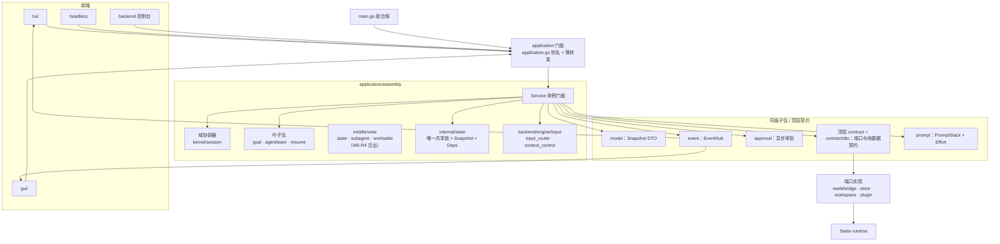
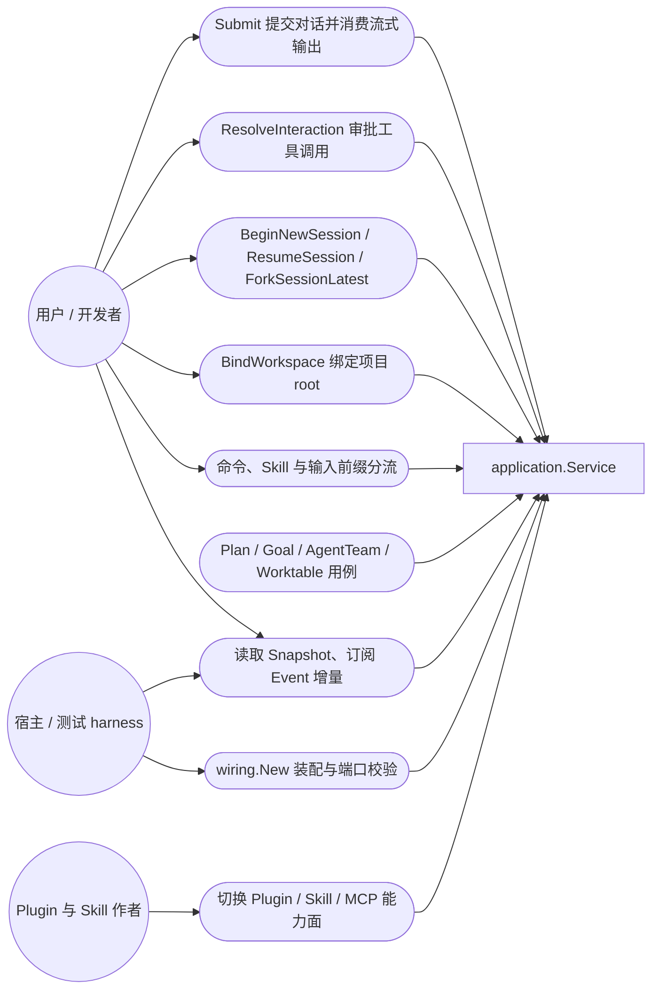
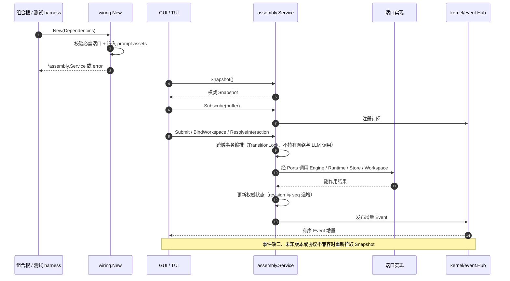
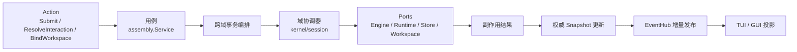
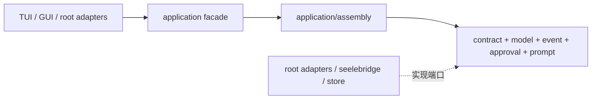

# Application

## 生态位

`application` 是 Seelex 的稳定应用层门面，处在「前端 / 组合根」与「运行时适配」之间，承担两件事：

1. **用例编排**：把底层能力组合成聊天、命令、会话、项目、审批、Plan、Goal、AgentTeam、Worktable 与运行时切换。
2. **权威状态**：所有用户可见事实以 `model.Snapshot` 为准，变更以 `event.Hub` 增量发布，多个前端消费同一份事实。

主要调用方：根目录 composition root（`main.go`）、`tui/`、`gui/` 与测试 harness（`e2e/`）。它们只依赖本门面与 `model`/`contract`，不直接驱动 Seele Engine、Plugin Manager 或存储实现。

## 职责与非职责

- 做：用例编排、跨域事务顺序、权威状态与事件投影、DTO 与协议版本、前端可消费的目录型投影。
- 不做：不实现 Agent 循环（归 Seele）、不实现存储原子写（归 `store`）、不实现工具路由与权限判定（归 `seelebridge`）、不渲染 UI（归 `tui`/`gui`）。
- 不做：**不持有构造函数**。`New` / `NewEventHub` / `NewApprovalBroker` / `NewToolHookBridge` /
  `NewPromptStack` / `NewEffortManager` / `WebSearch` 已于 2026-10-16（M1-B）迁到
  [`wiring/`](../wiring/README.md)：前端不得自造引擎，构造只发生在组合根。

## 五组窄接口（`faces_api.go`，M5-R10a）

门面按 plan §1.3 的「用例方法面收窄成五组」落地（契约
[`docs/2026-10-15-architecture-reshape/r10-r11-p13-contract.md`](../docs/2026-10-15-architecture-reshape/r10-r11-p13-contract.md) §1）：

| 组 | 形态 | 内容 |
|---|---|---|
| A 类型与事件身份 | `FaceTypeNames` 清单（89 个名字，别名表达不了方法集） | `application/application.go` 的 `type (...)` 别名块，按字母序逐字钉住 |
| B 读投影 | `ViewFace`（49 个方法） | 只读查询、订阅、历史窗口读回；项目看板装配方法已移出 |
| C 命令面 | `CommandFace`（40 个方法） | 提交/取消、会话与工作区生命周期（含批量项目登记）、子代理与角色草稿动作 |
| D 档位与策略 | `PolicyFace`（24 个方法） | 限制、档位、账号、存储配置、插件、角色生命周期、调度策略 |
| E 队列面 | `QueueFace`（3 个方法）+ 包级无状态函数 | 排队输入召回/调序、输入建议；`HasSigilPrefix` / `SigilOf` / `ValidEffortLevels` / `AccountWindowPresets` 仍是包级函数（接口装不下函数） |

- 四个接口的方法名与签名取自今日门面已导出的方法面：不改名、不改签名——
  它们就是 gui/tui 今天消费的兼容契约（I5）。方法集由
  `e2e/facade_narrow_faces_test.go` 逐字冻结。
- `Frontend` 在**结构上**满足新旧入站面：`application/frontend_assertions.go` 有
  `var _ ViewFace = (*Frontend)(nil)` 一族编译期钉子（契约 §1.2 第 1 条）；
  `Service` 只保留尚未迁出的兼容方法。
- 不在四组的第三类方法（**不属于前端缝**，仍供 `wiring` 与工具注册表调用）：
  ToolRecord 装配/落盘入口、事件钩子与 `TaskTerminalHandler`。其余装配、调度、
  订阅、Prompt 与 ProviderHistory 入口已经由 compat 或领域包承接。清单是
  `e2e/facade_narrow_faces_test.go` 里的 `assemblyOnlyMethods`。
- 机械断言（`e2e/facade_narrow_faces_test.go`，契约 §1.2）：①四个面的方法集与本文件冻结清单逐字比对；
  ②`Service` 的每个公开方法要么在四组、要么在装配面清单（本片追加，防止新方法绕过分组）；
  ③A 组别名集合逐字等于 `FaceTypeNames`（解析 `application.go` 的 `type (...)` 块——Go 反射列不出包级别名，
  故按事实源源码比对）；④`git diff -- gui tui` 为空（I5）。
- 分类口径：B = 只读投影/订阅；C = 会改会话、对话或工作区状态的动作；D = 档位与策略（含账号、存储配置、
  插件、角色、调度）；E = 队列与输入建议。逐方法分组理由是生成器
  `tmp/reshape/r10a_groups.py` 的显式清单，新增方法必须显式归类（断言 ② 会拦住漏网）。

### Application 结构预算（AP-001，已实现）

[`architecture_budget_test.go`](architecture_budget_test.go) 以
[`testdata/application_budget.json`](testdata/application_budget.json) 和
[`testdata/service_methods.txt`](testdata/service_methods.txt) 为事实源：

- `Service` 公开业务方法已归零；新增必须显式更新预算，能力入口只能由
  capability package 与 `compat.Frontend` 承载；
- 冻结 `application/assembly` 当前直接导入的 backend/middle/store 包白名单；
  当前事实基线为 0，预算只允许保持为零；
- 冻结 `application/assembly` 非测试生产文件 54 个、生产代码 7,092 行；
  领域包提取必须让规模净下降，任何例外都必须显式更新预算并说明原因；
- 冻结整个 `application/**` 的具体 Backend/Middle/Store import 集合：
  当前 0 个唯一包，预算只允许保持为零。Application
  生产代码已不再直接 import `store`。迁移期 identity facade 与 host adapter
  必须在兼容层台账登记，不得成为第二份状态机；
- 校验
  [`docs/2026-10-25-application-modularization/implementation.md`](../docs/2026-10-25-application-modularization/implementation.md)
  中的兼容层台账存在。

本轮 AP-001 只增加门禁和台账，不改变 API 行为；AP-002 起的小接口仍须让
`Service` 结构满足，旧四组接口在调用方归零前保留。

### 入站 API 契约净化（AP-003，已实现）

[`api_contract_test.go`](api_contract_test.go) 同时扫描根门面
`application.go` 与能力接口文件，禁止入站面 import
`backend/**`、`store/**`、`middle/switch/**`、`middle/view/**`。

- `Command` / `CommandResult` 的事实源移到 `contract/command.go`；
- Goal 记录、更新请求和状态视图移到 `contract/dto/goal.go`，goal 域保留别名与自由函数；
- `ScheduledTaskSpec/Status`、搜索结果显示为 `dto` 类型，底层旧路径继续 alias；
- `WebSearchConfig`、账号窗口挡位表移到 `contract/dto`；
- `ApprovalBroker` 直接别名 `contract.ApprovalBroker`，下游指针使用者改为接口值；
- `ProjectBoardTeamPlanFor/StateFor` 只服务项目看板装配，已从入站 `ViewFace` /
  `TeamworkQueryAPI` 移除，仍保留在 `Service` 装配面。

此批 JSON 字段与前端 wire 形状不变；当时 `application/assembly` 内部依赖预算为 39，
后续内部实现迁移、外部端口与 Contract/Middle 归位已把当前事实基线降到 16。
该数字由内部实现迁移单独治理，
不与入站 API 纯度混算。

### 按能力拆分的入站 API（AP-002，已实现）

[`faces_api.go`](faces_api.go) 同时定义四组兼容接口和 AP-002 能力型入站面，
接口事实源不再寄居 `application/assembly`。每个接口不超过
20 个方法，调用方可以直接声明所需能力：

| 接口 | 方法数 | 用途 |
|---|---:|---|
| `ConversationAPI` | 10 | 提交、取消、恢复、对话视图与审批决议 |
| `SessionAPI` | 19 | 会话目录、快照、历史窗口、订阅、恢复与 fork |
| `ExecutionQueryAPI` | 13 | WorkItem、teammate、子代理、历史与工作表格只读投影 |
| `WorkItemQueryAPI` | 2 | WorkItem 执行记录与工作表格只读投影 |
| `TeammateQueryAPI` | 3 | teammate 安全详情与 WorkItem 会话实时只读投影 |
| `TeamworkQueryAPI` | 1 | 团队看板只读事实；项目看板计划/状态已归装配面 |
| `SubagentQueryAPI` | 2 | 子代理详情与中断恢复目录 |
| `TranscriptQueryAPI` | 3 | transcript、历史检索与工具结果正文回读 |
| `ExecutionCommandAPI` | 1 | WorkItem 用户可写状态 |
| `WorkspaceAPI` | 15 | 工作区生命周期、文件/Git 读取、写入与审阅 |
| `GoalAPI` | 9 | Goal 状态机与治理视图 |
| `PolicyAPI` | 9 | 当前会话/进程策略与能力切换 |
| `AdminAPI` | 13 | 账号与调度任务管理 |
| `RoleAPI` | 11 | 角色会话、草稿、顺序与权限读面 |
| `SubagentAPI` | 6 | 子代理派发、详情、恢复与树清理 |
| `StateAPI` | 9 | Snapshot、订阅、空闲与只读运行投影 |
| `QueueAPI` | 3 | 排队输入编辑与建议 |
| `LifecycleAPI` | 2 | 优雅停机与强制关闭 |

`var _ ConversationAPI = (*Frontend)(nil)` 一族是编译期结构断言；
[`api_partition_test.go`](api_partition_test.go) 另有机械断言：单个 API 不超过
20 方法，且旧 `ViewFace`/`CommandFace`/`PolicyFace`/`QueueFace` 的方法全部
被新接口联合覆盖。此批只新增接口，不迁移 GUI/TUI 调用点，wire 字段与行为不变。

### 只读查询面（AP-004 / AP-005，已实现）

- `SessionQuery`：`ListSessions`、`ProjectRootFor`、`SessionMeta`、
  `WaitCatalogRefresh`、`SnapshotOf`、`GetSessionTranscript`、
  `SessionInputIndex`；查询对象只持窄读依赖，不持完整 `Service`。
- `ConversationHistoryQuery`：`LoadMoreHistory`、`LoadLatestHistory`；磁盘冷读在
  共享 `ViewMu` 之外完成，锁内只安装可见窗口。
- `SessionRuntimeOf`：从 RuntimeState 只提取会话字段，并深拷贝 Plan、Goal 历史与
  WorkTable。
- `ReadSnapshot`：在 `application/session/query` 选择冷读、驻留和内容 LRU 回退；
  assembly 的 `readSnapshotOf` 只注入状态采样和两个 Snapshot builder。
- `BuildResidentSnapshot`：统一驻留 Snapshot 的字段克隆、Task/Plan 深拷贝和
  WorkTable enrichment；assembly 的 `snapshotOfResident` 只提供锁内读面。

`LoadMoreHistory` / `LoadLatestHistory` 已由 `Frontend` 直接调用历史查询组件；
历史窗口算法仍只有
[`middle/switch/history`](../middle/switch/history/README.md) 一份实现；
`application/assembly` 通过 `application/history.WindowAssembler` 消费该唯一实现；
Wiring 注入 Middle `Assembler`，assembly 不再 import `middle/switch/history`。
直接内部依赖已降到 33；新增 Application 包仍必须逐批登记门面闭包。

### 领域包提取（AP-085 起，已完成）

包提取阶段已把应用编排从旧的 `application/core` 物理迁出，并完成 M9：
`application/core` 目录与 import 路径均不存在。剩余跨领域协调代码作为唯一
组合根归 `application/assembly`，其进程级会话运行元数据归
`application/session/state`。当前实测基线：

| 指标 | 当前 |
|---|---:|
| `Service` 公开方法 | 0 |
| `application/core` 生产文件 / 代码 | 0 / 0 行 |
| `application/assembly` 直接内部依赖 | 0 |
| `application/**` 具体 Backend/Middle/Store 依赖包 | 0 |
| `application/assembly` 生产文件 | 54 |
| `application/assembly` 生产代码 | 7,092 行 |

已落地领域包：

| 包 | 已迁能力 |
|---|---|
| [`admin/`](admin/README.md) | 账号 CRUD、余额、账号切换与逐账号窗口 |
| [`admin/scheduler/`](admin/scheduler/README.md) | 定时任务 CRUD、运行装配与后台会话 |
| [`execution/`](execution/README.md) | 项目看板与 WorkTable 活体查询 |
| [`execution/toolhooks/`](execution/toolhooks/README.md) | Seele Tool Hook 适配、并发工具 ID 配对与诊断 |
| [`execution/toolrecord/`](execution/toolrecord/README.md) | 工具记录累计、失败原因、暂存与批量落盘 |
| [`execution/table/`](execution/table/README.md) | WorkTable publisher、latest-wins 汇聚与 payload 去重 |
| [`execution/taskcontext/`](execution/taskcontext/README.md) | Engine Task Coordinator/helper identity facade |
| [`event/`](event/README.md) | Event/Hub/Subscription identity facade |
| [`input/command/`](input/command/README.md) | 基础内置命令注册与结果适配 |
| [`goal/`](goal/README.md) | Goal 路由、治理视图与 Runtime 刷新 |
| [`history/`](history/README.md) | 历史窗口分页、Page 坐标与安装模式 |
| [`workspace/`](workspace/README.md) | 项目环境表、Git 查询与批量登记投影 |
| [`session/`](session/README.md) | Session Meta、SSH、Release |
| [`session/cold/`](session/cold/README.md) | 冷恢复读取、历史、引擎恢复、workspace、激活、Task/View/Commit/Publish |
| [`session/runtime/`](session/runtime/README.md) | Engine Session Coordinator/helper identity facade |
| [`../kernel/sessionpolicy/`](../kernel/sessionpolicy/README.md) | queue/draft/interaction/release 等中立纯策略 owner |
| [`session/viewstate/`](session/viewstate/README.md) | Snapshot/message/revision View State identity facade |
| [`session/query/`](session/query/README.md) | Session 只读目录、元数据与 durable 查询 |
| [`policy/`](policy/README.md) | Role policy、Permission Tier、Effort、Plugin 与运行时策略切换 |
| [`lifecycle/`](lifecycle/README.md) | drain、cancel、shutdown、fault guard |
| [`reference/`](reference/README.md) | `read_tool_result` / `read_plan` / `read_compressed_turn` |
| [`review/`](review/README.md) | 文件审阅请求身份、会话投影与清理 |
| [`input/`](input/README.md) | sigil 解析与 Suggestions |
| [`observability/`](observability/README.md) | PerfStats 输入装配与 `/diag` 诊断文本 |
| [`window/`](window/README.md) | Engine context window 配置与策略 identity facade |
| [`conversation/search/`](conversation/search/README.md) | 历史检索工具适配 |
| [`conversation/`](conversation/README.md) | Conversation Queue 与 ChatState 应用面 |
| [`conversation/context/`](conversation/context/README.md) | 显式上下文压缩应用编排与回执 |
| [`conversation/edit/`](conversation/edit/README.md) | 编辑用户消息与 fork 组件 |
| [`compat/`](compat/README.md) | 迁移期前端兼容适配器；已承接全部非共享状态的旧入口 |

退出条件不是“文件存在”：旧 `Service` 入口必须只保留一行转发、assembly
不得定义第二份领域实现、生产行数只能收紧，并且 facade 闭包只登记真实依赖。
`Service` 不再暴露业务方法。组件 getter、输入
facade、订阅、ProviderHistory、PromptLayers、ProjectBoardSink 与 ToolRecord
公开入口已经退场；
`compat.Frontend` 同签名承接，旧四组窄接口也继续兼容。

### SessionQuery durable 读取面（AP-013 首个切片，已实现）

`SnapshotOf`、`GetSessionTranscript`、`SessionInputIndex` 已纳入
`SessionQuery`，旧 Service 方法只做一行转发。冷快照仍先采样宿主读面再取
`ViewMu` 读锁；transcript 与 input index 不进入共享写锁，也不修改内存态。

### Conversation Queue 应用组件（AP-007 首个切片，已实现）

`application/conversation/queue.go` 把排队输入的锁内编排从 `Service` 收拢到
`conversationQueue`。`SessionUnit.Queue` / `ChatState` 仍是唯一状态所有者；
组件只持窄依赖，不持完整 `Service`，也不复制队列内容。
`Frontend.ReorderQueuedInput` / `RecallQueuedInput` 直接调用该组件。

AP-007 的完整聚合边界、不变量、状态恢复来源和 AP-003 验收口径见
[`ap-007-conversation-design.md`](../docs/2026-10-25-application-modularization/ap-007-conversation-design.md)。
本切片不迁移 `startChat/runChat` 主循环，GUI/TUI wire 不变。

### Conversation ChatState 单一写入点（AP-008 首个切片，已实现）

`application/assembly/chat_turn_state.go` 的 `conversationTurnState` 集中管理
ChatState 的开始、队列投影、错误、收尾和重置。`SessionUnit.Chat` 仍是唯一
存储位置；生产代码不得在组件外直接调用 `SetChatState/UpdateChat`。

此切片不迁移 `ChatStream` 主循环、durable queue 或持久化顺序，只消除分散的
ChatState 写入判据。

### Conversation ChatTurn 请求工厂（AP-009 首个切片，已实现）

`chat_turn_request.go` 集中创建已受理输入、冻结 Skill 层、还原 SessionUnit
队列载荷、合并提升批次和提取排队引用。`chatRequest` 仍为私有值，主循环只消费
工厂结果；批次分隔符、Skill 合并顺序和错误语义保持不变。

### ChatTurnProcess 起点事务（AP-014 首个切片，已实现）

`ChatTurn process application` 集中 ChatTurn 起点：requestID、Effort 预算回退、cancel/stream、
ReAct budget、Task checkpoint、Skill 激活和 user transcript。正常首轮与队列批次提升
共用 `BeginLocked`；Engine 流、可见消息和持久化仍留在主循环。

### ChatTurn 持久化完成事务（AP-018 首个切片，已实现）

`ChatTurn completion application` 集中回合收尾的 durable 事务：定位会话、原子落盘、
持久化失败时把消费输入退回草稿、成功后确认消费并释放工作历史。错误包装仍区分
“原回合错误 + 持久化失败”和“纯持久化失败”，结构化错误码保持
`session.persistence_failed`。`chat.go` 不再直接调用上述存储规则，Engine 流、
事件发布和会话释放仍未迁移。

### ChatTurn 队列提升决策（AP-019 首个切片，已实现）

`conversationTurnProcess.PromoteLocked` 成为回合收尾后的唯一队列决策点：
无排队输入时结束 ChatState 并按全局忙闲决定是否 idle；有输入时合并批次、
清空 SessionUnit 队列、刷新投影并复用同一个起点事务。`chat.go` 仍负责下一条
user/assistant 可见消息、事件发布、durable queue consumed 标记和 goroutine 启动。

### ChatTurn 终态结果投影（AP-020 首个切片，已实现）

`ChatTurn outcome application` 集中回合完成后的终态结果应用：先按 `requestID` 拒绝已被
取代的旧回合，再清理旧错误、写入当前错误 ChatState/error 行并应用 runtime
projection。队列提升、任务镜像、revision 和事件发布仍由 `runChat` 编排。

### ChatTurn 终态事件发布（AP-021 首个切片，已实现）

`ChatTurn publication application` 在释放 `ViewMu` 后集中发布终态事件：先发 `chat.changed`，
再按结果显示 error 或 `snapshot.changed`，随后为提升批次发布两条 `message.added`、
切换 task batch 并发布 runtime projections。下一轮 goroutine 仍由 `runChat` 启动。

### ChatTurn 终态镜像（AP-022 首个切片，已实现）

`conversationTurnOutcome.MirrorLocked` 统一解锁前的最终镜像：写入会话 ChatState；
仅活跃会话再镜像权威 Task 到共享 Snapshot 并推进进程 revision。后台会话不会覆盖
共享 Task 或 revision。

### ChatTurn 异步尾段（AP-023 首个切片，已实现）

`ChatTurn tail application` 统一解锁后的收尾顺序：工作区重绑、提升批次 durable consumed
标记、终态事件发布、下一轮启动、空会话释放和工具记录落盘。慢 I/O 全部在
`ViewMu` 之外；consumed 标记失败保持只记诊断日志并继续的既有语义。

### 显式草稿提交激活（AP-024 首个切片，已实现）

`Session draft submission application` 集中显式提交命中未物化草稿时的激活编排：廉价目标
预判、视图过渡锁内归属复判、过期视图拒绝、首输入裁剪和物化委托。
`Service.materializeDraftForSubmit` 只保留一行转发。

### 草稿物化编排（AP-025 首个切片，已实现）

`Session draft materialization application` 集中草稿首请求物化：快照草稿来源、workspace
绑定、引擎激活、标题生成、Session/Plan/workspace 提交镜像、runtime/snapshot
发布、目录刷新、工具记录落盘和驻留登记。真实状态写入仍由现有 Session、Task、
Workspace 宿主拥有。

### 新建会话进入草稿（AP-026 首个切片，已实现）

`Session draft entry application` 集中 `BeginNewSession`：关闭/排空预检、空闲旧会话保存与
历史/context 释放、Skill 清理、草稿槽准备、持久档位恢复、草稿壳切换，以及
runtime/snapshot、任务和子代理树的锁外刷新。`Service.BeginNewSession` 只保留
一行转发。

### Resume 会话顶层编排（AP-027 首个切片，已实现）

`Session resume application` 集中会话选择的顶层分支：空 ID 校验、过渡锁、hot/restoring/
cold 判定、同步或后台冷加载选择，以及失败恢复调用。磁盘三读、wire 装配、Engine
恢复和 view epoch 发布仍由现有冷加载实现拥有。

### Edit/Fork 幂等操作注册表（AP-028 首个切片，已实现）

`Edit/Fork operation registry application` 独立拥有 operation map、TTL、并发等待 channel
和失败清理。相同 `operation_id`/请求复用同一 operation；复用给不同请求明确拒绝。
该 bookkeeping 不再占用 `serviceState` 或 `ViewMu`。

### Edit/Fork 父会话准入（AP-029 首个切片，已实现）

`Edit/Fork validator application` 集中当前会话、运行中、排队输入、expected revision、
保留窗口和压缩前缀检查。错误判据顺序与用户可见文案保持不变；目标事件解析、
child fork、切换、提交和回滚尚未迁移。

### Edit/Fork 目标事件解析（AP-030 首个切片，已实现）

`Edit/Fork target resolver application` 负责加载父事件、计算父 revision、定位目标用户
输入、拒绝内部/非用户事件，并复用 `contract/protocol.EventParagraphs` 的唯一段落
实现计算 fork cut；Store 同名函数只保留兼容转发。
child fork、切换、提交和失败回滚仍由原流程拥有。

### Edit/Fork child 原子编排（AP-031 首个切片，已实现）

`Edit/Fork process application` 固定原子顺序：解析目标 → 校验父会话 → 目标会话过渡锁内
fork → 锁外恢复 child → 提交编辑文本 → 失败回滚。fork/resume/submit/rollback
实现仍由现有 Session 能力提供。

### Edit/Fork 回滚错误合成（AP-032 首个切片，已实现）

`Edit/Fork rollback application` 集中 child 删除、parent 恢复及两路失败的错误合成；
原编辑失败始终保留为 wrapped cause，回滚失败只追加诊断正文。

### Edit/Fork 可见消息编辑判据（AP-033 首个切片，已实现）

`Edit/Fork annotation application` 为可见用户消息回填权威 EventSeq，并集中 running、
缺序号、无保留窗口和压缩前缀四类禁编原因。正文、窗口和 ChatState 所有权不变。

### Fork lineage 只读解析（AP-034 首个切片，已实现）

`Session fork lineage application` 集中读取并解码持久 context 中的 `forked_from`；
存储缺失、空 payload、损坏 record/ref 和空 parent ID 均安全降级为无 lineage。

### Restoring 空壳投影（AP-035 首个切片，已实现）

`Session restoring shell application` 统一冷加载空壳的 Session restoring 状态、Runtime
会话事实清理、ChatState 镜像、Active 切换和 revision。`beginAsyncRestore` 与
重复 Resume 的视图归位共用这一份投影。

### 冷加载失败恢复（AP-036 首个切片，已实现）

`Session restore recovery application` 集中 restoring 清除、active/epoch 判定、回退前一会话、
无可用回退时重置草稿，以及 Bridge 视图通知。失败原因与冷加载主体保持不变。

### 冷恢复 draft reset（AP-037 首个切片，已实现）

`Session restore draft reset application` 统一无可用回退时的 fresh draft：视图锁内复用/
创建草稿槽并切壳 bump，锁外发布 runtime/snapshot。

### 冷加载数据读取（AP-038 首个切片，已实现）

`Session cold load reader application` 集中 pending-tail 恢复、record/transcript 并行读取、
legacy history 回退和错误优先级。引擎恢复、engine history 装配、Snapshot 安装
与 epoch 发布仍在冷加载主流程。

### 冷加载 history 装配（AP-039 首个切片，已实现）

`Session cold history application` 集中 record transcript 重建/renumber 判定、wire history、
record history 回退和 Resume history 最终兜底。Engine 恢复与 Snapshot 安装仍由
冷加载主流程拥有。

### 冷加载 Engine 恢复与队列回填（AP-040 首个切片，已实现）

`Session cold restore application` 固定 workspace 显式键、Engine resume/replace history、
durable queue 恢复/回填和 system prompt 写入顺序。Snapshot/View 安装与 epoch
发布仍由冷加载主流程拥有。

### 冷加载 workspace 绑定（AP-041 首个切片，已实现）

`Session cold workspace application` 集中运行中不改全局根、per-session binding 照写、
真正无 workspace 才解绑，以及项目元数据缺失时禁止永久解绑的判据。

### 冷加载激活准备（AP-042 首个切片，已实现）

`Session cold activation application` 在 `ViewMu` 内集中 epoch/active 判定、清除 restoring、
标题选择、Active Session 切换、cancel 清理、权限档位和标题写入。Task/View 安装
仍由冷加载主流程拥有。

### 冷加载 Task 恢复（AP-043 首个切片，已实现）

`Session cold task application` 集中 transcript seq、record/context compaction 事实、
retainedFrom、Task/Plan/checkpoint 恢复，以及无 record 时清空任务状态。

### 冷加载 View 构造与安装（AP-044 首个切片，已实现）

`Session cold view application` 集中 record/legacy 可见窗口、ReadFiles/ForkedFrom、
空 View 安装门槛和 active Snapshot Task/ForkedFrom 镜像。plan/workspace/context
投影与发布仍在主流程。

### 冷加载解锁后发布（AP-045 首个切片，已实现）

`Session cold publish application` 固定全局 prompt 回退、context 四栈挂接、active
task/subagent 运行面切换、runtime 发布、catalog 刷新和 resident/content LRU。

### 冷加载锁内收口（AP-046 首个切片，已实现）

`Session cold commit application` 集中 pending-tail/ChatState、active Plan/Interaction、
system prompt 取数、workspace 投影和 revision。冷加载锁内/锁外阶段现已完全分离。

### ChatTurn Engine 前输入准备（AP-047 首个切片，已实现）

`ChatTurn input application` 固定 prompt 激活 → provider context 装配 → 非空输入归一化。
Engine 流、恢复、持久化和任务收尾仍在 `runChat`。

### ChatTurn Engine 返回事务（AP-048 首个切片，已实现）

`ChatTurn response application` 集中 reasoning attach、模型输出观测、最终 assistant
transcript 和 reasoning 回填。context recovery、budget/task finalization 仍在
`runChat`。

### ChatTurn 恢复与终态（AP-049 首个切片，已实现）

`ChatTurn recovery application` 集中 context control failure、provider recovery、bounded
retry、ReAct budget finalization 和 Task finalize。stream flush、route 和持久化
仍在 `runChat`。

### ChatTurn 清理与持久化前准备（AP-050 首个切片，已实现）

`ChatTurn cleanup application` 集中 stream flush、served route、subagent mailbox drain、
runtime projection 采集、checkpoint/recovery cleanup、未处理错误记录和 draft
snapshot 停止。持久化仍留在下一批。

### ChatTurn Commit（AP-051 首个切片，已实现）

`ChatTurn commit application` 串联持久化、stale/outcome、队列提升、下一批消息和锁内镜像，
返回 publication 所需的完整结果。publication 与 tail 仍由主循环启动。

### ChatTurn Finalize（AP-052 首个切片，已实现）

`ChatTurn finalize application` 把 commit result 映射为 publication 并交给异步 tail；
stale commit 直接忽略。`runChat` 现在只保留 Engine 循环与组件串联。

### ChatTurn 执行策略同步（AP-053 首个切片，已实现）

`ChatTurn execution application` 统一会话起步的 project root、subagent policy、reasoning
effort 和 full access 同步。`runChat` 现在只保留 Engine 输入与阶段组件串联。

### Chat Reasoning 投影（AP-113D1，已实现）

assistant 推理步骤提取、工具调用 ID/正文配对、legacy last-reasoning fallback 与
`message.delta` 生成迁入
[`application/conversation/reasoning.go`](conversation/reasoning.go)；
`runChat` 的 application 组件链编排也迁入 `conversation/turn_runner.go`；
assembly 只保留一行兼容 wrapper。Engine ReAct 循环本身仍由 Seele 拥有。

### Policy Application 首批（AP-054 首个切片，已实现）

`Policy switch application` 收拢技能激活、reasoning/loop 两条独立拉条、Session
release window 和 FullAccess 兼容壳。Effort/Plugin/PermissionTier 的复杂切换
仍保留后续批次。

### Permission Tier 用例（AP-055 首个切片，已实现）

`Policy switch application` 现集中 PermissionTier 本体的持久化、SessionUnit、
审批自动门、Runtime 门、生效档位、full 自动放行和 runtime 事件。Effort/Plugin
切换仍保留后续批次。

### Effort 切换（AP-056 首个切片，已实现）

`Policy switch application` 进一步集中视图空闲守卫、Effort cycle/apply、
subagent policy、reasoning effort、prompt 同步和 runtime 收口。Plugin 切换仍是
后续批次。

### Plugin 切换（AP-057 首个切片，已实现）

`Policy switch application` 集中全进程空闲守卫、activate/deactivate、
history/prompt 重建、Effort 恢复、会话 reset 和 runtime 发布。Policy 入站动作
已完成主体收口。

### Admin 账号管理用例（AP-058 首个切片，已实现）

`service_admin_application.go` 集中账号添加、详情、更新、删除和余额查询的端口
解析、名称裁剪与宿主能力缺失语义。账号档写入、热注册与余额探测仍由
`AccountAdminPort` 和 `AccountBalancePort` 的唯一实现拥有；`Account administration application`
的五个旧入口只保留一行组件转发。

### Admin 账号选择（AP-059 首个切片，已实现）

`service_admin_application.go` 进一步集中账号选择的 Runtime 准入、runtime
projection 采集、锁内账户/投影/revision 收口、解锁后事件发布和用户通知。
`Service.SelectAccount` 只保留一行转发；账号是否可用仍只由
`Runtime.SelectAccount` 判定。

### Admin 账号窗口（AP-061 首个切片，已实现）

`service_admin_application.go` 集中 `SetAccountWindow` 的 nil 守卫、可选 Runtime
端口解析和 `accountwindow.Setter` 适配；`Service.SetAccountWindow` 只保留一行
转发。挡位校验、先落盘再改内存和返回生效值仍由 Backend 的 Setter 唯一实现。

### Workspace Environment 用例（AP-060 首个切片，已实现）

项目环境表用例现位于 [`workspace/`](workspace/README.md)，集中可选端口解析、
项目 ID/环境名校验和四条转发。底层环境表读写仍由
`WorkspaceEnvironmentPort` 唯一实现；`Service` 的四个旧入口只保留一行转发。

### Workspace Git 查询用例（AP-062 首个切片，已实现）

Workspace Git 查询现位于 [`workspace/`](workspace/README.md)，集中多仓库发现、
仓库根解析、可选 Git/Tree/File 端口分派和“缺少能力”错误映射。containment
在领域包内只有一份；五条 `Service` 入口只保留一行转发。

### Workspace 批量登记（AP-063 首个切片，已实现）

Workspace 批量登记用例现位于 [`workspace/`](workspace/README.md)，集中成功后的
目录投影读取、锁内应用、revision bump 和解锁后 `snapshot.changed` 发布。
`Service.CreateWorkspaces` 只保留一行转发，项目创建与持久化仍由
`application/workspace/switch` 唯一实现。

### Session SSH 应用用例（AP-064 首个切片，已实现）

`Session SSH application` 内的 `sessionSSHApplication` 集中会话状态端口解析、项目环境表
读取、放权集合子集校验和固定环境不可变规则。`validateAllowedEnvs` 仍保留为唯一
纯判据；三个旧 `Service` 入口只保留一行转发。

### Role Account 用例（AP-065 首个切片，已实现）

`Role application` 内的 `roleAccountApplication` 集中角色默认账号读取、写入、
Runtime 热推与失败回滚、会话加载恢复。账号归属校验仍由 Bridge/运行时负责；
`RoleAccount`、`SetRoleAccount`、`RestoreRoleAccounts` 三个旧入口只保留一行转发。

### Role Permission Vector 用例（AP-066 首个切片，已实现）

`Role application` 内的 `rolePermissionApplication` 集中角色默认向量、会话登记、
五层来源解析和单/多角色读取。登记优先、显式空集不回退、缺失才解析五层由同一
`resolveRoleSettings` helper 持有；五个旧入口只保留一行转发。

### Role Inheritance / SSH Paths（AP-067 首个切片，已实现）

`roleInheritanceApplication` 集中 subagent/teammate 默认继承、关闭继承后的角色覆盖、
SSH 路径白名单读取与写入、远端 POSIX 路径规范化。Role Permissions 文件的 14 个旧
入口现已全部只保留一行组件转发。

### Scheduled Task CRUD（AP-068 首个切片，已实现）

`service_scheduler.go` 内的 `schedulerApplication` 集中定时任务创建、编辑、取消的
默认参数、统一校验顺序和成功后的 runtime 投影刷新。定义与执行仍归 Runtime 调度器；
三条旧 `Service` 入口只保留一行转发。

### Runtime Refresh（AP-069 首个切片，已实现）

`runtime_projection.go` 内的 `runtimeApplication` 集中 runtime projection 的锁外
采集、锁内应用与 revision、解锁后 runtime 事件和 task delta 发布。
`Service.RefreshRuntimeSnapshot` 只保留一行转发。

### Scheduled Run / Session（AP-070～071）

`service_scheduler.go` 内的 `scheduledRunApplication` 集中提交前档位/执行参数/插件
context 装配；`scheduledSessionApplication` 集中定时触发的新会话、workspace 绑定、
快照发布、运行装配和后台提交。新建会话与绑定会话路径保持共用，用户视图不切换。

### File Review（AP-072 首个切片，已实现）

`Review application` 内的 `reviewApplication` 集中 workspace 文件端口、召唤 ID、会话归属、
视图锁内请求写入和快照发布。逐文件 containment/敏感/二进制裁决仍由
`backend/tool/review.Requests` 唯一实现；`Service` 两个入口只保留一行转发。

### Lifecycle Application（AP-073～074）

`service_input.go` 内的 `lifecycleApplication` 集中 graceful drain、idle 等待、
运行判定、全部/当前会话取消，以及幂等 Shutdown 的取消收集和固定清理顺序。
chat 主循环与 Session release 本身仍未迁入。

### History Search 契约化（AP-075）

`SearchHistory` 的公开返回类型改为 `contract/dto.SearchResult`，省略 limit 时把 0
交给 Backend 的唯一默认/clamp 规则。`application/assembly` 不再直接 import
`kernel/context/seelectx/search`，直接内部依赖预算由 39 收紧到 38。

### History Search Application（AP-076）

`historySearchApplication` 集中历史检索查询、空查询校验和 search_history 工具 JSON
适配；Runtime/search 继续唯一拥有检索、默认 limit 与 clamp。两个旧入口只保留一行
转发。

### Input Completion（AP-077）

`completionApplication` 集中 sigil 候选合成、参数区拒绝、前缀过滤和 command →
skill → plugin 的稳定排序。命令、Skill、Plugin 目录仍由各自端口提供；
`Service.Suggestions` 只保留一行转发。

### Reference Tools（AP-078）

read_tool_result/read_plan 的应用用例从 AP-085 起位于
[`reference/`](reference/README.md)。该包集中引用别名解析、归档分页、节点结果读取、
Plan 节点筛选和 JSON 工具适配；Engine、Task、SessionStore 仍通过 assembly 注入的窄回调
访问，`Service` 三个兼容入口只保留一行转发。

### Session Metadata（AP-079）

`sessionMetaApplication` 集中会话置顶、别名与排序位的读写入口。写入仍由
`kernel/sessionpolicy.SetMeta` 校验并持久化，读取仍由 `SessionQuery` 提供；
`Service` 两个入口只保留一行转发。

### Project Board 只读查询（AP-080）

`projectBoardQuery` 集中 WorkTable 行、会话项目根、Team Plan 和 Team State 四个
只读入口。底层仍复用 `worktable.BuildWorkTable`、`SessionQuery` 和 Runtime 的
`TeamworkPlanSource`，不缓存第二份看板状态。

### Session Release（AP-081）

`sessionReleaseApplication` 集中 LRU/完整释放的二次守卫、flush 与有序回收：
引擎、桥侧 bundle、Goal 句柄、可见正文、SessionUnit/标题/Task、LRU 次序和工具台账。
受保护集、正文 LRU 与各具体释放动作仍由既有唯一实现持有。

### Context Compaction（AP-082）

`contextCompactionApplication` 集中 `/compact` 与 `compact_context` 的会话解析、
同会话压缩 gate、Controller 调用和回执映射。压缩算法、持久化、失败恢复和门禁判据
仍只在 `context_runtime`。

### Fault Guard（AP-083）

`faultGuardApplication` 集中降级退出的 once 幂等门、全部 Session cancel、catalog/
session/consumer/worktable/approval 清理顺序、ExitRequested 发布和 panic fail-fast
重抛。`degradeOnce` 已从 `serviceState` 移入组件。

### Performance Stats（AP-084）

`perfStatsApplication` 集中 PerfStats 的视图读锁、快照、历史窗口和工具引用输入；
`middle/view.PerfStats` 仍是唯一计算实现。`Service.PerfStats` 只保留一行转发。

### Goal Application 用例（AP-015 首个切片，已实现）

`Goal application` 集中 Goal 的会话路由、协调器查找、Begin/Update/Done/Status、
治理视图和运行投影刷新。Goal 栈状态机仍只在 `kernel/goal`；
Service 的 5 个主要 Goal 方法只保留一行转发。

### Subagent Application 用例（AP-016 首个切片，已实现）

`Subagent view application` 集中子代理恢复目录、中断恢复、定点恢复、fork 派发、
树清理和详情读取。Runtime 与 `application/execution/subagentview` 仍是具体能力提供方；
Service 对应方法只保留一行转发。

### Execution Application 用例（AP-017 首个切片，已实现）

`WorkItem execution application` 集中 WorkItem execution、teammate inspection/live
分页、团队看板和 todo 状态更新。Runtime 与 teamwork board reader 继续提供
具体能力；Service 六个入口只保留一行转发。

### Tool Hook 适配包（AP-115A，已实现）

`ToolHookBridge` 的 Seele loop-hook 适配、并发工具稳定 ID、start/complete FIFO
配对和 metadata-only 诊断迁入
[`application/execution/toolhooks`](execution/toolhooks/README.md)。assembly 的
`ToolHookBridge` 只保留 `Bind`/`Hooks` 宿主适配与既有工具投影；
`application/assembly/tool_hooks.go` 不再定义第二套 bridge 状态机。

### Tool Record 适配包（AP-115B，已实现）

工具记录的成功/失败累计、失败原因词表、执行单元 stage、`lastSeq` 幂等、
批量 flush、懒加载、看板错误与 dropped diagnostics 迁入
[`application/execution/toolrecord`](execution/toolrecord/README.md)。assembly 的
ToolRecord host adapter 与 subagent/teammate 终态收口位于
`execution/toolrecord/host.go`；assembly 只保留 draft 可写与 view session 装配回调。
`Accumulator` 与叶子 `Stage` 已归 ToolRecord 包，
`store/record` 已退场；存储只消费整份快照端口。

### WorkTable Publisher 包（AP-115C1，已实现）

`worktable.changed` 的 latest-wins 发布器、子代理树 payload 签名去重与关闭尾态
迁入 [`application/execution/table`](execution/table/README.md)。assembly 只保留
过滤后的树快照、session ID 和 EventHub 回调；WorkItem 行/批次/打点判据仍在
`kernel/worktable`。

该包的输入投影切片进一步承接请求尾部 TraceBlock 的会话过滤、稳定排序、行预算和
async/teamwork 读法提示；assembly 只采集不可变输入并调用 `BuildTraceBlock`。
async/teamwork 生命周期 consumer 也已迁入该包，assembly 只注入信号通道、refresh、
completion trigger、safe-call 和 stop 控制。
subagent/task consumer 与三路 start-once 生命周期同样由该包编排。
WorkItem 行、批次和 task-change 依赖补齐也已统一委托 `BuildRows` /
`WorkItemForRecord`，行构建算法仍只在 `kernel/worktable`。

### 基础命令注册包（AP-115D1，已实现）

help、clear、model、history、trace、sessions、diag、exit 以及
compact/new/resume/fork/plugin/effort/permission 的注册与参数适配迁入
[`application/input/command`](input/command/README.md)。assembly 只保留 mutation 命令
的 host callbacks；命令 Router 仍由 `backend/engine/input` 持有。

### Session Unload 应用编排（AP-010 首个切片，已实现）

`Session lifecycle application` 的 `sessionLifecycle` 承接 `UnloadSession`
的过渡锁、持久化、内存释放、视图续接和快照发布。是否允许 unload 仍由
`kernel/sessionpolicy.Unload` 唯一判定；Application 直接调用其窄 deps。

### Session Archive 宿主适配（AP-011 首个切片，已实现）

`Session archive application` 的 `sessionArchive` 承接归档所需的过渡锁、门控读数、
存储落点、引擎卸载/驻留清理、后台会话释放与目录刷新装配。归档准入与状态迁移仍由
`middle/residency.Archive` 经 `application/session.ResidencyPort` 唯一拥有；
Wiring 注入 adapter，`Service.ArchiveSession` 只保留一行转发。

### Session Delete 应用编排（AP-012 首个切片，已实现）

`Session delete application` 的 `sessionDelete` 承接删除 record、终止后台命令、
完整内存释放、workspace 解绑、视图续接、revision bump 和快照发布。
`Service.DeleteSession` 只保留一行转发；记录删除失败仍优先返回，内存释放失败
保持“记录已删、只记日志”的既有语义。

## 子模块

### 根级子包

| 目录 | 职责 |
|---|---|
| [`../contract/protocol/`](../contract/protocol/README.md) | Snapshot、Message、Plan、Interaction 等版本化 DTO（M5-R3 迁出 `application/model/`）。 |
| [`../kernel/event/`](../kernel/event/README.md) | 有序事件封装、订阅和 fan-out；Application 经 [`event/`](event/README.md) identity facade 使用。Middle 旧路径仅保留兼容 alias。 |
| ~~`approval/`~~ | 异步审批已按 plan §2.8 归位到 [`backend/limit/approval/`](../backend/limit/approval/README.md)（M2-C）；端口形状在 [`contract/approval.go`](../contract/approval.go)。 |
| [`prompt/`](prompt/README.md) | PromptStack 与 Effort 策略。 |
| [`admin/`](admin/README.md) | 账号管理、账号切换与逐账号上下文窗口。 |
| [`execution/`](execution/README.md) | 执行域与项目看板只读投影。 |
| [`execution/toolhooks/`](execution/toolhooks/README.md) | Seele Tool Hook 适配、稳定工具 ID 与诊断。 |
| [`execution/toolrecord/`](execution/toolrecord/README.md) | 工具记录累计、执行单元暂存与批量落盘。 |
| [`execution/table/`](execution/table/README.md) | WorkTable publisher、汇聚与事件 payload。 |
| [`input/command/`](input/command/README.md) | 基础内置命令注册与结果适配。 |
| [`goal/`](goal/README.md) | Goal 应用路由与会话治理。 |
| [`history/`](history/README.md) | 可见对话历史窗口分页与回到最新。 |
| [`reference/`](reference/README.md) | 工具结果、压缩轮次与历史 Plan 的只读引用应用用例。 |
| [`review/`](review/README.md) | 待审阅文件请求与会话快照投影。 |
| [`workspace/`](workspace/README.md) | 项目环境、工作区 Git 查询与批量登记应用用例。 |
| [`session/query/`](session/query/README.md) | 会话目录、绑定根、快照、transcript 与输入索引只读查询。 |
| [`session/`](session/README.md) | Session Meta、SSH 与 Release 应用用例。 |
| [`policy/`](policy/README.md) | 角色账号、权限向量、继承与 SSH 路径策略。 |
| [`lifecycle/`](lifecycle/README.md) | 运行排空、取消、关停与故障降级。 |
| [`input/`](input/README.md) | 输入 sigil 与候选建议。 |
| [`observability/`](observability/README.md) | 性能指标输入装配。 |
| [`conversation/search/`](conversation/search/README.md) | 历史检索工具适配。 |
| [`console/`](../console/README.md) | backend 诊断前端共享的控制台输出与命令解析（已顶层化为 `console/`，与 gui/tui 平级）。 |
| [`assembly/`](assembly/README.md) | Service 用例、聊天状态机、命令、session/project 作用域和工具事件。 |

契约层已于 2026-10-16 按
[`docs/2026-10-15-architecture-reshape`](../docs/2026-10-15-architecture-reshape/plan.md) §2.3 的 M1-A
物理归位到**顶层** [`contract/`](../contract/README.md) 与 [`contract/dto/`](../contract/dto/README.md)：
它不再是本目录的子包，本门面改为单向依赖它。

### `assembly` 叶子包

`assembly` 根包按文件前缀分卷（见 [`assembly/README.md`](assembly/README.md) 的「分卷 README」导航），
跨域共享与可独立测试的能力下沉为叶子包：

| 目录 | 职责 |
|---|---|
| [`../backend/multiagent/team/`](../backend/multiagent/team/README.md) | A2A 角色团队装配（`TeamSpec`/`RoleSpec` → 角色会话 + 工作顺序 + 成员表）；原 `assembly/agentteam/`，M5-R8b 归位多代理板块（包名 `team`）。 |
| [`../kernel/react/`](../kernel/react/README.md) | 聊天流式输出叶子域：`StreamBatcher` 与 `VisibleOutputStream`（M5-R7 迁出 `assembly/chat/`，包名不变）。 |
| [`../kernel/contextcontrol/`](../kernel/contextcontrol/README.md) | `seele.yaml` window 配置段与窗口策略类型装载（M5-R7 迁出 `assembly/context_control/`，包名不变）。 |
| [`../kernel/context/`](../kernel/context/README.md) | provider 上下文预算/压缩/result-ref 与历史归一化（M5-R7 迁出 `assembly/context_runtime/`，包名不变）。 |
| [`kernel/goal/`](../kernel/goal/README.md) | 会话级 Goal 对象与状态机、DS-A2A 治理编排、goal 栈持久化（M5-R8a 从 `application/assembly/goal/` 归位）。 |
<!-- assembly/govern/ 已于 2026-10-03（阶段三 W3）随 goal 席位轮转退场删除 -->
| [`../backend/engine/input/`](../backend/engine/input/README.md) | 输入分流（command/skill/plugin/conversation）与命令注册表（M5-R7 迁出 `assembly/input_router/`，包名不变）。 |
| [`../kernel/state/`](../kernel/state/README.md) | assembly 共享状态内核：唯一共享锁、Snapshot、Deps、Events、Approval（M5-R3 迁出 `application/assembly/internal/state/`）。 |
| [`../kernel/prompt/`](../kernel/prompt/README.md) | system prompt 层组装、资源与引擎同步（前缀缓存友好）。 |
| [`../backend/multiagent/resume/`](../backend/multiagent/resume/README.md) | 「终止前未完成工作」的领域无关恢复模板；原 `assembly/resume/`，M5-R8b 归位多代理板块。 |
| [`../kernel/session/`](../kernel/session/README.md) | 会话域协调器：持久化、目录与标题恢复、项目 binding、会话三读（M5-R7 迁出 `assembly/session_runtime/`，包名不变）。 |
| [`execution/subagentview/`](execution/subagentview/README.md) | 子代理投影面：详情分类、live 流透传、树/节点事件投影（EP-073 迁入 Application）。 |
| [`../kernel/task/`](../kernel/task/README.md) | 任务执行域协调器：打点与终态、transcript、checkpoint、token 审计（M5-R7 迁出 `assembly/task_context/`，包名不变）。 |
| [`session/state/`](session/state/README.md) | SessionUnit、Domain actor、Chat/Queue/View 与 DeepCopy 的唯一状态所有者。 |
| [`session/viewstate/`](session/viewstate/README.md) | 用户可见 Snapshot 读写、revision 与事件发布。 |
| [`../kernel/worktable/`](../kernel/worktable/README.md) | 工作表格纯投影与增量事件中枢（CSP 汇聚、latest-wins、有界背压）（EP-074 中立 owner）。 |

`assembly/internal/limits/` 已于 2026-10-16 随 M2-A 迁至基座包
[`kernel/limit/`](../kernel/limit/README.md)（运行时上限的类型、默认值、校验与进程级快照
同一处）；
`application/search` 已于 2026-08-22 迁至 `backend/tool/search/`（后端能力归位）；
`application` 门面只保留 `WebSearchConfig` 类型别名；`WebSearch` 的执行入口（薄转发）已于
2026-10-16 随 M1-B 迁到 [`wiring/`](../wiring/README.md)，其终局是 `backend/tool/websearch`（M4）。

### 门面再导出的 DTO（M1-C）

前端（`gui`/`tui`/`console`）**只经门面**消费下面这些形状，不再直接 import 后端包
（2026-10-16 M1-C 前的 4 条越层边：`store` / `seelexctx` / `seelexctx/search` / `seelebridge`）：

| 门面导出 | 指向 | 消费用例 | 终局（规划，尚未实现） |
|---|---|---|---|
| `SearchResult` / `SearchHit` / `SearchRecord` | `seelexctx/search` 的 `Result` / `Hit` / `ChatRecord` | `SearchHistory` | plan §2.1 的 `contract.SearchPort`（M4） |
| `AccountWindowPresets()` | `backend/limit/accountwindow.Presets` | 账号上下文窗口挡位表（只下发一次，前端不写死） | **已归位（M2-C3）**，无待迁项 |

定时任务的 `ScheduledTaskSpec` / `ScheduledTaskStatus` **不在门面再导出**：它们的事实源已经是
[`contract/dto/scheduler.go`](../contract/dto/scheduler.go)，`seelebridge` 的同名符号只是遗留别名
（plan §2.10 列入删除），因此 `gui/bridge.go` 直接改用 `dto.ScheduledTaskSpec` /
`dto.ScheduledTaskStatus`——即「改用上游类型」，而不是再造一层门面别名。
后端适配器（`application/adapters`）同步迁至 `wiring/adapters/`，只依赖
`contract` 层，不再反向依赖本门面。

`application.go` 通过类型别名和薄转发保持外部 API 稳定，调用方不需要依赖内部子包。

## 架构图



## 用例图



## 时序图



## 数据流图



## 依赖方向



接口定义在消费方 `contract/`，实现放在根目录适配器或基础设施模块。禁止 `application` 反向依赖 `gui`、`tui` 或 composition root。

## 核心运行流

1. 组合根调用 `wiring.New` 接收 `Dependencies`，校验必需端口与 embedded prompt assets，并返回 `(*assembly.Service, error)`；构造失败不会终止进程。
2. 前端调用 `Submit`、`ResolveInteraction`、`BindWorkspace` 等用例。
3. Service 更新权威 Snapshot，并通过 EventHub 发布增量事件。
4. TUI/GUI 先读取 Snapshot，再应用连续 Event；出现序列缺口时重新同步 Snapshot。
5. 外部副作用只通过 Ports 进入 Engine、Runtime、Session Store 和 Workspace Repo。

## Review 指南

- 新业务状态应进入 `model.Snapshot` 或明确的内部状态，而不是只存在于某个前端。
- DTO 变更必须检查 GUI reducer、TUI rendering、clone helper 和协议测试。
- 不要把 Seele 深层类型泄漏给前端；在 adapter 边界转换。
- Service 的锁不能包住网络、LLM、数据库或长时间工具调用。
- session/project 操作必须以 ID 为键，显示名称允许重复。

## 测试

```text
go test ./application/... -count=1
go test ./application/... -race -count=1   # 需要 CGO/C toolchain
go test ./e2e/ -run 'Facade' -count=1      # 五组窄接口的 4 条机械断言（M5-R10a）
```

集成入口主要位于 `assembly/service_test.go`、`assembly/command_registry_test.go` 和 `wiring/adapters/adapters_test.go`。
