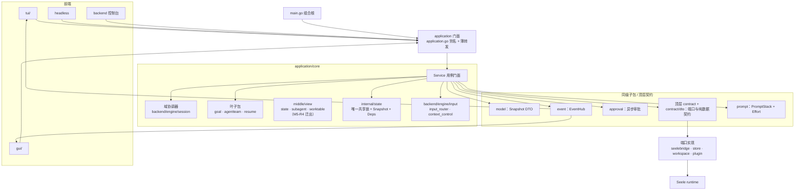
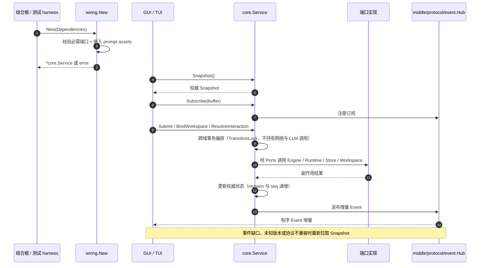
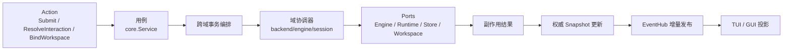
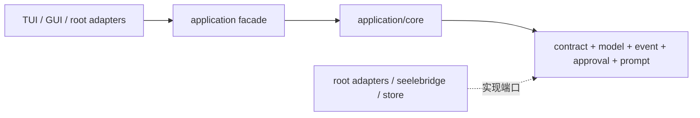

# Application

## 生态位

`application` 是 Seelex 的稳定应用层门面，处在「前端 / 组合根」与「运行时适配」之间，承担两件事：

1. **用例编排**：把底层能力组合成聊天、命令、会话、项目、审批、Plan、Goal、AgentTeam、Worktable 与运行时切换。
2. **权威状态**：所有用户可见事实以 `model.Snapshot` 为准，变更以 `event.Hub` 增量发布，多个前端消费同一份事实。

主要调用方：根目录 composition root（`main.go`）、`tui/`、`gui/` 与测试 harness（`e2e/`）。它们只依赖本门面与 `model`/`contract`，不直接驱动 Seele Engine、Plugin Manager 或存储实现。

## 职责与非职责

- 做：用例编排、跨域事务顺序、权威状态与事件投影、DTO 与协议版本、前端可消费的目录型投影。
- 不做：不实现 Agent 循环（归 Seele）、不实现存储原子写（归 `store`）、不实现工具路由与权限判定（归 `seelebridge`）、不渲染 UI（归 `tui`/`gui`）。
- 不做：**不持有构造函数**。`New` / `NewEventHub` / `NewApprovalBroker` / `NewToolHookBridge` /
  `NewPromptStack` / `NewEffortManager` / `WebSearch` 已于 2026-10-16（M1-B）迁到
  [`wiring/`](../wiring/README.md)：前端不得自造引擎，构造只发生在组合根。

## 五组窄接口（`faces.go`，M5-R10a）

门面按 plan §1.3 的「用例方法面收窄成五组」落地（契约
[`docs/2026-10-15-architecture-reshape/r10-r11-p13-contract.md`](../docs/2026-10-15-architecture-reshape/r10-r11-p13-contract.md) §1）：

| 组 | 形态 | 内容 |
|---|---|---|
| A 类型与事件身份 | `FaceTypeNames` 清单（88 个名字，别名表达不了方法集） | `application/application.go` 的 `type (...)` 别名块，按字母序逐字钉住 |
| B 读投影 | `ViewFace`（48 个方法） | 只读查询、订阅、历史窗口读回（不改内存/磁盘状态） |
| C 命令面 | `CommandFace`（39 个方法） | 提交/取消、会话与工作区生命周期（含批量项目登记）、子代理与角色草稿动作 |
| D 档位与策略 | `PolicyFace`（22 个方法） | 限制、档位、账号、存储配置、插件、角色生命周期、调度策略 |
| E 队列面 | `QueueFace`（3 个方法）+ 包级无状态函数 | 排队输入召回/调序、输入建议；`HasSigilPrefix` / `SigilOf` / `ValidEffortLevels` / `AccountWindowPresets` 仍是包级函数（接口装不下函数） |

- 四个接口的方法名与签名**逐字**取自今日门面已导出的方法面（`go doc -all ./application/core`，
  共 141 个公开方法）：不新增、不删除、不改名、不改签名——它们就是 gui/tui 今天消费的契约（I5）。
- `Service` 在**结构上**满足四个面：`application/faces.go` 末尾有编译期钉子
  `var _ ViewFace = (*Service)(nil)` 一族（契约 §1.2 第 1 条）。
- 不在四组的第三类共 29 个方法（**不属于前端缝**，仍供 `wiring` 与工具注册表调用）：装配注入口
  （`SetProjectBoardSink` / `SetToolRecordSnapshotStore` / `SetGoalTLEvaluator` / `ApplyToolRecordEnabled` /
  `SetToolRecordEnabled`）、工具注册面（11 个 `*Handler`）、事件钩子（4 个 `Handle*`）、内部发布与落盘编排
  （`Publish*` / `Refresh*` / `Flush*` / `Record*` / `PrepareProviderHistory`）与调度装配面
  （`StartScheduledSession` / `AssembleScheduledRun` / `ClearReviewRequest`）。清单是
  `e2e/facade_narrow_faces_test.go` 里的 `assemblyOnlyMethods`。
- 机械断言（`e2e/facade_narrow_faces_test.go`，契约 §1.2）：①四个面的方法集与本文件冻结清单逐字比对；
  ②`Service` 的每个公开方法要么在四组、要么在装配面清单（本片追加，防止新方法绕过分组）；
  ③A 组别名集合逐字等于 `FaceTypeNames`（解析 `application.go` 的 `type (...)` 块——Go 反射列不出包级别名，
  故按事实源源码比对）；④`git diff -- gui tui` 为空（I5）。
- 分类口径：B = 只读投影/订阅；C = 会改会话、对话或工作区状态的动作；D = 档位与策略（含账号、存储配置、
  插件、角色、调度）；E = 队列与输入建议。逐方法分组理由是生成器
  `tmp/reshape/r10a_groups.py` 的显式清单，新增方法必须显式归类（断言 ② 会拦住漏网）。

## 子模块

### 根级子包

| 目录 | 职责 |
|---|---|
| [`../middle/protocol/model/`](../middle/protocol/model/README.md) | Snapshot、Message、Plan、Interaction 等版本化 DTO（M5-R3 迁出 `application/model/`）。 |
| [`../middle/protocol/event/`](../middle/protocol/event/README.md) | 有序事件封装、订阅和 fan-out（M5-R3 迁出 `application/event/`）。 |
| ~~`approval/`~~ | 异步审批已按 plan §2.8 归位到 [`backend/limit/approval/`](../backend/limit/approval/README.md)（M2-C）；端口形状在 [`contract/approval.go`](../contract/approval.go)。 |
| [`prompt/`](prompt/README.md) | PromptStack 与 Effort 策略。 |
| [`console/`](../console/README.md) | backend 诊断前端共享的控制台输出与命令解析（已顶层化为 `console/`，与 gui/tui 平级）。 |
| [`core/`](core/README.md) | Service 用例、聊天状态机、命令、session/project 作用域和工具事件。 |

契约层已于 2026-10-16 按
[`docs/2026-10-15-architecture-reshape`](../docs/2026-10-15-architecture-reshape/plan.md) §2.3 的 M1-A
物理归位到**顶层** [`contract/`](../contract/README.md) 与 [`contract/dto/`](../contract/dto/README.md)：
它不再是本目录的子包，本门面改为单向依赖它。

### `core` 叶子包

`core` 根包按文件前缀分卷（见 [`core/README.md`](core/README.md) 的「分卷 README」导航），
跨域共享与可独立测试的能力下沉为叶子包：

| 目录 | 职责 |
|---|---|
| [`../backend/multiagent/team/`](../backend/multiagent/team/README.md) | A2A 角色团队装配（`TeamSpec`/`RoleSpec` → 角色会话 + 工作顺序 + 成员表）；原 `core/agentteam/`，M5-R8b 归位多代理板块（包名 `team`）。 |
| [`../backend/engine/react/`](../backend/engine/react/README.md) | 聊天流式输出叶子域：`StreamBatcher` 与 `VisibleOutputStream`（M5-R7 迁出 `core/chat/`，包名不变）。 |
| [`../backend/engine/input/contextcontrol/`](../backend/engine/input/contextcontrol/README.md) | `seele.yaml` window 配置段与窗口策略类型装载（M5-R7 迁出 `core/context_control/`，包名不变）。 |
| [`../backend/engine/context/`](../backend/engine/context/README.md) | provider 上下文预算/压缩/result-ref 与历史归一化（M5-R7 迁出 `core/context_runtime/`，包名不变）。 |
| [`backend/multiagent/goal/`](../backend/multiagent/goal/README.md) | 会话级 Goal 对象与状态机、DS-A2A 治理编排、goal 栈持久化（M5-R8a 从 `application/core/goal/` 归位）。 |
<!-- core/govern/ 已于 2026-10-03（阶段三 W3）随 goal 席位轮转退场删除 -->
| [`../backend/engine/input/`](../backend/engine/input/README.md) | 输入分流（command/skill/plugin/conversation）与命令注册表（M5-R7 迁出 `core/input_router/`，包名不变）。 |
| [`../kernel/state/`](../kernel/state/README.md) | core 共享状态内核：唯一共享锁、Snapshot、Deps、Events、Approval（M5-R3 迁出 `application/core/internal/state/`）。 |
| [`../backend/engine/prompt/`](../backend/engine/prompt/README.md) | system prompt 层组装与引擎同步（前缀缓存友好）（M5-R7 迁出 `core/prompt_layer/`，包名不变）。 |
| [`../backend/multiagent/resume/`](../backend/multiagent/resume/README.md) | 「终止前未完成工作」的领域无关恢复模板；原 `core/resume/`，M5-R8b 归位多代理板块。 |
| [`../backend/engine/session/`](../backend/engine/session/README.md) | 会话域协调器：持久化、目录与标题恢复、项目 binding、会话三读（M5-R7 迁出 `core/session_runtime/`，包名不变）。 |
| [`../middle/view/subagent/`](../middle/view/subagent/README.md) | 子代理投影面：详情分类、live 流透传、树/节点事件投影（M5-R4 迁出 `core/subagent_view/`）。 |
| [`../backend/engine/task/`](../backend/engine/task/README.md) | 任务执行域协调器：打点与终态、transcript、checkpoint、token 审计（M5-R7 迁出 `core/task_context/`，包名不变）。 |
| [`../middle/view/state/`](../middle/view/state/README.md) | 用户可见 Snapshot 读写与事件发布（M5-R4 迁出 `core/view_state/`）。 |
| [`../middle/view/worktable/`](../middle/view/worktable/README.md) | 工作表格增量事件中枢（CSP 汇聚、latest-wins、有界背压）（M5-R4 迁出 `core/worktable/`）。 |

`core/internal/limits/` 已于 2026-10-16 随 M2-A 迁至基座包
[`backend/limit/`](../backend/limit/README.md)（运行时上限的类型、默认值、校验与进程级快照
同一处）；
`application/search` 已于 2026-08-22 迁至 `backend/tool/search/`（后端能力归位）；
`application` 门面只保留 `WebSearchConfig` 类型别名；`WebSearch` 的执行入口（薄转发）已于
2026-10-16 随 M1-B 迁到 [`wiring/`](../wiring/README.md)，其终局是 `backend/tool/websearch`（M4）。

### 门面再导出的 DTO（M1-C）

前端（`gui`/`tui`/`console`）**只经门面**消费下面这些形状，不再直接 import 后端包
（2026-10-16 M1-C 前的 4 条越层边：`store` / `seelexctx` / `seelexctx/search` / `seelebridge`）：

| 门面导出 | 指向 | 消费用例 | 终局（规划，尚未实现） |
|---|---|---|---|
| `SessionStorageConfig` | `store.Config` | `SessionStorageConfig` / `TestSessionStorage` / `ConfigureSessionStorage` | M3 store 归位后由 store 侧提供，门面别名重指向 |
| `SearchResult` / `SearchHit` / `SearchRecord` | `seelexctx/search` 的 `Result` / `Hit` / `ChatRecord` | `SearchHistory` | plan §2.1 的 `contract.SearchPort`（M4） |
| `AccountWindowPresets()` | `backend/limit/accountwindow.Presets` | 账号上下文窗口挡位表（只下发一次，前端不写死） | **已归位（M2-C3）**，无待迁项 |

定时任务的 `ScheduledTaskSpec` / `ScheduledTaskStatus` **不在门面再导出**：它们的事实源已经是
[`contract/dto/scheduler.go`](../contract/dto/scheduler.go)，`seelebridge` 的同名符号只是遗留别名
（plan §2.10 列入删除），因此 `gui/bridge.go` 直接改用 `dto.ScheduledTaskSpec` /
`dto.ScheduledTaskStatus`——即「改用上游类型」，而不是再造一层门面别名。
后端适配器（`application/adapters`）同步迁至 `wiring/adapters/`，只依赖
`contract` 层，不再反向依赖本门面。

`application.go` 通过类型别名和薄转发保持外部 API 稳定，调用方不需要依赖内部子包。

## 架构图



## 用例图


## 时序图



## 数据流图



## 依赖方向



接口定义在消费方 `contract/`，实现放在根目录适配器或基础设施模块。禁止 `application` 反向依赖 `gui`、`tui` 或 composition root。

## 核心运行流

1. 组合根调用 `wiring.New` 接收 `Dependencies`，校验必需端口与 embedded prompt assets，并返回 `(*core.Service, error)`；构造失败不会终止进程。
2. 前端调用 `Submit`、`ResolveInteraction`、`BindWorkspace` 等用例。
3. Service 更新权威 Snapshot，并通过 EventHub 发布增量事件。
4. TUI/GUI 先读取 Snapshot，再应用连续 Event；出现序列缺口时重新同步 Snapshot。
5. 外部副作用只通过 Ports 进入 Engine、Runtime、Session Store 和 Workspace Repo。

## Review 指南

- 新业务状态应进入 `model.Snapshot` 或明确的内部状态，而不是只存在于某个前端。
- DTO 变更必须检查 GUI reducer、TUI rendering、clone helper 和协议测试。
- 不要把 Seele 深层类型泄漏给前端；在 adapter 边界转换。
- Service 的锁不能包住网络、LLM、数据库或长时间工具调用。
- session/project 操作必须以 ID 为键，显示名称允许重复。

## 测试

```text
go test ./application/... -count=1
go test ./application/... -race -count=1   # 需要 CGO/C toolchain
go test ./e2e/ -run 'Facade' -count=1      # 五组窄接口的 4 条机械断言（M5-R10a）
```

集成入口主要位于 `core/service_test.go`、`core/command_registry_test.go` 和 `wiring/adapters/adapters_test.go`。
