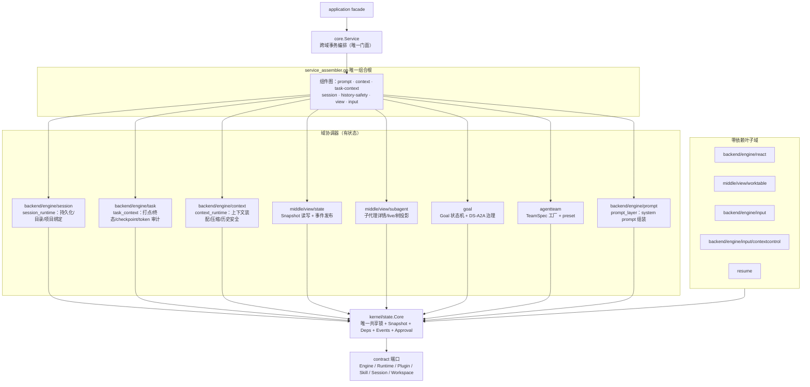
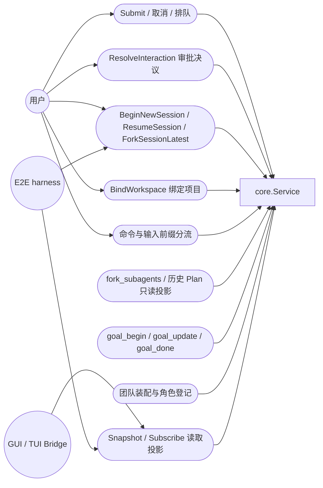
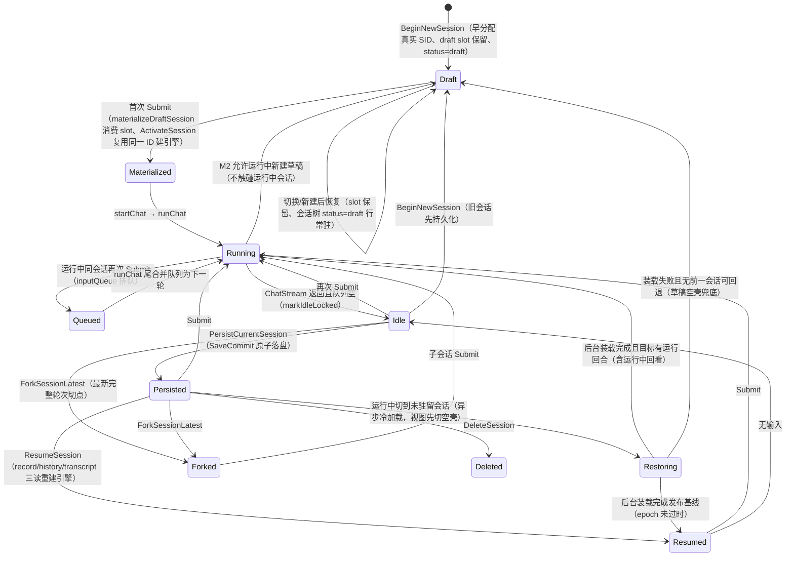
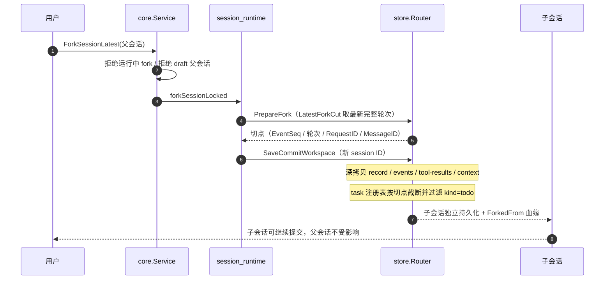

# Application Core

## 生态位

`core` 是 Seelex 的应用用例层和权威状态机。它不直接创建数据库、Wails 窗口或 Seele Agent，而是通过 `contract.Dependencies` 编排这些能力。

主要调用方是 `application` facade；主要消费者是 TUI、GUI Bridge 和 E2E harness。

本包按域拆分子包（装配件 + 消费方窄接口的容器化方向，见
`docs/2026-08-22-application-split/plan.md`）：

- 零依赖叶子域：`../../middle/view/worktable/`（表格增量 CSP 汇聚发布器）。（`resume/`（未完成工作恢复模板：七步顺序 + 幂等键 + 可审计
  Report，领域实现走 `Port`）已于 2026-10-16 随 M5-R8b 归位
  [`backend/multiagent/resume`](../../backend/multiagent/resume/README.md)。）
  （`input_router/`（命令注册表 + 输入路由）与 `context_control/`（窗口策略配置加载）已于
  2026-10-16 随 M5-R7 归位 [`backend/engine/input`](../../backend/engine/input/README.md)
  与 [`backend/engine/input/contextcontrol`](../../backend/engine/input/contextcontrol/README.md)。）
  （`chat/`（流式批次与可见输出）已于 2026-10-16 随 M5-R7 归位
  [`backend/engine/react`](../../backend/engine/react/README.md)。）
  （`govern/` 曾是"多代理回合制治理循环抽象：座次/轮次/断环"，已随
  2026-10-03 的 goal 席位轮转退场整包删除。）
- 有状态域协调器：`goal/`（Goal 状态机 +
  DS-A2A 双会话治理 + 终态 gate + 会话级第五栈持久化）。（`session_runtime/`
  （会话持久化/目录/项目绑定）已于 2026-10-16 随 M5-R7 归位
  [`backend/engine/session`](../../backend/engine/session/README.md)，包名不变。）
  （`context_runtime/`
  （provider 上下文装配/压缩/历史安全）已于 2026-10-16 随 M5-R7 归位
  [`backend/engine/context`](../../backend/engine/context/README.md)，包名不变。）
  （`agentteam/`（AgentTeam/角色会话
  通用装配：`TeamSpec` 工厂 + 团队库读面）的纯基座部分已于 2026-10-16 随 M5-R8b 归位
  [`backend/multiagent/team`](../../backend/multiagent/team/README.md)，包名 `team`。）
  （`task_context/`（任务执行/checkpoint/transcript/token 审计/plan 状态）已于
  2026-10-16 随 M5-R7 归位
  [`backend/engine/task`](../../backend/engine/task/README.md)，包名不变。）
- 共享叶子：`kernel/state`（锁 + 权威 Snapshot + 端口依赖 + 事件/审批
  内核）。判据类上限（`limits` 段类型、默认值、
  进程级快照）已于 2026-10-16 随 M2-A 迁到基座包 [`backend/limit`](../../backend/limit/README.md)。

域包依赖 `state.Core` 与装配根注入的消费方窄接口，禁止反向依赖 core 根包；
`service_assembler.go` 是唯一组合根。

> Seele v2 装配模型：`contract.ChatEngine` 端口由 seelebridge 创建的
> `session.Session`（`session.NewSession` 主会话）经 `enginePort` 适配满足；
> `RuntimePort` 转发 seelebridge.Runtime（账号池/Completer/可见性/Plan
> preflight/策略）。本模块只消费窄端口，不直接接触 Seele 会话实现。

## 架构图



## 用例图



## Service 装配结构

`Service` 是稳定的应用门面与跨组件编排层，本身只保存 `serviceState` 和 `serviceComponents`。共享状态按基础设施、会话、计划、任务上下文、提示词、生命周期和前端快照分组，避免继续扩张成平铺字段集合。

查询面（AP-004/AP-005）现由独立 Application 包实现，core 只保留 adapter：

- [`application/session/query`](../session/query/README.md) 组合会话目录、项目根、
  展示元数据和目录刷新等待；
- [`application/history`](../history/README.md) 组合历史窗口分页；磁盘冷读仍在
  共享 `ViewMu` 之外，core 只在锁内安装可见窗口。

对应公开方法只保留一行转发。历史行身份与窗口边界继续复用
`middle/switch/history` 的唯一实现；`session_query.go` 与
`session_conversation_history_query.go` 只承载宿主适配。

Conversation Queue（AP-007 首个切片）由 `chat_queue.go` 的
`conversationQueue` 组件承接。`SessionUnit` 继续唯一拥有 `Queue` 和
`ChatState`；组件只负责队列编辑的锁内编排、投影镜像和锁外发布，不持完整
`Service`。`service_queue.go` 的两个公开入口只保留一行转发。

Conversation ChatState（AP-008 首个切片）由 `chat_turn_state.go` 的
`conversationTurnState` 集中转换。开始回合、队列投影、错误、收尾和重置不再
散落写入 `SessionUnit`；状态数据仍由 `SessionUnit.Chat` 唯一持有。

ChatTurn 请求构造（AP-009 首个切片）由 `chat_turn_request.go` 集中：
输入受理、Skill 冻结、队列 payload 还原、批次合并和引用提取只有一个实现。

ChatTurn 起点（AP-014 首个切片）由 `chat_turn_process.go` 集中：requestID、预算、
cancel/stream、Task 初始化、Skill 激活和 user transcript 不再在两处重复。

ChatTurn 持久化完成（AP-018 首个切片）由 `chat_turn_completion.go` 集中：
会话定位、原子落盘、durable queue 失败回草稿/成功确认和工作历史释放保持原有
顺序；持久化错误仍是 `session.persistence_failed`。消息投影、事件发布与聊天
主循环仍由 `Service` 编排。

ChatTurn 队列提升（AP-019 首个切片）由 `conversationTurnProcess.PromoteLocked`
统一判断：空队列结束当前回合并按全局忙闲 idle；非空队列合并批次、清空单元队列、
刷新投影并复用起点事务。消息投影、事件和 goroutine 启动仍由 `Service` 编排。

ChatTurn 终态结果投影（AP-020 首个切片）由 `conversationTurnOutcome.ApplyLocked`
集中：stale request 防护、错误 ChatState/error 行和 runtime projection 应用保持
原有顺序；队列提升、任务镜像、revision 与事件发布仍在主循环。

ChatTurn 终态事件发布（AP-021 首个切片）由 `conversationTurnPublisher.Publish`
集中：`chat.changed`、error/snapshot、提升批次 `message.added`、task batch 和
runtime projections 保持原顺序；下一轮 goroutine 仍由主循环启动。

ChatTurn 终态镜像（AP-022 首个切片）由 `conversationTurnOutcome.MirrorLocked`
集中：所有会话写 ChatState，只有活跃会话镜像共享 Task 并 bump 进程 revision。

ChatTurn 异步尾段（AP-023 首个切片）由 `conversationTurnTail.Complete` 集中：
工作区重绑、durable queue consumed 标记、终态发布、下一轮启动、会话释放与工具
记录落盘保持原顺序，全部位于 `ViewMu` 之外。

Goal Application 用例（AP-015 首个切片）由 `goal_application.go` 集中；Goal
状态机仍在 backend goal domain。

Subagent Application 用例（AP-016 首个切片）由 `subagent_application.go` 集中；
Runtime 与 subagent view 的能力边界不变。

Execution Application 用例（AP-017 首个切片）由 `work_table_application.go`
集中 WorkItem/teammate/team board 读面与 todo 写入口。

Session unload（AP-010 首个切片）由 `session_lifecycle_use_case.go` 集中编排；
`middle/switch.Unload` 继续拥有准入判据，Service 只做一行转发。

Session archive（AP-011 首个切片）由 `session_archive_use_case.go` 集中宿主适配；
`middle/residency.Archive` 继续拥有准入、flush、归档写入和目录刷新判据。

Session delete（AP-012 首个切片）由 `session_delete_use_case.go` 集中删除与完整
释放顺序；存储删除语义、workspace 解绑和视图续接行为不变。

显式草稿提交激活（AP-024 首个切片）由
`session_draft_submission.go` 集中目标预判、视图过渡锁、归属复判和物化委托；
草稿物化本体与 Session 记录所有权不变。

草稿物化编排（AP-025 首个切片）由 `session_draft_materialization.go` 集中：
workspace 绑定、引擎激活、标题生成、Session/Plan/workspace 提交镜像、发布与
目录刷新、工具记录和驻留登记按原顺序执行。

新建会话进入草稿（AP-026 首个切片）由 `session_draft_entry.go` 集中：
预检、旧会话保存/释放、Skill 清理、草稿槽和档位恢复、草稿壳切换及锁外刷新
保持原顺序；`Service.BeginNewSession` 只保留一行转发。

Resume 顶层编排（AP-027 首个切片）由 `session_resume.go` 集中：hot/restoring/
cold 分支、过渡锁、同步/后台选择和失败恢复入口；冷加载主体与 epoch 判定不变。

Edit/Fork 幂等操作注册表（AP-028 首个切片）由
`edit_fork_operation_registry.go` 独立拥有：operation map、TTL、完成等待和失败
清理不再占用 `serviceState.editForkOps` 或 `ViewMu`。

Edit/Fork 父会话准入（AP-029 首个切片）由 `edit_fork_validator.go` 集中：
当前会话、忙闲/队列、expected revision、窗口和压缩前缀判据保持原顺序。

Edit/Fork 目标解析（AP-030 首个切片）由 `edit_fork_target_resolver.go` 集中：
父事件加载、revision、用户输入判定和 `EventParagraphs` fork cut 只有一份实现。

Edit/Fork child 原子编排（AP-031 首个切片）由 `edit_fork_process.go` 集中：
解析、校验、锁内 fork、锁外 resume/submit 和失败回滚顺序只有一份实现。

Edit/Fork 回滚错误合成（AP-032 首个切片）由 `edit_fork_rollback.go` 集中：
child 删除、parent 恢复和错误正文组合保留原始失败 cause。

Edit/Fork 可见消息编辑判据（AP-033 首个切片）由 `edit_fork_annotation.go`
集中：EventSeq 回填与四类禁编原因只有一份实现。

Fork lineage 只读解析（AP-034 首个切片）由 `session_fork_lineage.go` 集中：
context payload → `forked_from` → fork ref 的唯一解码与降级路径。

Restoring 空壳投影（AP-035 首个切片）由 `session_restoring_shell.go` 集中：
Session 状态、Runtime 会话事实清理、ChatState 镜像、Active 与 revision 共用一份实现。

冷加载失败恢复（AP-036 首个切片）由 `session_restore_recovery.go` 集中：
restoring 清除、active/epoch 判定、hot 回退、draft 重置和 Bridge 通知。

冷恢复 draft reset（AP-037 首个切片）由 `session_restore_draft_reset.go`
集中：锁内草稿槽/草稿壳与锁外 runtime/snapshot 发布。

冷加载数据读取（AP-038 首个切片）由 `session_cold_load_reader.go` 集中：
pending-tail、record/transcript 并行读取、legacy history 回退和错误优先级。

冷加载 history 装配（AP-039 首个切片）由 `session_cold_history.go` 集中：
transcript 重建、wire history、record/resume history 回退。

冷加载 Engine 恢复与队列回填（AP-040 首个切片）由 `session_cold_restore.go`
集中：workspace 键、Engine resume/replace、queue rehydrate 和 prompt 写入。

冷加载 workspace 绑定（AP-041 首个切片）由 `session_cold_workspace.go` 集中：
运行中不改根、per-session binding 与真正无项目解绑判据。

冷加载激活准备（AP-042 首个切片）由 `session_cold_activation.go` 集中：
epoch/active、restoring 清除、标题、Active、cancel、tier 和 title 写入。

冷加载 Task 恢复（AP-043 首个切片）由 `session_cold_task.go` 集中：
compaction/retainedFrom、Task/Plan/checkpoint 恢复和无 record reset。

冷加载 View 构造与安装（AP-044 首个切片）由 `session_cold_view.go` 集中：
record/legacy 窗口、ForkedFrom、空 View 安装与 active Snapshot Task 镜像。

冷加载解锁后发布（AP-045 首个切片）由 `session_cold_publish.go` 集中：
prompt/context/runtime/task/subagent/catalog/LRU 的锁外顺序。

冷加载锁内收口（AP-046 首个切片）由 `session_cold_commit.go` 集中：
pending-tail/ChatState、active Plan/Interaction、workspace 投影和 revision。

ChatTurn Engine 前输入准备（AP-047 首个切片）由 `chat_turn_input.go` 集中：
prompt 激活、provider context 装配和空输入归一化。

ChatTurn Engine 返回事务（AP-048 首个切片）由 `chat_turn_response.go` 集中：
reasoning、输出观测、final assistant transcript 与 reasoning 回填。

ChatTurn 恢复与终态（AP-049 首个切片）由 `chat_turn_recovery.go` 集中：
context failure、provider recovery、bounded retry、budget 与 Task finalize。

ChatTurn 清理与持久化前准备（AP-050 首个切片）由 `chat_turn_cleanup.go`
集中：flush/route/mailbox/projection/checkpoint/recovery/error/draft stop。

ChatTurn Commit（AP-051 首个切片）由 `chat_turn_commit.go` 集中：
持久化、outcome、队列提升、下一批消息和锁内镜像。

ChatTurn Finalize（AP-052 首个切片）由 `chat_turn_finalize.go` 集中：
commit result → publication → 异步 tail，stale 直接忽略。

ChatTurn 执行策略同步（AP-053 首个切片）由 `chat_turn_execution.go` 集中：
project root、subagent policy、reasoning effort 和 full access。

Policy Application 首批（AP-054 首个切片）由 `service_policy_application.go` 集中：
技能激活、两条独立拉条、release window 和 FullAccess 兼容壳。

Permission Tier 用例（AP-055 首个切片）由同一组件集中：持久化、会话/审批/
Runtime 同步、生效档位、full 自动放行和 runtime 事件。

Effort 切换（AP-056 首个切片）由同一组件集中：空闲守卫、cycle/apply、
subagent/reasoning 下发、prompt 同步和 runtime 收口。

Plugin 切换（AP-057 首个切片）由同一组件集中：全进程空闲、activate/deactivate、
prompt/history 重建、Effort 恢复、会话 reset 和 runtime 发布。

Admin 账号 CRUD、余额、账号切换和逐账号窗口已迁到
[`application/admin`](../admin/README.md)。core 只保留 `service_admin_application.go`
的窄 Host adapter，以及 `service_account.go` / `service_account_window.go` /
`service_interaction.go` 的一行兼容转发。

项目环境表、Workspace Git 查询和批量登记后的投影发布已迁到
[`application/workspace`](../workspace/README.md)。core 的
`workspace_environments.go` / `workspace_gitrepos.go` / `workspace_usecase.go`
只保留 Service 一行转发，`workspace_usecase.go` 另承载
`newServiceWorkspaceApplication` 宿主适配；containment 判据在领域包内只有一份，
查询不进入共享写锁。

Session SSH（AP-064 首个切片）由 `session_ssh.go` 内的 `sessionSSHApplication`
集中：可选会话状态端口解析、所属项目环境表读取、放权集合子集校验和固定环境
不可变规则。`validateAllowedEnvs` 仍是唯一纯判据；三个旧入口只保留一行转发。

Role Account（AP-065 首个切片）由 `role_permissions.go` 内的
`roleAccountApplication` 集中：角色账号读取、Runtime 先行热推、持久化失败回滚、
会话加载恢复和 `AccountRoleVocabulary` 遍历。三个旧入口只保留一行转发。

Role Permission Vector（AP-066 首个切片）由同一文件的
`rolePermissionApplication` 集中：角色默认向量、会话登记、五层来源解析和单/多角色
读取。登记优先与显式空集纪律由 `resolveRoleSettings` 单一 helper 持有；五个旧入口
只保留一行转发。

Role Inheritance / SSH Paths（AP-067 首个切片）由 `roleInheritanceApplication`
集中：subagent/teammate 默认继承、关闭继承后的角色覆盖、SSH 路径白名单默认/会话
两个写面以及远端 POSIX 路径规范化。Role Permissions 的 14 个旧入口已全部单行化。

Scheduled Task CRUD（AP-068 首个切片）由 `schedulerApplication` 集中：创建/编辑
共用的默认参数与校验顺序，以及成功后的 runtime 投影刷新。调度器定义校验、Runtime
CRUD 与执行仍归原有唯一实现；三条旧入口只保留一行转发。

Runtime Refresh（AP-069 首个切片）由 `runtimeApplication` 集中：projection 锁外
采集、锁内应用/revision、解锁后 runtime 事件和 task delta 发布。

Scheduled Run / Session（AP-070～071）由 `scheduledRunApplication` 与
`scheduledSessionApplication` 集中：提交前的档位/执行参数/插件装配，以及定时触发的
新会话、workspace 绑定、快照发布、装配和后台提交。

File Review（AP-072 首个切片）由 `reviewApplication` 集中：Workspace FilePort、
召唤 ID、会话归属、视图锁内请求写入和快照发布。逐文件裁决仍由
`backend/tool/review` 唯一实现；`reviewSeq` 已从 `serviceState` 移入组件。

Lifecycle（AP-073～074）先由 core 组件集中，AP-091 已迁入
[`application/lifecycle`](../lifecycle/README.md)：drain/idle/running 查询、全部或
当前 chat 取消，以及幂等 Shutdown 的关闭门和固定清理顺序。core 只保留 SessionUnit、
目录 worker、Session 域和 EventHub 的宿主适配及一行兼容入口。

History Search（AP-075）改用 `dto.SearchResult`，默认 limit 与 clamp 归 Backend
search 唯一实现。因此 `application/core` 不再直接依赖 `seelectx/search`，直接内部
依赖从 39 降到 38；AP-085～095 的包提取继续移除 `backend/tool/reference` 等直接
依赖，当前终点为 37。

Tool Hook Bridge（AP-115A）已把 Seele loop-hook 状态机迁入
[`application/execution/toolhooks`](../execution/toolhooks/README.md)；core 的
`ToolHookBridge` 只保留 `Bind`/`Hooks` 宿主适配、工具消息投影和既有事件发布。

Tool Record（AP-115B）已把按会话累计、stage/seq、开关、失败原因和批量落盘迁入
[`application/execution/toolrecord`](../execution/toolrecord/README.md)；core 的
`tool_record.go` / `tool_record_stage.go` 只保留 Service 兼容转发与物化会话判据。

WorkTable publisher（AP-115C1）已把 latest-wins 汇聚和子代理树 payload 去重迁入
[`application/execution/table`](../execution/table/README.md)；core 只保留行投影、
树快照、session ID 与 EventHub host 适配。

History Search Application（AP-076）由 `historySearchApplication` 集中：空查询校验、
Runtime 可用性、查询转发和 `search_history` 工具 JSON 适配。

Input Completion（AP-077）由 `completionApplication` 集中：sigil 候选合成、参数区
拒绝、前缀过滤和跨域名稳定排序。目录端口和 sigil 词表仍保持唯一来源。

Reference Tools（AP-078/AP-085）的实现已迁到
[`application/reference`](../reference/README.md)：result_ref 别名、节点归档、分页、
Plan 节点筛选和工具 JSON 适配由独立包集中。core 只保留一行 `Service` 转发及
Engine/Task/Session 窄回调适配；Archived result、PlanStack 和 Engine 仍是唯一事实源。

Session Metadata（AP-079）先由 core 组件集中，AP-086 已迁入
[`application/session`](../session/README.md)。写入判据仍在
`middle/switch.SetMeta`，读取仍由 `SessionQuery` 提供；core 只保留端口断言、
目录刷新适配和一行兼容入口。

Project Board 只读查询（AP-080）由 `projectBoardQuery` 集中：
`WorkTableRowsFor`、`ProjectRootFor`、`ProjectBoardTeamPlanFor` 和
`ProjectBoardTeamStateFor`。底层 WorkTable、SessionQuery、Runtime Team Plan 仍是
唯一事实源。

Session Release（AP-081）先由 core 组件集中，AP-086 已迁入
[`application/session`](../session/README.md)。包内固定 releaseIdle/releaseFull 的
二次保护、flush 和回收顺序；受保护集、正文 LRU、Engine/Runtime/Store 的具体释放
动作仍由 core 宿主适配背后的唯一实现持有。

Context Compaction（AP-082）由 `contextCompactionApplication` 集中主动压缩的会话
解析、同会话 gate、Controller 调用和回执映射。底层压缩、持久化、恢复与门禁判据仍
由 `context_runtime` 唯一持有。

Fault Guard（AP-083）先由 core 组件集中，AP-091 已迁入
[`application/lifecycle`](../lifecycle/README.md)：降级退出 once 门、资源清理顺序、
ExitRequested 发布和 panic 重抛都由包内持有。`Service` 的两个私有入口只保留一行
转发，具体关闭动作仍由 core 适配。

Performance Stats（AP-084）先由 core 组件集中，AP-089 已迁入
[`application/observability`](../observability/README.md)：读锁、快照、窗口和工具
引用输入由包内收拢；`middle/view.PerfStats` 仍是唯一计算实现，core 只保留一行转发。

Role Account / Permission / Inheritance（AP-065～067）的应用判据已迁入
[`application/policy`](../policy/README.md)。core 的
`role_permissions.go` 只保留 Session/Runtime 端口适配与 14 个一行兼容入口；
五层解析、显式空集优先、运行时账号回滚和 SSH 路径规范化不再有 core 副本。

`service_assembler.go` 是唯一组合根，负责装配 prompt、context、task-context、session、history-safety、view 和 input 组件。组件共享同一份受锁保护的状态，但行为通过窄组件端口协作；组件不得持有完整 `*Service`。聊天执行、会话切换等跨域事务仍由 `Service` 编排，单域规则由对应组件实现；工作区用例（创建/绑定/解绑、当前工作区读面与投影收集）已归位 [`middle/switch/workspace`](../../middle/switch/workspace/README.md)，本包公开方法只做一行转发，视图投影写面仍由本包持有。

`service_components_test.go` 固化两条结构约束：`Service` 只能包含状态与组件图，聚焦组件不能反向持有门面。

## 分卷 README（根包按文件前缀）

根包的文件与函数说明按文件前缀分卷到独立 README，主 README 只保留生态位
与导航；各卷含「生态位 + 文件与函数索引」，由
`scripts/gen_core_readme_index.py` 从源码 doc 注释自动刷新。

| 分卷 | 覆盖文件 | 生态位 |
|---|---|---|
| [README-service.md](README-service.md) | `service*.go` | Service 门面、装配根与跨域用例编排（输入/交互/调度/快照/测试夹具） |
| [README-session.md](README-session.md) | `session*.go` + 显式名单 | 会话草稿/恢复/存储用例与集成测试 |
| [README-chat.md](README-chat.md) | `chat*.go`、`visible_output_test.go`、`reasoning_visible_test.go` | 聊天主循环与可见输出集成 |
| [README-command.md](README-command.md) | `command*.go` | 内置命令注册与执行 |
| [README-error.md](README-error.md) | `error*.go` | 错误码与面向用户的错误呈现 |
| [README-history.md](README-history.md) | `history*.go` | 历史检索与 provider 失败恢复 |
| [README-input.md](README-input.md) | `input*.go` | 输入分派与路由兼容测试 |
| [README-plan.md](README-plan.md) | `plan_*.go` | Plan 打点/分支事件/重规划 |
| [README-reference.md](README-reference.md) | `reference*.go` | read_tool_result / read_plan 引用工具 |
| [README-skill.md](README-skill.md) | `skill*.go` | Skill 指令信封编解码 |
| [README-tool.md](README-tool.md) | `tool*.go` | 工具事件钩子与诊断 |
| [README-work-table.md](README-work-table.md) | `work_table*.go` | 工作表格投影与测试 |
| [README-context.md](README-context.md) | `context_*_test.go` | 上下文控制相关集成测试 |
| [README-task.md](README-task.md) | `task_*_test.go` | 任务执行集成测试 |
| [README-subagent.md](README-subagent.md) | `subagent_*_test.go` | 子代理投影集成测试 |
| [README-goal.md](README-goal.md) | `goal_*.go` | goal 域协调器/门面用例与「goal 上线即装配 TL 团队」接线回归 |
| [README-agentteam.md](README-agentteam.md) | `role_session.go`（`agentteam_runtime.go` 已删除） | **角色会话基座**（`RoleSessionID` 派生、角色 draft/floor 透传）与遗留的发言调度原语；Agent Team 装配面**已退场（2026-10-12 J-1a）**。纯基座部分（`spec.go`：`RoleSessionID` / `Normalize*` / `ValidToolPolicy`）已于 M5-R8b 归位 `backend/multiagent/team/` |
| [README-permission.md](README-permission.md) | `role_permissions.go` | 角色默认/会话覆盖、继承与 SSH 路径白名单 |
| [README-composer.md](README-composer.md) | `composer_*.go` | 输入草稿合成器的持久化与工作区绑定 |
| [README-archive.md](README-archive.md) | `archive_*.go`、`close_semantics_test.go` | 会话归档与收尾语义 |
| [README-misc.md](README-misc.md) | 显式名单（aliases/completion/compressed/diagnostics/fault-guard/limits/perf/snapshot-budget/runtime/workspace/race） | 基础与杂项 |

覆盖规则的唯一权威是 `scripts/gen_core_readme_index.py` 的 `ROOT_GROUPS`
（前缀 + 显式名单），各卷首行「覆盖：」由生成器写出；每个根包 `.go` 必须
恰好归入一卷，`verify_coverage` 自检在漏归属/重复归属时拒绝刷新（防止
「索引静默漏文档」）。README 里引用的文件/链接是否还在，用
`python scripts/check_readme_refs.py`（`--strict` 可用于 CI）核对。

### 叶子包 README

| 包 | 生态位 |
|---|---|
| [../../backend/engine/react/](../../backend/engine/react/README.md) | 流式批次管道（`StreamBatcher`）与 `<think>` 可见输出剥离（M5-R7 归位，包名 `chat`） |
| [../../middle/view/worktable/](../../middle/view/worktable/README.md) | worktable.changed CSP 汇聚发布器（latest-wins、背压、关闭排空尾态） |
| [../../backend/engine/input/](../../backend/engine/input/README.md) | 命令注册表与输入路由（M5-R7 归位，包名 `input_router`） |
| [../../backend/engine/input/contextcontrol/](../../backend/engine/input/contextcontrol/README.md) | 窗口策略配置加载（M5-R7 归位，包名 `context_control`；plan 原写与本包同目录，一目录两包不成立，按"一包一目录"落成子目录） |
| [../../backend/engine/session/](../../backend/engine/session/README.md) | 会话持久化/目录/项目绑定协调器（M5-R7 归位，包名 `session_runtime`） |
| [../../backend/engine/task/](../../backend/engine/task/README.md) | 任务执行/checkpoint/transcript/token 审计协调器（M5-R7 归位，包名 `task_context`） |
| [../../backend/engine/context/](../../backend/engine/context/README.md) | provider 上下文装配/压缩/历史安全协调器（M5-R7 归位，包名 `context_runtime`） |
| [../../backend/engine/prompt/](../../backend/engine/prompt/README.md) | system prompt 组装与引擎同步（M5-R7 归位，包名 `prompt_layer`） |
| [../../middle/view/state/](../../middle/view/state/README.md) | Snapshot 读/写/事件发布协调器 |
| [../../middle/view/subagent/](../../middle/view/subagent/README.md) | 子代理详情/live/树投影 |
| [backend/multiagent/goal/](../../backend/multiagent/goal/README.md) | Goal 状态机、DS-A2A 双会话治理、终态 gate 与会话级第五栈持久化（M5-R8a 归位多代理板块） |
| [../backend/multiagent/team/](../../backend/multiagent/team/README.md) | A2A 角色团队通用装配（`TeamSpec` 工厂 + 团队库读面 + 幂等角色会话）；原 `agentteam/`，M5-R8b 归位（包名 `team`） |
<!-- govern/ 已于 2026-10-03（阶段三 W3）随 goal 席位轮转退场删除 -->
| [../backend/multiagent/resume/](../../backend/multiagent/resume/README.md) | 未完成工作恢复模板（七步顺序 + 幂等键 + 可审计 Report）；原 `resume/`，M5-R8b 归位 |
| [../../kernel/state/](../../kernel/state/README.md) | 共享状态内核（锁 + Snapshot + 端口依赖；M5-R3 迁出 `application/core/internal/state/`） |

## 权威状态与生命周期

`Service.snapshot` 是前端状态事实源，受 `Service.mu` 保护。一次普通对话：

1. `Submit` 识别 command、Skill、Plugin 或 conversation。
2. `startChat` 写入 user/assistant placeholder、设置 ChatState 并发布事件。
3. Engine `ChatStream` 的 chunk 和 tool hooks 增量更新 conversation/runtime/plan。
4. 完成后保存当前 session；若队列非空，把排队输入冻结并合并为下一 turn。
5. `WaitForIdle` 在 active turn 和已接受队列全部完成后返回。

每个 conversation request 在提交时冻结其 effort 对应的 ReAct budget（工具轮数、工具调用数）。budget 耗尽时保留一次无工具的最终交付回合；它不把报告导出等交付工具一概禁止。长编码任务不设 wall-clock 超时，用户仍可随时主动取消。

`BeginGracefulShutdown` 拒绝新输入但允许已接受工作完成；`Shutdown` 才取消 active chat 并关闭 broker/events。

每个请求另有私有 `TaskExecutionState`：工具结果与 Plan 节点状态写入有界 `NodeCheckpoint`。超长工具结果在下一次 provider 调用前被替换为与原 tool-call 配对的短警告，原文不作为模型上下文；Agent 必须以文件路径、行范围、过滤条件、分页或摘要命令重新读取。历史超过标准 context budget 时，`ContextController` 保留 system prompt，并以一个私有 checkpoint 替换整段可变的 user/assistant/tool transcript；后续轮次需通过定向工具重新获取被省略的细节。连续无新事实、变更、产物或节点状态的工具轮次会触发预算兜底，但不是上下文管理主路径。模型应以 `task_complete`、`task_needs_user_decision` 或 `task_failed` 结束工具型任务；它们分别表示可交付完成、必须由用户选择的有效分歧，以及有界失败事实。若已加载的 authority Plan 尚未执行而模型自然收尾，运行时将其表示为 `needs_user_decision`，而不伪造完成或暴露内部错误。`Snapshot.Task` 公开 `progressing/completed/needs_user_decision/blocked/interrupted/failed`，而 checkpoint、装配的 system prompt 和 `<think>` 内容都不进入 frontend snapshot。Provider 明确返回 context overflow 时，Service 保存私有恢复 checkpoint 并给同一 Agent 一次受控的恢复回合；504 从不自动重放可能已有副作用的工具轮。

冷恢复只给引擎装载尾部窗口（provider 缓存近似）时，恢复后的首个请求不会把
尾部保留段误当“已覆盖前缀”：装配层校验保留段与 transcript 前缀一一对应
（`retainedMatchesTranscriptPrefix`），检测到保留段是后缀就改为从完整
transcript 按会话顺序重建。这样恢复前后的上下文前缀字节一致，模型缓存
（prefix cache）可以命中，而不是得到 `[tail]+[middle]` 的重排与重复。

子代理 mailbox 内容（含 `## 继承上下文 (Inherited Context)` 信封）在排空时
整体丢弃：子代理结论经工具结果（tool_result / summary / `NodeSemanticResult`）
回传父代理，mailbox 不再是注入引擎历史/可见会话/transcript 的通道，因此不会
以 `[子代理产出]` 噪音进入前端或上下文存储。

## Session 与 Project 语义

- project 只定义会话的文件读写范围，不共享 conversation history。
- session ID 是唯一键；标题是按 `(workspaceID, sessionID)` 保存的稳定 KV 元数据。首次请求只初始化一次标题；除显式重命名外，恢复、压缩、历史分页和首条历史消息都不能改写它。
- 运行中切换到**未驻留**会话走异步冷加载：`ResumeSession` 先切视图到目标
  restoring 空壳并立即返回（`session.status=restoring`，会话树与快照可见
  “恢复中”），后台完成三读/引擎重建/context 挂接后发布内容基线
  （`snapshot.changed`）；冷加载不占视图过渡 key，期间其它切换仍可快速
  进行，迟到完成按视图 epoch 判定不再抢占（`session_history.go` 的
  `beginAsyncRestore` / `resumeSessionCold`）。空闲切换与热加载保持原同步
  语义；`SessionStatusRestoring` 只作为运行期叠加状态，不落盘。
- 会话路由引擎（`SessionChatEngine`）下，切换/恢复的 system prompt 一律按
  **目标会话** 经 `SetSystemPromptFor` 写入（`EnginePort` 同步进程级 prompt
  缓存供新建引擎继承），不写进程级“活跃别名”引擎：别名可能指向另一个正在
  运行的会话，其 framework `Session` 锁被 `ChatStream` 全程持有，全局
  `SetSystemPrompt` 会阻塞到该会话收尾——表现为“点第三个会话没反应、被切走
  的会话跑完才开始切换”（复现/回归：
  `repro_two_running_view_third_then_switched_finishes_test.go` 的
  `TestSwitchToIdleThirdBlocksWhileAliasEngineSessionRuns`）。非路由单会话
  引擎无跨会话别名面，仍走全局写。
- `BeginNewSession` 保存旧的非空历史并清空 Engine history，然后进入幂等 draft：**早分配真实会话 ID 并建 `SessionUnit`**（`HasSession=false`，不建引擎 bundle、不写空历史、不建立 workspace binding）；**同时清空继承的项目绑定**（`CurrentWorkspace`/project root/session store workspace）——「任务会话」必须真正未关联工作区，上一个会话的项目信息（项目地址、资源管理器文件树与提交记录、工作台投影）不得污染新会话。需要项目上下文的「工作区会话」在草稿上显式 `BindWorkspace`，第一次进入 `submitConversation` 时才经 `ActivateSession` 用同一草稿 ID 建引擎 bundle，并立即用首问设置显示名。**草稿槽位（draft slot）保留**：`BeginNewSession` 在运行中也可进入草稿（不再返回 `ErrChatRunning`，也不触碰运行中会话的引擎）；切换/新建后草稿不丢失——槽位记录工作区绑定与早分配 SID 并在会话树以 `status=draft` 行常驻，再次新建恢复同一草稿，首次提交物化时消费槽位。用户输入未发送正文后 composer 随 record 落盘（`Status=draft`），冷启动恢复草稿。快照为会话补充 `status`（draft/idle/running/queued）与 `session.composer`（当前草稿未发送正文），`ApplyRuntimeProjectionLocked` 在草稿视图下不覆盖会话 ID（后台运行中会话不得顶掉草稿视图）。
- M1（2026-08-23）起聊天保护粒度从全局单例收窄为**会话级**：每会话独立
  `ChatState`/cancel/inputQueue（`session_scope.go` 的 `sessionChat`
  注册表），`ErrChatRunning` 只对同会话二次提交生效；跨会话提交在运行中
  返回 `ErrSessionBusy`（单飞执行边界）。显式 session API：
  `SubmitToSession/ActivateSession/SnapshotOf/SubscribeSession`；旧方法
  委托活跃会话。真并行执行、每会话驻留 Snapshot/组件栈为 M2 规划
  （见 `docs/gui/modules/multi-session-pages.md` §2.1）。
- workspace ID 是 binding 与 storage shard 的键；显示名来自 root basename。
- 恢复 session 时先定位真实 `workspaceID + sessionID`，再读取历史和绑定 Runtime。
- 有历史的 session 切换 project 时先保存旧 scope，然后创建新 session，禁止把同一 ID 重新绑定后继续写。
- `sessionCatalog` 跨所有项目聚合 metadata；标题按 updatedAt 缓存，存储切换和删除时失效。

## Snapshot/Event 协议

每次状态变化先在锁内 bump revision，再在锁外 Publish。Snapshot 可独立重建全部 UI；Event 只负责低延迟增量。Message ID 由 Service 生成并在 history prepend 时保持稳定。

Event 自 M1 起携带 `session_id` 路由键（`EventHub.PublishSession`），
`SubscribeSession` 可按会话过滤订阅；Snapshot 的会话归属由
`Snapshot.Session.ID` 表达（当前仅活跃会话有驻留快照）。

## 子代理与历史 Plan

并行工作由 `fork_subagents` 派发：每条 spec 获得独立 Session/worktree，继承项目作用域
与父证据，调用立即返回作业句柄；产出经 `bg_manage` 取回。Plan 执行器与 `plan_*`
工具族已退役，`application/core` 只保留**历史 Plan 的只读投影**：旧会话的 PlanState
仍可显示与 `read_plan` 回读，但不能加载或执行新的 DAG。

Effort 只为 `fork_subagents`/workunit 提供子代理数量、并发与循环上限；不创建
preflight、request-scoped authority lease 或 hidden Plan envelope。聊天、问候和
小任务始终直接进入 ReAct。

## 依赖边界

允许依赖 Application 子包、`contract`/`contract/dto` 的稳定形状和 `store.Config`。禁止依赖 `gui`、`tui`、根目录 main package 或具体数据库实现。

## Review 指南

- 不在持有 `Service.mu` 时调用 LLM、网络、数据库、文件系统或外部 callback。
- Snapshot 改动是否 bump revision 并发布正确事件。
- queued input 是否冻结提交时的 Skill 上下文，而非执行时重新读取。

Queue liveness note: for framework-backed sessions, queued inputs are removed
from the visible queue immediately after `ChatStream` returns and the session
lock is released. The current turn is persisted before the merged next turn is
started, so queue acknowledgement does not require re-entering the framework
session from an iteration callback.
- resume/load-more/delete 是否使用目标 session 的真实 workspace，而非当前 active scope。
- 热挂载/冷恢复收尾是否误写全局活跃别名引擎（`SetSystemPrompt` 可能阻塞在
  运行中会话的 framework `Session` 锁上）；路由引擎只按目标会话经
  `SetSystemPromptFor` 写，并同步进程级 prompt 缓存。
- project 切换、storage reconfigure、shutdown 与 running chat 的竞争是否有明确结果。
- draft 期间切换项目是否只更新待继承 scope，是否避免空 Session ID binding；重复点击新建是否仍只保留一个 draft。
- Tool/Plan callback 是否只更新所属 request/session。

## 会话数据流：状态流转



- draft 从新建即持有早分配的真实 SID（引擎 bundle `HasSession=false`），
  槽位跨切换保留；有未发送正文时 composer 随会话 record 落盘（
  `Status=draft`），冷启动恢复草稿，首次提交物化后消费槽位并清空 composer。
- 可见状态由 `Snapshot()` 富化：`SessionState.Status` / `SessionInfo.Status` ∈ draft | idle | running | queued | restoring。
- 运行中新建草稿时 `BeginNewSession` 不清理运行中会话的引擎；仅当用户输入
  未发送正文时才落盘 composer；`ApplyRuntimeProjectionLocked` 在草稿视图下
  不覆盖会话 ID（后台运行中会话不得顶掉草稿视图）。

## Fork 对话机制（字符画）

`ForkSessionLatest` 以父会话「最新完整轮次」为切点，深拷贝 record / events / tool-results / context 生成独立子会话：

```text
父会话 transcript 占比（LatestForkCut 取最新完整轮次作为切点）：
┌──────────────────────────────────────────┬──────────────┐
│ 已落盘内容（轮 1..5）100%                │ 轮 6 进行中   │
│ ▓▓▓▓▓▓▓▓▓▓▓▓▓▓▓▓▓▓▓▓▓▓▓▓▓▓▓▓▓▓▓▓▓▓▓▓▓▓│ ▒▒▒▒▒▒▒▒     │
│ → 子会话完整继承（全拷贝）                │ → 不继承      │
└──────────────────────────────────────────┴──────────────┘
```

子会话以新 ID 独立持久化到同一 workspace（SaveCommitWorkspace），血缘
ForkedFrom 记录父会话 + 切点（EventSeq/轮次/RequestID/MessageID）；
父会话保持原样继续，互不影响。运行中 fork 被拒绝（仅父会话自身）；
父会话未落盘（draft）时无法 fork。task 注册表按切点截断并过滤
`kind=todo`——子会话 todolist 全新、可正常新建；血缘与 plan/task/
checkpoint/tool-results 等其余内容仍按切点拷贝，不受过滤影响。



## 测试

```text
go test ./application/core -count=1
go test ./application/core -race -count=1
```

## Runtime projections and catalog cache

`Snapshot()` only clones the in-memory `Service.snapshot` under `Service.mu`.
It never reads Engine, Runtime, Workspace, or session storage. A background
worker refreshes the session catalog cache and stops without blocking GUI
shutdown on a legacy non-context-aware catalog call.

Application publishes immutable `RuntimeVisibilityProjection` and
`ParentEvidenceProjection` values to Runtime after relevant state changes.
Runtime never calls Application back. Subagent merge-back results return to the
parent through tool results (tool_result / summary / `NodeSemanticResult`) after
the node worktree finishes; a bounded Runtime mailbox is drained and **discarded**
by Application outside `Service.mu` — mailbox content never enters engine
history, the visible conversation, or the durable transcript.

## Context compression visibility

`context_runtime` 的 `PrepareExecutionContextFor` 重建 provider history：从生效的 system 政策、可信 task Skills、当前 Plan slice 与完整协议单元装配。一个单元只有在它的每个工具调用都有配对结果时才被接纳；孤儿结果与残缺并行调用留在 durable transcript 里，但永不进入 provider context。装配顺序遵循前缀缓存链路：system → project → memory → compact → 累积 context → plan → task（project/memory/栈块由 seelexctx 装配器渲染；coordinator 侧引擎历史 = 累积 context + 尾部 plan 消息）。`ContextController` 不再参与装配，只做超大工具结果的兜底归档。

> 已实现（任务 A/B/C）：装配顺序为「system → project → memory → compact → 累积 context（越线前 append-only 全量已定稿轮次）→ plan → task → 当前输入」，checkpoint 正常路径不再进入 LLM 上下文（异常恢复路径 provider 504 / history-safety 保留）；**越线才压缩**，且压缩只在装配层发生（请求估算 ≥ `limits.context_hard_percent`、`window.force_compact_tokens` 或显式 `/compact`、`compact_context`；2026-09-30 起软线不再参与判据）——折出保留窗口外的 transcript 前缀，plan/task 不参与压缩。设计见 [docs/arch/context-prefix-chain.md](../../docs/arch/context-prefix-chain.md)。

Provider 前缀与模型输出不变量（2026-10-21）：每条请求的字节都以本会话更早
发出的请求为前缀；工具轮还要求下一请求完整复现实际生成的 assistant output。
Seele 在流式 tool_call 分支保留 `content`、`reasoning_content` 与
`tool_calls`，Seelex 的 engine/durable 两条投影都原样携带；空正文不补占位。
这使 DeepSeek 能完整命中 user-input 与 model-output 两个 cache prefix unit。
旧“工具轮正文归零”只适用于当初 wire 从未收到正文的历史实现，现已取消。
守卫与边界见 [README-context.md](README-context.md)。

The token audit counts the separately configured system prompt, message/tool-call overhead, visible tool metadata, the current input, and an output plus safety reserve. Requests that still exceed the safe budget after dropping the accumulated context (without a checkpoint fallback) are rejected before `ChatStream`; the provider-504 / history-safety recovery path then owns the bounded checkpoint continuation.

Oversized tool output and oversized current input are stored through immutable `result_ref` records. Provider history and `SessionRecord` contain only the reference warning; `read_tool_result` provides bounded, read-only pagination or filtering. `read_plan` retrieves omitted canonical Plan nodes without changing Plan state.

`read_tool_result` 兼容 `result:call_<callID>` 别名：模型在省略占位后自行
拼接的 `result:call_...` 引用会按工具调用 ID 映射回归档的真实 `tr-` ref
（`resolveToolResultRefAlias`），避免「result_ref is not available」假阴性。
引用不可读/参数缺失不再落入 unclassified 兜底文案，而是分类为
「工具执行｜read_tool_result」（`resultRefUnavailablePresentation`），
给模型/用户可行动的指引。

When compaction creates a new checkpoint, Application also publishes a separate `Snapshot.Task.ContextCompactions` record. The record contains only a version, public trigger reason, message count, estimated token count, and timestamp. It never contains checkpoint text, system prompts, tool arguments, tool results, or raw conversation history.

## Session record and recovery

Provider history is an execution cache, not the user-visible source of truth. `persistCurrentSession` atomically stores version 3 `SessionRecord`, bounded provider history, append-only transcript events, and new tool-result objects. The record owns stable title, visible conversation, Plan revisions, `TaskContextProjection`, checkpoint history, and tool-result metadata. Resume reads only a token-bounded tail of complete transcript units for the Engine, restores content-addressed task Skills and the canonical Plan from the projection/store, and keeps the full archive untouched. Interrupted or blocked tasks carry their checkpoint into the next ordinary input; `/new` clears task-scoped Skill, Plan, checkpoint, and result state. Legacy v1/v2 records remain readable.

`Snapshot.Conversation` 是 `limits.history_window` 控制的有界投影；`HistoryOffset`、`TotalMessages`、`HasMoreHistory` 和 `ConversationWindow` 描述当前窗口。持久化前按稳定 message ID 与已有完整 `SessionRecord` 合并，因此尾部窗口不会覆盖旧历史。流式 chunk 经 `StreamBatcher`/`BatchPipeline` 按条数或时间聚合，批次 flush 后才更新 Snapshot 并发布一个 `message.delta`；工具和 Interaction 事件前会先 flush，以保持事件顺序。

子代理事件由 `HandlePlanNodeComplete` 和 `HandleSubagentToolEvent` 投影到嵌套 `PlanNode`。节点生命周期发布 `subagent.changed`，内部工具活动按 ID upsert 到有界 `tool_events` 并发布 started/completed 增量；Snapshot 始终可以重建相同状态。

## 群聊角色会话（R2/R4 可选端口）

`application/core/role_session.go` 把会话端口可选实现的角色能力面
（`CreateRoleSession` / `AppendRoleDraft` / `SyncRoleDraft` / `RoleSnapshot` /
`AssembleRoleWire` / `SetLifecycleOrder` / `schedule.*`）透传给 headless。
Application 只做窄转发，不实现 sequencer、floor、draft 删除或 compact_ref
校验；这些语义仍在 `store`。

端口形状在 S27 之后来自 `contract`：`contract.RoleSessionPort`
与 `contract.SchedulePort`（可选能力，装配期用类型断言发现），签名只用
`contract/dto` 纯 DTO，本包与 `headless` 不再出现
`store.*` 类型；DTO ↔ 存储映射是 `wiring/adapters.SessionPort` 的
职责。边界回归见 `e2e/dto_boundary_test.go`。

## 角色设置与权限向量恢复

`application/core/role_permissions.go` 是「会话级角色权限登记」的应用层读取面：
`RestoreRolePermissions`（会话加载点的整会话恢复）、`RolePermissionVector`（单角色
生效向量）与 `SetRolePermissionVector`（写入，空集 = 显式不给）三条。判据只有一份
（`contract/dto` 的 `ResolvePermissionVector` / `ResolveRoleSettings`，五级来源
`user_allow > agent_dispatch > session_default > role_default > global_default`），事实源只有一处
（存储层的会话级登记格，键 `(sessionID, role)`）；本包**不缓存第二份向量**、也**不把
解析结果写回盘**。

登记能力与五层来源都是会话端口上的**可选**能力（`rolePermissionPort` /
`rolePermissionLayerPort`，类型断言发现；生产装配在
`wiring/adapters/role_permission_port.go`）。未装配时显式返回
`ErrRolePermissionsUnavailable`，不静默给空权限。会话加载处
（`service_assembler.go`）对会话自持角色（权责表 root 主体）调一次恢复：作用是让装配
缺口与坏配置在加载时暴露、并把该会话的登记格热起来；CLI/headless 一类未装配登记能力的
宿主不因此启动失败。

角色默认账号与权限默认共用项目级角色权限记录，但字段互不覆盖。
`roleAccountApplication.SetRoleAccount` 先经运行时校验账号属于该角色，再落盘并
立即更新账号路由；`RestoreRoleAccounts` 在会话加载时把保存值推回运行时。团队 worker 回合以
`SceneScope.Role=teammate` 进入账号选择，因此 `accounts.yaml` 的 teammate 账号
不会被主 agent 账号抢占。

`RoleInheritMainAgent` / `SetRoleInheritMainAgent` 只作用于 subagent 与 teammate；
未显式设置时二者默认继承 mainagent。继承同时覆盖权限向量与 `ssh` 能力下的路径
白名单；关闭继承后才使用角色自己的 `DefaultVector` 与 `SSHUserSpaces`。
`RoleSSHUserSpaces` / `SetRoleSSHUserSpaces` 在应用层归一并拒绝相对路径、`/`、
超量或空条目，存储层保持原字节。SSH 只有一枚能力，路径白名单不是独立权限。
账户的增删改查由 `service_admin_application.go` 编排并转发到可选
`AccountAdminPort`，`service_account.go` 只保留兼容转发；账户本身没有独立
权限向量。

`task_context` 的消息生产者给 `user` 行写 `role_name=user`、给
`assistant/tool` 行写 `role_name=main`、给 `system`/internal 状态材料写
`role_name=system`，并用 `round_id`（每个 user 输入一轮）与 `unit_seq`
（轮内事件序）补齐群聊排序键；`role_session_id` 默认当前会话 ID。显式已填
字段不覆盖，给未来 agent-team 生产者留入口。注意：provider 请求的 `role`
仍是标准集（实验确认自定义 `tl` 被端点拒绝），A2A 角色只能放 metadata
`role_name`，不得透传成 provider role。

## 工作表格（Work Table）

工作表格是右侧工作台的统一读模型：`buildWorkTable`（纯函数，锁内构建）把
`Runtime.Plan` / `Runtime.TodoItems` / `Engine.SubAgentTree()` 归一为扁平
`WorkItem` 行（phase/task/status/assignee/dependencies/attachments + trace），
行数与 trace 有界（`work_table_rows` / `plan_node_events` / `evidence_chars`）。
增量经 `worktable.changed` 发布，payload 只带表格（CSP 汇聚发布器
latest-wins，避免整份 runtime 深拷贝与 JSON）。`UpdateWorkItemStatus` v1 仅
支持 todo 三态（pending/doing/done），经 `RuntimePort.SetTodoStatus` 落到
todoState mailbox actor（Actor + Mailbox 并发安全）；plan/subagent 状态由
执行器权威管理，手动更新返回明确错误。

子代理生命周期是被动数据源：`fork_subagents` 注册/节点完成时，
`seelebridge` 树 observer 触发 `Service.RefreshWorkTableSnapshot`
（锁外取树 → 锁内重建 → 发布 `worktable.changed`），无需模型调用任何工具；
done 节点有界保留（`subagentTreeRetainDone`），工作表格持续展示已完成
任务，直到显式清空。

task 体系：`backend/tool/task/task.go`（`TaskRegistry` actor）是唯一权威源（Actor + Mailbox，
保护粒度=task），todolist 融合为 kind=todo 的 task；主动 `taskadd` 与被动
plan/subagent 生命周期同步都落到注册表；`syncTasksFromSources`（锁外外部
端口）做幂等同步，`publishTaskDeltas` 发布 `task.changed`（逐任务）与
`worktable.changed`（结构）；retry 计数、B6 子代理装配 task_id、SessionRecord
快照复用 stack 存储均在此体系内。

工作表格的作用域是**项目/全局**（跨会话台账），不是会话粒度：投影数据源
`RuntimePort.TaskSnapshot()` 合并实时注册表（当前会话）与各会话 scope 分区，
切走/新建会话都不丢行。会话级读面 `TaskSnapshotFor(sessionID)` 只服务落盘
（`SessionRecord.Tasks`）与请求尾部打点块（避免把别的会话的活动任务注入本
会话上下文）。自动条目 ID（`task:<n>`/`todo:<n>`）由 seelebridge 侧的**进程级**
分配器给出（`task.NextAutoID`，装载/恢复经 `ObserveAutoID` 抬高水位），进程内
唯一——同 ID 在注册表里是覆盖、在台账里是丢行。

重点测试：`service_test.go` 覆盖 session/project/storage 用例，`command_registry_test.go` 覆盖输入协议，`race_test.go` 覆盖并发与关闭。
