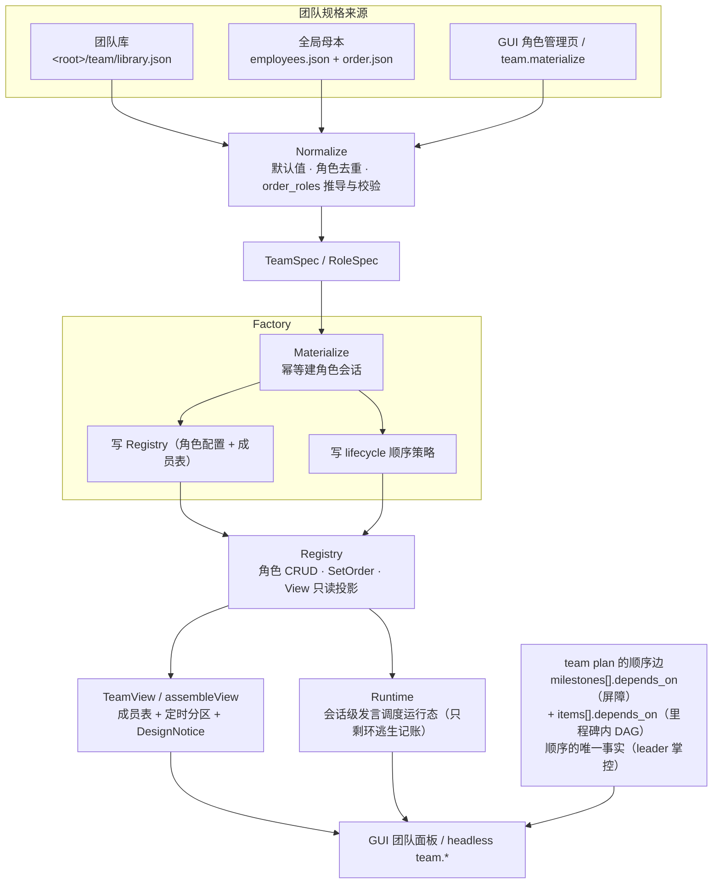
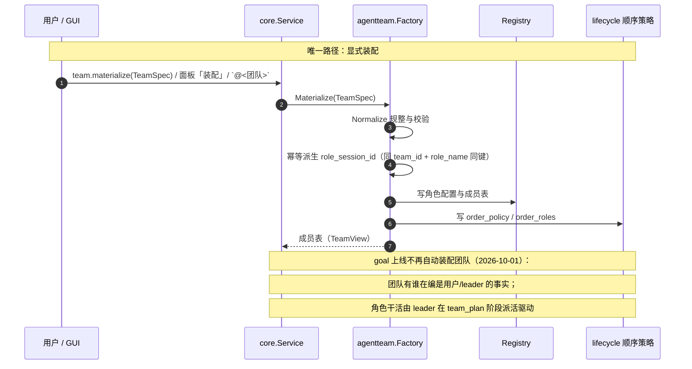

# core/agentteam

> **退场时间线（现行状态以本节为准）**
>
> | 日期 | 条目 | 退场内容 |
> |---|---|---|
> | 2026-10-12 | J-1a | Agent Team 装配适配（`factory.go` / `registry.go` / `library.go` / `global.go`，含 `MaterializeAgentTeam` / `AgentTeamView` / 团队库 / 员工库 / 全局母本 / 员工提示词优化）与 `@` 手动召唤；`application/core/agentteam_service.go`、`agentteam_runtime.go` 的装配读面、`agentteam_role_index.go` 一并删除 |
> | 2026-10-15 | A03 | `application/core/agentteam_runtime.go` 整文件的环接线（`teamRuntimeStore` / `teamRuntimeBySession` / `noteTeamWorkPrefix` / `releaseTeamRuntime`）与 goal 侧 `TeamRuntimeFor` 依赖 |
> | 2026-10-15 | A04 | 本包的 `runtime.go`（`Runtime`：环成员同步、逃生记账、`Next`/`Advance` 推进、team work 前缀投影）与 `scheduler.go`（`TurnScheduler` + 链表 + `TurnRequest`）及其四个用例文件 |
>
> 依据 [`docs/2026-10-15-product-architecture-pre-design/legacy-capability-audit.md`](../../../docs/2026-10-15-product-architecture-pre-design/legacy-capability-audit.md)（A03/A04）。
> A04 的执行前置正是 A03：`TeamRuntimeFor` 摘掉后，`*agentteam.Runtime` 不再是任何生产签名
> 的类型，全仓 Go 源码只剩注释提及；环本身没有任何建造入口，也没有任何消费者。

## 生态位

本包现在只剩 `spec.go`，且没有用户可见面：

1. **`RoleSessionID(mainSessionID, teamID, roleName)`** —— 角色会话号派生（重复装配幂等的键）。
   它是本包**唯一在生产仍被调用**的符号，调用方是 `application/core/goal_team_recorder.go`。
   `teamwork.DefaultRoleSessionID` 与它同形但不同语义（空 team ID / 空白裁剪 / 默认身份不同），
   两者**不合并**（见 A12：合并会改变空值兼容并制造新的角色会话键）。
2. **`Normalize` / `NormalizeRole` / `ValidToolPolicy` / `resolveOrderRoles`** —— 角色与
   `TeamSpec` 的写入侧规整口径。装配面（`Factory` / `Registry` / 团队库 / 员工入职）已随 J-1a
   退场，因此它们**当前没有生产调用方**：保留是为了"权限档位 / 权限格子 / 插件清单只允许
   `readonly`/`readwrite`/`full` 与显式拒绝"这套判据仍然只有一处实现（`ValidToolPolicy` 与
   `dto.NormalizePermissionGroups`/`dto.NormalizePlugins` 是同一套写入侧白名单），
   而不是留一条活的装配链。`RoleSpec` 的 `ToolsPolicy`/`PermissionGroups`/`Plugins` 仍是
   队友执行链的**活动**配置（见 A07），不随本包退场。

非职责（现行，未变）：不接纳 subagent（它是 tool calling 能力，不建角色会话、不进顺序、
不占 floor）；不写 message（正文只由 sequencer append）；`role_name` 只是 metadata，
provider role 仍只有 `system`/`user`/`assistant`/`tool`。

替代能力：团队事实归 teamwork（`seelebridge/teamwork` 的 `TeamworkPlan` 里程碑屏障 +
WorkItem DAG，leader 掌控），goal 终态由 goal 域 gate 判定；**发言环与"下一个谁发言"
没有替代者，因为它不是产品能力**（让角色说话的是 leader 的 `team_dispatch`）。

旧顺序/调度字段（`lifecycle.order_policy`/`order_roles`、`dto.TeamSchedule`、`TeamSpec.OrderPolicy`）
只保留**读兼容**、已无生产者，处理口径见 A05；`session/team/roles.json` 的读写面保留
**只读兼容与旧数据可诊断**口径，见 A06 与 [`sessionstore/README.md`](../../../sessionstore/README.md)。

## 文件结构

| 文件 | 职责 |
|---|---|
| `spec.go` | `TeamSpec`/`RoleSpec` 写入侧规整与校验（`Normalize` / `NormalizeRole` / `ValidToolPolicy` / `resolveOrderRoles`）、角色会话号派生（`RoleSessionID`） |
| `spec_plugins_test.go` | 本包当前仅存的用例：`NormalizeRole` 的插件装配写入侧口径（去空白 / 显式拒绝重复 / 上限 / 空 = 不覆盖） |

已删除（勿再按名字找）：`factory.go`、`registry.go`、`library.go`、`global.go`、
`runtime.go`、`scheduler.go`、`agentteam_test.go`、`team_view_test.go`、
`runtime_test.go`、`scheduler_test.go`、`scheduler_wiring_test.go`、`prefix_test.go`。

## 核心实现

- `RoleSessionID(mainSessionID, teamID, roleName)`：`mainSessionID-teamID-roleName` 的**纯函数**
  派生（各段去空白；`teamID` 为空时用 `dto.DefaultTeamID` 兜底；`mainSessionID` 为空时退化成
  `teamID-roleName`，仅供桩/测试）。它就是持久化的角色会话键，不是展示名。
- `Normalize` / `NormalizeRole` / `ValidToolPolicy` / `resolveOrderRoles`：`TeamSpec`/`RoleSpec`
  的**写入侧白名单**——只接受 `readonly`/`readwrite`/`full`/空（枚举外的拼写显式报错，因为运行时
  把未识别值映射成全权）、权限格子与插件清单交给 `dto.NormalizePermissionGroups` /
  `dto.NormalizePlugins`（同一套判据只有这一处实现）。
- 数据流：调用方（goal 记录器、未来的角色装配者）提供 `(主会话, team_id, role_name)` → 本包
  返回稳定角色会话号；本包**不读盘、不写盘、不建会话**（那曾是 `Factory`/`Port` 的职责，已退场）。

## 依赖方向

- 允许：本包 → `application/contract/dto`（纯 DTO）。
- 禁止：本包 → `sessionstore`、`internal/adapters`、`gui`；也禁止反向依赖（存储与界面不得
  import 本包）。存储形态只在适配器里出现。

## Review 指南

- 有人要改 `dto.DefaultTeamID`（`"goal-a2a"`）或 `RoleSessionID` 的拼接形状吗？它是**身份分量**：
  改它 = 既有角色会话号全体分裂（同名角色被当成新员工，会话子树/权责反查/项目根绑定错位）。
  要改必须走一次显式迁移，并带旧号码的冷读用例。
- 有人以"装配面已退场"为由要删 `RoleSpec` 的 `ToolsPolicy`/`PermissionGroups`/`Plugins` 吗？
  它们是 teammate 执行链的**活动**配置（`runRoleRound` + WorkerRequest）；权限不随插件走、
  插件只收窄、永不放宽，删字段等于放宽权限或让装配落空。
- 有人重新引入"发言顺序 / 下一个谁发言"的运行时（环、轮转、逃生计数）吗？那是已退场的产品语义
  （A04）：让角色说话的是 leader 的 `team_dispatch`；新长一份就是第二个顺序事实。
- 旧字段（`lifecycle.order_policy/order_roles`、`dto.TeamSchedule`）只能读、不得按它分支；
  它们的生产者都已删除，任何"按 schedule 决定行为"的新代码都是错的。
- `ValidToolPolicy` 的枚举与 `dto.NormalizePermissionGroups`/`dto.NormalizePlugins` 是否仍只有
  一处实现？两处判据必须一起漂移（A14 的纪律）。

## 测试与验证

```text
gofmt -l .
go build ./...
go build -tags "gui,desktop,production" ./...
go vet ./...
go test ./application/core/... ./sessionstore/... -count=1
```

本包当前只有一条用例：`spec_plugins_test.go`（`NormalizeRole` 的插件装配写入侧口径）。
`RoleSessionID` 的行为在调用方与 `seelebridge` 的用例里被间接覆盖。

---

## 退场前记录（历史，2026-10-12 之前的口径）

以下正文是**退场前**的记录，未逐行重写：凡提到 Agent Team 装配/面板/`@`/团队库/员工库/
母本/环（`Runtime`、`TurnScheduler`、`AutomaticTurnRoles`、`assembleView`）的行都
**已不再成立**（相关文件多数已删除）；保留它们是为了说明"删掉的是什么、为什么曾经这么设计"。
设计与决策轨迹的权威位置是 `docs/devlog/` 与 `docs/arch/`：
[`2026-10-01-turn-rotation-retired.md`](../../../docs/devlog/2026-10-01-turn-rotation-retired.md)、
[`2026-10-03-seat-rotation-retired.md`](../../../docs/devlog/2026-10-03-seat-rotation-retired.md)、
[`2026-10-01-m4-deadcode-inventory.md`](../../../docs/devlog/2026-10-01-m4-deadcode-inventory.md)。

> **2026-10-03（阶段三 W3）口径更新**：goal 的**席位轮转整条退场（已删除）**——
> `application/core/govern`（整包，已删除）、`goal/adapter.go`（已删除）、座位作业面
> （`jobs.KindSeat` / `SeatExecutor` / `SetSeatRoundRunner` / `RunSeat`，已删除）、座位派生
> （`newGovernor` / `seatsFor` / `seatPlan` / `RoleSeat`，已移除）与 headless `goal_gov_*`
> 均已删除。团队角色只服务 leader 派发的 worker 作业，顺序的唯一事实是 team plan
> 的 `stages[].depends_on`。

## 退场前：生态位

A2A 角色团队的**通用装配能力面**：把「`TeamSpec`/`RoleSpec` → 角色会话 + 工作顺序 +
成员表」抽成可复用装配，供 `application/core` 的 Service 门面与 headless `team.*`
接口消费。长期边界见 [`docs/arch/a2a-agent-team-factory.md`](../../../docs/arch/a2a-agent-team-factory.md)；
本次落地的工厂/注册表口径见
[`docs/2026-09-10-a2a-agentteam-recovery/agentteam-management.md`](../../../docs/2026-09-10-a2a-agentteam-recovery/agentteam-management.md)。

主要调用方：`application/core/agentteam_service.go`（窄转发 + 端口适配）、
`gui/headless_team.go`（`team.*` RPC）。

**没有内置团队形态目录**（2026-10-01，用户口径）：本包不再提供任何"预置团队"
（旧的 `presets.go`：`goal-a2a` / `review-team` / `research-team` 三支模板已删除）。
一支团队 = 调用方给的一份 `TeamSpec`，或**团队库**里的一个条目——有谁、什么顺序
由数据说，不由代码里的模板说。配套删除的还有：`Preset`/`Presets` API、
`AgentTeamPresets` 服务方法、`goal` 上线时的自动装配（它会整份替换掉会话已有的
团队，是事故而不是自动化——见 `application/core/goal_service.go` 的 `GoalBeginFor`）、
`@` 召唤的内置形态分支、输入建议面的形态候选。

装配入口只有一条：**显式装配**——`team.materialize`（一份 `TeamSpec`）/ GUI 面板的
「装配」按钮（团队库条目）/ `@<团队>`（团队库条目，可带附言）。幂等由工厂保证
（同 `(主会话, team_id, role_name)` 派生同一 `role_session_id`）。

## 退场前：职责与非职责

做什么：

- `Normalize` 规整 `TeamSpec`（默认值、角色去重、`order_roles` 推导与校验）；
- `Factory.Materialize` 由 `TeamSpec` 装配一支团队：幂等建角色会话 → 写注册表 →
  写 `lifecycle` 顺序策略 → 返回成员表；
- `Registry` 角色配置 CRUD 与工作顺序设置；
- `assembleView` 把注册表 + 顺序投影成前端消费的成员表（含定时分区与设计偏差提示）。

刻意不做：

- **不接纳 subagent**：subagent 是 tool calling 能力（劳务派遣），不建角色会话、
  不进 `order_roles`、不占 floor（见设计稿 AT1）；
- **不写 message**：正文只由 sequencer append；
- **不做第二份顺序事实**：顺序只落 `lifecycle.order_policy`/`order_roles`；
- 不决定 provider role：`role_name` 只是 metadata，provider 侧仍只有
  `system/user/assistant/tool`。

## 退场前：架构图



## 退场前：时序图（装配）



## 退场前：接线现状（2026-09-14 复核）

装配得出来 ≠ 有人在干活。下表是**退场前**的代码事实（每条都可按"证据"列复核），写在这里
是为了避免把"已注册/已装配"读成"已生效"。表中提到 `Runtime` / `TurnScheduler` 的两行
已被 A04（2026-10-15）整条删除，见本文件顶部的退场时间线：

| 能力 | 现状 | 证据 |
|---|---|---|
| 角色会话 + 顺序策略 + 注册表 | **已接线（显式装配）**：面板「装配」/ `@<团队>` / `team.materialize` 装配一份 TeamSpec，顺序落 `lifecycle`。goal 上线**不再**自动装配（那会整份替换掉会话已有的团队） | `application/core/agentteam_service.go`（`MaterializeAgentTeam`）、`application/core/goal_service.go`（`GoalBeginFor` 的说明）、`application/core/goal_team_wiring_test.go`（`TestGoalBeginLeavesSessionTeamAlone`） |
| 工作顺序（`order_policy`/`order_roles`） | **部分接线（历史字段）**：用于角色 draft 同步排序与成员表展示；**不驱动运行时轮次**（2026-10-03 起没有任何"运行时轮次驱动"了）。`order_policy` 更进一步——落 lifecycle 后只被回读展示（`dto.TeamView`/`dto.TeamSchedule` 与前端面板），不驱动任何行为；`order_roles` 现在只是**发言顺序与成员表的展示事实**（`seatPlan` 那套"按它长座位"的读面已随席位轮转退场）。新事实 = team plan 的 `milestones[].depends_on`（屏障）+ `items[].depends_on`（里程碑内 DAG，leader 掌控，见 `docs/arch/teamwork-leader-worker-architecture.md` §4.6/D4） | `sessionstore/role_session.go`（`sortRoleDraftRows`）、退场记录见 `docs/devlog/2026-10-03-seat-rotation-retired.md` |
| 运行时轮次驱动 | **没有这一层了（2026-10-03 阶段三 W3）**：goal 的治理座位循环（`exec-a` / `advisor-b`、`newGovernor`、`NewTurnGovernorForDSA2A`、`goal/adapter.go`，均已删除）整条退场，回合尾不再推任何座位。goal 由**提示词驱动的 leader 派活**推进（`plugins/default/goal/SKILL.md`），角色干活走 `team_dispatch` 的 worker 作业，顺序的唯一事实是 team plan 的 `milestones[].depends_on`（屏障）与 `items[].depends_on`（里程碑内 DAG） | `docs/devlog/2026-10-03-seat-rotation-retired.md`、`plugins/default/goal/SKILL.md` |
| EXEC 工作内容进入 ADVISOR 输入 | **已接线**：`turn_completed.Detail`（本轮正文/工具名有界摘要）→ `work.progress` 帧 → b 回合输入正文 | `application/core/goal_work_summary.go`、`application/core/goal/techleader.go`（`flushWorkProgressLocked`） |
| EXEC 的 computer use 证据进入 ADVISOR 输入 | **已接线**：工作摘要额外带 `screen: media:… 宽x高 foreground="…"`（截图句柄 + 画面尺寸 + 前台窗口），ADVISOR 据此"看证据评审"，而不是只看到一个工具名 | `application/core/goal_work_summary.go`（`computerUseEvidence`）、`gui/team_work_computer_use_live_probe_test.go` |
| ADVISOR 直接读画面内容 | **尚未实现**：ADVISOR 回合是一次有界 LLM 调用（`TLEvalEvaluator`，无工具循环），它拿到的是证据**句柄与元数据**，不是像素；要读图需要给 b 回合挂图（imageattach）或给角色配独立工具循环 | 见 `docs/devlog/2026-09-15-team-work-computer-use.md` |
| `TeamView.floor_role` | **已接线**：读主会话 `message head.floor`（唯一写者 = sequencer）填成员表；宿主未实现可选读面时留空 | `sessionstore/team_registry.go`（`ReadMessageFloorWorkspace`）、`internal/adapters/agentteam_ports.go`（`ReadFloorRole`） |
| 团队库（可复用团队模板） | **已接线**：**全局** `<root>/team/library.json`（整份替换型），条目 = 角色配置集 + 顺序策略；装配 = 条目 → `TeamSpec` → 既有工厂（建角色会话 + 写会话 registry + 写 lifecycle 顺序） | `sessionstore/team_global.go`、本包 `library.go`、`application/core/agentteam_service.go`（`AgentTeamSaveTeam`/`AgentTeamMaterializeTeam`） |
| 全局母本（员工库 + 默认顺序） | **已接线**：`<root>/team/employees.json`（员工名册）与 `<root>/team/order.json`（默认顺序）是全局母本；会话在编员工表 + lifecycle 顺序是它的**深拷贝副本**，会话内入职/改序只改副本；只有「确认·普及搭配到全局」把副本回写母本 | `sessionstore/team_global.go`、本包 `global.go`、`application/core/agentteam_service.go`（`AgentTeamGlobalConfig`/`AgentTeamPublishToGlobal`） |
| 员工提示词（`RoleSpec.SystemPrompt`）→ ADVISOR 回合 | **已接线**：装配根把"读已装配提示词"的读面注入 Runtime，ADVISOR 回合用它替换内置角色设定；**输出契约永远追加**（goal 域要解析 `TLDirective`，不能被员工提示词改掉输出格式） | `seelebridge/runtime_role_prompt.go`（`SetRolePromptProvider`）、`seelebridge/runtime_goal_tl.go`（`advisorSystemPrompt`）、`main.go` 装配点 |
| 员工权限（`RoleSpec.ToolsPolicy`） | **登记 + 写入侧枚举校验 + 运行时承载体已就位**：值随角色注册表落盘、在员工栏与编辑面板可见；写入侧经 `NormalizeRole` 只接受 `readonly`/`readwrite`/`full`/空（枚举外的拼写错误会被**显式拒绝**——运行时把未识别值映射成 root 全权，静默接受等于把拼写错误升级为最高权限）。真正的工具拦截在 seelebridge `PermissionGate`；**按角色拦截的承载体 = 角色回合执行体**（`seelebridge` 的 `runRoleRound`：开角色会话时分配 `emp_<角色名>` 主体，回合起手按构造把主体放进 ctx，工具面据此收窄；员工干活由 leader 派发的 worker 作业驱动，`RunRoleTurn` 那条座位适配层已于 2026-10-01 退场）| `application/core/agentteam/spec.go`（`ValidToolPolicy`）、`application/contract/dto/agentteam.go`（`ToolPolicy*`）、`seelebridge/tools/permission_policy.go`（`ClassForToolsPolicy`）、`seelebridge/runtime_role_turn.go`（`runRoleRound`）、`seelebridge/tools/registry_state.go`（`PermissionGate`） |
| 员工提示词优化 | **已接线**：一次有界 LLM 回合（`RolePromptPort`），只产出候选文本 + 改动理由，不落盘、不写会话消息；落盘仍走入职/保存 | `seelebridge/runtime_role_prompt.go`（`OptimizeRolePrompt`）、`application/core/agentteam_service.go`（`AgentTeamOptimizeRolePrompt`） |
| `TurnScheduler`（链表轮转 / team work 前缀载体） | **部分接线**：`Runtime`（会话级发言调度运行态）持有它并同步注册表顺序（环成员 = `order_roles` − `user`）；生产实际消费的是 `Order()`（顺序投影）、`NoteTurn()`（逃生记账）、`SyncOrder()` 与 `Snapshot()`，**`Advance()`（经 `Runtime.Next`）没有生产消费者**（"下一个谁发言"是表头扫描的静态投影，不随轮转变化）。含三条**逃生路径**（轮次上限 / 连续无进展 / 无执行者）——它们是**环自己的兜底**，与 goal 治理不再同源（goal 没有"轮次"了） | 本包 `runtime.go` + `scheduler.go`；守卫用例 `scheduler_wiring_test.go`、`runtime_test.go`（`Runtime.Next` → `Advance` 的行为用例、`TestRuntimeRingExcludesUser`）；消费点 `application/core/agentteam_service.go`（`teamRuntimeFor`）与 `goal_coordinator.go`（`NoteTurn` 逃生记账） |
| `@` 召唤的"开工"判据 | **已接线（2026-09-17，2026-10-03 换驱动）**：`@<团队> <附言>` 除装配外还落一个 goal（附言 = 目标陈述），随后由**主代理（leader）按 team_plan 阶段派活**推进；不带附言仍只装配（待命） | `application/core/input_team.go`（`beginGoalForSummon`）、用例 `application/core/input_team_work_test.go` |
| 团队离场（干完就走人） | **已接线（2026-09-17）**：目标收口（栈里没有 active goal）→ 删角色注册表 + 复位顺序；角色会话子树保留（装配幂等键 `(主会话, team_id, role_name)` 不变，再次召唤复用同一棵） | `application/core/agentteam/factory.go`（`Dismiss`/`DismissPort`）、`sessionstore/team_registry.go`（`removeTeamRegistry`）、`application/core/agentteam_service.go`（`DismissAgentTeam`）、`application/core/goal_service.go`（`dismissTeamWhenGoalClosed`） |
| `review-team` / `research-team` 的成员 | **只有装配、没有自动回合**：`reviewer`/`researcher` 建得出角色会话，但不会自动产生回合（`TeamView.DesignNotice` 会明说） | `factory.go`（`AutomaticTurnRoles` / `rolesWithoutAutomaticTurn`） |

结论口径（2026-10-03 复核）：`TurnScheduler` 的链表顺序与 `SetPrefix` 有生产消费者：
`Runtime`（`runtime.go`，2026-09-15 落地）把注册表顺序**减去 user** 同步成环（环成员 = 发言者集合，见 `ringOrder`）；生产**实际调用**的只有 `Order()`（顺序投影）、`NoteTurn()`（`AdvanceAfterChat` 据此收束环）与 `NoteWorkDetail()`（同一次 `AdvanceAfterChat` 把本轮正文装配成 team work 前缀 → `SetPrefix`；唯一写入口在后端，前端只能 `Snapshot().Prefix` 只读查看），`Advance()`（经 `Runtime.Next`）没有生产调用者（channel 投递路径 `Requests` / `Request` / `Next`、顺序编辑三件 `Move` / `Remove` / `Restore` 与只读 getter `Prefix` 已于 2026-10-01 **已退场**，理由是同一条：没有生产消费者）。
顺序也因此只剩**一条写入口**：`SyncOrder` → `SetOrder`（把 `order_roles` − user 整表同步成环），因此"下一个谁发言"不是排班结果（它是把表头第一格扫出来的静态投影）。**没有任何东西在驱动"轮到谁"**（2026-10-03 起）：让角色说话的是 leader 的 `team_dispatch`，环只剩逃生记账——逃生记账只属于**当前这一轮 goal**（新 goal 上线时 `goalCoordinator.Begin` 调 `Runtime.Reset()`，否则上一轮的逃生结论会让新 goal 一上来就"已收束"）。

**user 不在环里**（2026-09-17 定稿）：user 永远在 `order_roles` 里（它是群聊的起手与收口，
`resolveOrderRoles` 的校验也要求它必须在场），但**顺序事实 ≠ 环成员**：环成员 = `order_roles` − `user`
（见 `runtime.go` 的 `ringOrder`）。

为什么删掉旧的「user 席位口径」：曾经有 `queued`/`member`/`absent` 三态（由 `order_policy` 推导），
但三态都建立在同一个错误前提上——把 user 当成环里的一个排班位。后果是**队友的「下一个」会指向
user**（环头扫描会落到它），与「其余时间都是 agent teammate 在互动」的产品口径直接矛盾。现在 user
的发言机会只有一个：每次 react loop 收尾时**消息队列被整批提升为下一轮**（`chat.go` 的队列提升
点）。它是一个动作，不是一个座位；环不需要知道队列状态，`NoteTeamUserQueued`/`noteTeamUserSeat`
两条通知路径随之删除。

**逃生路径**（不能不休止地转）：① 轮次上限 `round_limit`（缺省 24，2026-10-03 起是环**自己的**独立上限，不再与 goal 治理同源）；② 连续无进展上限 `no_progress`；
③ 环内没有任何有执行者的角色 `no_automatic_turn`；④ 空环 `empty_ring`；⑤ 外部显式停止 `external_break`
（用户中断 / goal 收口）。停止是正常收束而非错误，原因随 `TeamView.schedule` 下发前端。

> **A04（2026-10-15）已删除本节的环**：`runtime.go` / `scheduler.go` 与四个用例文件
> （`runtime_test.go` / `scheduler_test.go` / `scheduler_wiring_test.go` / `prefix_test.go`）
> 一并移除，`Runtime` / `TurnScheduler` / `TurnRequest` / `AutomaticTurnRoles` /
> `RolesWithoutAutomaticTurn` / `ringOrder` / `cleanOrder` / `NoteMainContext` /
> `renderMainContextPrefix` 全部不再存在。因此上文"结论口径"里"链表顺序与 `SetPrefix` 有
> 生产消费者 / `Advance()` 只是没有调用者"一段**整段作废**：这条链在 A03（`TeamRuntimeFor`
> 摘除）之后就没有任何消费者，A04 只是把它删掉。判据 = 全仓 `.go` 索引中这四个符号只剩
> 注释提及，且 `*agentteam.Runtime` 不再是任何生产签名的类型。

## 退场前：文件结构

| 文件 | 职责 |
|---|---|
| `spec.go` | `TeamSpec` 规整与校验、角色会话号派生（`RoleSessionID`） |
| `factory.go` | `Port` 契约、`Factory.Materialize`、成员表投影 `assembleView` |
| `registry.go` | `Registry`：角色配置 CRUD、`SetOrder`、`View` 只读投影（含 floor 填充）、`Stored`/`PromptFor` 只读回读 |
| `library.go` | 团队库读写面（条目 upsert/delete/`Entry`）与投影（`SpecOfEntry`/`EntryFromRegistry`/`EntryFromSpec`），含共用口径 `IsBuiltinRole`/`OrderRolesOf` |
| `global.go` | `Global`：全局母本（员工库 + 默认顺序）读写面与规整（`NormalizeEmployeeLibrary`/`NormalizeDefaultOrder`） |
| `scheduler.go` | `TurnScheduler` 轮转原语（链表顺序 + team work 前缀载体；channel 投递与顺序编辑三件已退场，见文件头） |
| `runtime.go` | `Runtime`：会话级发言调度运行态（环成员同步 = 顺序 − user、逃生路径、team work 前缀载体），投影 `dto.TeamSchedule` |
| `agentteam_test.go` | 规整/工厂幂等/第二团队（AT8）/定时分区/注册表用例 |

## 退场前：核心实现

- `Port` 是唯一外部依赖面：`EnsureRoleSession`、`ReadLifecycleOrder`、
  `SetLifecycleOrder`、`Read/WriteTeamRegistry`。实现方是 `application/core` 的
  `agentTeamAdapter`（把 `internal/adapters.SessionPort` 的 DTO 形态转成工厂输入）。
- `FloorPort`（可选）是运行态读面：`ReadFloorRole` 读主会话 `message head.floor`。
  未实现的宿主（旧端口/测试桩）不填充 `TeamView.FloorRole`，也不报错——可选而不是
  塞进 `Port`，是为了不给每个装配桩加编译期义务。读失败只进 `DesignNotice`。
- `Factory.Materialize` 的幂等键是 `(主会话, team_id, role_name)` → `RoleSessionID`；重复装配
  不产生第二个角色会话，返回结果里 `TeamRoleSession.Created=false`。
  **主会话身份编进角色会话号**（2026-10-01，用例 2「团队会话粒度」）：两个会话召唤同一
  支团队时，各自拿到自己的成员实例——改前只按 `(team_id, role_name)` 派生，运行面按这个
  号做键的地方（角色引擎槽、项目根绑定、权责反查）会把两边当成同一个人。
- `resolveOrderRoles` 是顺序唯一入口：定时角色（`RoleKindTimer`）不得进顺序；
  显式顺序必须是「`user` + `main` + 已注册角色」的子集；未给定时按
  `user → main → 其余角色（OrderPriority 升序）` 推导。
- `assembleView` 只报事实不修补：已注册但不在顺序、顺序里未注册的角色写成
  `TeamView.DesignNotice`，供前端与冒烟断言。
- 顺序里存在**没有自动回合**的角色时（`reviewer`/`researcher`/自定义 agent/timer），
  `DesignNotice` 必须明说"没有自动回合"：执行者事实表 = `AutomaticTurnRoles`
  （`user`/`main` 由宿主驱动，`tl` 由 goal 治理执行）。

## 退场前：数据流或生命周期

```text
TeamSpec（团队库条目 / 前端提交）
  → Normalize（默认值/去重/顺序校验）
  → Factory.Materialize
      → Port.EnsureRoleSession（每个非 user/main 角色一个角色会话）
      → Port.WriteTeamRegistry（session/team/roles.json，整份替换型）
      → Port.SetLifecycleOrder（lifecycle head：order_policy/order_roles）
  → dto.TeamMaterializeResult（Spec/View/Sessions/Registry）
```

读取路径：`Registry.View` 读注册表 + `lifecycle` 顺序 → `dto.TeamView`
（成员 + 工作顺序 + 定时分区 + 设计偏差提示）。运行态 `online`/`floor` 高亮由
presence 与 `message head.floor` 提供，不在本包落盘；`Registry.View`/`SetOrder`/
`Materialize` 每次返回视图时经可选 `FloorPort` 重新读取 floor（运行态值不缓存）。

## 退场前：依赖方向

- 允许：本包 → `application/contract/dto`（纯 DTO）。
- 禁止：本包 → `sessionstore`、`internal/adapters`、`gui`；也禁止反向依赖
  （存储与界面不得 import 本包）。存储形态只在适配器里出现。

## 退场前：并发、存储、安全或错误语义

- 装配是**幂等**的：重复 `Materialize` 复用同一角色会话；注册表与顺序整份替换。
- 错误一律显式：未注册角色进顺序、定时角色进顺序、重复 `role_name`、内置角色被
  改写/删除、`team_id`/`team_kind` 都缺的 TeamSpec（没有"缺省形态"可回退）都返回
  错误，不静默降级。
- 不做读时补写：`View` 遇到「注册表有角色但 lifecycle 无顺序」时按注册顺序推导只读
  视图，不落盘，避免读操作产生第二份事实。

## 退场前：扩展方式

- 新增一支团队：**不用改代码**——在面板「团队库」新建（或把当前会话存进库），装配时
  走同一条 `TeamSpec` 通道；要新角色种类才动 `dto.RoleKind`。
  本包不再有"往代码里加一支模板"这条扩展方式（形态目录已删）。
- 新增调度策略：只在 `dto` 增加策略名并校验，替换点是 sequencer 的 role 顺序函数。
- 新增角色字段：加在 `dto.RoleSpec` + `sessionstore.TeamRoleSpec` + 适配器映射三处，
  保持旧注册表可读（缺字段 = 未配置）。

## 退场前：Review 指南

- 顺序是不是只落 `lifecycle`？有没有在别处复制一份 `order_roles`（环成员是它的投影，不是第二份事实）？
- 定时角色有没有漏进 `order_roles`？subagent 有没有被当成团队成员？
- 角色会话号是否稳定（`(主会话, team_id, role_name)`）？重复装配会不会建出第二棵子树？
- 两个会话召唤同一支团队时，角色会话号会不会碰撞（碰撞 = 成员实例被共用）？
- `View` 是否偷偷写盘（读路径必须零写入）？
- `role_name` 是否只做了 metadata：没有被当成 provider role 使用？
- `floor_role` 是不是每次读都重新取（有没有把运行态值缓存/落盘）？读失败是否被静默吞掉？
- 新增/删除有执行者的角色时，`AutomaticTurnRoles` 与 `DesignNotice` 是否同步（别让 UI 误以为有人干活）？
- `scheduler.go` 被改动时，README「接线现状」表与 `scheduler_wiring_test.go` 是否同步？
- 环成员是不是仍然等于「`order_roles` − `user`」？有没有哪条路径把 user 放回环里（那会让「下一个发言」指向人）？

## 退场前：测试与验证

```text
gofmt -l .
go build ./...
go build -tags "gui,desktop,production" ./...
go vet ./application/core/agentteam ./sessionstore ./gui ./internal/adapters
go test ./application/core/agentteam ./sessionstore ./gui -count=1
go test -race ./application/core/agentteam -count=1
```

关键测试：`agentteam_test.go`（规整/幂等/AT8 第二团队/定时分区/注册表 CRUD）、
`team_view_test.go`（floor 读面：可选端口/读失败/降级；无自动回合提示）、
`scheduler_wiring_test.go`（`TurnScheduler` 接线状态与 README 声明一致）、
`sessionstore/team_registry_test.go`（注册表落盘、角色会话幂等、`message head.floor` 读面）、
`application/core/goal_team_wiring_test.go`（goal → 自动装配）与
`application/core/goal_work_summary_test.go`（EXEC 工作正文进 ADVISOR 输入）、
`gui/headless_team_test.go`（`team.*` 契约）、
`gui/team_live_probe_test.go`（真实 API + pprof 冒烟，env 门控）。

## 文件与函数索引

> 由源码 doc 注释自动提取（首行摘要）；描述源码行为，与实现保持同步。
> 刷新方式：`python scripts/gen_core_readme_index.py`。

### spec.go

- `func Normalize(spec dto.TeamSpec) (dto.TeamSpec, error)` — Normalize 把 TeamSpec 规整成可装配形态：补默认值、去重、推导 order_roles、
- `func NormalizeRole(role dto.RoleSpec) (dto.RoleSpec, error)` — NormalizeRole 规整单个角色（TeamSpec 装配与"一步实例化一个角色"共用同一套
- `func ValidToolPolicy(policy string) bool` — ValidToolPolicy 报告 tools_policy 是否落在枚举内（dto.ToolPolicy*）。
- `func resolveRoleKind(roleName string, kind dto.RoleKind) dto.RoleKind` — resolveRoleKind 让内置角色名（user/main）永远取内置 kind；其它角色 kind 缺省
- `func resolveOrderRoles(spec dto.TeamSpec, registered map[string]struct{}) ([]string, error)` — resolveOrderRoles 决定工作顺序：显式给定时必须是 [user, main + 已注册角色] 的
- `func RoleSessionID(mainSessionID, teamID, roleName string) string` — RoleSessionID 派生角色会话号：同一个 (主会话, team_id, role_name) 永远得到同一个
- `func needsRoleSession(kind dto.RoleKind) bool` — needsRoleSession 判定该角色是否需要独立角色会话子树：user/main 复用主会话，
- `func registeredRoles(spec dto.TeamSpec) []dto.RoleSpec` — registeredRoles 返回需要角色会话的已注册角色。

### spec_plugins_test.go

- `func TestNormalizeRoleNormalizesPlugins(t *testing.T)` — TestNormalizeRoleNormalizesPlugins 钉住写入侧的**语法**口径（与编排侧共用

