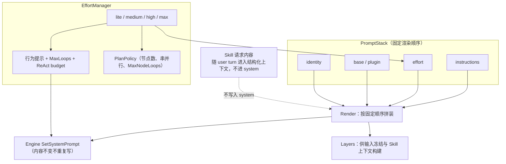
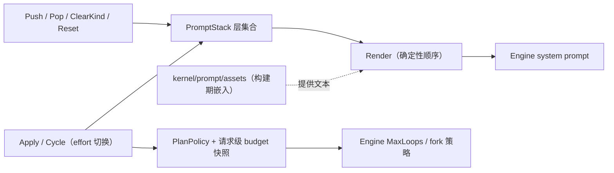

# Application Prompt

## 生态位

本包管理 system prompt 的分层组合和 Effort 行为策略，为 `assembly.Service` 提供线程安全、可解释的 prompt 状态。

主要调用方：`application/assembly`（经本包的 Coordinator alias 组装与引擎同步）、
`gui`/`tui`（Effort 切换与展示）。
具体提示词文本不在本包，而在 [`kernel/prompt/assets`](../../kernel/prompt/assets/README.md)。

## 架构图



## 数据流图



## PromptStack

`PromptLayer` 以 `kind + name + text` 标识一层。权威形状在
`contract/dto.PromptLayer`，本包保留同身份 alias，使 backend 任务域可直接使用
契约类型而不反向依赖 Application。固定 system 顺序为 identity、base/plugin、
effort、instructions；Skill 请求内容不永久写入 system prompt，而随用户 turn
进入结构化上下文。

主要操作：

- `Push`/`Pop`/`PopKind`/`ClearKind`：维护层。
- `Reset`：重置基础 prompt。
- `Render`：按固定顺序生成最终 system prompt。
- `Layers`：供服务端输入冻结和 Skill 上下文构建。装配后的 system prompt 与层摘要不得进入 Snapshot、Event 或前端诊断。

## EffortManager

`lite`、`medium`、`high`、`max` 映射到行为提示、Engine MaxLoops、SubagentPolicy 和请求级 ReAct budget。`Apply` 同时更新 PromptStack 与 Engine；`Cycle` 为前端提供顺序切换。

每个 budget 都限制工具轮数和工具调用数，并在 `assembly.Service` 接管底层 Engine 未主动执行 `MaxLoops` 时作为最终的收束边界。预算按提交时的 effort 快照保存；它不会禁止 Markdown 导出等交付工具，只会阻止预算耗尽后的下一次 ReAct 迭代。长编码任务不设 wall-clock 超时，仍可由用户显式取消。

具体提示词不保存在 Go 常量中。Seelex-owned identity、通用系统规则、各 effort 规则和子代理章程位于 [`kernel/prompt/assets`](../../kernel/prompt/assets/README.md)：默认以内嵌资源随二进制走，启动期可被 `config/prompt/` 里的同名文件逐份覆盖（外部覆盖层，见该包 README）。这里只保留层组合与 `EffortManager` 的应用动作；**档位策略表**（reasoning 强度 / 子代理约束 / 默认档位）已归位 [`kernel/limit/effort`](../../kernel/limit/effort/README.md)，四个档位共用同一份 effort 行为指令，档位差异只由策略读数表达。

每个 budget 同时限制工具轮数、工具调用数和连续无进展轮数；无进展只在重复工具工作未产生新事实、变更、产物或 task 状态时计数。它是最后熔断器，主路径仍是 Application 的 checkpoint 与 token 驱动上下文裁剪；长编码任务没有 wall-clock timeout。预算不会禁止 Markdown 导出等交付工具。

## Subagent policy

`SubagentPolicyFor` maps effort to runtime-enforced subagent constraints
(node/task limits, loop/output caps). The Plan DAG tool family is retired;
`fork_subagents` is the parallel-work entry and returns job handles immediately.
Every normal user request enters the ReAct loop directly; effort does not create
a mandatory planning preflight.

## Engine Prompt Coordinator

`coordinator.go` 以同身份 alias 暴露 `kernel/prompt.Coordinator`，并用
`NewCoordinator` 只转换装配参数形状。system 层组装、前缀缓存、活跃任务同步与
`SetSystemPrompt` 仍由 Engine prompt 唯一实现；`ValidateAssets` 也只转发资产校验。
这样 `application/assembly` 不再直接 import Engine prompt 子包。

## Environment Trace

`environment.go` 拥有请求尾部的项目环境只读块：固定标记、名称排序、本会话固定/
项目默认标记、local/SSH 地址、remote root 和单行截断。`EnvironmentTraceDeps`
只读取 Session SSH 环境表、当前固定环境与项目根；空表或读取失败返回空块，不参与
system 前缀、历史或压缩。

## Review 指南

- 不要让 map 迭代顺序影响 prompt；渲染顺序必须确定。
- Effort 更新应同时刷新 max loops 和最终 system prompt；新增等级必须通过单一 profile 同时定义 prompt、SubagentPolicy 和 budget。
- Skill prompt 与 system layers 的边界不能混淆。
- Coordinator 是否仍是 Engine 类型 alias，不能在本包复制前缀缓存或同步判据。
- 所有读写都经过 mutex，返回 slice 时需复制。

## 测试

```text
go test ./application/prompt -count=1
go test ./application/assembly -run 'Effort|Skill' -count=1
```

## 文件与函数索引

> 由源码 doc 注释自动提取（首行摘要）；描述源码行为，与实现保持同步。
> 刷新方式：`python scripts/gen_core_readme_index.py`。

### coordinator.go

- `func NewCoordinator(deps CoordinatorDeps) *Coordinator` — NewCoordinator constructs the one Engine-owned prompt coordinator.
- `func ValidateAssets() error` — ValidateAssets validates the resolved embedded-or-overridden prompt set.

### coordinator_test.go

- `func TestCoordinatorIsEngineIdentity(t *testing.T)`

### effort.go

- `func ReasoningEffortFor(level string) string` — ReasoningEffortFor returns the thinking-strength value for an effort level.
- `func MaxLoops(level string) int` — MaxLoops returns the engine loop limit for an effort level.
- `func ReActBudgetFor(level string) ReActBudget` — ReActBudgetFor returns an immutable execution budget for an effort level.
- `func SubagentPolicyFor(level string) dto.SubagentPolicy` — SubagentPolicyFor returns the plan constraints for an effort level.
- `func ValidEffortLevels() []string` — ValidEffortLevels 返回所有有效 effort 等级。
- `func (m *EffortManager) SubagentPolicy() dto.SubagentPolicy` — SubagentPolicy returns the constraints for the manager's current effort level.
- `func NewEffortManager(ps *PromptStack, eng interface { SetMaxLoops(int) SetSystemPrompt(string) }) *EffortManager` — NewEffortManager 创建 Effort 管理器。
- `func (m *EffortManager) Apply(level string) error` — Apply 切换 effort 等级并更新 effort prompt 层与 MaxLoops。
- `func (m *EffortManager) applyLocked(level string) error`
- `func (m *EffortManager) Current() string` — Current 返回当前 effort 等级。
- `func (m *EffortManager) Cycle() (string, error)` — Cycle 循环切换到下一个 effort 等级。

### effort_forward_test.go

- `func TestEffortEntryPointsForwardToPolicy(t *testing.T)` — TestEffortEntryPointsForwardToPolicy 是跨实现一致性用例：prompt 侧的三个既有

### environment.go

- `func EnvironmentTraceBlockFor(deps EnvironmentTraceDeps, sessionID string) string` — EnvironmentTraceBlockFor renders one session's provider-only environment
- `func RenderEnvironmentTraceBlock(projectRoot, defaultEnv, currentEnv string, environments []protocol.WorkspaceEnvironmentInfo) string` — RenderEnvironmentTraceBlock is the pure rendering surface.
- `func environmentAddress(item protocol.WorkspaceEnvironmentInfo, projectRoot string) string`
- `func environmentSingleLine(value string) string`

### environment_test.go

- `func TestRenderEnvironmentTraceBlockUsesStableOrderAndMarks(t *testing.T)`

### stack.go

- `func NewPromptStack() *PromptStack` — NewPromptStack 创建空栈。
- `func (ps *PromptStack) Push(kind, name, text string)` — Push 压入一层。同名 layer（kind+name 相同）会被覆盖更新。
- `func (ps *PromptStack) Pop(name string) bool` — Pop 按 name 删除一层。返回是否找到并删除。
- `func (ps *PromptStack) PopKind(kind string) string` — PopKind 删除最后一个指定 kind 的层，返回其 name。
- `func (ps *PromptStack) ClearKind(kind string)` — ClearKind 删除所有指定 kind 的层。
- `func (ps *PromptStack) Reset(baseText string)` — Reset 清空所有层，设置 base 层。
- `func (ps *PromptStack) Render() string` — Render 将所有层渲染为完整 system prompt。
- `func renderLayer(l PromptLayer, text string) string` — renderLayer 把一层包成 XML 段；kind 不在受限词表内（如自定义层）时退回原文，
- `func promptTagName(value string) string` — promptTagName 把层标识归一化成安全的 XML 标签名（只留 a-z0-9_-；大写折成
- `func systemPromptPriority(kind string) int`
- `func (ps *PromptStack) Has(kind string) bool` — Has 检查是否存在指定 kind 的层。
- `func (ps *PromptStack) Layers() []PromptLayer` — Layers 返回当前所有层的副本（用于 TUI 显示）。
- `func (ps *PromptStack) Count() int` — Count 返回层数。
- `func (ps *PromptStack) remove(kind, name string)`
- `func (ps *PromptStack) Describe() string` — Describe 返回人类可读的栈摘要（用于状态栏等）。

### stack_test.go

- `func TestPromptStack_PushAndRender(t *testing.T)`
- `func TestPromptStack_RenderUsesFixedSystemOrder(t *testing.T)`
- `func TestPromptStack_Pop(t *testing.T)`
- `func TestPromptStack_PopKind(t *testing.T)`
- `func TestPromptStack_Reset(t *testing.T)`
- `func TestPromptStack_ClearKind(t *testing.T)`
- `func TestPromptStack_Describe(t *testing.T)`
- `func TestPromptStack_Empty(t *testing.T)`
- `func TestEffortApply_ValidLevels(t *testing.T)`
- `func TestEffortApply_InvalidLevel(t *testing.T)`
- `func TestEffortApply_UpdatesPromptStack(t *testing.T)`
- `func TestEffortApply_SetsMaxLoops(t *testing.T)`
- `func TestReActBudgetByEffort(t *testing.T)`
- `func TestSubagentPolicyForByEffort(t *testing.T)`
- `func (m *mockEngine) SetMaxLoops(n int)`
- `func (m *mockEngine) SetSystemPrompt(p string)`
- `func contains(s, substr string) bool`
- `func containsStr(s, substr string) bool`
- `func hasLayer(layers []PromptLayer, kind, name string) bool`
