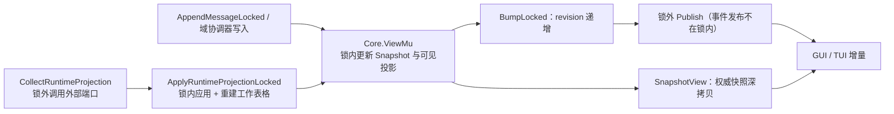
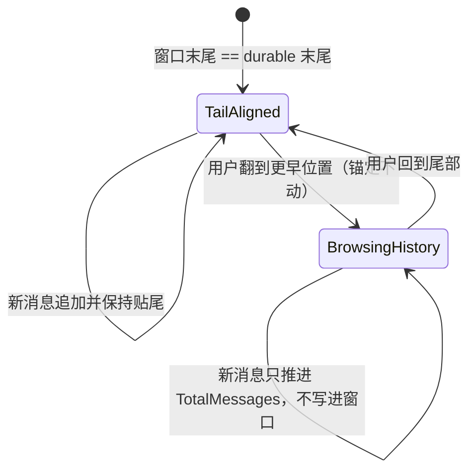

# application/session/viewstate

## 生态位

用户可见 Snapshot 读写与事件发布：`SnapshotView`/`Subscribe`/
`SubscribeSession`/`SubscribeSessionWithReplay`/
`AppendMessageLocked`/`BumpLocked`/`ApplyRuntimeProjectionLocked`/
`CollectRuntimeProjection`/`AddNotice`/`ResetConversation`；消息序列与
revision、restoring 集合、restore 广播和 view epoch/intent 在此自持。

本包现在是 Application-owned Coordinator，不再转调 `middle/view/state`；
core、conversation、policy、admin 与 cold/session 组件直接消费本包。

## 职责与非职责

- 做：消息追加与窗口裁剪、runtime 投影收集/应用、revision bump。
- 做：`ToolResultBudgetApplication` 消费 residency 的唯一 preview 判据，计算
  UTF-8 `total_chars` 并在截断时归档 `result_ref`；assembly 不再持有该判据。
- 做：会话级事件订阅的唯一过滤判据。显式 session ID 精确匹配；空 ID 跟随
  `session.Domain.ActiveID()`；`resync.required` / `app.exit_requested`
  只接受空 SessionID 的进程级事件。
- 做：会话目录活体行补种、状态/待批/驻留富化、restoring 状态与唤醒信号、
  每会话视图意图、读文件引用和工具后 assistant 占位。
- 窗口锚点（2026-09-11）：可见窗口是 `[HistoryOffset, HistoryOffset + 窗口条数)`
  的连续区间。**贴尾**（`viewWindowTailAligned`：窗口末尾即 durable 末尾）时新
  消息照常追加并保持贴尾；**回看历史**（用户翻到更早位置）时窗口锚定不动，
  新消息只推进 `TotalMessages`、不写进窗口——写进去会在窗口尾部插洞并把用户
  拽回尾部。`SessionViewBrowsingHistoryLocked` 是这条判据的消费面（流式增量、
  推理挂接等「写最新一条消息」的路径在回看期间必须跳过，否则会串写到旧消息）。
- **用户行例外（2026-09-28）**：回看期间到达的 `user` 行开启新一轮对话，追加前先
  把窗口原地重置为「以这条新消息为尾」（`endBrowsingForNewTurn`，与内容 LRU 卸载
  后的重置同一形状）。用户发言是「从现在起看最新」的手势，不是阅读手势：照旧不
  写进窗口时，这一轮自己的输入落在窗口之外，而前端 reducer 在 `historyWindowed`
  时同样不落 `message.added`，现场表现就是「输入被吞、整个回合界面一动不动」。
  助手/工具行不受这条规则影响（`TestAppendWhileBrowsingHistoryKeepsWindow` 钉住
  的正是那一侧）。
- 不做：工作表格构建（`application/execution/table`，经端口注入）、chat 流式。

## 依赖方向

依赖 `state.Core` + 注入端口（`CurrentEffort`、`RefreshWorkTableLocked`、
`DraftView`、`TitleForSession`、`dto.ViewLimits` 只读窄面）。thought 块过滤已改为
`contract/protocol` 的唯一实现，
本包不再 import `kernel/react`。

BM-003 已完成：Application 注入 `func() dto.ViewLimits`，
本包不依赖 `kernel/limit`。

`DurableConversationCount`、`BoundConversationTail`、`BoundConversationHead`
的窗口算法已下沉 `contract/protocol`；本包只保留同身份兼容转发。

## 数据流图

## 窗口锚点状态

## 并发/安全语义

视图锁（`Core.ViewMu`，保护 Snapshot 与可见投影）内 bump → 锁外 Publish；
`CollectRuntimeProjection` 锁外收集外部端口，`ApplyRuntimeProjectionLocked`
锁内应用并重建工作表格。会话可见投影的字段写一律经 `View.mu`
（`SessionViewMutateLocked`/`SessionViewReadLocked`；G5 访问器化）：单元
View 指针注册后不再整体替换，冷加载装载在 View.mu 内逐字段拷贝。

## 扩展与 Review

新增 Snapshot 派生面放本包。Review 重点：revision 单调、窗口裁剪不丢
system 引导消息、投影应用不覆盖 Plan/Account 指针。

## 测试

`subscribe_test.go` 覆盖视图归属过滤、显式会话隔离、进程事件透传和 replay
窗口；根包 `service_snapshot_test.go` 等继续覆盖跨组件集成行为。

## 文件与函数索引

> 由源码 doc 注释自动提取（首行摘要）；描述源码行为，与实现保持同步。
> 刷新方式：`python scripts/gen_core_readme_index.py`。

### coordinator.go

- `func NewCoordinator(deps Deps) *Coordinator` — NewCoordinator 构造 view 域协调器。
- `func (c *Coordinator) SnapshotView() model.Snapshot` — SnapshotView 返回权威快照深拷贝。
- `func (c *Coordinator) Subscribe(buffer int) event.Subscription` — Subscribe 订阅事件流。
- `func (c *Coordinator) SubscribeSession(sessionID string, buffer int) (event.Subscription, error)` — SubscribeSession returns events owned by sessionID, or by the current view
- `func (c *Coordinator) SubscribeSessionWithReplay(sessionID string, buffer, replayWindow int) (event.Subscription, error)` — SubscribeSessionWithReplay has the same ownership filter as SubscribeSession
- `func (c *Coordinator) sessionEventFilter(sessionID string) func(event.Event) bool`
- `func (c *Coordinator) CollectRuntimeProjection(ctx context.Context) RuntimeStateProjection` — CollectRuntimeProjection 锁外调用外部端口收集当前视图会话的 runtime
- `func (c *Coordinator) viewSessionID() string` — viewSessionID 返回当前视图指针会话（装配注入的 Domain.ActiveID；未注入
- `func (c *Coordinator) CollectRuntimeProjectionFor(ctx context.Context, sessionID string) RuntimeStateProjection` — CollectRuntimeProjectionFor 按显式会话收集 runtime 投影（G1：会话槽的
- `func (c *Coordinator) fullAccessFor(sessionID string) bool` — fullAccessFor 返回指定会话生效的全权模式（G4：会话选择优先；未选择时
- `func (c *Coordinator) permissionTierFor(sessionID string) string` — permissionTierFor 返回指定会话生效的权限档位（G4：会话选择优先；未选择时
- `func (c *Coordinator) tokenCountFor(sessionID string) string` — tokenCountFor 返回指定会话的 token 计数（有 per-session 端口优先；
- `func (c *Coordinator) activeSkillIDsFor(sessionID string) []string` — activeSkillIDsFor 返回指定会话的任务激活 skill ID（per-session 端口
- `func (c *Coordinator) goalSkillActiveFor(sessionID string) bool` — goalSkillActiveFor 返回指定会话的 goal skill 激活判定。
- `func (c *Coordinator) ApplyRuntimeProjectionLocked(projection RuntimeStateProjection)` — ApplyRuntimeProjectionLocked 应用 runtime 投影到当前活跃会话（保留 Plan/
- `func (c *Coordinator) ApplyRuntimeProjectionForLocked(sessionID string, projection RuntimeStateProjection)` — ApplyRuntimeProjectionForLocked 应用 runtime 投影到指定会话（G1）：
- `func (c *Coordinator) AppendMessageLocked(role, content string, tool *model.ToolCall) *model.Message` — AppendMessageLocked 追加一条可见消息到当前活跃会话（调用方持有
- `func (c *Coordinator) AppendMessageWithOriginLocked(role, content string, tool *model.ToolCall, origin model.MessageOrigin) *model.Message` — AppendMessageWithOriginLocked appends one attributed message to the current
- `func (c *Coordinator) AppendMessageLockedFor(sessionID, role, content string, tool *model.ToolCall) *model.Message` — AppendMessageLockedFor 追加一条可见消息到指定会话（阶段 1：可见对话收进
- `func (c *Coordinator) AppendMessageWithOriginLockedFor(sessionID, role, content string, tool *model.ToolCall, origin model.MessageOrigin) *model.Message` — AppendMessageWithOriginLockedFor 追加一条带群聊归属的可见消息：归属字段
- `func (c *Coordinator) sessionViewLocked(sessionID string) *session.View` — sessionViewLocked 返回指定会话的可见投影（按需创建会话域单元；调用方持有
- `func (c *Coordinator) SessionViewLocked(sessionID string) *session.View` — SessionViewLocked 返回指定会话的可见投影（core 域恢复/回看路径用；
- `func (c *Coordinator) SessionViewMutateLocked(sessionID string, mutate func(*session.View))` — SessionViewMutateLocked 在指定会话可见投影的 View.mu 内应用变更（G5 访问
- `func (c *Coordinator) SessionViewReadLocked(sessionID string, read func(*session.View))` — SessionViewReadLocked 在指定会话可见投影的 View.mu（读）内读取字段快照
- `func (c *Coordinator) SetSessionViewLocked(sessionID string, view *session.View)` — SetSessionViewLocked 装载指定会话的可见投影（冷加载/恢复路径；调用方
- `func (c *Coordinator) SetSessionChatLockedFor(sessionID string, chat model.ChatState)` — SetSessionChatLockedFor 写指定会话的聊天运行态投影（调用方持有
- `func (c *Coordinator) SetReadFilesFor(sessionID string, readFiles []model.ReadFileRef)` — SetReadFilesFor 写指定会话的 read 文件引用投影（调用方持有 Core.ViewMu）。
- `func (c *Coordinator) SetReviewRequestForLocked(sessionID string, request *dto.ReviewRequest)` — SetReviewRequestForLocked 把一次「请 GUI 打开这些待审阅文件」的批处理请求写进
- `func (c *Coordinator) ClearReviewRequestForLocked(sessionID string)` — ClearReviewRequestForLocked 清空指定会话的待审阅请求（工作区切换/解绑时用：
- `func (c *Coordinator) ReviewRequestForLocked(sessionID string) *dto.ReviewRequest` — ReviewRequestForLocked 读指定会话的待审阅请求拷贝（调用方持有 Core.ViewMu）。
- `func (c *Coordinator) mirrorActiveViewLocked(sessionID string, view *session.View)` — mirrorActiveViewLocked 把指定会话的 scope 镜像到 Snapshot（仅当目标为
- `func (c *Coordinator) MirrorActiveViewLocked()` — MirrorActiveViewLocked 把当前活跃会话 scope 镜像到 Snapshot（切换/恢复
- `func (c *Coordinator) AdvanceMessageSeqForLocked(sessionID string, messages []model.Message)` — AdvanceMessageSeqForLocked 按既有消息 ID 推进**指定会话**的消息派号
- `func (c *Coordinator) NextMessageSeqForLocked(sessionID string) uint64` — NextMessageSeqForLocked 返回指定会话的下一条消息序号并推进（分页加载 ID
- `func viewWindowTailAligned(view *session.View) bool` — viewWindowTailAligned 报告可见窗口是否贴尾（窗口末尾即 durable 末尾）。
- `func (c *Coordinator) SessionViewBrowsingHistoryLocked(sessionID string) bool` — SessionViewBrowsingHistoryLocked 报告指定会话是否处于「回看更早历史」状态
- `func DurableConversationCount(messages []model.Message) int` — DurableConversationCount 返回参与历史游标的可见消息数（system 引导消息
- `func endBrowsingForNewTurn(view *session.View)` — endBrowsingForNewTurn 结束回看：把可见窗口原地重置为「以即将追加的新消息为尾」。
- `func (c *Coordinator) boundViewTailLocked(view *session.View)`
- `func durableConversationCount(messages []model.Message) int`
- `func BoundConversationTail(messages []model.Message, window int) []model.Message` — BoundConversationTail 保留尾部窗口（system 与普通消息分列计数）。
- `func BoundConversationHead(messages []model.Message, window int) []model.Message` — BoundConversationHead 保留头部窗口（分页加载前置用）。
- `func TaskScope(sessionID, viewSessionID string) string` — TaskScope 是「读哪个会话的任务注册表」的唯一判据（看板读面与打点块同源）：
- `func (c *Coordinator) BumpLocked() uint64` — BumpLocked 递增快照修订号。
- `func (c *Coordinator) AddNotice(notice string)` — AddNotice 追加一条系统通知并发布事件。
- `func (c *Coordinator) ResetConversation(notice string)` — ResetConversation 清空可见会话并注入 CLI 标识与通知。

### frontend_snapshot.go

- `func NewSnapshotApplication(view *Coordinator, deps SnapshotDeps) *SnapshotApplication`
- `func (application *SnapshotApplication) BindToolResultBudget(budget *ToolResultBudgetApplication)` — BindToolResultBudget installs the visible tool-result boundary owner.
- `func (application *SnapshotApplication) ToolResultBudget() *ToolResultBudgetApplication` — ToolResultBudget returns the visible tool-result boundary owner.
- `func (application *SnapshotApplication) Snapshot() protocol.Snapshot` — Snapshot returns a deep-copied projection with session status, the retained

### frontend_snapshot_test.go

- `func TestFrontendSnapshotProjectsDraftRowsAndHostEnrichment(t *testing.T)`

### session_runtime.go

- `func (c *Coordinator) ProjectDraftWorkspaceLocked(snapshot *protocol.Snapshot)` — ProjectDraftWorkspaceLocked injects the active draft's workspace binding
- `func (c *Coordinator) WithLiveSessionRowsLocked(rows []protocol.SessionInfo) []protocol.SessionInfo` — WithLiveSessionRowsLocked appends running/queued/awaiting sessions that are
- `func (c *Coordinator) EnrichDirectoryRowsLocked(rows []protocol.SessionInfo) []protocol.SessionInfo` — EnrichDirectoryRowsLocked overlays session status, approval count and
- `func (c *Coordinator) SessionStatusLocked(sessionID string) protocol.SessionStatus` — SessionStatusLocked returns the visible status of one session.
- `func (c *Coordinator) IsRestoringLocked(sessionID string) bool` — IsRestoringLocked reports whether a session is in the cold-restore shell.
- `func (c *Coordinator) SetRestoringLocked(sessionID string)` — SetRestoringLocked marks a session as entering cold restore.
- `func (c *Coordinator) ClearRestoringLocked(sessionID string)` — ClearRestoringLocked removes the restore shell and wakes waiters.
- `func (c *Coordinator) signalRestoreLocked()`
- `func (c *Coordinator) RestoreSignalLocked() <-chan struct` — RestoreSignalLocked returns the current restore-change signal.
- `func (c *Coordinator) nextViewEpochLocked() uint64`
- `func (c *Coordinator) NextViewEpochLocked() uint64` — NextViewEpochLocked advances the view activation clock.
- `func (c *Coordinator) MarkSessionViewIntentLocked(sessionID string) uint64` — MarkSessionViewIntentLocked records a new per-session activation intent.
- `func (c *Coordinator) MarkSessionViewIntent(sessionID string)` — MarkSessionViewIntent records activation intent while taking the view lock.
- `func (c *Coordinator) SessionViewIntentLocked(sessionID string) uint64` — SessionViewIntentLocked returns the latest activation intent for a session.
- `func (c *Coordinator) RefreshRuntimeProjectionForSession(sessionID string)` — RefreshRuntimeProjectionForSession samples outside the lock and applies the
- `func (c *Coordinator) AppendAssistantPlaceholderAfterToolLocked(sessionID string) *protocol.Message` — AppendAssistantPlaceholderAfterToolLocked appends one empty assistant row
- `func (c *Coordinator) SessionViewEmptyLocked(sessionID string) bool` — SessionViewEmptyLocked reports whether a session has no visible messages.
- `func (c *Coordinator) RecordReadFileForSessionLocked(sessionID, arguments string)` — RecordReadFileForSessionLocked records/refreshes one read-file reference.

### session_runtime_test.go

- `func (sessionRuntimeTasks) ActiveSkillIDs() []string`
- `func (sessionRuntimeTasks) GoalSkillActive() bool`
- `func (sessionRuntimeTasks) RoleRoundFor(string) uint64`
- `func TestSessionViewRuntimeOwnsRestoringAndViewIntent(t *testing.T)`

### subscribe_test.go

- `func TestCoordinatorSubscribeSessionRoutesByViewOwnership(t *testing.T)`
- `func TestCoordinatorSubscribeSessionWithReplayUsesExplicitScope(t *testing.T)`

### tool_result_budget.go

- `func NewToolResultBudget(deps ToolResultBudgetDeps) *ToolResultBudgetApplication` — NewToolResultBudget constructs the tool-result budget application.
- `func (application *ToolResultBudgetApplication) Bound( name, content string, ) (visible string, resultRef string, truncated bool, totalChars int)` — Bound returns the visible preview and optional durable result reference. The

### tool_result_budget_test.go

- `func TestToolResultBudgetUsesPreviewDecisionAsSingleJudgement(t *testing.T)`
- `func TestToolResultBudgetCountsRunes(t *testing.T)`
