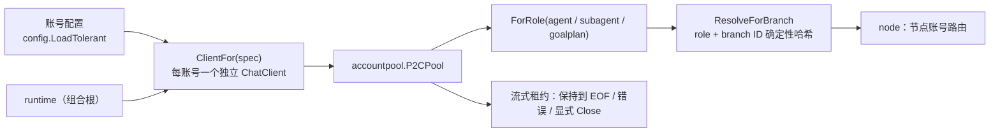

# account 域

## 生态位

承载 Seelex 的账号装配与选择：从账号配置构造同步 Completer、注册进 P2C
账号池、按 role+seed 稳定哈希解析节点账号。主要调用方：根包 `runtime.go`
（NewRuntime 装配与账号池注册）与 `runtime_account.go`（`accountSelector`
与分支账号路由，原独立路由文件已并入）。

## 职责与非职责

- 职责：`ClientFor` 构造 client、`RegisterAccounts` 注册账号池、
  `ResolveForBranch`/`ForRole`/`ByName`/`StableIndex` 选择与查找、
  `QueryBalance`/`BalanceEndpoint` 余额探测、`Manager.Add` 热注册新账号。
  `Manager.Accounts` 的界面摘要携带**显式角色**、`APIKeySet` 与 `Fallback`；密钥明文
  不进入摘要或快照。
- `Manager.SetRoleAccount` 固定某个账号角色的首选账号。作用域请求（subagent /
  goalplan / teammate）优先按该固定值租赁；主链路在未显式选择账号时也可使用 agent
  角色的固定值。
- 非职责：不持有账号池状态（池在 Runtime）、不决定 UI 展示、**不写账号档**
  （账号档的写入在 `internal/config`）。

## 与其它域的关系

同一份 DAG 的账号路由可复现（哈希而非随机），因此并发子代理不会争用同一额度，
也便于按角色核算成本。

## 核心实现

- `ClientFor(spec)`：每个账号一个独立 `api.NewChatClient`，provider 类型
  由配置设定；**不设整请求超时**（见下节「流式超时纪律」）。
- `ForRole(pool, role)`：按角色（含回退链）筛选启用账号，无匹配回退任意
  启用账号。
- `StableIndex(seed, size)`：FNV-1a 32 位稳定哈希索引（同 seed 恒等）。
- `ServedRouteRegistry`（`served_route.go`，P21-3 从 `backend/engine/assemble/runtime_account.go` 归位）：
  **每会话最近一次请求的实际承接路由**注册表。判据四条：① 只有 `request` / `failover` 才覆盖
  （最终承接账号覆盖前面的尝试）；② 只有**主链路请求**（`NodeID` 空、会话非空）才记录——
  子代理/plan 节点的路由归各自的节点视图，进程级请求无处回填；③ `unpinned_selection` 按
  「会话+账号」只记一次摘要（主链路未固定账号时它每轮都发生），`failover` 不去重（每次都要可审计）；
  ④ `Take` **读即清**（事实只服务「本轮 response 回填真相源」一次）。宿主面只差一个摘要落点
  （`ServedRouteDeps.RecordSummary`）。
- `WindowOverlay`（`window_overlay.go`，P21-8 从 `backend/engine/assemble/runtime_account.go` 归位）：
  **每账号上下文窗口的活体覆盖层**。它持有唯一一份状态（互斥量 + 表）与三条判据：① 入口过滤
  （空白名与非正值不进表，空表归一为 nil）；② 改一格 / 清一格（`window <= 0` 是**清除**这个
  账号的覆盖、回落到全局值，不是"设成 0"）；③ **生效窗口的唯一一处优先级**——账号级覆盖 >
  `limits.context_window` 全局值 > 账号档自报（遗留兜底），三个读数由 `WindowDeps` 在装配点注入
  （函数值，域包因此不认识配置与账号池）。落盘在 `backend/limit/overlay`，界面侧校验在
  `backend/limit/accountwindow`，两边都只校验/落盘/读生效值，不各判一次优先级。
- `QueryBalance(ctx, spec)` / `BalanceEndpoint(spec)`（`balance.go`）：**账号余额探测**（界面
  「角色卡账户行的余额」）。判据三条：① 供应商是**显式白名单**——目前只有 DeepSeek 的
  `GET {base}/user/balance`；其它 OpenAI 兼容供应商没有等价端点，返回 `ErrBalanceUnsupported`
  （可展示原话），绝不猜一个 URL 去打人家的服务；② 端点推导要把 `base_url` 尾部的 `/v1` 去掉
  （DeepSeek 的余额端点挂在域名根上，不在 `/v1` 之下）；③ 金额保持 provider 给的**字符串原样**
  （`"110.00"` 解析成 float 再格式化回去会丢掉末尾的 0，读数与账单就对不上）。
  `is_available` 独立于金额透出：额度耗尽时它为 false，这是 `402 Insufficient Balance` 之前
  唯一能提前看到的信号。这里是**一问一答的短查询**，与下节「流式超时纪律」相反——它带 20s
  整请求上限（宁可在界面上说"查不到"，也不让一次探测把界面挂住）。凭据只用于 `Authorization`
  头，不进错误文案。
- `Manager.Add(spec, limits)`：把界面刚加的账号**热注册**进管理器的规格与预算表（`Runtime
  .RegisterAccount` 先注册进池、再调它）。三条判据：空名拒绝；重名**报错而不是覆盖**（覆盖会
  让新账号悄悄替换一条正在承流的账号）；不动选中项与默认账号（加账号不等于切账号）。

## 流式超时纪律（2026-09-29 事故）

`api.NewChatClient(cfg)` 把 `cfg.Timeout` 变成 `http.Client.Timeout`——它是
**整请求 wall-clock 上限，含 SSE body 读**；`Timeout<=0` 还会回落到 60s。事故现场：
一条健康但缓慢的流 22:02:33 起、22:07:33 满 300s 被砍，报出
`read SSE: context deadline exceeded (Client.Timeout or context cancellation while
reading body)`——这句话区分不了「上游挂了」与「上游还在推进、只是慢」。

因此 `ClientFor` 在构造之后显式 `client.Client.Timeout = 0`（清零必须发生在构造
之后，见上），并装配 `newStreamTransport`（`transport.go`）：

- `streamHeaderTimeout`（默认 60s）：等响应头的上限；
- `streamIdleTimeout`（默认 300s）：两次 body 数据之间的**空闲**上限——只要流还在
  推进就永不触发；真停滞时报 `seelex: LLM stream stalled (no data received)
  after 5m0s`（自带语义，可定位）。

看门狗挂在 Transport 上（`idleWatchdogBody`，逐次 Read 装表），同步与流式两条路径
都被覆盖。整批/整轮的天花板仍在别处：`limits.fork_timeout`（默认 2h）与
`tool_call_timeout`。

## 数据流

NewRuntime 读取账号 YAML → `RegisterAccounts` 注册池 → 请求时
`accountSelector` 把选中账号/provider 过滤转为 `AcquireRequest` → P2C 租赁。

账号角色解析只在“该角色块不存在”时回退 `agent`。若角色块存在但没有可用
`api_key`，解析显式报错，绝不会拿另一角色的密钥继续运行；内置 fallback 账号在
快照里标记 `fallback=true`，避免与用户配置混为一谈。

界面加账号是另一条不经过启动装载的短链：GUI `AddAccount` → `internal/config.AddAccount`
（写账号档）→ `config.Load` 读回规格 → `Runtime.RegisterAccount` →
`RegisterAccounts`（进池）+ `Manager.Add`（进路由/预算）→ 下一份快照里就多一行。

余额：GUI `AccountBalance(name)` → `Runtime.AccountBalance` 按名字取 `AccountSpec` →
`QueryBalance`（DeepSeek `/user/balance`）→ `adapters.RuntimePort.AccountBalance` 映射成
`dto.AccountBalance` → 界面逐行显示（不进快照、不缓存）。

## 依赖方向

允许依赖：`internal/model`、`accountpool`、`agent`、`api`、`types`。
禁止依赖：seelebridge 根包及其它域。

## 并发、存储、安全

构造式函数（`ClientFor` / `ForRole` / `StableIndex`）无状态、纯函数；两个**显式注入的**有状态
类型各持自己的锁、都不读全局：`ServedRouteRegistry`（每会话承接路由，读即清）与
`WindowOverlay`（每账号窗口覆盖，值拷贝读写）。本域不落盘：覆盖层的持久化在
`backend/limit/overlay`，本域只持有内存里的活体一份。凭据不落日志（Metadata 只放 provider/model）。

## 扩展方式

新增账号角色：在 `internal/model` 的 FallbackRoles 定义；新增选择策略：
在 `ResolveForBranch` 扩展。

## Review 指南

- 账号角色回退链是否覆盖全部角色；禁用账号是否被过滤。
- 稳定哈希是否保持同 seed 同 size 恒等。

## 测试与验证

`go test ./backend/engine/account/...`：`manager_test.go`（账号选择/provider 过滤 +
`Add` 的空名/重名/限额判据）+
`transport_test.go` / `transport_watchdog_test.go`——后者用 httptest 的 OpenAI 兼容
SSE 上游钉住事故形状（整请求超时会掐断健康慢流、复现那句措辞；换成空闲看门狗后
同一条流活下来，真停滞则报可读错误）。稳定选择由根包
`runtime_test.go` 的 TestResolveAccountForBranchIsStableAndRoleScoped 覆盖；
`served_route_test.go` / `window_overlay_test.go` 是两片域级状态判据（去重与读即清、
入口过滤/改清一格/优先级三条支路/值拷贝与 nil 接收者），端到端那一跳留在装配层
`runtime_account_test.go`（经 `SetAccountWindow` → `ContextWindowFor` 走同一条链）。
`balance_test.go` 是余额探测的判据：端点推导（含 `/v1` 去尾与只写模型名的兜底）、真实响应
形状的解析（金额字符串原样）、非 200 把状态码与响应体摘要带出来且**不含** Authorization、
不支持的供应商**不发请求**、`balance_infos` 空表报"读不到"（不当成余额为 0）。
