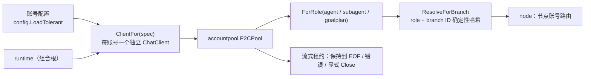

# account 域

## 生态位

承载 Seelex 的账号装配与选择：从账号配置构造同步 Completer、注册进 P2C
账号池、按 role+seed 稳定哈希解析节点账号。主要调用方：根包 `runtime.go`
（NewRuntime 装配与账号池注册）与 `runtime_account.go`（`accountSelector`
与分支账号路由，原独立路由文件已并入）。

## 职责与非职责

- 职责：`ClientFor` 构造 client、`RegisterAccounts` 注册账号池、
  `ResolveForBranch`/`ForRole`/`ByName`/`StableIndex` 选择与查找、
  `QueryBalance`/`BalanceEndpoint` 余额探测、`Manager.Add` 热注册新账号。
  `Manager.Accounts` 的界面摘要携带**显式角色**、`APIKeySet` 与 `Fallback`；密钥明文
  不进入摘要或快照。
- `Manager.SetRoleAccount` 固定某个账号角色的首选账号。作用域请求（subagent /
  goalplan / teammate）优先按该固定值租赁；主链路在未显式选择账号时也可使用 agent
  角色的固定值。
- 非职责：不持有账号池状态（池在 Runtime）、不决定 UI 展示、**不写账号档**
  （账号档的写入在 `internal/config`）。

## 与其它域的关系

同一份 DAG 的账号路由可复现（哈希而非随机），因此并发子代理不会争用同一额度，
也便于按角色核算成本。

## 核心实现

- `ClientFor(spec)`：每个账号一个独立 `api.NewChatClient`，provider 类型
  由配置设定；**不设整请求超时**（见下节「流式超时纪律」）。
- `ForRole(pool, role)`：按角色（含回退链）筛选启用账号，无匹配回退任意
  启用账号。
- `StableIndex(seed, size)`：FNV-1a 32 位稳定哈希索引（同 seed 恒等）。
- `ServedRouteRegistry`（`served_route.go`，P21-3 从 `backend/engine/assemble/runtime_account.go` 归位）：
  **每会话最近一次请求的实际承接路由**注册表。判据四条：① 只有 `request` / `failover` 才覆盖
  （最终承接账号覆盖前面的尝试）；② 只有**主链路请求**（`NodeID` 空、会话非空）才记录——
  子代理/plan 节点的路由归各自的节点视图，进程级请求无处回填；③ `unpinned_selection` 按
  「会话+账号」只记一次摘要（主链路未固定账号时它每轮都发生），`failover` 不去重（每次都要可审计）；
  ④ `Take` **读即清**（事实只服务「本轮 response 回填真相源」一次）。宿主面只差一个摘要落点
  （`ServedRouteDeps.RecordSummary`）。
- `WindowOverlay`（`window_overlay.go`，P21-8 从 `backend/engine/assemble/runtime_account.go` 归位）：
  **每账号上下文窗口的活体覆盖层**。它持有唯一一份状态（互斥量 + 表）与三条判据：① 入口过滤
  （空白名与非正值不进表，空表归一为 nil）；② 改一格 / 清一格（`window <= 0` 是**清除**这个
  账号的覆盖、回落到全局值，不是"设成 0"）；③ **生效窗口的唯一一处优先级**——账号级覆盖 >
  `limits.context_window` 全局值 > 账号档自报（遗留兜底），三个读数由 `WindowDeps` 在装配点注入
  （函数值，域包因此不认识配置与账号池）。落盘在 `backend/limit/overlay`，界面侧校验在
  `backend/limit/accountwindow`，两边都只校验/落盘/读生效值，不各判一次优先级。
- `QueryBalance(ctx, spec)` / `BalanceEndpoint(spec)`（`balance.go`）：**账号余额探测**（界面
  「角色卡账户行的余额」）。判据三条：① 供应商是**显式白名单**——目前只有 DeepSeek 的
  `GET {base}/user/balance`；其它 OpenAI 兼容供应商没有等价端点，返回 `ErrBalanceUnsupported`
  （可展示原话），绝不猜一个 URL 去打人家的服务；② 端点推导要把 `base_url` 尾部的 `/v1` 去掉
  （DeepSeek 的余额端点挂在域名根上，不在 `/v1` 之下）；③ 金额保持 provider 给的**字符串原样**
  （`"110.00"` 解析成 float 再格式化回去会丢掉末尾的 0，读数与账单就对不上）。
  `is_available` 独立于金额透出：额度耗尽时它为 false，这是 `402 Insufficient Balance` 之前
  唯一能提前看到的信号。这里是**一问一答的短查询**，与下节「流式超时纪律」相反——它带 20s
  整请求上限（宁可在界面上说"查不到"，也不让一次探测把界面挂住）。凭据只用于 `Authorization`
  头，不进错误文案。
- `Manager.Add(spec, limits)`：把界面刚加的账号**热注册**进管理器的规格与预算表（`Runtime
  .RegisterAccount` 先注册进池、再调它）。三条判据：空名拒绝；重名**报错而不是覆盖**（覆盖会
  让新账号悄悄替换一条正在承流的账号）；不动选中项与默认账号（加账号不等于切账号）。

## 流式超时纪律（2026-09-29 事故）

`api.NewChatClient(cfg)` 把 `cfg.Timeout` 变成 `http.Client.Timeout`——它是
**整请求 wall-clock 上限，含 SSE body 读**；`Timeout<=0` 还会回落到 60s。事故现场：
一条健康但缓慢的流 22:02:33 起、22:07:33 满 300s 被砍，报出
`read SSE: context deadline exceeded (Client.Timeout or context cancellation while
reading body)`——这句话区分不了「上游挂了」与「上游还在推进、只是慢」。

因此 `ClientFor` 在构造之后显式 `client.Client.Timeout = 0`（清零必须发生在构造
之后，见上），并装配 `newStreamTransport`（`transport.go`）：

- `streamHeaderTimeout`（默认 60s）：等响应头的上限；
- `streamIdleTimeout`（默认 300s）：两次 body 数据之间的**空闲**上限——只要流还在
  推进就永不触发；真停滞时报 `seelex: LLM stream stalled (no data received)
  after 5m0s`（自带语义，可定位）。

看门狗挂在 Transport 上（`idleWatchdogBody`，逐次 Read 装表），同步与流式两条路径
都被覆盖。整批/整轮的天花板仍在别处：`limits.fork_timeout`（默认 2h）与
`tool_call_timeout`。

## 数据流

NewRuntime 读取账号 YAML → `RegisterAccounts` 注册池 → 请求时
`accountSelector` 把选中账号/provider 过滤转为 `AcquireRequest` → P2C 租赁。

账号角色解析只在“该角色块不存在”时回退 `agent`。若角色块存在但没有可用
`api_key`，解析显式报错，绝不会拿另一角色的密钥继续运行；内置 fallback 账号在
快照里标记 `fallback=true`，避免与用户配置混为一谈。

界面加账号是另一条不经过启动装载的短链：GUI `AddAccount` → `internal/config.AddAccount`
（写账号档）→ `config.Load` 读回规格 → `Runtime.RegisterAccount` →
`RegisterAccounts`（进池）+ `Manager.Add`（进路由/预算）→ 下一份快照里就多一行。

余额：GUI `AccountBalance(name)` → `Runtime.AccountBalance` 按名字取 `AccountSpec` →
`QueryBalance`（DeepSeek `/user/balance`）→ `adapters.RuntimePort.AccountBalance` 映射成
`dto.AccountBalance` → 界面逐行显示（不进快照、不缓存）。

## 依赖方向

允许依赖：`internal/model`、`accountpool`、`agent`、`api`、`types`。
禁止依赖：seelebridge 根包及其它域。

## 并发、存储、安全

构造式函数（`ClientFor` / `ForRole` / `StableIndex`）无状态、纯函数；两个**显式注入的**有状态
类型各持自己的锁、都不读全局：`ServedRouteRegistry`（每会话承接路由，读即清）与
`WindowOverlay`（每账号窗口覆盖，值拷贝读写）。本域不落盘：覆盖层的持久化在
`backend/limit/overlay`，本域只持有内存里的活体一份。凭据不落日志（Metadata 只放 provider/model）。

## 扩展方式

新增账号角色：在 `internal/model` 的 FallbackRoles 定义；新增选择策略：
在 `ResolveForBranch` 扩展。

## Review 指南

- 账号角色回退链是否覆盖全部角色；禁用账号是否被过滤。
- 稳定哈希是否保持同 seed 同 size 恒等。

## 测试与验证

`go test ./backend/engine/account/...`：`manager_test.go`（账号选择/provider 过滤 +
`Add` 的空名/重名/限额判据）+
`transport_test.go` / `transport_watchdog_test.go`——后者用 httptest 的 OpenAI 兼容
SSE 上游钉住事故形状（整请求超时会掐断健康慢流、复现那句措辞；换成空闲看门狗后
同一条流活下来，真停滞则报可读错误）。稳定选择由根包
`runtime_test.go` 的 TestResolveAccountForBranchIsStableAndRoleScoped 覆盖；
`served_route_test.go` / `window_overlay_test.go` 是两片域级状态判据（去重与读即清、
入口过滤/改清一格/优先级三条支路/值拷贝与 nil 接收者），端到端那一跳留在装配层
`runtime_account_test.go`（经 `SetAccountWindow` → `ContextWindowFor` 走同一条链）。
`balance_test.go` 是余额探测的判据：端点推导（含 `/v1` 去尾与只写模型名的兜底）、真实响应
形状的解析（金额字符串原样）、非 200 把状态码与响应体摘要带出来且**不含** Authorization、
不支持的供应商**不发请求**、`balance_infos` 空表报"读不到"（不当成余额为 0）。

## 文件与函数索引

> 由源码 doc 注释自动提取（首行摘要）；描述源码行为，与实现保持同步。
> 刷新方式：`python scripts/gen_core_readme_index.py`。

### account.go

- `func ClientFor(spec model.AccountSpec) agent.Completer` — ClientFor 从账号配置构造一个同步 Completer（agent.Completer）。
- `func RegisterAccounts(pool *accountpool.P2CPool[agent.Completer], specs []model.AccountSpec) error` — RegisterAccounts 把加载的账号配置注册进 P2C 账号池。
- `func ResolveForBranch(pool *accountpool.P2CPool[agent.Completer], role model.AccountRole, seed string) (string, error)` — ResolveForBranch selects an account without mutating the shared pool
- `func ForRole(pool *accountpool.P2CPool[agent.Completer], role model.AccountRole) []accountpool.Entry[agent.Completer]` — ForRole 按角色（含回退角色链）筛选可用账号；无匹配时回退任意启用账号。
- `func ByName(specs []model.AccountSpec, name string) *model.AccountSpec` — ByName 在账号规格列表中按名称查找（返回内部指针；nil = 未找到）。
- `func StableIndex(seed string, size int) int` — StableIndex 返回 seed 的 FNV-1a 32 位稳定哈希索引（同 seed 同 size 恒等）。
- `func leastBusyForRole(pool *accountpool.P2CPool[agent.Completer], role model.AccountRole) (string, bool)` — leastBusyForRole 返回指定角色下当前还有并发余量的账号（余量最大者）；
- `func SetSessionReasoningEffort(pool *accountpool.P2CPool[agent.Completer], specs []model.AccountSpec, effort string) int` — SetSessionReasoningEffort 把**配置为跟随会话**的账号调到 effort 指定的思考强度，

### balance.go

- `func (balance Balance) isEmpty() bool` — isEmpty 报告这份读数是不是"什么都没读到"（没币种条目 = 上游给了空表）。
- `func BalanceEndpoint(spec model.AccountSpec) (string, error)` — BalanceEndpoint 返回该账号的余额查询端点；供应商没有该能力时返回
- `func isDeepSeekAccount(spec model.AccountSpec) bool` — isDeepSeekAccount 判据与账号档的口径一致（命中任一即算）：base_url 指向
- `func QueryBalance(ctx context.Context, spec model.AccountSpec) (Balance, error)` — QueryBalance 查询一个账号的余额。
- `func excerpt(body []byte) string` — excerpt 截断响应体用于错误文案（去换行，限制长度）。

### balance_test.go

- `func TestBalanceEndpointDerivation(t *testing.T)` — TestBalanceEndpointDerivation 钉住端点推导：DeepSeek 的余额端点挂在域名根上，
- `func TestQueryBalanceParsesDeepSeekShape(t *testing.T)` — TestQueryBalanceParsesDeepSeekShape 用 httptest 钉住真实响应形状的解析：金额保持
- `func TestQueryBalanceReportsStatus(t *testing.T)` — TestQueryBalanceReportsStatus 非 200 要把状态码与响应体摘要带出来（"402 Insufficient
- `func TestQueryBalanceRejectsUnsupported(t *testing.T)` — TestQueryBalanceRejectsUnsupported 不支持的供应商要报可展示的原话，且**不发请求**。
- `func TestQueryBalanceEmptyInfos(t *testing.T)` — TestQueryBalanceEmptyInfos：上游 200 但没有任何币种条目——这是"读不到"，
- `func TestQueryBalanceRequiresAPIKey(t *testing.T)` — TestQueryBalanceRequiresAPIKey：没有凭据就不该发请求。

### failure.go

- `func ClassifyFailure(err error) FailureKind` — ClassifyFailure 把一次账号调用错误分类为「账号资格问题」或「其它」。
- `func FailureAdvice(kind FailureKind) string` — FailureAdvice 给出一条可读的换号理由（日志/错误文本用）。

### manager.go

- `func NewManager(specs []model.AccountSpec, limits map[string]config.AccountLimits, defaultID string, pool *accountpool.P2CPool[agent.Completer]) *Manager` — NewManager 构造账号管理器。
- `func (m *Manager) SetRoleAccount(role model.AccountRole, account string) error` — SetRoleAccount 固定某个账号角色优先使用的账号。账号必须存在且确实属于该角色；
- `func (m *Manager) Select(name string) bool` — Select 切换主链路选中账号（provider 过滤跟随账号规格）；未知账号返回 false。
- `func (m *Manager) Add(spec model.AccountSpec, limits config.AccountLimits) error` — Add 登记一个新账号的规格与预算（界面「手动添加账号」的热注册落点：账号档刚多了
- `func (m *Manager) Spec(name string) (model.AccountSpec, bool)` — Spec 返回一个账号规格的只读拷贝。
- `func (m *Manager) Replace(spec model.AccountSpec, limits config.AccountLimits) error` — Replace 原位替换一个账号规格与限额。名称是身份，角色不允许借编辑迁移；
- `func (m *Manager) Remove(name string) error` — Remove 移除账号管理器里的规格，并清掉所有指向它的选择与默认槽。
- `func (m *Manager) SetSelected(name string)` — SetSelected 设置选中账号（不校验规格；plan 分支冻结路径用）。
- `func (m *Manager) Selected() string` — Selected 返回当前选中账号。
- `func (m *Manager) SetProvider(provider string)` — SetProvider 切换 provider 过滤；非空时清除固定账号，让 P2C 在过滤集内选择。
- `func (m *Manager) Provider() string` — Provider 返回当前 provider 过滤；未过滤时回退默认账号的 provider。
- `func (m *Manager) Accounts() []Account` — Accounts 返回账号池条目的路由摘要（按名称排序）。
- `func (m *Manager) Specs() []model.AccountSpec` — Specs 返回账号规格列表（只读拷贝）。
- `func (m *Manager) Limits() config.AccountLimits` — Limits 返回当前账号（选中或默认）的限额；未知回退默认值。
- `func (m *Manager) LimitsFor(name string) config.AccountLimits` — LimitsFor 返回**指定账号**在账号档里自报的限额；未知账号回退默认值（与 Limits
- `func (m *Manager) Selector() func(ctx context.Context, messages []types.Message, tools []types.Tool) accountpool.AcquireRequest` — Selector 返回主链路共享的账号选择器闭包：把请求条件转换为
- `func (m *Manager) mainChainRolePredicate(provider string) func(accountpool.AccountSnapshot) bool` — mainChainRolePredicate 返回主链路（无 SceneScope）的角色约束谓词：只允许
- `func (m *Manager) nodeRequest(scope dto.SceneScope) accountpool.AcquireRequest` — nodeRequest 按节点作用域解析账号租赁请求：binding 显式 AccountID 直接

### manager_test.go

- `func TestManagerSelectProviderAndLimits(t *testing.T)`
- `func registerCompleterAccount(t *testing.T, pool *accountpool.P2CPool[agent.Completer], id, provider, model2 string)` — registerCompleterAccount 把一个账号注册进测试池（Value 无需真实 client：
- `func TestManagerSelectorMainChainAgentRole(t *testing.T)` — TestManagerSelectorMainChainAgentRole 钉住主链路角色约束：主会话请求（无
- `func TestManagerSelectorMainChainRoleFallback(t *testing.T)` — TestManagerSelectorMainChainRoleFallback：agent 角色没有任何可用账号时，
- `func TestManagerAddRegistersSpecAndLimits(t *testing.T)` — TestManagerAddRegistersSpecAndLimits 覆盖热注册在管理器这一侧的判据：空名拒绝、
- `func TestManagerAccountsCarryExplicitRoleAndCredentialState(t *testing.T)`
- `func TestManagerRoleAccountPinsScopedRequest(t *testing.T)`

### served_route.go

- `func NewServedRouteRegistry(deps ServedRouteDeps) *ServedRouteRegistry` — NewServedRouteRegistry 装配一例（装配点是组合根 `assemble.Runtime` 的构造器）。
- `func (registry *ServedRouteRegistry) Observe(notice dto.RoutingNotice)` — Observe 是流式 completer 的路由事实观察者（租约路径上同步调用，必须非阻塞）。
- `func (registry *ServedRouteRegistry) record(notice dto.RoutingNotice)` — record 把一次路由事实覆盖进该会话的注册表（只有主链路请求才记录，判据见文件头）。
- `func (registry *ServedRouteRegistry) Take(sessionID string) (dto.ServedRoute, bool)` — Take 取出（并清掉）该会话最近一次请求的实际承接路由（读即清；无事实返回 ok=false）。
- `func (registry *ServedRouteRegistry) Forget(sessionID string)` — Forget 丢掉某个会话留在注册表与去重表里的残格（会话卸载/删除时调用；
- `func RoutingNoticeMessage(notice dto.RoutingNotice) string` — RoutingNoticeMessage 把内部路由事实翻成 B 类摘要的一句可读说明

### served_route_test.go

- `func countingRegistry() (*ServedRouteRegistry, *int)` — countingRegistry 造一例带摘要计数的注册表（"记了几条摘要"是去重判据的可观测面）。
- `func TestServedRouteOnlyMainChainRequestsAreRecorded(t *testing.T)`
- `func TestServedRouteTakeIsReadAndClear(t *testing.T)`
- `func TestServedRouteFailoverOverwritesAndRepeatsSummary(t *testing.T)`
- `func TestServedRouteUnpinnedSelectionDedupsSummaryAndSkipsRoute(t *testing.T)`
- `func TestServedRouteForgetDropsSessionCells(t *testing.T)`
- `func TestRoutingNoticeMessageCarriesOnlyRoutingFacts(t *testing.T)`

### transport.go

- `func newStreamTransport(base http.RoundTripper) http.RoundTripper` — newStreamTransport 在 base 上叠加响应头超时与流空闲看门狗。base 为 *http.Transport
- `func (t *idleWatchdogTransport) RoundTrip(request *http.Request) (*http.Response, error)`
- `func newIdleWatchdogBody(body io.ReadCloser, idle time.Duration) *idleWatchdogBody`
- `func (b *idleWatchdogBody) Read(buffer []byte) (int, error)`
- `func (b *idleWatchdogBody) markStalled()` — markStalled 关闭底层 body，让正在阻塞的 Read 立即返回（错误文本由 Read 统一改写）。
- `func (b *idleWatchdogBody) stalledError() error`
- `func (b *idleWatchdogBody) Close() error`

### transport_test.go

- `func sseServer(t *testing.T, chunks []string, every, stall time.Duration) *httptest.Server` — sseServer 是 OpenAI 兼容的流式测试上游：按 every 的节奏逐帧推 content；
- `func testAccountSpec(baseURL string) model.AccountSpec`
- `func tokens(count int) []string`
- `func TestClientForHasNoWholeRequestTimeout(t *testing.T)` — TestClientForHasNoWholeRequestTimeout 钉住病灶本身：账号 client 不得带
- `func TestWholeRequestTimeoutKillsHealthySlowStream(t *testing.T)` — TestWholeRequestTimeoutKillsHealthySlowStream 复现事故措辞（机制钉）：同一个

### transport_watchdog_test.go

- `func setStreamTimeouts(t *testing.T, header, idle time.Duration) func()` — setStreamTimeouts 注入两道看门狗的上限（复用 sseServer 夹具，不必真的等 5 分钟），
- `func TestSlowHealthyStreamSurvivesIdleWatchdog(t *testing.T)` — TestSlowHealthyStreamSurvivesIdleWatchdog 进度敏感：只要流还在推进，就不该被任何
- `func TestStalledStreamFailsWithReadableError(t *testing.T)` — TestStalledStreamFailsWithReadableError 停滞保护仍在：上游真挂住（不再有数据）时，

### window_overlay.go

- `func NewWindowOverlay(seed map[string]int) *WindowOverlay` — NewWindowOverlay 装配一例：把起点表（数据根覆盖层读出的那份）拷进自己的表。
- `func (overlay *WindowOverlay) Set(name string, window int)` — Set 改一个账号的窗口覆盖：`window > 0` 写入这一格，`window <= 0` 清掉它（回落到全局值——
- `func (overlay *WindowOverlay) Snapshot() map[string]int` — Snapshot 返回一份拷贝（诊断与落盘对账用；调用方改不动运行时的表，空表返回 nil）。
- `func (overlay *WindowOverlay) For(name string) int` — For 读该账号的界面覆盖（没设过 → 0）。
- `func (overlay *WindowOverlay) Effective(name string, deps WindowDeps) int` — Effective 返回该账号**生效**的上下文窗口：覆盖 > 全局值 > 账号档自报。
- `func copyWindows(source map[string]int) map[string]int` — copyWindows 复制一份窗口表（装配期与诊断读用；空表返回 nil）。

### window_overlay_test.go

- `func TestWindowOverlaySeedFiltering(t *testing.T)` — TestWindowOverlaySeedFiltering 钉住**入口判据**：起点表里的空白名与非正值不进来，
- `func TestWindowOverlaySetClearsEntry(t *testing.T)` — TestWindowOverlaySetClearsEntry 钉住"改一格 / 清一格"的判据：>0 写入；<=0 是**清除**
- `func TestWindowOverlayEffectivePrecedence(t *testing.T)` — TestWindowOverlayEffectivePrecedence 钉住**唯一一处优先级**：账号级覆盖 >
- `func TestWindowOverlaySnapshotIsCopy(t *testing.T)` — TestWindowOverlaySnapshotIsCopy 钉住值拷贝语义：调用方拿到的 map 改不动运行时那一份，
- `func TestWindowOverlayNilReceiver(t *testing.T)` — TestWindowOverlayNilReceiver 钉住 nil 接收者的语义（部分装配的 Runtime 会走到这里）：
