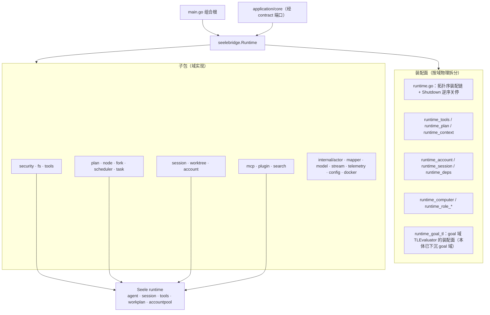

# assemble（原 seelebridge 根包装配面）

## 生态位

`backend/engine/assemble` 是 Seelex 与 Seele（当前 `v0.3.4`，见 `go.mod`）之间的防腐层**装配面**：
它把 Seele 的
`accountpool`（P2C 账号租约）、`agent`（NewWithComponents 装配）、`session`
（主会话与节点子代理会话）、`tools`（Registry + 主体×路由组×位的权限门）、
`workplan`（codec 导入 + 事件投影）、`event`/`telemetry` 能力包装成 Seelex
可装配、可限制和可测试的 Runtime，同时隔离上游 API 变化。

主要调用方：根目录组合根（`main.go`）、`application/core` 经
`contract` 端口消费、`gui`/`tui` 只经 Application 间接使用。

## 迁移状态：这是 **staging**（未收敛）

本包是 M4-J1 的落点：`seelebridge/` 根包（52 个生产文件 13,373 行 + 121 个用例）整体搬到这里，
**包名 `seelebridge` → `assemble`，调用方保留原别名**，目的是先让 `seelebridge/` 目录从仓库里
消失（可验证、可回滚），再按域把内容下沉到 `backend/{engine,tool,multiagent}`。因此本包今天
比它的终局**臃肿得多**——按
[plan.md](../../../docs/2026-10-15-architecture-reshape/plan.md) §2.5，终局只留四个文件：
`runtime.go`（拓扑装配 + 逆序关机）、`runtime_bundle.go`、`runtime_deps.go`、`runtime_live.go`。

已下沉的域（每片一个 commit，行为零变化）：

| 片 | 内容 | 落点 |
|---|---|---|
| M4-J2a | 请求画像 + 会话遥测（`request_log.go`、`session_telemetry.go`） | [`backend/engine/obs`](../../engine/obs/README.md) |
| M4-J2b | 会话媒体与随图（原 `assemble/runtime_image.go`，已删除：同一份实现换落点） | [`backend/tool/io/media`](../../tool/io/media/README.md) |
| R11-task | task 台账域：跨会话工作表格读面 + 会话 scope 分区 + 会话级批次 + 清单面（`ports.go` 的 task/todolist 逐行委托与 `runtime.go` 的 `sessionTaskSnapshots`/`currentTaskSessionID`/`sessionBatches` 私有状态） | [`backend/engine/task`](../../engine/task/README.md) |
| R11-schedule | 定时/周期任务域的宿主转发面：7 个 DTO 别名 + `RestoreScheduledTasks` / `RegisterScheduledCommand` / `ScheduledCommands` / `ScheduleTask` / `UpdateScheduledTask` / `CancelScheduledTask` / `ScheduledTasksSnapshot` / `SetScheduledPromptExecutor` / `SetSchedulerObserver` | 本包 `runtime_schedule.go`（**状态**早已在 [`backend/engine/schedule`](../../engine/schedule/README.md)，该域的 `Runtime` 面上没有可下沉的状态，故按任务书 S4/S5 条只搬转发面） |
| R11-mcp | MCP 域的宿主转发面：`MCPServer` 别名 + 11 个 `Runtime` 公开方法（`BreakerEvents` / `AttachMCP` / `AttachMCPServer` / `RegisterLazyMCP` / `LazyMCPServerNames` / `LoadMCP` / `DetachMCP` / `RefreshMCP` / `MCPServerNames` / `IsMCPAlive` / `MCPServerStatus`） | 本包 `runtime_mcp.go`（连接与工具刷新在 [`backend/engine/mcp`](../../engine/mcp/README.md)，`Runtime.mcpManager` 即装配点） |
| R11-plugin | 插件域的宿主转发面：`DefinePlugin` / `UndefinePlugin` / `ActivatePlugin` / `DeactivatePlugin` / `ActivePlugin` / `SetPluginUnassembledReason` / `WithPluginAssembly` | 本包 `runtime_plugin.go`（插件生命周期在 [`backend/engine/plugin`](../../engine/plugin/README.md)，`Runtime.plugins` 即装配点；`WithPluginAssembly` 与 teammate 回合共用 `toolreg.WithRolePlugins` 原语） |
| R11-node | 子代理树与节点只读面的宿主转发面：`ClearSubagentTree` / `SubagentTreeEvents` / `SubAgentTree` / `SetSubagentToolCallback` / `NodeSessionConversation` / `NodeContextSnapshot` / `SetSkillRegistry` / `NodeToolResult` / `NodeWorktreeInfo{,For}` / `NodeStageLogs` / `NodeStageEvents` / `NodeFirstPersonView` / `NodeSemanticResult` / `DrainSubagentSemanticResults` | 本包 `runtime_node.go`（状态在多智能体域组件上：子代理树注册表、节点会话/上下文快照、worktree 管理器） |
| R11-task-forwarder | task 台账域的薄转发面：`ledger()` 句柄 + 台账/清单/批次 20 个 `Runtime` 公开方法 + `SetSessionWorkspace`（会话绑定事实）+ `RegisterTaskTerminalTools`（改的是工具注册表） | 本包 `runtime_task.go`（判据与状态在 [`backend/engine/task`](../../engine/task/README.md) 的 `Ledger`，本层不写第二份判据） |
| R11-ports-zero | 收口片（契约 §2.3 第 3 条）：plan 端口的 `PrepareReplan`、历史检索端口的 `SearchHistory`、actor 边界的两个投影别名 + 两个 setter、包级常量 `mainAgentNodeID` 各回其域文件；**`ports.go` 删除（文件不存在）** | 本包 `runtime_plan.go` / `runtime_history.go` / `runtime_visibility.go` / `runtime.go`（状态由 `Runtime` 自有组件持有） |
| P21-compaction-stack | **域方法随类型走**第一片：装配层压缩推帧接收侧（`PushCompactionFrame` / `ReadbackCompactionSummary` / `CompactionSummaryAvailable` + 两个帧降级助手 + 两个请求/回执类型）连同**判据**一起下沉 | [`backend/engine/context`](../../engine/context/README.md) 的 `CompactionStack`（`compaction_stack.go`）；本包只剩一行薄转发 + 同身份别名，公开方法名与签名逐字不变 |
| P21-live-dispatch | **域方法随类型走**第二片：子代理第一视角实时流分发器（`live*` 字段组 + 广播循环 + 事件源接线 + 窗口归一化 + 分页读法 + 三个事件投影）连同**判据**一起下沉 | [`backend/multiagent/subagent`](../../multiagent/subagent/README.md) 的 `LiveDispatcher`（`live_dispatch.go`）；本包 `runtime_live.go` 只剩一行薄转发 + 同值常量别名，公开方法名与签名逐字不变 |
| P21-served-route | **域方法随类型走**第三片：路由事实注册表（`servedRoutes` + `routingNoticeMu` + `routingNoticeSeen` 三个字段与四条判据：哪些原因覆盖、只有主链路才记、读即清、unpinned 摘要去重）下沉；顺带收敛一处**同形状两份实现**（`internal/stream.RoutingNotice` 与 `dto.RoutingNotice` 字段逐一相同，现为同身份别名） | [`backend/engine/account`](../../engine/account/README.md) 的 `ServedRouteRegistry`（`served_route.go`）；本包 `runtime_account.go` 只留 `observeRoutingNotice` / `TakeServedRoute` 两个转发，公开面逐字不变 |
| P21-review-files | **域方法随类型走**第四片：`show_files` 的**工具形状**（名字 / 描述 / JSON schema / 参数校验 / 返回值回执）搬进域包 | [`backend/tool/review`](../../tool/review/README.md) 的 `show_files.go`；本包 `review_files.go` 只剩一句注册（`runtime.RegisterTool(review.ShowFilesToolName, …)`，与 `RegisterTaskTerminalTools` 同款形状）+ `ReviewFilesPort` 同身份别名 |
| P21-subagent-session | **域方法随类型走**第五片：子代理**独立会话工厂**（显式 ID 建会话 + 重名拒绝 + 组件模板补齐 Hooks/SessionID/ModelName/History + 注册进 registry）搬进域包 | [`backend/multiagent/subagent`](../../multiagent/subagent/README.md) 的 `SessionFactory`（`session_factory.go`）；本包 `runtime_subagent_session.go` 只剩一行薄转发，公开方法名与签名逐字不变 |
| P21-unified-events | **域方法随类型走**第六片：B 类脱敏摘要日志（`SummaryLog` + 摘要→框架事件转换）与统一事件查询（`UnifiedEventReader` / `UnifiedEventView` / 两个读法 / `UnifiedEventTopic` 话题映射 / `filterUnifiedEvents` 过滤）连同**判据**一起下沉 | [`backend/engine/obs`](../../engine/obs/README.md) 的 `unified_events.go`；本包 `events_unified.go` 只剩同身份别名（调用方与用例零改动）+ 两个公开读法的薄转发，宿主读数仍只有两格（`HistoryRouter` 与 tracer 的查询闭包） |
| P21-account-windows | **域方法随类型走**第七片：每账号上下文窗口覆盖层的**状态**（互斥量 + 表）与三条判据（入口过滤、改一格/清一格、**生效窗口的优先级**）下沉；顺带删掉装配层唯一读法 `Runtime.accountWindow`（域包 `For` 是唯一一份） | [`backend/engine/account`](../../engine/account/README.md) 的 `WindowOverlay`（`window_overlay.go`）；本包 `runtime_account.go` 只剩 `SetAccountWindow` / `AccountWindows` / `ContextWindowFor` 三个薄转发（公开签名逐字不变），宿主读数以 `account.WindowDeps` 注入（`limits.context_window` + 账号档自报两条函数值） |
| P21-event-correlation | **域方法随类型走**第八片：双轨事件的关联面（`correlateMainSessionID` 与两轨关联说明）整文件下沉；**同时把"从事件读会话归属"这条判据收敛成唯一一份**——装配层 `eventSessionID` 与 `backend/tool/plan` 的 `sessionIDFromLocations` 都是 `store.sessionIDFromEvent` 的逐字副本，现统一为 `store.SessionIDFromEvent` / `store.SessionIDFromLocations`（含 obs 话题映射里的内联循环） | [`backend/engine/obs`](../../engine/obs/README.md) 的 `event_correlation.go`（`CorrelateMainSessionID`）+ [`store`](../../../store/README.md) 的 `SessionIDFromEvent` / `SessionIDFromLocations`（唯一判据处）；本包 `events.go` **删除**，`runtime_plan.go` 的 `SetEventPersister` 改为调用域包一行 |
| P21-jobs-domain | **域方法随类型走**第九片：异步作业域的两面整文件下沉——作业生命周期事件流（`jobsEventStream` + 状态记忆 + 状态映射 + 时间基序号）与后台执行表投影（`AsyncRunsSnapshot` 的逐列搬运）；端口取窄（事件流只吃 `Snapshot(Scope)` 一格；投影只吃 `[]registry.AsyncRunInfo`） | 新建 [`backend/tool/jobs`](../../tool/jobs/README.md)（`event_stream.go` / `projection.go`，plan §2.6 的目标落点）；本包容纳事件流的那个文件（`jobs_events`）**整份删除**、`runtime_async.go` 只剩两个薄转发，`currentEventPersister` 移到 `runtime_plan.go`（与 `SetEventPersister` 同处），装配点 `SetTeamworkBackend` 改为 `tooljobs.NewEventStream(...)`。**顺带修掉一处停机隐患**：`Close` 在"从未 Start"时不再等一个永不关闭的 `done`（装配中途失败会让停机钉死） |
| P21-project-board | **域方法随类型走**第十片：项目看板的两面下沉——按需读取面（`ReadProjectBoard` + 白名单归一 + 稳定排序 + 边界报错，整文件）与 `TeamworkPlanFor` 的取数判定（会话号归一 / 键完整性 / 读失败与空计划同解）；端口取两格函数值 | [`middle/view/board`](../../../middle/view/board/README.md) 的 `read.go` / `teamwork_plan.go`（plan §2.4 的目标落点）；本包按需读取面那个文件（`runtime_project_board_read`）**整份删除**、`runtime_project_board.go` 只剩方法转发 + `teamworkKeyFor` / `readTeamworkPlan` 两格宿主读数 + **直接**钉 `var _ board.TeamworkPlanSource = (*Runtime)(nil)`（依赖方向允许本层引用该接口名）；工具注册点 `wiring/registry/registry.go` 的 5 处引用改指域包。域级用例随实现搬进域包（`read_test.go` 断言逐字 + 5 条新的 `teamwork_plan_test.go`），宿主级用例（`runtime_project_board_test.go`，真 Runtime + 真存储）留在本包 |
| P21-teammate-live | **域方法随类型走**第十一片：**当前 teammate 会话**的实时只读投影（默认页 + 分页读法 + 唯一一份裁剪/分页判据 + 只留 user/assistant 的投影判据 + 两个上限常量）整文件下沉 | [`backend/multiagent/teamwork`](../../multiagent/teamwork/README.md) 的 `teammate_live.go`（plan §2.7 的目标落点）；本包 `runtime_teammate_session_live.go` 只剩两个公开方法的一行转发 + 同值常量别名 + **一格宿主读数** `teammateLiveDeps`/`teammateLiveSession`（角色回合执行面句柄：角色名 / 是否在飞 / 引擎历史）。域级用例随实现搬进域包（`teammate_live_test.go`，含原纯函数用例的断言），宿主级用例（两个 `runtime_teammate_session_live*_test.go`，真 Runtime + 真角色回合）留在本包 |
| P21-goal-tl | **域方法随类型走**第十二片：ADVISOR(TL) 真实评估器整文件下沉（提示词四段与输出契约追加、工具边界与实际执行面同源判定、只读权限口径、裁决解析与域校验） | [`backend/multiagent/goal`](../../multiagent/goal/README.md) 的 `advisor_evaluator.go`（plan §2.5：`seelebridge` 的 runtime_goal_tl → `backend/multiagent/goal/`"搬 + 反向依赖改端口"）；本包 `runtime_goal_tl.go` 只剩 `GoalTLEvaluator` + **三格宿主读数**（`completeAdvisorOnce` 无工具兜底 / `rolePromptFor` 提示词读面 / `advisorRound` 把 `goal.AdvisorRoundRequest` 翻成 `roleRoundSpec`——**唯一**一处翻译）。两条域级用例随实现搬进域包，另补 7 条（两条执行面同源、只读口径与 FreshContext、ErrTLDisabled 与 ErrBadDirective 的区分、宽松解析、安全截断）。顺带把装配层两个零散字符串助手（`stringPtr` / `truncateRunes`）抽到新文件 `strings.go`：它们不止 goal 用，原来挂在被搬走的文件尾部 |
| P21-subagent-conclusion | **域方法随类型走**第十三片：子代理最终结论的**两向投影**与接管判据下沉——结论事件形状（时间基序号 / done-failed 映射 / 定位挂主会话）、从事件库读回结论记录（跳过外族与坏条目）、"记录的主人已不在本进程才按崩溃口径接管" | [`backend/multiagent/subagent`](../../multiagent/subagent/README.md) 的 `conclusion.go`（plan §2.7 的目标落点）；本包 `runtime_subagent_recovery.go` 的 `persistSubagentConclusion` / `loadSubagentConclusions` 仍持签名（下一片 `runtime_subagent_resume.go` 也在用），但正文只剩"交给谁落盘 / 从哪读"的接线。域级 4 条新用例（形状、**正反两向互为逆**的往返、跳过外族坏条目、接管判据）；宿主级用例 `runtime_subagent_recovery_test.go` 一行未改（只把 Source 常量换成域包的导出名） |
| P21-role-prompt-optimize | **域方法随类型走**第十四片：员工提示词的**一次有界改写**（固定元指令 / 请求按标签渲染 / 输出契约宽松解析 + `optimized` 必填 + 理由去空截断到 5 条每条 ≤60 rune / 回执组装）下沉 | [`backend/engine/prompt`](../../engine/prompt/README.md) 的 `role_prompt_optimize.go`（plan §2.5 的目标落点）；本包 `runtime_role_prompt.go` 只留**读面状态**（`SetRolePromptProvider` / `rolePromptFor`——宿主注入的读面，不是提示词域的事实）与两格宿主读数（`completePromptOptimizeRound` 一次无工具回合 / `Model`）。解析用例随实现搬进域包，另补 4 条（回合编排与缺省兜底、无执行面、回合失败包一层、理由有界）；`rolePromptFor` 用例留在本包 |
| P21-workunit-recovery | **域方法随类型走**第十五片：恢复链的**判据**下沉——记录身份 → 哪一层（写明的身份优先 / 缺身份按团队现场名单兜底 / 认不得的词按既有链归类并交回留痕）、按身份切开的分派与次序、"恢复说明"的容器 | [`backend/workunit`](../../workunit/README.md) 的 `recovery.go`（plan §2.7 把 `runtime_unit_recovery.go` 与 `seelebridge` 的 resume_notes 都指向 workunit 域）；本包 `runtime_unit_recovery.go` 只剩**两层策略本体**（宿主组件动作：详情数据面 / 子代理树 / 现场登记）与分派接线（`unitRecoveryStrategy` 是同身份别名），恢复说明容器那个文件（resume_notes）**删除**（容器改为 `workunit.ResumeNotes`，subagent 与 teammate 两个键语义留在各自调用点）。域级 5 条新用例；宿主级用例一行未改 |
| P21-context-wiring | **域方法随类型走**第十六片：上下文面的**判据**下沉——分片重放预算（旋钮零值语义）、厚摘要器的三条 nil 出口与理由文案、读尾预算与轮数回退、真空区补压（**没有压缩基线就不补**）、相关记忆块选取与渲染 | [`backend/engine/context`](../../engine/context/README.md)（`context_runtime`）的 `wiring.go`（plan §2.5 把 seelebridge 的 runtime_context 列为该域目标）；本包 `runtime_context.go` 保留**组件工厂**（把宿主 limits / completer / 会话上下文存储 / 窗口策略接成 `seelectx.*` 与 `seelexctx.*` 的构造参数）与五个一行转发。域级 5 条新用例（旋钮零值 / 三条 nil 理由 / 轮数回退 / 无基线不补帧 / 记忆块选取），既有宿主级用例一行未改 |
| P21-plugin-assembly | **域方法随类型走**第十七片：teammate 插件装配的**判据**下沉——三层口径（显式声明替换集合 / 角色自带 / 空集不覆盖）、读侧规范化（trim + 保序去重 + 空清完归一为 nil）、编排入口四条显式拒绝（语法规整写回 / 未知名 / 超限 / 重复）、装配面裁决三形态（有定义收窄 / 空定义一律可见 / **失灵一个都不给**） | [`backend/multiagent/team`](../../multiagent/team/README.md) 的 `plugin_assembly.go`（plan §2.7 把 runtime_role_plugins 列为该域目标）；本包 `runtime_role_plugins.go` 保留**宿主读数面**（插件定义目录与可见性管理器、技能注册表、limits）与装配读数（技能目录段、装配回执、黄牌），判据处改走**同身份别名**（`normalizePluginNames` / `validateMemberPlugins` 是函数值别名，`pluginFaceJudgement` 是类型别名），既有调用点与用例零改动。域级 4 条新用例 |
| P21-subagent-resume-units | **域方法随类型走**第十八片：子代理**中断恢复的判据**下沉——残留记录 → 恢复单元的判定口径（在跑 / 判失败 / 其余终结 / **已有结论一律按终结**）、幂等键口径、两个终态谓词（认不得的词不判死也不当终结）、现场投影与摘要回退、恢复说明组合（契约正文 + 两条有界追加事实） | [`backend/multiagent/subagent`](../../multiagent/subagent/README.md) 的 `resume_units.go`（plan §2.7 把 runtime_subagent_resume 列为该域目标）；本包 `runtime_subagent_resume.go` 保留**七步模板的宿主适配器**（Locate 的账本/事件库读取、RepairParent 的宿主钩子、Reexecute 的真派发与 ctx 会话注入、Converge 的记录删除）与公开方法面，判据处改走域包（`lastSubagentStagePreview` 是函数值同身份别名）。域级 5 条新用例；宿主级链路用例（`test/` 与 `assembly_chain*`）一行未改 |
| P21-teamwork-board-view | **域方法随类型走**第十九片：团队看板的**投影判据**下沉——五份行的搬运、人的状态两值折算、当前会话三段优先、卡点渲染（走编排面同一处判据）、句柄过期提示位、下发与存档同一条路径 | [`backend/multiagent/teamwork`](../../multiagent/teamwork/README.md) 的 `board_view.go`（plan §2.7 把 runtime_teamwork 列为该域目标）；本包 `runtime_teamwork_board.go` 只剩**宿主面**（文件读缓存 + 失效点 + 装配读数），投影处改走**同身份别名**（既有调用点与用例零改动）。域级 8 条新用例 |
| P21-teamwork-tool-shapes | **域方法随类型走**第二十片：leader 编排工具的**形状面**（12 组名字 / 描述 / schema）整份下沉 | [`backend/multiagent/teamwork`](../../multiagent/teamwork/README.md) 的 `tool_shapes.go`（plan §2.7，与 `backend/tool/review` 的 `show_files` 同款形状）；本包 `runtime_teamwork_schema` **删除**，`registerTeamworkTools` 改成 `teamwork.Team<X>ToolName` + 描述/schema 各一行（工具名常量跨包引用，工具面门禁按声明包名解析）。既有 schema 用例随实现搬进域包，断言逐字 |
| P21-teamwork-context-view | **域方法随类型走**第二十一片：`team_context` 读面的**投影与判据**下沉——成员行组装、最新作业行选取、按需取正文（非消费 `Peek`）、行不在册时按角色名回读残边、正文预算与 UTF-8 安全裁剪 | [`backend/multiagent/teamwork`](../../multiagent/teamwork/README.md) 的 `context_view.go`（plan §2.7）；本包 `runtime_teamwork_context.go` 只剩**宿主面**（读面三格读数 `teamworkReadScope`、输出面取值、参数解析与 handler 接线），`readOutputHead` 实现搬进域包（`ReadOutputHead`）并在本层留函数值别名。域级 5 条新用例；既有读面用例经同身份别名零改动 |
| P21-teamwork-output-store | **域方法随类型走**第二十二片：产品自有作业输出面（`TeamworkJobOutputs` 的分配 / 写入 / 清理 / 回读与角色名安全化）整份下沉 | [`backend/multiagent/teamwork`](../../multiagent/teamwork/README.md) 的 `output_store.go`（`OutputStore`，plan §2.7）；本包 `runtime_teamwork_output` **删除**，组合根（`wiring/bootstrap`）与 headless 端到端用例改调 `teamwork.NewOutputStore`，宿主级接线用例（`writeWorkerOutput` 经产品面 + 清目录后迟到写丢弃）留本包。域级用例随实现搬入 |
| P21-teamwork-board-archive | **域方法随类型走**第二十三片：看板**存档生命周期与封板判据**下沉——无档新开一版 / 换版本先关旧后开新 / 同版本推进 seq / 指纹节流 / 只恢复 active / 封板幂等 | [`backend/multiagent/teamwork`](../../multiagent/teamwork/README.md) 的 `board_archive.go`（plan §2.7）；本包两个文件（`runtime_teamwork_board_archive.go` / `runtime_teamwork_board_close.go`）只剩**宿主面**（什么时候读、读哪些、失败了记一行日志、收口路径与 `BoardCloser` 接线），判据处走同身份别名（`nextTeamBoardMeta` / `boardFingerprint` / `sealTeamBoard` 是函数值别名，`readTeamBoardArchive` 是方法转发）。域级 4 条新用例 |
| P21-teamwork-job-projection | **域方法随类型走**第二十四片：作业完成投影（逐列搬运 + 框架状态词 → 契约枚举的**唯一**折算处）下沉 | [`backend/multiagent/teamwork`](../../multiagent/teamwork/README.md) 的 `job_projection.go`（plan §2.7）；本包 `runtime_teamwork_jobs.go` 只剩宿主面（作业表读数 `teamworkJobManager`、信号口 `TeamworkJobEvents`、公开投影方法一行转发），判据处走同身份别名（`teamworkJobCompletionFrom` / `asyncStateFromJobs` 是函数值别名）。域级 3 条新用例；既有投影用例一行未改 |
| P21-teamwork-scene-index | **域方法随类型走**第二十五片：团队现场**名单判据**与**指派名的反向换算**下沉——计划 + 账本原始行 → nodeID 名单（去重保序、未释放才认领）、`seelex/<nodeID>` 去前缀 | [`backend/multiagent/teamwork`](../../multiagent/teamwork/README.md) 的 `scene.go`（plan §2.7；P21-26 顺带把"一条命名只有一域"补齐：正向拼装本来就在域包）；本包 `runtime_teamwork_scene.go` 只剩**宿主面**（读计划与账本两份持久事实 + 逐个 `Adopt` 认领），`workItemNodeID` 改成同身份别名（`teamSceneEntry` 是类型别名）；`runtime_teamwork_items.go` 因此删掉一份去前缀实现。域级 3 条新用例 |
| P21-plugin-reject | **域方法随类型走**第二十六片：「未装配名字」的判决（只判名字 / 已装插件不问 / 语法先于语义 / 判据函数给什么理由就说什么理由）下沉 | [`backend/multiagent/team`](../../multiagent/team/README.md) 的 `plugin_reject.go`（plan §2.7；与 P21-18 的 `ValidateMemberPlugins` 同域）；本包 `runtime_teamwork_curated.go` 只剩三格宿主读数（有没有判决面 / `Defined` / `UnassembledReason` + 每会话上限）。域级 5 条新用例；既有装配链用例一行未改 |
| P21-session-bundle-release | **域方法随类型走**第二十七片：桥侧会话本体**释放判据**（三种拒绝情形 + 顺序）下沉 | [`middle/switch`](../../../middle/switch/README.md) 的 `bundle_release.go`（plan §2.4）；本包 `runtime_session_release.go` 只剩**宿主面**（四格读数：`ForkInFlight` / `AsyncPendingFor` / `takeSessionBundle`（注册表锁内"活跃别名 + 在册"检查并移出，原子）/ `dropSessionResidue`），`ReleaseSessionBundle` 签名与返回语义不变。域级 4 条新用例；宿主级用例（真 Runtime 注册表与残格）一行未改 |
| P21-worker-round | **域方法随类型走**第二十八片：teammate 回合面的三条纯判据下沉（记录槽上限"只抬不降"、回数上限口径、回合输入正文组装） | [`backend/multiagent/teamwork`](../../multiagent/teamwork/README.md) 的 `worker_round.go`（plan §2.7）；本包 `runtime_teamwork.go` 里三处改成**同值/同身份别名**（`teamworkRoundsPerMember` / `teamworkJobRecordCeiling` / `workerTurnLimit`（回退值仍是本层角色回合常量）/ `workerRoundInput`），既有调用点与用例零改动。域级 3 条新用例 |
| P21-plan-branch-routing | **域方法随类型走**第二十九片：Plan **分支路由**三条判据下沉（追踪 ID、稳定哈希与节点会话号派生、分支账号解析含"钉住账号必须存在"的显式拒绝） | [`backend/tool/plan`](../../tool/plan/README.md) 的 `branch_routing.go`（plan §2.6）；本包 `runtime_plan.go` 里 `branchTraceID` / `stableHash` 改成同身份别名、`nodeSessionID` 与 `resolvePlanBranchAccount` 改成薄转发（签名不变），并因此去掉 `hash/fnv` 与 `engine/account` 两条直依赖。域级 5 条新用例；既有用例（含 `branchTraceID` 断言）一行未改 |
| P21-project-scoped-names | **域方法随类型走**第三十片（**去重**）：项目作用域工具名单**两份实现并成一份**——`Router.Register` 里的六个名字字面量与装配层 `isProjectScopedTool` 的 switch 是同一份名单；现在名字与判据同处工具注册域（`scoped_names.go`），注册点用常量 | [`backend/tool/registry`](../../tool/registry/README.md) 的 `scoped_names.go`；本包 `runtime_tools.go` 的 `isProjectScopedTool` 改成**同身份别名**（调用点零改动）。新增跨实现一致性用例（桩捕获注册面名字对账） |
| P21-role-turn-judgments | **域方法随类型走**第三十一片：员工回合三条判据下沉（身份 `WorkScope` 与 ctx 往返、工具活动稳定 ID 与上限、未登记提示词时的最小角色框架） | [`backend/multiagent/team`](../../multiagent/team/README.md) 的 `role_turn.go`（plan §2.7 明确列出 `runtime_role_turn.go`）；本包 `runtime_role_turn.go` 里 `roleWorkScope` 改类型别名、`withRoleWorkScope` / `roleWorkScopeFrom` / `roleToolActivityID` 改函数值别名、`roleTurnSystemPrompt` 只剩"读已登记提示词、否则回退域包默认"，并因此去掉 `hash/crc32`。执行面（开引擎/会话槽/权限分配/项目根绑定/回合闸门/ChatStream）仍是宿主。域级 3 条新用例 |
| P21-teamwork-plan-query | **域方法随类型走**第三十二片（**去重**）：派发回执里的"按工作项找执行角色"另写过一次里程碑遍历（与 `items.go` 的 `findItem` 同源但口径略不同）→ 与"按角色找成员"一起收进团队域 `plan_query.go`；装配层 `dispatchItemRole` / `dispatchAssemblyReading` 只剩"取计划（host）+ 查一次（域包）" | [`backend/multiagent/teamwork`](../../multiagent/teamwork/README.md) 的 `plan_query.go`（`ItemRole` / `MemberOf`）。域级 2 条新用例；既有派发/装配读数用例一行未改 |
| P21-team-unit-record | **域方法随类型走**第三十三片：teammate 单元记录的**写侧口径**下沉（状态词表来自契约、"收尾分类 → 终态"的折算、单元身份三形态） | [`backend/multiagent/teamwork`](../../multiagent/teamwork/README.md) 的 `unit_record.go`（plan §2.7）；本包 `workunit_team.go` 里五个符号改**同身份/同值别名**（`teamUnitStatus*` / `teamUnitStatusFor` / `teamUnitNodeID`），既有调用点（记录写侧、链用例、状态词表互锁用例）零改动，并去掉 `contract/dto` 直依赖。域级 3 条新用例 |
| P21-team-unit-record-link | **域方法随类型走**第三十四片：teammate 单元记录的**身份写侧**下沉——`UnitRecordKey` / `UnitRecordKeyFor`（记录身份与 nodeID 口径）与 `TeammateUnitRecordLink`（写链上 teammate 那一环） | [`backend/multiagent/teamwork`](../../multiagent/teamwork/README.md) 的 `unit_record.go`（plan §2.7）；本包 `teamUnitRecordKey` 改类型别名、`teamUnitKeyFor` / `teamUnitUnitRecordLink` 改函数值别名（记录写侧与链用例零改动）。域级 2 条新用例（身份取数 + 身份环只写自己那格且拷贝集合） |
| P21-team-unit-recovery | **域方法随类型走**第三十五片：`RecoverTeamworkUnits` 的**中断判定**下沉（记录侧与账本侧两条来源 + 一次去重 + 恢复说明生成） | [`backend/multiagent/teamwork`](../../multiagent/teamwork/README.md) 的 `unit_recovery.go`（`InterruptedUnits` / `UnitRecovery`，plan §2.7）；本包只剩**宿主编排**（认领现场 → 读记录 → 账本 Recover/AliveSceneNodes → 域包判中断 → 注入说明），执行面读数 `teamUnitSurfaceAlive` 以函数值传入。域级 3 条新用例 |
| P21-teamwork-tool-requests | **域方法随类型走**第三十六片：十个 handler 里的**入参形状与解码**下沉（形状与 schema 同处一域） | [`backend/multiagent/teamwork`](../../multiagent/teamwork/README.md) 的 `tool_requests.go`；本包 handler 只剩"解码（域包）→ 话术包装 → Coordinator 调用 → 回执"（错误文案 `team_x: 参数解析失败` 仍在本层）。域级 6 条新用例；既有 handler 级用例（端到端/headless）一行未改 |

**仍未下沉**（按 plan §2.5–§2.8 的目标落点，逐域各一片）：engine 侧 `runtime_tools`
（→ `backend/engine/toolregistry`）、
`runtime_session` / `role_host_session`（→ `backend/engine/session`）；
tool 侧 `runtime_plan`（→ `backend/tool/plan`）；
multiagent 侧 `runtime_teamwork*` + `teamwork`（→ `backend/multiagent/teamwork`）、
`runtime_subagent_*`（→ `backend/multiagent/subagent`；实时流与独立会话工厂已随 **P21-live-dispatch** /
**P21-subagent-session** 下沉，剩余是恢复/续跑面）、`workunit_*`（→ `backend/multiagent/workunit`）、
`runtime_role_turn` / `runtime_role_plugins`（→ `backend/multiagent/team`）。已下沉的域另有：`runtime_account` 的路由事实注册表
（**P21-served-route** → `backend/engine/account`）、`review_files` 的工具形状
（**P21-review-files** → `backend/tool/review`）、统一事件库（**P21-unified-events** → `backend/engine/obs`）。
看板侧两面（`runtime_project_board*` → `middle/view/board`，**P21-project-board**）与
作业侧两面（`runtime_async` / `jobs_events` → `backend/tool/jobs`，**P21-jobs-domain**）同样已归位。
**收口片已完成**：`ports.go` 的每一段都按域归位后**文件被删除**
（R11-task 收掉 task/todolist 状态与薄转发面、R11-schedule / R11-mcp / R11-plugin / R11-node
各收掉自己的宿主转发面、收口片 R11-ports-zero 把 plan / 历史检索 / actor 边界三段并回域文件）。
`git ls-files backend/engine/assemble/ports.go` 为空即这条验收。

每片的判据都是"行为零变化"：只动"文件在哪、包叫什么、谁持有状态"，不动判定、协议与持久化格式。

## 架构图



## 文件结构

根目录保留组合根骨架 + 端口文件 + 按层装配文件（薄桥形态，装配域物理拆分）：

| 文件 | 职责 |
|---|---|
| `runtime.go` | 组合根骨架：RuntimeConfig/Runtime 结构体 + NewRuntime（拓扑序装配链）+ Shutdown（生命周期逆序关停）+ 主会话装配 |
| `runtime_history.go` | 历史检索端口的宿主面（M5-R11 收口片从 `ports.go` 原样搬来）：`SearchHistory` 的装配（会话上下文存储当栈源 + 事件库路由当数据源）与两条未装配判据 |
| `runtime_visibility.go` | actor 消息边界（M5-R11 收口片从 `ports.go` 原样搬来）：`RuntimeVisibilityProjection` / `ParentEvidenceProjection` 两个跨层别名 + `SetRuntimeVisibilityProjection` / `SetParentEvidenceProjection` 两个单向发布口 |
| `runtime_schedule.go` | 定时/周期任务域的宿主转发面（M5-R11-schedule 从 `ports.go` 原样搬来）：7 个 DTO 别名 + 9 个 `Runtime` 公开方法，逐行委托 [`backend/engine/schedule.State`](../../engine/schedule/README.md)（`Runtime.scheduler` 即该装配点引用） |
| `runtime_mcp.go` | MCP 域的宿主转发面（M5-R11-mcp 从 `ports.go` 原样搬来）：`MCPServer` 别名 + 11 个 `Runtime` 公开方法，逐行委托 [`backend/engine/mcp`](../../engine/mcp/README.md)（`Runtime.mcpManager`） |
| `runtime_plugin.go` | 插件域的宿主转发面（M5-R11-plugin 从 `ports.go` 原样搬来）：7 个 `Runtime` 公开方法，前六个逐行委托 [`backend/engine/plugin`](../../engine/plugin/README.md)，`WithPluginAssembly` 走共享原语 `toolreg.WithRolePlugins` |
| `runtime_node.go` | 子代理树与节点只读面的宿主转发面（M5-R11-node 从 `ports.go` 原样搬来，含 `NodeWorktreeInfo` 别名）：14 个 `Runtime` 公开方法，逐行读 `Runtime` 自己持有的域组件 |
| `runtime_task.go` | task 台账域的薄转发面（M5-R11-task-forwarder 从 `ports.go` 原样搬来）：`ledger()` + 台账/清单/批次 20 个方法 + `SetSessionWorkspace` + `RegisterTaskTerminalTools` |
| `runtime_plan.go` | plan 执行域装配与委托（SetPlan*/Replan/事件通道/分支账号/NodeFactory/plan 与 fork/node 的 Deps 闭包） |
| `runtime_context.go` | 上下文**接线**（Assembler/Controller/Compressor/窗口/stack/project/memory/归档）：组件工厂 + 五个判据的一行转发（判据在域包 [`wiring.go`](../../engine/context/README.md)：分片预算 / 摘要器理由 / 读尾预算 / 真空区补压 / 记忆块选取） |
| `runtime_account.go` | 账号路由委托（account.Manager：选中账号/provider/限额/选择器）；**每账号上下文窗口**的取值面：`ContextWindowFor`、`SetAccountWindow`（界面「设置 → 账号」改一格，改后立刻生效）、`AccountWindows`（拷贝，诊断/对账用）——三条判据（入口过滤 / 改一格清一格 / **优先级**：账号级覆盖 > `limits.context_window` 全局 > 账号档自报值）在 P21-8 下沉到 [`backend/engine/account.WindowOverlay`](../../engine/account/README.md)，本文件只剩三个薄转发 + `account.WindowDeps` 注入。覆盖层的落盘在数据根 `runtime-limits.json`（宿主侧 [`backend/limit/overlay`](../../limit/overlay/README.md)），**不写回** `seelex.yaml` 与账号档。**路由事实注册表**（承接路由 / unpinned 去重 / 读即清）在 P21-3 下沉到 [`backend/engine/account.ServedRouteRegistry`](../../engine/account/README.md)，本文件只留 `observeRoutingNotice` / `TakeServedRoute` 两个转发 |
| `request_log.go` | LLM 请求记录中间件（`SEELEX_REQUEST_LOG` 门控，默认关闭）：包装 Completer/StreamCompleter，把每次真实请求的 role + 内容 hash + 工具调用名按顺序写 JSONL（不落正文/参数原文），供 headless 冒烟做“请求顺序 ↔ 存储内容”匹配 |
| `runtime_deps.go` | 启动期装配结构 `RuntimeDeps` + `ApplyDeps`（一次性注入；装配点不散装单字段 setter） |
| `events_unified.go` | 统一事件库的**宿主转发面**（P21-6：B 类 llm/tool 脱敏摘要 `SummaryLog`、统一查询 `UnifiedEventReader`、话题映射与过滤判据都在 [`backend/engine/obs`](../../engine/obs/README.md) 的 `unified_events.go`）：本文件只留同身份别名 + `NewSummaryLog()` 一行 + `Runtime.UnifiedEvents` / `Runtime.UnifiedEventsRange` 两个薄转发，宿主读数只有 `HistoryRouter` 与 tracer 查询闭包两格 |

| `runtime_tools.go` | 工具注册表装配（RegistryState/内联工具/权限门）、RegisterBuiltins、可见性策略装配、Deps 闭包工厂 |
| `runtime_computer.go` | computer use 工具族装配：`SEELEX_COMPUTER_USE` 门控 + 平台判定 + DPI 感知 + 注册（脚本面见 `../backend/tool/computer/tools*.go`） |
| `runtime_role_prompt.go` | 员工提示词的**装配读面**（P21-15：优化那一半的判据在域包 [`backend/engine/prompt`](../../engine/prompt/README.md)）：`SetRolePromptProvider`/`rolePromptFor`（ADVISOR 回合取已登记提示词，未登记回退内置；装配根在 `main.go` 注入——宿主状态，不搬）+ `OptimizeRolePrompt` 一行转发（把 completer 接成“一次无工具回合”与模型名两格读数） |
| `runtime_goal_tl.go` | goal 域 TL 评估器的**宿主转发面**（P21-13：评估器本体与提示词判据在 [`backend/multiagent/goal.AdvisorEvaluator`](../../multiagent/goal/README.md)）：`GoalTLEvaluator()` 装配 + 三格宿主读数（`completeAdvisorOnce` / `rolePromptFor` / `advisorRound`→`roleRoundSpec` 的唯一翻译） |
| `strings.go` | 装配层自己的零散字符串助手（`stringPtr` / `truncateRunes`）——原来挂在 `runtime_goal_tl.go` 尾部，但提示词优化与角色回合读数也在用，故单独成文件并写明与别处同名助手"像却不并"的理由 |
| `runtime_role_turn.go` | **角色（员工）回合执行体**：开角色会话（独立引擎 + 角色提示）的同时把该员工的权限分配成 `emp_<角色名>` 主体，回合起手按构造把主体放进 ctx（`tools.WithEmployeeSubject`），工具面与判定因此按角色权责收窄；引擎构造可用 `SetRoleEngineFactory` 替换（测试/更严隔离面），`ReleaseRoleSessions` 在 Shutdown 释放派生执行面。**ReAct 钩子按本轮身份分流**（2026-10-03）：员工做工回合（`roleRoundSpec.WorkScope`）的每次工具调用 → `dto.RoleToolActivity` → `SetRoleToolCallback`（装配根接 `app.HandleRoleToolActivity`）→ 会话级事件 `teammate.tool.started/completed`；ADVISOR 评审回合仍走 goal 域 TLStep sink |
| `runtime_session.go` | 主会话绑定状态（sessionBindings：ctxStore/historyRouter/mainHistory/project/turnArchiver/sessionID）+ merge-back 内部方法 |
| `runtime_live.go` | node 第一视角实时流的**宿主转发面**（P21-2：状态/广播循环/事件源接线/窗口归一化/分页读法都在 [`backend/multiagent/subagent.LiveDispatcher`](../../multiagent/subagent/README.md)）：`SubscribeSubagentLive`（历史回放 + 实时通道）与**同一份回放窗口**的分页读法 `SubagentLiveHistoryPage` 一行转发；窗口**配置读数**留在本层（`RuntimeConfig.SubagentLiveWindow`），归一化判据在域包（0 → 默认 512，<50 → 50） |
| `runtime_teammate_session_live.go` | **当前 teammate 会话**实时投影的宿主转发面（P21-12：判据在 [`backend/multiagent/teamwork.TeammateSessionLive`](../../multiagent/teamwork/README.md)）：`TeammateSessionLive` / `TeammateSessionLivePage` 各一行转发 + 同值常量别名，宿主读数只有一格（角色回合执行面句柄：角色名 / 是否在飞 / 引擎历史） |
| `runtime_project_board.go` | **项目看板窄可选端口的宿主转发面**（M3；P21-11 判定下沉）：`TeamworkPlanFor(sessionID)` 实现 `board.TeamworkPlanSource`，一行转发到 [`middle/view/board.TeamworkPlanFor`](../../../middle/view/board/README.md)（判据：会话号归一 / 键完整性 / 读失败与空计划同解都在域包），本文件只把 teamwork 后端句柄接成两格读数 + 一条 `var _ board.TeamworkPlanSource = (*Runtime)(nil)`。`Runtime` 不判"是否已收口"：收口是投影要搬运的事实（行的 `team_state` 格） |

### workunit：一件活的生命周期（一份实现 + 三格端口）

契约与**唯一一份生命周期实现**已按 M4-W 下沉到 [`backend/workunit`](../../workunit/README.md)
（`contract.go` 的 `Kind/Scene/Outcome/Unit/Lifecycle/FinishPolicy` + 作业面 `Jobs`、`classify.go` 的
收尾分类、`session.go` 的会话记录端口 + 在跑词表、`progress.go` 的进度读面、`ports.go` 的三格端口、
`lifecycle.go` 的 `Host`）。本包只剩"在它上面注册/装配"的五个文件：

| 文件 | 职责 |
|---|---|
| `workunit_assembly.go` | **装配表**：三格端口（`workunit.SceneFace`/`UnitFace`/`RecordFace`）的唯一实现 `hostPorts` + 唯一的构造点 `newLifecycleHost`（把同一个适配器接成三格传进 `workunit.NewHost`）+ 子代理层的生产驱动点（`beginNodeUnit`/`finishNodeUnit`）。具体类型只允许出现在这里 |
| `workunit_node.go` | subagent 层的**注册点**（`nodeUnitReadings` + 纯转发） |
| `workunit_team.go` | teammate 层的**注册点**（`teamUnitReadings` + 纯转发） |
| `workunit_team_records.go` | teammate 的会话记录面（词表 / 落盘 / 清理 / 恢复说明 / 重启回灌）——父那一侧的记录读写法都在这里 |
| `runtime_unit_recovery.go` | 恢复链的**策略面**：一条记录按哪一层恢复（身份在记录里，不猜 nodeID 形状） |

层与层之间唯一的差别是**读数**（身份 / 会话路径 / 策略 / 归属）与**装配**（装哪几格）；
两条链的跨层一致性由 `workunit_chain_test.go` / `workunit_single_path_test.go` 钉住，
"实现里没有第二份 + 每个实现都带编译期断言"由 `e2e/workunit_ports_test.go` 的机械门禁钉住
（该门禁**按包名 + 标记定位**文件，因此本域继续下沉时它不需要跟着改路径）。

## 配置容错

`NewRuntime` 使用 `config.LoadTolerant` 加载账号配置：`accounts.yaml` 解析
失败或未配置任何角色时自动退回内置兜底账号并继续装配，同时把原始错误记录为
启动警告（`Runtime.StartupWarnings()`），由装配层展示给用户；应用不再因账号
配置损坏而启动即退出。

## 子包结构

`seelebridge` 根包是组合根 + 端口文件；领域实现按模块下沉到子包：

| 子包 | 内容 |
|---|---|
| `security/` | `ProjectScope` 项目根 containment + `CommandSandbox` shell 隔离（见 `../backend/limit/gate/README.md`） |
| `fs/` | `FileSystem` 文件系统 actor（写路径分片串行化，见 `../backend/tool/io/fs/README.md`） |
| `plan/` | Plan 执行域：`Executor`/`ToolProvider`/`PlanPolicy`/`PlanPreflight`/`PlanNodeEvent`/`ReplanGuard`/`SeelexNodeInput`/`PlanBranchBinding`/`BuildNode` 等（见 `../backend/tool/plan/README.md`） |
| `task/` | `TaskRegistry` actor、`TaskRecord`/`TodoItem` 共享 DTO、`TaskTerminalProvider`/`Tools`（见 `../backend/tool/task/README.md`） |
| `fork/` | `fork_subagents` 纯类型、summary 节点与执行编排 `Tool`（见 `../backend/tool/fork/README.md`） |
| `node/` | `kind:agent` 节点执行域：`AgentNode`/`Coordinator`/`ScopeAssembler`/预算/charter/skill 匹配/工具结果归档（见 `../backend/tool/node/README.md`） |
| `session/` | 子代理会话注册表、fork 子代理树与父证据/merge-back actor（见 `../backend/multiagent/subagent/README.md`） |
| `worktree/` | 子代理 worktree 生命周期管理器（见 `../backend/tool/worktree/README.md`） |
| `account/` | 账号装配与选择：ClientFor/RegisterAccounts/ResolveForBranch/ForRole/ByName（见 `../backend/engine/account/README.md`） |
| `mcp/` | MCP 服务器生命周期 Manager：provider 懒创建/breaker/lazy 登记/工具重挂载（见 `../backend/engine/mcp/README.md`） |
| `plugin/` | 插件 include/exclude 可见性过滤 Manager（见 `../backend/engine/plugin/README.md`） |
| `scheduler/` | 定时周期任务 actor：白名单命令/prompt 任务/状态快照（见 `../backend/engine/schedule/README.md`） |
| `tools/` | scoped 工具 Router、`RegistryState`（内联工具+权限门控）、websearch、computer use 原语与工具面（2026-10-16 整包归位 `backend/tool/registry`，见 `../backend/tool/registry/README.md`；computer use 面见 `../backend/tool/computer/README.md`） |
| `internal/model/` | 各域共享的纯类型层（`AccountSpec`/`AccountRole`/`NodeScope`，无运行时依赖） |
| `internal/actor/` | 单消费者 actor 底座（有界命令通道 + 串行 handler + 幂等 Close；task/session 等 mailbox actor 复用，见 `../internal/actor/README.md`） |
| ~~`internal/mapper/`~~ | **已删除（2026-10-16，M4-T2）**：运行态结构 ↔ `contract/dto` 的无业务转换只有 `toolEventToDTO` 一处、唯一调用方是 `runtime_live.go`，已就地内联（plan §2.10 要求删该包） |
| `internal/config/` | 简化账号 YAML 加载（`Config`/`AccountLimits`/`Load`） |
| `internal/docker/` | Docker 守护进程自动恢复（探针/daemon-down 判定/恢复提示，见 `../internal/docker/README.md`） |
| `internal/stream/` | 流式账号 Completer 适配（`NewStreamingCompleter`） |
| `internal/telemetry/` | 内存遥测追踪器/生命周期钩子/诊断钩子/`Chain` 组合器/`SummaryHook` 脱敏摘要构造（见 `../internal/telemetry/README.md`） |

根包对子包保持单向依赖；子包禁止 import seelebridge 根包，跨域协作一律走
Deps 闭包或端口接口注入（`node.Coordinator`、`fork.Tool`、`tools.Router`、
`mcp.Manager` 均为先例）。公开 DTO 统一走 `contract/dto`。

根包只保留少量跨域**类型别名**（`ports.go`/`runtime.go`：`Account`、`MCPServer`、
`NodeWorktree`/`NodeWorktreeInfo`、`ScheduledTask*`、`RuntimeVisibilityProjection`、
`ParentEvidenceProjection`）；域类型由消费方直接 import 子包
（`task.TaskRecord`、`plan.PlanEdge`、`security.CommandSandbox` 等），**不再有
`*_aliases.go` 重导出层**。
子包遵循"域组件禁止 import seelebridge 根包"的依赖规则，根包→子包单向依赖。

## Runtime 生命周期

1. `NewRuntime` 加载账号并注册进 `accountpool.P2CPool[agent.Completer]`，装配
   `bridge.NewAccountCompleter`（同步）与 `streamingAccountCompleter`（流式，
   租约覆盖整条流），初始化 scope 和 MCP 状态。
2. `RegisterBuiltins` 注册 scoped tools 与 plan/task 工具 provider；不能同时
   暴露绕过 scope 的同名原始工具。
3. Application 通过 `BindProjectRoot`（进程默认根）与 `BindProjectRootFor`
   （逐会话根）限定工具范围；工具按执行 ctx 的会话键解析项目根，后台/并行
   会话各用自己的项目（见「ProjectScope 与 PathGate」）。
4. Plugin Manager 调用 Define/Activate 维护 include/exclude 可见性快照；
   每次请求经 `bridge.WithVisibilityPolicy` 过滤可见工具集。
5. Tool/Plan 执行事实经 `planEventSink`（`event.Sink`）投影为
   `PlanNodeEvent`，订阅者（Application）实时更新 Plan 状态与前端快照。
6. `Shutdown` 关闭 MCP、账号池和后台资源。

权限门始终保存一份 `manual` 基线表。主会话档位是**声明式覆盖**（`backend/limit/policy/tiers.go:ApplyTier`）：
只剪掉若干 `ask` 规则，从不新增 allow、从不触碰危险 `deny`，因此 `rm -rf` 根目录、
`dd if=* of=*`、`mkfs*` 在任何档位下都保持硬拦。`Runtime.SetPermissionTierFor(sessionID, tier)`
按会话切换 `manual` / `edit` / `auto` / `full`；`full` 档的执行门短路**只对 root 主体成立**
（`class == root`），所以子代理与员工不会因为主会话切到 full 而被连带放行，它们仍走
审批提权。`SetFullAccess*` / `FullAccessFor` 保留为兼容壳（`true ⇔ full`、`false ⇔ manual`），
`Runtime.FullAccess()` 仍可作为 `full` 档的派生读面。即使 CLI 以 `-permission full` 启动，
composition root 也先装配 `manual` 规则和审批桥，再打开覆盖层，因此 GUI 可以安全切回。

主 Session 可通过 `AttachHistoryRouter` 独立装配 `store.DurableHistory`；指定恢复 ID 时 `NewMainSessionWithID` 同时用它作为框架 Session identity 和 durable key。该路径不读取或覆盖 `SessionContextStore` 的 application state blob。

主会话在 seelebridge 侧按**会话槽化**：每个逻辑会话一个独立
`sessionBundle`（独立 `session.Session`、锁与会话绑定状态），
`NewMainSessionWithID` 新建/登记对应会话的 bundle，切换会话不销毁其它
会话的驻留 Session 与 context store（互不串写）；`Session()`/
`MainSessionID()` 按当前激活会话路由。跨会话共享装配（存储 Router、
轮次归档器、项目知识提供者）保留进程级单例（决策契约见
`docs/research/2026-08-24-session-resource-granularity.md` §决策契约；
fork 子会话深拷贝 = 新建 bundle + 数据面拷贝，不共享实例句柄）。

主会话装配器按前缀缓存链路接线（context-prefix-chain，任务 A）：project →
memory → 稳定前缀栈（skill/compact）→ WorkingHistory（累积 context）→
动态尾部栈（plan/task）；节点子代理继承路径仍使用完整栈块集合
（`stackBlocks` 兼容入口），不受主链路顺序影响。

冷恢复一致性：`DurableHistory` 尾窗 Load 触发的真空区补压只在会话已有
`CompactStack` 压缩基线时执行（栈顶之后确有未覆盖区间才补帧）；**从未压缩
过的会话恢复时不凭空生成合成摘要帧**，保证恢复后首请求与“未重启继续运行”
的上下文逐条一致（headless 双进程回归见
	[`headless_restore_prefix_probe_test.go`](../../../test/headless_restore_prefix_probe_test.go)）。

尾窗预算的边界（`windowTailBudget`）：它只决定「从磁盘读哪些分片」的宽度，
不是压缩保留前缀的口径（那走 `WindowConfig.RetainedContextTokens` 的
min(token1, token2)）；同时它也是真空区补压的唯一触发点。应用层每次请求装配
都会经 `ReplaceHistoryFor` → `PrepareNextLoad` 抢先装载（会话忙时的延迟安装
也在下一个 Run 前补装），因此尾窗分支只在「没有装配抢先装载的 Run」上决定
模型可见历史。

子代理节点通过 `NodeScope.Role == RoleSubAgent` 识别。工具 middleware 发布 `running/success/error`，worktree 编排发布 `worktree_creating/rebasing/merging`；阶段事实沿用 Plan binding，并在存在 session ID 时写入 `agent.runtime` Location。

## ProjectScope（项目根 containment）

ProjectScope 先把用户路径解析为 canonical absolute target，再验证它位于绑定 root。read 需要目标存在；write 允许目标尚不存在但父级必须安全；workdir 必须是目录。「项目内哪些操作仍需审批」是策略边界，由 `seele.yaml` 的 LMRW 规则经 Seele 的权限 gate 判定（旧的 `PathGate` 无调用点，已于 2026-10-01 作为死代码退场）。

项目根按**会话键**分格（`ProjectScope.BindFor` + `BindProjectRootFor`）：工具从执行
ctx 取会话键（`tools.Deps.SessionKey` = telemetry 会话 ID），只解析该会话自己的根；
会话键未绑定时回退进程默认根（当前视图会话）。这条口径是「工作区污染」的修复：
此前根是纯进程级，后台会话（`SubmitToSession`/冷恢复续跑）会借用视图会话的项目根，
把文件写进别的项目。**尚未按会话路由的消费方**：子代理 worktree 与 PathGuard 仍读
进程默认根（`worktree_manager` 的 `Root` 闭包），因此
`Runtime.PerSessionExecution()` 仍返回 false。

二者不能互相替代：scope 防越界，gate 表达策略。

scoped shell 在 POSIX 使用 bash/sh；Windows 使用系统 PowerShell 的绝对路径，并强制 `-NoProfile -NonInteractive`，避免 PATH 命中 WSL shim、用户 profile 或交互启动导致工具超时。所有平台都把 `cmd.Dir` 固定为 ProjectScope 解析后的目录。

Windows GUI 构建还会以 `SysProcAttr.HideWindow` 启动 scoped shell，避免每次 `bash` 工具调用闪现命令行窗口；若已安装 Git for Windows，优先使用其 `bash.exe`，使 `pwd && ls -la` 等模型常用 Bash 语义可直接执行；否则才回退到系统 PowerShell/cmd。stdout、stderr 与退出码仍通过工具结果返回。

## Plan branch

Plan 分支执行走 Seele v2 装配模型：`plan_run` 经 `codec.Import` 导入 DAG 后由
`workplan.NewFromPlan(plan, bridge.NewAgentFactory(...))` 执行，每个
`kind:agent` 节点获得**独立 Session**（`SeelexAgentNode` 包装：注入 NodeScope
与节点级 PromptBlocks——目标/父证据/预算），天然并行隔离。账号选择按
role + branchID 走确定性 hash（`ResolveAccountForBranch`），显式 binding
AccountID 直接 pin，不占用主链路租约。节点执行事实经 `event.Sink` 投影为
`PlanNodeEvent`（queued/running/终态），不再使用框架分支运行时回调。

### Plan 执行域组件（`planExecutor`）

Plan 策略、分支绑定、run ID、事件通道、重规划护栏、审批门与子代理工厂的
状态收进 `plan.Executor`（`plan/executor.go`；Runtime 字段名仍是 `planExecutor`），
`Runtime` 保留公开方法委托（`runtime_plan.go`）
（`SetPlanPolicy`/`SetPlanBranchBinding`/`SetPlanApprovalGate`/
`SetPlanNodeCallback`/`PlanNodeEventChannel`/`SetEventPersister`/
`SetEventErrorHandler`/`ReplanMetrics`/`PrepareReplan`），
`contract/ports.go` 不变。组件不持有 `*Runtime`：
`accounts`/`loadPlanDefinition`/`dispatch`/`nodeFactory` 以 deps 闭包注入，
`plan.ToolProvider`（`plan/tool_provider.go`，`plan.NewToolProvider` 绑定
`*plan.Executor`）持有执行器引用；节点工厂（`nodeFactory`/`nodeFactoryDeps`/
`nodeDeps`，见 `runtime_plan.go`）仍留在 Runtime，因为 `SeelexAgentNode` 依赖
Runtime 的节点作用域与子代理上下文服务。

### `fork_subagents` 的派发边界

`fork_subagents` 是上述 Plan 的轻量入口，也是**作业化派发工具**：它程序化构造
`start → N 个 agent → summary`，把这一批登记成 `Kind=subagent` 的作业，**调用立刻返回
受理回执**（每个子代理一个句柄，形如 `bs-7`），编排在后台跑。产出走 `bg_manage(op=fetch, handle)`
（消费式增量；一批一次等用 `handles`），过程用 `op=observe` 看、提前终止用 `op=kill`
（已产出内容不丢；一条 kill 取消整批共用编排），结清用 `op=done`。要看更细的运行状态，
另可读 Plan 的节点事件、工具活动与子会话快照。

句柄的命名空间（`bt-` 工具作业 / `bs-` 子代理作业 / `bteam-` 团队作业）与文法见
`contract/dto/job_namespace.go`：它让"拿错表的句柄"不再可能命中无关作业；
团队作业表的管理工具是框架 builtin `jobs_manage`，`bg_manage` 收到 `bteam-` 句柄会显式拒绝。

为什么不再提供"阻塞到全部跑完"的入口：阻塞调用期间模型没有下一次调用，"观察/提前终止
子代理"就没有入口——不是缺工具，是缺时机（设计文档 §B.3）。作业面关闭
（`limits.async_exec.enabled=false`）时该工具**显式报错**，不静默退化成阻塞执行。

summary 节点仍按节点 ID 拼接前驱输出并写入 `final_output`，它是**整批作业正文的兜底**
（某个子代理没有可复用摘要时用它）：适合小型、结构化交付，不是无界 transcript 传输通道。
单个子代理的完整产出按它自己的句柄取回；调用方必须将“结果被省略/过大”视为未读取的证据。

### 子代理上下文继承与重试复用

**上下文继承（缓存友好）**：节点子代理会话经 `nodeScopeAssembler` 合并节点
块（charter/skills）外，还继承主代理的稳定上下文块——project（项目语义）、
stack（now using 栈顶）与按当前查询召回的 memory——插在节点块之前。这些
块在同一会话内内容稳定，模型请求前缀可命中 DeepSeek 硬盘缓存；同时子代理
能读到主代理的项目知识/任务栈/相关记忆，不再只有 goal + 父证据。

**重试状态（B3 生产者）**：`bindSubagentTask` 重新命中既有 task 时，终态
（completed/failed）重开为 `retry`（`RetryCount` 自增，worktable 显示
`RETRY n`），节点真正启动时再转 `running`（计数保留）。`validateTaskTransition`
允许终态 → retry，禁止 retry → queued/pending（避免 re-fork 注册树节点时
覆盖重试计数）。

**结果复用（省 token）**：若结果返回失败需要重试（`final_output` 被截断或
`read_tool_result` 失败），且全部子代理都命中“既有已完成 task + 子代理树
保留完整输出”（`subagentTree.summaryFor`），这一批**照常登记成作业**但执行体立刻把
已保存输出写进各自正文并合成 `done`——不重跑（省 token），也不破“调用即返回句柄”
这条契约；task 经 retry 计数后回到 completed。只有全部命中才走复用；部分命中仍整体
重跑（保守策略，避免 DAG 混合状态）。

## Effort PlanPolicy

`Runtime.RegisterBuiltins` makes `plan_*` available at startup; Plan is not a standalone Plugin. For Medium, High, and Max, `PreparePlan` performs an isolated preflight request that forces `tool_choice=plan_load` before Application forwards the original request to ReAct. Before delegating `plan_load` to Seele, the bridge normalizes either the canonical object-keyed DAG or an LLM-friendly `nodes[]` / `edges[]` form into Seele's canonical JSON, then validates the current effort policy: Medium is a maximum four-node serial chain, High is capped at three concurrent branches, and Max permits every currently runnable node in the loaded plan to run concurrently.

The optional `plan_load` tool schema exposes only the canonical object-keyed DAG: node specs belong under `nodes`, and edges are source-keyed target arrays. The adapter retains narrowly scoped recovery compatibility for legacy node entries with `id`/`key`, edge entries with `from`/`source` and `to`/`target`, explicit edge-chain strings, adjacency targets written as `{ "to": "id" }`, and referenced top-level node specs containing only `input` and optional `kind`. It never guesses a missing edge source or target, and rejects unrelated top-level fields such as `item`; invalid references return a pre-execution `plan_load` error and can use the bounded corrective retry path.

The preflight and recovery prompt templates live in [`backend/engine/prompt/assets`](../prompt/assets/README.md). Runtime supplies only the current `PlanPolicy` limits to those templates; prompt prose is not embedded in `seelebridge` Go code.

`PrepareReplan` uses the same isolated, forced `plan_load` path for an explicitly selected recovery. It receives only the objective, old Plan, failure and completed-node evidence; it atomically replaces the WorkPlan but never calls `plan_run` itself.

Recovery planning is protected by a process-wide guard: by default at most two concurrent operations, six replan operations per minute, and six actual provider requests per minute. Its metrics are safe to expose in Application snapshots; a corrective retry is permitted only after a pre-execution `plan_load` validation failure.

Medium, High, and Max no longer create a mandatory planning preflight. Their
`PlanPolicy` only constrains a voluntarily loaded DAG. Normal requests enter
the primary ReAct loop directly, so no Plan authority envelope is injected
into user input and no request-scoped PlanAct lease is acquired. The optional
Plan remains a visible checklist; normal project-scoped tools perform the
actual work, while prompt policy keeps `plan_run` out of the main workflow.

每条 branch 必须携带 `PlanBranchBinding`，包括 session/workspace/account/trace/plan/node IDs。节点账号选择按 role 与 seed 确定性解析（`resolvePlanBranchAccount`/`ResolveAccountForBranch`），显式 binding 优先 pin，避免并发分支共享不可控状态。

## 兼容性原则

- 上游 Seele 已有能力优先薄适配，不复制实现；新代码只依赖新根模块
  （agent/session/tools/workplan/seelectx/accountpool/event/telemetry/errors）。
- 上游类型只在 bridge 内集中出现；Application/frontend 使用自己的 DTO。
- 升级 Seele tag 时先运行本包测试，重点审查 Tool schema、Session 装配、
  WorkPlan 事件投影、MCP 和账号池 API。

## Review 指南

- 是否存在未经过 ProjectScope 的文件/shell 工具。
- Windows shell 是否继续使用显式系统路径和 non-interactive 参数，超时后是否能终止。
- bind/unbind 是否对并发 tool call 有确定快照语义。
- plan provider 是否只装饰 schema，不替换 framework handler。
- 流式租约是否覆盖整条流（EOF/错误/Close 均幂等释放），规划回合是否使用独立 Completer 实例。
- 节点账号/作用域是否按 binding 隔离，确定性 hash 是否稳定。
- MCP attach/detach 失败是否留下半连接状态或 goroutine。
- 配置 fallback 是否可能选择 disabled/错误 role 账号。
- 窗口配置键（`rounds`/`min_rounds`/`max_rounds`）是否被误当成压缩保留前缀的口径——轮数只作用于框架侧窗口与主会话冷读分片宽度，保留前缀只由 token 规则 min(token1, token2) 决定。
- Full Access 是否仍是 manual 基线上的可逆覆盖，且开启时 Application 会释放已经等待的审批请求。
- task 台账判据是否只存在于 `backend/engine/task.Ledger`：`ports.go` 只留一行式
  薄转发（`r.ledger()`），Runtime 不再持有 `sessionTaskSnapshots`/
  `currentTaskSessionID`/`sessionBatches`，也不得复制分区/身份/批次判据。

## 测试

```text
go test ./backend/engine/assemble -count=1 -timeout=120s
go vet ./backend/engine/assemble
go test -race ./backend/engine/assemble -count=1
```

task 台账的端到端保真用例留在本包（`task_partition_test.go`、
`task_add_session_scope_test.go`、`worktable_{global_scope,session_axis,ledger_identity}_test.go`）：
它们经 `NewRuntime` 走真实注册表与薄转发，域级端口契约用例在
[`backend/engine/task`](../../engine/task/README.md)（`ledger_test.go`）。

## Runtime-owned projections

Runtime accepts value copies of Application visibility and parent-evidence
projections. Tool visibility and subagent prompt assembly read those local
copies only; neither path calls Application or the main session. Node
merge-back updates the parent-evidence projection and registers a structured
`NodeSemanticResult`; child outputs return to the parent as tool results after
the worktree merge. A fixed-capacity Runtime mailbox remains as a bounded
buffer (full mailbox only increments a diagnostic count and never blocks a
child agent) and Application drains it by discarding the content — mailbox
content never enters engine history, the visible conversation, or storage.

项目边界重点在 `project_scope_test.go`/`runtime_test.go`，Plan 内核在
`plan_kernel_test.go`，账号池/流式租约在 `runtime_account_test.go`/
`internal/stream/stream_test.go`，流式端到端在 `stream_integration_test.go`。
