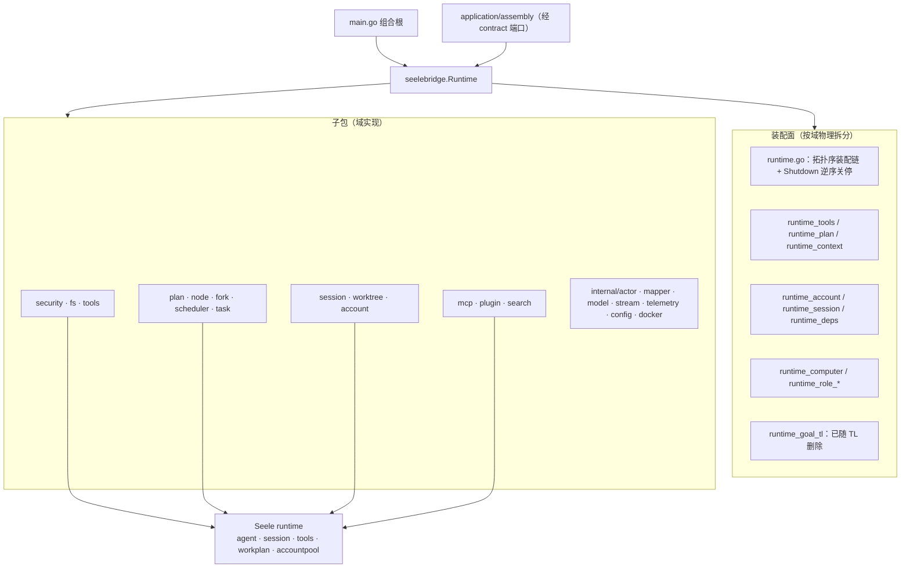

# assemble（原 seelebridge 根包装配面）

## 生态位

`backend/engine/assemble` 是 Seelex 与 Seele（当前 `v0.3.6`，见 `go.mod`）之间的**装配面**（原集中式防腐层，已按域拆解——见下方迁移表与「迁移状态」一节）：
它把 Seele 的
`accountpool`（P2C 账号租约）、`agent`（NewWithComponents 装配）、`session`
（主会话与节点子代理会话）、`tools`（Registry + 主体×路由组×位的权限门）、
`workplan`（codec 导入 + 事件投影）、`event`/`telemetry` 能力包装成 Seelex
可装配、可限制和可测试的 Runtime，同时隔离上游 API 变化。

主要调用方：根目录组合根（`main.go`）、`application/assembly` 经
`contract` 端口消费、`gui`/`tui` 只经 Application 间接使用。

## 迁移状态：这是 **staging**（未收敛）

本包是 M4-J1 的落点：`seelebridge/` 根包（52 个生产文件 13,373 行 + 121 个用例）整体搬到这里，
**包名 `seelebridge` → `assemble`，调用方保留原别名**，目的是先让 `seelebridge/` 目录从仓库里
消失（可验证、可回滚），再按域把内容下沉到 `backend/{engine,tool,multiagent}`。因此本包今天
比它的终局**臃肿得多**——按
[plan.md](../../../docs/2026-10-15-architecture-reshape/plan.md) §2.5，终局只留四个文件：
`runtime.go`（拓扑装配 + 逆序关机）、`runtime_bundle.go`、`runtime_deps.go`、`runtime_live.go`。

已下沉的域（每片一个 commit，行为零变化）：

| 片 | 内容 | 落点 |
|---|---|---|
| M4-J2a | 请求画像 + 会话遥测（`request_log.go`、`session_telemetry.go`） | [`backend/engine/obs`](../../engine/obs/README.md) |
| M4-J2b | 会话媒体与随图（原 `assemble/runtime_image.go`，已删除：同一份实现换落点） | [`backend/tool/io/media`](../../tool/io/media/README.md) |
| R11-task | task 台账域：跨会话工作表格读面 + 会话 scope 分区 + 会话级批次 + 清单面（`ports.go` 的 task/todolist 逐行委托与 `runtime.go` 的 `sessionTaskSnapshots`/`currentTaskSessionID`/`sessionBatches` 私有状态） | [`kernel/task`](../../../kernel/task/README.md) |
| R11-schedule | 定时/周期任务域的宿主转发面：7 个 DTO 别名 + `RestoreScheduledTasks` / `RegisterScheduledCommand` / `ScheduledCommands` / `ScheduleTask` / `UpdateScheduledTask` / `CancelScheduledTask` / `ScheduledTasksSnapshot` / `SetScheduledPromptExecutor` / `SetSchedulerObserver` | 本包 `runtime_schedule.go`（**状态**早已在 [`backend/engine/schedule`](../../engine/schedule/README.md)，该域的 `Runtime` 面上没有可下沉的状态，故按任务书 S4/S5 条只搬转发面） |
| R11-mcp | MCP 域的宿主转发面：`MCPServer` 别名 + 11 个 `Runtime` 公开方法（`BreakerEvents` / `AttachMCP` / `AttachMCPServer` / `RegisterLazyMCP` / `LazyMCPServerNames` / `LoadMCP` / `DetachMCP` / `RefreshMCP` / `MCPServerNames` / `IsMCPAlive` / `MCPServerStatus`） | 本包 `runtime_mcp.go`（连接与工具刷新在 [`backend/engine/mcp`](../../engine/mcp/README.md)，`Runtime.mcpManager` 即装配点） |
| R11-plugin | 插件域的宿主转发面：`DefinePlugin` / `UndefinePlugin` / `ActivatePlugin` / `DeactivatePlugin` / `ActivePlugin` / `SetPluginUnassembledReason` / `WithPluginAssembly` | 本包 `runtime_plugin.go`（插件生命周期在 [`backend/engine/plugin`](../../engine/plugin/README.md)，`Runtime.plugins` 即装配点；`WithPluginAssembly` 与 teammate 回合共用 `toolreg.WithRolePlugins` 原语） |
| R11-node | 子代理树与节点只读面的宿主转发面：`ClearSubagentTree` / `SubagentTreeEvents` / `SubAgentTree` / `SetSubagentToolCallback` / `NodeSessionConversation` / `NodeContextSnapshot` / `SetSkillRegistry` / `NodeToolResult` / `NodeWorktreeInfo{,For}` / `NodeStageLogs` / `NodeStageEvents` / `NodeFirstPersonView` / `NodeSemanticResult` / `DrainSubagentSemanticResults` | 本包 `runtime_node.go`（状态在多智能体域组件上：子代理树注册表、节点会话/上下文快照、worktree 管理器） |
| R11-task-forwarder | task 台账域的薄转发面：`ledger()` 句柄 + 台账/清单/批次 20 个 `Runtime` 公开方法 + `SetSessionWorkspace`（会话绑定事实）+ `RegisterTaskTerminalTools`（改的是工具注册表） | 本包 `runtime_task.go`（判据与状态在 [`kernel/task`](../../../kernel/task/README.md) 的 `Ledger`，本层不写第二份判据） |
| R11-ports-zero | 收口片（契约 §2.3 第 3 条）：plan 端口的 `PrepareReplan`、历史检索端口的 `SearchHistory`、actor 边界的两个投影别名 + 两个 setter、包级常量 `mainAgentNodeID` 各回其域文件；**`ports.go` 删除（文件不存在）** | 本包 `runtime_subagent.go` / `runtime_history.go` / `runtime_visibility.go` / `runtime.go`（状态由 `Runtime` 自有组件持有） |
| P21-compaction-stack | **域方法随类型走**第一片：装配层压缩推帧接收侧（`PushCompactionFrame` / `ReadbackCompactionSummary` / `CompactionSummaryAvailable` + 两个帧降级助手 + 两个请求/回执类型）连同**判据**一起下沉 | [`backend/engine/context`](../../../kernel/context/README.md) 的 `CompactionStack`（`compaction_stack.go`）；本包只剩一行薄转发 + 同身份别名，公开方法名与签名逐字不变 |
| P21-live-dispatch | **域方法随类型走**第二片：子代理第一视角实时流分发器（`live*` 字段组 + 广播循环 + 事件源接线 + 窗口归一化 + 分页读法 + 三个事件投影）连同**判据**一起下沉 | [`backend/multiagent/subagent`](../../multiagent/subagent/README.md) 的 `LiveDispatcher`（`live_dispatch.go`）；本包 `runtime_live.go` 只剩一行薄转发 + 同值常量别名，公开方法名与签名逐字不变 |
| P21-served-route | **域方法随类型走**第三片：路由事实注册表（`servedRoutes` + `routingNoticeMu` + `routingNoticeSeen` 三个字段与四条判据：哪些原因覆盖、只有主链路才记、读即清、unpinned 摘要去重）下沉；顺带收敛一处**同形状两份实现**（`internal/stream.RoutingNotice` 与 `dto.RoutingNotice` 字段逐一相同，现为同身份别名） | [`backend/engine/account`](../../engine/account/README.md) 的 `ServedRouteRegistry`（`served_route.go`）；本包 `runtime_account.go` 只留 `observeRoutingNotice` / `TakeServedRoute` 两个转发，公开面逐字不变 |
| P21-review-files / BM-005 | **域方法随类型走**第四片：`show_files` 的**工具形状**（名字 / 描述 / JSON schema / 参数校验 / 返回值回执）搬进域包；BM-005 又把唯一注册 helper 收回域包 | [`backend/tool/review`](../../tool/review/README.md) 的 `show_files.go`（`RegisterShowFilesTool` + `ToolRegistrar`）；生产注册由 `boot` 直接调用，本包 `review_files.go` 只剩 D1 一行转发 + `ReviewFilesPort` 同身份别名，计划 BM-007 删除 |
| P21-subagent-session | **域方法随类型走**第五片：子代理**独立会话工厂**（显式 ID 建会话 + 重名拒绝 + 组件模板补齐 Hooks/SessionID/ModelName/History + 注册进 registry）搬进域包 | [`backend/multiagent/subagent`](../../multiagent/subagent/README.md) 的 `SessionFactory`（`session_factory.go`）；本包 `runtime_subagent_session.go` 只剩一行薄转发，公开方法名与签名逐字不变 |
| P21-unified-events | **域方法随类型走**第六片：B 类脱敏摘要日志（`SummaryLog` + 摘要→框架事件转换）与统一事件查询（`UnifiedEventReader` / `UnifiedEventView` / 两个读法 / `UnifiedEventTopic` 话题映射 / `filterUnifiedEvents` 过滤）连同**判据**一起下沉 | [`backend/engine/obs`](../../engine/obs/README.md) 的 `unified_events.go`；本包 `events_unified.go` 只剩同身份别名（调用方与用例零改动）+ 两个公开读法的薄转发，宿主读数仍只有两格（`HistoryRouter` 与 tracer 的查询闭包） |
| P21-account-windows | **域方法随类型走**第七片：每账号上下文窗口覆盖层的**状态**（互斥量 + 表）与三条判据（入口过滤、改一格/清一格、**生效窗口的优先级**）下沉；顺带删掉装配层唯一读法 `Runtime.accountWindow`（域包 `For` 是唯一一份） | [`backend/engine/account`](../../engine/account/README.md) 的 `WindowOverlay`（`window_overlay.go`）；本包 `runtime_account.go` 只剩 `SetAccountWindow` / `AccountWindows` / `ContextWindowFor` 三个薄转发（公开签名逐字不变），宿主读数以 `account.WindowDeps` 注入（`limits.context_window` + 账号档自报两条函数值） |
| P21-event-correlation | **域方法随类型走**第八片：双轨事件的关联面（`correlateMainSessionID` 与两轨关联说明）整文件下沉；**同时把"从事件读会话归属"这条判据收敛成唯一一份**——装配层 `eventSessionID` 与 `backend/tool/plan` 的 `sessionIDFromLocations` 都是 `store.sessionIDFromEvent` 的逐字副本，现统一为 `store.SessionIDFromEvent` / `store.SessionIDFromLocations`（含 obs 话题映射里的内联循环） | [`backend/engine/obs`](../../engine/obs/README.md) 的 `event_correlation.go`（`CorrelateMainSessionID`）+ [`store`](../../../store/README.md) 的 `SessionIDFromEvent` / `SessionIDFromLocations`（唯一判据处）；本包事件关联文件已删除，`runtime_subagent.go` 的 `SetEventPersister` 改为调用域包一行 |
| P21-jobs-domain | **域方法随类型走**第九片：异步作业域的两面整文件下沉——作业生命周期事件流（`jobsEventStream` + 状态记忆 + 状态映射 + 时间基序号）与后台执行表投影（`AsyncRunsSnapshot` 的逐列搬运）；端口取窄（事件流只吃 `Snapshot(Scope)` 一格；投影只吃 `[]registry.AsyncRunInfo`） | 新建 [`backend/tool/jobs`](../../tool/jobs/README.md)（`event_stream.go` / `projection.go`，plan §2.6 的目标落点）；本包容纳事件流的那个文件（`jobs_events`）**整份删除**、`runtime_async.go` 只剩两个薄转发，`currentEventPersister` 移到 `runtime_subagent.go`（与 `SetEventPersister` 同处），装配点 `SetTeamworkBackend` 改为 `tooljobs.NewEventStream(...)`。**顺带修掉一处停机隐患**：`Close` 在"从未 Start"时不再等一个永不关闭的 `done`（装配中途失败会让停机钉死） |
| P21-project-board | **域方法随类型走**第十片：项目看板的两面下沉——按需读取面（`ReadProjectBoard` + 白名单归一 + 稳定排序 + 边界报错，整文件）与 `TeamworkPlanFor` 的取数判定（会话号归一 / 键完整性 / 读失败与空计划同解）；端口取两格函数值 | [`kernel/board`](../../../kernel/board/README.md) 的 `read.go` / `teamwork_plan.go`（plan §2.4 的目标落点）；本包按需读取面那个文件（`runtime_project_board_read`）**整份删除**、`runtime_project_board.go` 只剩方法转发 + `teamworkKeyFor` / `readTeamworkPlan` 两格宿主读数 + **直接**钉 `var _ board.TeamworkPlanSource = (*Runtime)(nil)`（依赖方向允许本层引用该接口名）；工具注册点 `boot/registry.go` 的 5 处引用改指域包。域级用例随实现搬进域包（`read_test.go` 断言逐字 + 5 条新的 `teamwork_plan_test.go`），宿主级用例（`runtime_project_board_test.go`，真 Runtime + 真存储）留在本包 |
| P21-teammate-live | **域方法随类型走**第十一片：**当前 teammate 会话**的实时只读投影（默认页 + 分页读法 + 唯一一份裁剪/分页判据 + 只留 user/assistant 的投影判据 + 两个上限常量）整文件下沉 | [`backend/multiagent/teamwork`](../../multiagent/teamwork/README.md) 的 `teammate_live.go`（plan §2.7 的目标落点）；本包 `runtime_teammate_session_live.go` 只剩两个公开方法的一行转发 + 同值常量别名 + **一格宿主读数** `teammateLiveDeps`/`teammateLiveSession`（角色回合执行面句柄：角色名 / 是否在飞 / 引擎历史）。域级用例随实现搬进域包（`teammate_live_test.go`，含原纯函数用例的断言），宿主级用例（两个 `runtime_teammate_session_live*_test.go`，真 Runtime + 真角色回合）留在本包 |
| P21-goal-tl（已随 TL 删除） | **域方法随类型走**第十二片：ADVISOR(TL) 真实评估器整文件下沉（提示词四段与输出契约追加、工具边界与实际执行面同源判定、只读权限口径、裁决解析与域校验） | [`kernel/goal`](../../../kernel/goal/README.md) 的 `advisor_evaluator.go`（plan §2.5：`seelebridge` 的 runtime_goal_tl → goal 域"搬 + 反向依赖改端口"）；本包 `runtime_goal_tl.go` 只剩 `GoalTLEvaluator` + **三格宿主读数**（`completeAdvisorOnce` 无工具兜底 / `rolePromptFor` 提示词读面 / `advisorRound` 把 `goal.AdvisorRoundRequest` 翻成 `roleRoundSpec`——**唯一**一处翻译）。两条域级用例随实现搬进域包，另补 7 条（两条执行面同源、只读口径与 FreshContext、ErrTLDisabled 与 ErrBadDirective 的区分、宽松解析、安全截断）。顺带把装配层两个零散字符串助手（`stringPtr` / `truncateRunes`）抽到新文件 `strings.go`：它们不止 goal 用，原来挂在被搬走的文件尾部 |（已删除）
| P21-subagent-conclusion | **域方法随类型走**第十三片：子代理最终结论的**两向投影**与接管判据下沉——结论事件形状（时间基序号 / done-failed 映射 / 定位挂主会话）、从事件库读回结论记录（跳过外族与坏条目）、"记录的主人已不在本进程才按崩溃口径接管" | [`backend/multiagent/subagent`](../../multiagent/subagent/README.md) 的 `conclusion.go`（plan §2.7 的目标落点）；本包 `runtime_subagent_recovery.go` 的 `persistSubagentConclusion` / `loadSubagentConclusions` 仍持签名（下一片 `runtime_subagent_resume.go` 也在用），但正文只剩"交给谁落盘 / 从哪读"的接线。域级 4 条新用例（形状、**正反两向互为逆**的往返、跳过外族坏条目、接管判据）；宿主级用例 `runtime_subagent_recovery_test.go` 一行未改（只把 Source 常量换成域包的导出名） |
| P21-role-prompt-optimize | **域方法随类型走**第十四片：员工提示词的**一次有界改写**（固定元指令 / 请求按标签渲染 / 输出契约宽松解析 + `optimized` 必填 + 理由去空截断到 5 条每条 ≤60 rune / 回执组装）下沉 | [`kernel/prompt`](../../../kernel/prompt/README.md) 的 `role_prompt_optimize.go`（plan §2.5 的目标落点）；本包 `runtime_role_prompt.go` 只留**读面状态**（`SetRolePromptProvider` / `rolePromptFor`——宿主注入的读面，不是提示词域的事实）与两格宿主读数（`completePromptOptimizeRound` 一次无工具回合 / `Model`）。解析用例随实现搬进域包，另补 4 条（回合编排与缺省兜底、无执行面、回合失败包一层、理由有界）；`rolePromptFor` 用例留在本包 |
| P21-workunit-recovery | **域方法随类型走**第十五片：恢复链的**判据**下沉——记录身份 → 哪一层（写明的身份优先 / 缺身份按团队现场名单兜底 / 认不得的词按既有链归类并交回留痕）、按身份切开的分派与次序、"恢复说明"的容器 | [`backend/workunit`](../../workunit/README.md) 的 `recovery.go`（plan §2.7 把 `runtime_unit_recovery.go` 与 `seelebridge` 的 resume_notes 都指向 workunit 域）；本包 `runtime_unit_recovery.go` 只剩**两层策略本体**（宿主组件动作：详情数据面 / 子代理树 / 现场登记）与分派接线（`unitRecoveryStrategy` 是同身份别名），恢复说明容器那个文件（resume_notes）**删除**（容器改为 `workunit.ResumeNotes`，subagent 与 teammate 两个键语义留在各自调用点）。域级 5 条新用例；宿主级用例一行未改 |
| P21-context-wiring | **域方法随类型走**第十六片：上下文面的**判据**下沉——分片重放预算（旋钮零值语义）、厚摘要器的三条 nil 出口与理由文案、读尾预算与轮数回退、真空区补压（**没有压缩基线就不补**）、相关记忆块选取与渲染 | [`backend/engine/context`](../../../kernel/context/README.md)（`context_runtime`）的 `wiring.go`（plan §2.5 把 seelebridge 的 runtime_context 列为该域目标）；本包 `runtime_context.go` 保留**组件工厂**（把宿主 limits / completer / 会话上下文存储 / 窗口策略接成 `seelectx.*` 与 `seelexctx.*` 的构造参数）与五个一行转发。域级 5 条新用例（旋钮零值 / 三条 nil 理由 / 轮数回退 / 无基线不补帧 / 记忆块选取），既有宿主级用例一行未改 |
| P21-plugin-assembly | **域方法随类型走**第十七片：teammate 插件装配的**判据**下沉——三层口径（显式声明替换集合 / 角色自带 / 空集不覆盖）、读侧规范化（trim + 保序去重 + 空清完归一为 nil）、编排入口四条显式拒绝（语法规整写回 / 未知名 / 超限 / 重复）、装配面裁决三形态（有定义收窄 / 空定义一律可见 / **失灵一个都不给**） | [`backend/multiagent/team`](../../multiagent/team/README.md) 的 `plugin_assembly.go`（plan §2.7 把 runtime_role_plugins 列为该域目标）；本包 `runtime_role_plugins.go` 保留**宿主读数面**（插件定义目录与可见性管理器、技能注册表、limits）与装配读数（技能目录段、装配回执、黄牌），判据处改走**同身份别名**（`normalizePluginNames` / `validateMemberPlugins` 是函数值别名，`pluginFaceJudgement` 是类型别名），既有调用点与用例零改动。域级 4 条新用例 |
| P21-subagent-resume-units | **域方法随类型走**第十八片：子代理**中断恢复的判据**下沉——残留记录 → 恢复单元的判定口径（在跑 / 判失败 / 其余终结 / **已有结论一律按终结**）、幂等键口径、两个终态谓词（认不得的词不判死也不当终结）、现场投影与摘要回退、恢复说明组合（契约正文 + 两条有界追加事实） | [`backend/multiagent/subagent`](../../multiagent/subagent/README.md) 的 `resume_units.go`（plan §2.7 把 runtime_subagent_resume 列为该域目标）；本包 `runtime_subagent_resume.go` 保留**七步模板的宿主适配器**（Locate 的账本/事件库读取、RepairParent 的宿主钩子、Reexecute 的真派发与 ctx 会话注入、Converge 的记录删除）与公开方法面，判据处改走域包（`lastSubagentStagePreview` 是函数值同身份别名）。域级 5 条新用例；宿主级链路用例（`test/` 与 `assembly_chain*`）一行未改 |
| P21-teamwork-board-view | **域方法随类型走**第十九片：团队看板的**投影判据**下沉——五份行的搬运、人的状态两值折算、当前会话三段优先、卡点渲染（走编排面同一处判据）、句柄过期提示位、下发与存档同一条路径 | [`backend/multiagent/teamwork`](../../multiagent/teamwork/README.md) 的 `board_view.go`（plan §2.7 把 runtime_teamwork 列为该域目标）；本包 `runtime_teamwork_board.go` 只剩**宿主面**（文件读缓存 + 失效点 + 装配读数），投影处改走**同身份别名**（既有调用点与用例零改动）。域级 8 条新用例 |
| P21-teamwork-tool-shapes | **域方法随类型走**第二十片：leader 编排工具的**形状面**（12 组名字 / 描述 / schema）整份下沉 | [`backend/multiagent/teamwork`](../../multiagent/teamwork/README.md) 的 `tool_shapes.go`（plan §2.7，与 `backend/tool/review` 的 `show_files` 同款形状）；本包 `runtime_teamwork_schema` **删除**，`registerTeamworkTools` 改成 `teamwork.Team<X>ToolName` + 描述/schema 各一行（工具名常量跨包引用，工具面门禁按声明包名解析）。既有 schema 用例随实现搬进域包，断言逐字 |
| P21-teamwork-context-view | **域方法随类型走**第二十一片：`team_context` 读面的**投影与判据**下沉——成员行组装、最新作业行选取、按需取正文（非消费 `Peek`）、行不在册时按角色名回读残边、正文预算与 UTF-8 安全裁剪 | [`backend/multiagent/teamwork`](../../multiagent/teamwork/README.md) 的 `context_view.go`（plan §2.7）；本包 `runtime_teamwork_context.go` 只剩**宿主面**（读面三格读数 `teamworkReadScope`、输出面取值、参数解析与 handler 接线），`readOutputHead` 实现搬进域包（`ReadOutputHead`）并在本层留函数值别名。域级 5 条新用例；既有读面用例经同身份别名零改动 |
| P21-teamwork-output-store | **域方法随类型走**第二十二片：产品自有作业输出面（`TeamworkJobOutputs` 的分配 / 写入 / 清理 / 回读与角色名安全化）整份下沉 | [`backend/multiagent/teamwork`](../../multiagent/teamwork/README.md) 的 `output_store.go`（`OutputStore`，plan §2.7）；本包 `runtime_teamwork_output` **删除**，组合根（`boot`）与 headless 端到端用例改调 `teamwork.NewOutputStore`，宿主级接线用例（`writeWorkerOutput` 经产品面 + 清目录后迟到写丢弃）留本包。域级用例随实现搬入 |
| P21-teamwork-board-archive | **域方法随类型走**第二十三片：看板**存档生命周期与封板判据**下沉——无档新开一版 / 换版本先关旧后开新 / 同版本推进 seq / 指纹节流 / 只恢复 active / 封板幂等 | [`backend/multiagent/teamwork`](../../multiagent/teamwork/README.md) 的 `board_archive.go`（plan §2.7）；本包两个文件（`runtime_teamwork_board_archive.go` / `runtime_teamwork_board_close.go`）只剩**宿主面**（什么时候读、读哪些、失败了记一行日志、收口路径与 `BoardCloser` 接线），判据处走同身份别名（`nextTeamBoardMeta` / `boardFingerprint` / `sealTeamBoard` 是函数值别名，`readTeamBoardArchive` 是方法转发）。域级 4 条新用例 |
| P21-teamwork-job-projection | **域方法随类型走**第二十四片：作业完成投影（逐列搬运 + 框架状态词 → 契约枚举的**唯一**折算处）下沉 | [`backend/multiagent/teamwork`](../../multiagent/teamwork/README.md) 的 `job_projection.go`（plan §2.7）；本包 `runtime_teamwork_jobs.go` 只剩宿主面（作业表读数 `teamworkJobManager`、信号口 `TeamworkJobEvents`、公开投影方法一行转发），判据处走同身份别名（`teamworkJobCompletionFrom` / `asyncStateFromJobs` 是函数值别名）。域级 3 条新用例；既有投影用例一行未改 |
| P21-teamwork-scene-index | **域方法随类型走**第二十五片：团队现场**名单判据**与**指派名的反向换算**下沉——计划 + 账本原始行 → nodeID 名单（去重保序、未释放才认领）、`seelex/<nodeID>` 去前缀 | [`backend/multiagent/teamwork`](../../multiagent/teamwork/README.md) 的 `scene.go`（plan §2.7；P21-26 顺带把"一条命名只有一域"补齐：正向拼装本来就在域包）；本包 `runtime_teamwork_scene.go` 只剩**宿主面**（读计划与账本两份持久事实 + 逐个 `Adopt` 认领），`workItemNodeID` 改成同身份别名（`teamSceneEntry` 是类型别名）；`runtime_teamwork_items.go` 因此删掉一份去前缀实现。域级 3 条新用例 |
| P21-plugin-reject | **域方法随类型走**第二十六片：「未装配名字」的判决（只判名字 / 已装插件不问 / 语法先于语义 / 判据函数给什么理由就说什么理由）下沉 | [`backend/multiagent/team`](../../multiagent/team/README.md) 的 `plugin_reject.go`（plan §2.7；与 P21-18 的 `ValidateMemberPlugins` 同域）；本包 `runtime_teamwork_curated.go` 只剩三格宿主读数（有没有判决面 / `Defined` / `UnassembledReason` + 每会话上限）。域级 5 条新用例；既有装配链用例一行未改 |
| P21-session-bundle-release | **域方法随类型走**第二十七片：桥侧会话本体**释放判据**（三种拒绝情形 + 顺序）下沉 | [`kernel/sessionpolicy`](../../../kernel/sessionpolicy/README.md) 的 `bundle_release.go`（plan §2.4）；本包 `runtime_session_release.go` 只剩**宿主面**（四格读数：`ForkInFlight` / `AsyncPendingFor` / `takeSessionBundle`（注册表锁内"活跃别名 + 在册"检查并移出，原子）/ `dropSessionResidue`），`ReleaseSessionBundle` 签名与返回语义不变。域级 4 条新用例；宿主级用例（真 Runtime 注册表与残格）一行未改 |
| P21-worker-round | **域方法随类型走**第二十八片：teammate 回合面的三条纯判据下沉（记录槽上限"只抬不降"、回数上限口径、回合输入正文组装） | [`backend/multiagent/teamwork`](../../multiagent/teamwork/README.md) 的 `worker_round.go`（plan §2.7）；本包 `runtime_teamwork.go` 里三处改成**同值/同身份别名**（`teamworkRoundsPerMember` / `teamworkJobRecordCeiling` / `workerTurnLimit`（回退值仍是本层角色回合常量）/ `workerRoundInput`），既有调用点与用例零改动。域级 3 条新用例 |
| P21-plan-branch-routing | **域方法随类型走**第二十九片（历史记录）：Plan **分支路由**三条判据曾下沉到 `backend/tool/plan` | 该包与内部 Plan 执行器已在 2026-10-17 随“plan_* 工具面退役”整体删除；节点会话号派生保留在 `backend/tool/node/session_id.go`，稳定哈希原语收敛到 `internal/stablehash` |
| P21-project-scoped-names | **域方法随类型走**第三十片（**去重**）：项目作用域工具名单**两份实现并成一份**——`Router.Register` 里的六个名字字面量与装配层 `isProjectScopedTool` 的 switch 是同一份名单；现在名字与判据同处工具注册域（`scoped_names.go`），注册点用常量 | [`backend/tool/registry`](../../tool/registry/README.md) 的 `scoped_names.go`；本包 `runtime_tools.go` 的 `isProjectScopedTool` 改成**同身份别名**（调用点零改动）。新增跨实现一致性用例（桩捕获注册面名字对账） |
| P21-role-turn-judgments | **域方法随类型走**第三十一片：员工回合三条判据下沉（身份 `WorkScope` 与 ctx 往返、工具活动稳定 ID 与上限、未登记提示词时的最小角色框架） | [`backend/multiagent/team`](../../multiagent/team/README.md) 的 `role_turn.go`（plan §2.7 明确列出 `runtime_role_turn.go`）；本包 `runtime_role_turn.go` 里 `roleWorkScope` 改类型别名、`withRoleWorkScope` / `roleWorkScopeFrom` / `roleToolActivityID` 改函数值别名、`roleTurnSystemPrompt` 只剩"读已登记提示词、否则回退域包默认"，并因此去掉 `hash/crc32`。执行面（开引擎/会话槽/权限分配/项目根绑定/回合闸门/ChatStream）仍是宿主。域级 3 条新用例 |
| P21-teamwork-plan-query | **域方法随类型走**第三十二片（**去重**）：派发回执里的"按工作项找执行角色"另写过一次里程碑遍历（与 `items.go` 的 `findItem` 同源但口径略不同）→ 与"按角色找成员"一起收进团队域 `plan_query.go`；装配层 `dispatchItemRole` / `dispatchAssemblyReading` 只剩"取计划（host）+ 查一次（域包）" | [`backend/multiagent/teamwork`](../../multiagent/teamwork/README.md) 的 `plan_query.go`（`ItemRole` / `MemberOf`）。域级 2 条新用例；既有派发/装配读数用例一行未改 |
| P21-team-unit-record | **域方法随类型走**第三十三片：teammate 单元记录的**写侧口径**下沉（状态词表来自契约、"收尾分类 → 终态"的折算、单元身份三形态） | [`backend/multiagent/teamwork`](../../multiagent/teamwork/README.md) 的 `unit_record.go`（plan §2.7）；本包 `workunit_team.go` 里五个符号改**同身份/同值别名**（`teamUnitStatus*` / `teamUnitStatusFor` / `teamUnitNodeID`），既有调用点（记录写侧、链用例、状态词表互锁用例）零改动，并去掉 `contract/dto` 直依赖。域级 3 条新用例 |
| P21-team-unit-record-link | **域方法随类型走**第三十四片：teammate 单元记录的**身份写侧**下沉——`UnitRecordKey` / `UnitRecordKeyFor`（记录身份与 nodeID 口径）与 `TeammateUnitRecordLink`（写链上 teammate 那一环） | [`backend/multiagent/teamwork`](../../multiagent/teamwork/README.md) 的 `unit_record.go`（plan §2.7）；本包 `teamUnitRecordKey` 改类型别名、`teamUnitKeyFor` / `teamUnitUnitRecordLink` 改函数值别名（记录写侧与链用例零改动）。域级 2 条新用例（身份取数 + 身份环只写自己那格且拷贝集合） |
| P21-team-unit-recovery | **域方法随类型走**第三十五片：`RecoverTeamworkUnits` 的**中断判定**下沉（记录侧与账本侧两条来源 + 一次去重 + 恢复说明生成） | [`backend/multiagent/teamwork`](../../multiagent/teamwork/README.md) 的 `unit_recovery.go`（`InterruptedUnits` / `UnitRecovery`，plan §2.7）；本包只剩**宿主编排**（认领现场 → 读记录 → 账本 Recover/AliveSceneNodes → 域包判中断 → 注入说明），执行面读数 `teamUnitSurfaceAlive` 以函数值传入。域级 3 条新用例 |
| P21-teamwork-tool-requests | **域方法随类型走**第三十六片：十个 handler 里的**入参形状与解码**下沉（形状与 schema 同处一域） | [`backend/multiagent/teamwork`](../../multiagent/teamwork/README.md) 的 `tool_requests.go`；本包 handler 只剩"解码（域包）→ 话术包装 → Coordinator 调用 → 回执"（错误文案 `team_x: 参数解析失败` 仍在本层）。域级 6 条新用例；既有 handler 级用例（端到端/headless）一行未改 |
| P21-worker-system-prompt | **域方法随类型走**第三十七片：worker 回合**系统提示的组成**下沉（作业纪律文案 + 三段顺序：角色提示词 → 作业纪律 → 恢复说明，段间空行） | [`backend/multiagent/team`](../../multiagent/team/README.md) 的 `role_turn.go`（`WorkerWorkItemDiscipline` / `ComposeWorkerSystemPrompt`，plan §2.7）；本包 `workerWorkItemDiscipline` 改同值常量别名、`workerRoleRoundSpec` 的提示词组装只剩"两格读数 → 域包一行"。域级 1 条新用例（顺序/空行/无恢复说明不多段） |
| P21-teamwork-scope-key | **P21 收尾：端口接线去重**——团队面"会话号 → 后端 + 作用域键"的解析此前在九处各写一遍，且两处只看 `KeyFor` 的 ok、不看键分量（半截键可进入存储），`teamworkKeyFor` 又漏了 trim。判据随 `store.Key` 走（`Key.Complete`），本包只剩 `runtime_teamwork_scope.go` 的 `resolveTeamworkScope` 一格；看板域的取数判定问同一句。跨实现一致性用例（同一输入走宿主与看板域） | [`store.Key.Complete`](../../../store/README-session.md) + 本包 `runtime_teamwork_scope.go` |
| P21-scene-node-single-source | **P21 收尾：端口接线去重**——团队现场名单的两处宿主用法（重启恢复的 `SceneNodes` 回调、teammate 记录的归属过滤）各写了一遍"index → nodeID"的投影/集合；现在都走域包 `SceneNodeIDs` / 新增 `SceneOwnsNode`，装配层不再建第二份名单 | [`backend/multiagent/teamwork`](../../multiagent/teamwork/README.md) 的 `scene.go` |

**P21 收尾后的剩余面**（都不是判据）：`runtime_teamwork.go` 的 worker 宿主动作
（`RunWorker` / `workerRoleRoundSpec` / `bindWorkerProjectRoot` / `writeWorkerOutput`）、
`workunit_team_records.go` 的存/删/回灌 I/O、`runtime_teamwork_items.go` /
`workunit_assembly.go` 的端口实现与三格适配器、`runtime_context.go` 的组件工厂与
`runtime_tools.go` 的注册面——按 plan §2.5 与 workunit 端口设计文档明确留在装配处。
全部判据已下沉；装配层只允许转发或接宿主读数，同一判据出现第二份即缺陷（AGENTS §8.3）。
**收口片已完成**：`ports.go` 的每一段都按域归位后**文件被删除**
（R11-task 收掉 task/todolist 状态与薄转发面、R11-schedule / R11-mcp / R11-plugin / R11-node
各收掉自己的宿主转发面、收口片 R11-ports-zero 把 plan / 历史检索 / actor 边界三段并回域文件）。
`git ls-files backend/engine/assemble/ports.go` 为空即这条验收。

每片的判据都是"行为零变化"：只动"文件在哪、包叫什么、谁持有状态"，不动判定、协议与持久化格式。

## 架构图



## 文件结构

根目录保留组合根骨架 + 端口文件 + 按层装配文件（薄桥形态，装配域物理拆分）：

本轮 teammate 会话/收口硬化新增的宿主面：

- `runtime_agent_conversation.go`：main/subagent/teammate 统一
  `View/Chat/Recover` 的执行侧适配器；teammate 只接受 WorkItem Session，不提供长期角色私聊。
- `runtime_workitem_execution.go`：WorkItem 详情与 teammate 进度页共用的
  `WorkItemExecutionView` 唯一 adapter。
- `runtime_teammate_inspection.go`：当前 WorkItem、base/effective prompt、安全插件能力、
  limit 与权限向量的只读聚合。
- `runtime_teamwork_items.go`：WorkItem worktree 使用 `BeginNamedStrict`，失败返回
  `approval_required` typed error；只有显式 `workspace=main` 才走已批准主工作区。
- `runtime_role_turn.go`：teammate 的 WorkItem Session 通过共享 AgentSessionFactory
  挂独立 DurableHistory；工具失败返回策略在 hook 上计连续显式失败并在阈值处取消本轮。
  冷会话在下一轮前注入该 WorkItem 自己最近一次快照；工具开始/收口时增量刷新记录，
  因此进程中断后可从同一上下文继续 Chat 或重派。

| 文件 | 职责 |
|---|---|
| `runtime.go` | 组合根骨架：RuntimeConfig/Runtime 结构体 + NewRuntime（拓扑序装配链）+ Shutdown（生命周期逆序关停）+ 主会话装配 |
| `runtime_history.go` | 历史检索端口的宿主面（M5-R11 收口片从 `ports.go` 原样搬来）：`SearchHistory` 的装配（会话上下文存储当栈源 + 事件库路由当数据源）与两条未装配判据 |
| `runtime_visibility.go` | actor 消息边界（M5-R11 收口片从 `ports.go` 原样搬来）：`RuntimeVisibilityProjection` / `ParentEvidenceProjection` 两个跨层别名 + `SetRuntimeVisibilityProjection` / `SetParentEvidenceProjection` 两个单向发布口 |
| `runtime_schedule.go` | 定时/周期任务域的宿主转发面（M5-R11-schedule 从 `ports.go` 原样搬来）：7 个 DTO 别名 + 9 个 `Runtime` 公开方法，逐行委托 [`backend/engine/schedule.State`](../../engine/schedule/README.md)（`Runtime.scheduler` 即该装配点引用） |
| `runtime_mcp.go` | MCP 域的宿主转发面（M5-R11-mcp 从 `ports.go` 原样搬来）：`MCPServer` 别名 + 11 个 `Runtime` 公开方法，逐行委托 [`backend/engine/mcp`](../../engine/mcp/README.md)（`Runtime.mcpManager`） |
| `runtime_plugin.go` | 插件域的宿主转发面（M5-R11-plugin 从 `ports.go` 原样搬来）：7 个 `Runtime` 公开方法，前六个逐行委托 [`backend/engine/plugin`](../../engine/plugin/README.md)，`WithPluginAssembly` 走共享原语 `toolreg.WithRolePlugins` |
| `runtime_node.go` | 子代理树与节点只读面的宿主转发面（M5-R11-node 从 `ports.go` 原样搬来，含 `NodeWorktreeInfo` 别名）：14 个 `Runtime` 公开方法，逐行读 `Runtime` 自己持有的域组件 |
| `runtime_task.go` | task 台账域的薄转发面（M5-R11-task-forwarder 从 `ports.go` 原样搬来）：`ledger()` + 台账/清单/批次 20 个方法 + `SetSessionWorkspace` + `RegisterTaskTerminalTools` |
| `runtime_subagent.go` | 子代理执行装配与委托（子代理策略、fork 作业面、node Deps 闭包；Plan 执行器已退役） |
| `runtime_context.go` | 上下文**接线**（Assembler/Controller/Compressor/窗口/stack/project/memory/归档）：组件工厂 + 五个判据的一行转发（判据在域包 [`wiring.go`](../../../kernel/context/README.md)：分片预算 / 摘要器理由 / 读尾预算 / 真空区补压 / 记忆块选取） |
| `runtime_account.go` | 账号路由委托（account.Manager：选中账号/provider/限额/选择器）；**每账号上下文窗口**的取值面：`ContextWindowFor`、`SetAccountWindow`（界面「设置 → 账号」改一格，改后立刻生效）、`AccountWindows`（拷贝，诊断/对账用）——三条判据（入口过滤 / 改一格清一格 / **优先级**：账号级覆盖 > `limits.context_window` 全局 > 账号档自报值）在 P21-8 下沉到 [`backend/engine/account.WindowOverlay`](../../engine/account/README.md)，本文件只剩三个薄转发 + `account.WindowDeps` 注入。覆盖层的落盘在数据根 `runtime-limits.json`（宿主侧 [`backend/limit/overlay`](../../limit/overlay/README.md)），**不写回** `seelex.yaml` 与账号档。**路由事实注册表**（承接路由 / unpinned 去重 / 读即清）在 P21-3 下沉到 [`backend/engine/account.ServedRouteRegistry`](../../engine/account/README.md)，本文件只留 `observeRoutingNotice` / `TakeServedRoute` 两个转发。**账号的两条界面链路**也挂在这里：`RegisterAccount`（手动添加账号的热注册：先进 P2C 池、再进 `account.Manager`——顺序不能反，池注册失败时管理器不该先认下这条账号，否则列表里会出现一条永远承不了流的假条目）与 `AccountBalance`（按账号名取 `AccountSpec` 后交给 `account.QueryBalance`；未知名字报错，**不**回退到"当前选中账号"，那会让用户看到另一个账号的钱） |
| `request_log.go` | LLM 请求记录中间件（`SEELEX_REQUEST_LOG` 门控，默认关闭）：包装 Completer/StreamCompleter，把每次真实请求的 role + 内容 hash + 工具调用名按顺序写 JSONL（不落正文/参数原文），供 headless 冒烟做“请求顺序 ↔ 存储内容”匹配 |
| `runtime_deps.go` | 启动期装配结构 `RuntimeDeps` + `ApplyDeps`（一次性注入；装配点不散装单字段 setter） |
| `events_unified.go` | 统一事件库的**宿主转发面**（P21-6：B 类 llm/tool 脱敏摘要 `SummaryLog`、统一查询 `UnifiedEventReader`、话题映射与过滤判据都在 [`backend/engine/obs`](../../engine/obs/README.md) 的 `unified_events.go`）：本文件只留同身份别名 + `NewSummaryLog()` 一行 + `Runtime.UnifiedEvents` / `Runtime.UnifiedEventsRange` 两个薄转发，宿主读数只有 `HistoryRouter` 与 tracer 查询闭包两格 |

| `runtime_tools.go` | 工具注册表装配（RegistryState/内联工具/权限门）、RegisterBuiltins、可见性策略装配、Deps 闭包工厂 |
| `runtime_computer.go` | computer use 工具族装配：`SEELEX_COMPUTER_USE` 门控 + 平台判定 + DPI 感知 + 注册（脚本面见 `../backend/tool/computer/tools*.go`） |
| `runtime_role_prompt.go` | 员工提示词的**装配读面**（P21-15：优化那一半的判据在域包 [`kernel/prompt`](../../../kernel/prompt/README.md)）：`SetRolePromptProvider`/`rolePromptFor`（ADVISOR 回合取已登记提示词，未登记回退内置；装配根在 `main.go` 注入——宿主状态，不搬）+ `OptimizeRolePrompt` 一行转发（把 completer 接成“一次无工具回合”与模型名两格读数） |
| ~~`runtime_goal_tl.go`~~（已删除） | 已随 TL/ADVISOR 删除（2026-10-17），不再有 evaluator 装配面 |
| `strings.go` | 装配层自己的零散字符串助手（`stringPtr` / `truncateRunes`） |
| `runtime_role_turn.go` | **角色（员工）回合执行体**：开角色会话（独立引擎 + 角色提示）的同时把该员工的权限分配成 `emp_<角色名>` 主体，回合起手按构造把主体放进 ctx（`tools.WithEmployeeSubject`），工具面与判定因此按角色权责收窄；引擎构造可用 `SetRoleEngineFactory` 替换（测试/更严隔离面），`ReleaseRoleSessions` 在 Shutdown 释放派生执行面。**ReAct 钩子按本轮身份分流**（2026-10-03）：员工做工回合（`roleRoundSpec.WorkScope`）的每次工具调用 → `dto.RoleToolActivity` → `SetRoleToolCallback`（装配根接 `app.HandleRoleToolActivity`）→ 会话级事件 `teammate.tool.started/completed`；ADVISOR 评审回合仍走 goal 域 TLStep sink |
| `runtime_session.go` | 主会话绑定状态（sessionBindings：ctxStore/historyRouter/mainHistory/project/turnArchiver/sessionID）+ merge-back 内部方法 |
| `runtime_live.go` | node 第一视角实时流的**宿主转发面**（P21-2：状态/广播循环/事件源接线/窗口归一化/分页读法都在 [`backend/multiagent/subagent.LiveDispatcher`](../../multiagent/subagent/README.md)）：`SubscribeSubagentLive`（历史回放 + 实时通道）与**同一份回放窗口**的分页读法 `SubagentLiveHistoryPage` 一行转发；窗口**配置读数**留在本层（`RuntimeConfig.SubagentLiveWindow`），归一化判据在域包（0 → 默认 512，<50 → 50） |
| `runtime_teammate_session_live.go` | **当前 teammate 会话**实时投影的宿主转发面（P21-12：判据在 [`backend/multiagent/teamwork.TeammateSessionLive`](../../multiagent/teamwork/README.md)）：`TeammateSessionLive` / `TeammateSessionLivePage` 各一行转发 + 同值常量别名，宿主读数只有一格（角色回合执行面句柄：角色名 / 是否在飞 / 引擎历史） |
| `runtime_project_board.go` | **项目看板窄可选端口的宿主转发面**（M3；P21-11 判定下沉）：`TeamworkPlanFor(sessionID)` 实现 `board.TeamworkPlanSource`，一行转发到 [`kernel/board.TeamworkPlanFor`](../../../kernel/board/README.md)（判据：会话号归一 / 键完整性 / 读失败与空计划同解都在域包），本文件只把 teamwork 后端句柄接成两格读数 + 一条 `var _ board.TeamworkPlanSource = (*Runtime)(nil)`。`Runtime` 不判"是否已收口"：收口是投影要搬运的事实（行的 `team_state` 格） |
| `runtime_teamwork_scope.go` | 团队面的**会话作用域解析**（P21 收尾）：`resolveTeamworkScope` 一次回答"后端 / 作业表 / 作用域键"，判据 = 会话号 trim 非空 + 后端与 `KeyFor` 已装配 + `store.Key.Complete`；协调器、现场名单、单元记录、读面、存档、看板快照、封板与项目看板都问这一格，不再各写一遍。`teamworkKeyFor` 是它的 ok 形态（只把理由折成 bool） |

### workunit：一件活的生命周期（一份实现 + 三格端口）

契约与**唯一一份生命周期实现**已按 M4-W 下沉到 [`backend/workunit`](../../workunit/README.md)
（`contract.go` 的 `Kind/Scene/Outcome/Unit/Lifecycle/FinishPolicy` + 作业面 `Jobs`、`classify.go` 的
收尾分类、`session.go` 的会话记录端口 + 在跑词表、`progress.go` 的进度读面、`ports.go` 的三格端口、
`lifecycle.go` 的 `Host`）。本包只剩"在它上面注册/装配"的五个文件：

| 文件 | 职责 |
|---|---|
| `workunit_assembly.go` | **装配表**：三格端口（`workunit.SceneFace`/`UnitFace`/`RecordFace`）的唯一实现 `hostPorts` + 唯一的构造点 `newLifecycleHost`（把同一个适配器接成三格传进 `workunit.NewHost`）+ 子代理层的生产驱动点（`beginNodeUnit`/`finishNodeUnit`）。具体类型只允许出现在这里 |
| `workunit_node.go` | subagent 层的**注册点**（`nodeUnitReadings` + 纯转发） |
| `workunit_team.go` | teammate 层的**注册点**（`teamUnitReadings` + 纯转发） |
| `workunit_team_records.go` | teammate 的会话记录面（词表 / 落盘 / 清理 / 恢复说明 / 重启回灌）——父那一侧的记录读写法都在这里 |
| `runtime_unit_recovery.go` | 恢复链的**策略面**：一条记录按哪一层恢复（身份在记录里，不猜 nodeID 形状） |

层与层之间唯一的差别是**读数**（身份 / 会话路径 / 策略 / 归属）与**装配**（装哪几格）；
两条链的跨层一致性由 `workunit_chain_test.go` / `workunit_single_path_test.go` 钉住，
"实现里没有第二份 + 每个实现都带编译期断言"由 `e2e/workunit_ports_test.go` 的机械门禁钉住
（该门禁**按包名 + 标记定位**文件，因此本域继续下沉时它不需要跟着改路径）。

## 配置容错

`NewRuntime` 使用 `config.LoadTolerant` 加载账号配置：`accounts.yaml` 解析
失败或未配置任何角色时自动退回内置兜底账号并继续装配，同时把原始错误记录为
启动警告（`Runtime.StartupWarnings()`），由装配层展示给用户；应用不再因账号
配置损坏而启动即退出。

## 子包结构

`seelebridge` 根包是组合根 + 端口文件；领域实现按模块下沉到子包：

| 子包 | 内容 |
|---|---|
| `security/` | `ProjectScope` 项目根 containment + `CommandSandbox` shell 隔离（见 `../backend/limit/gate/README.md`） |
| `fs/` | `FileSystem` 文件系统 actor（写路径分片串行化，见 `../backend/tool/io/fs/README.md`） |
| `task/` | `TaskRegistry` actor、`TaskRecord`/`TodoItem` 共享 DTO、`TaskTerminalProvider`/`Tools`（见 `../backend/tool/task/README.md`） |
| `fork/` | `fork_subagents` 纯类型、summary 节点与执行编排 `Tool`（见 `../backend/tool/fork/README.md`） |
| `node/` | `kind:agent` 节点执行域：`AgentNode`/`Coordinator`/`ScopeAssembler`/预算/charter/skill 匹配/工具结果归档（见 `../backend/tool/node/README.md`） |
| `session/` | 子代理会话注册表、fork 子代理树与父证据/merge-back actor（见 `../backend/multiagent/subagent/README.md`） |
| `worktree/` | 子代理 worktree 生命周期管理器（见 `../backend/tool/worktree/README.md`） |
| `account/` | 账号装配与选择：ClientFor/RegisterAccounts/ResolveForBranch/ForRole/ByName（见 `../backend/engine/account/README.md`） |
| `mcp/` | MCP 服务器生命周期 Manager：provider 懒创建/breaker/lazy 登记/工具重挂载（见 `../backend/engine/mcp/README.md`） |
| `plugin/` | 插件 include/exclude 可见性过滤 Manager（见 `../backend/engine/plugin/README.md`） |
| `scheduler/` | 定时周期任务 actor：白名单命令/prompt 任务/状态快照（见 `../backend/engine/schedule/README.md`） |
| `tools/` | scoped 工具 Router、`RegistryState`（内联工具+权限门控）、websearch、computer use 原语与工具面（2026-10-16 整包归位 `backend/tool/registry`，见 `../backend/tool/registry/README.md`；computer use 面见 `../backend/tool/computer/README.md`） |
| `internal/model/` | 各域共享的纯类型层（`AccountSpec`/`AccountRole`/`SceneScope`，无运行时依赖） |
| `internal/actor/` | 单消费者 actor 底座（有界命令通道 + 串行 handler + 幂等 Close；task/session 等 mailbox actor 复用，见 `../internal/actor/README.md`） |
| ~~`internal/mapper/`~~ | **已删除（2026-10-16，M4-T2）**：运行态结构 ↔ `contract/dto` 的无业务转换只有 `toolEventToDTO` 一处、唯一调用方是 `runtime_live.go`，已就地内联（plan §2.10 要求删该包） |
| `internal/config/` | 简化账号 YAML 加载（`Config`/`AccountLimits`/`Load`） |
| `internal/docker/` | Docker 守护进程自动恢复（探针/daemon-down 判定/恢复提示，见 `../internal/docker/README.md`） |
| `internal/stream/` | 流式账号 Completer 适配（`NewStreamingCompleter`） |
| `internal/telemetry/` | 内存遥测追踪器/生命周期钩子/诊断钩子/`Chain` 组合器/`SummaryHook` 脱敏摘要构造（见 `../internal/telemetry/README.md`） |

根包对子包保持单向依赖；子包禁止 import seelebridge 根包，跨域协作一律走
Deps 闭包或端口接口注入（`node.Coordinator`、`fork.Tool`、`tools.Router`、
`mcp.Manager` 均为先例）。公开 DTO 统一走 `contract/dto`。

根包只保留少量跨域**类型别名**（`ports.go`/`runtime.go`：`Account`、`MCPServer`、
`NodeWorktree`/`NodeWorktreeInfo`、`ScheduledTask*`、`RuntimeVisibilityProjection`、
`ParentEvidenceProjection`）；域类型由消费方直接 import 子包
（`task.TaskRecord`、`plan.PlanEdge`、`security.CommandSandbox` 等），**不再有
`*_aliases.go` 重导出层**。
子包遵循"域组件禁止 import seelebridge 根包"的依赖规则，根包→子包单向依赖。

## Runtime 生命周期

1. `NewRuntime` 加载账号并注册进 `accountpool.P2CPool[agent.Completer]`，装配
   `bridge.NewAccountCompleter`（同步）与 `streamingAccountCompleter`（流式，
   租约覆盖整条流），初始化 scope 和 MCP 状态。
2. `RegisterBuiltins` 注册 scoped tools 与 task 工具 provider；不能同时
   暴露绕过 scope 的同名原始工具。
3. Application 通过 `BindProjectRoot`（进程默认根）与 `BindProjectRootFor`
   （逐会话根）限定工具范围；工具按执行 ctx 的会话键解析项目根，后台/并行
   会话各用自己的项目（见「ProjectScope 与 PathGate」）。
4. Plugin Manager 调用 Define/Activate 维护 include/exclude 可见性快照；
   每次请求经 `bridge.WithVisibilityPolicy` 过滤可见工具集。
5. Tool/Plan 执行事实经 `planEventSink`（`event.Sink`）投影为
   `PlanNodeEvent`，订阅者（Application）实时更新 Plan 状态与前端快照。
6. `Shutdown` 关闭 MCP、账号池和后台资源。

权限门始终保存一份 `manual` 基线表。主会话档位是**权限向量预设**（`backend/limit/policy/tiers.go:TierVector`）：
向量授予对应组位，`deny` 不受档位影响，因此 `rm -rf` 根目录、
`dd if=* of=*`、`mkfs*` 在任何档位下都保持硬拦。`Runtime.SetPermissionTierFor(sessionID, tier)`
按会话切换 `manual` / `edit` / `auto` / `full`；`full` 档的执行门短路**只对 root 主体成立**
（`class == root`），所以子代理与员工不会因为主会话切到 full 而被连带放行，它们仍走
审批提权。`SetFullAccess*` / `FullAccessFor` 保留为兼容壳（`true ⇔ full`、`false ⇔ manual`），
`Runtime.FullAccess()` 仍可作为 `full` 档的派生读面。即使 CLI 以 `-permission full` 启动，
composition root 也先装配 `manual` 规则和审批桥，再打开覆盖层，因此 GUI 可以安全切回。

主 Session 可通过 `AttachHistoryRouter` 独立装配 `store.DurableHistory`；指定恢复 ID 时 `NewMainSessionWithID` 同时用它作为框架 Session identity 和 durable key。该路径不读取或覆盖 `SessionContextStore` 的 application state blob。

主会话在 seelebridge 侧按**会话槽化**：每个逻辑会话一个独立
`sessionBundle`（独立 `session.Session`、锁与会话绑定状态），
`NewMainSessionWithID` 新建/登记对应会话的 bundle，切换会话不销毁其它
会话的驻留 Session 与 context store（互不串写）；`Session()`/
`MainSessionID()` 按当前激活会话路由。跨会话共享装配（存储 Router、
轮次归档器、项目知识提供者）保留进程级单例（决策契约见
`docs/research/2026-08-24-session-resource-granularity.md` §决策契约；
fork 子会话深拷贝 = 新建 bundle + 数据面拷贝，不共享实例句柄）。

主会话装配器按前缀缓存链路接线（context-prefix-chain，任务 A）：project →
memory → 稳定前缀栈（skill/compact）→ WorkingHistory（累积 context）→
动态尾部栈（task/历史 plan 投影）；节点子代理继承路径仍使用完整栈块集合
（`stackBlocks` 兼容入口），不受主链路顺序影响。

冷恢复一致性：`DurableHistory` 尾窗 Load 触发的真空区补压只在会话已有
`CompactStack` 压缩基线时执行（栈顶之后确有未覆盖区间才补帧）；**从未压缩
过的会话恢复时不凭空生成合成摘要帧**，保证恢复后首请求与“未重启继续运行”
的上下文逐条一致（headless 双进程回归见
	[`headless_restore_prefix_probe_test.go`](../../../test/headless_restore_prefix_probe_test.go)）。

尾窗预算的边界（`windowTailBudget`）：它只决定「从磁盘读哪些分片」的宽度，
不是压缩保留前缀的口径（那走 `WindowConfig.RetainedContextTokens` 的
min(token1, token2)）；同时它也是真空区补压的唯一触发点。应用层每次请求装配
都会经 `ReplaceHistoryFor` → `PrepareNextLoad` 抢先装载（会话忙时的延迟安装
也在下一个 Run 前补装），因此尾窗分支只在「没有装配抢先装载的 Run」上决定
模型可见历史。

子代理节点通过 `SceneScope.Role == RoleSubAgent` 识别。工具 middleware 发布 `running/success/error`，worktree 编排发布 `worktree_creating/rebasing/merging`；阶段事实沿用 Plan binding，并在存在 session ID 时写入 `agent.runtime` Location。

## ProjectScope（项目根 containment）

ProjectScope 先把用户路径解析为 canonical absolute target，再验证它位于绑定 root。read 需要目标存在；write 允许目标尚不存在但父级必须安全；workdir 必须是目录。「项目内哪些操作仍需审批」是策略边界，由 `seele.yaml` 的 LMRW 规则经 Seele 的权限 gate 判定（旧的 `PathGate` 无调用点，已于 2026-10-01 作为死代码退场）。

项目根按**会话键**分格（`ProjectScope.BindFor` + `BindProjectRootFor`）：工具从执行
ctx 取会话键（`tools.Deps.SessionKey` = telemetry 会话 ID），只解析该会话自己的根；
会话键未绑定时回退进程默认根（当前视图会话）。这条口径是「工作区污染」的修复：
此前根是纯进程级，后台会话（`SubmitToSession`/冷恢复续跑）会借用视图会话的项目根，
把文件写进别的项目。**尚未按会话路由的消费方**：子代理 worktree 与 PathGuard 仍读
进程默认根（`worktree_manager` 的 `Root` 闭包），因此
`Runtime.PerSessionExecution()` 仍返回 false。

二者不能互相替代：scope 防越界，gate 表达策略。

scoped shell 在 POSIX 使用 bash/sh；Windows 使用系统 PowerShell 的绝对路径，并强制 `-NoProfile -NonInteractive`，避免 PATH 命中 WSL shim、用户 profile 或交互启动导致工具超时。所有平台都把 `cmd.Dir` 固定为 ProjectScope 解析后的目录。

Windows GUI 构建还会以 `SysProcAttr.HideWindow` 启动 scoped shell，避免每次 `bash` 工具调用闪现命令行窗口；若已安装 Git for Windows，优先使用其 `bash.exe`，使 `pwd && ls -la` 等模型常用 Bash 语义可直接执行；否则才回退到系统 PowerShell/cmd。stdout、stderr 与退出码仍通过工具结果返回。

### 子代理执行域（Plan 执行器已退役）

内部 Plan 执行器、`plan_*` 工具面、分支绑定、replan 护栏与审批门已在
2026-10-17 整体删除。当前 `Runtime` 只保留：

- `agentFactory`：`bridge.NewAgentFactory` 构造的子代理会话工厂（fork 与
  workunit 共用）；
- `subagentPolicy`：effort 档位写入的子代理数量/并发/循环上限（会话级槽 +
  进程默认槽，见 `runtime_subagent.go`）；
- `nodeDeps`：节点作用域、worktree 三件套、会话注册/终态、父证据、
  merge-back、PromptBlocks 与 Tracer 的闭包注入。

`contract/ports.go` 只保留 `SetSubagentPolicy` / `SetSubagentPolicyFor`；
历史 Plan 的只读投影仍在 `application/assembly/plan_tools.go`，但不再有执行入口。

### `fork_subagents` 的派发边界

`fork_subagents` 是**作业化派发工具**：它按每条 spec 直接构造一个 AgentNode
执行单条子代理（不经过 DAG），把这一批登记成 `Kind=subagent` 的作业，**调用立刻返回
受理回执**（每个子代理一个句柄，形如 `bs-7`），编排在后台跑。产出走 `bg_manage(op=fetch, handle)`
（消费式增量；一批一次等用 `handles`），过程用 `op=observe` 看、提前终止用 `op=kill`
（已产出内容不丢；一条 kill 取消整批共用编排），结清用 `op=done`。要看更细的运行状态，
另可读子代理树、工具活动与子会话快照。

句柄的命名空间（`bt-` 工具作业 / `bs-` 子代理作业 / `bteam-` 团队作业）与文法见
`contract/dto/job_namespace.go`：它让"拿错表的句柄"不再可能命中无关作业；
团队作业表的管理工具是框架 builtin `jobs_manage`，`bg_manage` 收到 `bteam-` 句柄会显式拒绝。

为什么不再提供"阻塞到全部跑完"的入口：阻塞调用期间模型没有下一次调用，"观察/提前终止
子代理"就没有入口——不是缺工具，是缺时机（设计文档 §B.3）。作业面关闭
（`limits.async_exec.enabled=false`）时该工具**显式报错**，不静默退化成阻塞执行。

summary 节点仍按节点 ID 拼接前驱输出并写入 `final_output`，它是**整批作业正文的兜底**
（某个子代理没有可复用摘要时用它）：适合小型、结构化交付，不是无界 transcript 传输通道。
单个子代理的完整产出按它自己的句柄取回；调用方必须将“结果被省略/过大”视为未读取的证据。

### 子代理上下文继承与重试复用

**上下文继承（缓存友好）**：节点子代理会话经 `nodeScopeAssembler` 合并节点
块（charter/skills）外，还继承主代理的稳定上下文块——project（项目语义）、
stack（now using 栈顶）与按当前查询召回的 memory——插在节点块之前。这些
块在同一会话内内容稳定，模型请求前缀可命中 DeepSeek 硬盘缓存；同时子代理
能读到主代理的项目知识/任务栈/相关记忆，不再只有 goal + 父证据。

**重试状态（B3 生产者）**：`bindSubagentTask` 重新命中既有 task 时，终态
（completed/failed）重开为 `retry`（`RetryCount` 自增，worktable 显示
`RETRY n`），节点真正启动时再转 `running`（计数保留）。`validateTaskTransition`
允许终态 → retry，禁止 retry → queued/pending（避免 re-fork 注册树节点时
覆盖重试计数）。

**结果复用（省 token）**：若结果返回失败需要重试（`final_output` 被截断或
`read_tool_result` 失败），且全部子代理都命中“既有已完成 task + 子代理树
保留完整输出”（`subagentTree.summaryFor`），这一批**照常登记成作业**但执行体立刻把
已保存输出写进各自正文并合成 `done`——不重跑（省 token），也不破“调用即返回句柄”
这条契约；task 经 retry 计数后回到 completed。只有全部命中才走复用；部分命中仍整体
重跑（保守策略，避免 DAG 混合状态）。

## Subagent policy

`Runtime.RegisterBuiltins` registers `fork_subagents` and the team tools;
`plan_load/plan_run/plan_status/plan_clear/plan_validate/plan_export` are not
registered. `SubagentPolicy` only constrains fork/workunit execution
(node/task limits, loop/output caps). There is no mandatory planning preflight,
no Plan approval gate and no replan guard; normal requests enter the primary
ReAct loop directly.

Medium, High, and Max no longer create a mandatory planning preflight. Their
`SubagentPolicy` only constrains `fork_subagents`/workunit execution. Normal
requests enter the primary ReAct loop directly, so no planning authority
envelope is injected into user input. 历史 Plan
只作为只读清单显示；实际工作由正常项目作用域工具与 fork 子代理完成。

每条子代理执行携带节点作用域（node/branch/role/workspace/task）。节点账号选择
按 role 与 branchID 种子确定性解析，不共享主链路租约，避免并发分支互相挤占。

## 兼容性原则

- 上游 Seele 已有能力优先薄适配，不复制实现；新代码只依赖新根模块
  （agent/session/tools/workplan/seelectx/accountpool/event/telemetry/errors）。
- 上游类型只在 bridge 内集中出现；Application/frontend 使用自己的 DTO。
- 升级 Seele tag 时先运行本包测试，重点审查 Tool schema、Session 装配、
  WorkPlan 事件投影、MCP 和账号池 API。

## Review 指南

- 是否存在未经过 ProjectScope 的文件/shell 工具。
- Windows shell 是否继续使用显式系统路径和 non-interactive 参数，超时后是否能终止。
- bind/unbind 是否对并发 tool call 有确定快照语义。
- plan provider 是否只装饰 schema，不替换 framework handler。
- 流式租约是否覆盖整条流（EOF/错误/Close 均幂等释放），规划回合是否使用独立 Completer 实例。
- 节点账号/作用域是否按 binding 隔离，确定性 hash 是否稳定。
- MCP attach/detach 失败是否留下半连接状态或 goroutine。
- 配置 fallback 是否可能选择 disabled/错误 role 账号。
- 窗口配置键（`rounds`/`min_rounds`/`max_rounds`）是否被误当成压缩保留前缀的口径——轮数只作用于框架侧窗口与主会话冷读分片宽度，保留前缀只由 token 规则 min(token1, token2) 决定。
- Full Access 是否仍是 manual 基线上的可逆覆盖，且开启时 Application 会释放已经等待的审批请求。
- task 台账判据是否只存在于 `kernel/task.Ledger`：`ports.go` 只留一行式
  薄转发（`r.ledger()`），Runtime 不再持有 `sessionTaskSnapshots`/
  `currentTaskSessionID`/`sessionBatches`，也不得复制分区/身份/批次判据。

## 测试

```text
go test ./backend/engine/assemble -count=1 -timeout=120s
go vet ./backend/engine/assemble
go test -race ./backend/engine/assemble -count=1
```

task 台账的端到端保真用例留在本包（`task_partition_test.go`、
`task_add_session_scope_test.go`、`worktable_{global_scope,session_axis,ledger_identity}_test.go`）：
它们经 `NewRuntime` 走真实注册表与薄转发，域级端口契约用例在
[`kernel/task`](../../../kernel/task/README.md)（`ledger_test.go`）。

## Runtime-owned projections

Runtime accepts value copies of Application visibility and parent-evidence
projections. Tool visibility and subagent prompt assembly read those local
copies only; neither path calls Application or the main session. Node
merge-back updates the parent-evidence projection and registers a structured
`NodeSemanticResult`; child outputs return to the parent as tool results after
the worktree merge. A fixed-capacity Runtime mailbox remains as a bounded
buffer (full mailbox only increments a diagnostic count and never blocks a
child agent) and Application drains it by discarding the content — mailbox
content never enters engine history, the visible conversation, or storage.

项目边界重点在 `project_scope_test.go`/`runtime_test.go`，Plan 内核在
`runtime_subagent_resume_test.go`，账号池/流式租约在 `runtime_account_test.go`/
`internal/stream/stream_test.go`，流式端到端在 `stream_integration_test.go`。

## 文件与函数索引

> 由源码 doc 注释自动提取（首行摘要）；描述源码行为，与实现保持同步。
> 刷新方式：`python scripts/gen_core_readme_index.py`。

### agent_node_test.go

- `func TestNodeBudgetPrefersNodeInput(t *testing.T)` — TestNodeBudgetPrefersNodeInput 验证节点级 budget 优先于 limits 默认值：
- `func TestNodeSkillBlocksInjected(t *testing.T)` — TestNodeSkillBlocksInjected 验证装配 skill 目录 actor 后，节点 PromptBlocks
- `func TestNodeCharterBlock(t *testing.T)` — TestNodeCharterBlock 验证子代理章程结构化提示词：Role/Context/Task/
- `func TestSubAgentSeesFullToolSurface(t *testing.T)` — TestSubAgentSeesFullToolSurface 验证子代理可见完整工具面（skill/MCP 等

### agent_node_uncommitted_test.go

- `func (c *worktreeLeftoverCompleter) Complete(ctx context.Context, _ []types.Message, _ []types.Tool) (types.Message, error)`
- `func TestSubagentUncommittedWorktreeKeepsResult(t *testing.T)` — TestSubagentUncommittedWorktreeKeepsResult 红灯复现：子代理 Chat 成功但

### assembly_chain_real_partition_test.go

- `func TestAssemblyChainRealPartitionHardwareNarrowsToolFaceAndAddsSkills(t *testing.T)`
- `func TestAssemblyChainRealPartitionImpeccableKeepsToolFaceAddsOneSkill(t *testing.T)`
- `func TestAssemblyChainRealPartitionEmptyMeansDefaultBaseline(t *testing.T)`
- `func TestAssemblyChainRealPartitionReceiptMatchesShippedPartition(t *testing.T)`
- `func newRealPartitionFixture(t testing.TB) *realPartitionFixture` — newRealPartitionFixture 把**发行根的真划分**装进一个测试 Runtime：加载器（与生产同一条
- `func (f *realPartitionFixture) newProbe(id string) *assemblyChainProbe`
- `func (f *realPartitionFixture) runRound(t *testing.T, probe *assemblyChainProbe, role string, plugins []string, prompt string) assemblyChainSnapshot` — runRound 跑一个真划分下的角色回合（装配集合经 roleRoundSpec 走生产透传链）。
- `func realPartitionHostFace(t testing.TB, runtime *Runtime) []string` — realPartitionHostFace 是"不装配时 teammate 拿到的面"——宿主全局激活插件（启动基线
- `func realRegistryFace(t testing.TB, runtime *Runtime) []string` — realRegistryFace 用生产那条收口算"真机全量工具里哪些过得了宿主面"（回执读数的对照：
- `func realRegistryTools(runtime *Runtime) []types.Tool` — realRegistryTools 把运行期全量工具投影成可见性策略消费的 types.Tool（名字即全部输入）。
- `func realPartitionTools() []types.Tool`
- `func realPartitionCtx(sessionID string) context.Context` — realPartitionCtx 给 team_plan 一个带会话键的 ctx（teamPlanHandler 按它取计划作用域）。
- `func assemblyChainContains(names []string, want string) bool`

### assembly_chain_test.go

- `func TestAssemblyChainTeammateSeesOwnPluginsToolsAndSkills(t *testing.T)` — TestAssemblyChainTeammateSeesOwnPluginsToolsAndSkills 是第 1 组：装配**生效**。
- `func TestAssemblyChainConcurrentTeammatesDoNotCrossTalk(t *testing.T)` — TestAssemblyChainConcurrentTeammatesDoNotCrossTalk 是第 2 组：**不串味**。
- `func TestAssemblyChainEmptySetIsByteIdenticalToToday(t *testing.T)` — TestAssemblyChainEmptySetIsByteIdenticalToToday 是第 3 组：**回归**（plugins 缺省/为空）。
- `func TestAssemblyChainPendingPluginCannotBeAssembled(t *testing.T)` — TestAssemblyChainPendingPluginCannotBeAssembled 是第 4 组的第三种拒绝：**路线图上的名字**。
- `func TestAssemblyChainRejectionsSpellOutTheReason(t *testing.T)` — TestAssemblyChainRejectionsSpellOutTheReason 是第 4 组：三条显式拒绝各自说清理由。
- `func TestAssemblyChainReceiptCarriesCatalogReadingsAndYellow(t *testing.T)` — TestAssemblyChainReceiptCarriesCatalogReadingsAndYellow 是第 5 组：**闸门读数**。
- `func newAssemblyChainProbe(runtime *Runtime, id string) *assemblyChainProbe`
- `func (p *assemblyChainProbe) SessionID() string`
- `func (p *assemblyChainProbe) SetSystemPrompt(prompt string)`
- `func (p *assemblyChainProbe) SetMaxLoops(int)`
- `func (p *assemblyChainProbe) ClearHistory()`
- `func (p *assemblyChainProbe) History() []types.Message`
- `func (p *assemblyChainProbe) ChatStream(ctx context.Context, _ string, _ func(string)) (string, error)`
- `func (p *assemblyChainProbe) snapshot() assemblyChainSnapshot`
- `func (s assemblyChainSnapshot) lastPrompt() string`
- `func assemblyChainEngineFactory(engines map[string]roleEngine) func(string) (roleEngine, error)` — assemblyChainEngineFactory 按会话号发引擎；工厂会被并发调用（两个回合同时开会话）。
- `func newAssemblyChainRuntime(t testing.TB) *Runtime` — newAssemblyChainRuntime 是装配链路的基座：宿主全局激活 cad，另有 docs / ops 两个只
- `func assemblyChainTools() []types.Tool`
- `func assemblyChainNames(tools []types.Tool) []string`
- `func assemblyChainSameStrings(got, want []string) bool`
- `func assemblyChainWantError(t *testing.T, name string, err error, want ...string)` — assemblyChainWantError 断言错误文案（不是只看 err != nil）：拒绝了什么、为什么、
- `func assemblyChainPlanStore(t *testing.T, runtime *Runtime, sessionID, argsJSON string) assemblyChainPlanResult` — assemblyChainPlanStore 调一次 team_plan 并回报：错误，以及"这次调用是否**没有**留下计划"。
- `func assemblyChainCuratedEntry(name string) plugin.CuratedEntry`

### attachment_live_smoke_test.go

- `func TestAttachmentShapeLiveSmoke(t *testing.T)`
- `func solidPNG(width, height int, fill color.RGBA) ([]byte, error)` — solidPNG 合成一张纯色 PNG：内容已知、判据可判，避免把「截图恰好糊了」算成模型失明。
- `func postChatCompletions(spec model.AccountSpec, messages []types.Message, maxTokens int) (int, string, string, string, error)` — postChatCompletions 用 Seele 自己的消息形状组请求：messages 逐个走
- `func postAnthropicDocument(spec model.AccountSpec, mediaType string, payload []byte, question string) (int, string, string, string, error)` — postAnthropicDocument 发射与 Seele Anthropic 策略一致的 document block
- `func postJSON(url string, headers map[string]string, envelope any) ([]byte, int, string, error)` — postJSON 返回 (响应体, HTTP 状态, 错误体, 传输错误)：4xx/5xx 不算传输错误，
- `func uploadImage(spec model.AccountSpec, filename, mime string, payload []byte) (string, string, error)` — uploadImage 走 Files API 上传一张图片：purpose 只能是 user_data（其余取值实测被拒）。
- `func deleteFile(spec model.AccountSpec, fileID string) (int, string, error)` — deleteFile 清理上传件：探针不该在别人的账号里留垃圾。
- `func postAnthropicImage(spec model.AccountSpec, mediaType string, payload []byte, question string) (int, string, string, string, error)` — postAnthropicImage 走 /anthropic 的 image 块（source.type=base64 + media_type）。

### cold_restore_compaction_context_probe_test.go

- `func restoreProbeReply() string` — restoreProbeReply 是确定性 completer 给出的"厚摘要"（小节骨架 + 可辨识正文）。
- `func restoreProbeBoot(t *testing.T, root string, resume bool) *restoreProbeFixture` — restoreProbeBoot 在同一份 root 上装配 Runtime（重启前 / 重启后各一次）。
- `func (fixture *restoreProbeFixture) calls() int`
- `func roundMessages(n, answerChars int) []types.Message` — roundMessages 造 n 个完整协议单元（user + 大 assistant，答复里带判据串）。同一批
- `func modelVisibleCompactBlock(record store.SessionContextRecord) string` — modelVisibleCompactBlock 返回重启后**模型真能看到**的压缩上下文块正文
- `func dumpProbeReport(t *testing.T, text string)`
- `func pointer(value string) *string`
- `func TestRestoreProbeModelSeesNoPriorContent(t *testing.T)`
- `func clipMiddle(value string, limit int) string` — clipMiddle 把过长正文折成"头 + 尾"，让日志可读（探针现场已另有完整落盘）。

### custom_role_live_probe_test.go

- `func TestCustomRoleLiveProbe(t *testing.T)` — TestCustomRoleLiveProbe 是 provider role 能力实验（默认跳过）：
- `func customRoleProbeLoggedRoles(path string) ([][]string, error)`

### docker_test.go

- `func requireDockerRecoveryEnv(t *testing.T)` — requireDockerRecoveryEnv 跳过依赖 daemon 状态的恢复测试：测试前提是
- `func fakeDockerCLI(t *testing.T, dir string) string` — fakeDockerCLI 写一个假 docker 脚本：首次 info 报 daemon-down（匹配恢复
- `func TestScopedBashDockerRecoveryRetries(t *testing.T)` — TestScopedBashDockerRecoveryRetries 端到端：bash 命令失败且匹配
- `func TestScopedBashDockerRecoveryFailsWithHint(t *testing.T)` — TestScopedBashDockerRecoveryFailsWithHint 恢复后重跑仍失败 → 附带恢复
- `func TestScopedBashDockerRecoveryDisabled(t *testing.T)` — TestScopedBashDockerRecoveryDisabled 配置关闭自动恢复 → 原样返回失败。

### engine_port_session_tag_test.go

- `func (engine *captureReactorEngine) ChatStream(ctx context.Context, _ string, _ func(string)) (string, error)`
- `func (*captureReactorEngine) History() []types.Message`
- `func (*captureReactorEngine) ClearHistory()`
- `func (engine *captureReactorEngine) SessionID() string`
- `func (*captureReactorEngine) SetSystemPrompt(string)`
- `func (*captureReactorEngine) SetMaxLoops(int)`
- `func (*captureReactorEngine) AppendHistory(types.Message)`
- `func TestEnginePortInjectsTelemetrySessionID(t *testing.T)` — TestEnginePortInjectsTelemetrySessionID（G1/M8 回归）：EnginePort 的会话
- `func emitTaggedLLMUsage(t *testing.T, hook frameworktelemetry.Hook, sessionID string, input, output int)` — emitTaggedLLMUsage 经完整生产链（LifecycleHook + SessionTagHook）产生一次
- `func TestSessionTokenCountUsesSessionTaggedEvents(t *testing.T)` — TestSessionTokenCountUsesSessionTaggedEvents（INV-T1/T2 生产面）：公共

### events_unified.go

- `func NewSummaryLog() *SummaryLog` — NewSummaryLog 创建摘要统一日志（域包实现）。
- `func (r *Runtime) unifiedEvents() *obs.UnifiedEvents` — unifiedEvents 装配一次查询的域句柄：Router 与 Live 都在调用时取读数，
- `func (r *Runtime) UnifiedEvents(ctx context.Context, sessionID, nodeID string, limit int) (UnifiedEventView, error)` — UnifiedEvents 按 sessionID/nodeID 查询统一事件视图（域包 `UnifiedEvents.Query`）。
- `func (r *Runtime) UnifiedEventsRange(ctx context.Context, sessionID, nodeID string, fromSeq, toSeq uint64, limit int) (UnifiedEventView, error)` — UnifiedEventsRange 按 Seq 区间查询统一事件视图（域包 `UnifiedEvents.QueryRange`）。

### events_unified_test.go

- `func TestUnifiedEventsEndToEndPersistsSummaryAndMergesFacts(t *testing.T)` — TestUnifiedEventsEndToEndPersistsSummaryAndMergesFacts 验证统一事件库的
- `func TestUnifiedEventsRequiresRouter(t *testing.T)` — TestUnifiedEventsRequiresRouter 验证未装配 store Router 时统一查询返回可读错误

### fork_besteffort_test.go

- `func (c *goalFailingCompleter) Complete(ctx context.Context, messages []types.Message, _ []types.Tool) (types.Message, error)`
- `func TestForkSubagentsBestEffortKeepsSiblingAlive(t *testing.T)` — TestForkSubagentsBestEffortKeepsSiblingAlive 验证一个子代理失败时，同批兄弟

### fork_concurrency_repro_test.go

- `func newCountingBlockingCompleter() *countingBlockingCompleter`
- `func (c *countingBlockingCompleter) Complete(ctx context.Context, _ []types.Message, _ []types.Tool) (types.Message, error)`
- `func (c *countingBlockingCompleter) peakInFlight() int`
- `func TestForkManySubagentsSharedAccountQueued(t *testing.T)` — TestForkManySubagentsSharedAccountQueued reproduces the user scenario: all
- `func TestForkManySubagentsSharedAccountDeadlockProbe(t *testing.T)` — TestForkManySubagentsSharedAccountDeadlockProbe blocks subagents on a single

### fork_concurrency_test.go

- `func newBlockingNodeCompleter() *blockingNodeCompleter`
- `func (c *blockingNodeCompleter) Complete(ctx context.Context, _ []types.Message, _ []types.Tool) (types.Message, error)`
- `func TestForkSubagentsExceedsConcurrencyLimitQueued(t *testing.T)` — TestForkSubagentsExceedsConcurrencyLimitQueued 远超并发上限的 mock：
- `func TestTaskRegistryHighConcurrencyBurst(t *testing.T)` — TestTaskRegistryHighConcurrencyBurst 注册表 mailbox 高并发突发：

### fork_hash_judgment_test.go

- `func normalizeForkProduct(product string) string` — normalizeForkProduct 是产物规范化：**只**去首尾空白（作业正文末尾带一个换行，
- `func forkProductDigest(product string) string` — forkProductDigest 是规范化产物的 sha256 摘要（十六进制）。
- `func forkProductEdges(product string) (string, string)` — forkProductEdges 取规范化产物的首尾片段（失败信息里定位差异用；各留 80 字节，
- `func forkProductBaseTruncated(base string) bool` — forkProductBaseTruncated 判断基准面是不是被产品侧上限截断的产物。
- `func forkProductMatches(base, fetched string) (matched bool, capped bool)` — forkProductMatches 是产物对照的**唯一判据**：取回正文与基准规范化后逐字节等价（sha256 相等）。
- `func forkProductDiff(want, got string) string` — forkProductDiff 渲染两侧产物的可比读数：长度 + 首尾片段，并在"基准面自身是截断产物"时
- `func forkScriptedProduct(taskID string) string` — forkScriptedProduct 把"某个子代理的身份"折成一条脚本化产物：同一身份恒等、不同身份
- `func (c *scriptedProductCompleter) Complete(ctx context.Context, _ []types.Message, _ []types.Tool) (types.Message, error)`
- `func (c *scriptedProductCompleter) seenServed() []string`
- `func TestForkProductTruncatedBaseComparesPrefix(t *testing.T)` — TestForkProductTruncatedBaseComparesPrefix 钉住判据的**截断分支**（真机产物常长于产品侧
- `func TestForkProductHashJudgmentDeterministic(t *testing.T)` — TestForkProductHashJudgmentDeterministic 是 fork 取回的**确定性对照**用例：

### fork_job_helpers_test.go

- `func newAsyncTestRuntime(t testing.TB) *Runtime` — newAsyncTestRuntime 造一个打开了作业面（含子代理作业）的测试 Runtime。
- `func newAsyncTestRuntimeWithSubagents(t testing.TB) *Runtime` — newAsyncTestRuntimeWithSubagents 同上，但账号池带两个子代理账号（并行分支各占一个）。
- `func forkDispatch(t *testing.T, runtime *Runtime, args string) (forkReceipt, error)` — forkDispatch 派发一批子代理，返回受理回执（句柄表）。
- `func forkRun(t *testing.T, runtime *Runtime, args string) forkBatch` — forkRun 走一遍完整的三段：派发（作业化）→ 等全部子代理作业终态 → 逐个取回增量。
- `func forkAndWait(t *testing.T, runtime *Runtime, args string) string` — forkAndWait 是最常用的形态：只需要子代理的输出正文。
- `func forkWaitTerminal(t *testing.T, runtime *Runtime, handles []string)` — forkWaitTerminal 等到给定句柄全部不在 running（终态由执行体判定，这里只观察）。
- `func forkWaitTerminalFor(t *testing.T, runtime *Runtime, handles []string, budget time.Duration)` — forkWaitTerminalFor 是 forkWaitTerminal 的显式预算形态（真实 API 冒烟用更宽的窗口）。
- `func forkStateOf(t *testing.T, runtime *Runtime, handle string) string` — forkStateOf 读一条作业的当前状态（只读，不消费输出）。句柄已销项时返回空串。
- `func forkFetch(t *testing.T, runtime *Runtime, handle string) string` — forkFetch 取回一个子代理作业的增量（消费式）。

### fork_live_smoke_test.go

- `func TestForkSubagentsLiveSmoke(t *testing.T)` — TestForkSubagentsLiveSmoke 真实 API 冒烟（非默认运行）：

### fork_smoke_test.go

- `func (c *scopeRecordingCompleter) Complete(ctx context.Context, _ []types.Message, _ []types.Tool) (types.Message, error)`
- `func (c *scopeRecordingCompleter) seenTaskIDs() []string`
- `func TestForkSubagentsSmokeTimeAndFileSummary(t *testing.T)` — TestForkSubagentsSmokeTimeAndFileSummary 双子代理冒烟：一个输出时间、一个
- `func containsParticipant(participants []string, want string) bool`
- `func (c *capturingCompleter) Complete(ctx context.Context, messages []types.Message, _ []types.Tool) (types.Message, error)`
- `func (c *capturingCompleter) snapshot() ([]types.Message, string)`
- `func TestSubagentTaskDeliveryCallbackInput(t *testing.T)` — TestSubagentTaskDeliveryCallbackInput 回调注入冒烟：fork 一个子代理，用
- `func (f *failingCompleter) Complete(context.Context, []types.Message, []types.Tool) (types.Message, error)`
- `func TestForkSubagentsFailurePropagationSmoke(t *testing.T)` — TestForkSubagentsFailurePropagationSmoke 报错路径：子代理失败必须**显式**呈现
- `func TestForkSummaryKeeps2000ChineseRunes(t *testing.T)` — TestForkSummaryKeeps2000ChineseRunes 汇总窗口按“字”计数：2000 汉字结论
- `func TestForkSummaryReportsTruncatedSize(t *testing.T)` — TestForkSummaryReportsTruncatedSize 超窗截断时汇总节点附上完整输出字数：

### fork_tool_test.go

- `func TestForkSubagentsEndToEnd(t *testing.T)` — TestForkSubagentsEndToEnd 验证 fork 全链路：两个并行子代理（确定性
- `func TestForkSubagentsReuseStoredOutputSavesTokens(t *testing.T)` — TestForkSubagentsReuseStoredOutputSavesTokens 验证结果复用短路：既有 task
- `func TestForkSubagentsRetryRunsWhenNoStoredOutput(t *testing.T)` — TestForkSubagentsRetryRunsWhenNoStoredOutput 验证无已保存输出时的重试路径：
- `func TestForkSubagentsValidation(t *testing.T)` — TestForkSubagentsValidation 验证护栏：空列表 / 重复 id / 缺 goal / 超数量上限。
- `func TestForkInFlightTracksRunningSubagentJobs(t *testing.T)` — TestForkInFlightTracksRunningSubagentJobs 钉住 fork 门控的**作业侧事实**：
- `func TestForkSummaryNodeConcatenatesPredecessors(t *testing.T)` — TestForkSummaryNodeConcatenatesPredecessors 验证 summary 节点拼接
- `func TestForkSummaryLinesCompact(t *testing.T)`
- `func multiLine(n int) string` — multiLine 生成 n 行 l1..ln 文本。

### glob_guard_test.go

- `func TestGlobSkipsHeavyDirs(t *testing.T)` — TestGlobSkipsHeavyDirs 验证 glob 遍历跳过重目录（node_modules/dist 等）

### image_live_smoke_test.go

- `func TestEngineImageLiveSmoke(t *testing.T)`
- `func askWithImage(t *testing.T, specs []model.AccountSpec, question string, pngBytes []byte, width, height int) string` — askWithImage 用引擎侧消息模型（types.Message.Images）向真实 provider 提问，
- `func syntheticStripes(fills []color.RGBA) ([]byte, int, int)` — syntheticStripes 生成一条等宽色带图，返回 PNG 字节与尺寸。
- `func assertColorOrder(t *testing.T, reply string, palette []struct { label string words []string fill color.RGBA })` — assertColorOrder 断言回答里四个颜色词的出现顺序与出题顺序一致。
- `func mentionsTitle(reply, title string) bool` — mentionsTitle 判断回答是否提到窗口标题：先整体匹配，再退化到最长前缀片段。

### imageattach_live_smoke_test.go

- `func TestImageAttachLiveSmoke(t *testing.T)`
- `func askThroughWrapper( t *testing.T, specs []model.AccountSpec, registry *imageattach.Registry, loader func(context.Context, string) (types.FilePart, error), question string, ) string` — askThroughWrapper 用 imageattach.Wrapper 包装真实账号客户端提问，返回首个成功回答。
- `func (c *countingCompleter) Complete(ctx context.Context, messages []types.Message, tools []types.Tool) (types.Message, error)`

### jobs_events_test.go

- `func TestJobsEventStreamProjectsLifecycleIntoSessionLog(t *testing.T)` — TestJobsEventStreamProjectsLifecycleIntoSessionLog 钉住任务 0 的回退口径：

### limits_live_smoke_test.go

- `func TestSeelexLimitsLiveSmoke(t *testing.T)`

### mcp_integration_test.go

- `func TestBreakerEventsChannel(t *testing.T)`
- `func TestMCPStackInitialized(t *testing.T)`
- `func TestListenBreakerIntegration(t *testing.T)`
- `func TestMCPStackSnapshotProvider(t *testing.T)`
- `func TestAttachMCPStackCreated(t *testing.T)`
- `func TestMCPStackConcurrent(t *testing.T)`
- `func TestMCPStackPersistence(t *testing.T)`
- `func TestMCPStackMultiServer(t *testing.T)`
- `func TestBreakerEventsReadonly(t *testing.T)`

### mcp_provider_test.go

- `func TestMCPFakeProviderState(t *testing.T)` — TestMCPFakeProviderState 验证 MCP 以 tools.ToolProvider 形态接入注册表后的
- `func TestMCPRuntimeLifecycleState(t *testing.T)` — TestMCPRuntimeLifecycleState 验证 seelebridge 侧的 MCP 生命周期状态：
- `func TestMCPLazyRegistrationDoesNotConnect(t *testing.T)` — TestMCPLazyRegistrationDoesNotConnect 验证冷启动契约：登记配置不连接、
- `func TestMCPProviderNameRegistered(t *testing.T)` — TestMCPProviderNameRegistered 验证 MCP provider 以固定名称 "mcp" 实现

### merge_back_concurrency_test.go

- `func TestMergeBackParallelSubagentsNoRace(t *testing.T)` — TestMergeBackParallelSubagentsNoRace 验证两个并行子代理完成时各自
- `func TestMergeBackIntoParentAccumulates(t *testing.T)` — TestMergeBackIntoParentAccumulates 单测验证 B 修复：mergeBackIntoParent
- `func TestMergeBackMailboxOverflowPreserved(t *testing.T)` — TestMergeBackMailboxOverflowPreserved 验证 A 修复：channel 满时 merge-back
- `func TestMergeBackOverflowUnderParallelForks(t *testing.T)` — TestMergeBackOverflowUnderParallelForks 端到端验证 A+B：超过 mailbox 容量的
- `func TestMergeBackMailboxNeverBlocksProducerRetained(t *testing.T)` — 确保 mailbox 满时生产者不会阻塞（原有保证），供并发回归基线。
- `func TestMergeBackSkippedOnTimeout(t *testing.T)` — TestMergeBackSkippedOnTimeout 复现用户猜想：长时间静置 → 触发超时 →
- `func (c *failingNodeCompleter) Complete(ctx context.Context, messages []types.Message, tools []types.Tool) (types.Message, error)`

### node_assistant_live_test.go

- `func TestSubscribeSubagentLiveReceivesAssistantDelta(t *testing.T)` — TestSubscribeSubagentLiveReceivesAssistantDelta G7：assistant 正文增量经

### node_first_person_live_smoke_test.go

- `func TestNodeFirstPersonLiveSmoke(t *testing.T)` — TestNodeFirstPersonLiveSmoke 真实 API 冒烟（非默认运行）：
- `func livePreview(value string) string` — livePreview 文本的有界单行预览（换行折叠，≤120 字符）。
- `func mustIndentJSON(t *testing.T, value any) string`

### node_scope_test.go

- `func TestSceneScopeContextRoundTrip(t *testing.T)`
- `func TestSceneScopeVisibilityFiltersSubagentTools(t *testing.T)`
- `func TestSceneScopeHiddenToolDispatchRejected(t *testing.T)` — TestSceneScopeHiddenToolDispatchRejected 验证 Dispatch 侧复核同一策略：
- `func TestSeelexAgentNodeBlocksCarryEvidenceAndBudget(t *testing.T)`
- `func TestSceneScopeAssemblerInheritsStableContextBlocks(t *testing.T)` — TestSceneScopeAssemblerInheritsStableContextBlocks 验证子代理会话继承主代理

### node_test_helpers_test.go

- `func newTestRouter(t testing.TB) *store.Router` — newTestRouter 创建 JSON 后端测试 Router（事件库落盘目标）。
- `func newScriptedNodeCompleter(reply string) *scriptedNodeCompleter`
- `func (c *scriptedNodeCompleter) Complete(ctx context.Context, messages []types.Message, tools []types.Tool) (types.Message, error)`
- `func newTestRuntimeWithSubagents(t testing.TB) *Runtime` — newTestRuntimeWithSubagents 构造带两个子代理账号的测试 Runtime。
- `func injectScriptedCompleters(t *testing.T, runtime *Runtime, completers map[string]agent.Completer)` — injectScriptedCompleters 用确定性 completer 替换账号池（不发起网络调用）。
- `func cloneMessages(messages []types.Message) []types.Message`
- `func cloneTools(tools []types.Tool) []types.Tool`
- `func joinMessageContents(messages []types.Message) string`
- `func toolNamesFromTypes(tools []types.Tool) []string`
- `func containsName(names []string, want string) bool`

### node_tool_result_test.go

- `func TestNodeToolResultArchiverPrefixAndReadback(t *testing.T)` — TestNodeToolResultArchiverPrefixAndReadback 验证 P1 桥：节点会话的工具
- `func TestNodeToolResultNilSafety(t *testing.T)`

### replay_live_broken_chain_probe_test.go

- `func TestReplayProbeBrokenToolChainShape(t *testing.T)`

### replay_live_shape_probe_test.go

- `func probeText(text string) *string`
- `func probeHistory(targetTokens int, leadingSystem string) []types.Message` — probeHistory 造一段约 targetTokens 的历史（按英文 4 字符/token 计）。
- `func TestReplayProbeShape(t *testing.T)`
- `func probeEnvPath(key, fallback string) string`

### review_files.go

- `func RegisterReviewFilesTool(runtime *Runtime, port ReviewFilesPort)` — RegisterReviewFilesTool 把 show_files 注册进 Runtime 工具面（形状见域包）。

### review_files_test.go

- `func (port *fakeReviewFilesPort) RequestFileReview(_ context.Context, files []dto.ReviewFileRef) (dto.ReviewRequest, error)`
- `func dispatchShowFiles(t *testing.T, port ReviewFilesPort, args string) (string, error)`
- `func TestShowFilesBatchCapIsAnExplicitError(t *testing.T)` — TestShowFilesBatchCapIsAnExplicitError：一次调用 = 一次批处理召唤，超限**显式
- `func TestShowFilesAtCapReachesPort(t *testing.T)` — TestShowFilesAtCapReachesPort：恰好 10 份是允许的（上限是闭区间）。
- `func TestShowFilesRejectsEmptyList(t *testing.T)` — TestShowFilesRejectsEmptyList：空清单是形状错误（"一次调用 = 一次批处理召唤"）。
- `func TestShowFilesReceiptReportsRequestedOpenedAndSkipped(t *testing.T)` — TestShowFilesReceiptReportsRequestedOpenedAndSkipped：返回值必须回契约（工具结果
- `func TestShowFilesPropagatesPortError(t *testing.T)` — TestShowFilesPropagatesPortError：落点失败原样上抛（例如工作区未绑定），不吞成

### role_host_session.go

- `func HostSessionForToolCall(ctx context.Context) string` — HostSessionForToolCall 返回「这次工具调用在为哪个宿主会话干活」：员工做工回合

### role_host_session_test.go

- `func TestHostSessionForToolCall(t *testing.T)` — TestHostSessionForToolCall 钉住「员工做工回合里，工具 handler 能按构造拿到宿主

### runtime.go

- `func (r *Runtime) MainSessionID() string` — MainSessionID 返回当前主会话 ID（压缩帧 SegmentID 溯源；空 = 未创建）。
- `func (r *Runtime) SetTurnArchiver(archiver seelexctx.TurnArchiver)` — SetTurnArchiver 注入压缩轮次原文归档实现（application 层持久化通道）。
- `func NewRuntime(cfg RuntimeConfig) (*Runtime, error)`
- `func (r *Runtime) Agent() *agent.Agent` — Agent returns the framework object used by session assembly.
- `func (r *Runtime) Session() *session.Session` — Session 返回当前主会话（尚未创建时返回 nil）。
- `func (r *Runtime) NewMainSession(hooks *session.LoopHooks) (*session.Session, error)` — NewMainSession 按新装配模型（session.NewSession）构造主会话。
- `func (r *Runtime) NewMainSessionWithID(sessionID string, hooks *session.LoopHooks) (*session.Session, error)` — NewMainSessionWithID keeps the framework Session identity aligned with the
- `func (r *Runtime) AttachHistoryRouter(router *store.Router)` — AttachHistoryRouter installs the provider-history plane independently from
- `func (r *Runtime) HistoryRouter() *store.Router` — HistoryRouter 返回会话存储路由（装配后只读；未装配 nil）。
- `func (r *Runtime) SessionProjectID(sessionID string) string` — SessionProjectID 解析会话绑定的项目 id（未绑定 = ""）。
- `func (r *Runtime) wrapImageAttachments()` — wrapImageAttachments 把待随图包装挂到最靠近 provider 的一层。
- `func (r *Runtime) PrepareMainSessionHistory(sessionID string, messages []types.Message) bool` — PrepareMainSessionHistory arms the Runtime-owned DurableHistory to hand the
- `func (r *Runtime) newMainSession(sessionID string, hooks *session.LoopHooks) (*session.Session, error)`
- `func (r *Runtime) sessionWorkspaceFor(sessionID string) func() string` — sessionWorkspaceFor 返回按会话 workspace 的解析闭包（framework
- `func (r *Runtime) Shutdown()`
- `func (r *Runtime) SetBashDiagnosticObserver(observer toolreg.BashDiagnosticObserver)` — SetBashDiagnosticObserver installs an optional, best-effort diagnostic
- `func (r *Runtime) Model() string`
- `func (r *Runtime) StartupWarnings() []string` — StartupWarnings 返回启动期非致命配置警告（如 accounts.yaml 解析失败、
- `func (r *Runtime) Tracer() *telemetry.MemoryTracer` — Tracer 返回遥测内存追踪器（trace 视图查询源，见 seelebridge/trace.go）。
- `func (r *Runtime) SessionTracer() *seeletelemetry.SessionTracer` — SessionTracer 返回会话过滤的 trace 查询面（M1 INV-T2：查询只含该会话
- `func (r *Runtime) CurrentSession() *session.Session` — CurrentSession 返回当前主会话（会话切换重建后依然是最新实例）。
- `func (r *Runtime) ContextWindow() int` — ContextWindow returns the effective context window of the selected account
- `func (r *Runtime) MaxOutputTokens() int` — MaxOutputTokens returns the configured maximum output for one model call.
- `func (r *Runtime) BindProjectRoot(rootPath string) error` — BindProjectRoot makes the supplied project the only root used by Seelex
- `func (r *Runtime) BindProjectRootFor(sessionID, rootPath string) error` — BindProjectRootFor 绑定指定会话自己的工具路径根（sessionID 为空 = 进程默认）。
- `func (r *Runtime) UnbindProjectRootFor(sessionID string)` — UnbindProjectRootFor 清空指定会话的工具路径根（会话解绑工作区/归档时）。
- `func (r *Runtime) PerSessionExecution() bool` — PerSessionExecution 声明宿主是否具备"逐会话执行"的全部前置条件。当前
- `func (r *Runtime) ForkBegin(sessionID string)` — ForkBegin 标记某会话进入 fork_subagents 执行（可嵌套，计数 +1）。
- `func (r *Runtime) ForkEnd(sessionID string)` — ForkEnd 结束某会话的一次 fork 执行（计数 -1）。
- `func (r *Runtime) ForkInFlight(sessionID string) bool` — ForkInFlight 报告指定会话当前是否有 fork_subagents 正在执行。
- `func (r *Runtime) UnbindProjectRoot()` — UnbindProjectRoot makes filesystem and shell tools fail closed until a
- `func summarizeTools(tools []types.Tool) []Tool`
- `func (p runtimeBudgetProvider) ContextTokens() int`
- `func (p runtimeBudgetProvider) MaxOutputTokens() int`
- `func (s runtimeCompactStacks) CompactStackSnapshot() []store.CompactFrame`
- `func (s runtimeCompactStacks) PushCompact(frame store.CompactFrame) error`

### runtime_account.go

- `func (r *Runtime) accountSelector(ctx context.Context, messages []types.Message, tools []types.Tool) accountpool.AcquireRequest` — accountSelector 是主链路共享的账号选择器闭包（委托 account.Manager.Selector）。
- `func (r *Runtime) assembleCompleters() error` — assembleCompleters 构造同步与流式 completer，两者共享同一个账号选择器闭包。
- `func (r *Runtime) observeRoutingNotice(notice stream.RoutingNotice)` — observeRoutingNotice 是流式 completer 的路由事实观察者（租约路径上同步调用，必须非阻塞）。
- `func (r *Runtime) TakeServedRoute(sessionID string) (dto.ServedRoute, bool)` — TakeServedRoute 取出（并清掉）该会话最近一次请求的实际承接路由（读即清；见域包判据）。
- `func (r *Runtime) bridgeAccountCompleter() (agent.Completer, error)` — bridgeAccountCompleter 构造同步 Completer（每次 Complete 恰好一次租赁）。
- `func (r *Runtime) Accounts() []Account` — Accounts 返回账号池条目的路由摘要（按名称排序）。
- `func (r *Runtime) SetRoleAccount(role, account string) error` — SetRoleAccount 把角色默认账号推入运行时账号路由；刷新后由角色回合按
- `func (r *Runtime) RegisterAccount(spec model.AccountSpec, limits config.AccountLimits) error` — RegisterAccount 把一个新账号注册进运行时（界面「手动添加账号」的落点）：
- `func (r *Runtime) ReplaceAccount(spec model.AccountSpec, limits config.AccountLimits) error` — ReplaceAccount 用更新后的规格热替换同一账号。池条目先退租再重新注册；
- `func (r *Runtime) UnregisterAccount(name string) error` — UnregisterAccount 从运行时退租并移除账号；正在承流时池会拒绝，文件层由适配器
- `func (r *Runtime) AccountBalance(ctx context.Context, name string) (account.Balance, error)` — AccountBalance 查询指定账号此刻的余额。
- `func (r *Runtime) Provider() string` — Provider 返回当前 provider 过滤；未过滤时回退默认账号。
- `func (r *Runtime) SelectAccount(name string) bool` — SelectAccount 切换主链路选中账号；未知账号返回 false。
- `func (r *Runtime) SetSessionReasoningEffort(effort string) int` — SetSessionReasoningEffort 实现 contract.ReasoningEffortPort（窄可选
- `func (r *Runtime) SetProvider(provider string)` — SetProvider 切换 provider 过滤（非空时清除固定账号）。
- `func (r *Runtime) setSelectedAccount(name string)` — setSelectedAccount 设置选中账号（plan 分支冻结路径用）。
- `func (r *Runtime) accountSpecList() []model.AccountSpec` — accountSpecList 返回账号规格列表（委托 account.Manager）。
- `func (r *Runtime) currentAccountLimits() config.AccountLimits` — currentAccountLimits 返回当前账号限额（委托 account.Manager）。
- `func (r *Runtime) SetAccountWindow(name string, window int)` — SetAccountWindow 改一个账号的窗口覆盖（window <= 0 = 清掉这一格，回落到全局值）。
- `func (r *Runtime) AccountWindows() map[string]int` — AccountWindows 返回一份拷贝（诊断与落盘对账用；调用方改不动运行时的表）。
- `func (r *Runtime) ContextWindowFor(name string) int` — ContextWindowFor 返回指定账号**生效**的上下文窗口（优先级判据在域包）。

### runtime_account_hot_add_test.go

- `func newHotAddRuntime(t *testing.T) *Runtime` — newHotAddRuntime 摆一个只有一条 agent 账号的真实运行时。
- `func TestRegisterAccountHotAddsIntoPoolAndManager(t *testing.T)` — TestRegisterAccountHotAddsIntoPoolAndManager：注册之后账号列表里能看到它（池），
- `func TestAccountBalanceUsesCredentialFromAccountsFile(t *testing.T)` — TestAccountBalanceUsesCredentialFromAccountsFile：完整一跳——账号档里的 base_url 与
- `func TestAccountBalanceRejectsUnknownAccount(t *testing.T)` — TestAccountBalanceRejectsUnknownAccount：余额按名字查，未知名字要报错——绝不能
- `func TestAccountBalanceDispatchesToAccountDomain(t *testing.T)` — TestAccountBalanceDispatchesToAccountDomain：已知账号要走到账号域的探测（这里用
- `func TestRegisterAccountRefusesWhenPoolWouldReject(t *testing.T)` — TestRegisterAccountRefusesWhenPoolWouldReject：池层拒绝（重名）时管理器不该先认领
- `func TestReplaceAndUnregisterAccountStayInPoolAndManager(t *testing.T)`

### runtime_account_test.go

- `func TestAccountLimitsHonorDefaultsAndAccountOverrides(t *testing.T)`
- `func TestAccountLimitsRejectUnsafeValues(t *testing.T)`
- `func TestMissingAccountsUsesEnvironmentCredential(t *testing.T)`
- `func TestResolveAccountForBranchIsStableAndRoleScoped(t *testing.T)`
- `func TestRuntimeAccountsToolsAndPlugins(t *testing.T)`
- `func TestRuntimeExposesSelectedAccountLimits(t *testing.T)`
- `func TestRuntimeContextWindowOverrideFromLimits(t *testing.T)` — TestRuntimeContextWindowOverrideFromLimits 钉住「窗口可以配在 seelex.yaml」这条
- `func TestRuntimeAccountWindowPriority(t *testing.T)` — TestRuntimeAccountWindowPriority 钉住「每账号上下文窗口」（设置 → 账号）的优先级
- `func TestRuntimeLoadsGroupedAccountRoles(t *testing.T)`
- `func TestRuntimeToleratesEmptyAccountsWithWarning(t *testing.T)`
- `func TestRuntimeToleratesLegacyAccountsListWithWarning(t *testing.T)`

### runtime_agent_conversation.go

- `func (r *Runtime) ViewAgentConversation(ctx context.Context, ref dto.ConversationSessionRef, request dto.ConversationViewRequest) (dto.SessionRecordPage, error)` — ViewAgentConversation implements the execution-side half of the unified
- `func (r *Runtime) RecoverAgentConversation(ctx context.Context, ref dto.ConversationSessionRef) (dto.SessionRecovery, error)` — RecoverAgentConversation reports the shared recovery state without changing
- `func (r *Runtime) ChatAgentConversation(ctx context.Context, ref dto.ConversationSessionRef, request dto.ConversationChatRequest) (dto.ChatReceipt, error)` — ChatAgentConversation sends one user turn to the exact subagent/teammate
- `func (r *Runtime) agentConversationRecords(ctx context.Context, ref dto.ConversationSessionRef) ([]dto.ConversationRecord, string, dto.SessionRecoveryState, error)`
- `func (r *Runtime) teammateConversationRecords(ctx context.Context, ref dto.ConversationSessionRef) ([]dto.ConversationRecord, string, dto.SessionRecoveryState, error)`
- `func (r *Runtime) subagentConversationRecords(ref dto.ConversationSessionRef) ([]dto.ConversationRecord, string, dto.SessionRecoveryState, error)`
- `func (r *Runtime) teammateConversationTarget(ctx context.Context, ref dto.ConversationSessionRef) (store.TeamworkWorkItem, error)`
- `func (r *Runtime) chatTeammateConversation(ctx context.Context, ref dto.ConversationSessionRef, message string, waitMS int) (dto.ChatReceipt, error)`
- `func (r *Runtime) chatSubagentConversation(ctx context.Context, ref dto.ConversationSessionRef, message string) (string, error)`
- `func (r *Runtime) loadSubagentRecord(mainSessionID, nodeID string) (store.NodeSessionRecord, bool)`
- `func conversationRecordsFromHistory(history []types.Message) []dto.ConversationRecord`
- `func ensureSystemRecord(records []dto.ConversationRecord, prompt string) []dto.ConversationRecord`
- `func prependRecoveryNote(records []dto.ConversationRecord, record store.NodeSessionRecord, kind workunit.Kind) []dto.ConversationRecord`

### runtime_async.go

- `func (r *Runtime) AsyncRunsSnapshot() []dto.AsyncRunRecord` — AsyncRunsSnapshot 返回后台执行表的探针读数，按派发顺序。
- `func (r *Runtime) AsyncRunEvents() <-chan struct` — AsyncRunEvents 返回后台执行表的变化信号口（core 的第四个生命周期消费者用它）。

### runtime_async_test.go

- `func TestAsyncPortsAreNilSafeBeforeAssembly(t *testing.T)` — Runtime 还没装配出工具路由（或整个 Runtime 为空）时，投影口必须回"没有行/没有信号"，

### runtime_bundle.go

- `func (r *Runtime) bundleFor(sessionID string) *sessionBundle` — bundleFor 返回 sessionID 对应的 bundle（不存在时新建并登记），并把
- `func (r *Runtime) activeBundle() *sessionBundle` — activeBundle 返回当前激活会话的 bundle（不存在返回 nil）。只读面

### runtime_bundle_read_lock_test.go

- `func TestSessionReadPathDoesNotTakeWriteLock(t *testing.T)` — TestSessionReadPathDoesNotTakeWriteLock 钉住 §2.14：Session()/CurrentSession()

### runtime_compaction_chapter_boundary_repro_test.go

- `func TestReproCompactionReadbackSummaryIsChapter2NotWholeFrame(t *testing.T)` — 复现「压缩成功，帧却是空骨架」。
- `func TestReproPrecomputedLocalSummaryMustNotBeRelabelledReplay(t *testing.T)` — 复现同一边界的第二半（2026-10-04 口径更新后拆成两段）：

### runtime_compaction_index.go

- `func (r *Runtime) compactionStackHandle() *context_runtime.CompactionStack` — compactionStack 返回压缩推帧接收侧的域句柄（装配点在 Runtime 构造器里，
- `func (r *Runtime) CompactionSummaryAvailable() bool` — CompactionSummaryAvailable 报告装配层压缩这次能不能拿到模型生成的读后感
- `func (r *Runtime) ReadbackCompactionSummary( ctx context.Context, sessionID string, request CompactionFrameRequest, ) (CompactionFrameReceipt, error)` — ReadbackCompactionSummary 在压缩之前试一次前缀重放厚摘要（域包 `CompactionStack.Readback`）。
- `func (r *Runtime) PushCompactionFrame( ctx context.Context, sessionID string, request CompactionFrameRequest, ) (CompactionFrameReceipt, error)` — PushCompactionFrame 生成一帧并压入该会话的压缩栈（域包 `CompactionStack.Push`）。

### runtime_compaction_readback_gate_repro_test.go

- `func (c *readbackGateCompleter) Complete(ctx context.Context, _ []types.Message, _ []types.Tool) (types.Message, error)`
- `func (c *readbackGateCompleter) recorded() (calls int, sawDeadline bool)`
- `func TestPushCompactionFrameWithEmptyReadbackRefusesStackFrame(t *testing.T)` — TestPushCompactionFrameWithEmptyReadbackRefusesStackFrame：读后感为空/失败 →
- `func TestReadbackCompactionSummaryReturnsReadbackFailure(t *testing.T)` — TestReadbackCompactionSummaryReturnsReadbackFailure：读数闸同口径——LLM 读后感
- `func TestPushCompactionFrameReadbackHasNoDeadline(t *testing.T)` — TestPushCompactionFrameReadbackHasNoDeadline：成功臂的时间限制钉子——读后感

### runtime_compaction_switch_test.go

- `func newCompactionSwitchFixture(t *testing.T, enabled bool) *compactionSwitchFixture` — newCompactionSwitchFixture 装配两臂共用的生产接线。enabled 只动
- `func newCompactionSwitchFixtureWith(t *testing.T, enabled bool, completer agent.Completer) *compactionSwitchFixture` — newCompactionSwitchFixtureWith 是上面那条接线的参数化版本：只换 completer。
- `func (fixture *compactionSwitchFixture) push(t *testing.T) CompactionFrameReceipt` — push 走生产推帧入口：溢出区原文 + "上一次真实请求"的历史字节。
- `func (fixture *compactionSwitchFixture) stackTop(t *testing.T) store.CompactFrame` — stackTop 返回推帧后的栈顶帧（推帧没落栈直接失败：摘要来源只有进了栈才算数）。
- `func TestCompactionSummarySwitchClosedKeepsLocalCompact(t *testing.T)` — TestCompactionSummarySwitchClosedKeepsLocalCompact：关臂 = "关就是关"的全部含义——
- `func hasLocalCompactEvidence(frame store.CompactFrame, code string) bool`
- `func TestCompactionSummarySwitchOpenReplayFailureRefusesStackFrame(t *testing.T)` — TestCompactionSummarySwitchOpenReplayFailureRefusesStackFrame：开臂 + 重放调用失败
- `func TestCompactionSummarySwitchOpenReplaysPrefixIntoStackFrame(t *testing.T)` — TestCompactionSummarySwitchOpenReplaysPrefixIntoStackFrame：开臂——摘要器非 nil、
- `func TestShippedCompactionSummarySwitchShipsOpen(t *testing.T)` — TestShippedCompactionSummarySwitchShipsOpen：出厂配置"打开"这一事实本身也要有牙。
- `func compactionSwitchOverflow() []types.Message` — compactionSwitchOverflow 是被折出保留窗口的协议单元原文（user + assistant 一个完整
- `func compactionSwitchReplayHistory() []types.Message` — compactionSwitchReplayHistory 是"上一次真实请求"的历史字节：前缀重放要求它与产出该
- `func (c *scriptedNodeCompleter) recorded() ([][]types.Message, [][]types.Tool)` — recorded 返回确定性 completer 收到的全部请求（消息与可见工具的成对快照）。

### runtime_compaction_unbound_test.go

- `func TestUnboundSessionContextStoreFailsCompactionPush(t *testing.T)` — TestUnboundSessionContextStoreFailsCompactionPush 钉住"未绑定"这一状态在装配层

### runtime_computer.go

- `func (r *Runtime) registerComputerTools()` — registerComputerTools 注册 computer use 工具族（见 RegisterBuiltins）。
- `func computerUseEnabled() bool` — computerUseEnabled 解析 SEELEX_COMPUTER_USE（缺省开）。

### runtime_computer_test.go

- `func TestComputerUseEnabledParsing(t *testing.T)`
- `func TestRegisterBuiltinsRegistersComputerTools(t *testing.T)` — TestRegisterBuiltinsRegistersComputerTools 验证正式接入点：支持桌面的平台
- `func (stubCompleter) Complete(context.Context, []types.Message, []types.Tool) (types.Message, error)`
- `func TestWrapImageAttachmentsWiresMediaLoader(t *testing.T)` — TestWrapImageAttachmentsWiresMediaLoader 验证装配位置与接线：装配链把

### runtime_context.go

- `func (r *Runtime) AttachSessionContextStore(st *store.SessionContextStore, boards ...*storeboard.BoundStore)` — AttachSessionContextStore 绑定会话上下文存储（state blob，plan.md §3.7.2）。
- `func (r *Runtime) SetProjectKnowledgeProvider(provider func() *store.ProjectRecord)` — SetProjectKnowledgeProvider 注入项目级模块语义提供者（ProjectKnowledge
- `func (r *Runtime) compactorInstance() *compactor.Compactor` — compactorInstance 返回跨会话快照压缩器（构造一次，会话间复用）。
- `func (r *Runtime) compressionSnapshot(_ string) *snapshot.ContextSnapshot` — compressionSnapshot 跨会话快照压缩输入：当前节点/会话的父证据快照
- `func (r *Runtime) coverHistoryGap(ctx context.Context, allEvents []store.Event, tailStartUnit int) error` — coverHistoryGap 把滑动窗口与压缩内容之间的真空区轮次压缩为合并帧
- `func (r *Runtime) mainContextComponents() session.ContextComponents` — mainContextComponents 构造主会话的 ContextComponents（plan.md §3.1 步骤 4）。
- `func (r *Runtime) nodeContextComponents() session.ContextComponents` — nodeContextComponents 构造节点子代理会话的 ContextComponents
- `func (r *Runtime) nodeController() seelectx.ContextController` — nodeController 构造节点子代理会话的上下文控制器：压缩栈与主会话隔离
- `func (r *Runtime) relatedMemoryBlocks(_ context.Context, query string) []seelectx.PromptBlock` — relatedMemoryBlocks 按当前查询从 CompactStack 全部帧选取相关记忆块
- `func (r *Runtime) resolvePlaceholder(name string) (string, error)` — resolvePlaceholder 解析 {{name}} 占位符（当前无内置变量，未知占位符
- `func (r *Runtime) seelexAssembler() seelectx.RequestAssembler` — seelexAssembler 构造 seelex 装配器：栈块（now using = 栈顶）来自
- `func (r *Runtime) seelexCompressor() seelectx.Compressor` — seelexCompressor 构造压缩器：短历史快速路径 + QuickChat 结构化 checkpoint
- `func (r *Runtime) seelexController() seelectx.ContextController` — seelexController 构造控制器：回合内不压缩对话，只做超大工具结果的兜底归档。
- `func (r *Runtime) replayInputTokens() int` — replayInputTokens 返回分片重放的片预算（模型输入侧）：取账号上下文窗口减去
- `func (r *Runtime) compactionSummarizer() seelexctx.PrefixReplaySummarizer` — compactionSummarizer 按开关构造前缀重放厚摘要器（limits.context_compaction_summary）。
- `func (r *Runtime) compactionSummarizerWithNote() (seelexctx.PrefixReplaySummarizer, string)` — compactionSummarizerWithNote 是上面那一跳的唯一实现：除了摘要器，还给出
- `func (r *Runtime) MainCompactionDAG() *seelexctx.CompactionDAG` — MainCompactionDAG 返回**装配层压缩**（application/assembly/context_runtime，回合
- `func (r *Runtime) sessionContextStore() *store.SessionContextStore` — sessionContextStore 返回绑定的会话上下文存储（nil = 未绑定）。
- `func (r *Runtime) stackBlocks() []seelectx.PromptBlock` — stackBlocks 渲染会话级全部使用栈块（稳定前缀 skill/compact + 动态尾部
- `func (r *Runtime) prefixStacks() []seelectx.PromptBlock` — prefixStacks 渲染稳定前缀栈块（skill/compact，now using = 栈顶；未绑定
- `func (r *Runtime) tailStacks() []seelectx.PromptBlock` — tailStacks 渲染动态尾部栈块（plan/task，now using = 栈顶；未绑定存储 →
- `func (r *Runtime) windowPolicy() seelexctx.WindowPolicy` — windowPolicy 返回当前窗口策略（NewRuntime 时按配置构造）。
- `func (r *Runtime) windowTailBudget() (tokenBudget, maxUnits int)` — windowTailBudget 推导主会话 DurableHistory 的读尾预算（判据在域包：窗口 → 读尾的

### runtime_deps.go

- `func (r *Runtime) ApplyDeps(deps RuntimeDeps)` — ApplyDeps 一次注入 Runtime 启动期装配（幂等；调用方保证在并发应用工作

### runtime_history.go

- `func (r *Runtime) SearchHistory(ctx context.Context, query string, limit int) (search.Result, error)` — SearchHistory 在会话压缩栈（语义索引）上检索历史聊天记录（GUI 历史检索

### runtime_live.go

- `func (r *Runtime) subagentLiveWindowSize() int` — subagentLiveWindowSize 归一化实时回放窗口上限（判据在域包：0 → 默认 512；< 下限 → 下限）。
- `func (r *Runtime) startLiveDispatcher()` — startLiveDispatcher 启动实时流分发器（幂等）。
- `func (r *Runtime) stopLiveDispatcher()` — stopLiveDispatcher 停止实时流分发（幂等；Shutdown 调用）。
- `func (r *Runtime) SubscribeSubagentLive(nodeID string) ([]dto.SubagentLiveEvent, <-chan dto.SubagentLiveEvent, func(), error)` — SubscribeSubagentLive 订阅 node 第一视角实时流（域包 `LiveDispatcher.Subscribe`）。
- `func (r *Runtime) SubagentLiveHistoryPage(nodeID string, offset, limit int) dto.SubagentLiveHistoryPage` — SubagentLiveHistoryPage 读回实时回放的一页（域包 `LiveDispatcher.HistoryPage`）。
- `func (r *Runtime) broadcastLive(event dto.SubagentLiveEvent)` — broadcastLive 把一条事件写进窗口并投递（域包 `LiveDispatcher.Broadcast`）。
- `func (r *Runtime) recordNodeAssistant(nodeID, delta string)` — recordNodeAssistant 投递子代理 assistant 正文增量（域包 `LiveDispatcher.RecordAssistant`：

### runtime_live_page_test.go

- `func newLiveWindowRuntime(t *testing.T, window int) *Runtime` — newLiveWindowRuntime 造一个显式配置回放窗口的 Runtime（账号用临时文件，不碰真账号）。
- `func TestSubagentLiveWindowSizeNormalizes(t *testing.T)` — TestSubagentLiveWindowSizeNormalizes 钉住窗口上限的归一（0 → 默认 512；<50 → 50）：
- `func TestSubagentLiveHistoryPageReadsWholeWindow(t *testing.T)` — TestSubagentLiveHistoryPageReadsWholeWindow 在**窗口=50** 的运行时下逐页读：

### runtime_mcp.go

- `func (r *Runtime) BreakerEvents() <-chan frameworkmcp.BreakerEvent` — BreakerEvents returns a read-only channel of breaker events.
- `func (r *Runtime) AttachMCP(ctx context.Context, cfg MCPServer) error` — AttachMCP connects and registers a new MCP server.
- `func (r *Runtime) AttachMCPServer( ctx context.Context, name, transport, command string, args, env []string, url string, ) error` — AttachMCPServer 是 plugin 域使用的展开入参版 AttachMCP。
- `func (r *Runtime) RegisterLazyMCP(name string, cfg MCPServer) error` — RegisterLazyMCP 登记 MCP 服务器配置但不连接（冷启动：启动路径零 MCP 进程）。
- `func (r *Runtime) LazyMCPServerNames() []string` — LazyMCPServerNames 返回已登记但尚未连接的 MCP 服务器名（按字典序）。
- `func (r *Runtime) LoadMCP(ctx context.Context, name string) (int, error)` — LoadMCP 按需连接已登记的 MCP 服务器（冷启动加载点）。
- `func (r *Runtime) DetachMCP(name string) error` — DetachMCP 断开并注销 MCP 服务器。
- `func (r *Runtime) RefreshMCP(ctx context.Context, name string) error` — RefreshMCP 刷新指定 MCP 服务器的工具列表。
- `func (r *Runtime) MCPServerNames() []string` — MCPServerNames 返回已连接 MCP 服务器名（按字典序）。
- `func (r *Runtime) IsMCPAlive(name string) bool` — IsMCPAlive 轻量 ping 检查 MCP 服务器是否存活（2s 超时）。
- `func (r *Runtime) MCPServerStatus(name string) (alive bool, tools int, err error)` — MCPServerStatus 返回 MCP 服务器健康状态（alive + tool count + error）。

### runtime_node.go

- `func (r *Runtime) ClearSubagentTree() error` — ClearSubagentTree 清空子代理树（GUI"清空"按钮入口）。
- `func (r *Runtime) SubagentTreeEvents() <-chan struct` — SubagentTreeEvents 返回子代理树生命周期信号 channel（CSP 消费者）。
- `func (r *Runtime) SubAgentTree() []dto.SubAgentTreeNode` — SubAgentTree 返回子代理树的只读投影（根 = 主代理）。
- `func (r *Runtime) SetSubagentToolCallback(callback func(SubagentToolObservation))` — SetSubagentToolCallback 注入子代理工具活动观察者（委托 session.ToolEventState）。
- `func (r *Runtime) subagentOwnerSession(nodeID string) (string, bool)` — subagentOwnerSession 返回节点归属的主会话（执行上下文绑定值；空 = 没有归属）。
- `func (r *Runtime) noteSubagentOwner(nodeID, mainSessionID string)` — noteSubagentOwner 记住节点归属的主会话（注册时调用；空 owner 也记——"没有归属"
- `func (r *Runtime) forgetSubagentOwner(nodeID string)` — forgetSubagentOwner 在节点注销时删掉它的归属登记（节点没了，身份也就不必留着）。
- `func (r *Runtime) NodeSessionConversation(nodeID string) ([]types.Message, bool)` — NodeSessionConversation 返回节点子代理的会话记录：运行中 → 子会话
- `func (r *Runtime) NodeContextSnapshot(nodeID string) (*snapshot.ContextSnapshot, bool)` — NodeContextSnapshot 返回节点子代理的结构化上下文快照（详情弹窗"上下文"标签）。
- `func (r *Runtime) SetSkillRegistry(registry *skill.Registry)` — SetSkillRegistry 装配子代理 skill 目录 actor（skill.Registry 自带锁；
- `func (r *Runtime) NodeToolResult(nodeID, ref string) (string, bool)` — NodeToolResult 读回节点子代理的工具结果原始内容（ref 必须带
- `func (r *Runtime) NodeWorktreeInfoFor(nodeID string) (NodeWorktreeInfo, bool)` — NodeWorktreeInfoFor 返回节点 worktree 现场信息（无现场 → false）。
- `func (r *Runtime) NodeStageLogs(nodeID string) []model.NodeStageLog` — NodeStageLogs 返回 node 第一视角分阶段上下文日志（同一 subagent 会话的
- `func (r *Runtime) NodeStageEvents() <-chan model.NodeStageLog` — NodeStageEvents 返回第一视角阶段日志的实时推送通道（即时输出面）：
- `func (r *Runtime) NodeFirstPersonView(nodeID string) *model.NodeFirstPersonView` — NodeFirstPersonView 返回 node 第一视角完整载荷：查看时间（ProbedAt）+
- `func (r *Runtime) NodeSemanticResult(nodeID string) *model.NodeSemanticResult` — NodeSemanticResult 返回 node 的预定义语义结果（只读；对象结构由 seelex
- `func (r *Runtime) DrainSubagentSemanticResults() []*model.NodeSemanticResult` — DrainSubagentSemanticResults 取空子代理语义结果队列（消息队列消费面：

### runtime_plugin.go

- `func (r *Runtime) DefinePlugin(name, description string, include, exclude []string) error` — DefinePlugin 定义或替换一个插件的可见性快照。
- `func (r *Runtime) UndefinePlugin(name string)` — UndefinePlugin 删除插件定义；若其为当前激活插件则一并停用。
- `func (r *Runtime) ActivatePlugin(name string) error` — ActivatePlugin 激活插件（未定义返回显式错误）。
- `func (r *Runtime) DeactivatePlugin()` — DeactivatePlugin 停用当前插件。
- `func (r *Runtime) ActivePlugin() string` — ActivePlugin 返回当前激活插件名。
- `func (r *Runtime) SetPluginUnassembledReason(fn func(name string, installed []string) error)` — SetPluginUnassembledReason 注入"未定义插件名怎么判 / 怎么说"的判决函数（产品侧在
- `func (r *Runtime) WithPluginAssembly(ctx context.Context, plugins []string) context.Context` — WithPluginAssembly 返回把"这一轮装配哪些插件"带进执行 ctx 的派生 ctx。

### runtime_plugin_capabilities.go

- `func (r *Runtime) SetPluginCapabilitiesProvider(provider func(names []string) []dto.PluginCapabilityView)` — SetPluginCapabilitiesProvider installs the safe plugin-detail projection.
- `func (r *Runtime) pluginCapabilityViews(names []string) []dto.PluginCapabilityView`

### runtime_project_board.go

- `func (r *Runtime) TeamworkPlanFor(sessionID string) (store.TeamworkPlan, bool)` — TeamworkPlanFor 实现 `board.TeamworkPlanSource`：返回该会话的 teamwork 计划。
- `func (r *Runtime) readTeamworkPlan(ctx context.Context, key store.Key) (store.TeamworkPlan, error)` — readTeamworkPlan 读当前装配的 teamwork 后端的计划读口（未装配 ⇒ 报错，与"读失败"同解）。

### runtime_project_board_test.go

- `func TestTeamworkPlanForRequiresBackendAndScope(t *testing.T)`
- `func TestTeamworkPlanForReturnsStoredPlan(t *testing.T)`
- `func TestTeamworkPlanForRejectsHalfKey(t *testing.T)` — TestTeamworkPlanForRejectsHalfKey：KeyFor 给出半截键 ⇒ false，不当"有键"用。
- `func TestTeamworkPlanForNilRuntimeIsFalse(t *testing.T)`

### runtime_reasoning_effort_test.go

- `func reasoningEffortOfAccount(t testing.TB, runtime *Runtime, name string) string` — reasoningEffortOfAccount 读回账号池里某个账号当前**实际**会发到 wire 的思考强度
- `func TestRuntimeSetSessionReasoningEffortOnlyMovesSessionAccounts(t *testing.T)` — TestRuntimeSetSessionReasoningEffortOnlyMovesSessionAccounts 钉住 Runtime 侧下发口

### runtime_role_face_test.go

- `func (a *faceProbeAgent) LLM() types.ChatCompleter`
- `func (a *faceProbeAgent) VisibleTools(context.Context) []types.Tool`
- `func (a *faceProbeAgent) Dispatch(_ context.Context, name, _ string) (string, error)`
- `func visibleNamesOf(agent session.Agent, ctx context.Context) []string`
- `func TestTeammateToolFaceHidesForkSubagents(t *testing.T)`
- `func TestTeammateToolFaceRefusesForkDispatch(t *testing.T)`
- `func TestTeammateToolFaceKeepsNil(t *testing.T)` — TestTeammateToolFaceKeepsNil：未装配 agent 时收窄层不把 nil 包成非 nil 空壳
- `func TestRoleEngineUsesTeammateToolFace(t *testing.T)` — TestRoleEngineUsesTeammateToolFace 是装配点钉子：newRoleEngine 必须把 r.agt 经

### runtime_role_plugins.go

- `func (r *Runtime) SetRolePluginsProvider(provider func(roleName string) []string)` — SetRolePluginsProvider 注入"角色自带的插件装配"读面（RoleSpec.Plugins）；传 nil
- `func (r *Runtime) rolePluginsFor(roleName string) []string` — rolePluginsFor 读某个角色自带的插件装配（未注入读面/未登记 = 空集）。
- `func (r *Runtime) rolePluginAssembly(spec roleRoundSpec) []string` — rolePluginAssembly 解析"这一轮装配哪些插件"：显式声明替换集合 → 角色自带 →
- `func (r *Runtime) maxPluginsPerTeammate() int`
- `func (r *Runtime) pluginFaceJudgement(names []string) pluginFaceJudgement` — pluginFaceJudgement 解析"这一轮的装配集合"该按哪份定义收窄——**唯一的装配面判据**
- `func (r *Runtime) skillRegistryFor() *skill.Registry` — skillRegistryFor 取已装配的 skill 目录 actor（未装配 = nil，降级不注入目录）。
- `func (r *Runtime) roleSkillCatalog(plugins []string) string` — roleSkillCatalog 渲染装配集合的技能目录段（纯 name + description；正文永不进
- `func skillInfosOf(skills []skill.Skill) []model.SkillInfo` — skillInfosOf 把 skill 包的类型投影成目录段消费的只读模型（Name/Description 是
- `func (r *Runtime) assemblyViews(members []store.TeamworkMember) []rolePluginAssemblyView` — assemblyViews 生成逐成员的装配读数（回执用；members 为空时返回空切片）。
- `func (r *Runtime) pluginsCatalogYellow(tokensEst int) (bool, string)` — pluginsCatalogYellow 判黄牌：目录段 token 估算超过 6k，或占当前账号上下文窗口
- `func appendSkillCatalog(prompt, catalog string) string` — appendSkillCatalog 把目录段接到 system prompt 末尾（空目录段 = 原样返回：字节

### runtime_role_plugins_fault_test.go

- `func TestAssemblyReadingMatchesRuntimeFaceForInheritedMember(t *testing.T)` — TestAssemblyReadingMatchesRuntimeFaceForInheritedMember 钉住 C 的前半：**没声明装配**
- `func TestAssemblyReadingAgreesWithRuntimeAfterPluginRevoked(t *testing.T)` — TestAssemblyReadingAgreesWithRuntimeAfterPluginRevoked 钉住 C 的后半 + ③：
- `func TestDuplicatePluginDeclarationIsRejectedNotMerged(t *testing.T)` — TestDuplicatePluginDeclarationIsRejectedNotMerged 钉住 D：重复声明的唯一生效口径是
- `func newPluginChainProbe(runtime *Runtime) *pluginChainProbe`
- `func (p *pluginChainProbe) SessionID() string`
- `func (p *pluginChainProbe) SetSystemPrompt(string)`
- `func (p *pluginChainProbe) SetMaxLoops(int)`
- `func (p *pluginChainProbe) ClearHistory()`
- `func (p *pluginChainProbe) History() []types.Message`
- `func (p *pluginChainProbe) ChatStream(ctx context.Context, _ string, _ func(string)) (string, error)`
- `func (p *pluginChainProbe) nextRound(t *testing.T) pluginChainRound` — nextRound 等这一轮真的跑起来（作业是后台跑的：受理即返回，不等待）。
- `func TestDispatchChainCarriesPluginsFromPlanToWorkerContext(t *testing.T)` — TestDispatchChainCarriesPluginsFromPlanToWorkerContext 是 G：从 `team_plan` 一路断到
- `func TestDispatchReceiptReportsFaultedFaceAfterRevoke(t *testing.T)` — TestDispatchReceiptReportsFaultedFaceAfterRevoke 是 C ③ 的**端到端**版本：先把插件

### runtime_role_plugins_test.go

- `func pluginFaceToolsOf(names ...string) []types.Tool`
- `func pluginFaceNamesOf(built []types.Tool) []string`
- `func pluginFaceSameNames(got, want []string) bool`
- `func newPluginAssemblyRuntime(t *testing.T) *Runtime` — newPluginAssemblyRuntime 是装配探针基座：两个插件定义 + 四个工具名。
- `func TestPluginAssemblyEmptySetMatchesHostFace(t *testing.T)` — TestPluginAssemblyEmptySetMatchesHostFace 是**回归断言**（契约 4）：空集时新收口必须
- `func TestPluginAssemblyIsolatedPerTurnContext(t *testing.T)` — TestPluginAssemblyIsolatedPerTurnContext：同一进程里两个 teammate 装不同插件不得串
- `func TestPluginAssemblyUndefinedNameFailsClosed(t *testing.T)` — TestPluginAssemblyUndefinedNameFailsClosed：声明过的插件之后被撤销 ⇒ 显式失灵
- `func TestRoleSkillCatalogAndAssemblyReadings(t *testing.T)` — TestRoleSkillCatalogAndAssemblyReadings：目录段按装配集合取（name+description），
- `func TestRolePluginAssemblyPrefersExplicitOverRoleDefault(t *testing.T)` — TestRolePluginAssemblyPrefersExplicitOverRoleDefault：集合口径是"显式声明替换 →
- `func TestValidateMemberPluginsRejectsUnknownAndOverCap(t *testing.T)` — TestValidateMemberPluginsRejectsUnknownAndOverCap：编排入口的两道显式拒绝（未知
- `func (e *pluginRoundProbeEngine) SessionID() string`
- `func (e *pluginRoundProbeEngine) SetSystemPrompt(prompt string)`
- `func (e *pluginRoundProbeEngine) SetMaxLoops(int)`
- `func (e *pluginRoundProbeEngine) ClearHistory()`
- `func (e *pluginRoundProbeEngine) History() []types.Message`
- `func (e *pluginRoundProbeEngine) ChatStream(ctx context.Context, _ string, _ func(string)) (string, error)`
- `func TestRunRoleRoundAssemblesPlugins(t *testing.T)` — TestRunRoleRoundAssemblesPlugins：装配真的落到角色回合上——集合进本轮 ctx（工具面

### runtime_role_prompt.go

- `func (r *Runtime) SetRolePromptProvider(provider func(roleName string) string)` — SetRolePromptProvider 注入"已装配提示词"读面；传 nil 取消注入（回退内置）。
- `func (r *Runtime) rolePromptFor(roleName string) string` — rolePromptFor 读某个角色登记的提示词；未注入读面或未登记时返回空串
- `func (r *Runtime) OptimizeRolePrompt(ctx context.Context, request dto.RolePromptOptimizeRequest) (dto.RolePromptOptimizeResult, error)` — OptimizeRolePrompt 实现 contract.RolePromptPort：一次有界 LLM 回合，把员工提示词
- `func (r *Runtime) completePromptOptimizeRound(ctx context.Context, systemPrompt, userContent string) (string, error)` — completePromptOptimizeRound 是"一次无工具回合"那一格宿主读数（未装配 completer ⇒

### runtime_role_prompt_matrix_test.go

- `func promptMatrixCases() []promptMatrixCase` — promptMatrixCases 是交付的那张表本体（顺序 = 空集 → 1 → 2 → 3 个插件，都在上限内）。
- `func TestRoleRoundPromptIsResetIdempotentlyAcrossRounds(t *testing.T)` — TestRoleRoundPromptIsResetIdempotentlyAcrossRounds 是补证 E 的主用例：同一张表、
- `func assertPromptMatrixCase(t *testing.T, runtime *Runtime, tc promptMatrixCase, base, catalog string, snap promptMatrixSnapshot)` — assertPromptMatrixCase 是这张表**唯一**的断言函数：空集与非空集都走它，差别只在
- `func newPromptMatrixRuntime(t *testing.T) *Runtime` — newPromptMatrixRuntime：宿主全局激活 cad；docs / ops 只有按会话装配才拿得到；
- `func newPromptMatrixProbe(runtime *Runtime, id string) *promptMatrixProbe`
- `func (p *promptMatrixProbe) SessionID() string`
- `func (p *promptMatrixProbe) SetSystemPrompt(prompt string)`
- `func (p *promptMatrixProbe) SetMaxLoops(int)`
- `func (p *promptMatrixProbe) ClearHistory()`
- `func (p *promptMatrixProbe) History() []types.Message`
- `func (p *promptMatrixProbe) ChatStream(ctx context.Context, _ string, _ func(string)) (string, error)`
- `func (p *promptMatrixProbe) snapshot() promptMatrixSnapshot`
- `func (s promptMatrixSnapshot) lastPrompt() string`
- `func promptMatrixEngineFactory(engines map[string]roleEngine) func(string) (roleEngine, error)` — promptMatrixEngineFactory 按会话号发引擎（工厂每个用例重建一次，句柄表随之新建）。
- `func promptMatrixSameStrings(got, want []string) bool`

### runtime_role_prompt_test.go

- `func TestRolePromptProviderDefaultsToEmpty(t *testing.T)` — TestRolePromptProviderDefaultsToEmpty：未注入读面时 rolePromptFor 返回空串

### runtime_role_tool_test.go

- `func TestRoleLoopHooksReportTeammateToolActivity(t *testing.T)`
- `func TestRoleLoopHooksTruncateAndReportErrors(t *testing.T)`
- `func (e errProbe) Error() string`
- `func TestRoleLoopHooksStaySilentWithoutWorkScope(t *testing.T)`
- `func TestWorkerRoundCarriesWorkScopeIntoTheRound(t *testing.T)`
- `func TestRoleWorkScopeIsPerRound(t *testing.T)` — TestRoleWorkScopeIsPerRound 钉住"身份是按轮的事实"：同一条钩子（同一个 Runtime）在

### runtime_role_turn.go

- `func (h *roleSessionHandle) inFlight() bool` — inFlight 报告这一轮**此刻**是否还在跑（不阻塞：闸门被占着 = 有回合在飞）。
- `func (h *roleSessionHandle) setSystemPrompt(prompt string)`
- `func (h *roleSessionHandle) effectiveSystemPrompt() string`
- `func withRoleRoundInFlight(ctx context.Context, roleSessionID string) context.Context`
- `func roleRoundInFlightFromContext(ctx context.Context) string`
- `func withRoleToolFailureRun(ctx context.Context, run *roleToolFailureRun) context.Context`
- `func roleToolFailureRunFrom(ctx context.Context) (*roleToolFailureRun, bool)`
- `func (r *Runtime) SetRoleEngineFactory(factory func(sessionID string) (roleEngine, error))` — SetRoleEngineFactory 注入角色会话引擎的构造器（nil = 回退默认的框架 Session）。
- `func (r *Runtime) roleTurnState() *roleTurnState` — roleTurnState 返回（必要时创建）角色回合状态。
- `func (r *Runtime) runRoleRound(ctx context.Context, spec roleRoundSpec) (string, error)` — runRoleRound 是角色回合的公共执行原语：一轮角色回合的**顺序即语义**。
- `func (r *Runtime) roleSessionFor(spec roleRoundSpec) (*roleSessionHandle, error)` — roleSessionFor 取（必要时开）角色会话的引擎，并在**开的那一刻**把这个角色的权限
- `func (r *Runtime) newRoleEngine(sessionID string) (roleEngine, error)` — newRoleEngine 造一个角色会话的引擎：优先用注入的构造器（测试/严格隔离面），
- `func (r *Runtime) newRoleEngineWithHistory(sessionID, systemPrompt string, resumeHistory []types.Message) (roleEngine, error)`
- `func (r *Runtime) roleLoopHooks() *session.LoopHooks` — roleLoopHooks 返回角色回合的 ReAct 钩子集合：把工具调用与返回送到**按本轮身份选定的**
- `func (r *Runtime) reportRoleToolStart(ctx context.Context, info session.ToolCallInfo)` — reportRoleToolStart 报告员工回合的一次工具调用开始（非员工回合 = 零成本 no-op）。
- `func (r *Runtime) reportRoleToolComplete(ctx context.Context, info session.ToolCallInfo)` — reportRoleToolComplete 报告员工回合的一次工具调用收口（成功/出错都在这一条上）。
- `func (r *Runtime) snapshotRoleWorkItemTranscript(ctx context.Context)` — snapshotRoleWorkItemTranscript 在显式工具边界补一次 WorkItem transcript 快照。
- `func (r *Runtime) publishRoleToolActivity(activity dto.RoleToolActivity)` — publishRoleToolActivity 把一条员工工具活动交给观察者（未订阅 = 丢弃，不排队、不落盘）。
- `func (r *Runtime) SetRoleToolCallback(callback func(dto.RoleToolActivity))` — SetRoleToolCallback 注入**员工回合**工具活动的观察者（nil = 取消订阅）。
- `func (r *Runtime) SetRoleTurnEndCallback(callback func(mainSessionID, roleSessionID string))` — SetRoleTurnEndCallback 注入**员工回合收口**的观察者（nil = 取消订阅）。
- `func (r *Runtime) publishRoleTurnEnd(mainSessionID, roleSessionID string)` — publishRoleTurnEnd 通知"这一轮员工回合收口了"（未订阅 = 丢弃，不排队、不落盘）。
- `func (r *Runtime) roleTurnSystemPrompt(roleName string) string` — roleTurnSystemPrompt 组装员工回合的系统提示：**已登记的员工提示词优先**
- `func (r *Runtime) bindRoleProjectRoot(mainSessionID, roleSessionID string)` — bindRoleProjectRoot 把角色会话的工具路径根对齐到主会话的项目根：角色读的
- `func (r *Runtime) ReleaseRoleSessions()` — ReleaseRoleSessions 释放全部角色会话（进程收尾 / 会话清理）。角色会话是**派生
- `func (r *Runtime) RoleSessionIDs() []string` — RoleSessionIDs 返回当前已打开的角色会话号（排序无关，巡检/诊断面）。
- `func teammateToolFace(inner session.Agent) session.Agent` — teammateToolFace 把框架 Agent 包成 teammate 工具面。inner 为 nil 时原样返回 nil，
- `func (a *teammateAgent) LLM() types.ChatCompleter`
- `func (a *teammateAgent) VisibleTools(ctx context.Context) []types.Tool`
- `func (a *teammateAgent) Dispatch(ctx context.Context, name, argsJSON string) (string, error)`

### runtime_role_turn_maxloops_test.go

- `func TestRoleSessionHonoursDeclaredMaxLoops(t *testing.T)` — TestRoleSessionHonoursDeclaredMaxLoops：一个 teammate **自己声明的**回合上限真的
- `func TestWorkerTurnLimitPrefersDeclaredAndFallsBackToConstant(t *testing.T)` — TestWorkerTurnLimitPrefersDeclaredAndFallsBackToConstant：没声明回合上限的 teammate

### runtime_role_turn_stream_test.go

- `func TestRunRoleRoundForwardsOnDelta(t *testing.T)` — TestRunRoleRoundForwardsOnDelta：装上 OnDelta 时逐段转发，返回值仍是完整回答。
- `func TestRunRoleRoundWithoutOnDelta(t *testing.T)` — TestRunRoleRoundWithoutOnDelta：没有观察面时（员工回合/未装配 GUI）回合照旧。

### runtime_role_turn_test.go

- `func (engine *fakeRoleEngine) SessionID() string`
- `func (engine *fakeRoleEngine) SetSystemPrompt(prompt string)`
- `func (engine *fakeRoleEngine) History() []types.Message` — ClearHistory 是 FreshContext 回合的隔离手段（评审回合每轮前清历史）。
- `func (engine *fakeRoleEngine) ClearHistory()`
- `func (engine *fakeRoleEngine) clearCount() int` — clearCount 返回被要求清历史的次数。
- `func (engine *fakeRoleEngine) SetMaxLoops(n int)`
- `func (engine *fakeRoleEngine) ChatStream(ctx context.Context, input string, onChunk func(string)) (string, error)`
- `func (engine *fakeRoleEngine) snapshot() (prompt string, maxLoops, calls int, ctxs []context.Context)`
- `func newRoleTurnRuntime(t *testing.T) (*Runtime, *fakeRoleEngine, *int)` — newRoleTurnRuntime 造一个装了假引擎工厂的 Runtime，权限面按生产默认配置装配。
- `func (r *Runtime) employeeSpec(mainSession, role, roleSession, policy, input string) roleRoundSpec` — employeeSpec 组装一轮"员工回合"的执行面入参：系统提示按角色登记取、本轮正文
- `func employeeRoundInput(roleName, input string) string` — employeeRoundInput 组装员工这一轮的工作正文（与 worker 的 round_input 同口径）。
- `func TestRoleTurnRunsOnRoleSessionAndAssignsEmployeePermission(t *testing.T)` — TestRoleTurnRunsOnRoleSessionAndAssignsEmployeePermission 钉住"开角色会话的同时
- `func TestRoleTurnContextYieldsEmployeeToolFace(t *testing.T)` — TestRoleTurnContextYieldsEmployeeToolFace 钉住"按构造授权"：角色回合的 ctx 一
- `func TestRoleTurnReusesRoleSessionAcrossTurns(t *testing.T)` — TestRoleTurnReusesRoleSessionAcrossTurns：同一角色会话复用同一个引擎（员工有
- `func TestRoleTurnPropagatesEngineError(t *testing.T)` — TestRoleTurnPropagatesEngineError：执行面出错必须向上抛。吞成"没产出"会让治理
- `func TestRoleTurnRejectsMissingIdentity(t *testing.T)` — TestRoleTurnRejectsMissingIdentity：角色名与角色会话是权限落地的锚点，缺一不跑。
- `func TestRoleTurnInheritedPolicyAssignsNothing(t *testing.T)` — TestRoleTurnInheritedPolicyAssignsNothing：空/full 口径是"继承宿主默认"，
- `func TestReleaseRoleSessionsDropsEngines(t *testing.T)` — TestReleaseRoleSessionsDropsEngines：角色会话是派生执行面，释放后重开即正确
- `func TestRoleRoundRejectsReentrantDriveOnSameSession(t *testing.T)` — TestRoleRoundRejectsReentrantDriveOnSameSession 钉住回合闸门**不可重入**且被拦成
- `func TestRoleRoundAllowsSequentialRoundsOnSameSession(t *testing.T)` — TestRoleRoundAllowsSequentialRoundsOnSameSession 是上一条的**反向护栏**：在飞标记
- `func TestRoleEngineDefaultKeepsRoleSessionIdentity(t *testing.T)` — TestRoleEngineDefaultKeepsRoleSessionIdentity：默认引擎（未注入构造器）必须用
- `func TestTeamMemberInstancesAreSessionScoped(t *testing.T)` — TestTeamMemberInstancesAreSessionScoped（用例 2「团队会话粒度」，修前 RED）：

### runtime_role_user_spaces.go

- `func (r *Runtime) SetRoleUserSpacesProvider(provider func(sessionID, role string) []string)` — SetRoleUserSpacesProvider 注入“角色在远端用户空间允许访问的路径”读面。
- `func (r *Runtime) roleUserSpacesFor(sessionID, role string) []string`

### runtime_routing_notice_test.go

- `func TestRoutingNoticeObserverRecordsServedRouteAndSummary(t *testing.T)`
- `func TestRoutingNoticeObserverOverwritesRouteWithFinalAttempt(t *testing.T)`
- `func TestRoutingNoticeObserverSkipsNodeAndProcessLevelRequests(t *testing.T)`
- `func TestRoutingNoticeObserverDedupesUnpinnedSummaryPerSessionAndAccount(t *testing.T)`

### runtime_schedule.go

- `func (r *Runtime) RestoreScheduledTasks() (int, int, error)` — RestoreScheduledTasks 从全局 JSONL 读回定时任务定义（冷启动重建）：返回
- `func (r *Runtime) RegisterScheduledCommand(command ScheduledCommand) error` — RegisterScheduledCommand 登记白名单命令（重复键拒绝；main 装配调用）。
- `func (r *Runtime) ScheduledCommands() []ScheduledCommandInfo` — ScheduledCommands 返回白名单命令展示信息（GUI 新建弹窗数据源）。
- `func (r *Runtime) ScheduleTask(ctx context.Context, spec ScheduledTaskSpec) (*ScheduledTaskStatus, error)` — ScheduleTask 创建并启动一个定时/周期任务（校验入参；返回创建后的快照）。
- `func (r *Runtime) UpdateScheduledTask(ctx context.Context, id string, spec ScheduledTaskSpec) (*ScheduledTaskStatus, error)` — UpdateScheduledTask 用一份新定义覆盖既有定时/周期任务（编辑入口；校验与创建
- `func (r *Runtime) CancelScheduledTask(id string) error` — CancelScheduledTask 取消并移除定时/周期任务。
- `func (r *Runtime) ScheduledTasksSnapshot() []ScheduledTaskStatus` — ScheduledTasksSnapshot 返回定时/周期任务只读快照（application 快照投影数据源）。
- `func (r *Runtime) SetScheduledPromptExecutor(executor ScheduledPromptExecutor)` — SetScheduledPromptExecutor 注入提示词任务执行器（nil = 禁用 prompt 任务）。
- `func (r *Runtime) SetSchedulerObserver(observer func())` — SetSchedulerObserver 注入调度器状态变化通知（main 接 application 投影发布）。

### runtime_session.go

- `func (b *sessionBindings) sessionID() string`
- `func (b *sessionBindings) setSessionID(id string)`
- `func (b *sessionBindings) setMainHistory(history *store.DurableHistory)`
- `func (b *sessionBindings) prepareMainSessionHistory(sessionID string, messages []types.Message) bool`
- `func (b *sessionBindings) attachContextStore(st *store.SessionContextStore, boards *storeboard.BoundStore)`
- `func (b *sessionBindings) contextStore() *store.SessionContextStore`
- `func (b *sessionBindings) boardStore() *storeboard.BoundStore`
- `func (r *Runtime) SessionContextStoreFor(sessionID string) *store.SessionContextStore` — SessionContextStoreFor 返回指定会话的 SessionContextStore（goal 第五栈
- `func (r *Runtime) SessionBoardsFor(sessionID string) *storeboard.BoundStore` — SessionBoardsFor returns the session-bound board archive injected by the
- `func (r *Runtime) getTurnArchiver() seelexctx.TurnArchiver` — getTurnArchiver 返回全局轮次归档器（跨会话共享；nil = 未注入）。
- `func (r *Runtime) setProjectKnowledge(provider func() *store.ProjectRecord)` — setProjectKnowledge 设置全局项目级模块语义提供者（ProjectKnowledge
- `func (r *Runtime) projectBlock() *seelectx.PromptBlock` — projectBlock 渲染项目级模块语义块（ProjectKnowledge，会话前预读缓存；
- `func (r *Runtime) enqueueSubagentContext(content string)` — enqueueSubagentContext is the subagent-to-main merge-back write. It is
- `func (r *Runtime) DrainSubagentContexts() []string` — DrainSubagentContexts returns all currently queued merge-back messages. It
- `func (r *Runtime) subagentContextDropped() int64` — subagentContextDropped 返回 merge-back 队列溢出计数（诊断面）。
- `func (r *Runtime) mergeBackIntoParent(child *snapshot.ContextSnapshot) *snapshot.ContextSnapshot` — mergeBackIntoParent 把子代理快照合并进 Runtime 持有的父证据，并把合并

### runtime_session_release.go

- `func (r *Runtime) ReleaseSessionBundle(sessionID string) bool` — ReleaseSessionBundle 释放一个会话的桥侧内存占用：移出 bundles 注册表并清掉
- `func (r *Runtime) takeSessionBundle(sessionID string) bool` — takeSessionBundle 在注册表锁内做"活跃别名 / 在册"两项检查并移出本体：这两步必须原子
- `func (r *Runtime) dropSessionResidue(sessionID string)` — dropSessionResidue 清掉同会话的 per-会话残格（调用方已把会话移出 bundles）。

### runtime_session_release_test.go

- `func hasBundle(runtime *Runtime, sessionID string) bool` — hasBundle 读桥侧注册表里有没有该会话本体（包内用例直读，不为此export一个
- `func TestReleaseSessionBundleDropsBundleAndResidue(t *testing.T)` — TestReleaseSessionBundleDropsBundleAndResidue：桥侧会话本体释放面——移出

### runtime_session_test.go

- `func TestRuntimeMainSessionIDTracksCurrentSession(t *testing.T)` — TestRuntimeMainSessionIDTracksCurrentSession 验证 MainSessionID 跟踪
- `func TestRuntimeNewMainSessionWithIDKeepsDurableResumeIdentity(t *testing.T)`
- `func TestRuntimeSessionBundlesArePerSession(t *testing.T)` — TestRuntimeSessionBundlesArePerSession 验证会话槽化（决策契约 §1/§2）：

### runtime_subagent.go

- `func (r *Runtime) SetEventPersister(fn func(context.Context, frameworkevent.Event) error)` — SetEventPersister 安装执行事实持久化钩子（事件库的事实轨）。
- `func (r *Runtime) currentEventPersister() func(context.Context, frameworkevent.Event) error` — currentEventPersister 返回装配期注入的事实持久化钩子（可能为 nil = 宿主
- `func (r *Runtime) SetSubagentPolicy(policy dto.SubagentPolicy)` — SetSubagentPolicy 写入子代理执行策略默认槽（effort 档位决定 fork 数量/并发
- `func (r *Runtime) SetSubagentPolicyFor(sessionID string, policy dto.SubagentPolicy)` — SetSubagentPolicyFor 按会话写入子代理执行策略槽（会话 effort 同步入口；
- `func (r *Runtime) currentSubagentPolicy(ctx context.Context) dto.SubagentPolicy` — currentSubagentPolicy 返回执行 ctx 所属会话的策略；未建槽时回退默认槽。
- `func (r *Runtime) agentDispatch(ctx context.Context, name, argsJSON string) (string, error)` — agentDispatch 统一工具分发入口（agent.DirectDispatch 语义等价）。
- `func (r *Runtime) beginNodeWorktree(scope dto.SceneScope, nodeID string) *worktree.NodeWorktree` — beginNodeWorktree 为节点创建 worktree（降级返回 nil；语义见
- `func (r *Runtime) currentAgentFactory() frameworknode.AgentFactory` — currentAgentFactory 返回当前子代理工厂（AgentNode 的读取器）。
- `func (r *Runtime) currentNodeSceneScope(sceneID string) dto.SceneScope` — currentNodeSceneScope 解析节点执行作用域。Plan 执行器退役后，节点只有
- `func (r *Runtime) finishNodeWorktree(ctx context.Context, nodeID string, wt *worktree.NodeWorktree) error` — finishNodeWorktree 收尾：变基仓库 → 提交判定 → 合并 → 清理。
- `func (r *Runtime) forkDeps() fork.Deps` — forkDeps 把 Runtime 能力面注入 fork 域（Deps 全部为闭包，域内不依赖根包）。
- `func (r *Runtime) runForkSubagent(ctx context.Context, id, goal, taskID string, maxLoops int) (string, error)` — runForkSubagent 直接执行一条 fork 子代理：按一份 spec 起一个子代理会话并
- `func (a subagentJobsAdapter) Add(spec fork.SubagentJobSpec, cancel context.CancelFunc) (string, error)` — Add 登记一条子代理作业并挂取消口。
- `func (a subagentJobsAdapter) Note(handle, text string)` — Note 追加子代理的已产出内容（kill 后仍可 fetch）。
- `func (a subagentJobsAdapter) Complete(handle string, state dto.AsyncState)` — Complete 合成终态（运行体系被动 done）。
- `func (a subagentJobsAdapter) router() *toolreg.Router` — router 延迟解析工具路由：fork 域在 NewRuntime 构造期就拿到这个端口（那时
- `func (r *Runtime) subagentJobs() fork.SubagentJobs` — subagentJobs 返回子代理作业端口（延迟解析）。
- `func (r *Runtime) forkSubagentsHandler(ctx context.Context, argsJSON string) (string, error)` — forkSubagentsHandler 是 fork_subagents 的执行入口（委托 fork.Tool.Handle）。
- `func (r *Runtime) nodeDeps() seenode.Deps` — nodeDeps 把 Runtime 能力面注入 node 域（Deps 全部为闭包，域内不依赖根包）。
- `func (r *Runtime) nodeSessionComponents() session.SessionComponents` — nodeSessionComponents 构造子代理会话的公共组件（bridge.WithSessionComponents
- `func (r *Runtime) nodeSessionID(systemPrompt string) string` — nodeSessionID 派生节点会话 ID（判据在 node 域：以系统提示为种子的稳定 hash）。
- `func (r *Runtime) registerForkTool()` — registerForkTool 注册 fork_subagents（RegisterBuiltins 内调用）。
- `func (r *Runtime) releaseNodeWorktree(nodeID string)` — releaseNodeWorktree 在节点结束时从注册表移除（成功路径已清理；失败路径

### runtime_subagent_concurrency_test.go

- `func TestSubagentRouteConcurrencyNarrowsThePolicy(t *testing.T)` — TestSubagentRouteConcurrencyNarrowsThePolicy 钉住 limits.concurrency.subagent：

### runtime_subagent_recovery.go

- `func (r *Runtime) AttachSubSessionStore(st *store.NodeSessionStore)` — AttachSubSessionStore 装配子代理会话记录持久化（Router 就绪后注入）：
- `func (r *Runtime) sessionProjectIDFor(sessionID string) string` — sessionProjectIDFor 返回会话绑定的项目 ID（无绑定 = 默认项目 ""）。角色/
- `func (r *Runtime) persistSubagentConclusion(mainSessionID string, record store.NodeSessionRecord)` — persistSubagentConclusion 把子代理最终结论写入主会话事件库
- `func (r *Runtime) RestoreSubagentAnchors(sessionID string) error` — RestoreSubagentAnchors 从持久化重建目标会话的恢复锚点。**按记录快照里的身份分派策略**
- `func (r *Runtime) recordBelongsToCurrentMain(record store.NodeSessionRecord) bool` — recordBelongsToCurrentMain 判定一条持久化子代理记录是否属于**当前活着的**
- `func loadSubagentConclusions(ctx context.Context, router *store.Router, projectID, sessionID string) ([]store.NodeSessionRecord, error)` — loadSubagentConclusions 从主会话事件库读取子代理最终结论事件。

### runtime_subagent_recovery_test.go

- `func (recoveryTestCompleter) Complete(context.Context, []types.Message, []types.Tool) (types.Message, error)`
- `func (recoveryTestCompleter) CompleteStream(context.Context, []types.Message, []types.Tool, func(string)) (string, string, []types.ToolCall, error)`
- `func (recoveryTestCompleter) CompleteStreamEvents(context.Context, []types.Message, []types.Tool, func(types.StreamEvent)) (string, string, []types.ToolCall, error)`
- `func (a recoveryTestAgent) VisibleTools(context.Context) []types.Tool`
- `func (a recoveryTestAgent) Dispatch(context.Context, string, string) (string, error)`
- `func (a recoveryTestAgent) LLM() types.ChatCompleter`
- `func TestSubagentConclusionFollowsMainAndAnchorsRebuild(t *testing.T)` — TestSubagentConclusionFollowsMainAndAnchorsRebuild 验证生命周期闭环：
- `func findTreeNode(nodes []dto.SubAgentTreeNode, id string) *dto.SubAgentTreeNode`

### runtime_subagent_resume.go

- `func (r *Runtime) SetSubagentParentRepairer(fn func(sessionID string) error)` — SetSubagentParentRepairer 注入父侧历史补齐钩子（缺失的子代理结果 →
- `func (r *Runtime) SubagentResumeNote(nodeID string) string` — SubagentResumeNote 返回节点当前的恢复说明（node 装配 PromptBlocks 时读取；
- `func (r *Runtime) setSubagentResumeNote(nodeID, note string)`
- `func (r *Runtime) clearSubagentResumeNote(nodeID string)`
- `func (r *Runtime) setSubagentRedispatchHook(fn func(ctx context.Context, nodeID, goal string) (string, error))` — setSubagentRedispatchHook 覆盖同键重跑的传输实现（nil = 默认
- `func (r *Runtime) ListSubagentRecovery(sessionID string) ([]dto.SubagentRecoveryView, error)` — ListSubagentRecovery 列出目标主会话下残留的子代理单元及其恢复态
- `func (r *Runtime) ResumeInterruptedSubagents(ctx context.Context, sessionID string) (dto.SubagentResumeReport, error)` — ResumeInterruptedSubagents 冷恢复续跑目标会话下所有未完成子代理：
- `func (r *Runtime) ResumeSubagent(ctx context.Context, sessionID, nodeID string) (dto.SubagentResumeResult, error)` — ResumeSubagent 定点续跑单个子代理（幂等键 = 节点 ID；失败可重试）。
- `func (r *Runtime) ForkSubagents(ctx context.Context, sessionID string, specs []dto.SubagentForkSpec) (string, error)` — ForkSubagents 直接派发一批子代理（自动化/冒烟入口）。
- `func resumeNoteRole(steps []resume.Step) string` — resumeNoteRole 报告实际注入过的恢复说明 role（未注入 → 空串）。
- `func (r *Runtime) newSubagentResumePort(sessionID string) (*subagentResumePort, error)` — newSubagentResumePort 组装一次恢复所需的适配器（每次调用独立，不共享
- `func (p *subagentResumePort) Locate(ctx context.Context) ([]resume.Unit, error)` — Locate 定位残留子代理单元：残留记录 + 父级结论事件。
- `func nodeStateOfRecord(wire string) dto.SubAgentNodeStatus` — ── 记录那一格的终态词表（字面量只有一份，在对外契约里）────────────────────
- `func (p *subagentResumePort) RepairParent(ctx context.Context, _ resume.Unit) error` — RepairParent 补齐父侧历史：缺失的子代理结果 → provider-only tool 占位。
- `func (p *subagentResumePort) RestoreScene(_ context.Context, unit resume.Unit) (resume.Scene, error)` — RestoreScene 重建被执行单元自己的现场：目标/已知进展/工作树。
- `func (p *subagentResumePort) InjectNote(_ context.Context, unit resume.Unit, scene resume.Scene) error` — InjectNote 生成并以 system 注入恢复说明：只进被执行单元自己的上下文
- `func (p *subagentResumePort) Reexecute(ctx context.Context, unit resume.Unit, _ resume.Scene) (resume.Outcome, error)` — Reexecute 以同一幂等键（节点 ID = fork 子代理 id）重新派发：
- `func (p *subagentResumePort) Converge(ctx context.Context, unit resume.Unit, outcome resume.Outcome) error` — Converge 收敛：清除恢复说明；已有结论的残留记录幂等删除（结论唯一）。
- `func (p *subagentResumePort) ensureConclusion(ctx context.Context, unit resume.Unit) error` — ensureConclusion 保证残留单元的结论已跟随父级（结论唯一）。
- `func (r *Runtime) subagentConclusionSet(ctx context.Context, projectID, sessionID string) (map[string]struct{}, error)` — subagentConclusionSet 读取父级事件库里的子代理结论（幂等键集合）。
- `func truncateSubagentResumePreview(value string) string` — truncateSubagentResumePreview 截断摘要（报告/恢复说明用）——转调契约那**唯一一份**预览

### runtime_subagent_resume_test.go

- `func newResumeTestFixture(t *testing.T) *resumeTestFixture`
- `func (fixture *resumeTestFixture) save(t *testing.T, record store.NodeSessionRecord)`
- `func TestSubagentResumeRestartsInterruptedUnit(t *testing.T)` — TestSubagentResumeRestartsInterruptedUnit（T-A-01/T-A-04）：残留 running
- `func TestSubagentResumeSkipsTerminalResidual(t *testing.T)` — TestSubagentResumeSkipsTerminalResidual（T-A-02）：done 记录（结论丢失的
- `func TestSubagentResumeSingleNodeFailureKeepsRecordRetryable(t *testing.T)` — TestSubagentResumeSingleNodeFailureKeepsRecordRetryable：定点重跑失败必须
- `func mainHistoryLen(t *testing.T, router *store.Router, sessionID string) int` — mainHistoryLen 读取主会话持久化历史长度（断言恢复链路不污染 main）。

### runtime_subagent_session.go

- `func (r *Runtime) NewSubagentSessionWithID(sessionID string, hooks *session.LoopHooks) (*session.Session, error)` — NewSubagentSessionWithID 创建独立子代理会话单元（域包 `SessionFactory.NewWithID`）。
- `func (r *Runtime) SubagentSessionCount() int` — SubagentSessionCount 返回当前注册的子代理会话数（监控/测试）。

### runtime_subagent_session_test.go

- `func TestSubagentCreatesOwnSession(t *testing.T)` — TestSubagentCreatesOwnSession（UC7）：plan 节点 = 独立 SubagentSession——
- `func TestSubagentReclaimAndMergeBack(t *testing.T)` — TestSubagentReclaimAndMergeBack（UC8）：子代理结束经 Unregister 回收
- `func TestRuntimeShutdownConcurrentWithSubagentSessions(t *testing.T)` — TestRuntimeShutdownConcurrentWithSubagentSessions（R5 子代理面）：注册多个

### runtime_task.go

- `func (r *Runtime) ledger() *task_context.Ledger` — ledger 返回台账域句柄：nil 接收者与"未装配"都返回 nil 句柄，判据由域自己给
- `func (r *Runtime) TaskSnapshot() []dto.TaskRecord` — TaskSnapshot 返回**项目/全局** task 表只读快照（worktable 投影数据源）。
- `func (r *Runtime) TaskSnapshotFor(sessionID string) []dto.TaskRecord` — TaskSnapshotFor 返回指定会话的 task 注册表快照（会话级读面：持久化落盘
- `func (r *Runtime) TaskAdd(spec dto.TaskSpec) (dto.TaskRecord, bool, error)` — TaskAdd 主动登记 task（幂等：Key 命中返回既有记录，不重复建条目）。
- `func (r *Runtime) TaskAddFor(sessionID string, spec dto.TaskSpec) (dto.TaskRecord, bool, error)` — TaskAddFor 按归属会话登记 task：当前任务会话写实时注册表，后台会话写自身
- `func (r *Runtime) ResolveTaskByKey(key string) (dto.TaskRecord, bool, error)` — ResolveTaskByKey 按幂等键查 task（B6 子代理装配：查重命中 → 绑定既有 id）。
- `func (r *Runtime) ResolveTaskByKeyFor(sessionID, key string) (dto.TaskRecord, bool, error)` — ResolveTaskByKeyFor 按归属会话查 task。
- `func (r *Runtime) TaskSetStatus(id string, status dto.TaskStatus, evidence string) (dto.TaskRecord, error)` — TaskSetStatus 更新 task 状态（生命周期打点）。
- `func (r *Runtime) TaskSetStatusFor(sessionID, id string, status dto.TaskStatus, evidence string) (dto.TaskRecord, error)` — TaskSetStatusFor 按归属会话更新 task 状态。
- `func (r *Runtime) TaskAttachParticipant(id, participant string) (dto.TaskRecord, error)` — TaskAttachParticipant 记录参与节点（并行执行证明）。
- `func (r *Runtime) TaskAppendTrace(id string, point dto.TaskTracePoint) (dto.TaskRecord, error)` — TaskAppendTrace 追加任务生命周期 trace 点。
- `func (r *Runtime) SwitchSessionTasks(sessionID string, records []dto.TaskRecord)` — SwitchSessionTasks 会话切换：保存旧会话注册表快照到其 scope 分区，装载
- `func (r *Runtime) TaskChangedChannel() <-chan dto.TaskRecord` — TaskChangedChannel 返回 task.changed 输出 channel（CSP：变更即投递）。
- `func (r *Runtime) SetCurrentTaskBatch(sessionID, batchID string)` — SetCurrentTaskBatch 设置会话级默认批次（application startChat 按会话调用；
- `func (r *Runtime) CurrentTaskBatchFor(sessionID string) string` — CurrentTaskBatchFor 返回指定会话的默认批次（TaskAdd 盖章辅助；空 = 未启动）。
- `func (r *Runtime) TodoSnapshot() []dto.TodoItem` — TodoSnapshot 返回当前清单只读拷贝（application 快照投影数据源；主代理
- `func (r *Runtime) SetTodoStatus(index int, status dto.TodoItemStatus) error` — SetTodoStatus 设置指定待办项的三态（GUI 工作表格人工状态更新入口；
- `func (r *Runtime) TodoSnapshotFor(sessionID string) []dto.TodoItem` — TodoSnapshotFor 按归属会话读清单（工具族按调用会话取数）。
- `func (r *Runtime) ReplaceTodoFor(sessionID string, items []dto.TodoItem) error` — ReplaceTodoFor 按归属会话整体替换清单（todo_init）。
- `func (r *Runtime) AppendTodoFor(sessionID string, item dto.TodoItem, limit int) error` — AppendTodoFor 按归属会话追加清单项（todo_add；上限与注册表同一口径）。
- `func (r *Runtime) SetTodoStatusFor(sessionID string, index int, status task.TaskStatus) (dto.TaskRecord, error)` — SetTodoStatusFor 按归属会话设置清单项三态（todo_done）。
- `func (r *Runtime) SetSessionWorkspace(sessionID, workspaceID string)` — SetSessionWorkspace 记录会话绑定的 workspace ID（application 在恢复/
- `func (r *Runtime) RegisterTaskTerminalTools(handler task.TaskTerminalHandler)` — RegisterTaskTerminalTools 把终态工具 provider 注册进工具注册表（幂等）。

### runtime_team_message_test.go

- `func TestTeamMessageIsRegisteredAndRequiresAWorkItem(t *testing.T)` — TestTeamMessageIsRegisteredAndRequiresAWorkItem 钉住工具壳：team_message 与
- `func (e *blockingConversationEngine) SessionID() string`
- `func (e *blockingConversationEngine) SetSystemPrompt(string)`
- `func (e *blockingConversationEngine) SetMaxLoops(int)`
- `func (e *blockingConversationEngine) ClearHistory()`
- `func (e *blockingConversationEngine) History() []types.Message`
- `func (e *blockingConversationEngine) ChatStream(ctx context.Context, _ string, _ func(string)) (string, error)`
- `func TestTeamMessageTimeoutReturnsJobHandleWithoutCancellingChat(t *testing.T)` — TestTeamMessageTimeoutReturnsJobHandleWithoutCancellingChat 钉住有界等待：

### runtime_teammate_inspection.go

- `func (r *Runtime) TeammateInspection(ctx context.Context, mainSessionID, role string) (dto.TeammateInspectionView, error)` — TeammateInspection aggregates safe read-only facts for the teammate detail
- `func (r *Runtime) roleSessionHandleFor(sessionID string) *roleSessionHandle`
- `func (r *Runtime) inspectPluginCapabilities(member store.TeamworkMember, role string) []dto.PluginCapabilityView`
- `func (r *Runtime) inspectPermissionVector(role string, member store.TeamworkMember, groups map[string]uint8, plugins []dto.PluginCapabilityView) dto.PermissionVectorView`
- `func decodePermissionAbilities(bits uint8) []string`

### runtime_teammate_session_live.go

- `func (r *Runtime) TeammateSessionLive(sessionID string) dto.TeammateSessionLiveView` — TeammateSessionLive 实现 contract.TeammateSessionProjection：**默认页**（域包一行转发）。
- `func (r *Runtime) TeammateSessionLivePage(sessionID string, offset, limit int) dto.TeammateSessionLiveView` — TeammateSessionLivePage 是同一份读数的**分页读法**（域包一行转发；判据在域包）。
- `func (r *Runtime) teammateLiveDeps() teamwork.TeammateLiveDeps` — teammateLiveDeps 把"当前角色回合执行面"接成域包要的一格读数（nil Runtime ⇒ 空端口，
- `func (r *Runtime) teammateLiveSession(sessionID string) (teamwork.TeammateLiveSession, bool)` — teammateLiveSession 读该会话的执行面句柄（没有 / 没有引擎 ⇒ ok = false）。

### runtime_teammate_session_live_page_test.go

- `func TestTeammateSessionLivePageCoversSessionByPages(t *testing.T)` — TestTeammateSessionLivePageCoversSessionByPages 多轮之后逐页读：

### runtime_teammate_session_live_test.go

- `func TestTeammateSessionLiveReadsCurrentRound(t *testing.T)`
- `func TestTeammateSessionLiveReportsMissingExecutionFace(t *testing.T)`

### runtime_teamwork.go

- `func (r *Runtime) SetTeamworkBackend(backend TeamworkBackend) error` — SetTeamworkBackend 注入 teamwork 持久面（组合根在装配期调用一次）。
- `func (r *Runtime) teamworkEnabled() bool` — teamworkEnabled 报告 leader 编排是否已装配（工具注册的前置条件）。
- `func (r *Runtime) coordinatorFor(ctx context.Context) (*teamwork.Coordinator, error)` — coordinatorFor 取（必要时建）当前会话的 Coordinator。
- `func (r *Runtime) coordinatorForKey(key dto.SessionKey) (*teamwork.Coordinator, error)` — coordinatorForKey 取（必要时建）某个会话作用域键对应的 Coordinator。
- `func teamworkJobLimit(maxJobs int) int` — teamworkJobLimit 把"未配置"折成域内出厂值。role 数与 job 数不相乘、
- `func (r *Runtime) registerTeamworkTools()` — registerTeamworkTools 注册 leader 编排面（RegisterBuiltins 内调用；未装配 backend
- `func (r *Runtime) afterTeamworkMutation(ctx context.Context)` — afterTeamworkMutation 是"团队计划变过一次"之后的固定两步：失效看板缓存 + 推进存档
- `func (r *Runtime) teamPlanHandler(ctx context.Context, argsJSON string) (string, error)`
- `func (r *Runtime) dispatchAssemblyReading(ctx context.Context, coordinator *teamwork.Coordinator, role string) *rolePluginAssemblyView` — dispatchAssemblyReading 给**派发回执**补一条装配读数（与运行面同一判据：见
- `func dispatchItemRole(ctx context.Context, coordinator *teamwork.Coordinator, itemID string) string` — dispatchItemRole 在计划里按工作项 id 找它的执行角色（派发回执的读数要按**这个工作项**
- `func (r *Runtime) teamDispatchHandler(ctx context.Context, argsJSON string) (string, error)`
- `func (r *Runtime) teamWorkHandler(ctx context.Context, argsJSON string) (string, error)` — teamWorkHandler 给一个里程碑**排活**（分里程碑排活：依赖未完成的里程碑会被拒）。
- `func (r *Runtime) teamItemHandler(ctx context.Context, argsJSON string) (string, error)` — teamItemHandler 调整一条**尚未开始**的工作项。
- `func (r *Runtime) teamAcceptHandler(ctx context.Context, argsJSON string) (string, error)` — teamAcceptHandler 是 leader 的**验收通过**：工作项 → done，并结束这件事的执行隔离。
- `func (r *Runtime) teamFailHandler(ctx context.Context, argsJSON string) (string, error)` — teamFailHandler 判定一件工作不通过（现场与记忆都留着，可重派）。
- `func (r *Runtime) teamRecoverHandler(ctx context.Context, _ string) (string, error)` — teamRecoverHandler 做中断恢复（额度中断 / 重启）：读回计划与绑定，把"句柄已作废、
- `func (r *Runtime) teamItemsHandler(ctx context.Context, _ string) (string, error)` — teamItemsHandler 读回全部工作项（甘特图的数据面）。
- `func (r *Runtime) teamMessageHandler(ctx context.Context, argsJSON string) (string, error)` — teamMessageHandler 把一轮 teammate 对话交给统一的 AgentConversationPort。
- `func (r *Runtime) teamJoinHandler(ctx context.Context, argsJSON string) (string, error)`
- `func (r *Runtime) teamMilestoneHandler(ctx context.Context, argsJSON string) (string, error)`
- `func (r *Runtime) teamCloseHandler(ctx context.Context, _ string) (string, error)` — teamCloseHandler 收口整支团队（team_close）：逐在编成员走同一套收口四步（作业回收、
- `func (r *Runtime) RunWorker(ctx context.Context, request teamwork.WorkerRequest, sink jobs.Sink) error` — RunWorker 实现 teamwork.WorkerRunner：在角色会话里跑一轮有界回合。
- `func (r *Runtime) workerRoleRoundSpec(request teamwork.WorkerRequest, mainSessionID string, maxLoops int) roleRoundSpec` — workerRoleRoundSpec 组装一个 teammate 作业回合的执行面入参。
- `func (r *Runtime) writeWorkerOutput(path, text string) error` — writeWorkerOutput 把本轮正文写进**产品自有**的输出文件（jobs.Spec.OutputPath 形态）。
- `func (r *Runtime) teamworkJobOutputs() teamwork.JobOutputs` — teamworkJobOutputs 取当前装配的产品作业输出面（未装配 = nil）。
- `func writeWorkerOutputFile(path, text string) error` — writeWorkerOutputFile 是未装配产品输出面时的直接落盘（带落点却未装配 = 组装矛盾，
- `func (r *Runtime) bindWorkerProjectRoot(mainSessionID, roleSessionID, worktreeName string)` — bindWorkerProjectRoot 把角色会话的工具根绑到它这一轮该看到的工作区：有 worktree
- `func (r *Runtime) ReleaseWorkspace(ctx context.Context, role string) error` — ReleaseWorkspace 实现 teamwork.WorkspaceReleaser：释放一个 teammate 的**角色级**
- `func (r *Runtime) ResetSession(ctx context.Context, roleSessionID string) error` — ResetSession 实现 teamwork.SessionResetter：清一个角色会话的**记录内容**
- `func jsonReceipt(value map[string]any) (string, error)`

### runtime_teamwork_board.go

- `func (r *Runtime) teamBoardAssemblies(plan store.TeamworkPlan) []dto.PluginAssemblyView` — teamBoardAssemblies 算一次下发/存档需要的逐成员装配读数。
- `func (r *Runtime) TeamworkBoardSnapshot(sessionID string) *dto.TeamworkBoardView` — TeamworkBoardSnapshot 实现 contract.TeamworkBoardProjection：返回某会话的团队看板
- `func (r *Runtime) invalidateTeamworkBoard()` — invalidateTeamworkBoard 丢弃看板缓存（team_* 工具成功返回后调用）。

### runtime_teamwork_board_archive.go

- `func (r *Runtime) archiveTeamBoard(ctx context.Context)` — archiveTeamBoard 在 team_* 动作成功后刷新团队看板存档（best-effort）。
- `func (r *Runtime) readTeamBoardArchive(backend *TeamworkBackend, key store.Key) *dto.TeamworkBoardView` — readTeamBoardArchive 读存档并还原成看板投影（判据在域包）。

### runtime_teamwork_board_archive_test.go

- `func (m *memBoardStore) WriteGoalBoard(context.Context, store.Key, store.GoalBoardMeta) error`
- `func (m *memBoardStore) ReadGoalBoard(context.Context, store.Key) (store.GoalBoardMeta, error)`
- `func (m *memBoardStore) WriteTeamBoard(_ context.Context, key store.Key, meta store.TeamBoardMeta) error`
- `func (m *memBoardStore) ReadTeamBoard(_ context.Context, key store.Key) (store.TeamBoardMeta, error)`
- `func (m *memBoardStore) snapshot() []store.TeamBoardMeta`
- `func (m *memBoardStore) latest(key store.Key) (store.TeamBoardMeta, bool)`
- `func archiveBackend(plans *memPlanStore, boards *memBoardStore, sessionID string) TeamworkBackend` — archiveBackend 装配一份带存档面的 backend（计划面用内存桩）。
- `func boardPlanArgs(teamID string, version int) string` — boardPlanArgs 造一份最小合法计划（一个里程碑 + 一个在编角色；阶段口径已退场）。
- `func TestTeamBoardArchiveVersionProgressionClosesOld(t *testing.T)`
- `func TestTeamBoardArchiveThrottlesIdenticalPayload(t *testing.T)`
- `func TestTeamworkBoardSnapshotRecoversFromArchive(t *testing.T)`
- `func TestTeamworkBoardSnapshotNilWhenArchiveClosed(t *testing.T)`
- `func TestTeamBoardArchiveSurvivesColdRuntime(t *testing.T)`
- `func TestEveryTeamworkMutationHandlerRefreshesBoardArchive(t *testing.T)` — TestEveryTeamworkMutationHandlerRefreshesBoardArchive 是接线守卫（设计契约 §10 第 5 条）：
- `func teamworkHandlerBody(source, name string) (string, bool)` — teamworkHandlerBody 截出一个 handler 的函数体（到下一个顶层 func 为止）。

### runtime_teamwork_board_assembly_test.go

- `func boardAssemblyRuntime(t *testing.T) (*Runtime, *memPlanStore)` — boardAssemblyRuntime 是这块看板的基座：宿主全局激活 cad（`cad_*`），另有两个只能按
- `func boardAssemblyPlan(t *testing.T, runtime *Runtime) string` — boardAssemblyPlan 立一支三成员的团队：exec 装 docs / pm 不装（空集）/ writer 装 ops。
- `func boardToolsWithPrefix(runtime *Runtime, prefix string) int` — boardToolsWithPrefix 从**全量工具面**里数出某个插件 include 前缀下的工具数：它是本
- `func boardMemberByRole(t *testing.T, members []dto.TeamworkMemberView, role string) dto.TeamworkMemberView`
- `func TestTeamworkBoardCarriesMemberAssemblyReadings(t *testing.T)` — TestTeamworkBoardCarriesMemberAssemblyReadings 是主用例：三态可区分 + 与计划声明一致。
- `func TestTeamworkBoardAssemblyFaultIsVisible(t *testing.T)` — TestTeamworkBoardAssemblyFaultIsVisible 钉"失灵 ≠ 没装配"：声明过的插件被撤掉之后，
- `func TestTeamworkBoardAssemblySharesOneShapeWithReceipt(t *testing.T)` — TestTeamworkBoardAssemblySharesOneShapeWithReceipt 是**同一形状**的回归断言：
- `func TestTeamBoardArchiveCarriesSameAssemblyReadings(t *testing.T)` — TestTeamBoardArchiveCarriesSameAssemblyReadings 钉**存档**那一侧也带读数：存档与下发
- `func boardSameStrings(got, want []string) bool`

### runtime_teamwork_board_close.go

- `func (r *Runtime) CloseTeamBoard(ctx context.Context) error` — CloseTeamBoard 实现 teamwork.BoardCloser：把当前会话的团队看板存档封板
- `func sealClosedTeamBoard(ctx context.Context, backend *TeamworkBackend, manager jobs.Manager, key store.Key, plan store.TeamworkPlan, now time.Time, assemblies []dto.PluginAssemblyView) error` — sealClosedTeamBoard 封板**已收口**团队的那一版存档，并把收口时的最终投影写进去。

### runtime_teamwork_board_closed_test.go

- `func TestTeamworkBoardSnapshotRetiresClosedPlan(t *testing.T)`

### runtime_teamwork_board_test.go

- `func newCountingPlanStore() *countingPlanStore`
- `func (s *countingPlanStore) WritePlan(ctx context.Context, key store.Key, plan store.TeamworkPlan, max int) error`
- `func (s *countingPlanStore) ReadPlan(ctx context.Context, key store.Key) (store.TeamworkPlan, error)`
- `func (s *countingPlanStore) AppendEvent(ctx context.Context, key store.Key, event store.TeamworkEvent) error`
- `func (s *countingPlanStore) ReadEvents(ctx context.Context, key store.Key) ([]store.TeamworkEvent, error)`
- `func (s *countingPlanStore) reads() (int, int)`
- `func (s *countingPlanStore) AppendBinding(ctx context.Context, key store.Key, binding store.TeamworkBinding) error`
- `func (s *countingPlanStore) ReadBindings(ctx context.Context, key store.Key) ([]store.TeamworkBinding, error)`
- `func countingBackend(st *countingPlanStore, sessionID string) TeamworkBackend`
- `func boardPlanFixture() store.TeamworkPlan`
- `func TestTeamworkBoardSnapshotNilWithoutBackend(t *testing.T)`
- `func TestTeamworkBoardSnapshotNilWithoutPlan(t *testing.T)`
- `func TestTeamworkBoardSnapshotProjectsPlan(t *testing.T)`
- `func TestTeamworkBoardSnapshotMarksStaleHandleProjection(t *testing.T)`
- `func TestTeamworkBoardSnapshotCachesFileReads(t *testing.T)`
- `func TestSettleWorkItemInvalidatesBoardCache(t *testing.T)` — TestSettleWorkItemInvalidatesBoardCache 钉住「自动尾插」这条**非工具**写路径也让看板缓存失效。
- `func boardWorkItemStatus(board *dto.TeamworkBoardView, id string) string` — boardWorkItemStatus 取看板里某个工作项的状态（空串 = 投影里没有这一条）。
- `func TestTeamworkBoardCarriesWorkItemsAndTeammateQueue(t *testing.T)` — TestTeamworkBoardCarriesWorkItemsAndTeammateQueue 钉住 Work Item 口径的看板搬运
- `func TestTeamworkBoardCarriesMemberCurrentSession(t *testing.T)` — TestTeamworkBoardCarriesMemberCurrentSession 钉住 teammate 段的**当前会话**归属
- `func TestTeamworkBoardSnapshotCapsAuditWindow(t *testing.T)`
- `func TestTeamworkBoardSnapshotNegativeCache(t *testing.T)`
- `func TestTeamworkBoardSnapshotPortsRoleFromSubject(t *testing.T)`
- `func BenchmarkTeamworkBoardSnapshot(b *testing.B)` — BenchmarkTeamworkBoardSnapshot 是采集路径的**量级证据**（契约 §4）：

### runtime_teamwork_close_test.go

- `func (m *memBoardRepo) WriteGoalBoard(context.Context, store.Key, store.GoalBoardMeta) error`
- `func (m *memBoardRepo) ReadGoalBoard(context.Context, store.Key) (store.GoalBoardMeta, error)`
- `func (m *memBoardRepo) WriteTeamBoard(_ context.Context, key store.Key, meta store.TeamBoardMeta) error`
- `func (m *memBoardRepo) ReadTeamBoard(_ context.Context, key store.Key) (store.TeamBoardMeta, error)`
- `func (m *memBoardRepo) board(key store.Key) (store.TeamBoardMeta, bool)`
- `func TestTeamCloseToolRegistered(t *testing.T)`
- `func TestTeamCloseSealsBoardAndIsIdempotent(t *testing.T)`

### runtime_teamwork_context.go

- `func (r *Runtime) teamworkContextHandler(ctx context.Context, argsJSON string) (string, error)` — teamworkContextHandler 读回成员工作上下文（只读，不改任何事实）。
- `func (r *Runtime) teamworkReadScope(ctx context.Context) (*TeamworkBackend, jobs.Manager, store.Key, error)` — teamworkReadScope 解析"读面"需要的三件：后端、作业表、作用域键。
- `func teamworkMemberOutputsFor(backend *TeamworkBackend) teamworkMemberOutputs` — teamworkMemberOutputsFor 取读面用的最小输出面：只有装配了产品自有输出面才谈得上回读

### runtime_teamwork_context_test.go

- `func (f *fakeMemberJobs) Snapshot(jobs.Scope) []jobs.Record`
- `func (f *fakeMemberJobs) Observe(handle jobs.Handle) (jobs.Record, bool)`
- `func (f *fakeMemberJobs) Peek(_ context.Context, handle jobs.Handle, _ jobs.FetchBudget) (string, jobs.Record, error)`
- `func runningWorker(handle jobs.Handle, seq int, subject string, bytes int64) jobs.Record`
- `func TestTeamworkContextNoBodyByDefault(t *testing.T)`
- `func TestTeamworkContextBounded(t *testing.T)`
- `func TestTeamworkContextRolesFilterAndClosedFlag(t *testing.T)`
- `func TestTeamContextToolReportsIdleMembers(t *testing.T)`
- `func (f *fakeMemberOutputs) LatestJobOutputPath(_ context.Context, role string) (string, bool, error)`
- `func TestTeamworkContextReadsEvictedBodyFromProductFile(t *testing.T)` — TestTeamworkContextReadsEvictedBodyFromProductFile 钉住 prune 残边（devlog §4.2）：
- `func teamworkSubjectForTest(role string) string` — teamworkSubjectForTest 直接借用生产口径（写死 "emp_" 就是第二处定义）。

### runtime_teamwork_curated.go

- `func (r *Runtime) rejectUnassembledMemberPlugins(members []store.TeamworkMember) error` — rejectUnassembledMemberPlugins 逐成员判"未定义的插件名是什么"（判据在域包）。

### runtime_teamwork_curated_test.go

- `func curatedRuntimeRead(t *testing.T) plugin.CuratedRead` — curatedRuntimeRead 造一份**运行期会见到**的精选目录读数：entries 三个已装插件、
- `func newCuratedRuntime(t *testing.T, read plugin.CuratedRead) *Runtime` — newCuratedRuntime 造装配链路的基座（cad/docs/ops 三个已定义插件）并注入真判决函数，
- `func TestTeamPlanRejectsPendingPluginWithSource(t *testing.T)` — TestTeamPlanRejectsPendingPluginWithSource 钉住 A 的主句：pending（路线图）名字进
- `func TestTeamPlanRejectsUnknownPluginAgainstBothLists(t *testing.T)` — TestTeamPlanRejectsUnknownPluginAgainstBothLists 钉住"谁都不认识"的那一句：
- `func TestTeamPlanRejectsWhenCuratedCatalogIsUnreadable(t *testing.T)` — TestTeamPlanRejectsWhenCuratedCatalogIsUnreadable 钉住"读不到不得静默当空目录"：
- `func TestTeamPlanKeepsInstalledPluginsOnTheOldPath(t *testing.T)` — TestTeamPlanKeepsInstalledPluginsOnTheOldPath 钉住回归：已装插件**不问判决函数**、
- `func TestTeamPlanWithoutCuratedJudgeKeepsTheOldMessage(t *testing.T)` — TestTeamPlanWithoutCuratedJudgeKeepsTheOldMessage 钉住"未注入 = 原口径"：
- `func TestTeamPlanGrammarOutranksCuratedSemantics(t *testing.T)` — TestTeamPlanGrammarOutranksCuratedSemantics 钉住分层：超上限是**语法**层的话，
- `func errCuratedMissing() error`
- `func (curatedMissingError) Error() string`

### runtime_teamwork_items.go

- `func (r *Runtime) SettleWorkItem(ctx context.Context, request teamwork.WorkerRequest, runErr error) error` — SettleWorkItem 实现 teamwork.ItemSettler：worker 一轮跑完之后**自动**做尾插
- `func (r *Runtime) BindWorkspace(_ context.Context, binding teamwork.WorkspaceBinding) (teamwork.WorkspaceBinding, error)` — BindWorkspace 实现 teamwork.Workspaces：为这件事建（或复用）一个 git worktree。
- `func (e *WorkspaceCreateError) Error() string`
- `func (e *WorkspaceCreateError) Unwrap() error`
- `func strictTeamWorkspaceError(binding teamwork.WorkspaceBinding, code string, err error) error`
- `func (r *Runtime) MergeWorkspace(ctx context.Context, binding teamwork.WorkspaceBinding) error` — MergeWorkspace 实现 teamwork.Workspaces：把这件事的改动并回主工作区。
- `func (r *Runtime) ReleaseWorkspaceItem(_ context.Context, binding teamwork.WorkspaceBinding) error` — ReleaseWorkspaceItem 实现 teamwork.Workspaces：释放这件事的现场（验收通过 /
- `func (r *Runtime) EnqueueTeammateMessage(ctx context.Context, message teamwork.TeammateMessage) error` — EnqueueTeammateMessage 实现 teamwork.TeammateQueue：把尾插消息记进 teammate 的
- `func (r *Runtime) workspaceRootFor(sessionID string) string` — workspaceRootFor 返回某宿主会话的项目根（无 = 空串）。
- `func (r *Runtime) coordinatorForSession(sessionID string) (*teamwork.Coordinator, error)` — coordinatorForSession 按**主会话号**取（必要时建）该会话的协调器。

### runtime_teamwork_items_test.go

- `func teammateSceneBinding(mainSessionID, role string) teamwork.WorkspaceBinding` — teammateSceneBinding 造一份 teammate 级（角色级）现场绑定：指派名 `seelex/<role>`，
- `func localBranchExists(t *testing.T, repo, branch string) bool` — localBranchExists 报告本地是否还有某个分支（现场释放的另一半：分支要一并删掉）。
- `func TestReleaseWorkspaceReleasesTeammateScene(t *testing.T)` — TestReleaseWorkspaceReleasesTeammateScene —— ② 角色级现场（老口径派发建出来的
- `func TestReleaseWorkspaceRefusesDirtyTeammateScene(t *testing.T)` — TestReleaseWorkspaceRefusesDirtyTeammateScene —— ③ 现场有未提交改动时释放必须

### runtime_teamwork_jobs.go

- `func (r *Runtime) TeamworkJobCompletions() []dto.TeamworkJobCompletionRecord` — TeamworkJobCompletions 实现在册 teammate 作业的只读投影。
- `func (r *Runtime) TeamworkJobEvents() <-chan struct` — TeamworkJobEvents 返回 teammate 作业表的变化信号口（扇出后的订阅通道）。
- `func (r *Runtime) teamworkJobManager() jobs.Manager` — teamworkJobManager 取当前装配的作业表（未装配 = nil）。

### runtime_teamwork_jobs_test.go

- `func TestTeamworkJobSignalsFanOutToEverySubscriber(t *testing.T)` — TestTeamworkJobSignalsFanOutToEverySubscriber：上游 jobs.Manager.Events() 是容量 1 的
- `func TestTeamworkJobSignalsCloseIsIdempotentAndSafeBeforeStart(t *testing.T)` — TestTeamworkJobSignalsCloseIsIdempotentAndSafeBeforeStart：未 start 过就 close 不得
- `func TestTeamworkJobCompletionsProjectsRecords(t *testing.T)`
- `func TestTeamworkJobCompletionsNilWithoutBackend(t *testing.T)` — TestTeamworkJobCompletionsNilWithoutBackend：未装配 teamwork 时两个成员都退场——
- `func waitTeammateRecord(t *testing.T, r *Runtime, handle string) dto.TeamworkJobCompletionRecord` — waitTeammateRecord 轮询到该句柄的 teammate 作业读数（测试里用真实时钟，只等短窗口）。

### runtime_teamwork_output_test.go

- `func TestWriteWorkerOutputRoutesThroughProductFaceAndDropsAfterClear(t *testing.T)` — TestWriteWorkerOutputRoutesThroughProductFaceAndDropsAfterClear 钉住 Runtime 侧的接线：
- `func (s *outputStoreDirStub) WritePlan(dto.SessionKey, workstore.Plan, int) error`
- `func (s *outputStoreDirStub) ReadPlan(dto.SessionKey) (workstore.Plan, error)`
- `func (s *outputStoreDirStub) AppendEvent(dto.SessionKey, workstore.Event) error`
- `func (s *outputStoreDirStub) ReadEvents(dto.SessionKey) ([]workstore.Event, error)`
- `func (s *outputStoreDirStub) JobOutputDir(dto.SessionKey) (string, error)`
- `func (s *outputStoreDirStub) AppendBinding(dto.SessionKey, workstore.Binding) error`
- `func (s *outputStoreDirStub) ReadBindings(dto.SessionKey) ([]workstore.Binding, error)`

### runtime_teamwork_scene.go

- `func (r *Runtime) teamSceneIndex(sessionID string) []teamSceneEntry` — teamSceneIndex 返回本会话团队现场的名单与归属（判据在域包；这里只读两份持久事实）。
- `func (r *Runtime) teamSceneNodeIDs(sessionID string) []string` — teamSceneNodeIDs 返回本会话团队现场的全部 nodeID（判据在域包；这里一行转发）。
- `func (r *Runtime) adoptTeamworkScenes(sessionID string) int` — adoptTeamworkScenes 把本会话团队现场里**磁盘上还有**的那些认领回注册表，返回认领

### runtime_teamwork_scene_test.go

- `func sceneTestTeamPlan() store.TeamworkPlan` — sceneTestTeamPlan 造一份含两个现场的计划：teammate 级（member.Worktree）与
- `func TestRestoreAnchorsAdoptsTeamScenesBeforePrune(t *testing.T)` — TestRestoreAnchorsAdoptsTeamScenesBeforePrune —— F4 ①（宿主级）：
- `func TestTeamSceneNodeIDsReadsPlanAndRawLedgerRows(t *testing.T)` — TestTeamSceneNodeIDsReadsPlanAndRawLedgerRows 钉住认领名单的两个来源与两条规则：

### runtime_teamwork_scope.go

- `func (r *Runtime) resolveTeamworkScope(sessionID string) (*TeamworkBackend, jobs.Manager, store.Key, error)` — resolveTeamworkScope 解析当前团队面的三格读数：后端、作业表、作用域键。
- `func (r *Runtime) teamworkKeyFor(sessionID string) (store.Key, bool)` — teamworkKeyFor 是 resolveTeamworkScope 的 ok 形态（未装配 / 认不出 / 半截键 ⇒ false）。

### runtime_teamwork_scope_test.go

- `func teamworkScopeFixture() *TeamworkBackend`
- `func TestResolveTeamworkScopeJudgment(t *testing.T)`
- `func TestTeamworkKeyJudgmentMatchesBoardDomain(t *testing.T)` — TestTeamworkKeyJudgmentMatchesBoardDomain 是跨实现一致性用例：同一份 KeyFor 输入同时走

### runtime_teamwork_strict_workspace_test.go

- `func TestBindWorkspaceDoesNotFallBackToMain(t *testing.T)` — TestBindWorkspaceDoesNotFallBackToMain 钉住 teammate 路径：worktree 创建失败

### runtime_teamwork_test.go

- `func (m *memPlanStore) WritePlan(_ context.Context, key store.Key, plan store.TeamworkPlan, _ int) error`
- `func (m *memPlanStore) ReadPlan(_ context.Context, key store.Key) (store.TeamworkPlan, error)`
- `func (m *memPlanStore) AppendEvent(_ context.Context, key store.Key, event store.TeamworkEvent) error`
- `func (m *memPlanStore) ReadEvents(_ context.Context, key store.Key) ([]store.TeamworkEvent, error)`
- `func (m *memPlanStore) AppendBinding(_ context.Context, key store.Key, binding store.TeamworkBinding) error`
- `func (m *memPlanStore) ReadBindings(_ context.Context, key store.Key) ([]store.TeamworkBinding, error)`
- `func teamworkTestBackend(st *memPlanStore, sessionID string) TeamworkBackend`
- `func TestTeamworkToolsRegisteredOnlyWithBackend(t *testing.T)`
- `func TestTeamworkPlanHandlerPersistsPlan(t *testing.T)`
- `func TestTeamworkDispatchRefusesUnenrolledRole(t *testing.T)`
- `func TestTeamworkToolsNeedSessionScope(t *testing.T)`

### runtime_teamwork_work_item_progress_test.go

- `func workItemProgressFixture() store.TeamworkPlan` — workItemProgressFixture 造一份"某件工作正在跑"的计划：工作项自带它自己的会话号与现场。
- `func TestTeamworkBoardReadsWorkItemProgressDetail(t *testing.T)` — TestTeamworkBoardReadsWorkItemProgressDetail 钉住：teammate 某件工作的进度详情
- `func boardWorkItemBySession(board *dto.TeamworkBoardView, sessionID string) (dto.TeamworkWorkItemView, bool)` — boardWorkItemBySession 在投影里按**会话号**找那件工作（"每 Session 进度详情"的定位口径）。
- `func boardMilestoneName(board *dto.TeamworkBoardView, milestoneID string) string` — boardMilestoneName 把里程碑 id 解析成名字（空串 = 投影里没有这个里程碑）。

### runtime_test.go

- `func TestRuntimeShutdownIdempotentAndRegistered(t *testing.T)` — TestRuntimeShutdownIdempotentAndRegistered 验证生命周期链：NewRuntime 已登记

### runtime_test_helpers_test.go

- `func newTestRuntime(t testing.TB) *Runtime`

### runtime_tolerant_test.go

- `func TestNewRuntimeToleratesInvalidAccountsConfig(t *testing.T)` — TestNewRuntimeToleratesInvalidAccountsConfig 保证 accounts.yaml 损坏时

### runtime_tool_failure_test.go

- `func TestRoleToolHookCancelsAtWorkItemFailureThreshold(t *testing.T)`
- `func TestWorkerRoundSpecKeepsSystemPromptAndWorkItemScope(t *testing.T)`

### runtime_tools.go

- `func (a mcpRegistryAdapter) Unregister(name string) error`
- `func (a mcpRegistryAdapter) Register(provider frameworktools.ToolProvider) error`
- `func (r *Runtime) SetPermissionConfig(cfg toolspermission.PermissionConfig, handler toolspermission.ApprovalHandler)` — SetPermissionConfig 安装权限门控：Mode + Groups + Subjects + Rules + ApprovalHandler。
- `func (r *Runtime) SetRoleSessionPolicyResolver(resolver func(sessionID string) (string, bool))` — SetRoleSessionPolicyResolver 注入"角色会话（员工）→ ToolsPolicy"的读面：权限门据此
- `func (r *Runtime) SetRolePermissionVectorResolver(resolver func(sessionID, role string) ([]string, bool, error))` — SetRolePermissionVectorResolver 注入 (会话, 角色) → **生效权限向量**的读面：
- `func (r *Runtime) SetRoleSessionOwnerResolver(resolver func(sessionID string) (string, bool))` — SetRoleSessionOwnerResolver 注入"角色会话（员工/评审者）→ 宿主主会话"的读面：
- `func (r *Runtime) AssignEmployeePermissions(roles []dto.RoleSpec) error` — AssignEmployeePermissions 实现 contract.EmployeePermissionPort：在**装配期**把
- `func (r *Runtime) EmployeePermissions() []toolreg.EmployeePermission` — EmployeePermissions 读回装配期分配过的员工权限（巡检/诊断面）。
- `func (r *Runtime) bashDiagnosticMiddleware() frameworktools.Middleware` — bashDiagnosticMiddleware marks entry to and exit from the framework tool
- `func (r *Runtime) ensureDockerForRuntime(ctx context.Context) error` — ensureDockerForRuntime 是 tools 域的接线面：按 limits 配置执行自动恢复
- `func (r *Runtime) observeBash(event toolreg.BashDiagnosticEvent)` — observeBash 投递 scoped bash 诊断事件（工具调用不可被诊断改变；观察者
- `func (r *Runtime) registerProjectScopedTools()` — registerProjectScopedTools overrides the Seele builtin filesystem tools
- `func (r *Runtime) ReleaseSessionAsync(sessionID string) int` — ReleaseSessionAsync 杀掉某会话名下所有在途后台命令（会话删除/归档时由 core 调用）。
- `func (r *Runtime) AsyncPendingFor(sessionID string) int` — AsyncPendingFor 报告某会话还在跑的后台命令数。core 的"无进展预算"用它把
- `func (r *Runtime) registerTaskTools()` — registerTaskTools 注册主动任务工具 taskadd（同上委托）。
- `func (r *Runtime) registerTodoTools()` — registerTodoTools 注册 todolist 工具族（委托 task.Tools；RegisterBuiltins 内调用）。
- `func (r *Runtime) scopedToolsDeps() toolreg.Deps` — scopedToolsDeps 把 Runtime 能力面注入 tools 域（Deps 全部为闭包）。
- `func (r *Runtime) taskToolsDeps() task.Deps` — taskToolsDeps 把 Runtime 能力面注入 task 工具族（Deps 全部为闭包）。
- `func (r *Runtime) AllTools() []Tool`
- `func (r *Runtime) FullAccess() bool`
- `func (r *Runtime) RegisterBuiltins()`
- `func (r *Runtime) RegisterTool( name, description string, inputSchema map[string]interface{}, handler func(context.Context, string) (string, error), )`
- `func (r *Runtime) ToolMetas() map[string]frameworktools.ToolMeta` — ToolMetas 返回**已装配内联工具面**每个工具的簇属声明（名字 → ToolMeta）。
- `func (r *Runtime) UndeclaredTools() []string` — UndeclaredTools 返回**没有簇属声明**的工具名（K-0 判据：seelex 自己的静态工具面
- `func (r *Runtime) SetFullAccess(on bool)`
- `func (r *Runtime) SetFullAccessFor(sessionID string, on bool)` — SetFullAccessFor 按会话设置全权模式（G4 归属面）：执行门的全权短路按
- `func (r *Runtime) FullAccessFor(sessionID string) bool` — FullAccessFor 返回指定会话生效的全权模式（探针/诊断面；与 middleware
- `func (r *Runtime) PermissionTier() string` — PermissionTier 返回进程级默认权限档位（装配/诊断面）。
- `func (r *Runtime) SetPermissionTierFor(sessionID, tier string) error` — SetPermissionTierFor 按会话设置权限档位（G4 归属面）：执行门按工具调度 ctx
- `func (r *Runtime) VisibleTools(ctx context.Context) []Tool`

### runtime_tools_test.go

- `func TestFrameworkMCPValidation(t *testing.T)`
- `func TestRuntimeBuiltinsAndMCPEmptyState(t *testing.T)`
- `func TestRuntimeProjectScopedToolsUseBoundProject(t *testing.T)`
- `func hasSuitableBash() bool` — hasSuitableBash 报告是否存在可供 bash 工具使用的 POSIX bash（固定 Git 路径

### runtime_transport.go

- `func (r *Runtime) sessionWorkspaceID(sessionID string) string` — sessionWorkspaceID 返回会话绑定的工作区 ID（未绑定 = ""，即"没有项目归属"）。
- `func (r *Runtime) transportSelector() frameworktools.MetaMiddleware` — transportSelector 装配传输中间件（**两段共用一份**；见 registry 的 transport_decision.go）。
- `func transportEnabled() bool` — transportEnabled 报告这台宿主是否具备 SSH 执行能力（装配级开关）。
- `func (r *Runtime) sshEndpointForProject(projectID string) (toolreg.SSHEndpoint, bool, error)` — sshEndpointForProject 读项目连接配置里的 SSH 端点（口令永远读不到，也不需要）。
- `func (r *Runtime) transportEnvironmentForEnv(projectID, env string) (toolreg.TransportEnvironment, bool, error)` — transportEnvironmentForEnv 按会话固定环境名读项目环境表里的执行面。
- `func (r *Runtime) SetSessionSSHEnvResolver(resolver func(sessionID, projectID string) string)` — SetSessionSSHEnvResolver 注入"会话当前环境"读面（装配期调用一次；nil = 没有缺省）。
- `func (r *Runtime) sessionSSHEnvFor(sessionID string) string` — sessionSSHEnvFor 读会话当前限定的环境名（空 = 没有缺省）。
- `func (r *Runtime) SetWorkspaceEnvironmentPort(port contract.WorkspaceEnvironmentPort)` — SetWorkspaceEnvironmentPort 注入项目连接/环境表读面（装配期调用一次）。
- `func (r *Runtime) workspaceEnvironmentPort() contract.WorkspaceEnvironmentPort` — workspaceEnvironmentPort 读注入的环境表读面（nil = 未装配）。
- `func (r *Runtime) workspaceConnectionPort() contract.WorkspaceConnectionPort` — workspaceConnectionPort 读注入的连接读面（同一份端口的窄视图）。
- `func sshEndpoint(connection model.WorkspaceConnection) (toolreg.SSHEndpoint, bool, error)` — sshEndpoint 把连接配置折成选择器要的窄形状。
- `func proberVerdict(prober *seelessh.Prober) func(context.Context, string, toolreg.SSHEndpoint) (toolreg.TransportProbeVerdict, bool)` — proberVerdict 把探针缓存的读面接到选择器（未探 = ok=false，选择器不替人探）。
- `func probeNow(prober *seelessh.Prober) func(context.Context, string, toolreg.SSHEndpoint) toolreg.TransportProbeVerdict` — probeNow 是"显式指名者付的探测费"。
- `func probeVerdict(result seelessh.ProbeResult) toolreg.TransportProbeVerdict` — probeVerdict 把探针结论翻成选择器词表（分类词表只有 ssh 包一份）。
- `func dialSSH(_ context.Context, projectID string, endpoint toolreg.SSHEndpoint) (toolreg.Transport, error)` — dialSSH 是建连面：只在探针通过之后被调用。
- `func sshSpecFor(projectID string, endpoint toolreg.SSHEndpoint) seelessh.Spec` — sshSpecFor 由端点折出一次连接的 Spec。

### runtime_transport_remote_root_test.go

- `func TestSSHEndpointCarriesRemoteRoot(t *testing.T)`

### runtime_unit_record_identity_test.go

- `func teamUnitRecordFixture(t *testing.T, sessionID, nodeID, roleSessionID string, write func(*Runtime, *store.NodeSessionStore)) (repo, scenePath string, router *store.Router, nodeStore *store.NodeSessionStore)` — teamUnitRecordFixture 搭出"旧进程落一条 teammate 单元记录 + 建出现场"的现场。
- `func restartOverScene(t *testing.T, repo string) *Runtime` — restartOverScene 在同一份存储上起一个新 Runtime（现场注册表是内存态，重启即空）。
- `func teammateSubagentTreeNodes(r *Runtime) []string` — teammateSubagentTreeNodes 返回子代理树上当前的全部节点 id（工作表格的 phantom 行就从这里长出来：
- `func TestTeamUnitRecordRestoresAsTeamworkSceneNotSubagentNode(t *testing.T)` — TestTeamUnitRecordRestoresAsTeamworkSceneNotSubagentNode —— ① 上面那段背景的直接用例。
- `func TestLegacyTeamUnitRecordWithoutIdentityIsClassifiedByTeamScene(t *testing.T)` — TestLegacyTeamUnitRecordWithoutIdentityIsClassifiedByTeamScene —— ② 加固前的老记录。

### runtime_unit_recovery.go

- `func (s subagentRecovery) Kind() workunit.Kind`
- `func (s subagentRecovery) Restore(records []store.NodeSessionRecord)`
- `func (t teamUnitRecovery) Kind() workunit.Kind`
- `func (t teamUnitRecovery) Restore(records []store.NodeSessionRecord)`
- `func (r *Runtime) unitRecoveryStrategies(sessionID string) []unitRecoveryStrategy` — unitRecoveryStrategies 返回本会话的恢复策略。顺序固定（子代理在前、teammate 在后）：
- `func (r *Runtime) restoreUnitRecords(sessionID string, records []store.NodeSessionRecord)` — restoreUnitRecords 是恢复链的分派点（装配侧接线）：读团队现场名单 → 交契约包按身份切开 →

### runtime_visibility.go

- `func (r *Runtime) SetRuntimeVisibilityProjection(projection RuntimeVisibilityProjection)` — SetRuntimeVisibilityProjection publishes a value copy from Application. It
- `func (r *Runtime) SetParentEvidenceProjection(projection ParentEvidenceProjection)` — SetParentEvidenceProjection turns the application projection into a

### runtime_workitem_execution.go

- `func (r *Runtime) WorkItemExecution(ctx context.Context, mainSessionID, itemID string, page dto.ConversationViewRequest) (dto.WorkItemExecutionView, error)` — WorkItemExecution is the one backend adapter used by both WorkItem details
- `func workItemProgressView(progress workunit.Progress) dto.WorkItemProgressView`

### runtime_workitem_execution_test.go

- `func (e *conversationEngine) SessionID() string`
- `func (e *conversationEngine) SetSystemPrompt(string)`
- `func (e *conversationEngine) SetMaxLoops(int)`
- `func (e *conversationEngine) ClearHistory()`
- `func (e *conversationEngine) History() []types.Message`
- `func (e *conversationEngine) ChatStream(context.Context, string, func(string)) (string, error)`
- `func textMessage(role, text string) types.Message`
- `func TestWorkItemExecutionIsTheSingleProgressAndTranscriptRead(t *testing.T)` — TestWorkItemExecutionIsTheSingleProgressAndTranscriptRead 钉住 WorkItem 详情与
- `func ptrText(value string) *string`

### ssh_env_endpoint_test.go

- `func (port *fakeEnvironmentPort) WorkspaceEnvironments(string) ([]model.WorkspaceEnvironmentInfo, string, error)`
- `func (port *fakeEnvironmentPort) SetWorkspaceEnvironment(string, string, model.WorkspaceEnvironmentChange) (model.WorkspaceEnvironmentInfo, error)`
- `func (port *fakeEnvironmentPort) DeleteWorkspaceEnvironment(string, string) error`
- `func (port *fakeEnvironmentPort) SetDefaultWorkspaceEnvironment(string, string) error`
- `func TestTransportEnvironmentForEnvResolvesNamedEnvironment(t *testing.T)`
- `func TestTransportEnvironmentForEnvSkipsTableWhenEnvEmpty(t *testing.T)`
- `func TestTransportEnvironmentForEnvWithoutPortIsNotConfigured(t *testing.T)`

### stage_preview_judgment_test.go

- `func wantClipPreview(text string) string` — wantClipPreview 是**测试自己**的那份期望（不调用生产实现）：同一份正文按 rune 裁到契约
- `func (c *stageCapture) RecordStage(_ string, log model.NodeStageLog)`
- `func hookStagePreview(t *testing.T, text string) model.NodeStageLog` — hookStagePreview 用**真正的生产者**（阶段钩子，子代理写侧）产出一条打点。
- `func TestStagePreviewBoundIsOneAcrossProducers(t *testing.T)` — TestStagePreviewBoundIsOneAcrossProducers：同一份超长预览，两条链落盘后解出的打点必须
- `func TestResumeNotePreviewNeverSplitsARune(t *testing.T)` — TestResumeNotePreviewNeverSplitsARune：恢复说明里那条"之前做到哪"的预览，同样受**同一份**
- `func TestSubagentStatusVocabularyAgreesWithTheWire(t *testing.T)` — TestSubagentStatusVocabularyAgreesWithTheWire：**记录里的状态词**与**对外契约的状态词**
- `func TestResumeNoteContainerIsOneAndKeepsCallSiteSemantics(t *testing.T)` — TestResumeNoteContainerIsOneAndKeepsCallSiteSemantics：恢复说明的**容器只有一份**，而

### stream_integration_test.go

- `func TestRuntimeMainSessionStreamsThroughSharedSelector(t *testing.T)` — TestRuntimeMainSessionStreamsThroughSharedSelector 验证主会话装配后

### strings.go

- `func stringPtr(value string) *string` — stringPtr 返回字符串的指针（`types.Message.Content` 是 `*string`）。
- `func truncateRunes(value string, max int) string` — truncateRunes 把一段原文压到 max 个 rune 并加省略号（错误文案里的原文摘录用）。

### subagent_audit_test.go

- `func TestSubAgentMailboxOverflowPreservesMessages(t *testing.T)` — TestSubAgentMailboxOverflowPreservesMessages 验证 A 修复：merge-back 队列
- `func TestSubAgentStartupEndToEnd(t *testing.T)` — TestSubAgentStartupEndToEnd 验证子代理完整启动路径：
- `func TestSubAgentParallelBranches(t *testing.T)` — TestSubAgentParallelBranches 验证两个 agent 节点并行执行
- `func mustRegisterAccount(t *testing.T, runtime *Runtime, id string, value agent.Completer) accountpool.Account[agent.Completer]`
- `func TestSubAgentMergeBackRegistersResultWithoutMailbox(t *testing.T)` — TestSubAgentMergeBackRegistersResultWithoutMailbox 验证 2026-09-08 改造：

### subagent_events_test.go

- `func TestSubagentToolMiddlewareProjectsStartedAndCompleted(t *testing.T)`
- `func TestSubagentToolMiddlewareProjectsPermissionOrHandlerFailure(t *testing.T)`

### subagent_job_contract_test.go

- `func TestForkSubagentsAsyncRunsAsJobs(t *testing.T)` — 子代理作业契约（打点 L-5）的端到端判据：**模型侧**能把一批子代理当作业派发，

### subagent_main_id_drift_repro_test.go

- `func TestSubagentRecordKeyedByMainSessionIDDriftsOnResume(t *testing.T)` — 复现（用户报告）：子代理判定有问题 —— "在会话 id 还是 draft 开头的时候诞生的
- `func newSessionKeyFixture(t *testing.T, storageDir, mainSessionID string) *sessionKeyFixture`
- `func (fixture *sessionKeyFixture) shutdown()`

### subagent_record_state_boundary_test.go

- `func TestNodeStateOfRecordKeepsUnknownNonTerminal(t *testing.T)` — subagent_record_state_boundary_test.go — **落盘那一格**的未知词取舍。

### subagent_tool_owner_test.go

- `func TestSubagentToolObservationCarriesExecutionContextOwner(t *testing.T)` — TestSubagentToolObservationCarriesExecutionContextOwner：节点注册时随执行 ctx 绑定的
- `func TestRoleTurnEndCallbackCarriesOwnerAndRole(t *testing.T)` — TestRoleTurnEndCallbackCarriesOwnerAndRole：员工回合收口的通知要带上

### subagent_tree_test.go

- `func TestSubAgentTreeRegisterForkProjection(t *testing.T)` — TestSubAgentTreeRegisterForkProjection 验证 fork 注册 parent/child 链并
- `func TestSubAgentTreeContextProjection(t *testing.T)` — TestSubAgentTreeContextProjection 验证紧凑上下文挂在树节点上：
- `func TestSubAgentTreeLifecycleTransitions(t *testing.T)` — TestSubAgentTreeLifecycleTransitions 验证节点终态：成功 → done 有界保留
- `func TestRestoredCrashLeftoversMarkedInterrupted(t *testing.T)` — TestRestoredCrashLeftoversMarkedInterrupted（INV-G9/G4 stale）：进程中断
- `func TestRegisterForkTagsOwningMainSession(t *testing.T)` — TestRegisterForkTagsOwningMainSession 钉住**归属主会话**的标注：fork 注册按
- `func TestSubAgentTreeClearRemovesEverything(t *testing.T)` — TestSubAgentTreeClearRemovesEverything 清空入口：整树（含失败节点与
- `func TestSubAgentTreeNestedFork(t *testing.T)` — TestSubAgentTreeNestedFork 验证嵌套 fork：子代理再 fork → 三层树，
- `func TestSubAgentTreeEmptyAndOrphan(t *testing.T)` — TestSubAgentTreeEmptyAndOrphan 验证空树返回 nil；孤儿节点（父已不在
- `func TestForkSubagentsRecordsTree(t *testing.T)` — TestForkSubagentsRecordsTree 验证 fork 全链路：两个并行子代理跑完后树
- `func TestSubAgentTreeEventsChannelNotifiesOnForkLifecycle(t *testing.T)` — TestSubAgentTreeEventsChannelNotifiesOnForkLifecycle 验证被动触发（CSP）：
- `func TestSubAgentTreeRetainsBoundedDoneNodes(t *testing.T)` — TestSubAgentTreeRetainsBoundedDoneNodes 验证 done 节点有界保留：
- `func countSubagentTreeNodes(t *testing.T, runtime *Runtime) int`
- `func treeNode(t *testing.T, runtime *Runtime, id string) dto.SubAgentTreeNode` — treeNode 从投影树中按 id 查找节点；未找到返回零值节点。
- `func TestLiveRunningSubagentSurvivesSessionSwitchRestore(t *testing.T)` — TestLiveRunningSubagentSurvivesSessionSwitchRestore 复现「一切换会话子代理就
- `func TestRestoreSkipsRecordsOfAnotherMainSession(t *testing.T)` — TestRestoreSkipsRecordsOfAnotherMainSession 钉住归属过滤：运行期
- `func TestSubagentLiveOwnerTracksRegisteredSession(t *testing.T)` — TestSubagentLiveOwnerTracksRegisteredSession 钉住 LiveOwner 的判据：节点注册

### system_position_live_probe_test.go

- `func TestSystemPositionLiveProbe(t *testing.T)` — TestSystemPositionLiveProbe 是 provider 对 system 位置能力的真实实验：

### task_add_session_scope_test.go

- `func TestTaskAddToolWritesToCallingSessionScope(t *testing.T)` — ── taskadd 的会话归属（2026-09-29 与子代理树同一批收口）──────────────────
- `func TestTodoToolsWriteToCallingSessionScope(t *testing.T)` — TestTodoToolsWriteToCallingSessionScope 钉住清单工具族（todo_init/add/done/

### task_partition_test.go

- `func TestTaskAddForRoutesToOwningSessionPartition(t *testing.T)` — TestTaskAddForRoutesToOwningSessionPartition 验证 task 写按归属会话路由 +

### teamwork_job_namer.go

- `func (teamworkJobNamer) Name(spec jobs.Spec, seq int) jobs.Handle` — Name 实现 jobs.Namer。

### teamwork_job_namer_test.go

- `func TestTeamworkJobNamerMintsNamespaceHandle(t *testing.T)` — TestTeamworkJobNamerMintsNamespaceHandle：命名器给出的句柄必须带团队表的 token，
- `func TestTeamworkJobNamerIsNotSharedWithTheToolTable(t *testing.T)` — TestTeamworkJobNamerIsNotSharedWithTheToolTable：团队句柄与后台工具作业的句柄必须落在

### teamwork_job_signals.go

- `func newTeamworkJobSignals() *teamworkJobSignals`
- `func (h *teamworkJobSignals) subscribe() <-chan struct` — subscribe 登记一个新订阅者（容量 1；广播时通道已满就跳过这一次）。
- `func (h *teamworkJobSignals) start(upstream <-chan struct{})` — start 起扇出协程（幂等；upstream 为 nil 时不起——没有作业面就没有信号）。
- `func (h *teamworkJobSignals) broadcast()` — broadcast 把一次信号派给所有订阅者（非阻塞：满了就是"已经有一次待读"，够用）。
- `func (h *teamworkJobSignals) close()` — close 停扇出协程（幂等）。未 start 过时直接返回——不能等一个不会关闭的 done。
- `func (h *teamworkJobSignals) stopOnce()`

### teamwork_release_idempotent_test.go

- `func workItemBinding(mainSessionID, role, itemID string) teamwork.WorkspaceBinding` — workItemBinding 造一条 Work Item 口径的工作区绑定（与 coordinator 派发时的派生一致）。
- `func TestReleaseWorkspaceItemNormalReleasesScene(t *testing.T)` — TestReleaseWorkspaceItemNormalReleasesScene —— ① 正常路径：工作区还在，释放步骤照常
- `func TestReleaseWorkspaceItemIdempotentWhenBindingAlreadyReclaimed(t *testing.T)` — TestReleaseWorkspaceItemIdempotentWhenBindingAlreadyReclaimed —— ② 绑定已被上游回收
- `func TestMergeWorkspaceReleasesRegistryAfterSuccessfulSettle(t *testing.T)` — TestMergeWorkspaceReleasesRegistryAfterSuccessfulSettle —— 钉住根因那一处配对：

### todo_tool_test.go

- `func TestTodoListLifecycle(t *testing.T)` — TestTodoListLifecycle 验证 init → add → done → status 全链路与全部完成提示。
- `func TestTodoListValidation(t *testing.T)` — TestTodoListValidation 验证护栏：超上限、越界索引、空项。
- `func TestTodoSnapshot(t *testing.T)` — TestTodoSnapshot 验证快照投影（GUI 待办面板数据源）：

### tool_meta_declaration_test.go

- `func TestBuiltinToolsDeclareGroupsAndMetas(t *testing.T)` — 打点 K-0 的**运行时读面**验收：装配后的注册表里，每个 seelex 注册的工具都

### trace_test.go

- `func TestNewTracerAndLifecycleHookWireLLMIntentEffect(t *testing.T)`
- `func TestSessionLifecycleEventsLLMAndToolIntentEffect(t *testing.T)` — TestSessionLifecycleEventsLLMAndToolIntentEffect 验证主会话经
- `func dumpLifecycleEvents(view telemetry.ViewModel) string` — dumpLifecycleEvents 把一个 telemetry 视图压成可读的事件清单（顺序敏感：它正是
- `func TestRuntimeTracerSurvivesSessionRecreation(t *testing.T)` — TestRuntimeTracerSurvivesSessionRecreation 验证同一 Runtime 的 tracer

### visibility_test.go

- `func registerNamedTool(t *testing.T, r *Runtime, name string)` — 注册一个普通产品工具，供可见性断言使用。
- `func TestPluginSwitchFiltersVisibleTools(t *testing.T)` — TestPluginSwitchFiltersVisibleTools 验证插件切换后 VisibleTools 按当前插件的
- `func TestPluginExcludeFiltersVisibleTools(t *testing.T)` — TestPluginExcludeFiltersVisibleTools 验证 exclude 快照：被排除的工具不可见，
- `func TestHiddenToolDispatchRejected(t *testing.T)` — TestHiddenToolDispatchRejected 验证 Registry Dispatch 侧复核同一可见性策略：
- `func toolNames(tools []Tool) []string`
- `func equalNames(got []string, want ...string) bool`

### wi_worktree_root_binding_test.go

- `func TestWorkItemWorktreeIsBoundAsTeammateRoot(t *testing.T)`

### worker_discipline_prompt_test.go

- `func TestWorkerSystemPromptCarriesTheWorkItemDiscipline(t *testing.T)` — TestWorkerSystemPromptCarriesTheWorkItemDiscipline：teammate 的**收尾纪律**必须落在它自己的

### worktable_global_scope_test.go

- `func TestWorkTableGlobalScopeRepro(t *testing.T)` — ── 红灯复现：工作表格的内容是「项目/全局」粒度，不是会话粒度 ──────────
- `func TestWorkTableGlobalReadKeepsSessionReadScoped(t *testing.T)` — 会话级读面仍按会话取数（持久化/上下文打点用），全局读面不改变它：

### worktable_ledger_identity_test.go

- `func TestWorkTableLedgerRowIDsUniqueAcrossSessions(t *testing.T)` — ── 残留风险红灯：跨会话台账的行身份必须**进程内唯一** ────────────────
- `func TestWorkTableLedgerNeverReusesRestoredRowID(t *testing.T)` — 装载（会话切换/磁盘恢复）进来的记录占用的号，不得被后续新条目重发——

### worktable_session_axis_test.go

- `func TestTaskSnapshotTagsOwningSession(t *testing.T)` — ── 会话筛选轴的数据面：全局台账每行必须能判定归属会话 ────────────────

### worktree_chain_live_test.go

- `func (f *liveSceneFrames) record(nodeID string, repo string, fileName string)`
- `func (f *liveSceneFrames) snapshot() (registered, fileInScene, fileInMain bool, path string, samples int)`
- `func liveSubagentAccountsPath() string`
- `func TestLiveSubagentWorktreeChain(t *testing.T)` — TestLiveSubagentWorktreeChain 端到端验一条链：派发 → 现场 → 现场上真干活 →
- `func firstLine(text string) string`

### worktree_test.go

- `func setupGitRepo(t *testing.T) string` — setupGitRepo 构造临时 git 仓库（含一个初始提交），返回仓库根。
- `func TestWorktreeLifecycleCreateAndClean(t *testing.T)` — TestWorktreeLifecycleCreateAndClean 验证：subagent 节点开 worktree →
- `func TestWorktreeDirtyUncommittedPreserved(t *testing.T)` — TestWorktreeDirtyUncommittedPreserved 验证设计 §风险表的承诺：子代理在
- `func TestWorktreeCleanWithNoChanges(t *testing.T)` — TestWorktreeCleanWithNoChanges 无提交且工作区干净 → 仍走原清理路径。
- `func TestWorktreeConflictFilesListsUnmerged(t *testing.T)` — TestWorktreeConflictFilesListsUnmerged 冲突后能列出冲突文件（诊断面）。
- `func TestWorktreeDegradeOutsideGit(t *testing.T)` — TestWorktreeDegradeOutsideGit 验证非 git 仓库降级共享工作区。

### workunit_assembly.go

- `func newHostPorts(r *Runtime) *hostPorts` — newHostPorts 把宿主接成端口（构造式注入，不读全局）。
- `func newLifecycleHost(r *Runtime) workunit.Lifecycle` — newLifecycleHost 是**装配点**：把同一个适配器接成三格传进生命周期实现（契约包的 `Host`）。
- `func (p *hostPorts) Owned(ctx context.Context, sessionPath string, own workunit.Ownership) bool` — Owned 实现"是不是归团队托管"：归属读数里给了 TeamID 就是；只给了工作项 id 时，按它去
- `func (p *hostPorts) Settled(ctx context.Context, sessionPath, itemID string) (bool, error)` — Settled 实现"计划里这一件事是否已经收过尾"（重入判据的编排侧一半）。
- `func (p *hostPorts) SettleUnit(ctx context.Context, sessionPath string, own workunit.Ownership, resultErr, mergeErr error) (workunit.Outcome, error)` — SettleUnit 交回收尾结论：编排面那一份分类在 `SettleWorkItemWith` 里，本方法只转发。
- `func (p *hostPorts) ReclaimUnit(ctx context.Context, sessionPath, role string) error` — ReclaimUnit 回收一个 teammate 单元：收口四步的前三步（作业 → 现场 → 会话内容）只有那一份实现。
- `func (p *hostPorts) RecoverUnits(ctx context.Context, sessionPath string) (workunit.Resume, error)` — RecoverUnits 重启回灌本会话的团队单元（认领现场 → 账本读数 → 会话回灌 → 注入恢复说明）。
- `func (p *hostPorts) BeginScene(ctx context.Context, own workunit.Ownership, nodeID, sessionPath string) (workunit.Scene, error)` — BeginScene 建（或复用）一份现场。
- `func (p *hostPorts) MergeScene(ctx context.Context, own workunit.Ownership, nodeID, sessionPath string) error` — MergeScene 把这一份现场的改动合回主工作区一次：team 托管的走编排面的合并，其余走现场面。
- `func (p *hostPorts) ReleaseScene(nodeID string)` — ReleaseScene 拆掉没有团队归属的那一份现场（幂等）。
- `func (p *hostPorts) AdoptScenes(ctx context.Context, sessionPath string) error` — AdoptScenes 认领本会话在册的现场（重启回灌；**必须在 Prune 之前**，顺序是判据的一部分）。
- `func (p *hostPorts) SceneRegistered(nodeID string) bool` — SceneRegistered 报告这一份现场是否还在册（读数，不动现场）。
- `func (p *hostPorts) Status(ctx context.Context, own workunit.Ownership, nodeID, sessionPath string) (string, bool, error)` — Status 读回本单元那一份记录的 status（会话记录面的一格读数；折算走 `ProgressOf` 那一份）。
- `func (p *hostPorts) Readout(ctx context.Context, own workunit.Ownership, nodeID, sessionPath string) (workunit.Resume, error)` — Readout 按会话路径读回该会话的全部单元记录，并折成回灌读数：
- `func (p *hostPorts) SaveRecord(ctx context.Context, own workunit.Ownership, nodeID, sessionPath, status, summary, stage string)` — SaveRecord 落一条本单元的记录（**团队托管**那一层的写面；子代理的记录由节点会话面自己写）。
- `func (p *hostPorts) SettleRecord(ctx context.Context, own workunit.Ownership, nodeID, sessionPath string, outcome workunit.Outcome)` — SettleRecord 把收尾分类落成记录终态。
- `func (p *hostPorts) Clear(ctx context.Context, own workunit.Ownership, nodeID, sessionPath string) error` — Clear 清掉本单元的记录：
- `func (p *hostPorts) unitReader(ctx context.Context, own workunit.Ownership, sessionPath string) (*workunit.UnitReader, store.Key, bool)` — unitReader 组装本层的记录读面：**作用域解析仍只有 `sessionScope` 一处**，而
- `func (p *hostPorts) sessionScope(ctx context.Context, own workunit.Ownership, sessionPath string) (store.Key, bool)` — sessionScope 解析本层的会话账本作用域（**唯一一处解析**）：团队归属的单元记在团队账本
- `func recordKeyFor(own workunit.Ownership, nodeID string) teamUnitRecordKey` — recordKeyFor 把归属读数折成记录身份（现场 nodeID + 角色会话 + 这一轮的目标）：
- `func workerRequest(sessionPath string, own workunit.Ownership) teamwork.WorkerRequest` — workerRequest 把归属读数折成编排那条路认识的载荷（它只读 WorkItemID 与归属，因此不需要
- `func (r *Runtime) beginNodeUnit(scope dto.SceneScope, nodeID string) *worktree.NodeWorktree` — beginNodeUnit 驱动 subagent 层工作单元的 Begin（现场的唯一建法仍在生命周期实现里）。
- `func (r *Runtime) finishNodeUnit(ctx context.Context, nodeID string, _ *worktree.NodeWorktree) error` — finishNodeUnit 驱动 subagent 层工作单元的 Finish：合并只做一次（调用方没有合并结果）、
- `func resolvedSceneScope(ctx context.Context, nodeID string) dto.SceneScope` — resolvedSceneScope 取当前节点作用域的读数（ctx 上有节点作用域时用它，否则按子代理角色
- `func (r *Runtime) nodeWorktreeFor(nodeID string) *worktree.NodeWorktree` — nodeWorktreeFor 返回节点在册的现场（无管理器/无现场 → nil）。

### workunit_chain_test.go

- `func (u chainStubReadings) Kind() workunit.Kind`
- `func (u chainStubReadings) ID() string`
- `func (u chainStubReadings) SessionPath() string`
- `func (u chainStubReadings) Policy() workunit.FinishPolicy`
- `func (u chainStubReadings) Owns() workunit.Ownership`
- `func (l *chainStubLifecycle) Begin(context.Context, workunit.Unit) (workunit.Scene, error)`
- `func (l *chainStubLifecycle) Finish(context.Context, workunit.Unit, workunit.Result, error) (workunit.Outcome, error)`
- `func (l *chainStubLifecycle) Reclaim(context.Context, workunit.Unit) error`
- `func (l *chainStubLifecycle) Recover(context.Context, workunit.Unit) (workunit.Resume, error)`
- `func (l *chainStubLifecycle) AlreadySettled(context.Context, workunit.Unit) (bool, error)`
- `func (l *chainStubLifecycle) Notice(workunit.Outcome) string`
- `func chainPolicyOf(t *testing.T, unit workunit.Unit) workunit.FinishPolicy` — chainPolicyOf 取一个 Unit 声明的收尾策略。策略是**契约的一部分**（`Unit.Policy()`），
- `func chainClassifyRows() []chainClassifyRow`
- `func TestChainOneFinishScriptForBothLayers(t *testing.T)` — TestChainOneFinishScriptForBothLayers 是跨层主用例：**同一份输入表**分别喂给 subagent 层
- `func TestChainFinishPolicyIsTheOnlyLayerDifference(t *testing.T)` — TestChainFinishPolicyIsTheOnlyLayerDifference 钉住"层间差异只在策略上"：同一份 Finish 之后，
- `func TestChainTwoRealLayersDeclareTheirPolicy(t *testing.T)` — TestChainTwoRealLayersDeclareTheirPolicy 用**两个真实读数**（零值、只读声明）核对上一条：
- `func TestChainEveryLayerCoversEveryOutcome(t *testing.T)` — TestChainEveryLayerCoversEveryOutcome 钉住"契约加了分类，两层都得接"：teammate 层的记录
- `func TestChainRecoveryNoteIsOneFamily(t *testing.T)` — TestChainRecoveryNoteIsOneFamily 钉住"恢复说明只有一族"：任何一层、任何 kind 的说明都以
- `func TestChainInFlightVocabularyHasOneSource(t *testing.T)` — TestChainInFlightVocabularyHasOneSource 钉住"在跑词表只有一份"（判中断的依据）：teammate

### workunit_node.go

- `func (u nodeUnitReadings) Kind() workunit.Kind` — Kind 报告这一层：subagent（恒定读数：本注册点只服务这一层）。
- `func (u nodeUnitReadings) ID() string` — ID 是本单元现场的身份：本层就是节点 id。
- `func (u nodeUnitReadings) SessionPath() string` — SessionPath 是本层的会话路径 = 主会话号（账本键的解析在父里）。
- `func (u nodeUnitReadings) Policy() workunit.FinishPolicy` — Policy 是本层的收尾策略：subagent 的现场是临时的（收尾即回收）。
- `func (u nodeUnitReadings) Owns() workunit.Ownership` — Owns 是归属读数：subagent 单元没有团队归属（TeamID / ItemID 留空），只有角色。
- `func (r *Runtime) newNodeWorkUnit(mainSessionID, nodeID string, scope dto.SceneScope) *nodeWorkUnit` — newNodeWorkUnit 组装 subagent 层的注册点：父实现 + 本层读数（依赖构造式注入）。
- `func (u *nodeWorkUnit) FinishPolicy() workunit.FinishPolicy` — FinishPolicy 是本层声明的收尾策略读数（转发给读数；恒定的常量，因此 nil 接收者也能回答）。
- `func (u *nodeWorkUnit) Begin(ctx context.Context) (workunit.Scene, error)` — Begin 建现场：唯一实现在父里。
- `func (u *nodeWorkUnit) Finish(ctx context.Context, result workunit.Result, mergeErr error) (workunit.Outcome, error)` — Finish 收尾这一轮（分类 + 合并 + 回执；不拆现场）：唯一实现在父里。落定之后按策略
- `func (u *nodeWorkUnit) Reclaim(ctx context.Context) error` — Reclaim 拆这一份（拆现场 + 清会话记录；幂等）：唯一实现在父里。
- `func (u *nodeWorkUnit) Recover(ctx context.Context) (workunit.Resume, error)` — Recover 重启回灌（会话级读回 + 认领现场 + 中断读数）：唯一实现在父里。

### workunit_node_test.go

- `func (a nodeFinishFakeAgent) Chat(context.Context, string) (string, error)`
- `func (f nodeFinishFakeFactory) NewAgent(string) frameworknode.Agent`
- `func (e nodeFinishEffect) outcome() workunit.OutcomeKind` — outcome 从节点可见效果反推契约分类：判死看 error，落定看现场是否释放，
- `func runNodeFinish(t *testing.T, runErr, finishErr error) nodeFinishEffect` — runNodeFinish 用假 Deps 驱动一次 AgentNode.Run：现场与收尾都走注入的回调，
- `func TestNodeFinishClassificationIsOneTable(t *testing.T)` — TestNodeFinishClassificationIsOneTable：同一输入 → 契约 OutcomeKind 与
- `func TestRecoveryNoteIsOneFamilyAcrossLayers(t *testing.T)` — TestRecoveryNoteIsOneFamilyAcrossLayers：subagent 的前缀/role 不是自造的第二份，
- `func TestNodeWorkUnitSinglePath(t *testing.T)` — TestNodeWorkUnitSinglePath：subagent 层的注册点只做"注册 + 转发"——本用例让这条路

### workunit_single_path_test.go

- `func TestLifecycleOneImplementationAcrossLayers(t *testing.T)` — TestLifecycleOneImplementationAcrossLayers：两个注册点，一份结论（含重入）。

### workunit_team.go

- `func (u teamUnitReadings) Kind() workunit.Kind` — Kind 报告这一层：teammate（恒定读数：本注册点只服务这一层）。
- `func (u teamUnitReadings) ID() string` — ID 是本单元现场的身份（`<role>-<itemID>` / `<role>`，换算只有 teamUnitNodeID 一处）。
- `func (u teamUnitReadings) SessionPath() string` — SessionPath 是本层的会话路径 = 归属主会话号（账本键由父按团队归属解析到团队账本）。
- `func (u teamUnitReadings) Policy() workunit.FinishPolicy` — Policy 是本层的收尾策略：teammate 归 team_close（Finish 之后不动现场与会话）。
- `func (u teamUnitReadings) Owns() workunit.Ownership` — Owns 是归属读数：把 `teamwork.WorkerRequest` 折成契约自己的小结构——折算只有这一处，
- `func newTeamUnit(r *Runtime, mainSessionID, role string, scene workunit.Scene, request teamwork.WorkerRequest) (*teamUnit, error)` — newTeamUnit 组装 teammate 层的注册点：父实现 + 本层读数。缺装配（runtime / 主会话 /
- `func (u *teamUnit) FinishPolicy() workunit.FinishPolicy` — FinishPolicy 是本层声明的收尾策略读数（转发给读数；恒定的常量）。
- `func (u *teamUnit) Begin(ctx context.Context) (workunit.Scene, error)` — Begin 建（或复用）这个单元的现场：唯一实现在父里。
- `func (u *teamUnit) Finish(ctx context.Context, result workunit.Result, mergeErr error) (workunit.Outcome, error)` — Finish 收尾这一轮：唯一实现在父里（重入、只合一次、分类、策略都在那边）。
- `func (u *teamUnit) Reclaim(ctx context.Context) error` — Reclaim 拆掉这个单元自己这一份：唯一实现在父里。
- `func (u *teamUnit) Recover(ctx context.Context) (workunit.Resume, error)` — Recover 重启回灌（会话级：按会话路径读回整支团队的单元）：唯一实现在父里。

### workunit_team_records.go

- `func (r *Runtime) teamUnitLedger() workunit.SessionLedger` — teamUnitLedger 取契约要的会话存储端口：**结构上**就是既有的
- `func (r *Runtime) teamUnitScope(sessionID string) (store.Key, bool)` — teamUnitScope 返回本会话的**存储作用域**（项目 + 会话）：与团队计划 / 绑定账本同一个
- `func (r *Runtime) saveTeamUnitRecord(mainSessionID string, key teamUnitRecordKey, status, summary, stage string)` — saveTeamUnitRecord 落一条 teammate 单元的会话记录（整条写；端口只有 Save/List，
- `func (r *Runtime) teamUnitRecordWriter(key teamUnitRecordKey) *store.NodeSessionRecordWriter` — teamUnitRecordWriter 返回 teammate 那一层的记录写入链：**子代理那条链外面再包一环**
- `func (r *Runtime) teamUnitWorktreeRecord(nodeID string) store.NodeWorktreeRecord` — teamUnitWorktreeRecord 从 worktree 注册表取现场（**四栏全取**）。没有现场（降级共享主工作区）
- `func (r *Runtime) markTeamUnitRunning(mainSessionID string, key teamUnitRecordKey)` — markTeamUnitRunning 落"这一轮开始了、现场在哪"（运行期落盘：崩溃/重启后回灌的依据）。
- `func (r *Runtime) recordTeamUnitRoundOutput(mainSessionID string, key teamUnitRecordKey, output string)` — recordTeamUnitRoundOutput 把这一轮的产出预览补进记录（记录回答"跑到哪"：中断之后
- `func (r *Runtime) saveTeamUnitTranscript(mainSessionID string, key teamUnitRecordKey)` — saveTeamUnitTranscript 把当前 WorkItem Session 的工作历史写回既有单元记录，
- `func (r *Runtime) teamUnitResumeHistory(mainSessionID, roleSessionID string) []types.Message` — teamUnitResumeHistory 返回冷恢复要注入下一轮的历史。现场角色会话仍在本进程时
- `func (r *Runtime) settleTeamUnitRecord(mainSessionID string, key teamUnitRecordKey, outcome workunit.Outcome)` — settleTeamUnitRecord 把尾插的收尾分类写成记录的终态。分类本身就是写进计划的那一份
- `func (r *Runtime) clearTeamUnitRecord(mainSessionID, roleSessionID string)` — clearTeamUnitRecord 清掉一个角色会话的单元记录（这个单元被回收时随会话内容一起清：
- `func (r *Runtime) clearTeamUnitRecords(sessionID string) int` — clearTeamUnitRecords 清掉本会话团队的**全部**单元记录（整队收口的落点：收口之后
- `func (r *Runtime) setTeamResumeNote(roleSessionID, note string)` — setTeamResumeNote 记下该角色会话下一次装配要带的恢复说明。
- `func (r *Runtime) consumeTeamResumeNote(roleSessionID string) string` — consumeTeamResumeNote 取走该角色会话的恢复说明并**清掉**（一次装配读完即消：恢复
- `func (r *Runtime) clearTeamResumeNote(roleSessionID string)` — clearTeamResumeNote 丢掉该角色会话还没被读走的恢复说明（收口清会话内容时用：会话内容
- `func (r *Runtime) RecoverTeamworkUnits(ctx context.Context, sessionID string) (TeamRecovery, error)` — RecoverTeamworkUnits 重启回灌本会话的 teammate 单元（契约 `Lifecycle.Recover` 的落点）：
- `func (r *Runtime) teamUnitReader(sessionID string, index []teamSceneEntry) *workunit.UnitReader` — teamUnitReader 组装 teammate 侧的读面（`workunit.UnitReader`）：作用域解析仍只有
- `func (r *Runtime) teamUnitSurfaceAlive(entry teamSceneEntry, roleSessionID string, alive map[string]bool) bool` — teamUnitSurfaceAlive 报告这个单元在本进程里还有没有**执行面**：
- `func (r *Runtime) roleSessionLive(roleSessionID string) bool` — roleSessionLive 报告一个角色会话在本进程里是否还活着。

### workunit_team_records_history_test.go

- `func TestTeamUnitRecordPersistsItsOwnTranscript(t *testing.T)` — TestTeamUnitRecordPersistsItsOwnTranscript 钉住 WorkItem 冷恢复的数据源：

### workunit_team_test.go

- `func (f *fakeTeamSpaces) BindWorkspace(_ context.Context, binding teamwork.WorkspaceBinding) (teamwork.WorkspaceBinding, error)`
- `func (f *fakeTeamSpaces) MergeWorkspace(_ context.Context, binding teamwork.WorkspaceBinding) error`
- `func (f *fakeTeamSpaces) ReleaseWorkspaceItem(_ context.Context, binding teamwork.WorkspaceBinding) error`
- `func (f *fakeTeamReleaser) ReleaseWorkspace(_ context.Context, role string) error`
- `func (f *fakeTeamSessions) ResetSession(_ context.Context, roleSessionID string) error`
- `func (f *fakeTeamQueue) EnqueueTeammateMessage(_ context.Context, message teamwork.TeammateMessage) error`
- `func newSettleFixture(t *testing.T, mergeErr error) (*teamwork.Coordinator, *memPlanStore, *fakeTeamSpaces, *fakeTeamQueue)` — newSettleFixture 造一支"一件事正在跑、只等尾插"的团队（合并由 fake 决定）。
- `func TestTeamSettleClassifiesWithTheSharedClassifier(t *testing.T)` — TestTeamSettleClassifiesWithTheSharedClassifier 钉住收尾分类的**唯一来源**与逐条映射。
- `func TestTeamCloseGateKeepsUnmergedScenes(t *testing.T)` — TestTeamCloseGateKeepsUnmergedScenes 钉住闸门**没有反向放松**：分类改成"不判死"之后，
- `func teamHostPlan() store.TeamworkPlan` — teamHostPlan 是本文件宿主用例的团队计划：exec 的 wi-1 在跑、test_case 的 wi-2 待验收。
- `func newTeamHostFixture(t *testing.T, plan store.TeamworkPlan, bindings []store.TeamworkBinding) *teamHostFixture`
- `func teamHostBindings() []store.TeamworkBinding`
- `func saveTeamRecord(t *testing.T, st *store.NodeSessionStore, record store.NodeSessionRecord)` — saveTeamRecord 落一条 teammate 单元的会话记录（形状 = store.NodeSessionRecord）。
- `func teamRecords(t *testing.T, st *store.NodeSessionStore) []store.NodeSessionRecord` — teamRecords 读回本会话的全部节点记录（含子代理的，调用方自己筛 NodeID）。
- `func TestTeamUnitRecoverMarksInterruptedAndInjectsTheNoteOnce(t *testing.T)` — TestTeamUnitRecoverMarksInterruptedAndInjectsTheNoteOnce ①：
- `func TestTeamUnitRecordsCarryTheSceneAndProgress(t *testing.T)` — TestTeamUnitRecordsCarryTheSceneAndProgress 钉住**记录里存了什么**：契约的形状
- `func TestWorkerRoundPersistsTheUnitRecord(t *testing.T)` — TestWorkerRoundPersistsTheUnitRecord 端到端：派发（屏障 / 依赖 / 一 Work Item 一套现场都过
- `func waitTeamUnitRecordStatus(t *testing.T, fixture *teamHostFixture, nodeID, want string)` — waitTeamUnitRecordStatus 等到某个单元的记录落到目标状态（异步作业；超时即失败）。
- `func singleTeamRecord(t *testing.T, st *store.NodeSessionStore, nodeID string) store.NodeSessionRecord` — singleTeamRecord 取某 nodeID 的单元记录（不存在即失败）。
- `func TestTeamCloseClearsTheUnitRecords(t *testing.T)` — TestTeamCloseClearsTheUnitRecords ②：整队收口之后，单元的会话记录被清——再回灌时
- `func TestTeamUnitFinishPolicyKeepsTheScene(t *testing.T)` — TestTeamUnitFinishPolicyKeepsTheScene ④：AtTeamClose 的 Finish **不拆现场**——
