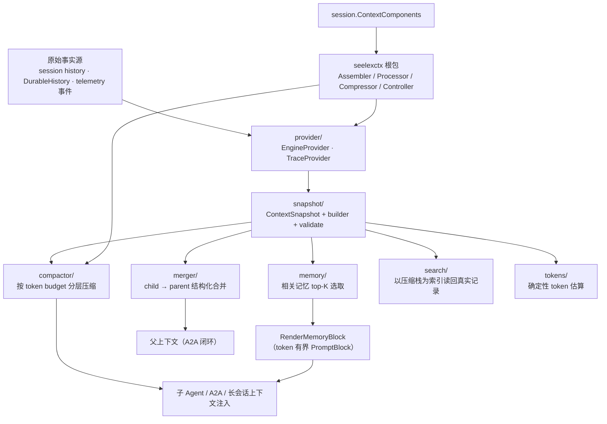
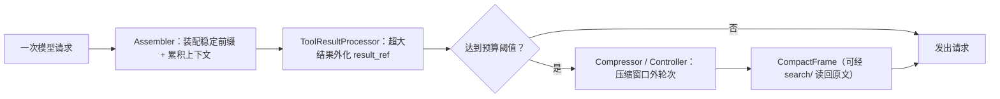

# Seelex Context

## 生态位

`seelexctx` 是 Seele v2 会话上下文契约（`seelectx`）的 Seelex 适配层与跨
父子 Agent 的上下文承袭门面。它把原始 history/遥测事件提炼为稳定
`ContextSnapshot`，支持预算压缩和 child-to-parent merge-back；同时把主会话
的装配/压缩/控制决策实现为 `seelectx` 的原子策略（Assembler/Processor/
Compressor/Controller），供 `session.ContextComponents` 注入。

M7 起，prompt 装配、local compaction 与 gap coverage 只接收
`store/context.PromptStackSnapshot`，不再通过 store 的万能
`SessionContextRecord` 读取存储字段。投影只含 Plan/Task/Skill/Compact 四栈；
GoalStack、SystemPrompt、schema 与 fork origin 不属于该读面。

## 架构图



## 数据流图



## 子模块

| 目录 | 职责 |
|---|---|
| [`snapshot/`](snapshot/README.md) | 上下文 DTO、builder、format 和 validate。 |
| [`provider/`](provider/README.md) | 从会话（SessionSource/DurableHistory）或 telemetry 导出 Snapshot。 |
| [`compactor/`](compactor/README.md) | 基于 token budget 的分级压缩。 |
| [`merger/`](merger/README.md) | 子任务 findings/decisions/progress 合并回父上下文。 |
| [`memory/`](memory/README.md) | 超长上下文的历史记忆**单次**选取：只在 memory epoch 首次建立/压缩滚动时按查询选 top-K；后续请求复用 Runtime 冻结字节，不逐轮重选。 |
| [`lifecycle/`](lifecycle/) | 泛型 Context actor 与有界批处理管道；提供 cold-load/windowed/pipelined 策略和关闭竞态测试。 |
| [`tokens/`](tokens/README.md) | 脚本感知的 token 估算（零依赖、确定性，替代 len/3）。 |

根包文件：

| 文件 | 职责 |
|---|---|
| `assembler.go` | `RequestAssembler`：system prompt（effort/skill）+ PromptBlocks + working history 拼装；工具定义经 `AssembledRequest.Tools` 透传（引擎 API schema 通道，不渲染为消息文本）。 |
| `processor.go` | `ToolResultProcessor`：超大工具结果 → result_ref/省略警告。 |
| `compressor.go` | `Compressor` 适配：短历史免压缩 + QuickChat 隔离摘要。 |
| `controller.go` | `ContextController`：**回合内只剩超大工具结果的兜底归档**（归档器按调用 ID 幂等，不改变历史）；不再折帧——压缩整条归装配层（`application/assembly/context_runtime`）。 |
| `window.go` | 滑动窗口轮数策略（配置 + provider 推导）；`RetainFloorTokens` 兼容转发 Contract 的零依赖数学契约。 |
| `gap.go` | 真空区覆盖：滑动窗口与压缩内容之间的未压缩轮次，Load 时检测并压入合并帧。边界取自存储层选窗时回报的**尾窗起始单元下标**（与压缩栈顶 `To` 同一计数空间），不做跨列表减法，因此无需保守 clamp 与事后去重。下标必须落在单元空间内：尾窗起点超出 `[0, 单元数]` 或栈顶 `To < -1` 时报错返回、不落帧（不做越界切片）。 |
| `frame.go` | CompactFrame 两章节 Summary 纯函数（Chapter 1 链锚点 + Chapter 2 厚内容）、渲染截取、一句话摘要与 request 覆盖标签。 |
| `replay.go` | 前缀重放摘要协议：`PrefixReplaySummarizer` + QuickChat 实现（字节级同源素材由调用方保证）。 |
| `dag.go` | 压缩 DAG 执行器：codec 文档装配 + workplan runner 串行执行，Chapter 2 失败回退本地压缩。 |
| `history_safety.go` | Provider 历史安全配对规则（assistant/tool 配对、恢复信封）。 |
| `bridge.go` | Export/ExportWithGoal/Import 兼容 API（委托子包）。 |
| `seele.go` | re-export 仍被使用的 Seele `seelectx` 压缩函数；`EstimateTokens` 兼容变量已改为 `tokens` 脚本感知估算。 |

## 阈值与上限的来源（一处配置，装配层消费）

本包**不持有任何魔法数字**：压缩与归档的比例、上限全部来自
`config/seelex.yaml` 的 `limits` / `window` 段，由 `seelebridge` 在装配 Runtime 时
注入。2026-09-30 起这些比例的**消费方是装配层**
（`application/assembly/context_runtime`）；本包的 `ContextWindowPolicy` 仍是同一份公式的
导出面（`Budget` / `SoftThreshold` / `HardThreshold` / `TargetAfterCompaction`），
由装配层与冷恢复探针按同一份 limits 构造。

| 配置键 | 作用 | 注入点 |
|---|---|---|
| `context_window` | **覆盖账号档的上下文窗口**（token；0 = 不覆盖）——窗口是预算的基数，配在这里才随出厂档分发；覆盖是全局的（所有账号含子代理一刀切） | `limit.Limits.ContextWindow` → `seelebridge.Runtime.ContextWindow()`（`ContextBudgetFor` 消费它） |
| `context_safety_reserve_divisor` | 安全预留 = 窗口 ÷ 该值，决定预算基数 | `NewContextWindowPolicy(window, output, r.limits)` |
| `context_hard_percent` | **自动压缩的唯一阈值**：请求估算到达 `预算 × %`（代码默认 98；本仓 2026-10-15 起 90）即折出保留窗口外的 transcript 前缀（装配层执行） | 装配层 `ContextBudgetFor`；`NewContextWindowPolicy` 为同一公式的导出面 |
| `context_soft_percent` | **已不参与判据**（2026-09-30 取消软线提前量）：本包 `ContextWindowPolicy.SoftThreshold()` 仍按它算（公式面）；装配层的报表/进度字段 `SoftThreshold` 按硬线比例产出，因此 `soft=` 与硬线同值。该键保留仅为兼容旧配置，**且必须 < `context_hard_percent`**（否则 `limit.LoadLimits` 启动期报错）——本仓 2026-10-15 随 hard 降到 90 一并把 soft 由 95 调到 85 | 同上 |
| `context_target_percent` | 压缩后落点，同时是保留区硬上限（默认 80；`hard − target` 即每次压缩留给下一轮的余量） | 同上 |
| `max_tool_result_chars` | 单条工具结果多大算"超大"（→ 归档为 `result_ref` + 省略警告，模型用 `read_tool_result` 回读）。**字符数，不是 token、也不是压缩阈值**——它只管"单条结果太长"，与上面那组 `context_*` 比例不是一套数 | `ControllerOptions.MaxToolResultChars` 与 `NewToolResultProcessor(maxToolResultChars, …)` |

**触发点**：压缩由装配层在**回合开始前**的同一次装配里完成（判据 → 读数闸 → 装配 →
推帧 → 落记录）；`/compact` 命令与 `compact_context` 工具是同一落点的显式入口。
`seelexctx.ContextController` 现在只处理 Seele ReActLoop 的 `after_tool` 事件做
**超大工具结果兜底归档**，不再折帧——回合内的工作历史拿不到与 wire 同源的字节，
拿它做前缀重放会付一次全价调用却命中不到缓存（2026-09-30 现场）。

**注入而非全局**：`Limits` 类型已于 2026-10-16（M2-A）迁到基座包 `backend/limit`，`limit.Apply`/`limit.Get` 是这
同一份结构的进程持有者（与类型同包，不再有反向依赖环）。因此沿用 `FrameCarryTokens`
已在走的"调用方注入"通路，不再新增第二份进程级持有者。

**回归防线**：`controller_limits_test.go` 钉住三件事——改比例真的改变软/硬/目标
数字、`Budget` 覆盖账号窗口时比例不被重建策略丢掉、注入的上限真的决定"算不算超大"。

## 数据流

```text
Session history / DurableHistory -> Provider -> ContextSnapshot -> Compactor -> child agent
parent snapshot <- Merger <------------------------------ child result
ContextComponents（Assembler/Processor/Compressor/Controller）-> session.Session
Load（尾窗）─ 真空区 GapCoverer → CoverHistoryGap → CompactStack 合并帧
Assembler ─ 冻结 memory epoch（压缩帧 top-K 只在 epoch 首现时选择）→ 相关记忆块
压缩 DAG（2026-09-06）：select_range → {chapter1 锚点, chapter2 厚摘要} →
merge_frame → PushCompact（装配层推帧走 `seelebridge.PushCompactionFrame`，按会话键
串行；真空区由 gap 路径自推）；帧 Summary 固定两章节，模型请求
只渲染栈顶帧 Chapter 2（`FrameChapter2`），锚点与 requestID 索引留在记录里。
```

## 设计原则

- copy-on-write：压缩和 merge 不修改调用方原对象。
- 有界上下文：所有跨 Agent 注入都应有 token budget。
- 结构化优先：Goal、Decision、Finding、Constraint、PendingWork 分字段传递。
- 向后兼容：门面 API 保持稳定，复杂能力下沉子包。
- token 估算：事前用 `tokens` 脚本感知估算，事后由 application 侧以 provider usage 校准（`calibratedTokenCounter`）。
- 前缀稳定（注入点决定代价）：动态尾部帧（plan/task 栈顶）**只追加在 `WorkingHistory` 之后**——它的位置恒等于请求最末格，且装配不写回历史，所以历史变长不会把它挤到中间；代价只是它自己每请求全价重算（228~234 字符，实测见 `docs/arch/context-prefix-stability-l1.md` §6.3.3）。反过来，任何**会进历史**的帧（如 plan 上下文帧）必须落 transcript 按记录位置重放，否则下一轮它占的那一格会被新历史顶掉、从该格起到请求尾整段重算。用例：`tail_frame_position_test.go`。

**孪生实现必须同步改**：provider 的 tool 配对协议在两处各有一份实现——应用侧
`application/assembly/context_runtime/history.go:RepairInterruptedToolChains`（请求前，缺结果一律补占位）
与本包 `history_safety.go:repairToolPairing`（wire 出口，`SanitizeProviderToolProtocol` 保守不补占位，
但**重复宣告**一类照补：那不是"可能正在执行"的调用，而是已经拿到过回执的调用的重发）。包依赖方向
不允许共用一份代码，因此改动必须成对；两侧出口不变量由
`seelexctx/wire_protocol_safety_test.go:assertProviderToolProtocol` 全量断言（逐条声明的相邻回执、
孤儿、乱序、重复、空 ID）。

## Review 指南

- 是否把完整 secrets/tool raw output 无界注入 child。
- token 估算和压缩层级是否保持确定性。
- merge 是否去重 constraints、保留 parent goal，并正确处理 escape。
- Provider nil/empty trace 是否安全降级。

## 上下文压缩的占比表现（字符画）

以 `history_window = 200k tokens` 为例（每个 `▓` 约 10k tokens；预算轴 0 → 200k）：

```text
history_window = 200k tokens（填充 ▓ 每字符 ≈ 10k，宽度按占比）

未启用压缩：原始 transcript 逐轮全量累积（第 20 轮触顶）
┌───────────────┬───────────────┬───────────────┬───────────────┐
│   轮 1-5      │   轮 6-10     │   轮 11-15    │   轮 16-20    │
│ ▓▓▓▓▓ 50k     │ ▓▓▓▓▓ 50k    │ ▓▓▓▓▓ 50k    │ ▓▓▓▓▓ 50k    │
└───────────────┴───────────────┴───────────────┴───────────────┘
  ✗ 触顶：超出预算 → 丢弃旧轮次 / 请求被拒绝（上下文丢失、质量下降）

启用压缩：请求估算越线 → 装配层折出保留窗口外的协议单元 → 帧 + 有界保留窗口
┌────────────────┬──────────────┬────────────────────────────────┐
│ compact 帧摘要  │ 保留窗口原文  │ 余量 = hard − target（本仓 25%）│
│ （栈顶，进前缀）│ （单元不切）  │                                │
└────────────────┴──────────────┴────────────────────────────────┘
  ✓ 落点由 context_target_percent 收口（本仓 65% 预算），越线线是
    context_hard_percent（本仓 90% 预算）：差额就是每次压缩留下的确定余量
  组成：system prompt + 累积 context（越线前全量 append-only；压缩后为
  有界保留窗口，按完整协议单元收敛）+ plan/task 尾部 + compact 帧摘要
```

压缩后请求规模落回 `context_target_percent`（本仓 65% 预算）附近，余量 = `hard − target`（本仓 25% 预算）；每次压缩发布 `Snapshot.Task.ContextCompactions`（version/reason/messages_before/estimated_tokens），不含帧正文、system prompt、工具参数/结果或原始对话。拿不到模型读后感（`no_model_summary`）或压缩换不来余量（`ineffective_compact`）时按口径**不折上下文、不推压缩栈顶**，只留一条失败痕；装配后仍超 `Budget` 时请求在 `ChatStream` 前被拒绝。checkpoint 正常路径不再进入 LLM 上下文，只保留恢复路径与持久化数据面。

> 已实现（任务 A/B/C）：装配顺序为「system → project → memory → 稳定前缀栈
> （skill/compact）→ 累积 context（越线前 append-only 全量已定稿轮次）→
> plan → task → 当前输入」，checkpoint 正常路径不再进入 LLM 上下文（异常
> 恢复路径保留）。越线才压缩：请求估算 ≥ `context_hard_percent`（或显式
> `/compact`、`compact_context`）时折出保留窗口外的 transcript 前缀，产出 compact
> 帧 + 有界保留窗口；plan/task 不参与压缩。设计见
> [docs/arch/context-prefix-chain.md](../../../../docs/arch/context-prefix-chain.md)。

> 已实现（2026-09-06 压缩 DAG 首批）：CompactFrame 携带超上下文 request 首尾
> 与链锚字段（`prev_segment_id`/request/一句话 + summary/anchor 来源标记），
> `PushCompact` 追加链不变量；Summary 固定两章节、模型可见范围只取栈顶
> Chapter 2；压缩经 workplan DAG 表达（先串行）。前缀重放 `PrefixReplaySummarizer`
> 协议与 QuickChat 实现**已接入生产**（2026-09-29：装配层 `MainCompactionDAG` 注入
> 摘要器，开关 `limits.context_compaction_summary.enabled` 出厂为开；2026-10-02 起
> 压缩前先实测读数，拿不到模型读后感就不折、不推栈顶）。回合内控制器 / 节点链路
> 结构上不注入摘要器，走本地确定性压缩（`summary_source=local`）。详设见
> [docs/2026-09-06-compaction-dag/design.md](../../../../docs/2026-09-06-compaction-dag/design.md)。

## 测试

```text
go test ./backend/engine/context/seelectx/... -count=1
go test -race ./backend/engine/context/seelectx/lifecycle -count=1
```

## 文件与函数索引

> 由源码 doc 注释自动提取（首行摘要）；描述源码行为，与实现保持同步。
> 刷新方式：`python scripts/gen_core_readme_index.py`。

### assembler.go

- `func NewAssembler(options AssemblerOptions) seelectx.RequestAssembler` — NewAssembler 构造 seelex 装配器。
- `func (a seelexAssembler) Assemble(ctx context.Context, request seelectx.AssemblyRequest) (seelectx.AssembledRequest, error)` — Assemble 按投影顺序组装一次模型请求。
- `func (a seelexAssembler) systemPrompt() string`
- `func (a seelexAssembler) projectBlock(ctx context.Context) *seelectx.PromptBlock`
- `func (a seelexAssembler) prefixStacks() []seelectx.PromptBlock`
- `func (a seelexAssembler) tailStacks() []seelectx.PromptBlock`
- `func LastUserQuery(history []types.Message) string` — LastUserQuery 提取 WorkingHistory 中最后一条非控制块 user 消息作为
- `func RenderStackBlocks(record storecontext.PromptStackSnapshot) []seelectx.PromptBlock` — RenderStackBlocks 把 PromptStackSnapshot 渲染为 PromptBlock 列表（新链路
- `func RenderStablePrefixBlocks(record storecontext.PromptStackSnapshot) []seelectx.PromptBlock` — RenderStablePrefixBlocks 渲染稳定前缀栈块（skill/compact，now using =
- `func RenderTailBlocks(record storecontext.PromptStackSnapshot) []seelectx.PromptBlock` — RenderTailBlocks 渲染动态尾部栈块（plan/task，now using = 栈顶）：放在
- `func renderStackBlock(name, title string, payload map[string]any) seelectx.PromptBlock`
- `func RenderProjectBlock(record store.ProjectRecord) *seelectx.PromptBlock` — RenderProjectBlock 渲染项目级模块语义块（ProjectKnowledge，plan.md
- `func isStackContextMarker(message types.Message) bool` — isStackContextMarker 判断消息是否为 seelex 上下文控制块（压缩帧/检查点/

### assembler_test.go

- `func TestAssemblerProjectionOrder(t *testing.T)`
- `func TestAssemblerPlaceholderOnlyInBlocks(t *testing.T)`
- `func TestAssemblerWindowFallbackOnError(t *testing.T)`
- `func TestAssemblerEmptySystemAndBlocks(t *testing.T)`
- `func TestAssemblerMemoriesInjectedWithLastUserQuery(t *testing.T)`
- `func TestAssemblerMemoriesSkipControlBlocksAndNil(t *testing.T)`
- `func TestRenderStackBlocksTopOnly(t *testing.T)`
- `func TestRenderStackBlocksSplitPrefixAndTail(t *testing.T)`
- `func TestRenderTailBlocksPlanFrameStaysCompact(t *testing.T)`
- `func TestLastUserQuerySkipsPlanTailMessage(t *testing.T)`
- `func blockNames(blocks []seelectx.PromptBlock) []string`
- `func TestRenderProjectBlockEmpty(t *testing.T)`
- `func assertContent(t *testing.T, message types.Message, want string)`

### bridge.go

- `func Export(eng provider.SessionSource) *snapshot.ContextSnapshot` — Export 从会话导出上下文快照（兼容旧 API，eng 可以是 *session.Session）。
- `func ExportWithGoal(eng provider.SessionSource, goal string) *snapshot.ContextSnapshot` — ExportWithGoal 导出并显式设置目标（兼容旧 API）。
- `func ExportSnapshot(eng provider.SessionSource, trace provider.TraceSource, goal string) *snapshot.ContextSnapshot` — ExportSnapshot 导出完整上下文快照：EngineProvider（Goal / MessageCount）
- `func ExportSnapshotFromData(sessionID, goal string, messageCount int, trace provider.TraceSource) *snapshot.ContextSnapshot` — ExportSnapshotFromData 从无锁数据面构造完整快照：调用方提供
- `func Import(eng SessionState, snap *snapshot.ContextSnapshot)` — Import 将上下文快照注入到目标会话的 system prompt 中。
- `func getCurrentSystemPrompt(eng SessionState) string`

### compressor.go

- `func NewCompressor(options CompressorOptions) seelectx.Compressor` — NewCompressor 构造 seelex 压缩器。QuickChat 为 nil 时仅支持短历史快速
- `func (c seelexCompressor) Compress(ctx context.Context, request seelectx.CompressionRequest) (seelectx.CompressionResult, error)` — Compress 实现 seelectx.Compressor。
- `func snapshotMessages(snap *snapshot.ContextSnapshot) []types.Message` — snapshotMessages 把压缩后的快照渲染为单条 user 消息（压缩摘要块）。

### compressor_test.go

- `func (f *fakeQuickChat) Complete(_ context.Context, _ seelectx.QuickChatRequest) (types.Message, error)`
- `func bigHistory(count, chars int) []types.Message` — bigHistory 构造 len 条超长消息（≥ 最小压缩阈值）。
- `func TestCompressorShortHistoryFastPath(t *testing.T)`
- `func TestCompressorQuickChatCheckpoint(t *testing.T)`
- `func TestCompressorSnapshotPath(t *testing.T)`
- `func TestCompressorNoQuickChatFailsLongHistory(t *testing.T)`

### contention_gate_test.go

- `func TestPrefixChainLockContentionGate(t *testing.T)` — TestPrefixChainLockContentionGate：并发负载下取 mutex/block profile 并断言本次
- `func runConcurrent(t *testing.T, workers int, work func(worker int) error)` — runConcurrent 并发跑 worker 次负载，回收全部错误（t.Fatalf 不能在子 goroutine 调用）。
- `func contentionGatePureWorker(worker int) error` — contentionGatePureWorker 只跑本次改动的纯函数路径（A 臂：这些函数不含任何锁，
- `func contentionGateSharedWorker(worker int, shared CompactStackStore) error` — contentionGateSharedWorker 跑真实形状：每 worker 一份压缩产物 + 一个 DAG，共用一把压缩栈锁。
- `func (gateSummarizer) Summarize(_ context.Context, req ReplayRequest) (ReplayResult, error)`
- `func contentionGateSamples(text string) []contentionSample` — contentionGateSamples 解析 pprof 文本格式：
- `func symbolOf(frame string) string` — symbolOf 去掉 pprof 帧里的 +0x… 位移。
- `func contentionGateLockedSamples(samples []contentionSample) []contentionSample` — contentionGateLockedSamples 只保留**归属本次改动观测面**的用户级锁竞争样本：
- `func contentionGateStdlibInternal(site string) bool` — contentionGateStdlibInternal 判定阻塞点是否为标准库内部实现（见上）。
- `func contentionGateBlockingSite(sample contentionSample) string` — contentionGateBlockingSite 返回竞争样本的**阻塞点**：等锁帧（frames[0]）的直接
- `func contentionGateBlockingSites(samples []contentionSample) []string`
- `func contentionGateRender(samples []contentionSample) string`
- `func dumpProfile(t *testing.T, name string) string` — dumpProfile 把 profile 渲染为文本（debug=1）并留档到 tmp/lock-contention-gate/

### controller.go

- `func NewContextWindowPolicy(window, outputReserve int, limits limit.Limits) ContextWindowPolicy` — NewContextWindowPolicy 按 window/outputReserve + limits 生效值构造阈值策略
- `func (p ContextWindowPolicy) Budget() int` — Budget 返回可用于请求的 token 预算。
- `func (p ContextWindowPolicy) SoftThreshold() int` — SoftThreshold 软阈值（limits.context_soft_percent，默认 95%）。
- `func (p ContextWindowPolicy) HardThreshold() int` — HardThreshold 硬阈值（limits.context_hard_percent，默认 98%）。
- `func (p ContextWindowPolicy) TargetAfterCompaction() int` — TargetAfterCompaction 压缩目标（limits.context_target_percent，默认 80%）。
- `func (p ContextWindowPolicy) Reserved() int` — Reserved 固定预留（system prompt + 栈块）。
- `func (ConservativeTokenCounter) Name() string` — Name 实现 TokenCounter。
- `func (ConservativeTokenCounter) CountText(value string) int` — CountText 实现 TokenCounter。
- `func (ConservativeTokenCounter) CountMessage(message types.Message) int` — CountMessage 实现 TokenCounter。
- `func (ConservativeTokenCounter) CountHistory(history []types.Message) int` — CountHistory 实现 TokenCounter。
- `func messageContent(message types.Message) string` — messageContent 解引用可空消息正文。
- `func (m *memoryCompactStack) CompactStackSnapshot() []store.CompactFrame` — CompactStackSnapshot implements the narrow compact-stack read face.
- `func (m *memoryCompactStack) PushCompact(frame store.CompactFrame) error` — PushCompact 实现 CompactStackStore。
- `func NewMemoryCompactStack() CompactStackStore` — NewMemoryCompactStack 创建内存态压缩栈（无持久后端时的兜底，活跃会话
- `func NewContextController(opts ControllerOptions) seelectx.ContextController` — NewContextController 构造 seelex 上下文控制器。
- `func (c *seelexContextController) Handle(ctx context.Context, ev seelectx.ContextEvent) (seelectx.ContextDecision, error)` — Handle 实现 seelectx.ContextController。
- `func (c *seelexContextController) oversizedTool(result *seelectx.ToolResult) bool` — oversizedTool 判断事件携带的工具结果是否超大（带截断标记或超字符预算）。
- `func (c *seelexContextController) maxToolResultChars() int`
- `func renderUnitLine(unit []types.Message) string` — renderUnitLine 渲染一个单元的可读索引行：用户输入与助手答复各取首段预览
- `func overflowEvidence(overflow []historyUnit, record storecontext.PromptStackSnapshot) []store.EvidenceRef` — overflowEvidence 从溢出轮次中的工具结果与任务栈证据提取证据引用。
- `func chatUnits(history []types.Message, baseOrdinal int) []historyUnit` — chatUnits 把 working history 切分为可见协议轮次单元：user 轮、assistant
- `func (c *seelexContextController) chatUnits(history []types.Message) []historyUnit` — chatUnits 方法版：区号基准取已记录帧边界的下一个区号（见 compactedUnitBase）。
- `func overflowMessages(overflow []historyUnit) []types.Message` — overflowMessages 展平溢出单元的消息（保留原始顺序；单元内消息不重复）。
- `func (c *seelexContextController) compactedUnitBase() int` — compactedUnitBase 返回累计单元区号基准 = 已被压缩帧覆盖的单元数（栈顶
- `func userMessageUnit(history []types.Message, start int) (historyUnit, int, bool)` — userMessageUnit 用户轮：user + 直到下一个 user 或 assistant 文本收尾；
- `func toolChainUnit(history []types.Message, start int) (historyUnit, int, bool)` — toolChainUnit 工具链轮：assistant + 全部调用 ID 配对成功的 tool 结果。

### controller_limits_test.go

- `func (b strictBudget) ContextTokens() int`
- `func (b strictBudget) MaxOutputTokens() int`
- `func TestContextWindowPolicyUsesConfiguredRatios(t *testing.T)` — TestContextWindowPolicyUsesConfiguredRatios：四个比例真的进入阈值数字，
- `func TestControllerOversizedToolUsesConfiguredLimit(t *testing.T)` — TestControllerOversizedToolUsesConfiguredLimit：注入的

### controller_loop_contract_test.go

- `func TestControllerLoopNeverCompactsConversation(t *testing.T)` — TestControllerLoopNeverCompactsConversation：喂远超任何阈值线的历史（放大计数器
- `func TestControllerLoopArchivesOversizedToolResult(t *testing.T)` — TestControllerLoopArchivesOversizedToolResult：兜底归档仍在，且**不改历史**。

### controller_test.go

- `func (heavyTokenCounter) Name() string`
- `func (heavyTokenCounter) CountText(value string) int`
- `func (c heavyTokenCounter) CountMessage(message types.Message) int`
- `func (c heavyTokenCounter) CountHistory(history []types.Message) int`
- `func (p fixedWindowPolicy) WindowRounds(context.Context, ProviderContextInfo) (int, error)`
- `func textMessage(role, content string) types.Message`
- `func roundHistory(rounds int) []types.Message` — roundHistory 构造 rounds 轮完整协议单元（user + assistant 文本）。
- `func controllerTestLimits() limit.Limits` — controllerTestLimits 是控制器**机制**用例的显式阈值注入：这组用例验证窗口
- `func newController(stacks CompactStackStore) *seelexContextController` — newController 构造注入压缩栈的控制器。
- `func (s *recordStack) CompactStackSnapshot() []store.CompactFrame`
- `func (s *recordStack) PushCompact(frame store.CompactFrame) error`
- `func TestControllerPlanTailMessageDoesNotFormCompressionUnit(t *testing.T)`
- `func stringPtr(value string) *string`
- `func (a *recordingTurnArchiver) StoreTurn(_ context.Context, segmentID string, messages []types.Message) (string, error)`

### dag.go

- `func NewCompactionDAG(opts CompactionDAGOptions) *CompactionDAG` — NewCompactionDAG 构造压缩 DAG 执行器。
- `func (d *CompactionDAG) Execute(ctx context.Context, input CompactionInput) (store.CompactFrame, error)` — Execute 运行压缩 DAG 并返回拼装完成的 CompactFrame（不含 PushCompact；
- `func (d *CompactionDAG) newState(input CompactionInput) *compactionDAGState`
- `func (n *dagFuncNode) ID() string`
- `func (n *dagFuncNode) Run(ctx context.Context, _ *workplantypes.WorkflowContext) (string, error)`
- `func (d *CompactionDAG) nodeFactory(state *compactionDAGState) codec.NodeFactory[compactionNodeInput]`
- `func (d *CompactionDAG) buildNodes(state *compactionDAGState) map[string]*dagFuncNode` — buildNodes 构造同一次运行的全部节点（工厂与串行兜底共用同一组闭包）。
- `func (d *CompactionDAG) runSerial(ctx context.Context, state *compactionDAGState) error`
- `func markStarted(state *compactionDAGState, id string)`
- `func (state *compactionDAGState) degrade(code, note string)` — degrade 记录"这次为什么没有模型摘要"。后写的覆盖先写的：先分片链失败、再单次
- `func (state *compactionDAGState) clearDegrade()` — clearDegrade 在重放成功后清掉降级事实：降级记录只记"最终真的降级了"。
- `func (state *compactionDAGState) startedCount() int`
- `func (d *CompactionDAG) selectRangeNode(state *compactionDAGState) func(context.Context) error` — selectRangeNode：溢出单元切分（纯计算；request 首尾在 merge 按覆盖范围
- `func (d *CompactionDAG) chapter1Node(state *compactionDAGState) func(context.Context) error` — chapter1Node：栈顶 → 锚点/一句话；prev 缺失（首帧）或提取不到一句话时
- `func (d *CompactionDAG) chapter2Node(state *compactionDAGState) func(context.Context) error` — chapter2Node：前缀重放厚摘要（一次重试）→ 失败/无重放素材回退本地压缩。
- `func (d *CompactionDAG) replayChunkPlan(state *compactionDAGState) ReplayChunkPlan` — replayChunkPlan 计算本次重放的分片计划：溢出区 token 数超过片预算
- `func dagOrdinalBase(prevTop *store.CompactFrame) int` — dagOrdinalBase 返回本次压缩单元区号的基准 = 已被覆盖帧覆盖的单元数
- `func (d *CompactionDAG) mergeNode(state *compactionDAGState) func(context.Context) error` — mergeNode：拼装 CompactFrame（SegmentID/From/To/Evidence + 链锚字段 +
- `func frameEvidence(state *compactionDAGState) []store.EvidenceRef` — frameEvidence 汇总本次压缩的全部事实证据，按"从区间 → 素材 → 出口"的读法排序：
- `func (d *CompactionDAG) publishNode(state *compactionDAGState) func(context.Context) error` — publishNode：适配点节点——当前 PushCompact 留在调用方（去重/归档/审计），
- `func (d *CompactionDAG) systemPrompt() string`
- `func (d *CompactionDAG) tools() []frameworktypes.Tool`
- `func (d *CompactionDAG) chapter2MaxTokens() int`
- `func (d *CompactionDAG) frameCarryTokens() int` — frameCarryTokens 返回帧摘要传递上限（≤0 → DefaultFrameCarryTokens）。
- `func (d *CompactionDAG) replayInputTokens() int` — replayInputTokens 返回分片重放的片预算（≤0 → 不分片）。
- `func (d *CompactionDAG) segmentID() string` — segmentID 生成帧 SegmentID（会话溯源前缀，与 controller 同风格）。

### dag_body_missing_repro_test.go

- `func TestReplayWithoutConversationBodyMustNotClaimModelReadback(t *testing.T)` — ── 现场复现（第二跳：验收）────────────────────────────────────────────
- `func TestReplayWithConversationBodyStillCompacts(t *testing.T)` — ── 对照组（断言当前行为，不是红灯）────────────────────────────────────
- `func hasEvidenceRef(frame store.CompactFrame, ref string) bool` — hasEvidenceRef 报告帧证据里有没有这条 ref（降级出口的唯一解释来源）。
- `func wireRoles(messages []types.Message) string` — wireRoles 渲染一条重放请求的角色构成（红灯里要能一眼看出「素材这一跳没给正文」）。

### dag_test.go

- `func (s *countingReplaySummarizer) Summarize(_ context.Context, _ ReplayRequest) (ReplayResult, error)`
- `func dagInput(messages []frameworktypes.Message) CompactionInput`
- `func TestCompactionDAGLocalCompact(t *testing.T)` — TestCompactionDAGLocalCompact 无重放素材（Summarizer=nil）→ 本地压缩：
- `func TestCompactionDAGChainFields(t *testing.T)` — TestCompactionDAGChainFields 第二次压缩的帧携带链锚字段：PrevSegmentID
- `func TestCompactionDAGReplayThick(t *testing.T)` — TestCompactionDAGReplayThick 注入 Summarizer 且带 History → 前缀重放生成
- `func TestCompactionDAGUsesUnitCountFromMessages(t *testing.T)` — TestCompactionDAGUsesUnitCountFromMessages 未显式给 UnitCount 时按

### frame.go

- `func CarryPreviousChapter2(prev *store.CompactFrame, limitTokens int) (string, CarryDiagnostics)` — CarryPreviousChapter2 返回并入新帧的上一帧 Chapter 2 正文：
- `func renderCarryAnchor(prev store.CompactFrame, limitTokens, carried int) string` — renderCarryAnchor 渲染并入上限降级后的锚点正文：定位信息（segment_id /
- `func AnchorSourceWithCarry(base string, carry CarryDiagnostics) string` — AnchorSourceWithCarry 在链锚点质量标记之上叠加帧摘要传递的结果：并入超限
- `func CarryEvidence(carry CarryDiagnostics) []store.EvidenceRef` — CarryEvidence 把帧摘要传递的决策事实写成一条证据引用——帧持久化在会话
- `func LocalChapter2(opts LocalCompactOptions) string` — LocalChapter2 生成 Chapter 2 正文（不含外层 "## 压缩内容" 标题）：
- `func LocalChapter2WithCarry(opts LocalCompactOptions) (string, CarryDiagnostics)` — LocalChapter2WithCarry 与 LocalChapter2 同值，并回报「上一帧摘要并入」的决策
- `func Chapter2Skeleton() string` — Chapter2Skeleton 返回全部小节为 (none) 的骨架正文（保留章节骨架，
- `func sectionHeading(title string) string`
- `func sectionBody(body string) string` — sectionBody 归一化小节正文：空 → (none)；去首尾空白。
- `func localGoal(record storecontext.PromptStackSnapshot) string`
- `func localKeyConcepts(record storecontext.PromptStackSnapshot) string`
- `func localFilesAndCode(overflow []historyUnit) string` — localFilesAndCode 从溢出单元提取工具名（assistant ToolCalls 与 tool 消息，
- `func localCurrentWork(opts LocalCompactOptions) (string, CarryDiagnostics)` — localCurrentWork 渲染当前工作小节：轮次计数 + 逐单元行 + 上一栈顶的
- `func localConstraints(record storecontext.PromptStackSnapshot) string`
- `func RenderFrameSummary(anchor string, chapter2 string) string` — RenderFrameSummary 拼装帧 Summary：Chapter 1（锚点正文，无标题）+ Chapter 2
- `func RenderAnchorChapter(prev *store.CompactFrame) string` — RenderAnchorChapter 生成 Chapter 1 锚点正文（无 "## " 标题）：上一帧的
- `func FrameChapter1(frame store.CompactFrame) string` — FrameChapter1 返回帧 Summary 的 Chapter 1 正文；旧记录（无章节标记）
- `func FrameChapter2(frame store.CompactFrame) string` — FrameChapter2 返回帧 Summary 的 Chapter 2 正文；旧记录（无章节标记）
- `func Chapter2Body(text string) string` — Chapter2Body 把一段「可能是 Chapter 2 正文、也可能是一整份两章节摘要」的文本
- `func frameChapter(summary, title string) string` — frameChapter 截取 title 之后的正文，止于下一个 "## " 标题。
- `func OneLineSummary(frame store.CompactFrame) string` — OneLineSummary 从帧内容提取一句话摘要（锚点用）：优先取 Chapter 2 正文
- `func FrameAnchorSource(prev *store.CompactFrame) string` — FrameAnchorSource 计算链锚点质量标记：无前驱 → 空；有前驱且能提取
- `func ChatQueueRequestLabels(from, to int) (string, string)` — ChatQueueRequestLabels 把 ChatQueue 单元累计索引映射为 request 覆盖标签
- `func truncateRunes(value string, maxRunes int) string`

### frame_carry_test.go

- `func carryTestFrame(body string) store.CompactFrame` — carryTestFrame 构造一个带 Chapter 2 正文与完整链锚字段的帧（前一栈顶）。
- `func TestCarryPreviousChapter2KeepsSmallBody(t *testing.T)` — TestCarryPreviousChapter2KeepsSmallBody：并入量在限额内 → Chapter 2 正文原样并入
- `func TestCarryPreviousChapter2DegradesToAnchor(t *testing.T)` — TestCarryPreviousChapter2DegradesToAnchor：并入量超限 → 退化为锚点（segment_id +
- `func TestCarryPreviousChapter2DefaultsAndEmpty(t *testing.T)` — TestCarryPreviousChapter2DefaultsAndEmpty：limit <= 0 → 用兜底定值；无上一帧 /
- `func TestCarryEvidenceAndAnchorSource(t *testing.T)` — TestCarryEvidenceAndAnchorSource：并入决策的**打点落点**——帧证据里留一条可审计
- `func TestLocalChapter2WithCarryReportsFacts(t *testing.T)` — TestLocalChapter2WithCarryReportsFacts：本地压缩的 Chapter 2 与决策事实一次算出

### frame_chapter2_body_test.go

- `func TestChapter2BodyNormalizesWholeFrameSummary(t *testing.T)` — Chapter2Body 是帧摘要两章节边界的唯一归一化件：链上有一个出口（装配层读数闸
- `func TestFrameChapter2HasNoChapterHeadings(t *testing.T)` — 同一个归一化件必须同时伺候 FrameChapter2：帧摘要恰好两章节时，读回来的正文里
- `func TestFrameChapter2FeedsOneLineSummary(t *testing.T)` — 归一化后的正文进 OneLineSummary：锚点的一句话必须是正文散文，而不是章节标题。

### frame_test.go

- `func TestLocalChapter2SkeletonKeepsSections(t *testing.T)` — TestLocalChapter2SkeletonKeepsSections 详设 §3.2：空章节写 (none)，
- `func TestLocalChapter2OverflowCompact(t *testing.T)` — TestLocalChapter2OverflowCompact 控制器本地压缩：目标/概念来自任务与计划
- `func TestLocalChapter2GapCompact(t *testing.T)` — TestLocalChapter2GapCompact 真空区压缩：文案用真空区轮次并保留上一栈顶
- `func TestFrameSummaryRoundTripAndViews(t *testing.T)` — TestFrameSummaryRoundTripAndViews 拼装 → 截取：Summary 固定两章节；
- `func TestFrameChapter2LegacyFallback(t *testing.T)` — TestFrameChapter2LegacyFallback 旧记录 Summary 无章节标记 → Chapter 2
- `func TestOneLineSummaryAndAnchorSource(t *testing.T)` — TestOneLineSummaryAndAnchorSource 一句话摘要与锚点质量标记：
- `func TestOneLineSummarySkipsStructuredData(t *testing.T)` — TestOneLineSummarySkipsStructuredData 锚点一句话不得取到结构化数据行。
- `func TestChatQueueRequestLabels(t *testing.T)` — TestChatQueueRequestLabels 1 基 request 覆盖标签；倒置返回空。

### gap.go

- `func CoverHistoryGap(ctx context.Context, opts GapCoverageOptions) (GapCoverageResult, error)` — CoverHistoryGap 检测并覆盖真空区：压缩栈顶 To 与尾窗起点是否接得上。
- `func buildGapFrame( ctx context.Context, opts GapCoverageOptions, uncovered [][]store.Event, gapEnd int, ) (store.CompactFrame, error)` — buildGapFrame 构造真空区合并帧：Summary 内嵌上一栈顶摘要 + 真空区轮次
- `func gapRequestRange(uncovered [][]store.Event) (string, string)` — gapRequestRange 从真空区事件单元提取首尾 requestID（Event.TaskID 关联
- `func gapSegmentID(sessionID string) string` — gapSegmentID 生成真空区帧段标识（会话溯源前缀，与控制器同风格）。
- `func gapEvidence(uncovered [][]store.Event) []store.EvidenceRef` — gapEvidence 从真空区单元提取证据引用：事件携带 ResultRef 时直接引用，
- `func renderEventUnitLine(unit []store.Event) string` — renderEventUnitLine 渲染一个事件单元的单行摘要（与控制器 renderUnitLine
- `func gapUnitMessages(uncovered [][]store.Event) []types.Message` — gapUnitMessages 把真空区单元展平为 types.Message（原文归档载荷）。

### gap_test.go

- `func gapEvents(units int) []store.Event` — gapEvents 构造 N 个完整协议单元的事件流（user → assistant 文本轮）。
- `func gapStackRecord(t *testing.T, frames ...store.CompactFrame) storecontext.PromptStackSnapshot`
- `func TestCoverHistoryGapCoversUncompactedRegion(t *testing.T)`
- `func TestCoverHistoryGapNoStackCoversHead(t *testing.T)`
- `func TestCoverHistoryGapNoGapWhenStackCoversWindowStart(t *testing.T)`
- `func TestCoverHistoryGapNoGapWhenEverythingLoaded(t *testing.T)`
- `func TestCoverHistoryGapRepeatedCoverageIsIdempotent(t *testing.T)`
- `func TestCoverHistoryGapRestoresCoverageContiguity(t *testing.T)` — TestCoverHistoryGapRestoresCoverageContiguity 守的是本模块的不变量：补压之后
- `func TestCoverHistoryGapRejectsInputsOutsideUnitSpace(t *testing.T)` — TestCoverHistoryGapRejectsInputsOutsideUnitSpace 守的是输入契约：尾窗起点由
- `func TestCoverHistoryGapEmptyInputs(t *testing.T)`
- `func TestCoverHistoryGapEvidenceAndTurns(t *testing.T)`

### goal_stack_boundary_test.go

- `func TestGoalStackNotRenderedIntoContext(t *testing.T)` — TestGoalStackNotRenderedIntoContext 固化 goal 第五栈的语义边界：
- `func TestGoalStackNotUsedForCompactionSummary(t *testing.T)` — TestGoalStackNotUsedForCompactionSummary 固化压缩边界：栈内 goal 不做
- `func sectionBodyBetween(body, title string) string` — sectionBodyBetween 截取指定标题后至下一个 "### " 标题的正文（测试辅助）。

### history_safety.go

- `func interruptedToolResultContent(name string) string`
- `func SanitizeProviderToolProtocol(history []types.Message) []types.Message` — SanitizeProviderToolProtocol 是 wire 出口的 tool 配对协议规整：剔除没有
- `func PrepareReplaceHistory(history []types.Message) []types.Message` — PrepareReplaceHistory 在 ContextDecision.ReplaceHistory 生效前执行：
- `func (p toolCallPairing) emitInPlace(index int) bool` — emitInPlace 报告某 tool 行能否原样输出：它是所服务声明的结果，且位置已经落在
- `func (p toolCallPairing) declarationHasInPlaceResult(index int) bool` — declarationHasInPlaceResult 报告声明行 index 的结果里是否存在"原地输出"的那
- `func isInterruptedToolResult(message types.Message) bool` — isInterruptedToolResult 报告一行 tool 结果是否为合成占位（不是真实工具输出）。
- `func indexToolCallPairing(history []types.Message) toolCallPairing` — indexToolCallPairing 为一次配对修复建立索引（每个 call_id 逐次配对；占位被同
- `func repairToolPairing(history []types.Message, fabricate bool) []types.Message` — repairToolPairing 按 provider 的 tool 配对协议规整历史。现场（2026-09-20
- `func removeContextMarkers(history []types.Message) []types.Message` — removeContextMarkers 移除 user 角色且以 checkpoint 或压缩帧标记开头的
- `func repairEmptyHistoryContent(history []types.Message) []types.Message` — repairEmptyHistoryContent 按配对规则修复空正文消息。
- `func IsProviderOnlyHistoryContent(content string) bool` — IsProviderOnlyHistoryContent 识别仅用于满足 provider 非空正文的修复文本，
- `func cloneMessageSlice(messages []types.Message) []types.Message`

### history_safety_test.go

- `func TestPrepareReplaceHistoryRemovesControlMarkers(t *testing.T)`
- `func TestRepairEmptyHistoryContentPairingRules(t *testing.T)`
- `func TestRepairPreservesToolCalls(t *testing.T)`
- `func TestIsProviderOnlyHistoryContent(t *testing.T)`

### integration_test.go

- `func createTestSession(t *testing.T) (*frameworkSession.Session, *assemble.Runtime)`
- `func TestIntegration_ExportFull(t *testing.T)`
- `func TestIntegration_ExportWithGoal(t *testing.T)`
- `func TestIntegration_ImportAppend(t *testing.T)`
- `func TestIntegration_ProviderImportRoundTrip(t *testing.T)`
- `func TestIntegration_MergeBackChain(t *testing.T)`
- `func TestIntegration_CompactorRealSnapshot(t *testing.T)`
- `func TestIntegration_Validate(t *testing.T)`
- `func TestIntegration_ImportNoExistingPrompt(t *testing.T)`
- `func getPrompt(t *testing.T, eng *frameworkSession.Session) string`

### interrupted_units_test.go

- `func interruptedChatTurn(withSuffixText, atTail bool) []types.Message` — interruptedChatTurn 构造残缺工具链 working history（与 store/task_context
- `func TestChatUnitsKeepsSuffixTextOfInterruptedChain(t *testing.T)` — TestChatUnitsKeepsSuffixTextOfInterruptedChain：残缺工具链后的同轮文本与
- `func TestChatUnitsKeepsTailInterruptedChainAsOpenUnit(t *testing.T)` — TestChatUnitsKeepsTailInterruptedChainAsOpenUnit：以残缺工具链收尾且前面
- `func TestPrepareReplaceHistoryRepairsInterruptedChain(t *testing.T)` — TestPrepareReplaceHistoryRepairsInterruptedChain：装配 seam（ReplaceHistory

### local_compact_content_test.go

- `func TestLocalChapter2CarriesAssistantAnswerPreview(t *testing.T)` — TestLocalChapter2CarriesAssistantAnswerPreview 有牙：删掉 renderUnitLine 里
- `func TestLocalChapter2AssistantPreviewBoundedByRune(t *testing.T)` — TestLocalChapter2AssistantPreviewBoundedByRune 预览按 rune 截断（多字节安全），
- `func TestCompactionDAGNoSummarizerNoteStaysHonest(t *testing.T)` — TestCompactionDAGNoSummarizerNoteStaysHonest 未注入摘要器且调用方未说明原因时，

### processor.go

- `func (f ToolResultArchiverFunc) Store(ctx context.Context, callID, tool, raw string) (string, error)` — Store 实现 ToolResultArchiver。
- `func (f TurnArchiverFunc) StoreTurn(ctx context.Context, segmentID string, messages []types.Message) (string, error)` — StoreTurn 实现 TurnArchiver。
- `func NewInMemoryToolResultArchiver() *InMemoryToolResultArchiver` — NewInMemoryToolResultArchiver 创建内存归档器。
- `func (a *InMemoryToolResultArchiver) Store(_ context.Context, callID, tool, raw string) (string, error)` — Store 实现 ToolResultArchiver（按调用 ID 幂等）。
- `func (a *InMemoryToolResultArchiver) Read(ref string) (string, bool)` — Read 按引用读取归档内容（供 read_tool_result 语义的测试/装配使用）。
- `func (a *InMemoryToolResultArchiver) RetainedBytes() int` — RetainedBytes 返回当前归档保留的原始文本总字节数（生命周期记账用）。
- `func (a *InMemoryToolResultArchiver) Release() int` — Release 丢弃全部归档内容并返回释放的字节数。
- `func NewToolResultProcessor(maxToolResultChars int, archive ToolResultArchiver) seelectx.ToolResultProcessor` — NewToolResultProcessor 构造结果处理器。maxToolResultChars ≤ 0 时兜底到
- `func (p seelexToolResultProcessor) Process(ctx context.Context, result seelectx.ToolResult) (seelectx.ToolResultView, error)` — Process 实现 seelectx.ToolResultProcessor。
- `func IsOversizedToolResult(content string, limit int) bool` — IsOversizedToolResult 判断工具结果是否超过单条预算（字符数上限或
- `func OversizedToolResultWarning(name, resultRef string) string` — OversizedToolResultWarning 生成省略块：显式拒绝在省略内容上推断事实，

### processor_test.go

- `func TestProcessorOversizedResultArchived(t *testing.T)`
- `func TestProcessorSmallResultPassthrough(t *testing.T)`
- `func TestProcessorErrorResultPassthrough(t *testing.T)`
- `func TestProcessorTruncatedMarkerOversized(t *testing.T)`
- `func TestProcessorArchiverIdempotentByCallID(t *testing.T)`
- `func TestIsOversizedToolResult(t *testing.T)`
- `func TestProcessorDefaultLimitUsesSeelexDefault(t *testing.T)`

### replay.go

- `func NewQuickChatPrefixReplaySummarizer(chat seelectx.QuickChat) (PrefixReplaySummarizer, error)` — NewQuickChatPrefixReplaySummarizer 构造 QuickChat 前缀重放摘要器。
- `func (s *quickChatPrefixReplaySummarizer) Summarize(ctx context.Context, req ReplayRequest) (ReplayResult, error)` — Summarize 实现 PrefixReplaySummarizer。
- `func normalizeReplayChapter2(text string) string` — normalizeReplayChapter2 归一化模型输出的 Chapter 2：去除外层重复标题与
- `func (p ReplayChunkPlan) ChunkCount() int` — ChunkCount 返回片数（0 = 未分片）。
- `func ChunkReplayMessages(messages []types.Message, budgetTokens int) ReplayChunkPlan` — ChunkReplayMessages 把待重放的溢出区消息按协议单元切成若干片，使每片不超过
- `func SummarizeChunkPlan( ctx context.Context, summarizer PrefixReplaySummarizer, base ReplayRequest, plan ReplayChunkPlan, ) (ReplayResult, error)` — SummarizeChunkPlan 按分片计划逐片重放并前向传递摘要：
- `func carryPrompt(index, total int, previous string) string` — carryPrompt 渲染片 i>1 的前向上下文：上一片摘要 + 明确说明它只是材料的一半。
- `func LocalCompactEvidence(code, note string) []store.EvidenceRef` — LocalCompactEvidence 把"为什么这次没有模型摘要"写成帧证据。与 ReplayEvidence 同一条
- `func ReplayEvidence(plan ReplayChunkPlan) []store.EvidenceRef` — ReplayEvidence 把分片重放的决策事实写成帧证据（打点落点：帧持久化在会话

### replay_body_gate_test.go

- `func TestHasConversationBodyTable(t *testing.T)` — TestHasConversationBodyTable 钉住"素材里有没有可压的对话正文"这组形状。
- `func TestMeasureReplayCoverageTable(t *testing.T)` — TestMeasureReplayCoverageTable 钉住"素材盖不盖得住本次要压的区间"这一事实：

### replay_chunk_test.go

- `func (s *recordingSummarizer) Summarize(_ context.Context, req ReplayRequest) (ReplayResult, error)`
- `func replayTestTurns(count int) []types.Message`
- `func TestChunkReplayMessagesSplitsOnProtocolUnits(t *testing.T)` — TestChunkReplayMessagesSplitsOnProtocolUnits：分片预算 <= 0 或消息为空 → 不分片；
- `func TestSummarizeChunkPlanFailsSafely(t *testing.T)` — TestSummarizeChunkPlanFailsSafely：缺少摘要器 / 空计划 / 任一片失败都必须整条
- `func TestSummarizeChunkPlanCarriesSummaryForward(t *testing.T)` — TestSummarizeChunkPlanCarriesSummaryForward：逐片重放 + 摘要前向传递——片 1 用固定
- `func TestReplayEvidenceOnlyWhenChunked(t *testing.T)` — TestReplayEvidenceOnlyWhenChunked：分片决策的打点落点——未分片（<= 1 片）不留痕，
- `func TestCompactionDAGChunkedReplayWritesFrameFacts(t *testing.T)` — TestCompactionDAGChunkedReplayWritesFrameFacts：DAG 集成——溢出区超过片预算时走
- `func TestCompactionDAGSingleReplayKeepsPrefixCachePath(t *testing.T)` — TestCompactionDAGSingleReplayKeepsPrefixCachePath：片预算足够大时不分片——仍走

### replay_material.go

- `func (r ReplayMaterialReport) Repaired() bool` — Repaired 报告本次素材是否被动过（false → 逐字原样重放）。
- `func (r ReplayMaterialReport) Terse() string` — Terse 渲染一行事实（帧证据正文）。
- `func ReplayMaterialEvidence(report ReplayMaterialReport) []store.EvidenceRef` — ReplayMaterialEvidence 把素材规整事实写成帧证据。与 ReplayEvidence / LocalCompactEvidence
- `func HasConversationBody(messages []types.Message) bool` — HasConversationBody 报告素材里有没有**对话正文**：非 system 角色、且正文非空或带
- `func PrepareReplayMaterial(messages []types.Message) ([]types.Message, ReplayMaterialReport)` — PrepareReplayMaterial 把素材规整成 provider 的 tool 配对协议下合法的字节序：
- `func payloadRow(message types.Message) bool` — payloadRow 判定单行是不是**带载荷的行**：三种对话角色（user / assistant /
- `func ReplayRolesTerse(messages []types.Message) string` — ReplayRolesTerse 渲染素材的角色构成：降级原因里要能一眼看出"全是控制行"。
- `func (c ReplayCoverage) Covered() bool` — Covered 报告素材里至少看得到一条要压的内容（区间为空时视为无此事实）。
- `func (c ReplayCoverage) Terse() string` — Terse 渲染一行事实。
- `func ReplayCoverageEvidence(coverage ReplayCoverage) []store.EvidenceRef` — ReplayCoverageEvidence 把覆盖事实写成帧证据：**只在不覆盖时留痕**（"没有这件事
- `func MeasureReplayCoverage(material, overflow []types.Message) ReplayCoverage` — MeasureReplayCoverage 量"素材盖不盖得住本次要压的区间"：区间里每一条带载荷的行，
- `func trimUnsettledTail(messages []types.Message) ([]types.Message, ReplayMaterialReport)` — trimUnsettledTail 丢掉"未落定的尾单元"：尾巴上那条 assistant 宣告仍有未回执的
- `func ValidateReplayProtocol(messages []types.Message) error` — ValidateReplayProtocol 按 provider 数请求的那条规则校验一次消息序，违规时指名

### replay_material_dag_test.go

- `func TestCompactionDAGDropsUnsettledTailBeforeReplay(t *testing.T)` — TestCompactionDAGDropsUnsettledTailBeforeReplay：素材尾巴是未落定的工具调用单元
- `func TestCompactionDAGFillsDeadChainBeforeReplay(t *testing.T)` — TestCompactionDAGFillsDeadChainBeforeReplay：中段死链（声明之后还有别的消息）
- `func TestCompactionDAGLegalMaterialStaysByteForByteAndSilent(t *testing.T)` — TestCompactionDAGLegalMaterialStaysByteForByteAndSilent：合法素材既不改字节
- `func TestCompactionDAGMaterialTrimmedToEmptyFallsBackToLocal(t *testing.T)` — TestCompactionDAGMaterialTrimmedToEmptyFallsBackToLocal：素材整体就是一个未落定

### replay_material_test.go

- `func replayAssistantCall(calls ...types.ToolCall) types.Message` — replayAssistantCall 构造一条只带工具调用的 assistant 声明行（wire 上正文为空）。
- `func replayToolCall(id, name string) types.ToolCall` — replayToolCall 构造一条工具调用声明。
- `func replayToolResult(id, name, content string) types.Message` — replayToolResult 构造一条工具结果行。
- `func sameReplayMessages(left, right []types.Message) bool`
- `func TestPrepareReplayMaterialDropsUnsettledTailUnit(t *testing.T)` — TestPrepareReplayMaterialDropsUnsettledTailUnit：尾巴上的声明还有未回执调用
- `func TestPrepareReplayMaterialFillsDeadChainPlaceholder(t *testing.T)` — TestPrepareReplayMaterialFillsDeadChainPlaceholder：中段死链（声明之后还有别的
- `func TestPrepareReplayMaterialPairsRepeatedDeclarationOccurrence(t *testing.T)` — TestPrepareReplayMaterialPairsRepeatedDeclarationOccurrence：同一 call_id 被两次
- `func TestPrepareReplayMaterialDropsOrphanAndRealignsMisordered(t *testing.T)` — TestPrepareReplayMaterialDropsOrphanAndRealignsMisordered：孤儿结果（没有声明可
- `func TestPrepareReplayMaterialKeepsLegalHistoryByteForByte(t *testing.T)` — TestPrepareReplayMaterialKeepsLegalHistoryByteForByte：合法素材逐字不变（前缀
- `func TestReplayMaterialEvidenceNamesWhatChanged(t *testing.T)` — TestReplayMaterialEvidenceNamesWhatChanged：素材被动过就必须能从帧读出来。
- `func TestValidateReplayProtocolRejectsProviderViolations(t *testing.T)` — TestValidateReplayProtocolRejectsProviderViolations：校验器按 provider 数回执的
- `func TestSummarizeNormalizesAndRefusesEmptyMaterial(t *testing.T)` — TestSummarizeNormalizesAndRefusesEmptyMaterial：摘要器出口是最后一道闸——

### replay_test.go

- `func (c *recordingQuickChat) Complete(_ context.Context, request seelectx.QuickChatRequest) (types.Message, error)`
- `func (c *recordingQuickChat) snapshot() []seelectx.QuickChatRequest`
- `func TestQuickChatPrefixReplayByteOrder(t *testing.T)` — TestQuickChatPrefixReplayByteOrder 请求 = system（可选）→ History 原样 →
- `func TestQuickChatPrefixReplayFallbackErrors(t *testing.T)` — TestQuickChatPrefixReplayFallbackErrors 输入/通道错误显式返回：
- `func TestQuickChatPrefixReplayDefaultInstruction(t *testing.T)` — TestQuickChatPrefixReplayDefaultInstruction 未给 Instruction 时使用固定

### router_storage_conformance_test.go

- `func TestRouterStorageWithContextActor(t *testing.T)` — TestRouterStorageWithContextActor 集成：`store.RouterStorage` 直接作为
- `func strPtr(value string) *string`

### tail_frame_position_test.go

- `func TestTailFrameStaysAtRequestSuffix(t *testing.T)` — TestTailFrameStaysAtRequestSuffix 钉住 task 尾帧（plan/task 尾栈）**不漂**的机制：
- `func TestTailFrameSurvivesToolProtocolSanitize(t *testing.T)` — 钉住第二条机制：尾部帧在协议规整
- `func cloneTailProbe(messages []types.Message) []types.Message`
- `func serializeTailProbe(messages []types.Message) string` — serializeTailProbe 把消息序列化成确定性字节流（探针比较用：只取 role +
- `func tailProbeLCP(left, right string) int` — tailProbeLCP 返回两段字节流的最长公共前缀长度。

### window.go

- `func DefaultWindowConfig() WindowConfig` — DefaultWindowConfig 返回确认点 5 的既定默认值：ratio=0.7、min_rounds=4、
- `func (config WindowConfig) WithDefaults() WindowConfig` — WithDefaults 用既定默认值补齐未配置字段（零值 = 未配置），
- `func (config WindowConfig) RetainedContextTokens(allContextTokens, fallbackTokens int) int` — RetainedContextTokens 决定保留在 provider 请求中的上下文前缀 token 预算，
- `func RetainFloorTokens(percent, budgetTokens int) int` — RetainFloorTokens 返回保护区下限的**比例部分**（《压缩四区模型》边界判定）：
- `func (config WindowConfig) RetainedContextTokensWithFloor(allContextTokens, fallbackTokens, floorTokens int) int` — RetainedContextTokensWithFloor 在 min(token1, token2) 之上再套一层下限：
- `func (config WindowConfig) ValidateRetainWindow(floorTokens int) error` — ValidateRetainWindow 校验「保护区下限 > 保留上限」的非法组合。floorTokens 是
- `func (config WindowConfig) MustCompact(allContextTokens int) bool` — MustCompact 报告全量上下文 token 数（all_context）是否达到硬压缩阈值// window.force_compact_tokens：达到即必须自主压缩（硬策略），与 provider
- `func NewDefaultWindowPolicy(config WindowConfig) DefaultWindowPolicy` — NewDefaultWindowPolicy 从 window 配置段构建策略。零值字段回退默认值。
- `func (policy DefaultWindowPolicy) WindowRounds(_ context.Context, info ProviderContextInfo) (int, error)` — WindowRounds 按决策顺序计算 N。
- `func (e *windowPolicyError) Error() string`

### window_floor_test.go

- `func TestRetainFloorTokens(t *testing.T)` — TestRetainFloorTokens：保护区下限的**比例部分** = 比例 × 预算；未配置（0）或预算
- `func TestRetainedContextTokensWithFloor(t *testing.T)` — TestRetainedContextTokensWithFloor：保留区 = clamp(min(token1, token2), floor, token1)。
- `func TestValidateRetainWindow(t *testing.T)` — TestValidateRetainWindow：floor > retain_tokens 是**非法组合**，必须报错（不许静默

### window_retain_test.go

- `func TestRetainedContextTokensMinOfTwoWindows(t *testing.T)` — TestRetainedContextTokensMinOfTwoWindows 钉住压缩保留窗口的决策规则：
- `func TestWindowConfigWithDefaultsKeepsConfiguredKnobs(t *testing.T)` — TestWindowConfigWithDefaultsKeepsConfiguredKnobs：补默认值只补"未配置"的
- `func TestWindowConfigMustCompact(t *testing.T)` — TestWindowConfigMustCompact：硬压缩阈值（force_compact_tokens）——全量上下文

### window_test.go

- `func TestDefaultWindowPolicyFormulaClamps(t *testing.T)`
- `func TestDefaultWindowPolicyConfigOverrideAndFallback(t *testing.T)`
- `func TestDefaultWindowConfigDecidedDefaults(t *testing.T)`

### wire_pairing_gap_test.go

- `func TestPrepareReplaceHistoryPairsRepeatedDeclarationOccurrence(t *testing.T)` — TestPrepareReplaceHistoryPairsRepeatedDeclarationOccurrence：ReplaceHistory
- `func TestPrepareReplaceHistoryKeepsRepeatedResultWithRepeatedDeclaration(t *testing.T)` — TestPrepareReplaceHistoryKeepsRepeatedResultWithRepeatedDeclaration：两条同名
- `func TestAssemblerRepairsRepeatedDeclarationAtWire(t *testing.T)` — TestAssemblerRepairsRepeatedDeclarationAtWire：wire 出口（fabricate=false）也
- `func TestAssemblerDropsUnpairableCallDeclarations(t *testing.T)` — TestAssemblerDropsUnpairableCallDeclarations：空 ID 与行内重复 ID 的调用在 wire

### wire_protocol_safety_test.go

- `func assertProviderToolProtocol(t *testing.T, history []types.Message)` — assertProviderToolProtocol 复刻 provider 对 tool 消息的校验规则：
- `func roleShape(history []types.Message) string` — roleShape 渲染历史的角色形状，失败信息里能一眼看出违规在哪。
- `func callMessage(id, name string) types.Message` — callMessage 构造携带单个工具调用的 assistant 消息。
- `func resultMessage(id, name, content string) types.Message` — resultMessage 构造 tool 结果消息。
- `func TestPrepareReplaceHistoryDropsUnownedOrphanToolResult(t *testing.T)` — TestPrepareReplaceHistoryDropsUnownedOrphanToolResult 孤儿 tool 结果（没有
- `func TestPrepareReplaceHistoryRealignsMisorderedToolResult(t *testing.T)` — TestPrepareReplaceHistoryRealignsMisorderedToolResult 乱序结果必须搬回
- `func TestPrepareReplaceHistoryLeavesLegalHistoryUntouched(t *testing.T)` — TestPrepareReplaceHistoryKeepsLegalHistoryUntouched 已经是合法协议的
- `func TestAssemblerSanitizesWorkingHistoryToolProtocol(t *testing.T)` — TestAssemblerSanitizesWorkingHistoryToolProtocol 装配器是发往 provider 的
