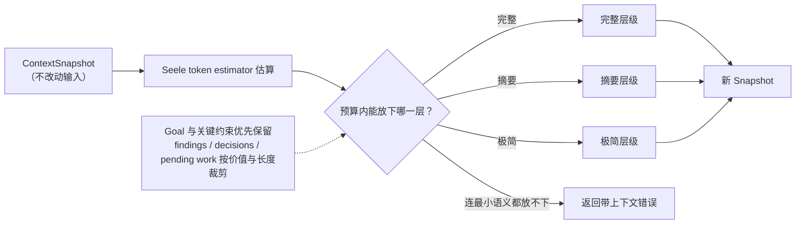

# Context Compactor

## 生态位

Compactor 在给定 token budget 内压缩 `ContextSnapshot`，用于子 Agent、A2A 和长会话上下文注入。

## 数据流图



## 策略

压缩复用 Seele token estimator，并根据预算选择完整、摘要或极简层级。Goal 和关键约束优先保留，findings/decisions/pending work 按价值和长度裁剪。

返回新 Snapshot，不修改输入；无法在预算内保留最小语义时返回带上下文错误。

## Review

- budget 边界和层级切换是否稳定。
- Unicode 截断是否安全，估算是否与 Seele 一致。
- 关键 goal/constraint 不应被低价值日志挤掉。
- 不要通过删除字段掩盖 escape/error 状态。

## 测试

```text
go test ./seelexctx/compactor -count=1
```

## 文件与函数索引

> 由源码 doc 注释自动提取（首行摘要）；描述源码行为，与实现保持同步。
> 刷新方式：`python scripts/gen_core_readme_index.py`。

### compactor.go

- `func NewCompactor() *Compactor`
- `func (c *Compactor) Compact(snap *snapshot.ContextSnapshot, budget int) (*snapshot.ContextSnapshot, error)` — Compact 压缩快照到目标 token 预算内。返回新快照，不修改原始快照。
- `func (c *Compactor) fullSnapshot(snap *snapshot.ContextSnapshot) *snapshot.ContextSnapshot`
- `func (c *Compactor) summarySnapshot(snap *snapshot.ContextSnapshot) *snapshot.ContextSnapshot`
- `func (c *Compactor) minimalSnapshot(snap *snapshot.ContextSnapshot) *snapshot.ContextSnapshot`
- `func minimumSnapshot(snap *snapshot.ContextSnapshot) *snapshot.ContextSnapshot`
- `func fitMinimalSnapshot(snap *snapshot.ContextSnapshot, budget int) *snapshot.ContextSnapshot`
- `func fitSnapshotFields(cp, snap *snapshot.ContextSnapshot, budget int) *snapshot.ContextSnapshot`
- `func estimateTokens(snap *snapshot.ContextSnapshot) int`
- `func truncateForToken(s string, maxTokens int) string`
- `func cloneSnapshot(snap *snapshot.ContextSnapshot) *snapshot.ContextSnapshot`

### compactor_test.go

- `func largeSnap() *snapshot.ContextSnapshot`
- `func TestCompact_Nil(t *testing.T)`
- `func TestCompact_FullBudget(t *testing.T)`
- `func TestCompact_Summary(t *testing.T)`
- `func TestCompact_Minimal(t *testing.T)`
- `func TestCompact_NegativeBudget(t *testing.T)`
- `func TestEstimateTokens(t *testing.T)`
- `func TestTruncateForToken(t *testing.T)`
- `func TestTruncateForTokenKeepsUTF8AndBudget(t *testing.T)`
- `func TestCompactNeverExceedsBudget(t *testing.T)`
- `func TestCompact_SummaryToolCalls(t *testing.T)`
