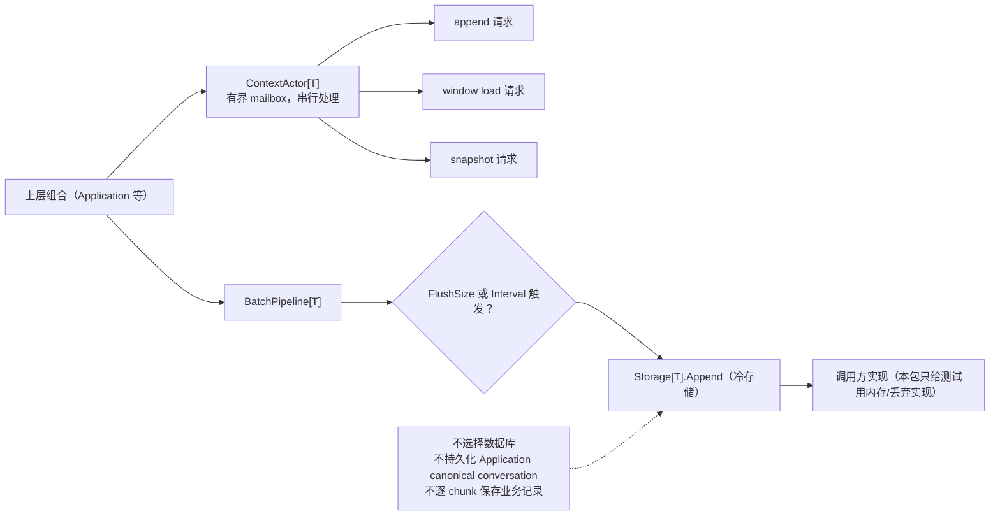

# Context Lifecycle

## 生态位

`lifecycle` 是与具体消息类型无关的上下文生命周期基建。它为冷加载、滑动窗口和流式批处理提供泛型 actor/管道，供 Application 等上层组合；它不理解 Session、Plan、Provider 或前端 DTO。

## 架构图



## 职责与边界

- `ContextActor[T]` 串行处理 append、window load 和 snapshot，请求只能通过有界 mailbox 进入。
- `BatchPipeline[T]` 聚合写入，按 `FlushSize` 或 `Interval` 调用 `Storage.Append`。
- `Storage[T]` 是调用方拥有的冷存储接口；本包只提供测试用内存/丢弃实现。
- 本包不选择数据库、不持久化 Application canonical conversation，也不逐 chunk 保存业务记录。

## 文件结构

| 文件 | 职责 |
|---|---|
| `actor.go` | 生命周期策略、Context actor、窗口读写和关闭协议。 |
| `pipeline.go` | 有界批处理、背压、flush/close 和统计。 |
| `storage.go` | `Storage[T]` 的测试实现。 |
| `mock_bench_test.go` | 并发、背压、边界、内存策略和 race 验证。 |

## 数据流与并发语义

`Append/Push` 成功表示所有权已转移：关闭必须排空已接受数据。Actor 和 Pipeline 都使用生命周期门协调投递与 channel close，避免 send-on-closed 和“已入队但无人回复”。Pipeline 的 `Flush` 等待自身 `committed` 数达到调用时的 accepted target，不依赖底层 Storage 构造前已有多少数据。

背压是显式错误：mailbox 满返回 `ErrMailboxFull`，pipeline 满返回 `ErrPipelineFull`。流式调用方应退避重试；关闭后返回 closed error。Storage append 失败会保留 pipeline buffer 并把错误返回给 Flush/Close。

## 扩展与 Review

新增策略应只修改 actor 私有状态机，不把锁或业务类型暴露到调用面。新增 Storage 必须并发安全，并保持 `Append`、`ReadRange`、`Count` 的一致计数语义。

Review 重点：Push/Close、Enqueue/Close、Flush/Close 是否可并发终止；成功接收的数据是否恰好提交一次；失败 flush 是否会静默丢数据；窗口策略是否保持常驻内存上限。

## 测试

```text
go test ./seelexctx/lifecycle -count=1
go test -race ./seelexctx/lifecycle -count=1
```

## Cancellation and drain

`ContextActor.CloseContext` and `BatchPipeline.CloseContext` cancel active
storage work before closing admission and draining accepted messages. Every
`Storage.Append` and `Storage.ReadRange` call receives a bounded context.
`SnapshotContext` also observes caller cancellation, so a full mailbox cannot
cause an unbounded spin.

## 文件与函数索引

> 由源码 doc 注释自动提取（首行摘要）；描述源码行为，与实现保持同步。
> 刷新方式：`python scripts/gen_core_readme_index.py`。

### actor.go

- `func (p LifecyclePolicy) String() string`
- `func NewContextActor[T any](policy LifecyclePolicy, store Storage[T], options Options) *ContextActor[T]` — NewContextActor 构造上下文 actor：启动消息循环（actor goroutine）。
- `func (a *ContextActor[T]) run()` — run 是唯一状态持有者：串行消费 mailbox（无锁闭包状态）。
- `func (a *ContextActor[T]) handle(req request[T])` — handle 分发消息（actor goroutine 内）。
- `func (a *ContextActor[T]) handleAppend(req request[T])` — handleAppend 写路径：按策略决定驻留 vs 落库。
- `func (a *ContextActor[T]) handleLoadWindow(req request[T])` — handleLoadWindow 读路径（① 前端 select / ③ 递 LLM）：
- `func (a *ContextActor[T]) handleSnapshot(req request[T])` — handleSnapshot 返回当前常驻区与总数（审计/测试）。
- `func (a *ContextActor[T]) replyErr(req request[T], err error)` — replyErr 回传错误（不中断 actor 循环）。
- `func (a *ContextActor[T]) operationContext() (context.Context, context.CancelFunc)`
- `func (a *ContextActor[T]) appendToStore(items []T) error`
- `func (a *ContextActor[T]) Append(items []T) error` — Append 写路径：追加上下文（② 后端写操作）。非阻塞投递；mailbox 满时
- `func (a *ContextActor[T]) LoadWindow(ctx context.Context, offset, limit int) ([]T, int, error)` — LoadWindow 读路径（① 前端 select / ③ 递 LLM）：按窗口读，返回
- `func (a *ContextActor[T]) Snapshot() ([]T, int)` — Snapshot 返回常驻区拷贝与总数（测试/审计；非生产热路径）。
- `func (a *ContextActor[T]) SnapshotContext(ctx context.Context) ([]T, int, error)` — SnapshotContext is a bounded snapshot request. It never spins when the
- `func (a *ContextActor[T]) Enqueue(req request[T]) error` — Enqueue 投递消息（非阻塞；满则返回 ErrMailboxFull 并计入丢弃计数；
- `func (a *ContextActor[T]) CloseContext(ctx context.Context) error` — CloseContext first cancels in-flight Storage work, then closes admission and
- `func (a *ContextActor[T]) Close()` — Close is the compatibility shutdown API. Use CloseContext when the caller
- `func (a *ContextActor[T]) Dropped() int` — Dropped 返回背压丢弃计数（审计）。

### mock_bench_test.go

- `func newCancellableBlockingStorage[T any]() *cancellableBlockingStorage[T]`
- `func (store *cancellableBlockingStorage[T]) Append(ctx context.Context, _ []T) error`
- `func (*cancellableBlockingStorage[T]) ReadRange(context.Context, int, int) ([]T, int, error)`
- `func (*cancellableBlockingStorage[T]) Count() int`
- `func TestActorConcurrentAppendOrdering(t *testing.T)` — TestActorConcurrentAppendOrdering 并发写保序：100 goroutines × 200 items
- `func TestActorLoadWindowBoundaries(t *testing.T)` — TestActorLoadWindowBoundaries 窗口边界：空存储 / 越界 offset / limit=0 /
- `func TestActorWindowedPolicyOverflow(t *testing.T)` — TestActorWindowedPolicyOverflow 窗口策略溢出：驻留窗口外的条数落库，
- `func TestActorBackpressureMailboxFull(t *testing.T)` — TestActorBackpressureMailboxFull 背压：mailbox 容量 1，满时 Append 返回
- `func TestPipelineBatchFlushCount(t *testing.T)` — TestPipelineBatchFlushCount 批量落库：10k chunks 经管道聚合，
- `func TestPipelineIntervalFlush(t *testing.T)` — TestPipelineIntervalFlush 时间间隔 flush：低流量也按时落库（不滞留）。
- `func TestActorCancelAfterClose(t *testing.T)` — TestActorCancelAfterClose 取消：Close 后 Enqueue 报错（actor 已停）。
- `func TestActorCloseCancelsBlockingStoreAndBoundsSnapshot(t *testing.T)`
- `func TestPipelineCloseCancelsBlockingStore(t *testing.T)`
- `func TestActorSnapshotAfterCloseReturnsFinalState(t *testing.T)`
- `func TestPipelineFlushTracksOnlyPipelineCommits(t *testing.T)`
- `func TestActorConcurrentUseAndClose(t *testing.T)` — TestActorConcurrentUseAndClose verifies that every request accepted before
- `func TestPipelineConcurrentPushAndClose(t *testing.T)` — TestPipelineConcurrentPushAndClose verifies the Push/Close lifecycle gate:
- `func measureHeap() uint64` — measureHeap 返回 GC 后的堆分配（稳定基线：多次 GC + 取最小值，
- `func TestPolicyMemoryComparison(t *testing.T)` — TestPolicyMemoryComparison 四策略内存对比（非 happy path 核心交付）：
- `func TestPolicyMemoryComparisonFullRetainGrows(t *testing.T)` — TestPolicyMemoryComparisonFullRetainGrows 全量常驻确认增长（对照基准有效）：

### pipeline.go

- `func fmtError(message string) error`
- `func NewBatchPipeline[T any](store Storage[T], options PipelineOptions) *BatchPipeline[T]`
- `func (p *BatchPipeline[T]) run()`
- `func (p *BatchPipeline[T]) operationContext() (context.Context, context.CancelFunc)`
- `func (p *BatchPipeline[T]) flushBuffer(buffer *[]T) error`
- `func (p *BatchPipeline[T]) Push(item T) error` — Push transfers ownership without blocking. A full producer mailbox is an
- `func (p *BatchPipeline[T]) FlushContext(ctx context.Context) error` — FlushContext waits only for chunks accepted before it captured target. The
- `func (p *BatchPipeline[T]) Flush() error`
- `func (p *BatchPipeline[T]) CloseContext(ctx context.Context) error` — CloseContext first cancels in-flight Storage work, then closes admission and
- `func (p *BatchPipeline[T]) Close() error`
- `func (p *BatchPipeline[T]) Stats() PipelineStats`

### storage.go

- `func newMemoryStorage[T any]() *memoryStorage[T]`
- `func (s *memoryStorage[T]) Append(_ context.Context, items []T) error`
- `func (s *memoryStorage[T]) ReadRange(_ context.Context, offset, limit int) ([]T, int, error)`
- `func (s *memoryStorage[T]) Count() int`
- `func newDiscardStorage[T any]() *discardStorage[T]`
- `func (s *discardStorage[T]) Append(_ context.Context, items []T) error`
- `func (s *discardStorage[T]) ReadRange(_ context.Context, offset, limit int) ([]T, int, error)`
- `func (s *discardStorage[T]) Count() int`
