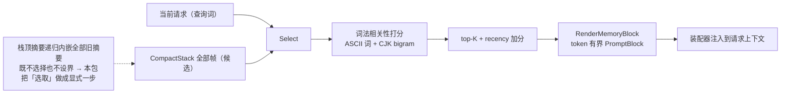

# seelexctx/memory — 历史记忆选取

## 生态位

超长会话里 CompactStack 只渲染栈顶帧（`RenderStackBlocks`），栈顶摘要递归
内嵌全部旧摘要——既不选择也不设界。本包把「从历史 select 出相关过往记忆」
做成显式一步：

```text
查询（当前请求） + CompactStack 全部帧（候选）
  └─ Select：词法相关性打分（ASCII 词 + CJK bigram）→ top-K（recency 加分）
  └─ RenderMemoryBlock：token 有界的「相关记忆」PromptBlock（装配器注入）
```

## 数据流图



## 契约

| 符号 | 语义 |
|---|---|
| `Candidate` | 一条记忆：SegmentID + Summary + Evidence（压缩帧映射） |
| `Select(query, candidates, opts)` | 纯函数：命中降序 top-K；空查询/无命中 → nil |
| `RenderMemoryBlock(selected, maxTokens)` | 有界块；预算默认 1024 tokens |

## 设计原则

- **确定性**：词法打分（术语频次加权），零外部依赖、可单测断言顺序。
- **有界**：渲染块逐条按预算截断，绝不无界拼接（替代栈顶递归内嵌）。
- **可替换**：`Select` 输入输出为纯数据结构；graph role 向量检索可用后
  以同签名实现替换，装配点不变。
- **不伪造事实**：块内显式声明排序分数不作为事实，证据指向不可变句柄。

## 测试

```text
go test ./seelexctx/memory -count=1
```

## 文件与函数索引

> 由源码 doc 注释自动提取（首行摘要）；描述源码行为，与实现保持同步。
> 刷新方式：`python scripts/gen_core_readme_index.py`。

### block.go

- `func RenderMemoryBlock(selected []Candidate, maxTokens int) *seelectx.PromptBlock` — RenderMemoryBlock 把选中的记忆渲染为单个「相关记忆」PromptBlock。
- `func renderCandidateLine(candidate Candidate, budget int) string` — renderCandidateLine 渲染一条记忆：段标识 + 摘要（按 budget token 截断）
- `func blockFrom(builder *strings.Builder) *seelectx.PromptBlock` — blockFrom 从 builder 构造 memory PromptBlock。
- `func truncateTokens(text string, maxTokens int) string` — truncateTokens 按 token 预算截断文本（EstimateTokens 估算；末尾加省略标记）。

### memory.go

- `func DefaultOptions() Options` — DefaultOptions 返回默认选取参数：limit=3、min_score=0、
- `func Select(query string, candidates []Candidate, opts Options) []Candidate` — Select 按查询词法相关性选取候选记忆，返回按分数降序的 top-K（仅命中项）。
- `func (o *Options) applyDefaults()`
- `func Score(query string, candidate Candidate) float64` — Score 返回候选记忆对查询的词法相关性分数（与 Select 同款打分规则；
- `func sortScored(entries []scoredCandidate)`
- `func (c Candidate) score(terms []string) float64` — score 统计查询词项在摘要/证据/段标识中的命中加权和。
- `func tokenize(text string) []string` — tokenize 把查询/文本切分为词项：ASCII 词（≥2 字母数字）+ CJK bigram。
- `func isCJK(value string) bool` — isCJK 判断字串是否全为 CJK 统一表意文字（含扩展区）。
- `func appendBigrams(terms *[]string, word string)` — appendBigrams 把 CJK 串切成相邻 2-gram 词项。
- `func dedupe(terms []string) []string` — dedupe 去重并保持首次出现顺序（同一词项不重复计分）。

### memory_test.go

- `func candidates(entries ...Candidate) []Candidate`
- `func TestSelectMatchesSummaryTerms(t *testing.T)`
- `func TestSelectASCIIAndCJKBigramTokenization(t *testing.T)`
- `func TestSelectLimitAndRecency(t *testing.T)`
- `func TestSelectFiltersByEvidenceRefs(t *testing.T)`
- `func TestSelectEmptyQueryAndNoHit(t *testing.T)`
- `func TestSelectMinScoreFiltersWeakHits(t *testing.T)`
- `func TestSelectEmptyCandidates(t *testing.T)`
- `func TestRenderMemoryBlock(t *testing.T)`
- `func TestRenderMemoryBlockBoundsAndNil(t *testing.T)`
- `func TestRenderMemoryBlockEmptySummary(t *testing.T)`
