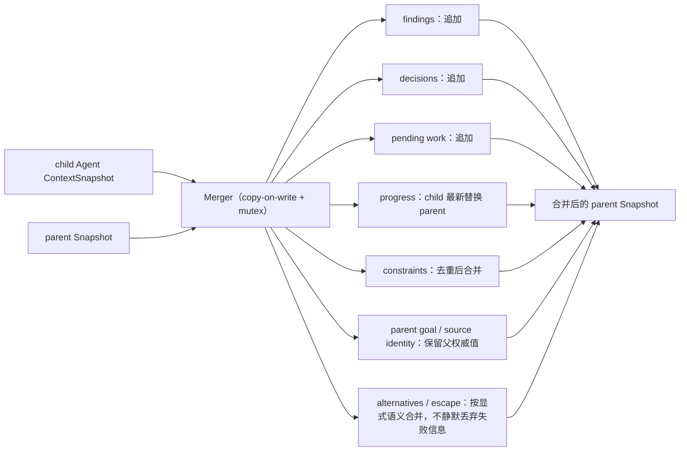

# Context Merger

## 生态位

Merger 把 child Agent 的结构化结果合并回 parent Snapshot，形成 A2A 闭环。

## 数据流图



并发分支不会就地修改同一 parent 对象：写入走 copy-on-write，读侧由 mutex 保护。

## 合并语义

- findings、decisions、pending work：追加。
- progress：child 的最新进度替换 parent progress。
- constraints：去重后合并。
- parent goal/source identity：保留父上下文权威值。
- alternatives/escape：按显式语义合并，不静默丢弃失败信息。

实现使用 copy-on-write 和 mutex，避免并发分支修改同一 parent 对象。

## Review

- 合并顺序是否会导致非确定结果。
- 去重是否只按文本，是否需要未来稳定 ID。
- child 不应覆盖 parent identity/goal。
- 失败/escape 分支是否仍可被上层观察。

## 测试

```text
go test ./seelexctx/merger -count=1
```

## 文件与函数索引

> 由源码 doc 注释自动提取（首行摘要）；描述源码行为，与实现保持同步。
> 刷新方式：`python scripts/gen_core_readme_index.py`。

### merger.go

- `func NewMerger() *Merger`
- `func (m *Merger) MergeBack(parent, child *snapshot.ContextSnapshot) error` — MergeBack 将子代理快照合并到父代理快照。不修改原始切片。
- `func copyDecisions(src []snapshot.Decision) []snapshot.Decision`
- `func copyStrings(src []string) []string`

### merger_test.go

- `func TestMergeBack_NilParent(t *testing.T)`
- `func TestMergeBack_NilChild(t *testing.T)`
- `func TestMergeBack_FindingsAppend(t *testing.T)`
- `func TestMergeBack_DecisionsAppend(t *testing.T)`
- `func TestMergeBack_ProgressReplace(t *testing.T)`
- `func TestMergeBack_ProgressKeep(t *testing.T)`
- `func TestMergeBack_PendingReplace(t *testing.T)`
- `func TestMergeBack_TokenSum(t *testing.T)`
- `func TestMergeBack_MessageCountSum(t *testing.T)`
- `func TestMergeBack_EscapeReplace(t *testing.T)`
- `func TestMergeBack_ConstraintsDedup(t *testing.T)`
- `func TestMergeBack_CopyOnWrite(t *testing.T)`
- `func TestMergeBack_Alternatives(t *testing.T)`
- `func TestMergeBack_GoalInheritedWhenParentEmpty(t *testing.T)`
- `func TestMergeBack_GoalKeptWhenParentSet(t *testing.T)`
