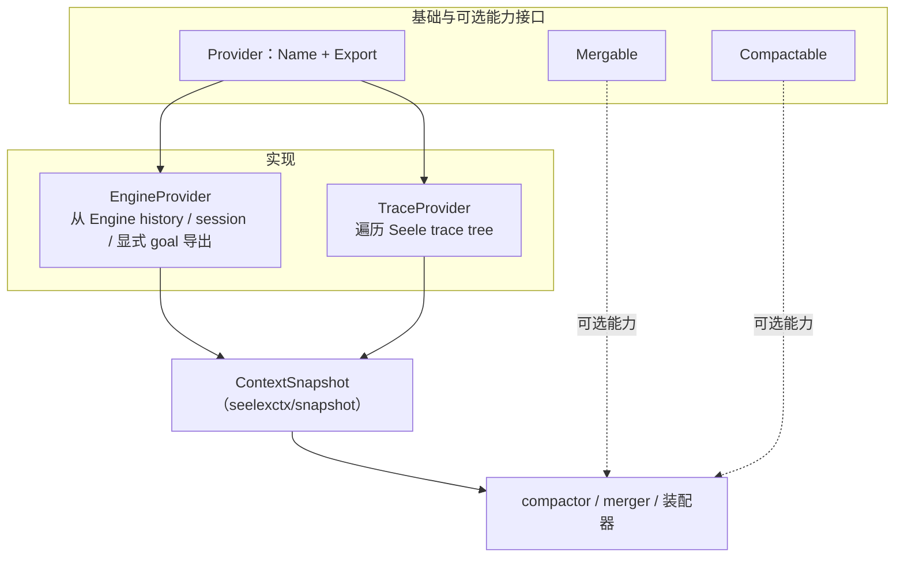

# Context Providers

## 生态位

Provider 把不同运行时事实源转换为统一 `ContextSnapshot`。

## 架构图



TraceProvider 提取 LLM 文本、tool decision、错误、token 与进度；两者都**不修改**
Engine history 或 trace tree。

## 实现

- `Provider`：`Name` + `Export` 基础接口。
- `Mergable`/`Compactable`：可选能力接口。
- `EngineProvider`：从 Engine history、session 和显式 goal 导出上下文。
- `TraceProvider`：遍历 Seele trace tree，提取 LLM 文本、tool decision、错误、token 和进度。

## Review

- provider 不应修改 Engine history 或 trace tree。
- nil Engine、空 history、未知 trace node 和无效 token 必须安全处理。
- Tool args/result 可能含秘密或大文本，导出前应限制和清洗。
- 新事实源实现同一接口，不在调用方加入类型 switch。

## 测试

```text
go test ./seelexctx/provider -count=1
```

## 文件与函数索引

> 由源码 doc 注释自动提取（首行摘要）；描述源码行为，与实现保持同步。
> 刷新方式：`python scripts/gen_core_readme_index.py`。

### engine.go

- `func NewEngineProvider(eng SessionSource) *EngineProvider`
- `func NewEngineProviderWithGoal(eng SessionSource, goal string) *EngineProvider`
- `func (p *EngineProvider) Name() string`
- `func (p *EngineProvider) Export(_ context.Context) (*snapshot.ContextSnapshot, error)` — Export 从会话导出上下文。
- `func NewHistoryProvider(history seelectx.DurableHistory, sessionID string) *HistoryProvider` — NewHistoryProvider 构造基于 DurableHistory 的导出器。
- `func NewHistoryProviderWithGoal(history seelectx.DurableHistory, sessionID, goal string) *HistoryProvider` — NewHistoryProviderWithGoal 构造并显式设置目标。
- `func (p *HistoryProvider) Name() string` — Name 实现 Provider。
- `func (p *HistoryProvider) Export(ctx context.Context) (*snapshot.ContextSnapshot, error)` — Export 从持久化历史导出上下文快照（Load 失败显式返回错误）。

### provider_test.go

- `func TestEngineProvider_Name(t *testing.T)`
- `func TestEngineProvider_NilExportError(t *testing.T)`
- `func TestEngineProvider_NilExportErrorWithGoal(t *testing.T)`
- `func TestTraceProvider_NilExportError(t *testing.T)`
- `func TestTraceProvider_ExportReadsTelemetryLifecycleEvents(t *testing.T)`
- `func TestTraceProvider_ExportEmptyEvents(t *testing.T)`
- `func TestExtractLLMInfo_Tokens(t *testing.T)`
- `func TestExtractLLMInfo_NoAttrs(t *testing.T)`
- `func TestExtractLLMInfo_ModelFinding(t *testing.T)`
- `func TestExtractToolDecision_Normal(t *testing.T)`
- `func TestExtractToolDecision_NoTool(t *testing.T)`
- `func TestExtractToolDecision_Error(t *testing.T)`
- `func (f fakeTraceSource) Query(context.Context, telemetry.Query) (telemetry.ViewModel, error)`
- `func contains(s, substr string) bool`

### trace.go

- `func NewTraceProvider(src TraceSource, sessionID string) *TraceProvider` — NewTraceProvider 构造基于 telemetry 追踪的导出器。
- `func NewTraceProviderWithGoal(src TraceSource, sessionID, goal string) *TraceProvider` — NewTraceProviderWithGoal 构造并显式设置目标。
- `func (p *TraceProvider) Name() string`
- `func (p *TraceProvider) Export(ctx context.Context) (*snapshot.ContextSnapshot, error)` — Export 从 telemetry 生命周期事件（llm/tool intent-effect）提取结构信息。
- `func extractLLMInfo(event telemetry.Event, snap *snapshot.ContextSnapshot)` — extractLLMInfo 从 llm.after 事件提取 token 用量与模型信息
- `func extractToolDecision(event telemetry.Event, snap *snapshot.ContextSnapshot)` — extractToolDecision 从 tool.after 事件提取工具决策
- `func attrString(attributes telemetry.Attributes, key string) string`
- `func attrInt(attributes telemetry.Attributes, key string) int`
