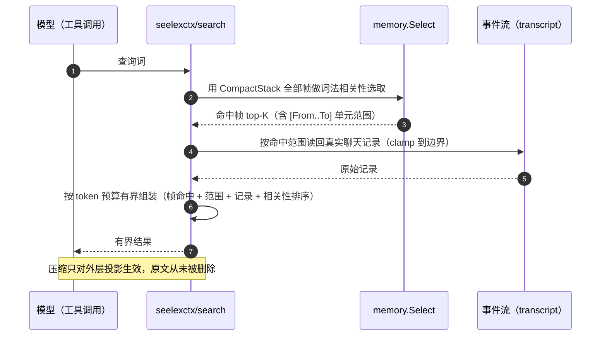

# seelexctx/search — 历史记录检索

## 生态位

超长会话里窗口外轮次被压缩成 CompactStack 摘要（栈顶递归内嵌），模型在
请求中只剩摘要——久远但相关的细节丢失，且没有按需读回的入口。本包把
「用压缩栈做语义索引，在索引范围内查聊天记录」做成显式一步：

```text
查询 + CompactStack 全部帧（语义索引）
  └─ memory.Select：词法相关性选相关帧（top-K，recency 加分）
  └─ 按命中帧 [From..To] 单元范围从事件流读回真实聊天记录（clamp 到边界）
  └─ token 预算内有界返回（帧命中 + 范围 + 记录 + 相关性排序）
```

## 时序图



## 契约

| 符号 | 语义 |
|---|---|
| `Searcher.Search(query, opts)` | 核心检索：索引路径（压缩栈）/ 兜底路径（尾部扫描） |
| `StackSource` | 压缩栈读取（`store.SessionContextStore` / `seelexctx.CompactStackStore` 满足） |
| `EventSource` | 事件流读取（`NewRouterEventSource` 绑定 Router；测试可用假实现） |
| `Result` | 权威返回：hits + 索引规模 + 轮数 + 预算 + 边界提示（JSON 序列化给工具/UI） |
| `Options.Limit` | 命中数上限（默认 3，硬上限 20） |
| `Options.TokenBudget` | 记录总预算（默认 4000，硬上限 12000——绝不无界） |

## 边界语义

- **空查询**：显式拒绝（`ErrEmptyQuery`），不静默全量返回。
- **无压缩栈**：尾部扫描兜底——事件流全部轮次按单元展开为候选（复用
  `memory.Select` 同款打分），只扫描最近 `MaxFallbackScanUnits`（300）轮；
  提示文案明示「历史未压缩：可检索性有限」。选兜底而非拒绝：短会话
  （尚未触发压缩）同样需要可检索，且全量扫描无额外 I/O（事件流本来就
  要完整读取以对齐单元索引）。
- **帧范围越界**：`[From..To]` 与 `CompleteEventUnits` 单元下标近似对齐，
  clamp 到事件流边界；clamp 后倒置 → 空命中（不报错）。
- **预算耗尽**：按相关性顺序累计，帧内记录截断（`Hit.Truncated`）或
  后续命中丢弃（`Result.Truncated`）——硬上限内绝不无界拼接。
- **单条内容**：截断到 `maxRecordChars`（800 字符），结果摘要同样截断。

## 设计原则

- **复用**：选取直接用 `seelexctx/memory`（`Select` + `Score` 同款打分），
  不复制打分逻辑；范围渲染与 `gap.go` / `controller.go` 同风格。
- **纯数据 + 构造注入**：输入输出都是数据结构，StackSource/EventSource
  接口化——未来换向量检索器只换装配点。
- **事件流是真相源**：读回的是 append-only 事件库里的真实记录
  （用户输入 + assistant 摘要 + 工具名/结果摘要），不读压缩摘要拼凑。

## 测试

```text
go test ./seelexctx/search -count=1
```

## 文件与函数索引

> 由源码 doc 注释自动提取（首行摘要）；描述源码行为，与实现保持同步。
> 刷新方式：`python scripts/gen_core_readme_index.py`。

### event_seq_range_test.go

- `func orphanHeavyStream() []store.Event` — orphanHeavyStream 造一条**事件下标与单元下标不同步**的事件流：中间夹一个孤儿
- `func TestEventSeqUnitRangeMapsByLookupNotArithmetic(t *testing.T)` — TestEventSeqUnitRangeMapsByLookupNotArithmetic：EventSeq → 单元下标必须按 Seq
- `func TestEventSeqUnitRangeRefusesToGuess(t *testing.T)` — TestEventSeqUnitRangeRefusesToGuess：定不了界就如实说定不了，不 clamp、不猜。
- `func TestBuildHitPrefersEventSeqOverUnitIndex(t *testing.T)` — TestBuildHitPrefersEventSeqOverUnitIndex：帧同时带 From/To 与 EventSeq 时，
- `func TestBuildHitReportsUnmappableRangeInsteadOfClamping(t *testing.T)` — TestBuildHitReportsUnmappableRangeInsteadOfClamping：定不了界时在 Summary 里
- `func TestBuildHitKeepsUnitIndexFallbackForLegacyFrames(t *testing.T)` — TestBuildHitKeepsUnitIndexFallbackForLegacyFrames：未声明 EventSeq 的帧

### search.go

- `func (o *Options) applyDefaults()`
- `func NewRouterEventSource(router *store.Router, projectID, sessionID string) EventSource` — NewRouterEventSource 构造绑定到 Router 的事件源（LoadEventTailWorkspace
- `func (source routerEventSource) LoadAllEvents(ctx context.Context) ([]store.Event, error)` — LoadAllEvents 实现 EventSource。会话不存在（尚无事件库）→ 空流不报错
- `func New(stack StackSource, events EventSource) *Searcher` — New 构造检索器。stack 为 nil 时退化为尾部扫描兜底；events 为 nil 时
- `func (s *Searcher) Search(ctx context.Context, query string, opts Options) (Result, error)` — Search 执行检索：空查询拒绝；无压缩栈 → 尾部扫描兜底；命中帧按
- `func collectHits(query string, selected []memory.Candidate, units [][]store.Event, budget int) ([]Hit, bool)` — collectHits 把选中的候选帧逐一读回真实记录：共享 token 预算累计，
- `func buildHit(query string, candidate memory.Candidate, units [][]store.Event, budget int) Hit` — buildHit 按帧区间读回真实聊天记录。
- `func eventSeqUnitRange(units [][]store.Event, eventFrom, eventTo uint64) (unitRange, bool)` — eventSeqUnitRange 在 units 上按 EventSeq 区间反查单元下标区间。
- `func unitSeqBounds(unit []store.Event) (low, high uint64)` — unitSeqBounds 返回一个单元内非零 EventSeq 的最小/最大值（都为 0 = 无真实序号）。
- `func renderUnitRecords(unit []store.Event, budget int) ([]ChatRecord, bool)` — renderUnitRecords 渲染一个事件单元为记录列表（token 预算内；预算耗尽
- `func recordFromEvent(event store.Event) ChatRecord` — recordFromEvent 把一个事件渲染为聊天记录：用户输入、assistant 文本/
- `func renderUnitSummaryLine(unit []store.Event) string` — renderUnitSummaryLine 渲染一个事件单元的单行摘要（兜底候选帧的
- `func estimateRecord(record ChatRecord) int` — estimateRecord 估算一条记录的 token（脚本感知估算 + 固定开销，
- `func sumRecordEstimate(records []ChatRecord) int` — sumRecordEstimate 汇总记录 token 估算。
- `func truncateContent(content string) string` — truncateContent 把正文截断到 maxRecordChars（末尾加省略标记）。
- `func clampIndex(index, total int) int` — clampIndex 把单元索引 clamp 到 [0, total-1]（total=0 → 返回 0，

### search_test.go

- `func (s *fakeStack) CompactStackSnapshot() []store.CompactFrame`
- `func (s *fakeEvents) LoadAllEvents(context.Context) ([]store.Event, error)`
- `func unit(seqBase int, userText, toolName string) []store.Event` — unit 构造一个事件单元：user 输入 + assistant 工具链（调用 + 结果）。
- `func frame(segment string, from, to int, summary string) store.CompactFrame`
- `func TestSearchSelectsRelevantFramesAndReadsRecords(t *testing.T)`
- `func TestSearchClampsFrameRangeToEventStream(t *testing.T)`
- `func TestSearchRejectsEmptyQuery(t *testing.T)`
- `func TestSearchTokenBudgetTruncatesAndDropsLaterHits(t *testing.T)`
- `func TestSearchBudgetHardCapClamps(t *testing.T)`
- `func TestSearchNoStackFallsBackToTailScan(t *testing.T)`
- `func TestSearchFallbackScanCap(t *testing.T)`
- `func TestSearchNoEventsReturnsNote(t *testing.T)`
- `func TestSearchEventSourceUnavailable(t *testing.T)`
- `func TestSearchToolResultRefFallbackFromCallID(t *testing.T)`
- `func TestMemoryScoreMatchesSelectOrdering(t *testing.T)`

### session_not_found_test.go

- `func TestSessionNotFoundCriterionMatchesStore(t *testing.T)` — TestSessionNotFoundCriterionMatchesStore 钉住「会话不存在」判据的唯一性
- `func TestSessionNotFoundCriterionHasNoLocalCopy(t *testing.T)` — TestSessionNotFoundCriterionHasNoLocalCopy 钉「判据唯一」：本包不得再定义
- `func definesFuncNamed(t *testing.T, dir, name string) bool` — definesFuncNamed 报告目录下（不含测试文件自身）是否声明了名为 name 的函数。
