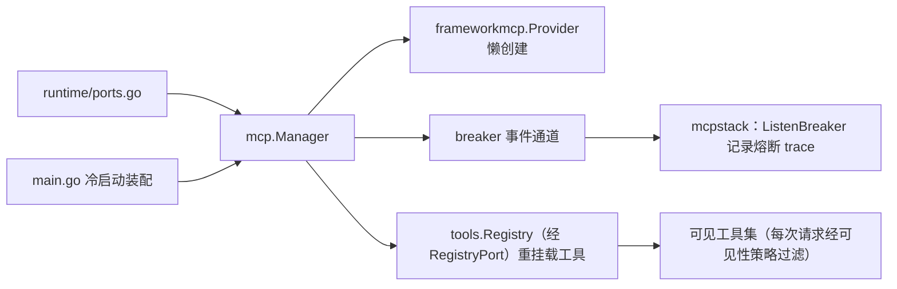
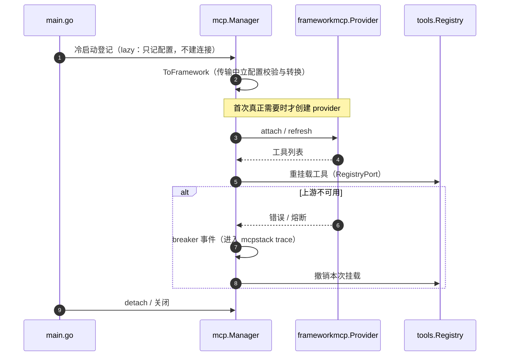

# mcp 域

## 生态位

承载 Seelex 的 MCP 服务器生命周期：provider 懒创建、breaker 事件通道、
lazy 冷启动登记、attach/detach/refresh、工具重挂载。主要调用方：
`ports.go`（Runtime MCP 端口）、`main.go`（冷启动装配）。

## 职责与非职责

- 职责：`Manager` 持有 MCP 生命周期状态并对外提供服务；`ToFramework`
  做传输中立配置校验与转换。
- 非职责：MCP 调用 trace 的数据层（归子包 `mcpstack/`）、插件驱动的 MCP 装配
  （归顶层 `plugin/`）。

## 与其它域的关系

## 时序图

## 核心实现

- `Manager.Provider()`：provider 懒创建（首次使用才实例化）。
- `RegisterLazy`/`Load`：冷启动登记 + 按需连接（幂等，失败不破坏登记）。
- `refreshTools`：把 MCP provider 重挂载到工具注册表（Unregister+Register）。

## 数据流

Attach → breaker 通道初始化 → `mcpstack.ListenBreaker(stack, ch)` →
provider.Attach → 工具重挂载 → 注册表可见。

## 依赖方向

允许依赖：`frameworkmcp`、`mcpstack`、`framework tools`、`types`。
禁止依赖：seelebridge 根包及其它域（registry 经接口注入）。

## 并发、存储、安全

`Manager` 自带锁（lazyMu）；breaker channel 有界（64）；配置校验在
`ToFramework` 内（name/transport/command 契约）。

## 扩展方式

新增 transport：扩展 `ToFramework` 校验与 `frameworkmcp.ServerConfig` 映射。

## Review 指南

- 重挂载是否幂等；detach 后工具是否从注册表移除。
- lazy 登记是否与 Attach 校验一致（防配置绕过）。

## 测试与验证

`go test ./seelebridge/... -run 'MCP|Breaker'`；根包
`mcp_provider_test.go`/`mcp_integration_test.go` 覆盖。

## 文件与函数索引

> 由源码 doc 注释自动提取（首行摘要）；描述源码行为，与实现保持同步。
> 刷新方式：`python scripts/gen_core_readme_index.py`。

### mcp.go

- `func NewManager(stack *mcpstack.MCPStack, registry RegistryPort) *Manager` — NewManager 构造 MCP 管理器。stack 记录 breaker 事件；registry 重挂载工具。
- `func (m *Manager) Provider() *frameworkmcp.Provider` — Provider 返回 MCP 工具提供者（tools/mcp，实现 tools.ToolProvider），懒创建。
- `func (m *Manager) BreakerEvents() <-chan frameworkmcp.BreakerEvent` — BreakerEvents returns a read-only channel of breaker events.
- `func (m *Manager) Attach(ctx context.Context, cfg Server) error` — Attach connects and registers a new MCP server.
- `func (m *Manager) isClosed() bool`
- `func (m *Manager) Close()` — Close 关闭 MCP 管理器：停掉熔断事件监听（close(ch) 使 ListenBreaker
- `func (m *Manager) AttachServer( ctx context.Context, name, transport, command string, args, env []string, url string, ) error` — AttachServer 是 plugin 域使用的展开入参版 Attach。
- `func (m *Manager) RegisterLazy(name string, cfg Server) error` — RegisterLazy 登记 MCP 服务器配置但不连接（冷启动：启动路径零 MCP 进程）。
- `func (m *Manager) LazyNames() []string` — LazyNames 返回已登记但尚未连接的 MCP 服务器名（按字典序）。
- `func (m *Manager) Load(ctx context.Context, name string) (int, error)` — Load 按需连接已登记的 MCP 服务器（冷启动加载点）：
- `func (m *Manager) Detach(name string) error` — Detach 断开并注销 MCP 服务器。
- `func (m *Manager) Refresh(ctx context.Context, name string) error` — Refresh 刷新指定 MCP 服务器的工具列表。
- `func (m *Manager) Names() []string` — Names 返回已连接 MCP 服务器名（按字典序）。
- `func (m *Manager) IsAlive(name string) bool` — IsAlive 轻量 ping 检查 MCP 服务器是否存活。
- `func (m *Manager) Status(name string) (alive bool, toolsCount int, err error)` — Status 返回 MCP 服务器健康状态（alive + tool count + error）。
- `func (m *Manager) RefreshTools()` — RefreshTools 重新挂载 MCP provider 到注册表，重建可见工具快照（幂等）。
- `func (m *Manager) refreshTools(provider *frameworkmcp.Provider)` — refreshTools 重新挂载 MCP provider 到注册表，重建可见工具快照。
- `func (m *Manager) setNotes(name string, notes []string)` — setNotes 记录一个 server 的工具描述注记。空白注记不写（也**不覆盖**已有
- `func (m *Manager) notesSnapshot() map[string][]string` — notesSnapshot 取一份注记副本（注册时用；返回 nil 表示无注记）。
- `func ToFramework(cfg Server) (frameworkmcp.ServerConfig, error)` — ToFramework 把 Seelex 的传输中立配置转换为框架 ServerConfig（校验契约）。

### notes.go

- `func (p *notesProvider) ProviderName() string`
- `func (p *notesProvider) Tools() []tools.ToolEntry`
- `func (p *notesProvider) notesFor(entryName string, attached []string) []string` — notesFor 按 entry 名找回它所属 server 的注记。
- `func appendNotes(description string, notes []string) string` — appendNotes 把注记折在描述末尾（空段分隔），空白注记跳过。

### notes_test.go

- `func (p *fakeProvider) ProviderName() string`
- `func (p *fakeProvider) ServerNames() []string`
- `func (p *fakeProvider) Tools() []tools.ToolEntry`
- `func entry(name, description string) tools.ToolEntry`
- `func TestNotesProviderAppendsServerNotes(t *testing.T)`
- `func TestNotesProviderPassthroughWithoutNotes(t *testing.T)` — 没有注记时必须是纯透传：描述、provider 名、条目数都不许被动。
- `func TestNotesProviderScopesNotesPerServer(t *testing.T)` — 多 server：框架给 entry 名加 `server__` 前缀，注记只落在自己那个 server 上。
- `func TestAppendNotesSkipsBlankAndFoldsMultiple(t *testing.T)` — 空白注记折叠掉：多行 folded scalar 带来的缩进/换行不该出现在描述里。
- `func TestSetNotesKeepsRegisteredNotesOnLaterAttach(t *testing.T)`
