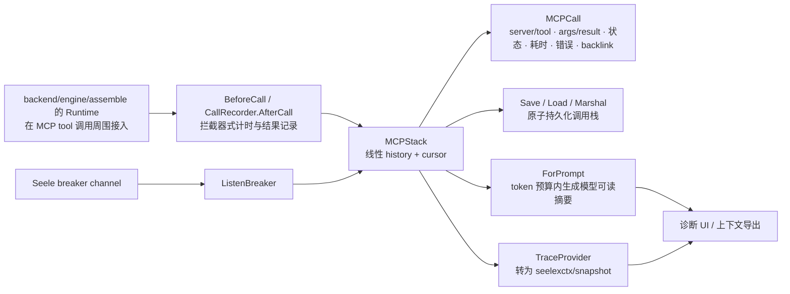
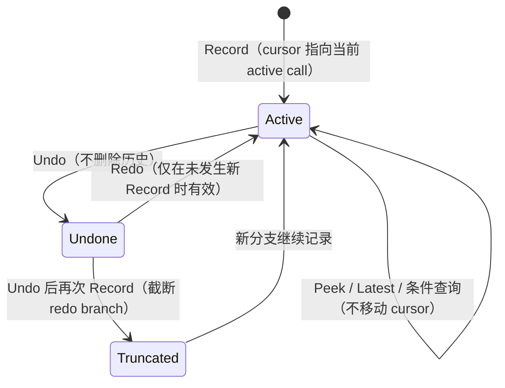

# MCP Stack

## 生态位

`mcpstack` 为 MCP 调用提供可回放的调用栈、持久化、prompt 摘要和 breaker 事件记录。它补充 Seele MCP runtime 的可观测性，不负责建立或管理 MCP 连接。

## 架构图



## 状态语义



`Snapshot` 返回深拷贝，调用方不能修改内部 args/result/tags。

## 核心实现

- `MCPCall`：server/tool、args/result、状态、耗时、错误、AI backlink 和时间戳。
- `MCPStack`：线性 history + cursor，支持 Record、Undo、Redo、Peek、Latest 和条件查询。
- `BeforeCall`/`CallRecorder.AfterCall`：拦截器式调用计时与结果记录。
- `ListenBreaker`：把 Seele breaker channel 状态写入调用轨迹。
- `Save`/`Load`/`Marshal`：原子持久化调用栈。
- `ForPrompt`：在 token budget 内生成模型可读摘要。
- `TraceProvider`：把 MCP history 转为 `seelexctx/snapshot`。

## 状态语义

cursor 指向当前 active call。Undo 不删除历史，Redo 只在未发生新 Record 时有效；在 undo 后 Record 会截断 redo branch。`Snapshot` 返回深拷贝，调用方不能修改内部 args/result/tags。

## 生态位与依赖

上游由 [`backend/engine/assemble`](../README.md) 的 Runtime 在 MCP tool 调用周围接入；
下游可供 trace、context export 和诊断 UI 使用。禁止反向依赖 Application 或 frontend。

## Review 指南

- Record/Undo/Redo/Snapshot 并发访问是否都受锁保护。
- JSON RawMessage、map 和 slice 是否深拷贝。
- auto-save 是否原子写入，失败是否返回而不是静默丢失。
- prompt 摘要是否严格遵守 budget，避免把秘密或无限结果送回模型。
- breaker listener 是否能随 channel 关闭退出。

## 测试

```text
go test ./backend/engine/mcp/mcpstack/... -count=1
```

## 文件与函数索引

> 由源码 doc 注释自动提取（首行摘要）；描述源码行为，与实现保持同步。
> 刷新方式：`python scripts/gen_core_readme_index.py`。

### breaker.go

- `func ListenBreaker(s *MCPStack, ch <-chan frameworkmcp.BreakerEvent)` — ListenBreaker 消费熔断器事件 channel，将状态变更记录到 MCPStack trace 中。

### interceptor.go

- `func (r *CallRecorder) Call() MCPCall` — Call returns the underlying MCPCall data (for middleware that needs to inspect it).
- `func BeforeCall(stack *MCPStack, serverName, toolName string, argsJSON json.RawMessage, aiBacklink string) *CallRecorder` — BeforeCall creates a new CallRecorder and records a "pending" entry in the stack.
- `func (r *CallRecorder) AfterCall(resultJSON json.RawMessage, callErr error)` — AfterCall completes the recorded call with its result or error.
- `func estimateTokenCount(serverName, toolName string, args json.RawMessage) int`
- `func FormatSummary(s *MCPStack) string` — FormatSummary returns a dense one-line summary of all active calls grouped by server.

### persist.go

- `func StackPath(sessionID, dir string) string` — StackPath returns the conventional file path for a session trace.
- `func (s *MCPStack) Marshal() ([]byte, error)` — Marshal serializes the stack to JSON (thread-safe).
- `func (s *MCPStack) Unmarshal(data []byte) error` — Unmarshal deserializes JSON data into the stack (thread-safe).
- `func (s *MCPStack) Save(path string) error` — Save writes the stack to a file atomically (write .tmp then rename).
- `func (s *MCPStack) save(path string) error`
- `func (s *MCPStack) Load(path string) error` — Load reads a stack from a file, replacing current state.
- `func LoadStack(path string) (*MCPStack, error)` — LoadStack loads a complete MCPStack from a file.

### prompt.go

- `func (s *MCPStack) ForPrompt(budget int) string` — ForPrompt generates a token-budget-aware textual summary of the MCP call history
- `func (s *MCPStack) averageTokenCount() int`

### provider.go

- `func NewTraceProvider(stack *MCPStack) *TraceProvider` — NewTraceProvider creates a TraceProvider wrapping the given MCPStack.
- `func (p *TraceProvider) Name() string` — Name returns a stable identifier for this provider.
- `func (p *TraceProvider) BuildSnapshot() (*snapshot.ContextSnapshot, error)` — BuildSnapshot exports the current MCP trace state as a ContextSnapshot.
- `func (p *TraceProvider) Compact(snap *snapshot.ContextSnapshot, budget int) (*snapshot.ContextSnapshot, error)` — Compact reduces the trace to a minimal summary.

### snapshot.go

- `func (s *MCPStack) Snapshot() (*MCPStack, error)` — Snapshot returns a deep copy of the current stack state (thread-safe).

### stack.go

- `func (s CallStatus) String() string`
- `func WithSessionID(id string) Option`
- `func WithAutoSave(path string) Option`
- `func WithMetadata(md StackMetadata) Option`
- `func New(opts ...Option) *MCPStack` — New creates an empty MCPStack.
- `func (s *MCPStack) Record(call MCPCall) error` — Record appends a completed MCP call to the stack.
- `func (s *MCPStack) Undo() (*MCPCall, error)` — Undo moves CurrentIdx back by one. Returns the undone call.
- `func (s *MCPStack) Redo() (*MCPCall, error)` — Redo moves CurrentIdx forward by one. Returns the redone call.
- `func (s *MCPStack) Current() (*MCPCall, error)` — Current returns the call at CurrentIdx, or nil if the stack is empty.
- `func (s *MCPStack) Peek(offset int) (*MCPCall, error)` — Peek returns the call at CurrentIdx+offset without moving the pointer.
- `func (s *MCPStack) ActiveCount() int` — ActiveCount returns the number of active (not undone) calls.
- `func (s *MCPStack) TotalCount() int` — TotalCount returns the total number of calls (including undone ones).
- `func (s *MCPStack) ByServer(serverName string) []MCPCall` — ByServer returns all calls (up to CurrentIdx) that targeted a given server.
- `func (s *MCPStack) ByTool(toolName string) []MCPCall` — ByTool returns all calls (up to CurrentIdx) for a given tool name.
- `func (s *MCPStack) Latest(n int) []MCPCall` — Latest returns the N most recent active calls.
- `func (s *MCPStack) autoSave() error`

### stack_test.go

- `func TestNew(t *testing.T)`
- `func TestRecordAndActiveCount(t *testing.T)`
- `func TestUndoRedo(t *testing.T)`
- `func TestUndoAtBottom(t *testing.T)`
- `func TestEmptyStackCurrent(t *testing.T)`
- `func TestRecordAfterUndo(t *testing.T)`
- `func TestSerialization(t *testing.T)`
- `func TestFilePersistence(t *testing.T)`
- `func TestAutoSave(t *testing.T)`
- `func TestByServer(t *testing.T)`
- `func TestByTool(t *testing.T)`
- `func TestLatest(t *testing.T)`
- `func TestForPrompt(t *testing.T)`
- `func TestSnapshot(t *testing.T)`
- `func TestInterceptor(t *testing.T)`
- `func TestInterceptorFailure(t *testing.T)`
- `func TestFormatSummary(t *testing.T)`
- `func TestMultiServer(t *testing.T)`
- `func makeCall(server, tool, argsJSON string) MCPCall`
- `func recordN(s *MCPStack, t *testing.T, n int)`
- `func contains(s, substr string) bool`
