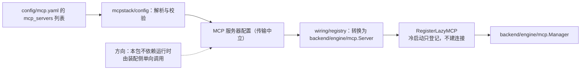

# MCP Config

## 生态位

`mcpstack/config` 从**独立的 MCP 配置文件 `mcp.yaml`** 加载 MCP 服务器清单
（根级 `mcp_servers:` 列表，2026-10 从账号档拆出）。
它只负责解析与校验，不依赖运行时；注册由 [`wiring/registry`](../../../../../wiring/registry/README.md)
转换为 `backend/engine/mcp` 的 `Server` 并调 `Runtime` 的登记入口，
从而保持本包与生命周期包之间的单向依赖。

路径不由本包决定：启动装配用 `internal/bootseed` 责任链（`config/mcp.yaml` →
`mcp.yaml` → `<exe>/config/mcp.yaml`）解析，四处全缺时用内嵌默认档就地初始化
一份空清单，之后只读用户那份。详见 `config/README.md`。

## 数据流图



## 验证

```text
go test ./backend/engine/mcp/mcpstack/config -count=1
```
