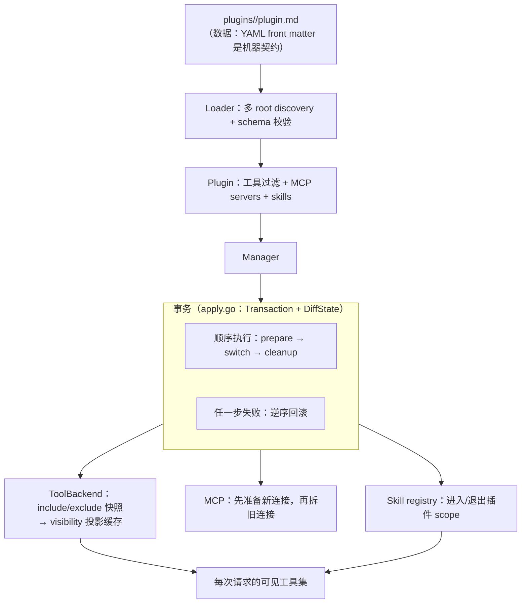
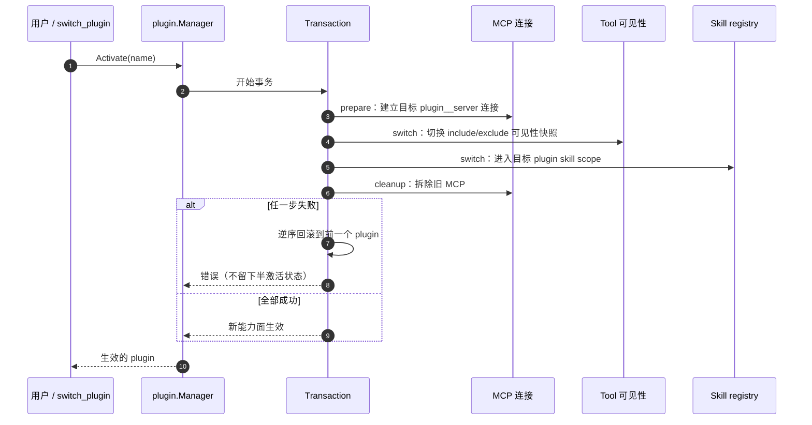

# Plugin Runtime

## 生态位

`plugin` 把 `plugins/<name>/plugin.md` 声明转换为可运行的专业能力形态，并协调工具可见性（include/exclude 快照经 `ToolBackend` 交给同目录下的 `visibility` 投影缓存）、MCP servers 与 Seelex Skill registry。

主要调用方：`boot`（唯一装配与工具注册）、`internal/startup`（插件根责任链）与
`gui`/`tui`（插件切换入口）。运行时可见性投影缓存
在子包 [`visibility/`](visibility/README.md)。

## 架构图



## 时序图：激活一个 Plugin



## 文件结构

- `plugin.go`：`Plugin`、`MCPServer` 和 schema version 模型。
- `loader.go`：多 root discovery、front matter 解析、名称/schema 校验和 Skill 加载；
  `PrimaryRoot()` 给出**写侧**该落盘的根（链上第一个真实存在的根，与读侧同源）。
- `curated.go`：精选目录 `plugins/curated.yaml` 的读侧与守卫（严格解码 + 交叉校验：
  只列已落盘插件、禁止重复 include/exclude、权限档只属于 preset、`source` 五字段必填、
  没装的只能进 `presets[].pending`——而每条 pending 必须带 `upstream`/`source`/`verified`/
  `promote` 四项，`verified` 目前只允许 `listing-only`）。装配面两道闸也在本文件：
  `AssemblePreset` / `AssemblePlugin` 对 pending 显式拒绝并**点名它是 pending 与它的来源**；
  读面 `CuratedCatalog.SourceSummary(name)` 给出"哪个插件是谁给的"一行摘要。
  转正四问 = `CuratedPromoteQuestions`。旁车文件不进 `Loader`：它只认目录。
- `curated_write.go`：精选目录的**写侧**——发现 → 读回 → 落进 yaml。`RegisterDiscoveredPlugins`
  把"已落盘但目录里没登记"的本机自建插件补进 `entries`（`source.kind = local`）并挂进 `local`
  preset；只追加（文本插入，注释与已有条目逐字节保留）、只登记本根下的插件、幂等、写回前自检
  （坏目录拒绝改写、没有目录不硬造）。`Manager.RegisterDiscoveredPlugins` 是走读侧同一条
  first-wins 责任链的入口。
- `scaffold.go`：`plugin_create` / `skill_create` 的脚手架写盘（落在 `PrimaryRoot()`）。
- `apply.go`：通用事务助手 `Transaction`（顺序执行 + 失败逆序回滚）与
  快照差异 `DiffState`（新增/删除/修改）。
- `manager.go`：Load、Activate、Deactivate、Reload；跨 Tool/MCP/Skill 的
  事务式回滚统一走 `Transaction`，Reload 热更新 diff 走 `DiffState`。

## 生命周期

1. `Loader.LoadAll` 按 root 优先级发现目录并解析 `plugin.md`。
2. `Manager.Load` 注册所有 tool filters，发布 plugin skills；任一失败按逆序回滚。
3. `Activate` 先用 `plugin__server` 名准备目标 MCP，再切 Tool 和 Skill，最后拆旧 MCP。
4. 任一步失败都恢复前一个 plugin，避免半激活状态。
5. `Deactivate` 拆 MCP、恢复默认 Tool 可见性并退出 plugin skill scope。

## 边界

本包不执行工具、不实现 MCP transport，也不解析 Skill 指令语义；这些由 backend ports 完成。`plugins/` 是数据，`backend/engine/plugin/` 是运行时。插件根的**责任链**（`-plugins` > `$SEELEX_PLUGINS` > `<exe>/plugins` > `<exe>/../plugins` > CWD `plugins`）在 [`internal/startup`](../../../internal/startup/README.md)（`PluginRootChain`），本包只负责"多根 first-wins"地加载；"零插件"由 `startup.RequirePlugins` 显式拒绝启动。

## Review 指南

- 激活顺序是否保持“先准备新状态，再移除旧状态”。
- rollback 是否同时覆盖 Tool、Skill、MCP 和 `current`。
- runtime MCP name 是否 plugin-qualified，避免不同插件 server 冲突。
- loader 是否拒绝路径逃逸、重复名称和不支持 schema。
- 写侧（`plugin_create`/`skill_create`）是否落在 `PrimaryRoot()`（链上第一个存在的根），
  而不是链首那个可能只存在于交付树里的路径（否则"创建成功但 reload 看不到"）。
- `curated.yaml` 是否满足 `curated.go` 的铁律；`pending` 的每条是否带齐 `upstream`/`source`/`verified`/`promote`
  （没实读正文就只准 `verified: listing-only`）；装配到 pending 是否**显式拒绝并指向来源**；
  改完跑 `go test ./backend/engine/plugin/... ./e2e/ -count=1`。
- 不要在 manager 持锁时执行可能永久阻塞的 backend；若调整并发模型需补 race/rollback tests。

## 测试

```text
go test ./backend/engine/plugin/... ./e2e/ -count=1
go test ./test/ -run 'Curated|PluginRoot|RequirePlugins' -count=1   # 仓库里那份 curated.yaml 的落地守卫
```

## 文件与函数索引

> 由源码 doc 注释自动提取（首行摘要）；描述源码行为，与实现保持同步。
> 刷新方式：`python scripts/gen_core_readme_index.py`。

### apply.go

- `func Transaction(steps ...Step) error` — Transaction 顺序执行 steps：任一步 Do 失败时，按逆序回滚所有已成功步骤
- `func DiffState(current, next map[string]Plugin) StateDiff` — DiffState 对比 current/next 插件定义：

### apply_test.go

- `func TestTransactionRollsBackInReverseOrder(t *testing.T)` — TestTransactionRollsBackInReverseOrder 验证失败时按逆序执行已成功步骤的
- `func TestTransactionJoinsUndoErrors(t *testing.T)` — TestTransactionJoinsUndoErrors 验证回滚错误与正向错误聚合返回。
- `func TestTransactionSkipsNilUndo(t *testing.T)` — TestTransactionSkipsNilUndo 验证 nil Undo 步骤在回滚中被跳过。
- `func TestDiffState(t *testing.T)` — TestDiffState 验证新增/删除/修改三类差异归类正确。

### curated.go

- `func curatedVerifiedLevelNames() string`
- `func (c CuratedCatalog) Entry(name string) (CuratedEntry, bool)` — Entry 按名字取一条目录条目。
- `func (c CuratedCatalog) Preset(name string) (CuratedPreset, bool)` — Preset 按名字取一个装配预设。
- `func (c CuratedCatalog) PresetForPlugin(name string) (CuratedPreset, bool)` — PresetForPlugin 回报某个插件挂在哪个 preset 的 `plugins` 下（权限档从这里取）。
- `func (c CuratedCatalog) PendingEntry(name string) (CuratedPending, string, bool)` — PendingEntry 跨所有 preset 找一条 pending 候选，并回报它登记在哪个 preset 里。
- `func (c CuratedCatalog) ReadSource(name string) (SourceReading, bool)` — ReadSource 给出某个插件的来源读数。found=false 表示这个名字既不在 entries 也不在
- `func (c CuratedCatalog) SourceSummary(name string) (string, bool)` — SourceSummary 是"这个插件是谁给的"的一行摘要（读面）。`plugins_list` 之类的回执
- `func pendingRejection(assembling string, item CuratedPending, declaredIn string) error` — pendingRejection 是"归零不静默"的那一句话：pending 不是可用集合，装配到它必须
- `func (c CuratedCatalog) AssemblePreset(presetName string, installed []string) (AssemblyPlan, error)` — AssemblePreset 把 preset 解析成装配计划（要激活哪些已落盘插件 + 用哪个权限档）。
- `func (c CuratedCatalog) AssemblePlugin(pluginName string, installed []string) (AssemblyPlan, error)` — AssemblePlugin 是"我就要这个插件"的单插件装配解析：已落盘则给出它所在的 preset 与
- `func (read CuratedRead) Page() string` — Page 返回"这份读数是从哪里来的"一行（无路径时给找过的根），供拒绝文案与回执引用。
- `func (read CuratedRead) Judge(name string, installed []string) error` — Judge 判一个**本进程未定义**的装配名：nil = 放行（目录把它登记为已落盘的 entries），
- `func curatedNameList(names []string) string` — curatedNameList 把插件名清单渲染成一行（空清单必须显式写成"(无)"，不留空档让人猜）。
- `func LoadCuratedFromRoot(root string) (CuratedCatalog, error)` — LoadCuratedFromRoot 读 `root/curated.yaml`，并用 root 下**真实可加载**的插件
- `func LoadCuratedCatalog(root string, installed []string) (CuratedCatalog, error)` — LoadCuratedCatalog 读取并校验精选目录；installed 是插件根下真实存在的插件名。
- `func ParseCuratedCatalog(data []byte) (CuratedCatalog, error)` — ParseCuratedCatalog 严格解码精选目录（未知字段即错误，见文件头铁律 2）。
- `func LoadCuratedForRuntime(root string, installed []string) (CuratedCatalog, []string, error)` — LoadCuratedForRuntime 读 `root/curated.yaml` 供**运行期装配面**使用：目录**自身**的问题
- `func ValidateCuratedCatalog(catalog CuratedCatalog, installed []string) error` — ValidateCuratedCatalog 校验精选目录与"实际落盘的插件集合"一致，并逐条报告问题
- `func validateCuratedCatalogStructure(catalog CuratedCatalog) []string` — validateCuratedCatalogStructure 只校验目录**自身**成立与否（与"这台机器装了什么"无关）：
- `func curatedInstalledDrift(catalog CuratedCatalog, installed []string) []string` — curatedInstalledDrift 报"目录 ↔ 这台机器此刻的已装集合"的差异（两个方向都报，一次列全）：
- `func containsString(values []string, want string) bool`

### curated_test.go

- `func TestCuratedCatalogSideCarIsNotAPlugin(t *testing.T)` — TestCuratedCatalogSideCarIsNotAPlugin 钉住"零改加载器"：curated.yaml 是插件根下的
- `func TestLoadCuratedFromRootRequiresFile(t *testing.T)` — TestLoadCuratedFromRootRequiresFile 是"文件不存在即红"的那一半。
- `func TestParseCuratedCatalogRejectsUnknownFields(t *testing.T)` — TestParseCuratedCatalogRejectsUnknownFields 钉住铁律 2：include/exclude 的事实源是
- `func TestValidateCuratedCatalogDiscriminates(t *testing.T)` — TestValidateCuratedCatalogDiscriminates 是对抗性用例：每一条都会让目录**变红**。
- `func TestValidateCuratedCatalogAcceptsBase(t *testing.T)` — TestValidateCuratedCatalogAcceptsBase 是阴性对照：合法目录必须过（否则上面那组
- `func TestLoaderPrimaryRootPrefersExistingRoot(t *testing.T)` — TestLoaderPrimaryRootPrefersExistingRoot 钉住写侧与读侧同源：责任链首根常常是交付树
- `func TestManagerCreateWritesIntoExistingRoot(t *testing.T)` — TestManagerCreateWritesIntoExistingRoot 是上一条的写侧落地：脚手架真的落到那个根。
- `func baseCuratedCatalog() CuratedCatalog`
- `func basePending() CuratedPending` — basePending 是一条"证据齐备"的 pending 候选：任何一条字段缺失都该让目录变红。
- `func pendingWithout(mutate func(*CuratedPending)) CuratedPending` — pendingWithout 在 basePending 上改一个字段，用来逐条证明"证据缺一项就红"。
- `func designCatalog() CuratedCatalog` — designCatalog 是一份"设计垂直面"目录：plugins 里是已落盘的 impeccable，
- `func TestCuratedPendingEmptySequenceIsDeclared(t *testing.T)` — TestCuratedPendingEmptySequenceIsDeclared 钉住 `pending: []` 与"没写 pending"是两件事：
- `func TestAssemblePresetRejectsPendingAndPointsAtSource(t *testing.T)` — TestAssemblePresetRejectsPendingAndPointsAtSource 是"归零不静默"的正面用例：
- `func TestAssemblePluginRejectsPending(t *testing.T)` — TestAssemblePluginRejectsPending 是另一条入口：用户/teammate 直接点名要装一个
- `func TestAssemblePresetRejectsUnknownNameWithoutSilentSkip(t *testing.T)` — TestAssemblePresetRejectsUnknownNameWithoutSilentSkip 钉住"不许静默跳过"：
- `func TestActivateFromCatalogRejectsPendingBeforeSideEffects(t *testing.T)` — TestActivateFromCatalogRejectsPendingBeforeSideEffects 是装配面的端到端闸门：
- `func TestActivateFromCatalogRejectsMultiPluginPreset(t *testing.T)` — TestActivateFromCatalogRejectsMultiPluginPreset 钉住全局单选这条产品口径：
- `func TestReadSourceSharesOneJudgement(t *testing.T)` — TestReadSourceSharesOneJudgement 钉住"来源判定只有一套"：机读面（ReadSource 给出的
- `func TestSourceSummaryIsReadable(t *testing.T)` — TestSourceSummaryIsReadable 钉住"这个插件是谁给的"这一最小可见化读面：

### curated_write.go

- `func LocalEntry(p Plugin, readAt string) CuratedEntry` — LocalEntry 依据一个**已落盘**的插件造一条本机自建条目。description 直接取 manifest 里
- `func RegisterDiscoveredPlugins(root string, loaded []Plugin) ([]string, error)` — RegisterDiscoveredPlugins 把 root 下**已落盘但目录里没登记**的插件补进
- `func pluginLivesInRoot(p Plugin, root string) bool` — pluginLivesInRoot 判一个插件目录是否就落在 root 下面（多根 first-wins 下的归属判定）。
- `func sameFilePath(a, b string) bool` — sameFilePath 比对两条路径是否同一处（Windows 上大小写不敏感——同一个根可能以两种写法
- `func verifyCuratedRewrite(document string) error` — verifyCuratedRewrite 是落盘前的自检：新文本必须解得动、且过结构守卫（文件自身成立与否，
- `func insertCuratedEntries(document string, entries []CuratedEntry) (string, error)` — insertCuratedEntries 把新条目插进 `entries:` 序列的**末尾**，逐字节保留文件其余部分。
- `func upsertCuratedLocalPreset(document string, localPlugins []string) (string, error)` — upsertCuratedLocalPreset 保证目录里有一个 `local` preset，其 `plugins` 恰好是 localPlugins
- `func curatedSequenceBlocks[T any](items []T) ([]string, error)` — curatedSequenceBlocks 把一份 YAML 序列**渲染成 2 空格缩进的序列项**（每项一行起头
- `func spliceLines(lines []string, from, to int, insert []string) string` — spliceLines 把 [from, to) 换成 insert（原地语义、返回新切片），供各处文本插入共用。
- `func writeFileAtomic(path string, data []byte) error` — writeFileAtomic 同目录临时文件 + rename：写一半崩掉也不会把目录留成读不动的现场。
- `func (m *Manager) RegisterDiscoveredPlugins() ([]string, error)` — RegisterDiscoveredPlugins 是 Manager 上的写侧入口：走与读侧**同一条** first-wins 责任链

### curated_write_test.go

- `func catalogFixtureYAML(installed ...string) string` — catalogFixtureYAML 造一份**合法**的目录文本：entries 与 installed 一一对应，baseline
- `func catalogRoot(t *testing.T) string` — catalogRoot 造一个"发行风格"的插件根：default + seed 两个真插件 + 一份带注释头的目录。
- `func writeCatalogPlugin(t *testing.T, root, name string)`
- `func writeCatalogFile(t *testing.T, root, body string)`
- `func catalogLoaded(root string, names ...string) []Plugin` — catalogLoaded 造一个"已加载"的读数（名字 + manifest 描述 + 它所在的根，正是 Loader 给出的那三面）。
- `func linesFormSubsequence(before, after string) bool` — linesFormSubsequence 判 before 的每条非空行是否**按原序**出现在 after 里（登记只许在原
- `func TestRegisterDiscoveredPluginsAppendsLocalEntryAndPreset(t *testing.T)`
- `func TestRegisterDiscoveredPluginsIsIdempotent(t *testing.T)`
- `func TestRegisterDiscoveredPluginsAddsToExistingLocalPreset(t *testing.T)` — TestRegisterDiscoveredPluginsAddsToExistingLocalPreset 钉住第二次发现的**增量**路径：
- `func TestRegisterDiscoveredPluginsHandlesEmptyInlineEntries(t *testing.T)` — TestRegisterDiscoveredPluginsHandlesEmptyInlineEntries 钉住 `entries: []` 这种内联空表形态
- `func TestRegisterDiscoveredPluginsIgnoresOtherRoots(t *testing.T)` — TestRegisterDiscoveredPluginsIgnoresOtherRoots 钉住多根 first-wins 下的归属判定：
- `func TestRegisterDiscoveredPluginsRefusesBrokenCatalog(t *testing.T)` — TestRegisterDiscoveredPluginsRefusesBrokenCatalog 钉住"落盘前自检/坏目录不改写"：
- `func TestRegisterDiscoveredPluginsWithoutCatalogIsNoop(t *testing.T)` — TestRegisterDiscoveredPluginsWithoutCatalogIsNoop 钉住"自建根/用户树可以不带精选目录"：
- `func TestManagerRegisterDiscoveredPluginsWalksRootChain(t *testing.T)` — TestManagerRegisterDiscoveredPluginsWalksRootChain 钉住写侧要走**读侧同一条**责任链：

### loader.go

- `func NewLoader(roots ...string) *Loader`
- `func (l *Loader) PrimaryRoot() string` — PrimaryRoot 返回写侧（plugin_create / skill_create）应落盘的根：责任链上**第一个
- `func (l *Loader) LoadAll() ([]Plugin, error)`
- `func (l *Loader) Load(name string) (*Plugin, error)`
- `func loadPlugin(root, directoryName string) (Plugin, error)`
- `func resolveMCPServers(root string, servers []MCPServer) ([]MCPServer, error)`
- `func resolveManifestPath(root, value string) (string, error)`
- `func firstHeading(body, fallback string) string`

### loader_test.go

- `func TestLoaderReadsManifestAndPrivateSkills(t *testing.T)`
- `func TestLoaderRejectsMismatchedNameAndEscapingPath(t *testing.T)`
- `func TestLoaderLookupFallbackDescriptionAndErrors(t *testing.T)`
- `func mustPluginWrite(t *testing.T, path, content string)`

### manager.go

- `func NewManager(loader *Loader, tools ToolBackend, mcp MCPBackend, skills SkillBackend) *Manager`
- `func (m *Manager) SetCuratedCatalog(catalog CuratedCatalog)` — SetCuratedCatalog 把本次启动读到的精选目录挂到 manager 上，供来源读数
- `func (m *Manager) SourceReading(name string) (SourceReading, bool)` — SourceReading 给出某个已加载插件「从哪来」的读数（机读 kind/url + 一行摘要）。
- `func (m *Manager) Load() error`
- `func (m *Manager) Activate(ctx context.Context, name string) error`
- `func (m *Manager) Deactivate(ctx context.Context) error`
- `func (m *Manager) Current() (Plugin, bool)`
- `func (m *Manager) All() []Plugin`
- `func (m *Manager) ActivateFromCatalog(ctx context.Context, catalog CuratedCatalog, presetName string) error` — ActivateFromCatalog 是"精选目录 → 运行时"的装配入口：先把 preset 解析成计划
- `func (m *Manager) Reload(ctx context.Context) (ReloadReport, error)` — Reload 重新扫描磁盘插件目录并与当前状态 diff 后**事务式**应用：
- `func (m *Manager) attachLocked(ctx context.Context, p Plugin) error`
- `func (m *Manager) attachServerLocked(ctx context.Context, p Plugin, server MCPServer) error`
- `func (m *Manager) detachLocked(ctx context.Context, pluginName string) error`
- `func serverByRuntimeName(p Plugin, runtimeName string) (MCPServer, bool)`
- `func (m *Manager) restoreToolPluginLocked(previous Plugin)`

### manager_test.go

- `func (f *fakeTools) DefinePlugin(name, _ string, _, _ []string) error`
- `func (f *fakeTools) UndefinePlugin(name string)`
- `func (f *fakeTools) ActivatePlugin(name string) error`
- `func (f *fakeTools) DeactivatePlugin()`
- `func (f *fakeTools) ActivePlugin() string`
- `func (f *fakeMCP) AttachMCPServer(_ context.Context, name, _, _ string, _, _ []string, _ string) error`
- `func (f *fakeMCP) DetachMCP(name string) error`
- `func (f *fakeSkills) PublishPluginSkills(name string, _ []skill.Skill) error`
- `func (f *fakeSkills) ClearPluginSkills(name string)`
- `func (f *fakeSkills) ActivatePluginSkills(name string) error`
- `func (f *fakeSkills) DeactivatePluginSkills() error`
- `func TestManagerActivateAndRollback(t *testing.T)`
- `func TestManagerAttachFailureKeepsPrevious(t *testing.T)`
- `func TestManagerLoadActivateDeactivateAndList(t *testing.T)`
- `func TestManagerSkillFailureRollsBack(t *testing.T)`
- `func TestManagerSerializesConcurrentActivation(t *testing.T)`
- `func TestManagerLoadRollsBackDefinitionsAndSkills(t *testing.T)`
- `func TestManagerDetachFailureKeepsPreviousPlugin(t *testing.T)`
- `func TestManagerDeactivateSkillFailureRollsBack(t *testing.T)`

### scaffold.go

- `func (m *Manager) Create(spec CreateSpec) ([]string, error)` — Create 在**责任链上第一个存在的根**（`Loader.PrimaryRoot`）下脚手架一个插件目录
- `func (m *Manager) CreateSkill(pluginName string, spec SkillSpec) (string, error)` — CreateSkill 在已有插件的目录下脚手架一个 skill（<plugin>/<skill>/SKILL.md），
- `func (m *Manager) writeSkillDir(pluginDir string, spec SkillSpec) (string, error)`
- `func childWithin(root, name string) (string, error)` — childWithin 校验 name 落在 root 内部（防路径逃逸），返回拼接后的绝对路径。
- `func pluginReadmeTemplate(spec CreateSpec) string`
- `func skillStructureNote(skills []SkillSpec) string`

### self_tools_test.go

- `func TestPluginCreateSkillReloadCycle(t *testing.T)` — TestPluginCreateSkillReloadCycle 覆盖自迭代闭环：
- `func TestPluginReloadRollbackOnDefineFailure(t *testing.T)` — TestPluginReloadRollbackOnDefineFailure 验证 reload 事务性：新增插件
