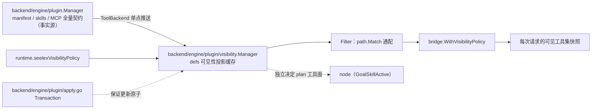

# visibility 域

## 生态位

承载 Runtime 的插件可见性**执行面**：插件不再控制 holder，而是作为
`bridge.WithVisibilityPolicy` 的输入——激活插件时按 include/exclude 过滤
每次请求的可见工具集。主要调用方：`backend/engine/assemble` 的
`ports.go`（插件端口）与 `runtime.go`（seelexVisibilityPolicy）。

> 边界（解耦方案 §02.4 方案 A 轻量版）：本包只是**可见性投影缓存**，不是
> 插件定义的事实源。事实源在 `backend/engine/plugin.Manager`（manifest/skills/MCP
> 全量契约），本包 `defs` 由 root 经 `ToolBackend` 单点推送；写路径只有
> root 一个入口，配合 `backend/engine/plugin/apply.go` 的 `Transaction` 保证更新原子。
> 多插件叠加属产品决策，当前为单选（`active string`）。

## 职责与非职责

- 职责：`Manager.Define/Undefine/Activate/Deactivate/Active` 与
  `Filter`（include/exclude 模式过滤）。
- 非职责：插件声明式能力包加载（归 `backend/engine/plugin/` + `plugins/`）、
  skill 联动（归 `backend/engine/skill/`）。

## 与其它域的关系

本包**不是**插件定义的事实源，只是可见性投影缓存；写路径只有根包一个入口，
激活失败由事务逆序回滚。当前为单选（`active string`），多插件叠加属尚未落地的产品决策。

## 核心实现

- `Manager`：自带 RWMutex 的状态 actor（defs + active）。
- `Filter`：激活插件时按 `path.Match` 通配过滤（与旧 holder 语义一致）。
- `VisibleName` / `Face`：单插件装配面（给角色会话按插件名过滤工具面）。

## 数据流

root `backend/engine/plugin.Manager`（定义事实源）→ `ToolBackend` 单点推送
`DefinePlugin`/`UndefinePlugin`/`ActivatePlugin` → 本包投影缓存
（defs + active）→ 每次工具可见性求值时 `Filter` 过滤 → 模型可见工具面。

## 依赖方向

允许依赖：上游 Seele `types`、标准库。禁止依赖：`backend/engine/plugin`
（生命周期事实源）、装配根及其它域——方向是它们 import 本包，反向 import
会把投影缓存变成第二个状态 owner。

## 并发、存储、安全

`Manager` 自带锁；快照复制防数据竞争。

## 扩展方式

新增过滤语义：扩展 `Filter` 或 `matchToolPattern`。

## Review 指南

- include/exclude 优先级（exclude 优先）是否保持；空 include 是否放行。

## 测试与验证

`go test ./backend/engine/plugin/...`；根包可见性测试覆盖联动。

## 文件与函数索引

> 由源码 doc 注释自动提取（首行摘要）；描述源码行为，与实现保持同步。
> 刷新方式：`python scripts/gen_core_readme_index.py`。

### visibility.go

- `func NewManager() *Manager` — NewManager 构造插件可见性管理器。
- `func (m *Manager) Define(name, description string, include, exclude []string) error` — Define 定义或替换一个插件的可见性快照。
- `func (m *Manager) Undefine(name string)` — Undefine 删除插件定义；若其为当前激活插件则一并停用。
- `func (m *Manager) Activate(name string) error` — Activate 激活插件（未定义返回显式错误）。
- `func (m *Manager) Deactivate()` — Deactivate 停用当前插件。
- `func (m *Manager) Active() string` — Active 返回当前激活插件名。
- `func (m *Manager) Defined(name string) bool` — Defined 报告插件是否已定义（按会话装配的**语义**校验用：未知名显式拒绝，不
- `func (m *Manager) Names() []string` — Names 返回本进程已定义插件名（排序）。"已装的是哪些"是拒绝文案的一半事实——
- `func (m *Manager) SetUnassembledReason(fn func(name string, installed []string) error)` — SetUnassembledReason 注入"未定义的名字怎么判 / 怎么说"（产品侧启动期一次；nil =
- `func (m *Manager) HasUnassembledReason() bool` — HasUnassembledReason 报告是否注入了判决函数（未注入的调用方不必为每个名字多跑一趟）。
- `func (m *Manager) UnassembledReason(name string) error` — UnassembledReason 问一句"这个未定义的名字是什么"，返回 nil = 放行（判决函数认为
- `func (m *Manager) DefsFor(names []string) (defs []Def, missing []string)` — DefsFor 取这些插件名的可见性快照（按入参顺序），并把本进程**未定义**的名字
- `func (m *Manager) Filter(tools []types.Tool) []types.Tool` — Filter 按激活插件的 include/exclude 过滤可见工具集；未激活/未知插件
- `func VisibleName(defs []Def, name string) bool` — VisibleName 报告一个工具名在**装配集合**（多个插件定义）下是否可见。
- `func Face(defs []Def, tools []types.Tool) []types.Tool` — Face 按**装配集合**过滤工具面（include 取并集、exclude 取并集硬拆，见
- `func matchesAnyPattern(name string, patterns []string) bool`
- `func matchToolPattern(pattern, name string) bool` — matchToolPattern 支持 "*" 通配的简单模式匹配（与旧 holder 插件过滤语义一致）。

### visibility_face_test.go

- `func faceTestTools(names ...string) []types.Tool`
- `func faceTestNames(tools []types.Tool) []string`
- `func faceTestSameNames(got, want []string) bool`
- `func TestFaceSingleDefMatchesFilter(t *testing.T)` — TestFaceSingleDefMatchesFilter 钉住"同一套语义"：单元素装配集合与 Filter（全局
- `func TestDefsForReportsMissingNames(t *testing.T)` — TestDefsForReportsMissingNames 钉住"未知名可被显式拒绝"的读面：DefsFor 必须把
- `func TestFaceUnionOfIncludesAndExcludeVeto(t *testing.T)` — TestFaceUnionOfIncludesAndExcludeVeto 钉住集合语义：include 取并集、exclude 取
