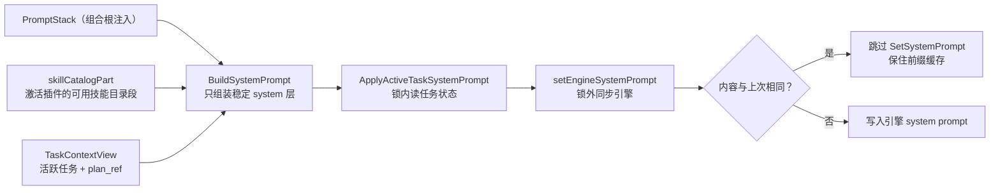

# prompt_layer

## 生态位

system prompt 层组装与引擎同步：identity/instructions/base 栈 + 活跃任务
skill 层 + Plan 执行策略；前缀缓存友好（内容不变不重复 `SetSystemPrompt`）。

## 职责与非职责

- 做：`BuildSystemPrompt`、`ApplyActiveTaskSystemPrompt`、
  `SystemPromptForActiveTaskLocked`。
- 不做：skill 请求信封编解码（根包）、prompt 栈实例所有权（组合根持有并
  注入）。

## 依赖方向

依赖 `state.Core` + 注入的 `PromptStack`/`EffortManager` 引用 +
`TaskContextView` 窄只读面（`task_context.Coordinator` 满足）。

## 文件

| 文件 | 职责 |
|---|---|
| `coordinator.go` | `BuildSystemPrompt` / `ApplyActiveTaskSystemPrompt` / `SystemPromptForActiveTaskLocked`（稳定 system 层组装 + 锁外同步引擎） |
| `skill_catalog.go` | 激活插件的可用技能目录段 |
| `role_prompt_optimize.go` | **员工提示词的一次有界改写**（P21-15 从 `backend/engine/assemble/runtime_role_prompt.go` 归位）：`RolePromptOptimizer` + `RolePromptOptimizerDeps{Complete, Model}` + 固定的改写器元指令 + `parseRolePromptOptimization`（宽松解码、`optimized` 必填、`notes` 去空截断到 5 条、每条 ≤60 rune）+ `ErrOptimizerUnavailable`。**只返回候选文本**：不落盘、不写会话消息 |
| `role_prompt_optimize_test.go` | 解析用例（随实现搬入，断言逐字）+ 回合编排/缺省兜底/无执行面/回合失败包一层/理由有界 |

## 数据流图

激活技能的**正文**不在这里：它由 `context_runtime` 作为请求侧上下文注入，
避免成为持久 system 层。

## 并发/安全语义

`ApplyActiveTaskSystemPrompt` 锁内读任务状态，锁外同步引擎；plan 投影只放
稳定信息（`plan_ref`），不放随节点变化的 `current_node`。

## 扩展与 Review

新增 prompt 层改 `BuildSystemPrompt`。Review 重点：skill 内容不得成为持久
system 层、前缀缓存失效面、锁外 `SetSystemPrompt`。

## 测试

根包 `service_input_test.go` 等覆盖组装与缓存稳定性。

## 文件与函数索引

> 由源码 doc 注释自动提取（首行摘要）；描述源码行为，与实现保持同步。
> 刷新方式：`python scripts/gen_core_readme_index.py`。

### coordinator.go

- `func NewCoordinator(deps Deps) *Coordinator` — NewCoordinator 构造 prompt 域协调器。
- `func (c *Coordinator) BuildSystemPrompt()` — BuildSystemPrompt 只组装稳定 system 层（激活技能正文由 context_runtime 作为
- `func (c *Coordinator) ApplyActiveTaskSystemPrompt(requestID string)` — ApplyActiveTaskSystemPrompt 按活跃任务刷新 system prompt（锁内读取任务
- `func (c *Coordinator) ApplyActiveTaskSystemPromptFor(sessionID, requestID string)` — ApplyActiveTaskSystemPromptFor 按指定会话活跃任务刷新 system prompt（锁内
- `func (c *Coordinator) SystemPromptForActiveTaskLocked() string` — SystemPromptForActiveTaskLocked 组装活跃任务 system prompt（调用方持有
- `func (c *Coordinator) SystemPromptForActiveTaskLockedFor(sessionID string) string` — SystemPromptForActiveTaskLockedFor 组装指定会话活跃任务 system prompt
- `func (c *Coordinator) skillCatalogPart() string` — skillCatalogPart 返回当前激活插件的"可用技能"被动目录段（无技能/无插件
- `func (c *Coordinator) setEngineSystemPrompt(sessionID, promptText string)` — setEngineSystemPrompt 设置指定会话引擎的 system prompt（支持会话路由的
- `func (c *Coordinator) activeSessionID() string` — activeSessionID 返回当前活跃会话（快照归属会话）。

### environment_section_test.go

- `func TestEnvironmentSectionIsInjectedAndStable(t *testing.T)` — TestEnvironmentSectionIsInjectedAndStable：**执行面的环境事实**（这台机器上 bash 工具落到
- `func renderSystemPrompt(coordinator *pl.Coordinator) string` — renderSystemPrompt 走**生产同一条路**：先 BuildSystemPrompt（推段 + 同步引擎），再读回。
- `func (engine *environmentPromptEngine) SetSystemPrompt(promptText string)`
- `func (engine *environmentPromptEngine) SetMaxLoops(int)`
- `func (environmentPluginStub) All() []model.PluginInfo`
- `func (environmentPluginStub) Activate(context.Context, string) error`
- `func (environmentPluginStub) Deactivate(context.Context) error`
- `func (environmentPluginStub) Current() (model.PluginInfo, bool)`

### skill_catalog.go

- `func skillCatalogActivationHint(skillSigil string) string` — skillCatalogActivationHint 是目录尾的激活纪律：目录只宣告可激活技能，
- `func RenderSkillCatalog(skills []model.SkillInfo, skillSigil string) string` — RenderSkillCatalog 把当前插件的技能清单渲染为字节稳定的目录段（被动技能

### skill_catalog_test.go

- `func (s catalogSkillsStub) All() []model.SkillInfo`
- `func (catalogSkillsStub) Get(string) (model.SkillInfo, bool)`
- `func (s catalogTasksStub) CurrentTaskExecution() *task_context.TaskExecutionState`
- `func (s catalogTasksStub) CurrentTaskExecutionFor(string) *task_context.TaskExecutionState`
- `func (catalogTasksStub) ActivePlanID() string`
- `func (catalogTasksStub) ActivePlanIDFor(string) string`
- `func (catalogTasksStub) PlanSequence() uint64`
- `func (catalogTasksStub) PlanSequenceFor(string) uint64`
- `func newCatalogCoordinator(t testing.TB, skills contract.SkillPort, tasks *task_context.TaskExecutionState) *pl.Coordinator`
- `func systemPromptFor(t testing.TB, c *pl.Coordinator) string`
- `func TestRenderSkillCatalogEmpty(t *testing.T)` — TestRenderSkillCatalogEmpty：无技能表 → 不占 system 字节（返回空）。
- `func TestRenderSkillCatalogStableAndSorted(t *testing.T)` — TestRenderSkillCatalogStableAndSorted：字节稳定（同输入同输出）+ 按 name 排序。
- `func TestRenderSkillCatalogNeverLeaksPrompt(t *testing.T)` — TestRenderSkillCatalogNeverLeaksPrompt：目录只含 name/description，指令正文
- `func TestCoordinatorInjectsPassiveCatalog(t *testing.T)` — TestCoordinatorInjectsPassiveCatalog：目录段自动进 system prompt（模型零
- `func TestCoordinatorSystemOmitsActiveSkillBody(t *testing.T)` — TestCoordinatorSystemOmitsActiveSkillBody：激活技能存在时，system 也只含
- `func TestCoordinatorCatalogFollowsPluginSwitch(t *testing.T)` — TestCoordinatorCatalogFollowsPluginSwitch：目录内容随"当前插件技能表"变化
- `func TestCoordinatorEmptyCatalogOmitsSection(t *testing.T)` — TestCoordinatorEmptyCatalogOmitsSection：插件无技能 → 目录段整体不出现，
- `func TestRenderSkillCatalogHintUsesInjectedSigil(t *testing.T)` — TestRenderSkillCatalogHintUsesInjectedSigil：激活纪律句里的用户入口前缀来自

