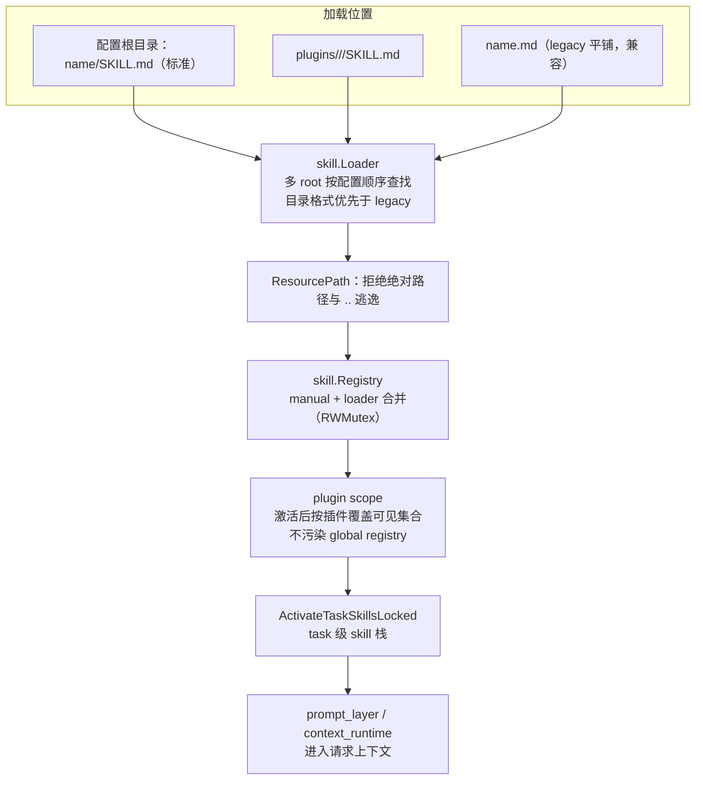
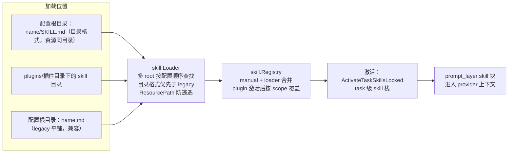

# Skill Runtime

## 生态位

`skill` 加载目录化 Skill、解析 `SKILL.md`、限制资源路径，并根据当前 Plugin 计算可见 Skill 集合。

主要调用方：`application/assembly`（任务激活时注入 skill 栈）、`backend/engine/plugin`（激活/停用时的可见集切换）、
`backend/engine/assemble`（装配与调用 Skill 指令）。

`skill_activate` 判据经 `application/policy.SkillActivationPort` 消费；
Wiring adapter 只转发本包 `Activator`，错误文案与可激活性判断没有第二份。

## 架构图



## 文件结构

- `loader.go`：多 root 查找、目录/legacy flat-file 兼容、create/delete 和 plugin-dir load。
- `skill.go`：`Skill` 模型、`ResourcePath` 安全解析和线程安全 Registry。
- `activate.go`：`Activator`——"模型侧激活技能"（`skill_activate` 工具后端）的**判据落点**：
  名字校验 / 可激活性（`goal` 不可激活）/ 命中查询；命中后交给宿主注入的落地动作（压 skill 层 + 会话通知）。
  2026-10-16 随 M5-R-skill **接收者转移**从 `application/assembly/skill_activate.go` 归位（plan §2.5）。
- `activate_test.go`：激活判据用例（空名 / 不可激活 / 未知技能 / 名字归一 / 未装配技能表）。

## 加载与优先级

标准格式为 `<root>/<name>/SKILL.md`，资源与脚本留在同一目录。Loader root 按配置顺序优先；目录格式优先于 legacy `<name>.md`。

Registry 合并 manual 与 loader skills；激活 Plugin 后，只暴露该 Plugin 发布的 skills。Plugin skill 同名覆盖由 plugin scope 决定，不污染 global registry。

## 安全边界

`ResourcePath` 拒绝绝对路径和 `..` 逃逸。Skill 名称必须满足安全模式。删除只作用于 Loader primary root 下解析出的目标。

## Review 指南

- reload 是否保留 manual skills，并按 root priority 确定性覆盖。
- plugin activate/deactivate 是否原子切换可见集合。
- front matter body 是否完整保留，resource path 是否 canonical 后再比较。
- 新格式必须保留已有 Skill 的向后兼容或提供迁移。

## Skill 加载位置（Mermaid）



- 标准格式 `<root>/<name>/SKILL.md`，资源与脚本留在同一 Skill 目录（不跨根引用）；`<root>/<name>.md` 为 legacy 兼容。
- loader root 按配置顺序优先；目录格式优先于 legacy；plugin skill 只在插件激活后可见且不污染 global registry。
- 加载后进入 `skill.Registry`，任务激活时经 `ActivateTaskSkillsLocked` 注入 `prompt_layer` 的 skill 块。

## 测试

```text
go test ./backend/engine/skill/ -count=1
go test ./backend/engine/plugin/ -count=1
go test ./application/assembly/ -run ActivateSkill -count=1   # 门面级集成（压层 + 下一次提交确信它）
```

## 文件与函数索引

> 由源码 doc 注释自动提取（首行摘要）；描述源码行为，与实现保持同步。
> 刷新方式：`python scripts/gen_core_readme_index.py`。

### activate.go

- `func NewActivator(deps ActivateDeps) *Activator` — NewActivator 建落点。
- `func (a *Activator) Activate(name string) (model.SkillInfo, error)` — Activate 把当前插件的一个技能激活进当前会话的 skill 层。

### activate_test.go

- `func (lookup fakeLookup) Get(name string) (model.SkillInfo, bool)`
- `func TestActivateRejectsBadNamesWithoutApplying(t *testing.T)` — TestActivateRejectsBadNamesWithoutApplying：空名 / 不可激活（goal）/ 未知技能都在落地之前拒绝，
- `func TestActivateNormalizesNameAndApplies(t *testing.T)` — TestActivateNormalizesNameAndApplies：命中时名字先 trim，落地动作恰好一次，并回传技能信息。
- `func TestActivateWithoutRegistry(t *testing.T)` — TestActivateWithoutRegistry：技能表未装配时给明确错误（不是静默无效）。

### loader.go

- `func NewLoader(dirs ...string) *Loader`
- `func (l *Loader) PrimaryDir() string`
- `func (l *Loader) LoadAll() ([]Skill, error)`
- `func (l *Loader) Load(name string) (*Skill, error)`
- `func (l *Loader) Create(name, description, prompt string) error`
- `func (l *Loader) Delete(name string) error`
- `func (l *Loader) primaryDirLocked() string`
- `func loadRoot(root string, seen map[string]Skill) error`
- `func loadRootFiltered(root string, seen map[string]Skill, includeLegacy bool) error`
- `func LoadPluginDir(dir string) ([]Skill, error)` — LoadPluginDir loads skill directories from a plugin root (no legacy flat files).
- `func readSkill(name, path, root string, legacy bool) (Skill, error)`
- `func validateName(name string) error`
- `func childPath(root, name string) (string, error)`
- `func buildMarkdown(name, description, prompt string) string`
- `func extractDescription(content, fallback string) string`

### loader_test.go

- `func TestLoaderDirectorySkillWithResource(t *testing.T)`
- `func TestLoaderDirectoryBeatsLegacy(t *testing.T)`
- `func TestLoaderReadsAndDeletesLegacySkill(t *testing.T)`
- `func TestLoaderRootPriority(t *testing.T)`
- `func TestCreateDeleteCompletesAndUsesDirectoryFormat(t *testing.T)`
- `func TestRejectsUnsafeNamesAndResources(t *testing.T)`
- `func TestLoaderErrors(t *testing.T)`
- `func mustMkdir(t *testing.T, path string)`
- `func mustWrite(t *testing.T, path, content string)`

### registry_test.go

- `func TestRegistryPluginSkillsOverrideGlobal(t *testing.T)`
- `func TestRegistryReloadPreservesManualSkills(t *testing.T)`
- `func TestRegistryLoadedAndPluginLifecycle(t *testing.T)`

### skill.go

- `func (s Skill) ResourcePath(relative string) (string, error)` — ResourcePath resolves a skill-relative resource without allowing root escape.
- `func NewRegistry() *Registry`
- `func (r *Registry) Register(s Skill)`
- `func (r *Registry) Remove(name string)`
- `func (r *Registry) Get(name string) (Skill, bool)`
- `func (r *Registry) All() []Skill`
- `func (r *Registry) AddLoader(loader *Loader) error`
- `func (r *Registry) Reload() error`
- `func (r *Registry) SetPluginSkills(pluginName string, skills []Skill)`
- `func (r *Registry) ClearPluginSkills(pluginName string)`
- `func (r *Registry) ActivatePlugin(pluginName string)`
- `func (r *Registry) ActivatePluginSkills(pluginName string) error`
- `func (r *Registry) DeactivatePlugin()`
- `func (r *Registry) DeactivatePluginSkills() error`
- `func (r *Registry) PublishPluginSkills(pluginName string, skills []Skill) error`
- `func (r *Registry) Count() int`
- `func (r *Registry) PluginSkillsFor(names []string) []Skill` — PluginSkillsFor 返回**指定插件集合**的技能（按 name 排序；未发布的插件名跳过，
- `func sortedSkills(skills map[string]Skill) []Skill`
