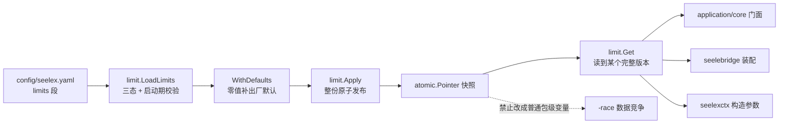

# backend/limit

## 生态位

Seelex 的**判据与档位基座包**：集中运行时上限（`config/seelex.yaml` 的 `limits` 段）
的类型、默认值、加载与校验，以及**进程级生效快照**。它是全仓库最底层的判据落点——
同一件事（某个上限是多少、某个取值合不合法）只在这里判定，上层只消费。

主要调用方：

| 调用方 | 用法 |
|---|---|
| `application/core` 门面（[limits.go](../../application/core/limits.go)） | `ApplyLimits` / `Limits` / `ApplySessionReleaseWindow` 一行转发（本包是唯一实现处） |
| `seelebridge`（装配 Runtime、`internal/config`） | 启动期 `LoadLimits` 读数 + `Apply` 注入；运行期按构造参数注入生效值 |
| `seelexctx`（`ContextWindowPolicy` / `ToolResultProcessor`） | 按**构造参数**消费生效值，不自己持有第二份 |
| `main.go`、[overlay/](overlay/README.md) | 启动期加载、启动期覆盖层校验（`ValidateSessionReleaseWindow`）与界面改值的落盘（M2-C2 前在仓库根的 `runtime_limits_overlay.go`，已移除） |

落点沿革：`limits.go` 与 `active.go` 于 2026-10-16 随架构重排 M2-A 从
原 `seelexctx/limits.go`、`application/core/internal/limits/`（两处旧文件已移除）**物理归位**到此处，
行为零变化；迁移口径见
[plan.md](../../docs/2026-10-15-architecture-reshape/plan.md) §2.8。

`knobs.go` 于 2026-10-16 随 M5-R-limitb **接收者转移**从 `application/core/service_knobs.go`
归位：两条独立拉条（思考强度 / 循环次数）的判据、运行守卫与状态（读数 + 按会话说强度租约）
都在这里，宿主能力经 `KnobsHost` 注入（门面只留一行转发 + 适配，见
[`application/core/service_knobs.go`](../../application/core/service_knobs.go)）。

## 职责与非职责

**做**：

1. 声明 `limits` 段的**结构**（`Limits` 及其子块）与 yaml 键名。
2. 给出**代码内置兜底档**（`DefaultLimits`）与"零值 = 未配置"的补齐规则（`WithDefaults`）。
3. 读配置并做**启动期校验**（`LoadLimits`：负值、比例越界、`soft < hard` 相对关系）。
4. 持有**进程级生效快照**（`Apply` / `Get` / `SetSessionReleaseWindow`）。
5. 给"会话驻留窗口"这一格的**唯一判据**（`ValidateSessionReleaseWindow` + `Min/Max`）
   与唯一读法（`ReleaseWindow`）。

**刻意不做**：

- 不决定配置**文件位置**与加载时机（路径由调用方注入，启动期由 `main.go` 决定）。
- 不持有工具、不跑 ReAct 循环：那些属于 `backend/tool` 与 `backend/engine`。
  权限**判据**（授权表 / 路由组 / 档位覆盖 / 工具簇属声明 / 壳类别词表）已在
  [policy/](policy/README.md)：本包不做判定、policy 也不做判定（判定委托上游
  Seele `permission.Gate`），执行门仍在 `backend/tool/registry`。
- 不做"读一处、判一处"的第二份实现：默认值表、比例校验、窗口边界都只在本包出现，
  上层不得复制。
- 不 import 任何 Seelex 包（见「依赖方向」）。

**规划，尚未实现**（plan §2.8 的其余行）：
权限三件套 + `tool_meta.go` → `policy/`（需先把 `backend/tool/registry` 的依赖抽成接口）；
`application/prompt/effort.go` 的 effort 策略面 → `effort/`。

**已完成**：`loop/`（循环上限判据，M2-B）；`approval/`（审批 broker，M2-C1；端口形状与
哨兵错误留在 `contract/approval.go`，实现包不做第二份定义）；`overlay/`（运行时上限覆盖层，
M2-C2；数据根由组合根注入，不再依赖 `package main` 的 flag）；`accountwindow/`
（每账号上下文窗口的挡位表与校验，M2-C3；从 `backend/engine/context/seelectx/window.go` 归位）。
`gate/`（路径门 / 沙箱 / 进程树 / 环境清洗，M4-B；从 `seelebridge/security` 整体归位，
包名仍为 `security`——plan §2.8 点名的落点是 `gate/`，改名不是搬迁，包名是否统一到
`gate` 留给用户裁决）。

`tier/`（权限档位）的沿革：**词表与规整/校验不动**——档位词表**只有一份**，在
`contract/dto/permission.go`（`PermissionTiers` / `NormalizePermissionTier` / …），那是跨层共享
形状层，前端与 limit 都消费它；把它搬进 `backend/limit/tier` 会让契约层与前端反向依赖 backend
包，违反 plan §1.2 的依赖方向，**这条前提至今成立**。

2026-10-16 M5-R-limitc 按 plan §2.8 收口了当时**有意延后**的那部分：`application/core` 里
"生效档位解析 + 会话级持久化的读写/落地 + 视图快照重算"的**口径**（原
`session_permission_tier.go`、`session_scope.go`、`service_interaction.go` 的三处散落实现）现在
归位 `tier/`，宿主面（会话槽、视图锁、执行门、审批面、进程默认档位）经 `Deps` 的窄端口注入；
门面只留 `service.tierDeps()` 适配与一行转发。M2 当时按 plan §5.9「先内核后域状态」延后，理由
正是"等内容面在 M5 切分时一起走"——本次即那一步。

本轮（M2-A）只搬了 `limits` 家族与进程级快照。

## 文件结构

| 文件 | 职责 |
|---|---|
| `loop/` | **ReAct 循环上限的唯一判据**：档位轮数与工具预算、会话钉住值 vs 进程默认值的解析、子代理 `max_loops` 校验（见 [`loop/README.md`](loop/README.md)）。 |
| `approval/` | 异步审批 broker（等用户点头的那一格；端口形状在 `contract`，见 [`approval/README.md`](approval/README.md)）。 |
| `overlay/` | 运行时上限覆盖层：界面改过的窗口/开关落成数据根的一份 JSON，启动时叠在 limits 之上（见 [`overlay/README.md`](overlay/README.md)）。 |
| `accountwindow/` | 「每账号上下文窗口」的判据：界面挡位表 + 自定义值校验（见 [`accountwindow/README.md`](accountwindow/README.md)）。 |
| `tier/` | 「主会话权限档位」的落点：生效档位解析 + 会话级持久化编排 + 执行门/审批面/视图快照的落地口径（宿主面经 `Deps` 注入，见 [`tier/README.md`](tier/README.md)）。 |
| `limits.go` | `limits` 段类型（`Limits` / `SessionStorageLimits` / `AsyncExecLimits` / `ProjectBoardLimits` / `CompactionSummaryLimits` / `TeamLimits` / `RuntimeLimits` / `PluginLimits`）、出厂默认、`LoadLimits` 与启动期校验、窗口判据。 |
| `active.go` | 进程级生效快照：`active atomic.Pointer[Limits]` + `Apply` / `Get` / `SetSessionReleaseWindow`。 |
| `knobs.go` | 两条独立拉条（思考强度 / 循环次数）的判据、运行守卫与状态（读数 + 按会话说强度租约）；宿主能力经 `KnobsHost` 注入（M5-R-limitb 从 `application/core` 接收者转移而来）。 |
| `knobs_test.go` | 上述组件的**宿主端口契约**用例（守卫返回视图会话 ID、拉条读数的档位回退、改上限在宿主锁内一次写完、下发即发布、无端口 no-op、租约一次性）。 |
| `limits_test.go` | 默认档、部分覆盖、负值/比例越界/`soft >= hard` 拒绝、厚摘要"缺省即开"、`search_timeout` 别名。 |
| `limits_runtime_test.go` | `limits.runtime.allow_multi_process` 两臂 + 出厂档单实例。 |
| `limits_project_board_test.go` | `limits.project_board` 三格解析与出厂档打开。 |
| `async_exec_config_test.go` | 后台命令能力：出厂档常驻开 vs 结构零值关。 |

## 核心实现

- **类型即契约**：`Limits` 的字段就是 `config/seelex.yaml` `limits` 段的键空间，
  yaml tag 是唯一映射来源；字段 doc 注释写语义与消费点。
- **零值 = 未配置**：`Limits{}` 不表达"全是 0"，`WithDefaults()` 把零值补成出厂默认；
  少数格明确**不能**被补齐（如 `ToolCallTimeoutSec: 0` = 显式"无限制"）。
- **三态加载**：`LoadLimits(path)` —— 文件不存在或没有 `limits` 段 → 直接
  `DefaultLimits()`；段存在 → 解析（未写的字段留零值，由调用方 `WithDefaults` 补齐）；
  解析失败 / 负值 / 比例不在 `[0,100]` / `soft >= hard` → **显式返回 error**，不静默回退。
- **键存在性单独判定**：`context_compaction_summary.enabled` 的缺省语义要看"写没写这个键"
  （bool 零值分不清"没写"与"写了 false"），因此走 YAML 节点级读取。
- **窗口的唯一读法**：消费方不得直接读 `SessionReleaseWindow` 字段（零值会退化成
  "什么都不留"），必须走 `ReleaseWindow()`；写入侧先过 `ValidateSessionReleaseWindow`。

## 数据流



## 依赖方向

允许：标准库 + `gopkg.in/yaml.v3`（`go list -deps ./backend/limit` 只多出这一个第三方包）。
**禁止**：`seelexctx`、`application/*`、`seelebridge/*`、`store` 及任何 Seelex
包。方向是单向的——上层可以 import 本包，本包不得回指（回指即成环，且会把
"最底层判据"变成又一处分层人质）。

## 并发、存储与错误语义

- **快照整份替换**：`Apply` 补默认后整份 `Store`；`Get` 读到的是某个完整版本，
  看不到撕裂值。后台会话 goroutine 会在任务收尾读上限，所以 `active` **不得**
  退回普通包级变量（会与 `Apply` 构成 `-race` 数据竞争）。
- **只改一格**：`SetSessionReleaseWindow` 读当前快照 → 改这一格 → 原子发布，
  **不重跑 `WithDefaults`**（快照本来就是补过默认的完整版本）。窗口是"每次决策现读"
  的，所以这一步之后下一次释放就用新值，不必重启。
- **错误一律显式**：`LoadLimits` 的失败返回 `error`，由启动路径决定是否拒绝启动；
  本包不做"看起来生效"的静默兜底。
- **不落盘**：本包只读调用方给的配置文件，不写任何文件；进程级开关的持久化在
  `store/root`（见 plan §2.9）。

## 扩展方式

1. 先在 `Limits` 加字段：yaml tag + 中文 doc 注释（语义、默认、消费点）。
2. 判断这一格的**零值语义**：是"未配置"（→ `DefaultLimits` + `WithDefaults`）还是
   "显式值"（→ 不补默认，并在注释里写明为什么）；bool 且需要区分"没写"时，
   走 YAML 节点级的键存在性判定。
3. 决定是否需要**启动期校验**（负值、比例区间、相对关系），并加进 `LoadLimits`。
4. 消费点优先**构造注入**生效值；确需进程级读数的走 `Get()`，不要各自缓存一份。
5. 改键名或默认值必须同步：`config/seelex.yaml`、
   `internal/bootseed/assets/config/seelex.yaml`（经 `scripts/sync-bootseed-defaults.ps1`
   保持同源）、`config/README.md` 与对应测试；源码 doc 注释变化后刷新
   「文件与函数索引」。

## Review 指南

- **零值语义是否被两处不同解读**：`WithDefaults`（结构零值）与 `LoadLimits`
  （键存在性）必须给同一答案；只改一处就是漂移。
- **默认值是否出现第二份**：`DefaultLimits()` 是唯一默认表，`config/seelex.yaml`
  是出厂档取值，两者只在"整块缺失"时交接，不得在第三处再写一遍数字。
- **原子性是否被破坏**：任何"改一格"的写路径不得退化成非原子的读-改-写，也不得
  顺手重跑 `WithDefaults`。
- **依赖方向是否被破**：新增 import 超出"标准库 + yaml"就是越界。
- **窗口判据是否唯一**：前端挡位表（`gui/frontend/dist/release-window.js`）与
  `SessionReleaseWindowMin/Max` 由用例逐值对账，改边界要同时改三处（本包常量、
  前端表、两侧用例）。
- **规划是否被写成既成事实**：`gate` / `policy` / `approval` / `loop` / `tier` /
  `accountwindow` / `overlay` 目前**不在**本包，README 与注释都不得暗示它们在。

## 测试与验证

```text
go test ./backend/limit/ -count=1
gofmt -l backend/limit
go list -deps ./backend/limit
```

关键用例：`limits_test.go`（出厂默认档、部分覆盖后补齐、负值与比例越界拒绝、
`soft >= hard` 拒绝、厚摘要缺省即开、`tavily_timeout` → `search_timeout` 别名）、
`limits_runtime_test.go`（`allow_multi_process` 两臂 + 出厂档单实例）、
`limits_project_board_test.go`、`async_exec_config_test.go`。

跨包互钉：`backend/engine/context/seelectx/controller_limits_test.go`（注入的比例真的改变阈值）、
`gui/frontend/dist/settings-release-window.test.mjs`（前端边界与
`backend/limit/limits.go` 的常量逐值一致）。

## 文件与函数索引

> 由源码 doc 注释自动提取（首行摘要）；描述源码行为，与实现保持同步。
> 刷新方式：`python scripts/gen_core_readme_index.py`。

### active.go

- `func init()`
- `func Apply(l Limits)` — Apply 应用 seele.yaml limits 段（零值字段自动补默认）。
- `func SetSessionReleaseWindow(window int)` — SetSessionReleaseWindow 只改**一格**并原子发布：读当前快照 → 改这一格 → 整体替换。
- `func Get() Limits` — Get 返回当前生效的运行时上限（只读拷贝语义）。

### async_exec_config_test.go

- `func TestAsyncExecShippedConfigOn(t *testing.T)` — 两条口径必须分开钉住（§10 J9）：
- `func TestAsyncExecZeroValueStaysOff(t *testing.T)`

### knobs.go

- `func NewKnobs(host KnobsHost) *Knobs` — NewKnobs 建一条拉条状态机；host 不可为 nil。
- `func (k *Knobs) SeedReadings(reasoningEffort string, loopLimit int)` — SeedReadings 在装配期播种两条拉条的默认读数（档位默认值派生）。只该在装配期调一次：
- `func (k *Knobs) EnsureViewIdle(action string) (string, error)` — EnsureViewIdle 是运行守卫：返回视图会话 ID，并在视图会话 running 时给出「先等回合结束」
- `func (k *Knobs) SetReasoningEffort(effort string) error` — SetReasoningEffort 单独下发"想多深"（不碰循环上限、不碰档位的 prompt 层与预算）。
- `func (k *Knobs) SetLoopLimit(limit int) error` — SetLoopLimit 单独改"跑多少轮"（不碰思考强度）。取值判据与定时任务的循环次数同源
- `func (k *Knobs) ApplyLoopLimit(limit int)` — ApplyLoopLimit 是"改循环上限"的唯一写点：引擎与快照读数一起改，避免出现"引擎已经改了、
- `func (k *Knobs) setReasoningEffortReading(value string)` — setReasoningEffortReading 记录"当前生效的 wire 思考强度"（engine/账号池那一步由调用方做：
- `func (k *Knobs) Readings() (string, int)` — Readings 是 runtime 投影收集两条拉条读数的唯一入口（每个回合尾、每次工具边界都会调；
- `func (k *Knobs) ReasoningEfforts() string` — ReasoningEfforts / LoopLimit 是投影装配用的两个单值回调。
- `func (k *Knobs) LoopLimit() int`
- `func (k *Knobs) CurrentLoopLimit() int` — CurrentLoopLimit 返回"当前生效的循环上限"：用户用拉条改过就用改过的值，否则回退当前档位的
- `func (k *Knobs) PushSessionReasoningEffort(wireValue string) int` — PushSessionReasoningEffort 把 wire 值下发给"跟随会话"的账号，返回被改动的账号数。
- `func (k *Knobs) Publish(mutate func(*model.RuntimeState)) error` — Publish 把两条拉条的读数变更推成一次 runtime.changed：mutate 在宿主视图锁下改快照
- `func (k *Knobs) BorrowSessionReasoningEffort(sessionID, wireValue string)` — BorrowSessionReasoningEffort 记下"某会话的下一回合要用哪条 wire 思考强度"（触发即记，
- `func (k *Knobs) TakeSessionReasoningEffort(sessionID string) (string, bool)` — TakeSessionReasoningEffort 取走并消掉指定会话待下发的思考强度（没有则 false）。
- `func ValidateLoopLimit(limit int) error` — ValidateLoopLimit 是"循环次数"这一项的**唯一**一份取值判据：拉条（SetLoopLimit）与定时任务
- `func ValidWireReasoningEffort(value string) bool` — ValidWireReasoningEffort 判定一个值是否是 provider 词表里的思考强度。
- `func ReasoningEffortChoices() []string` — ReasoningEffortChoices 是给报错提示用的可选值清单（不含 "session"：见

### knobs_test.go

- `func (host *fakeKnobsHost) ViewSession() (string, bool)`
- `func (host *fakeKnobsHost) MutateRuntime(mutate func(*model.RuntimeState))`
- `func (host *fakeKnobsHost) PublishRuntime(mutate func(*model.RuntimeState)) error`
- `func (host *fakeKnobsHost) SetEngineMaxLoops(limit int)`
- `func (host *fakeKnobsHost) CurrentEffort() string`
- `func (host *fakeKnobsHost) MaxLoopsForEffort(level string) int`
- `func (host *fakeKnobsHost) ReasoningEffortSink() contract.ReasoningEffortPort`
- `func (sink *fakeEffortSink) SetSessionReasoningEffort(wireValue string) int`
- `func newFakeKnobsHost() *fakeKnobsHost`
- `func TestKnobsEnsureViewIdleReturnsViewSessionID(t *testing.T)` — TestKnobsEnsureViewIdleReturnsViewSessionID：守卫返回视图会话 ID；running 时给拒绝理由。
- `func TestKnobsCurrentLoopLimitFallsBackToEffortPreset(t *testing.T)` — TestKnobsCurrentLoopLimitFallsBackToEffortPreset：拉条没改过 → 回退档位预设；
- `func TestKnobsApplyLoopLimitWritesInsideHostLock(t *testing.T)` — TestKnobsApplyLoopLimitWritesInsideHostLock：引擎与两条读数一次改完（避免半截状态）。
- `func TestKnobsSetReasoningEffortPushesThenPublishes(t *testing.T)` — TestKnobsSetReasoningEffortPushesThenPublishes：先下发强度、再记读数、最后发一次
- `func TestKnobsPushWithoutSinkIsNoOp(t *testing.T)` — TestKnobsPushWithoutSinkIsNoOp：宿主没装配强度端口时整步退化为记录读数，不报错。
- `func TestKnobsBorrowTakeIsOneShot(t *testing.T)` — TestKnobsBorrowTakeIsOneShot：按会话租一笔强度，取走即消掉；空参数是 no-op。

### limits.go

- `func DefaultLimits() Limits` — DefaultLimits 返回全部默认值（与重构前的硬编码常量一一对应，行为不变）。
- `func (l Limits) ReleaseWindow() int` — ReleaseWindow 返回生效的**会话释放窗口**（受保护集之外最多保留几个已加载
- `func ValidateSessionReleaseWindow(window int) error` — ValidateSessionReleaseWindow 是窗口取值的**唯一**判据：设置面的写路径与启动期的
- `func DefaultToolResultLimit() int` — DefaultToolResultLimit 返回工具结果字符预算的 seelex 生效默认值。
- `func (l Limits) WithDefaults() Limits` — WithDefaults 把零值字段替换为默认值，返回完整配置。
- `func (l Limits) Durations() (toolCall, approval, planDecision, heartbeat, replanWindow, searchTimeout time.Duration)` — Durations 返回常用的时间转换（秒字段 → time.Duration）。
- `func LoadLimits(path string) (Limits, error)` — LoadLimits 读取 config/seelex.yaml（运行参数文件；权限在 config/seele.yaml）的
- `func compactionSummaryDefaultsOpen(limitsContent map[string]*yaml.Node) bool` — compactionSummaryDefaultsOpen 报告配置里的压缩处厚摘要开关是否落在"缺省"一侧
- `func documentContent(document *yaml.Node) map[string]*yaml.Node` — documentContent 返回 YAML 节点按**键存在性**组织的映射：文档节点取根映射，
- `func mappingContent(node *yaml.Node) map[string]*yaml.Node` — mappingContent 把映射节点的键值对收进 map；非映射（含 null / 标量）→ nil。

### limits_project_board_test.go

- `func TestLimitsProjectBoardBlock(t *testing.T)` — TestLimitsProjectBoardBlock：解析与负值拒绝。
- `func TestShippedSeelexYamlProjectBoardOpen(t *testing.T)` — TestShippedSeelexYamlProjectBoardOpen：出厂档默认**开**，且块内没有 max_rows；

### limits_runtime_test.go

- `func TestLoadLimitsRuntimeAllowMultiProcess(t *testing.T)` — TestLoadLimitsRuntimeAllowMultiProcess 钉住 limits.runtime.allow_multi_process
- `func TestShippedConfigShipsSingleProcess(t *testing.T)` — TestShippedConfigShipsSingleProcess 钉住出厂档这一行：config/seelex.yaml 的

### limits_test.go

- `func TestLoadLimitsCompactionBudgetRatios(t *testing.T)` — TestLoadLimitsCompactionBudgetRatios：压缩预算比例是**装配参数**（seelex.yaml
- `func TestLoadLimitsDefaults(t *testing.T)` — TestLoadLimitsDefaults 验证缺失文件/缺失 limits 段 → 完整默认值。
- `func TestLoadLimitsParsesAndOverrides(t *testing.T)` — TestLoadLimitsParsesAndOverrides 验证部分配置只覆盖指定字段，
- `func TestLoadLimitsRejectsNegative(t *testing.T)` — TestLoadLimitsRejectsNegative 验证负值显式报错（避免静默吞掉错误配置）。
- `func TestLoadLimitsRejectsSoftAtOrAboveHard(t *testing.T)` — TestLoadLimitsRejectsSoftAtOrAboveHard：软线必须**严格低于**硬线。这条约束此前只写在
- `func TestLimitsDurations(t *testing.T)` — TestLimitsDurations 验证秒字段 → time.Duration 转换。
- `func TestLimitsSearchTimeoutAlias(t *testing.T)` — TestLimitsSearchTimeoutAlias 验证旧字段 tavily_timeout 仍兼容，且
- `func TestLimitsAsyncExecDefaultsOff(t *testing.T)` — TestLimitsAsyncExecDefaultsOff 验证作业面的开关语义：缺省（配置文件缺失、
- `func TestLimitsCompactionSummaryDefaultsOpen(t *testing.T)` — TestLimitsCompactionSummaryDefaultsOpen：压缩处厚摘要开关的**缺省语义 = 开**

