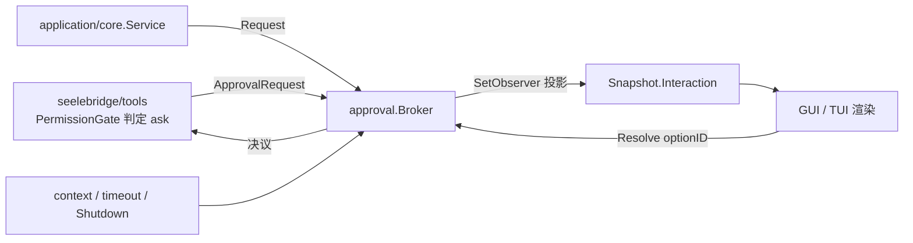
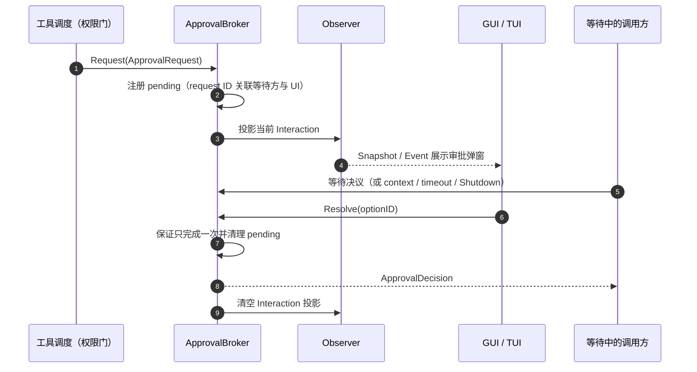
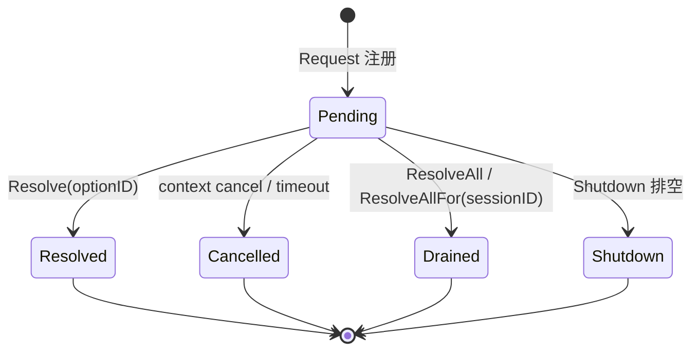

# backend/limit/approval

## 生态位

本包提供与界面无关的审批生命周期（limit 板块里的"审批"这一格：工具链上的第 4 段判定
要有地方等用户点头）。`core.Service` 把高风险动作转换为 `ApprovalRequest`，
TUI/GUI 只展示 `model.Interaction` 并提交决议。

**端口形状与哨兵错误的事实源在 [`contract/approval.go`](../../../contract/approval.go)**：
`ApprovalRequest` / `ApprovalDecision` / `PendingApproval` / `ErrInteractionNotFound` /
`ErrInteractionResolved` 定义在契约层，本包只用本地别名引用它们（同一类型身份）。
理由：契约层是最底层的依赖倒置边界，不得反过来依赖 backend 实现包。

主要调用方：`application/core`（发起与决议）、`seelebridge/tools`（权限门把 `ask` 判定交给它）、
`gui`/`tui`（只渲染 `model.Interaction`）。

物理位置：2026-10-16 按
[`../../../docs/2026-10-15-architecture-reshape/plan.md`](../../../docs/2026-10-15-architecture-reshape/plan.md)
§2.8 从 `application/approval`（已移除）归位到 `backend/limit/approval`；形状留在 contract。

## 架构图



## 时序图



## 生命周期状态



## 核心实现

- `ApprovalRequest`：问题、风险、工具预览、选项和超时。
- `ApprovalDecision`：前端选择的 option ID。
- `ApprovalBroker`：维护待决请求表，以 request ID 关联等待方和 UI 决议。
- `SetObserver`：把当前 Interaction 投影给 Application Snapshot。

`Request` 注册 pending request、发布打开事件并等待 context、timeout、Resolve 或 Shutdown；`Resolve` 保证请求只完成一次；`ResolveAll` / `ResolveAllFor(sessionID, …)` 用同一显式决议原子摘取并释放（指定会话的）全部当前 pending request。`full` 权限档（旧称 full access，见 [`docs/arch/agent-permission-subjects.md`](../../../docs/arch/agent-permission-subjects.md)）还通过 `PermissionRequest` + `SetPermissionAutoApproval` / `SetPermissionAutoApprovalFor(sessionID, …)` 覆盖“切换发生在权限检查与入队之间”的窄竞态；非 permission 的 Plan/manual 审批不会被自动放行。

**高权限档的会话归属**：自动放行与“全部放行”都按会话解析——`SetPermissionAutoApprovalFor` 只影响指定会话，`ResolveAllFor` 只结该会话的待批；空会话 ID = 进程级/无归属 legacy 面，不替请求猜会话（否则 A 会话切到 `full` 档会替 B 会话的工具点头）。自动放行返回 `allow` 而不是 `always`：档位是会话级、可撤销的模式，不能在共享 checker 里留一条永久 allow 规则（用户把档位调回 `manual` 后仍会在别的会话静默生效）；持久 `always` 规则只由用户显式选择建立。回归：`approval_session_isolation_test.go`。

## 生态位与边界

本包决定“如何等待和完成审批”，不决定哪些工具需要审批，也不直接渲染界面。权限规则属于 Seele permission/runtime 适配层，展示属于前端。

## 并发与 Review

- pending map 必须在锁内修改，向等待 channel 发送时避免重复完成。
- context cancel、timeout、Resolve、ResolveAll、Shutdown 可能竞争，任何路径都必须清理 pending，且不能重复完成等待方。
- Observer 不应在持锁状态执行不可控逻辑。
- 新增决议类型时同步更新 `model.Interaction` 和两个前端。

## 测试

审批行为由 `broker_test.go`、`application/core/service_test.go` 和 `race_test.go` 覆盖：

```text
go test ./backend/limit/approval -count=10
go test ./application/core -run Approval -count=1
```

## 文件与函数索引

### broker.go

| 函数 | 签名 | 摘要 |
|---|---|---|
| `NewApprovalBroker` | `func NewApprovalBroker(events event.Hub) *ApprovalBroker` | 构造异步审批 broker（events 可为 nil） |
| `SetObserver` | `func (broker *ApprovalBroker) SetObserver(observer func(sessionID, requestID string, interaction *model.Interaction))` | 注册审批开/结观察回调 |
| `SetPermissionAutoApproval` | `func (broker *ApprovalBroker) SetPermissionAutoApproval(on bool)` | 进程级权限自动放行（无会话归属面） |
| `SetPermissionAutoApprovalFor` | `func (broker *ApprovalBroker) SetPermissionAutoApprovalFor(sessionID string, on bool)` | 会话级权限自动放行（GUI 全权按钮） |
| `Request` | `func (broker *ApprovalBroker) Request(ctx context.Context, request ApprovalRequest) (ApprovalDecision, error)` | 登记待批并等待决议（context/timeout/Resolve/Shutdown） |
| `Resolve` | `func (broker *ApprovalBroker) Resolve(id string, decision ApprovalDecision) error` | 结掉一笔待批（只允许一次） |
| `ResolveAll` | `func (broker *ApprovalBroker) ResolveAll(decision ApprovalDecision) int` | 结掉全部无会话归属的待批 |
| `ResolveAllFor` | `func (broker *ApprovalBroker) ResolveAllFor(sessionID string, decision ApprovalDecision) int` | 结掉指定会话全部待批 |
| `Pending` | `func (broker *ApprovalBroker) Pending() []PendingApproval` | 返回待批的会话归属快照 |
| `PendingBySession` | `func (broker *ApprovalBroker) PendingBySession(sessionID string) []model.Interaction` | 返回指定会话的待批审批 |
| `Shutdown` | `func (broker *ApprovalBroker) Shutdown()` | 关闭 broker 并释放全部等待方 |

### approval_session_isolation_test.go / broker_test.go

会话级归属隔离（自动放行/全部放行不跨会话）、只完成一次、超时与关闭清理。
