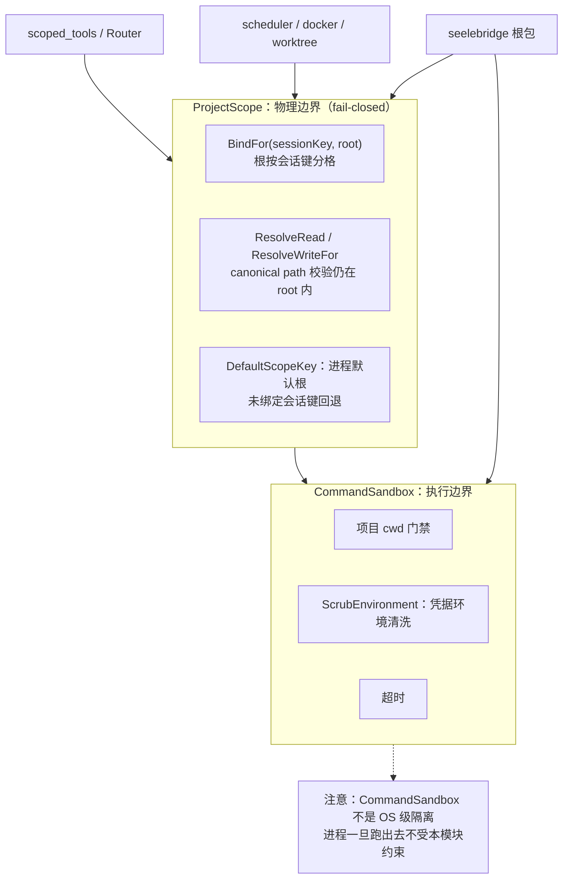

# Security

## 生态位

`backend/limit/gate` 承载项目作用域、路径门禁与命令执行隔离的安全边界：

- `project_scope.go`：`ProjectScope` 项目根 containment（fail-closed，无 fallback root）。
  根按**会话键**分格：`BindFor(sessionKey, root)` / `Resolve*For(sessionKey, …)`
  让每个会话用自己的项目根（多项目并行/后台会话不借用视图会话的根）；空键
  （`DefaultScopeKey`）是进程默认根（当前视图会话），未绑定会话键回退默认根。
- `sandbox.go`：`CommandSandbox` shell 执行隔离端口（项目 cwd 门禁 + 凭据环境清洗 +
  超时，非 OS 级隔离）；`ScrubEnvironment`/`FileExists` 供根包命令路径复用。
**`command_class.go` 已删除（2026-10-15）**：它是 `bash_read` 的服务端只读判定
（`ClassifyCommand` / 可解释的 `ExplainCommand`）。`bash_read` 整体删除后它没有第二个
消费者，按"不留死代码"退役。要点留在这里备查：判定的**口径**是"单条 POSIX 命令 + 首词
白名单 + `git`/`go`/`dotnet` 子命令白名单 + 参数级写形态"，语法标记（`&& || ; | > < $`
反引号换行）整串拒绝；现场 479 次调用 34.4% 折在这条判定上，成因分布是复合语法 102 /
PowerShell 命令面 38 / 白名单外子命令 18 / 其它 7。删除它换来的是"只读面只有一处事实"
：命令面只剩 `bash`（rw）+ `bash_bg`，免打断的读命令由 `backend/tool/registry` 的
`bash` 模式白名单承担。
- `command_windows.go`/`command_other.go`：`ConfigureHiddenCommand`（平台构建标签）——**合并写入** `SysProcAttr` 而不是整体赋值：`internal/winhide` 也往同一处写 `CREATE_NO_WINDOW`，谁赋值谁就把对方抹掉。
- `process_tree_windows.go`/`process_tree_other.go`：`ProcessTree`（Windows = Job Object + `KILL_ON_JOB_CLOSE`；POSIX = 进程组 + `kill(-pgid)`）与 `ConfigureProcessTree`。**`taskkill /T` 不够**：MSYS2/Git Bash 的 fork 子 shell 不一定挂在直接父 PID 下，实测杀不掉；Job Object 不看父子关系，关句柄即整树回收。Job 建不出来时退化为按 PID 杀，由 `Degraded()` 如实报出（此时不得主张"整棵进程树已终止"）。

被根包 `scoped_tools` / `runtime` / `scheduler` / `docker` / `worktree_manager` 消费；
不反向依赖 `seelebridge` 根包；根包直接 import `security.*`（如
`security.CommandSandbox`），不再有重导出层。

## 架构图



本模块给的是**物理边界**：`ProjectScope` 决定「能不能逃出项目目录」，
`CommandSandbox` 决定「命令在什么环境、什么 cwd 下跑」。项目内「哪些操作仍需
审批」是**策略边界**，由 `seele.yaml` 权限段经 Seele 的 permission gate 判定——
它不在本模块，也不与 `ProjectScope` 互相替代。`PathGate`（曾在此文件里）自
2026-10-01 起作为**无调用点的死代码**退场（见
`docs/devlog/2026-10-01-m4-deadcode-round1.md`）。

## 验证

```text
go test ./backend/limit/gate -count=1
```

## 文件与函数索引

> 由源码 doc 注释自动提取（首行摘要）；描述源码行为，与实现保持同步。
> 刷新方式：`python scripts/gen_core_readme_index.py`。

### command_other.go

- `func ConfigureHiddenCommand(_ *exec.Cmd)` — ConfigureHiddenCommand is a no-op on non-Windows platforms.

### command_windows.go

- `func ConfigureHiddenCommand(cmd *exec.Cmd)` — ConfigureHiddenCommand prevents a GUI build from flashing a console window

### command_windows_test.go

- `func TestConfigureHiddenCommandHidesWindowsShell(t *testing.T)`

### process_tree_attach_test.go

- `func TestAttachFailureMarksTreeDegraded(t *testing.T)`
- `func TestAttachSuccessKeepsTreeHealthy(t *testing.T)` — TestAttachSuccessKeepsTreeHealthy 是阴性对照：**挂得上就不许报退化**——否则这条读数变成噪声，

### process_tree_other.go

- `func ConfigureProcessTree(cmd *exec.Cmd)` — ConfigureProcessTree 让子进程自成进程组（Setpgid）——负 PID 终止的前提。
- `func NewProcessTree() *ProcessTree` — NewProcessTree 无需系统资源，只是记下稍后绑定的进程组号。
- `func (t *ProcessTree) Degraded() bool` — Degraded 在 POSIX 上恒为 false：Setpgid + kill(-pgid) 覆盖整棵树，没有"挂不上"这一形态
- `func (t *ProcessTree) Attach(pid int) error` — Attach 绑定进程组号（= 首进程 PID，因为 Setpgid）。
- `func (t *ProcessTree) Terminate() error` — Terminate 对整个进程组发 SIGKILL。ESRCH（组已经没了）算良性。
- `func (t *ProcessTree) Close()` — Close 没有系统资源要释放，保持与 Windows 变体同生命周期形状。

### process_tree_windows.go

- `func ConfigureProcessTree(cmd *exec.Cmd)` — ConfigureProcessTree 让子进程自成进程组。与 Job 无关，作用是别让控制台的
- `func NewProcessTree() *ProcessTree` — NewProcessTree 建 Job 并设 KILL_ON_JOB_CLOSE：句柄一旦关闭，Job 里剩下的进程全部
- `func (t *ProcessTree) Degraded() bool` — Degraded 报告这棵树是否只能按 PID 杀。true 时不得对外主张"整棵进程树已终止"。
- `func (t *ProcessTree) markAttachFailed()` — markAttachFailed 记下"这个进程没进 Job"。只有真的调用失败才置位：参数非法一类由
- `func (t *ProcessTree) Attach(pid int) error` — Attach 把已启动的进程纳入 Job。失败不致命：退化成按 PID 杀，但**要记进退化判据**
- `func (t *ProcessTree) Terminate() error` — Terminate 结束整棵树。返回错误 = 没能确认终止，调用方不得谎报已杀。
- `func (t *ProcessTree) Close()` — Close 释放 Job 句柄；KILL_ON_JOB_CLOSE 会顺手带走任何还在里面的进程。
- `func killByPIDTree(pid int) error` — killByPIDTree 是退化路径：taskkill /T 只按 Windows 父 PID 枚举（杀不到 MSYS 的

### process_tree_windows_test.go

- `func TestSysProcAttrWritersMerge(t *testing.T)` — 生产顺序就是 scopedBash / startAsync 的顺序（winhide.Apply 后 ConfigureHiddenCommand）。
- `func TestProcessTreeFlagsSurviveRepeatedConfigure(t *testing.T)`
- `func TestNewProcessTreeNotDegraded(t *testing.T)` — 本机必须能建出 Job：否则 bg_manage(op=kill) 只剩"杀直接子进程"的退化能力，

### project_scope.go

- `func NewProjectScope() *ProjectScope`
- `func (scope *ProjectScope) Bind(rootPath string) error`
- `func (scope *ProjectScope) BindFor(sessionKey, rootPath string) error` — BindFor 绑定指定会话键的项目根；sessionKey 为空 = 进程默认根。同键重绑
- `func (scope *ProjectScope) Unbind()`
- `func (scope *ProjectScope) UnbindFor(sessionKey string)` — UnbindFor 清空指定会话键的项目根（会话解绑工作区/归档时调用；其它会话的
- `func (scope *ProjectScope) Root() string`
- `func (scope *ProjectScope) RootFor(sessionKey string) string` — RootFor 返回指定会话键的项目根；该键未绑定时回退进程默认根（未绑定同样
- `func (scope *ProjectScope) ResolveRead(path string) (string, error)`
- `func (scope *ProjectScope) ResolveReadFor(sessionKey, path string) (string, error)` — ResolveReadFor 在指定会话键的项目根内解析读路径。
- `func (scope *ProjectScope) ResolveWrite(path string) (string, error)` — ResolveWrite permits a new path only when its nearest existing ancestor is
- `func (scope *ProjectScope) ResolveWriteFor(sessionKey, path string) (string, error)` — ResolveWriteFor 在指定会话键的项目根内解析写路径（语义同 ResolveWrite）。
- `func (scope *ProjectScope) ResolveWorkdir(path string) (string, error)`
- `func (scope *ProjectScope) ResolveWorkdirFor(sessionKey, path string) (string, error)` — ResolveWorkdirFor 解析指定会话键下的工作目录（bash 的 cwd）。
- `func (scope *ProjectScope) rootsFor(sessionKey string) (string, string, error)` — rootsFor 返回会话键对应的根：该键已绑定用该键，否则回退进程默认根（旧会话
- `func resolveInside(root, rawPath string) (string, error)`
- `func withinRoot(root, candidate string) bool`
- `func (scope *ProjectScope) Relative(path string) (string, error)` — Relative 返回 path 相对项目根的显示路径；path 在根内时返回相对形式。
- `func (scope *ProjectScope) RelativeFor(sessionKey, path string) (string, error)` — RelativeFor 返回指定会话键下 path 相对其项目根的显示路径。
- `func ResolveInside(root, rawPath string) (string, error)` — ResolveInside 解析任意路径到根内绝对路径（供根包 scoped_tools 复用）。

### project_scope_session_test.go

- `func TestProjectScopeKeepsPerSessionRoots(t *testing.T)` — TestProjectScopeKeepsPerSessionRoots 钉住"项目根按会话分格"：视图会话的默认根

### project_scope_test.go

- `func TestProjectScopeResolvesOnlyInsideBoundRoot(t *testing.T)`
- `func TestProjectScopeRejectsSymlinkEscape(t *testing.T)`

### sandbox.go

- `func NewNativeProjectCWD() CommandSandbox` — NewNativeProjectCWD 构造默认 CommandSandbox 实现（项目 cwd 门禁 + 凭据清洗）。
- `func (s *nativeProjectCWD) Prepare(ctx context.Context, root string, command string, timeoutSec int) (*exec.Cmd, SandboxCapabilities, error)` — Prepare 构造命令：cwd = 项目根（调用方已解析 worktree/项目根）、
- `func ScrubEnvironment(environ []string) []string` — ScrubEnvironment 清洗凭据类环境变量（子代理/主代理 bash 不得读取
- `func isSensitiveEnvName(name string) bool` — isSensitiveEnvName 判断环境变量名是否携带凭据（API key/secret/token/
- `func commandShell() string` — commandShell 返回平台 shell（与 scopedBash 的探测逻辑一致：
- `func commandShellArgs(command string) []string` — commandShellArgs 返回对应 shell 的参数前缀（与 scopedBash 一致）。
- `func IsWSLBash(path string) bool` — IsWSLBash 报告路径是否为 WSL bash 启动器（System32/Sysnative/WindowsApps
- `func FileExists(path string) bool` — FileExists 报告路径是否存在（供 shell 探测/工具链查找复用）。

### sandbox_test.go

- `func TestScrubEnvironmentRemovesCredentials(t *testing.T)` — TestScrubEnvironmentRemovesCredentials 验证凭据环境变量清洗：
- `func TestSandboxPrepareScrubsEnvAndSetsRoot(t *testing.T)` — TestSandboxPrepareScrubsEnvAndSetsRoot 验证 native sandbox Prepare：
- `func TestIsSensitiveEnvName(t *testing.T)` — TestIsSensitiveEnvName 验证敏感名判定覆盖常见凭据模式。
