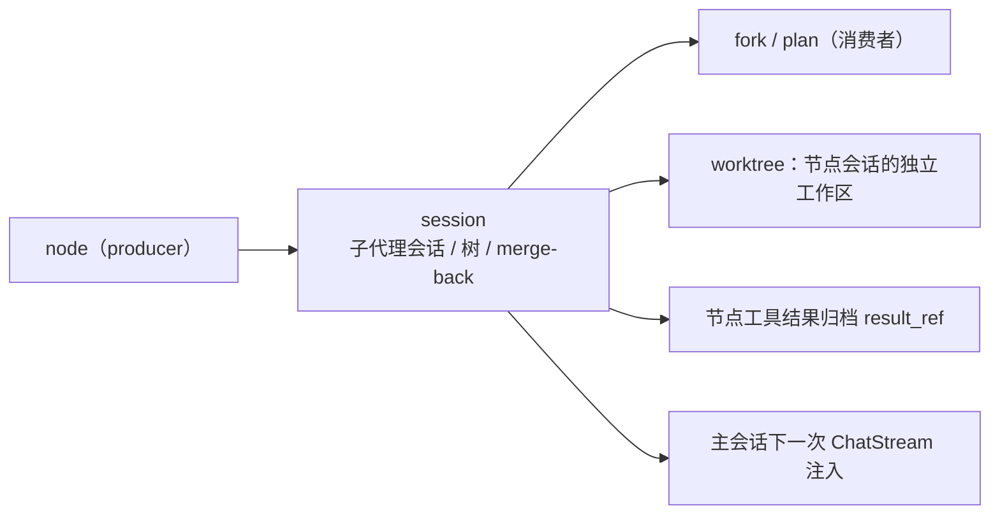
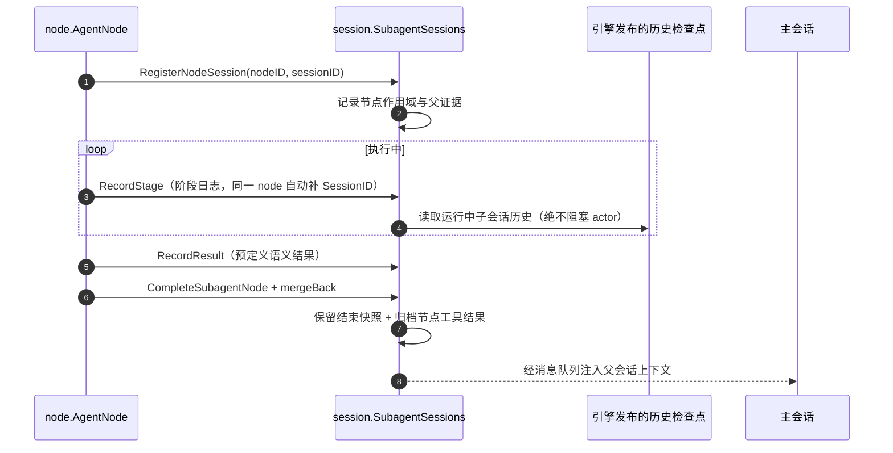

# backend/multiagent/subagent — 子代理会话与上下文 actor 域

## 生态位

承载子代理会话注册表与父证据/merge-back 两个 actor。主要调用方：根包 `runtime.go` 装配、`agent_node.go` 会话门面、`actor.go` 的 merge-back facade。

## 与其它域的关系



session 承载子代理会话注册、fork 子代理树与 merge-back 队列；node 是
producer，fork/plan 是消费者；节点工具结果归档（result_ref）也在本域托管。

## 时序图



## 职责与非职责

职责：

- `SubagentSessions`：运行中子会话历史读取（走引擎发布的历史检查点，
  **绝不阻塞 actor**）、结束快照保留、节点工具结果归档（`ToolResultArchiverFor`/`ToolResult`）；
- `SubagentSessions`（第一视角数据面）：node 分阶段上下文日志（`RecordStage`/`StageLogs`，
  同一 node 会话自动补全 SessionID——多阶段同一 subagent 的认证面）与预定义语义
  结果返回（`RecordResult`/`Result`/`DrainResults`，结果经语义结果队列按消息队列
  路径返回给 mainagent / 下游 node）；`StageEvents` 提供阶段日志**实时推送通道**
  （即时输出面：每条阶段记录后立即投递，非轮询/缓存；通道有界，满时丢弃并计数，
  best-effort 不阻塞执行路径）；
- `ToolEventState`：子代理工具事件分发器支持多观察者（`SetCallback` 供 main 路径，
  `Subscribe` 供 Runtime 实时流等并行订阅），node 第一视角统一实时流的工具面；
- `SubagentContextActor`：父证据读-合并-写回（`MergeBackIntoParent`）、merge-back 有界 mailbox（`Enqueue`/`Drain`）、父证据无锁读取（`NodeParentEvidence`）。

非职责：

- 不执行子代理（执行在 `backend/tool/node/` 域）；
- 不决定合并策略（`seelexctx/merger` 负责）；
- 不接触主会话锁（mailbox 只是消息进出）。

## 目录或文件结构

| 文件 | 职责 |
|---|---|
| `subagent_sessions.go` | 会话注册表 actor（运行期记录落盘 + 结束结论回传主会话 + 记录删除） |
| `subagent_stage_test.go` | 第一视角阶段日志与语义结果队列单元测试 |
| `subagent_tree.go` | fork 子代理树注册表与只读投影（运行中上下文走无锁计数，不读子会话） |
| `subagent_tree_lock_test.go` | 投影锁序与长流阻塞回归测试（2026-09-07 死锁 + 2026-09-10 长流热点） |
| `subagent_sessions_stream_test.go` | 注册表观测面不被运行中节点阻塞的回归测试（2026-09-10 长流热点） |
| `subagent_context.go` | 父证据合并 + merge-back mailbox actor |
| `context_clone.go` | `ContextSnapshot` 深拷贝辅助 |
| `subagent_sessions_test.go` | 会话注册表单元测试 |

## 核心实现

两个组件都是"channel 命令 + 单消费者 goroutine"的 actor：外部经有界命令通道投递操作（带 10s 超时），actor 串行处理，天然免锁。

- `SubagentContextActor`：`handleMerge` 串行执行"读当前父证据 → `merger.MergeBack`（copy-on-write 累积）→ 写回 `atomic.Pointer`"；`handleEnqueue` 在队列达 soft cap 时仅计数 `Overflow`，内容全部保留；`Drain` 一次性全量回收。
- `SubagentSessions`：注册/注销导出结束快照（`seelexctx.ExportSnapshot`，trace 可为 nil 降级）；工具结果走节点专属 `InMemoryToolResultArchiver`，ref 前缀由 `internal/model.NodeResultRefPrefix` 统一。
- 第一视角阶段日志（`model.NodeStageLog`）：`AgentNode`/telemetry 钩子写入，actor 按
  nodeID 追加并补全 SessionID 与 turn 编号；语义结果（`model.NodeSemanticResult`）
  登记时自动附带该节点全部阶段日志，并投入语义结果队列（`DrainResults` 一次性取空）；
  每条阶段日志写入后同时推入 `StageEvents` 通道（即时输出）。

## 数据流或生命周期

子代理完成 → `backend/tool/node/` 域 `mergeBack` 导出快照 → `SubagentContextActor.MergeBackIntoParent`（合并写回 parentEvidence）→ `Format()` 文本 `Enqueue` → 主会话 ChatStream 前后 `injectPendingSubagentContexts` 排空 mailbox 注入。

## 依赖方向

`session` → `seelexctx`（merger/provider/snapshot）、`internal/model`、框架 `session` 类型。**禁止反向依赖 seelebridge 根包**。

## 并发、存储、安全或错误语义

- actor 串行化父证据合并，防并发覆盖（B 修复）；
- mailbox soft cap 只作诊断计数、内容不丢（A 修复）；
- 命令投递带超时，actor 关闭后快速失败；
- **运行中会话读取一律非阻塞**（2026-09-10 长流热点；2026-09-27 Seele 方案 B
  后语义更强）：`SubagentSessions` 是单 goroutine actor，若某次读会停在子代理
  整段流式上（旧实现里 `Session.History()` 会，实测 28s），**所有**节点的详情、
  阶段日志与落账都会一起排队，mailbox（256）满后 `RecordStage` 开始丢事件。
  Seele 现在把工作历史放在短临界区后面（回合不持锁跑整轮），`History()` 任何
  时刻都立即返回当前工作历史，因此运行中读取统一走 `refreshLiveHistoryLocked`：
  直接读 `History()`，空历史不覆盖上次缓存（第一条消息还没落历史时读到的 nil
  只是"还没有材料"，不是"历史被清空了"）。
  - 落账语义：`buildRecordLocked` 写的是当前工作历史（最多滞后一次写入提交，
    而不是滞后整轮），崩溃恢复要的是写得及时，不是写得最全。
  - 回归覆盖：`TestSubagentSessionsReadsDoNotBlockOnStreamingNode`
    （运行中节点自身读取 + 另一节点不被拖住）、`TestSubagentSessions*`。
- 运行期记录落盘（`<mainSessionID>-<subSessionID>.json`，见
  [store/README.md](../../../store/README.md)）；节点结束
  （done/failed）时最终结论写入主会话事件库（`seelex.subagent.result`），
  节点记录文件随即删除——详情数据面保留在内存快照，进程存活期可读，
  重启后由恢复锚点（`Runtime.RestoreSubagentAnchors`）从主会话事件库重建；
- 压缩栈与主会话隔离：节点控制器使用独立内存栈（2026-08-24 修复，
  子代理压缩帧不再写入主会话 SessionContextStore）。
- `SubagentTree.Projection` 不读运行中子会话（2026-09-07 死锁 + 2026-09-10
  长流热点）：投影只持树锁浅拍快照（scalar + 结束快照指针 + 会话引用），
  释放树锁后组装 DTO，**全过程不取子代理会话锁**——运行中节点的紧凑上下文
  由 `NoteMessageCount` 上报的工作历史条数 + 遥测 trace 经
  `seelexctx.ExportSnapshotFromData` 组装。
  - 为什么不能读：`Session.ChatStream` 从进函数持到出函数整段持有会话锁，
    `Session.History()`/`ExportSnapshot` 用同一把锁。子代理长文流式（实测
    1200 字 ≈ 42s）期间读它会各被挡约 28s，表现为「工作表格卡住不动」。
  - 计数来源：节点在请求装配路径（`backend/tool/node/coordinator.go` 的
    `ScopeAssembler`，即持该节点会话锁的那个 goroutine）调用
    `Coordinator.NoteProgress` 上报 `len(WorkingHistory)`，因此观测侧读到它
    是无锁的；计数变化才 notify，避免每轮装配触发一次重投影。
  - 历史死锁同源消灭：投影一侧不再有会话锁，树锁 ↔ 会话锁的环不复存在
    （2026-09-07 真实 API 复现：多个子代理 running 后无任何 llm/tool 事件、
    行停留在 QUEUED）。回归覆盖：`subagent_tree_lock_test.go` 的
    `TestProjectionDoesNotBlockOnLiveSessionStream`（真会话持锁长流的确定性
    用例）与 `TestProjectionCarriesNodeReportedMessageCount`，以及
    `tmp/headless-smoke` 的 `TestRealAPIForkLiveProbe`（真实 API E2E）。

## 扩展方式

- 新增会话数据面：扩展 `SubagentSessions` 命令种类与处理；
- 调整 mailbox 容量：`NewSubagentContextActor(trace, queueCap)`；
- 改变合并策略：替换 `merger.NewMerger()` 调用点（保持 copy-on-write 语义）。

## Review 指南

- 是否仍由 actor 单 goroutine 持有全部可变状态（不再新增互斥锁）；
- `Drain` 是否只在锁外/ ChatStream 边界调用；
- overflow 是否"计数不丢"（不能悄悄丢消息）。

## 测试与验证

本包内：`subagent_sessions_test.go`；merge-back mailbox 并发/overflow 用例在根包 `merge_back_concurrency_test.go`（联调，保留根测试包）。验证：

```text
go test ./backend/multiagent/subagent/ -run 'TestProjection|TestSubAgent|TestSubagentSessions' -count=1
go test ./backend/multiagent/subagent/ ./seelebridge/ -count=1
go build ./...
```

## 文件与函数索引

> 由源码 doc 注释自动提取（首行摘要）；描述源码行为，与实现保持同步。
> 刷新方式：`python scripts/gen_core_readme_index.py`。

### context_clone.go

- `func cloneContextSnapshot(source *snapshot.ContextSnapshot) *snapshot.ContextSnapshot` — cloneContextSnapshot 返回快照的深拷贝（读侧导出与 parentEvidence 合并共用）。

### subagent_context.go

- `func NewSubagentContextActor(trace provider.TraceSource, queueCap ...int) *SubagentContextActor`
- `func (a *SubagentContextActor) handle(cmd subagentContextCmd)`
- `func (a *SubagentContextActor) handleMerge(cmd subagentContextCmd)` — handleMerge 串行执行「读当前父证据 → 合并子代理快照 → 写回」并发布
- `func (a *SubagentContextActor) handleEnqueue(content string)`
- `func (a *SubagentContextActor) handleSetProjection(projection *model.ParentEvidenceProjection)`
- `func (a *SubagentContextActor) drainLocked() []string`
- `func (a *SubagentContextActor) send(cmd subagentContextCmd) bool` — send 投递命令（带超时；actor 关闭后快速返回 false）。
- `func (a *SubagentContextActor) SetParentEvidenceProjection(projection model.ParentEvidenceProjection)` — SetParentEvidenceProjection 应用侧发布父证据投影。命令投递后等待 actor
- `func (a *SubagentContextActor) MergeBackIntoParent(child *snapshot.ContextSnapshot) *snapshot.ContextSnapshot` — MergeBackIntoParent 投递合并命令并等待 actor 串行完成，返回合并后的
- `func (a *SubagentContextActor) Enqueue(content string)` — Enqueue 投递 merge-back 文本（mergeBackSink 使用；actor 内入队不丢）。
- `func (a *SubagentContextActor) Drain() []string` — Drain 投递并等待全量 merge-back 文本（channel + overflow 合并回收）。
- `func (a *SubagentContextActor) Overflow() int64` — Overflow 返回队列超容量累计（诊断；内容不丢）。
- `func (a *SubagentContextActor) NodeParentEvidence() *snapshot.ContextSnapshot` — NodeParentEvidence 返回当前父证据快照的无锁拷贝（读取面；nil = 无证据）。
- `func (a *SubagentContextActor) Close()` — Close 关闭命令通道并等待 actor 退出（幂等）。

### subagent_lifecycle_release_test.go

- `func TestSubagentTreeReleasesLiveSessionOnComplete(t *testing.T)` — TestSubagentTreeReleasesLiveSessionOnComplete 钉住终态即摘活会话引用。
- `func TestSubagentSessionsReleaseArchiverOnUnregister(t *testing.T)` — TestSubagentSessionsReleaseArchiverOnUnregister 钉住注销即释放结果归档。
- `func TestToolResultArchiverReleaseIsIdempotent(t *testing.T)` — TestToolResultArchiverReleaseIsIdempotent 归档释放可重复调用且返回释放字节数。

### subagent_persist_test.go

- `func newTestNodeSessionStore(t *testing.T) *store.NodeSessionStore` — newTestNodeSessionStore 构造 JSON 后端节点会话记录存储。
- `func waitForRecords(t *testing.T, st *store.NodeSessionStore, mainID string, want int) []store.NodeSessionRecord` — waitForRecords 轮询等待主会话索引下出现 want 条子会话记录
- `func waitForRecordState(t *testing.T, st *store.NodeSessionStore, mainID string, predicate func(store.NodeSessionRecord) bool) store.NodeSessionRecord` — waitForRecordState 轮询等待首条记录满足 predicate（阶段/结果/终态落盘）。
- `func TestSubagentSessionsLifecyclePersistConclusionDelete(t *testing.T)` — TestSubagentSessionsLifecyclePersistConclusionDelete 验证生命周期策略：
- `func TestSubagentSessionsRestoreRebuildsDetail(t *testing.T)` — TestSubagentSessionsRestoreRebuildsDetail 验证重启后可从残留记录重建
- `func TestSubagentSessionsPersistFailedOutcome(t *testing.T)` — TestSubagentSessionsPersistFailedOutcome 验证失败节点同样收敛：

### subagent_sessions.go

- `func SubagentUnitRecordLink(record store.NodeSessionRecord) store.NodeSessionRecord` — SubagentUnitRecordLink 是记录写入链上**子代理那一层**的一环：给还没有身份的记录写上
- `func WithNodeSessionStore(st *store.NodeSessionStore) SubagentSessionsOption` — WithNodeSessionStore 装配节点会话记录持久化（nil = 纯内存态）：装配的是一个"以该存储为
- `func WithMainSessionID(fn func() string) SubagentSessionsOption` — WithMainSessionID 提供当前主会话 ID（记录落盘时作为索引键；nil = 不落盘）。
- `func WithConclusionSink(fn func(string, store.NodeSessionRecord)) SubagentSessionsOption` — WithConclusionSink 装配节点结束时的结论回传（mainagent 侧持久化；nil = 只删不传）。
- `func NewSubagentSessions(trace provider.TraceSource, opts ...SubagentSessionsOption) *SubagentSessions`
- `func (s *SubagentSessions) handle(cmd subagentSessionCmd)`
- `func (s *SubagentSessions) finalizeLocked(nodeID string)` — finalizeLocked 节点结束时收敛持久化（actor goroutine 内调用）：
- `func (s *SubagentSessions) restoreLocked(record store.NodeSessionRecord)` — restoreLocked 从持久化记录重建节点的详情数据面（actor goroutine 内调用）：
- `func (s *SubagentSessions) persistLocked(nodeID string)` — persistLocked 把节点的当前内存态投影为 NodeSessionRecord 并落盘
- `func (s *SubagentSessions) refreshLiveHistoryLocked(nodeID string, sess *frameworkSession.Session) []types.Message` — refreshLiveHistoryLocked 刷新并返回运行中节点的当前历史（actor goroutine 内
- `func (s *SubagentSessions) buildRecordLocked(nodeID string) store.NodeSessionRecord` — buildRecordLocked 把节点当前内存态投影为 NodeSessionRecord（actor goroutine 内调用）。
- `func (s *SubagentSessions) reply(cmd subagentSessionCmd, reply subagentSessionReply)`
- `func (s *SubagentSessions) send(cmd subagentSessionCmd) bool` — send 投递命令并等待 actor 处理（带超时；actor 关闭后快速返回 false）。
- `func (s *SubagentSessions) Register(nodeID string, sess *frameworkSession.Session, goal string)` — Register 注册运行中的子代理会话与节点目标（goal 供 ContextSnapshot 导出复用）。
- `func (s *SubagentSessions) RegisterFor(mainSessionID, nodeID string, sess *frameworkSession.Session, goal string)` — RegisterFor 在显式主会话作用域下注册节点（冷恢复/后台会话用；空 ID 回退
- `func (s *SubagentSessions) Session(nodeID string) *frameworkSession.Session` — Session 返回指定节点当前注册的运行中会话（UC7 查询面）；不存在返回 nil。
- `func (s *SubagentSessions) Count() int` — Count 返回当前注册的子代理会话数（监控/测试）。
- `func (s *SubagentSessions) LiveOwner(nodeID string) (string, bool)` — LiveOwner 报告节点在本进程内是否还有**活着的**子代理会话，并返回它归属的
- `func (s *SubagentSessions) Unregister(nodeID string) *snapshot.ContextSnapshot` — Unregister 结束注册：移除会话，导出并留存结束快照与最后 History；
- `func (s *SubagentSessions) Conversation(nodeID string) ([]types.Message, bool)` — Conversation 返回节点子代理会话记录：运行中实时 History；已结束返回留存快照。
- `func (s *SubagentSessions) ContextSnapshot(nodeID string) (*snapshot.ContextSnapshot, bool)` — ContextSnapshot 返回节点子代理结构化上下文快照：运行中实时导出；已结束返回留存快照。
- `func (s *SubagentSessions) ToolResultArchiverFor(nodeID string) *seelexctx.InMemoryToolResultArchiver` — ToolResultArchiverFor 返回节点专属工具结果归档器（惰性创建并复用）。
- `func (s *SubagentSessions) ToolResult(nodeID, ref string) (string, bool)` — ToolResult 读回节点子代理的工具结果原始内容（ref 可带 node:<nodeID>: 前缀）。
- `func (s *SubagentSessions) RecordStage(nodeID string, log model.NodeStageLog)` — RecordStage 记录 node 第一视角分阶段日志（同一 node 会话的认证面：
- `func (s *SubagentSessions) StageLogs(nodeID string) []model.NodeStageLog` — StageLogs 返回 node 的全部第一视角阶段日志（拷贝，按记录序）。
- `func (s *SubagentSessions) StageEvents() <-chan model.NodeStageLog` — StageEvents 返回第一视角阶段日志的实时推送通道：每个阶段被记录后立即投递
- `func (s *SubagentSessions) DroppedEvents() int64` — DroppedEvents 返回因通道满被丢弃的实时事件数（诊断计数）。
- `func (s *SubagentSessions) RecordResult(nodeID string, result *model.NodeSemanticResult)` — RecordResult 登记 node 的预定义语义结果并投入语义结果队列（消息队列路径）；
- `func (s *SubagentSessions) Result(nodeID string) *model.NodeSemanticResult` — Result 返回 node 最近一次语义结果（只读）。
- `func (s *SubagentSessions) DrainResults() []*model.NodeSemanticResult` — DrainResults 取空语义结果队列（消息队列消费面：mainagent / 下游 node 读取）。
- `func (s *SubagentSessions) NoteWorktree(nodeID string, wt store.NodeWorktreeRecord)` — NoteWorktree 记录节点 worktree 现场（持久化恢复数据面：重启后可重建
- `func (s *SubagentSessions) NoteOutcome(nodeID, status, summary, errMsg string)` — NoteOutcome 记录节点终态（done/failed + 摘要/错误），落盘后恢复时
- `func (s *SubagentSessions) Restore(records []store.NodeSessionRecord)` — Restore 从持久化记录重建节点会话的详情数据面（重启/恢复锚点；
- `func (s *SubagentSessions) Configure(writer *store.NodeSessionRecordWriter, mainID, projectID func() string, sink func(string, store.NodeSessionRecord))` — Configure 装配/替换节点会话记录的**写入链**（Router 就绪后注入；幂等）。
- `func (s *SubagentSessions) Close()` — Close 关闭命令通道并等待 actor 退出（幂等）。

### subagent_sessions_stream_test.go

- `func awaitObservation[T any](t *testing.T, label string, call func() T) T` — awaitObservation 在独立 goroutine 里执行一次观测面读取并把超时判失败。
- `func TestSubagentSessionsReadsDoNotBlockOnStreamingNode(t *testing.T)` — TestSubagentSessionsReadsDoNotBlockOnStreamingNode 是 2026-09-10 长流热点的

### subagent_sessions_test.go

- `func (stubCompleter) Complete(context.Context, []types.Message, []types.Tool) (types.Message, error)`
- `func (stubCompleter) CompleteStream(context.Context, []types.Message, []types.Tool, func(string)) (string, string, []types.ToolCall, error)`
- `func (stubCompleter) CompleteStreamEvents(context.Context, []types.Message, []types.Tool, func(types.StreamEvent)) (string, string, []types.ToolCall, error)`
- `func (a stubSessionAgent) VisibleTools(context.Context) []types.Tool`
- `func (a stubSessionAgent) Dispatch(context.Context, string, string) (string, error)`
- `func (a stubSessionAgent) LLM() types.ChatCompleter`
- `func newTestSubagentSession(t *testing.T, sessionID string) *frameworksession.Session`
- `func TestSubagentSessionsRegisterConversationUnregister(t *testing.T)`
- `func TestSubagentSessionsUnregisterWithoutSessionIsNoop(t *testing.T)`
- `func TestSubagentSessionsToolResultArchiverLazyAndReuse(t *testing.T)`
- `func TestSubagentSessionsConcurrentRace(t *testing.T)`

### subagent_stage_test.go

- `func (stubStageCompleter) Complete(context.Context, []types.Message, []types.Tool) (types.Message, error)`
- `func (stubStageCompleter) CompleteStream(context.Context, []types.Message, []types.Tool, func(string)) (string, string, []types.ToolCall, error)`
- `func (stubStageCompleter) CompleteStreamEvents(context.Context, []types.Message, []types.Tool, func(types.StreamEvent)) (string, string, []types.ToolCall, error)`
- `func (stubStageAgent) VisibleTools(context.Context) []types.Tool`
- `func (stubStageAgent) Dispatch(context.Context, string, string) (string, error)`
- `func (stubStageAgent) LLM() types.ChatCompleter`
- `func TestSubagentStageLogsAndSemanticResult(t *testing.T)` — TestSubagentStageLogsAndSemanticResult 验证 node 第一视角数据面：

### subagent_tree.go

- `func NewSubagentTree(trace provider.TraceSource) *SubagentTree` — NewSubagentTree 构造子代理树（trace 可为 nil，运行中实时导出降级为无
- `func (s *SubagentTree) RegisterFork(mainSessionID, parentID string, specs []fork.SubagentSpec)` — RegisterFork 记录一次 fork_subagents：parentID 下挂 N 个子代理节点
- `func (s *SubagentTree) notify()` — notify 在锁外投递生命周期信号到 channel（CSP：application 消费者刷新
- `func (s *SubagentTree) Events() <-chan struct` — Events 返回生命周期信号 channel（CSP 消费者；幂等刷新）。
- `func (s *SubagentTree) NoteSession(nodeID string, sess *frameworksession.Session)` — NoteSession 挂载运行中子会话（registerNodeSession 调用；幂等）。
- `func (s *SubagentTree) MarkRunning(nodeID string)` — MarkRunning 节点首次组装请求（真正开始执行，SSE 流开启）→ queued 转
- `func (s *SubagentTree) NoteSnapshot(nodeID string, snap *snapshot.ContextSnapshot)` — NoteSnapshot 挂载结束导出的上下文快照（unregisterNodeSession 调用；
- `func (s *SubagentTree) NoteMessageCount(nodeID string, count int)` — NoteMessageCount 记录节点上报的工作历史条数（节点在请求装配路径调用，
- `func (s *SubagentTree) CompleteSubagentNode(nodeID, summary string, runErr error)` — CompleteSubagentNode 写入节点终态（AgentNode.Run 结束路径调用）：
- `func (s *SubagentTree) pruneDoneBeyondCapLocked()` — pruneDoneBeyondCapLocked 保留最近 subagentTreeRetainDone 个 done 节点
- `func (s *SubagentTree) removeNodeLocked(nodeID string)` — removeNodeLocked 从注册表移除节点（调用方持锁）：删除节点记录与其子
- `func (s *SubagentTree) Clear() error` — Clear 清空整棵树（GUI"清空"入口：一次移除全部节点，含失败节点与
- `func (s *SubagentTree) Restore(records []store.NodeSessionRecord, mainSessionID string, belongsToCurrent func(store.NodeSessionRecord) bool)` — Restore 从持久化记录重建 fork 树节点（重启/恢复锚点）：
- `func restoredSubAgentStatus(status string) SubAgentNodeStatus` — restoredSubAgentStatus 把持久化状态映射为树投影状态：崩溃遗留的
- `func (r *subagentNodeRecord) isLive() bool` — isLive 报告节点是否仍由**本进程**承载（记录只是过期快照、真实状态在本进程
- `func containsString(values []string, value string) bool`
- `func (s *SubagentTree) SummaryFor(nodeID string) string` — SummaryFor 返回节点最后一次完成的输出摘要（复用判定：子代理跑完但外层
- `func (s *SubagentTree) Projection() []SubAgentTreeNode` — Projection 返回子代理树的只读投影（根 = 主代理；含全部层级子节点）。
- `func (s *SubagentTree) projection() []SubAgentTreeNode` — projection 组装树投影：主代理为合成根；孤儿节点（父已不在注册表）归到
- `func (s *SubagentTree) projectNode(id string, records map[string]*treeProjectionNode, seen map[string]bool) SubAgentTreeNode` — projectNode 用阶段 1 的浅快照递归组装 DTO（无锁；实时导出在锁外执行）。
- `func compactSubAgentContext(snap *snapshot.ContextSnapshot) *SubAgentNodeContext` — compactSubAgentContext 把完整上下文快照压成树投影的紧凑 DTO
- `func subagentMainStatus(children []SubAgentTreeNode) SubAgentNodeStatus` — subagentMainStatus 汇总主代理合成根状态（递归）：任一子代理

### subagent_tree_lock_test.go

- `func newBlockingChatCompleter() *blockingChatCompleter`
- `func (c *blockingChatCompleter) Complete(ctx context.Context, _ []types.Message, _ []types.Tool) (types.Message, error)`
- `func (c *blockingChatCompleter) CompleteStream(ctx context.Context, _ []types.Message, _ []types.Tool, _ func(string)) (string, string, []types.ToolCall, error)`
- `func (c *blockingChatCompleter) CompleteStreamEvents(ctx context.Context, messages []types.Message, tools []types.Tool, _ func(types.StreamEvent)) (string, string, []types.ToolCall, error)`
- `func (a blockingAgent) VisibleTools(context.Context) []types.Tool`
- `func (a blockingAgent) Dispatch(context.Context, string, string) (string, error)`
- `func (a blockingAgent) LLM() types.ChatCompleter`
- `func TestProjectionDoesNotBlockOnLiveSessionStream(t *testing.T)` — TestProjectionDoesNotBlockOnLiveSessionStream 是 2026-09-10 报告 §4.4 长流
- `func findTreeNode(nodes []SubAgentTreeNode, id string) *SubAgentTreeNode`
- `func TestProjectionCarriesNodeReportedMessageCount(t *testing.T)` — TestProjectionCarriesNodeReportedMessageCount 覆盖 2026-09-10 长流修复后的

### tool_events.go

- `func NewToolEventState() *ToolEventState` — NewToolEventState 构造子代理工具事件分发器。
- `func (s *ToolEventState) SetCallback(callback func(SubagentToolEvent))` — SetCallback 注入子代理工具活动观察者。主代理工具仍由 ToolHookBridge
- `func (s *ToolEventState) Subscribe(fn func(SubagentToolEvent)) func()` — Subscribe 注册额外的工具事件观察者（多消费者：main 的 SetCallback 之外，
- `func (s *ToolEventState) Publish(event SubagentToolEvent)` — Publish 派发一条子代理工具事件（无观察者则丢弃）。
- `func (s *ToolEventState) Middleware() tools.Middleware` — Middleware 从 NodeScope 识别子代理调用并投影 started/completed。

### tool_events_test.go

- `func TestToolEventStateMultiObserver(t *testing.T)` — TestToolEventStateMultiObserver 验证工具事件多观察者：

