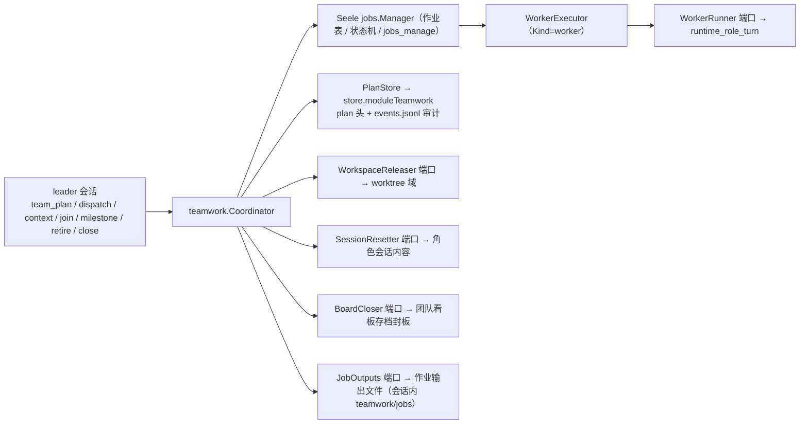
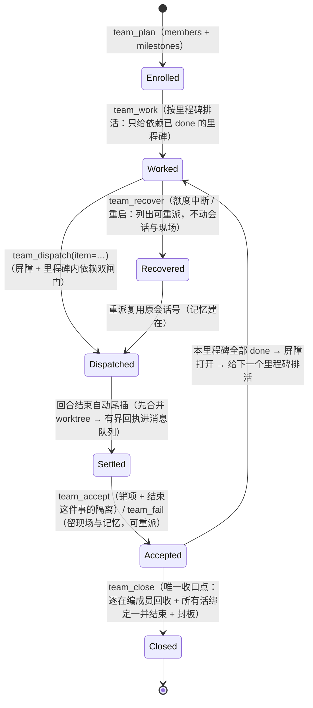

# teamwork（`backend/multiagent/teamwork`） — leader/worker 团队编排域

## 生态位

把 teamwork 从「一排轮流发言的座位」重做成「**一个 leader + 一组可被派发 / 观察 /
终止的 worker 作业**」。分工（`docs/arch/teamwork-leader-worker-architecture.md` §2 / D1）：

物理位置：2026-10-16 按
[plan.md](../../../docs/2026-10-15-architecture-reshape/plan.md) §2.7 从 `seelebridge/teamwork/`
整包归位到这里（**包名不变、内容零 diff**，只有 import 路径与注释里的落点改写）。
同域的执行体（角色回合、作业派发、看板投影、会话实时面）仍在装配包
`backend/engine/assemble`，它们的下沉是 J2 的续做项。

- **作业面**归 Seele 的 `jobs` 根能力（契约 + `Manager` + `jobs_manage`）；
- **硬编排**归本包：计划（谁、什么顺序）+ 派发 + 汇合 + 里程碑 + 退场 + 整队收口；
- **执行体**（在角色会话里真跑一轮）与**工作区**（git worktree）是**端口**，由装配层
  （`backend/engine/assemble/runtime_teamwork.go`）注入——本包因此能在没有引擎、没有 git 的测试里把
  编排语义（顺序、超员拒绝、作用域回收、退场四步）全部跑完。

顺序的**唯一事实**是计划的顺序边：里程碑之间是 `milestones[].depends_on`（屏障），里程碑内是
`work_items[].depends_on`（DAG）——不是 leader 的调用姿势，也不是任何「上一轮是谁」的隐式状态。
（`stages` 已整条退场：它不在计划结构、DTO、投影与工具 schema 里，读侧也不再认它。）

## 与其它域的关系



## 生命周期状态



（阶段制口径已退场：`team_plan(stages…)` 写进去的阶段不再被任何读侧认作顺序事实，工具 schema 里
也没有这个属性。leader 级的老派发 `team_dispatch(role, goal)` 仍受理，但**归属只有格**——它没有
可回执的阶段，只会拿到 handle。）

## Work Item：一里程碑一屏障、一件事一套隔离

- **Milestone 是屏障，Work Item 是调度单位**：`milestones[].depends_on` 管里程碑之间（串行），
  `work_items[].depends_on` 管里程碑内（DAG 并行）。跨里程碑的 item 依赖被**显式拒绝**。
- **一个 Work Item 一个 Session + 一个 git worktree**：会话号
  `WorkItemSessionID(...)` = `<role_session>-wi-<itemID>`；worktree 指派名
  `seelex/<role>-<itemID>`（与 worktree 管理器的 nodeID 同一套命名）。
  绑定落**追加型 JSONL**（`teamwork/worktrees.jsonl`，KV 语义：按 work_item 取最后一行）。
- **尾插是自动的**：`workerExecutor` 在回合结束后调 `ItemSettler.SettleWorkItem` ——
  **先合并**这件事的 worktree，再把有界一行插进 teammate 的消息队列（= 审计流里
  `kind=message` 的行，按 `role_session_id` 读）。合并失败也插，正文写明
  「插入失败 → 请 leader 亲自执行」并把 bug 原文带上。
- **中断恢复不清会话**：额度中断 / 进程重启之后，`Recover` 只把"句柄已作废、可重派"显式化；
  重派同一个工作项会**复用原会话号**（记忆必须建在）。

## 职责与非职责

职责：

- 计划校验与持久化（`SetPlan`）：会话作用域、`PlanStore` / `jobs.Manager` 装配、成员权限格子
  合法性（0..255）、里程碑与工作项的 id 与依赖闸门、人数上限（`limits.team.max_teammates`，
  超限**显式拒绝**，不静默排队）——**在持久化点再校验一次**（计划可被 leader 重写，
  第二道闸必须存在）；
- 派发（含去重与超员拒绝）、有界汇合、里程碑、退场四步与整队收口（`Close`）；
- 追加 `plan / dispatch / join / milestone / retire / close` 审计行（append-only）。

非职责：

- 不跑 teammate（跑是 `jobs.Manager` + `WorkerRunner` 的事）；
- 不做 git 操作、不碰角色会话内容、不 import `application` 或根包——全部走端口。

## 目录或文件结构

| 文件 | 职责 |
|---|---|
| `teamwork.go` | 端口契约（`PlanStore` / `WorkerRunner` / `WorkspaceReleaser` / `Workspaces` / `TeammateQueue` / `SessionResetter` / `BoardCloser` / `JobOutputs` / `ItemSettler`）、`Options`、`Coordinator` 装配、计划校验、成员权限格子折叠 |
| `coordinator.go` | 计划/派发/汇合/里程碑/退场/收口（`SetPlan` / `Dispatch` / `Join` / `Milestone` / `Retire` / `Close`，`Retire` 与 `Close` 复用 `retireStepsLocked(reclaim bool)`），以及 `audit` |
| `planlock.go` | **计划头读-改-写的进程内互斥锁**（按 `store.Key` 分片的包级锁表；`lockPlan` / `unlockPlan`） |
| `items.go` | **Work Item 生命周期**：`PlanMilestone` / `AdjustItem` / `DispatchItem` / `SettleWorkItem`（尾插）/ `AcceptItem` / `FailItem` / `Items` / `Recover`，屏障与里程碑内依赖闸门、绑定账本折叠 |
| `executor.go` | 作业执行体：`WorkerExecutor(runner, settler, maxTurns)`（`Kind=worker`）；回合结束后**自动尾插**（`SeatExecutor` 已随 goal 席位轮转退场） |
| `store.go` | `store` 持久面的适配与计划/绑定读写 |
| `board.go` | **团队看板读面**（原 `application/core/teamwork_service.go`，M5-R8c 归位）：`BoardReader` 只做转发与"未装配 / 宿主不支持该投影"时的空视图口径（不解释、不缓存、不做判定）；`application/core` 侧只留同名门面方法 |
| `teammate_live.go` | **当前 teammate 会话的实时只读投影**（P21-12 从 `backend/engine/assemble/runtime_teammate_session_live.go` 归位，plan §2.7）：`TeammateSessionLive`（默认页）/ `TeammateSessionLivePage`（分页）+ 唯一一份裁剪分页判据 `teammateSessionLiveSlice` + 投影 `teammateSessionLiveProject`（只留 user/assistant、单条长度上限）+ `TeammateLiveDeps` / `TeammateLiveSession`（宿主读数：角色名 / 是否在飞 / 引擎历史） |
| `board_view.go` | **团队看板的投影判据**（P21-20 从 `backend/engine/assemble/runtime_teamwork_board.go` 归位，plan §2.7）：`BuildBoardView`（下发与存档**同一条**路径）+ `MemberViews` / `MemberStatus`（人的状态只有 running/free 两值）/ `MemberCurrent`（“此刻那件事的会话”三段优先，不用长期角色会话顶替）/ `WorkItemViews`（Live 与卡点都走编排面同一处判据 `ItemGateOf`）/ `MilestoneViews` / `JobViews` + `RoleFromSubject`（`emp_<role>` 反解）/ `EventViews`（审计只取最近 `BoardEventLimit` 条）/ `ProjectionStale`（句柄过期提示位）/ `PlanHasOrchestration` |
| `tool_shapes.go` | **leader 编排工具的 12 组形状**（P21-21 从 装配层同名文件（已删除）整份归位，plan §2.7，与 `backend/tool/review` 的 `show_files` 同款形状）：`Team<X>ToolName` 常量 ×12 + `Team<X>Description()` / `Team<X>Schema()` ×12（计划 / 派发 / 汇合 / 里程碑 / 关闭 / 上下文 / 做工 / 工作项 / 验收 / 判负 / 回收 / 清单）。描述与 schema 面向**提示词**：既是准入面也是文档面 |
| `tool_requests.go` | **工具入参形状与解码**（P21-37 从 `backend/engine/assemble/runtime_teamwork.go` 的十个 handler 搬进本域）：`PlanRequest` / `DispatchRequest` / `WorkRequest` / `ItemRequest` / `ItemNoteRequest` / `JoinRequest` / `MilestoneRequest` + 七个 `Decode*`（默认值：plan version 缺省 1、join 预算缺省 5s 并丢弃空白句柄；trim 口径：role/item/id/milestone trim，goal/note/content **原样**——它们是给模型/人看的正文）。与 `tool_shapes.go` 的 schema 同处一域：schema 改了、解析结构没跟上会让模型按 schema 发的东西被静默丢掉 |
| `tool_requests_test.go` | 七个解码入口的默认值/trim 口径/逐字段搬运/顺序保持/非 JSON 报错 |
| `context_view.go` | **成员工作上下文读面的投影与判据**（P21-22 从 `backend/engine/assemble/runtime_teamwork_context.go` 归位，plan §2.7）：`BuildContextView`（唯一组装路径）+ `MemberJobsPort`（只 Peek/Snapshot/Observe——"它绝不会 Fetch/Done/Kill"写进类型）/ `MemberOutputsPort` + 最新作业行选取（优先在跑、否则登记序号最大）/ 行不在册时按角色名**回读残边**（`Evicted=true`）/ `RoleMilestone` / 角色过滤 / `ContextBodyBudget`（缺省 4KB、硬上限 32KB）+ `TruncateContextBody`（按字节裁且**不切碎 UTF-8 字符**）+ `ReadOutputHead` |
| `output_store.go` | **产品自有作业输出面**（P21-23 从 装配层同名文件（已删除）整份搬入，plan §2.7）：`OutputStore` 实现本包的 `JobOutputs` 端口——目录按会话走（`<sessionRoot>/teamwork/jobs`）、每次派发一个**互不覆盖**的文件（`<role>-<n>.log`，进程内单调、**不复用**落点）、写入与清目录经**同一把锁**串行（迟到的写查不到落点即静默丢弃，S5 残边）、按角色名回读最近一份（`LatestJobOutputPath`，服务"行被框架 prune 逐出"那条残边）、角色名过 `safeRoleFileName` 折成安全片段 |
| `board_archive.go` | **看板存档的生命周期判据**（P21-24 从 `backend/engine/assemble/runtime_teamwork_board_archive.go` 与 `..._board_close.go` 归位，plan §2.7；契约 docs/arch/session-board-metadata-lifecycle.md §5/§6/§7/§8/§9）：`NextBoardMeta`（无档新开一版 / **换版本先关旧后开新**（`team.replan`）/ 同版本只推进 seq 与 updated_at / 指纹不变即节流；读失败与"没档案"同解）、`ReadBoardArchive`（只恢复 active 且快照可解且有里程碑；`Recovered=true` 且 `Stale=true`）、`SealBoard`（把在册那一版关成 `team.close`，可顺带刷新快照；幂等，读失败上抛）、`BoardFingerprint`（§7 节流判据） |
| `job_projection.go` | **作业完成投影**（P21-25 从 `backend/engine/assemble/runtime_teamwork_jobs.go` 归位，plan §2.7）：`ProjectJobCompletions`（按读取顺序搬运、空表归一 nil）+ `JobCompletionFrom`（"每一列都要到"的搬运口径：角色由 `emp_<role>` 反解、工作项取 `Node`）+ `AsyncStateFromJobs`（框架状态词 → 契约枚举，**只折一次**；认不得的词落 `AsyncStateUnknown`——"认不得"不许被折成"还在跑"） |
| `scene.go` | **团队现场名单判据 + 指派名的反向换算**（P21-26 从 `backend/engine/assemble/runtime_teamwork_scene.go` 归位，plan §2.7）：`SceneIndex`（计划（成员 → 工作项）+ 账本**原始行**（未释放）→ `SceneEntry{NodeID, Role, WorkItem}`，按 nodeID 去重保序；刻意不经折叠读法——折叠以 work_item 为键会把 WorkItem 留空的 teammate 级行整行丢掉）、`SceneNodeIDs`（只取名字的投影）、`NodeIDFromWorktreeName`（`seelex/<nodeID>` → nodeID，**与正向拼装 `WorkItemWorktreeName` / `TeammateWorktreeName` 同处一域**——两个方向过去分居两包，现在一条命名只有一域） |
| `worker_round.go` | **teammate 回合面的三条纯判据**（P21-29 从 `backend/engine/assemble/runtime_teamwork.go` 归位，plan §2.7）：`RoundsPerMember`（"一名 teammate 收口前最多派多少轮"的量级取用值 64）+ `JobRecordCeiling`（作业表记录槽上限：规模换算，**只抬不降**、永不低于框架缺省；计划侧"不限制"按一名成员算）、`TurnLimit`（成员级 `max_turns` 优先，否则回退宿主给的默认）、`RoundInput`（回合输入正文的组装：`<milestone>` 标签只认里程碑、正文 trim、没有正文时如实说明） |
| `plan_query.go` | **计划查询的两条判据**（P21-33 从 `backend/engine/assemble/runtime_teamwork.go` 的两个遍历点搬进本域，与已有 `items.go` 的 `findItem` 同源）：`ItemRole(plan, id)`（按 id 查执行角色；入参 trim 后比较；查不到/空 id ⇒ 空串）与 `MemberOf(plan, role)`（按角色名查在编成员；trim 后比较；查不到/空角色 ⇒ false）。收口之前派发回执那边另写了一次"遍历里程碑找 item.Role"的循环——与 `findItem` 口径略不同，迟早漂移 |
| `unit_record.go` | **teammate 单元记录的写侧口径**（P21-34 从 `backend/engine/assemble/workunit_team.go` 归位，plan §2.7）：`UnitStatusRunning` / `UnitStatusDone` / `UnitStatusFailed`（记录那一格的词表——"在跑"复用 workunit 契约、终态来自 `dto.SubAgent*`，记录词 = wire 词）、`UnitStatusFor`（收尾分类 → 记录终态：**只有判死那一类记 failed**；未提交 / 主工作区挡路都记 done，产出还在现场）、`UnitNodeID`（一轮作业的 nodeID：有独立现场就去前缀，降级共享工作区按 `<role>-<itemID>` 拼，连工作项都没有退到角色名）；（P21-35 补：`UnitRecordKey` / `UnitRecordKeyFor`（记录身份：nodeID 口径见 `UnitNodeID`、标量与插件集合搬运）+ `TeammateUnitRecordLink`（写链上 teammate 那一环：Kind=teammate / Role / Plugins / SystemPrompt 写进 `record.Unit`，其余字段一概不动；与 subagent 的身份环同形）） |
| `unit_recovery.go` | **中断判定的判据面**（P21-36 从 `backend/engine/assemble/workunit_team_records.go` 的 `RecoverTeamworkUnits` 归位，plan §2.7）：`InterruptedUnits(index, progress, stored, ledgerInterrupted, surfaceAlive)` → `UnitRecovery{Interrupted, Notes}`——两条来源一次去重（记录侧：在跑且执行面不在；账本侧：状态说在跑、句柄不在册——**记录缺席**时也不漏），并按记录生成恢复说明（键 = 角色会话号，正文来自 `workunit.RecoveryNote` 唯一构建器）。`surfaceAlive == nil` 时保守判中断（可重派清单只会多不会少） |
| `unit_recovery_test.go` | 在跑无执行面 ⇒ 中断 + 说明；执行面还在 / 终态记录 ⇒ 不中断；账本侧覆盖记录缺席、有执行面排除、名单外忽略；两来源去重保序 |
| `unit_record_test.go` | 词表来自契约、收尾分类四支路（只有 failed 记 failed）、单元身份三形态与空输入 |
| `plan_query_test.go` | 按 id 找执行角色（trim/查不到/空 id/空计划）、按角色找成员（trim/查不到/空角色） |
| `worker_round_test.go` | 记录槽上限"只抬不降"两半（换算低于缺省取缺省、高于缺省照用）与"不限制"同解、回数上限优先与回退、输入正文（里程碑标签/正文 trim/task 点名角色/无正文与无里程碑两形态） |
| `scene_test.go` | 反向换算与正向拼装互逆（含空白与无前缀输入）、名单次序（计划在前账本在后、去重保序、已释放不认领、空白指派名跳过）、teammate 级行 WorkItem 留空、空输入与 nodeID 投影 |
| `job_projection_test.go` | 逐列搬运（含缺主体/缺状态）、状态折算（四词 + 空值 + 未知词）、顺序保持与空表归一 |
| `board_archive_test.go` | 生命周期三规则 + 换版本写序（新开→刷新→关旧）+ 已退场不再续命 + 读失败按首次写；恢复只认 active（四种不恢复形态）；封板幂等与读失败上抛；指纹稳定 |
| `output_store_test.go` | 随实现搬入的域级用例（逐字）：每次派发互不覆盖且落在会话目录、角色名折成安全片段、清目录= 删整目录 + 作废落点（迟到写丢弃、不复用）、非本面分配的路径拒绝写、按角色名取序号最大的一份、无会话归属显式报错、缺 store/keyFor 构造函数返回 nil |
| `context_view_test.go` | 预算夹取与缺省、UTF-8 安全裁剪、最新作业行选取、空转与残边回读两条空闲形态、角色过滤归一 |
| `tool_shapes_test.go` | 随实现搬入的断言（逐字）：team_plan schema 是**里程碑口径**（milestones 有 name/depends_on、`after` 整条退场、required 说明是角色声明）、**没有 stages**、description 讲里程碑词表、成员级 `max_turns` 既进 schema 也进 description |
| `board_view_test.go` | 出图五份行齐与闭板三字段从计划搬、人状态两值、队列销项即出队、当前会话三段优先、主体反解、审计有界保序、过期提示位、编排判据 |
| `teammate_live_test.go` | 域级用例：有界裁剪（条数 + 单条长度 + 如实标 Truncated）、只留 user/assistant、分页归一（负 offset / limit<=0 / 越界页）、默认页取尾部、执行面不在本进程时的空视图语义 |
| `teamwork_test.go` / `items_test.go` | 端口桩驱动的编排语义测试（后者按 Work Item 口径逐条覆盖九类要求） |
| `items_concurrent_test.go` | **并发 settle 丢失更新**的回归用例：`TestConcurrentSettleDoesNotLoseUpdates`（N=5 全并发 settle）+ `TestConcurrentSettleAndAcceptDoNotResurrectDone`（settle 混 accept，done 不得被写回）。用会合点（`rendezvous`）排定交错，不靠 sleep；内存替身按生产语义 JSON 深拷贝计划 |

## 核心实现

`Coordinator` 只掌控顺序、作用域与收口，它**自己不跑**任何 teammate——这正是
「leader 阻塞与否与 worker 是否推进正交」的落点。

- `Dispatch` 拒绝未在编的角色、拒绝超过产品级上限的成员（**显式拒绝，绝不静默排队**：
  排队会把「队伍满了」伪装成「它在跑」），并对同一角色的重复派发用 `jobs.Spec.Dedup`
  收敛到已运行的那条（两条作业共享一个 worktree 会让「谁在改这里」失去答案）。
- `Join` 是**有界**等待且**只观察不取回**：取回（`Fetch`）是消费式的，会把 teammate 的
  输出从工作表格上拿走。等待用 `jobs.Manager.Events()` 的变更信号口 + 短定时器，不轮询。
- `Retire` / `Close` 复用**同一套**四步（`retireSteps(role, reclaim bool)`）：释放工作区 →
  清会话内容 → 保留在编；**回收作业只发生在 `reclaim=true`**，也就是整队收口——`Close`
  逐在编成员回收该主体名下的作业（`Reclaim(Scope{Session, Subject})`，不动兄弟 teammate）
  → 封板团队看板存档（`closed` / `team.close`）→ 计划标 `closed` → 落一条 `close` 审计；
  幂等（第二次返回 `already_closed`，不重复封板、不重复审计）。于是「谁还在跑」在收口之前
  一直留在册上——**退场不撤走作业正文**。**端口缺失是显式错误**，不是静默跳过——worktree
  数量只有在退场真的释放时才被封顶。
- `Dispatch` 在装配了 `JobOutputs` 时**先分配产品自有输出路径**（同时写进
  `jobs.Spec.OutputPath` 与 `WorkerRequest.OutputPath`），正文因此活到 `Close`：框架不建
  写句柄、只按偏移读，销项 / 驱逐 / Close 都不删它，收口时才 `ClearJobOutputs`。分配失败
  即报错，不悄悄退回框架自建文件（那会让「正文活到 close」时真时假）。
- 超员闸门按**角色**扣掉自己那一条：`Retire` 不再回收作业之后，退场后重派同一个角色不会
  自己把自己顶在上限外（同一角色的重复派发会折叠到在跑的那一条）。
- `audit` 失败**不吞**：审计与计划是同一份事实的两个面。

## 依赖方向

`teamwork` → `Seele jobs`、`store`（计划/审计持久面）。**禁止** import
`application/*` 或装配包 `backend/engine/assemble`；执行体与工作区经端口反向注入。

## 并发、存储、安全或错误语义

### "还没声明团队"是一个状态，不是错误（2026-10-15）

`PlanStore.ReadPlan` 的读面契约是**缺失返回空计划 + nil**（`IsEmpty` 为真），
不是把 `metadata/teamwork.json` 的 `ENOENT` 上抛。分工：

- **读面宽容**：`Items`（team_items）/ 上下文投影（team_context）对空计划给**空结果**
  ——模型看到的是"还没有内容"，不是一条内部路径噪声；
- **写面显式**：需要已声明团队的入口（`PlanMilestone` / `DispatchItem` / `AdjustItem` /
  `AcceptItem` / `FailItem` / `Dispatch` / `Milestone` / `Close`）经**唯一判据**
  `requireTeam` 翻成同一句领域文案：`teamwork: 本会话还没有团队计划——先用 team_plan
  声明在编成员与里程碑`。

现场（2026-10-15）：模型在一个没有计划的会话里调 `team_items` / `team_context`，收到
`team_items: open …\metadata\teamwork.json: The system cannot find the path specified.`，
并自行判定"这是错误，不是空结果"——它没有可用的下一步。判据只有一处（`requireTeam`），
别在各入口各写一遍"什么算还没组队"。

- **计划头读-改-写是原子的**：`SetPlan` / `PlanMilestone` / `AdjustItem` / `DispatchItem` /
  `SettleWorkItem` / `AcceptItem` / `FailItem` / `Dispatch` / `Milestone` / `Retire` /
  `Close` 都在**同一把按 `store.Key` 分片的包级计划锁**内完成"读计划 → 改 → 写计划"
  （`planlock.go`）。store 的模块锁只覆盖单次 `commitModuleHead`，跨这三步没有锁——不补这把
  锁就会出现"5 个并发 settle、2 个被后写覆盖回 running"的丢失更新（2026-10-05 实测）。
  为什么不是 store 层 CAS、锁粒度为什么选在 Key，见 `planlock.go` 的取舍注释。
- **锁顺序铁律**：计划锁永远在最外层。它在任何 store 调用（内部取模块锁）之前取得，所以
  "计划锁 → 模块锁"是一条全序，不存在反向获取。锁**不可重入**：需要嵌套的场合一律走
  `...Locked` 变体（`retireStepsLocked`），由外层持锁、内层不取锁。
- **慢操作不在临界区内**：`SettleWorkItem` 的 git 合并（`MergeWorkspace`）在计划锁**之外**
  执行，但可观察顺序不变（合并 → 尾插 → 状态落 `review` / `failed`）；合并后进入临界区时
  会**重读计划**并再判一次 `running`，因此合并期间若计划已被别人收口，本次是幂等的空操作。
- **回归测试**（`items_concurrent_test.go`）：两条并发用例用**会合点**（`rendezvous`）把
  交错排定，而不是靠 sleep 碰运气。修复前（HEAD 的 `items.go`/`coordinator.go` + 同一份用例）
  两条用例 3/3 次失败（`wi-0 状态 = running`、已 `done` 的 `wi-2` 被覆盖回 `running`），
  修复后 `-count=20` 全绿、`-race` 通过。注：`-race` 在修复前的副本上**不报**竞态——丢失的
  原子性跨三次调用，探针索引不到；这条测试因此不能用 `-race` 替代。
  证据与复现命令：`docs/devlog/2026-10-05-concurrent-settle-lost-update-regression.md`。
- 执行体的 ctx 是 `jobs.Manager` 从 `Background` 派生的：**会话归属与工作正文一律走
  载荷**（`WorkerRequest` / `SeatRequest`），不能指望执行体 ctx 里还有原调用；
- 作业作用域 = `{Session: 主会话, Subject: emp_<role>}`；`Subject` 同时是权限主体；
- 成员权限格子（组 → 位）越界（非 0..255）是**计划写错了**，显式报错而不是截断成
  「分配成功」；
- 缺端口的动作一律显式报错，不静默降级（缺 `Worktrees` ⇒ 退场第二步报错）；`Boards` /
  `JobOutputs` 是**可选**端口，缺失时按「没装配」降级（不写存档 / 交回框架自建文件）。

## 扩展方式

- 换持久面：实现 `PlanStore`（生产实现是 `store.moduleTeamwork`）；
- 换执行体：实现 `WorkerRunner`；
- 换工作区策略：实现 `WorkspaceReleaser`（须遵守 `ErrUncommittedChanges` 语义）；
- 换看板存档面 / 作业输出面：实现 `BoardCloser` / `JobOutputs`。两者都是**可选**端口
  （"有就有、没有就是没装配"）：缺失 = 不写存档 / 交回框架自建输出文件；
- 换顺序来源：目前唯一事实是里程碑屏障（`milestones[].depends_on`）与里程碑内依赖
  （`work_items[].depends_on`）——要改顺序语义就改计划校验，而不是
  在执行体里加隐式状态。

## Review 指南

- 超员是否**显式拒绝**（不得排队）；同角色重复派发是否收敛到同一条作业；
- `Join` 是否只观察不取回、是否**有界**（预算到点如实返回「仍在跑」）；
- `Retire` 四步顺序是否固定、缺端口是否显式报错；回收是否**只在** `Close`、`Close` 是否幂等；
- 计划校验是否在**持久化点**也跑（不只在装配期）；
- 执行体是否只从载荷读会话归属与正文（不从 ctx 猜）。

## 测试与验证

端口桩驱动，不需要引擎/git（见 `teamwork_test.go`）。

```text
go test ./backend/multiagent/teamwork/ -count=1
go test ./backend/multiagent/... -count=1
```

## 文件与函数索引

> 由源码 doc 注释自动提取（首行摘要）；描述源码行为，与实现保持同步。
> 刷新方式：`python scripts/gen_core_readme_index.py`。

### board.go

- `func NewBoardReader(source any) BoardReader` — NewBoardReader 绑定宿主运行面（传 `service.Deps.Runtime` 这类宿主面接口值）。
- `func (reader BoardReader) BoardViewFor(sessionID string) *dto.TeamworkBoardView` — BoardViewFor 返回指定会话的团队看板只读投影（无计划 / 未装配 → nil，
- `func (reader BoardReader) SessionLiveFor(sessionID string) dto.TeammateSessionLiveView` — SessionLiveFor 返回**当前 teammate 会话**的实时只读投影（"这件事的会话此刻在
- `func (reader BoardReader) SessionLivePageFor(sessionID string, offset, limit int) dto.TeammateSessionLiveView` — SessionLivePageFor 返回**当前 teammate 会话**实时读数的分页一页（有界窗口 +
- `func (reader BoardReader) projections() (contract.TeamworkBoardProjection, bool)` — boardProjections 是"能回答团队看板"的宿主面；未装配 → 取不到。
- `func (reader BoardReader) liveProjections() (contract.TeammateSessionProjection, bool)` — liveProjections 是"能回答 teammate 会话 live 读数"的宿主面；未装配 → 取不到。

### board_archive.go

- `func NextBoardMeta(ctx context.Context, repository store.BoardRepository, key store.Key, plan store.TeamworkPlan, payload json.RawMessage, now time.Time) (store.TeamBoardMeta, bool, error)` — NextBoardMeta 按生命周期规则推进存档元数据（§5），并报告"是否需要写盘"（§7）。
- `func ReadBoardArchive(repository store.BoardRepository, key store.Key) *dto.TeamworkBoardView` — ReadBoardArchive 读存档并还原成看板投影（§6 重启恢复）。
- `func SealBoard(ctx context.Context, repository store.BoardRepository, key store.Key, payload json.RawMessage, now time.Time) error` — SealBoard 把一版**在册的**看板存档显式收口；payload 非空时顺带刷新快照内容。
- `func BoardFingerprint(payload []byte) string` — BoardFingerprint 是存档载荷的指纹（§7 节流判据）：同一份载荷 → 同一个值。

### board_archive_test.go

- `func (s *stubBoardRepository) ReadTeamBoard(context.Context, store.Key) (store.TeamBoardMeta, error)`
- `func (s *stubBoardRepository) WriteTeamBoard(_ context.Context, _ store.Key, meta store.TeamBoardMeta) error`
- `func (s *stubBoardRepository) WriteGoalBoard(context.Context, store.Key, store.GoalBoardMeta) error` — 目标看板那一半在本用例里不被触达，但接口是完整的（不做"只实现一半"的替身）。
- `func (s *stubBoardRepository) ReadGoalBoard(context.Context, store.Key) (store.GoalBoardMeta, error)`
- `func archivePlanFixture(version int) store.TeamworkPlan`
- `func TestNextBoardMetaOpensNewVersionAndClosesOld(t *testing.T)` — TestNextBoardMetaOpensNewVersionAndClosesOld：三条生命周期规则——无存档新开一版、
- `func TestBoardFingerprintIsStable(t *testing.T)` — TestBoardFingerprintIsStable：同一份载荷 → 同一个值；不同载荷 → 不同值。
- `func TestReadBoardArchiveOnlyRestoresActive(t *testing.T)` — TestReadBoardArchiveOnlyRestoresActive：只有 active 且快照可解、且有里程碑时才恢复；
- `func TestSealBoardIsIdempotent(t *testing.T)` — TestSealBoardIsIdempotent：封板把在册那一版关掉（可顺带刷新快照）；已 closed / 无存档都是
- `func boardArchiveViewFixture() map[string]any` — boardArchiveViewFixture 造一份"有里程碑"的看板投影（存档恢复的最小形状）。

### board_test.go

- `func (fake *boardFake) TeamworkBoardSnapshot(sessionID string) *dto.TeamworkBoardView`
- `func (fake *boardFake) TeammateSessionLive(sessionID string) dto.TeammateSessionLiveView`
- `func (fake *boardFake) TeammateSessionLivePage(sessionID string, offset, limit int) dto.TeammateSessionLiveView`
- `func TestBoardReaderUnassembledReturnsEmptyViews(t *testing.T)` — TestBoardReaderUnassembledReturnsEmptyViews 钉"未装配"口径：nil 宿主不是错误，
- `func TestBoardReaderUnsupportedHostReturnsEmptyViews(t *testing.T)` — TestBoardReaderUnsupportedHostReturnsEmptyViews 钉"已装配但不支持该投影"口径：
- `func TestBoardReaderForwardsToProjection(t *testing.T)` — TestBoardReaderForwardsToProjection 钉"装配了就走宿主"：读法不得本地判定/缓存，

### board_view.go

- `func SubjectPrefix() string` — SubjectPrefix 与 `SubjectForRole` 同源（`emp_<role>`）：装配层用它把作业行的作用域主体
- `func BuildBoardView( plan store.TeamworkPlan, events []store.TeamworkEvent, bindings []store.TeamworkBinding, records []jobs.Record, maxMembers int, assemblies []dto.PluginAssemblyView, ) dto.TeamworkBoardView` — BuildBoardView 是把（计划 + 审计 + 作业行 + 装配读数）组装成下发前端的
- `func PlanHasOrchestration(plan store.TeamworkPlan) bool` — PlanHasOrchestration 报告一份计划有没有**可看的编排**。
- `func MemberViews(plan store.TeamworkPlan, events []store.TeamworkEvent, records []jobs.Record, assemblies []dto.PluginAssemblyView) []dto.TeamworkMemberView` — MemberViews 搬运在编成员。Permission 格子**不下发**：它是权责分配的实现细节，
- `func MemberStatus(plan store.TeamworkPlan, member store.TeamworkMember) string` — MemberStatus 把一个人名下工作项的状态折算成人的状态，**只有两个值**（2026-10-04 用户口径）：
- `func MemberCurrent(plan store.TeamworkPlan, role string) (sessionID, workItem string)` — MemberCurrent 反解"这个人此刻那件事的会话"：优先在跑的工作项，其次等验收的，
- `func WorkItemViews(plan store.TeamworkPlan, bindings []store.TeamworkBinding, records []jobs.Record) []dto.TeamworkWorkItemView` — WorkItemViews 搬运工作项（甘特图的扁平数据面）。
- `func MilestoneViews(milestones []store.TeamworkMilestone) []dto.TeamworkMilestoneView` — MilestoneViews 搬运里程碑（after 是判据边，原样搬；status 空 = pending）。
- `func JobViews(records []jobs.Record) []dto.TeamworkJobView` — JobViews 搬运作业行，并给出**权威归属**：Node = record.Node（派发时写的是
- `func RoleFromSubject(subject string) string` — RoleFromSubject 把 emp_<role> 反解成角色名；不是这个前缀就原样返回（不猜）。
- `func EventViews(events []store.TeamworkEvent) []dto.TeamworkEventView` — EventViews 搬运审计流水；只取**最近** `BoardEventLimit` 条（保持文件顺序 = 发生顺序）。
- `func ProjectionStale(state store.TeamworkState, views []dto.TeamworkJobView) bool` — ProjectionStale 判定"计划里的句柄投影是否已经过期"（jobs I-4 的显式化）：

### board_view_test.go

- `func boardPlanFixture() store.TeamworkPlan`
- `func TestBuildBoardViewCarriesFactsNotJudgments(t *testing.T)` — TestBuildBoardViewCarriesFactsNotJudgments：看板只搬事实——闭板三字段从**计划**搬、
- `func TestMemberStatusHasOnlyTwoValues(t *testing.T)` — TestMemberStatusHasOnlyTwoValues：人的状态只有 running / free 两值（看板回答"此刻在不在干活"）。
- `func TestMemberStatusSkipsDoneItemsInQueue(t *testing.T)` — TestMemberStatusSkipsDoneItemsInQueue：队列是"还没完成的工作项名称"（销项即出队）。
- `func TestMemberCurrentPrefersRunningThenReviewThenLast(t *testing.T)` — TestMemberCurrentPrefersRunningThenReviewThenLast："这个人此刻那件事的会话"三段优先，
- `func TestJobViewsReverseSubjectBackToRole(t *testing.T)` — TestJobViewsReverseSubjectBackToRole：作业行的角色由作用域主体反解（emp_<role>）；
- `func TestEventViewsKeepsOnlyRecent(t *testing.T)` — TestEventViewsKeepsOnlyRecent 钉住审计投影的有界性：只取最近 BoardEventLimit 条，
- `func TestProjectionStaleIsOnlyAHint(t *testing.T)` — TestProjectionStaleIsOnlyAHint：句柄过期提示位——计划里记着句柄、本进程作业表一个都查不到
- `func TestPlanHasOrchestrationRequiresMilestones(t *testing.T)` — TestPlanHasOrchestrationRequiresMilestones：可看的编排 = 有里程碑（阶段口径已退场）。

### context_view.go

- `func BuildContextView(ctx context.Context, plan store.TeamworkPlan, records []jobs.Record, port MemberJobsPort, outputs MemberOutputsPort, options ContextOptions) dto.TeamworkContextView` — BuildContextView 把（计划 + 作业行 + 可选正文）组装成 `dto.TeamworkContextView`。
- `func memberContext(ctx context.Context, plan store.TeamworkPlan, member store.TeamworkMember, records []jobs.Record, port MemberJobsPort, outputs MemberOutputsPort, options ContextOptions) dto.TeamworkMemberContextView` — memberContext 组装一个成员的工作上下文：先找它名下**最新**的作业行，再按需取正文。
- `func attachEvictedBody(ctx context.Context, outputs MemberOutputsPort, role string, options ContextOptions, view *dto.TeamworkMemberContextView)` — attachEvictedBody 在"行不在册"时尝试从**产品自有文件**回读正文。
- `func latestRecordFor(records []jobs.Record, subject string) (jobs.Record, bool)` — latestRecordFor 取某主体名下**最新**的那条作业行：优先在跑的，否则取登记序号
- `func RoleMilestone(plan store.TeamworkPlan, role string) string` — RoleMilestone 反解角色**当前归属的里程碑**：这个角色在哪个里程碑的工作项里出现过
- `func roleFilter(roles []string) map[string]struct` — roleFilter 归一 roles 过滤：空 / 全空白 = 不过滤（全员）。
- `func ContextBodyBudget(requested int) int` — ContextBodyBudget 把调用方给的预算夹到 [1, ContextMaxBodyBytes]；
- `func TruncateContextBody(body string, limit int) (string, bool)` — TruncateContextBody 按**字节**预算裁剪，并保证不切碎一个 UTF-8 字符（正文是中文的
- `func ReadOutputHead(path string, limit int) (string, error)` — ReadOutputHead 读一个产品自有输出文件的前 limit 字节（limit<=0 = 读全）。文件不存在 =

### context_view_test.go

- `func (s *stubMemberJobs) Snapshot(jobs.Scope) []jobs.Record`
- `func (s *stubMemberJobs) Observe(handle jobs.Handle) (jobs.Record, bool)`
- `func (s *stubMemberJobs) Peek(_ context.Context, handle jobs.Handle, _ jobs.FetchBudget) (string, jobs.Record, error)`
- `func contextPlanFixture() store.TeamworkPlan`
- `func TestContextViewTakesBodyOnlyWhenAsked(t *testing.T)` — TestContextViewTakesBodyOnlyWhenAsked：默认不取正文（看一眼成员状态不该把内容变成"已读"）——
- `func TestContextBodyBudgetClamp(t *testing.T)` — TestContextBodyBudgetClamp：预算夹取——缺省 4KB、超过硬上限按 32KB。
- `func TestTruncateContextBodyKeepsUTF8Intact(t *testing.T)` — TestTruncateContextBodyKeepsUTF8Intact：按字节裁但**不切碎**字符（切半字符是损坏，不是截断）。
- `func TestLatestRecordForPrefersRunningThenSeq(t *testing.T)` — TestLatestRecordForPrefersRunningThenSeq：最新作业行 = 优先在跑的，否则登记序号最大
- `func TestContextViewIdleShapes(t *testing.T)` — TestContextViewIdleShapes：空闲的两种形态——没派过活（无残边）与行被逐出但产品自有文件里有正文
- `func TestContextViewClosureFlagAndRoles(t *testing.T)` — TestContextViewClosureFlagAndRoles：闭板标记来自计划；roles 全空白 = 不过滤（全员）。
- `func (s *stubMemberOutputs) LatestJobOutputPath(_ context.Context, role string) (string, bool, error)`

### coordinator.go

- `func (c *Coordinator) Plan(ctx context.Context) (store.TeamworkPlan, error)` — Plan 读回当前计划。
- `func requireTeam(plan store.TeamworkPlan) error` — requireTeam 是"这次调用需要一个已声明的团队"的**唯一判据**（空计划 → errNoPlan）。
- `func (c *Coordinator) Audit(ctx context.Context) ([]store.TeamworkEvent, error)` — Audit 读回审计流水（派发 / 里程碑 / 收口的事实顺序）。
- `func (c *Coordinator) SetPlan(ctx context.Context, plan store.TeamworkPlan) error` — SetPlan 写入（整份替换）一份计划，并把这次改写记进审计面。
- `func pluginAssemblySummary(members []store.TeamworkMember) string` — pluginAssemblySummary 把成员的插件装配压成一行**审计摘要**（与回执同一口径：
- `func countItems(plan store.TeamworkPlan) int` — countItems 数一份计划里的工作项总数（审计行用）。
- `func (c *Coordinator) Dispatch(ctx context.Context, role, goal string) (jobs.Handle, error)` — Dispatch 派发一个 teammate 的作业：受理回执即 handle，调用方不等待。
- `func (c *Coordinator) Join(ctx context.Context, handles []jobs.Handle, budget time.Duration) ([]jobs.Record, error)` — Join 是一次**有界**汇合等待：只在该汇合点真有依赖时用（§6.2 / §6.3 的 A 姿势）。
- `func (c *Coordinator) Milestone(ctx context.Context, id, content string) error` — Milestone 声明一个里程碑并写入 leader 撰写的内容（§4.5）。
- `func (c *Coordinator) closeStepsLocked(ctx context.Context, role string) (store.TeamworkPlan, error)` — closeStepsLocked 是**整队收口**里对单个在编成员做的四步（Close 的唯一实现），也是整个
- `func (c *Coordinator) Reclaim(ctx context.Context, role string) error` — Reclaim 回收**一个 teammate 单元**：步 1 回收它名下的作业 → 步 2 拆它的现场（角色级
- `func (c *Coordinator) reclaimStepsLocked(ctx context.Context, plan store.TeamworkPlan, role string) error` — reclaimStepsLocked 是收口四步的**前三步**（步 1–3）的唯一实现。
- `func (c *Coordinator) AliveSceneNodes(ctx context.Context) (map[string]bool, error)` — AliveSceneNodes 返回计划里"本进程还有执行面"的现场 nodeID 集合（契约命名：
- `func (c *Coordinator) Close(ctx context.Context) (bool, error)` — Close 收口整支团队（team_close）：逐在编成员走同一套四步（这里 reclaim=true，回收
- `func (c *Coordinator) observe(handles []jobs.Handle) ([]jobs.Record, int)` — observe 汇总一组句柄的只读读数，并返回仍在跑的条数。
- `func (c *Coordinator) ensureCapacity(role string) error` — ensureCapacity 是**产品级**人数约束的闸门（§4.3）。
- `func milestoneDone(plan store.TeamworkPlan, id string) bool` — milestoneDone 报告某个里程碑是否已 done（不在计划里 = 未完成，不静默放过）。
- `func minDuration(left, right time.Duration) time.Duration`

### dispatch_scene_test.go

- `func (s *fakeSpaces) boundWorktrees() []string` — boundWorktrees 返回建现场时收到的**指派名**——现场在册与否看的就是这个键。放在这
- `func containsName(names []string, want string) bool`
- `func TestDispatchBindsTeammateSceneAndRecordsLedger(t *testing.T)` — TestDispatchBindsTeammateSceneAndRecordsLedger —— ① 老口径派发必须建出
- `func TestCloseReleasesEverySceneOfRole(t *testing.T)` — TestCloseReleasesEverySceneOfRole —— ④ 一角色两 Work Item + 角色级现场：收口是**唯一
- `func (s *failingSpaces) ReleaseWorkspaceItem(ctx context.Context, binding WorkspaceBinding) error`
- `func newSceneFixture(t *testing.T, spaces *failingSpaces) *itemFixture` — newSceneFixture 建一个与 newItemFixture 同构的 fixture，只是 Workspaces 换成可注入
- `func TestCloseNamesTheItemWhoseSceneFailedToRelease(t *testing.T)` — TestCloseNamesTheItemWhoseSceneFailedToRelease —— 收口释放 Work Item 级现场时，

### executor.go

- `func WorkerExecutor(runner WorkerRunner, settler ItemSettler, maxTurns int) jobs.Executor` — WorkerExecutor 返回注册进 jobs.Manager 的 teammate 执行体（Kind = "worker"）。
- `func (e *workerExecutor) Kind() jobs.Kind`
- `func (e *workerExecutor) Start(ctx context.Context, spec jobs.Spec, sink jobs.Sink) error`

### items.go

- `func WorkItemSessionID(derive func(mainSessionID, teamID, roleName string) string, mainSessionID, teamID, role, itemID string) string` — WorkItemSessionID 派生「一个 Work Item 一个 Session」的会话号。
- `func WorkItemWorktreeName(role, itemID string) string` — WorkItemWorktreeName 派生「一个 Work Item 一个 worktree」的指派名
- `func TeammateWorktreeName(role string) string` — TeammateWorktreeName 派生 **teammate 级**（非 Work Item）现场的指派名。
- `func SceneNodeID(role, itemID string) string` — SceneNodeID 返回一个 Work Item 的现场 **nodeID**（`<role>-<itemID>`）——契约
- `func milestoneIndex(plan store.TeamworkPlan, id string) int` — milestoneIndex 返回里程碑在计划里的下标（不存在 = -1）。
- `func findItem(plan *store.TeamworkPlan, id string) (*store.TeamworkMilestone, *store.TeamworkWorkItem, bool)` — findItem 定位一个工作项，返回它所属的里程碑与**可变指针**。
- `func recomputeMilestones(plan *store.TeamworkPlan)` — recomputeMilestones 重算里程碑状态（屏障 + 收敛）。
- `func resolveMilestoneStatus(plan *store.TeamworkPlan, index int, memo map[int]string, visiting map[int]bool) string`
- `func (c *Coordinator) PlanMilestone(ctx context.Context, milestoneID string, specs []WorkItemSpec) error` — PlanMilestone 给一个里程碑**安排工作**（分里程碑排活）。
- `func (c *Coordinator) AdjustItem(ctx context.Context, itemID string, spec WorkItemSpec) error` — AdjustItem 调整一条**尚未开始**的工作项（人 / 名称 / 描述 / 达成目标 / 依赖）。
- `func (c *Coordinator) DispatchItem(ctx context.Context, itemID string) (jobs.Handle, error)` — DispatchItem 派发**一个工作项**。
- `func (c *Coordinator) SettleWorkItem(ctx context.Context, request WorkerRequest, runErr error) error` — SettleWorkItem 是 teammate 一轮跑完之后的**尾插程序**：先合并这件事的 worktree，
- `func (c *Coordinator) SettleWorkItemOutcome(ctx context.Context, request WorkerRequest, runErr error) (workunit.Outcome, error)` — SettleWorkItemOutcome 与 SettleWorkItem 是**同一段**尾插程序，只是把这一轮的收尾
- `func (c *Coordinator) settleWorkItem(ctx context.Context, request WorkerRequest, runErr error) (workunit.Outcome, error)` — settleWorkItem 是尾插程序的完整一段：合并半段 + 写态半段，**合并只做一次**。
- `func (c *Coordinator) ItemStatus(ctx context.Context, itemID string) (string, bool)` — ItemStatus 读一件事在计划里的状态（第二返回值 = 计划里有没有它）。
- `func (c *Coordinator) ItemSettled(ctx context.Context, itemID string) bool` — ItemSettled 报告这件事是不是已经收过尾（计划里已经不是 running）。
- `func (c *Coordinator) MergeWorkItem(ctx context.Context, request WorkerRequest) error` — MergeWorkItem 是尾插程序的**合并半段**：只回答"改动并回主工作区了吗"，返回合并失败
- `func (c *Coordinator) SettleWorkItemWith(ctx context.Context, request WorkerRequest, runErr, mergeErr error) (workunit.Outcome, error)` — SettleWorkItemWith 是尾插程序的**写态半段**：合并结果由调用方给（非空即采信，绝不
- `func applySettleOutcome(plan *store.TeamworkPlan, item *store.TeamworkWorkItem, outcome workunit.Outcome, receipt string)` — applySettleOutcome 把收尾分类写到工作项上（**唯一**映射，写回与读侧都认这一张表）：
- `func (c *Coordinator) AcceptItem(ctx context.Context, itemID, note string) error` — AcceptItem 是 leader 的**验收通过**：工作项 → done，销项。**不动现场与会话**——
- `func (c *Coordinator) FailItem(ctx context.Context, itemID, note string) error` — FailItem 是 leader 的**判定不通过**：状态 → failed（现场与记忆都留着，可重派）。
- `func (c *Coordinator) Items(ctx context.Context) ([]ItemView, error)` — Items 读回全部工作项（按里程碑顺序、里程碑内按排活顺序）。
- `func (c *Coordinator) Recover(ctx context.Context) (RecoveryReport, error)` — Recover 做**中断恢复**：把计划与绑定账本读回来，把"句柄已作废"显式化。
- `func (c *Coordinator) releaseBinding(ctx context.Context, binding store.TeamworkBinding, teamID, reason string) error` — releaseBinding 结束一份绑定的执行隔离：释放现场 → 清这件事的会话内容 → 追加释放
- `func (c *Coordinator) appendReleasedBinding(ctx context.Context, binding store.TeamworkBinding, reason string) error` — appendReleasedBinding 追加一行「这份绑定已释放」（账本 KV 语义：最后一行说了算）。
- `func (c *Coordinator) releaseRoleItemScenes(ctx context.Context, role, teamID, reason string) error` — releaseRoleItemScenes 释放某角色名下**每一个**已派发 Work Item 的现场（收口步 2
- `func teammateLevelBinding(binding store.TeamworkBinding, role string) bool` — teammateLevelBinding 报告一行账本是不是**角色级**（teammate 级）现场：它的指派名
- `func (c *Coordinator) markTeammateBindingReleased(ctx context.Context, role, reason string) error` — markTeammateBindingReleased 把角色级现场那一行账本记成已释放（现场已经由
- `func (c *Coordinator) releaseTeammateScenes(ctx context.Context, teamID, role, reason string) error` — releaseTeammateScenes 释放一个 teammate 的**全部**现场：角色级 + 该角色名下每一个
- `func (c *Coordinator) releaseAllItems(ctx context.Context, teamID string) error` — releaseAllItems 是整队收口时的**一并结束**：所有活绑定（会话 + 工作区）到此为止。
- `func (c *Coordinator) workspaceBinding(binding store.TeamworkBinding, teamID string) WorkspaceBinding` — workspaceBinding 把账本里的一行绑定折成工作区端口认识的现场（补上会话作用域键与
- `func (c *Coordinator) AppendTeammateMessage(ctx context.Context, message TeammateMessage) error` — AppendTeammateMessage 把一条尾插消息记进 teammate 的**消息队列**（= 审计流里的一行
- `func (c *Coordinator) TeammateMessages(ctx context.Context, roleSessionID string, limit int) ([]store.TeamworkEvent, error)` — TeammateMessages 读一个 teammate（按角色会话号）的消息队列，最近 limit 条
- `func (c *Coordinator) milestoneOpen(plan store.TeamworkPlan, milestone store.TeamworkMilestone) error` — milestoneOpen 是屏障闸门：里程碑的依赖没完成，就不许给它排活、也不许派发它下面的
- `func (c *Coordinator) handleAlive(handle string) bool` — handleAlive 报告一个作业句柄在本进程的作业表里是否还在册。
- `func (c *Coordinator) jobRunning(handle string) bool` — jobRunning 报告一个作业句柄此刻**是不是还在跑**（作业表里的状态读数）。
- `func (c *Coordinator) retireSettledJob(ctx context.Context, handle string)` — retireSettledJob 结清一个已落定作业的**作业行**（销项）。幂等：句柄为空、不在册、
- `func workItemGoal(item store.TeamworkWorkItem) string` — workItemGoal 把工作内容折成这一轮的正文（名称 / 描述 / 达成目标三件）。
- `func settleMessage(item store.TeamworkWorkItem, milestone store.TeamworkMilestone, mergeErr, runErr error) string` — settleMessage 组装尾插正文（**有界**：看板与上下文都吃这一行）。
- `func clipOneLine(text string) string` — clipOneLine 把错误正文压成一行（尾插是有界回执，不是日志搬运）。
- `func trimmedList(values []string) []string` — trimmedList 去掉空项与重复项，保持顺序（依赖列表的输入卫生）。

### items_accept_gate_test.go

- `func TestAcceptPassesOnceTheJobIsTerminal(t *testing.T)` — TestAcceptPassesOnceTheJobIsTerminal：作业已终态（哪怕那一行还在册）→ 验收必须放行。
- `func TestAcceptStillRefusesARunningJob(t *testing.T)` — TestAcceptStillRefusesARunningJob：真在跑就仍然拒——闸门没有被放松成"永远放行"。
- `func TestAcceptRetiresTheSettledJobRow(t *testing.T)` — TestAcceptRetiresTheSettledJobRow：验收 = 这件事结清（计划销项 + 作业行销项）。
- `func TestTeamworkHandlesCarryTheirNamespace(t *testing.T)` — TestTeamworkHandlesCarryTheirNamespace：团队作业表的句柄必须带 `bteam-` token——

### items_adjust_test.go

- `func TestAdjustItemRewritesPendingWorkAndReadsBack(t *testing.T)` — TestAdjustItemRewritesPendingWorkAndReadsBack 覆盖正向路径的前半：未开始的工作项
- `func TestAdjustItemDependencyIsAHardGate(t *testing.T)` — TestAdjustItemDependencyIsAHardGate 覆盖正向路径的后半：把某未开始项的 depends_on
- `func TestAdjustItemStillRefusesRunningReviewAndDone(t *testing.T)` — TestAdjustItemStillRefusesRunningReviewAndDone 是负向边界**不回归**：已 running /

### items_chain_gate_test.go

- `func blockWorker(fixture *itemFixture) chan struct` — blockWorker 让 worker 停在半路：工作项因此**稳定地**处于"在跑"——这正是尾插要用现场
- `func runningItem(t *testing.T, fixture *itemFixture, id string)` — runningItem 派一件事并等它**稳定在跑**（执行体已收下这一轮，但没跑完）。
- `func TestAcceptRefusesItemStillRunning(t *testing.T)` — TestAcceptRefusesItemStillRunning —— 闸门正面：还在跑 ⇒ 拒绝，且**不许动现场**。
- `func TestAcceptAllowsRunningItemWhoseHandleIsGone(t *testing.T)` — TestAcceptAllowsRunningItemWhoseHandleIsGone —— 闸门反面：handle 已作废（进程重启 /
- `func TestCloseRefusesWhileItemRunning(t *testing.T)` — TestCloseRefusesWhileItemRunning 收口闸门之一：还在跑（handle 还在册）⇒ 拒收，连作业
- `func TestCloseRefusesFailedItemUntilSettled(t *testing.T)` — TestCloseRefusesFailedItemUntilSettled 收口闸门之二：失败项的现场是留给 leader 人工处置

### items_concurrent_test.go

- `func clonePlan(plan store.TeamworkPlan) store.TeamworkPlan` — clonePlan 用 JSON 往返深拷贝一份计划。**这是生产持久面的语义**（store 把计划
- `func newRendezvous(want int, auto bool) *rendezvous`
- `func (r *rendezvous) arrive()` — arrive 到达会合点并阻塞，直到放行。
- `func (r *rendezvous) open()` — open 显式放行全部到达者（幂等）。
- `func (r *rendezvous) openLocked()`
- `func (r *rendezvous) arrivedCount() int`
- `func waitUntil(t *testing.T, what string, cond func() bool)` — waitUntil 在窗口内等一个条件成立（等的是**事实**，不是时间）。
- `func dispatchBlockedItems(t *testing.T, fixture *itemFixture, n int) chan struct` — dispatchBlockedItems 把 n 个工作项（同一里程碑、彼此无依赖）逐一派发，并让执行体
- `func itemID(i int) string`
- `func assertItemStatus(t *testing.T, fixture *itemFixture, id, want string)`
- `func TestConcurrentSettleDoesNotLoseUpdates(t *testing.T)` — TestConcurrentSettleDoesNotLoseUpdates 并发 settle N 个仍在跑的工作项，断言**全部**
- `func TestConcurrentSettleAndAcceptDoNotResurrectDone(t *testing.T)` — TestConcurrentSettleAndAcceptDoNotResurrectDone 把 settle 与 accept 混跑，钉死

### items_gate.go

- `func (g ItemGate) Next() string` — Next 返回卡点对应的**下一步动作**（可直接照做的一句话）。
- `func ItemGateOf(plan store.TeamworkPlan, item store.TeamworkWorkItem, job JobReading) ItemGate` — ItemGateOf 是"这件工作项此刻卡在哪"的**唯一判据**。
- `func (c *Coordinator) jobReading(handle string) JobReading` — jobReading 把作业表读数折成判据需要的两个布尔（`ItemGateOf` 的输入）。
- `func unsettledBySandboxGate(gate ItemGate) bool` — unsettledBySandboxGate 报告这个卡点是不是"收口会拆掉、因此必须先处置"的那几类现场。
- `func (c *Coordinator) unsettledItemGates(plan store.TeamworkPlan) []UnsettledItem` — unsettledItemGates 列出收口闸门会拦下的工作项（卡点口径）：每件带它自己的卡点与下一步。
- `func FormatUnsettledItems(items []UnsettledItem) string` — FormatUnsettledItems 把没收干净的账渲染成**逐件**的一行（卡点 + 该照做的下一步）。
- `func unmetDependencies(plan store.TeamworkPlan, item store.TeamworkWorkItem) []string` — unmetDependencies 返回这件工作项里**还没 done** 的依赖项 id。

### items_gate_test.go

- `func TestItemGateNamesWhereEveryItemIsStuck(t *testing.T)` — TestItemGateNamesWhereEveryItemIsStuck 把每一种卡点逐个钉住：判据是纯函数，词表就是它的输出。
- `func TestOnlySandboxHoldingGatesCountAsUnsettled(t *testing.T)` — TestOnlySandboxHoldingGatesCountAsUnsettled 钉住"没落定"这一格的边界：只有收口会拆掉现场的那几类
- `func TestItemsCarryGateAndNext(t *testing.T)` — TestItemsCarryGateAndNext：team_items 的每一项都带着"卡在哪 + 下一步该做什么"两格。
- `func TestTeamCloseRefusalNamesTheCurrentGate(t *testing.T)` — TestTeamCloseRefusalNamesTheCurrentGate：收口被拒时，文案要**逐件**说清卡点与下一步，

### items_max_turns_test.go

- `func TestDispatchCarriesPerMemberMaxTurns(t *testing.T)`
- `func TestMaxTurnsForPrefersMemberDeclaration(t *testing.T)` — TestMaxTurnsForPrefersMemberDeclaration：抉择点本身（0 = 没声明，不是"零轮"）。

### items_plugins_test.go

- `func pluginsEqual(got, want []string) bool`
- `func TestDispatchCarriesPluginsInWorkerPayload(t *testing.T)` — TestDispatchCarriesPluginsInWorkerPayload 钉住两个派发口的载荷构造：
- `func TestDispatchPayloadOmitsUndeclaredPlugins(t *testing.T)` — TestDispatchPayloadOmitsUndeclaredPlugins：没声明 = 缺省（空），不是"装配了空集"。
- `func TestDispatchItemCarriesPluginsAfterPlanRewrite(t *testing.T)` — TestDispatchItemCarriesPluginsAfterPlanRewrite 是一次**回归钉子**：SetPlan 会整份

### items_test.go

- `func (s *fakeSpaces) BindWorkspace(_ context.Context, binding WorkspaceBinding) (WorkspaceBinding, error)`
- `func (s *fakeSpaces) MergeWorkspace(_ context.Context, binding WorkspaceBinding) error`
- `func (s *fakeSpaces) ReleaseWorkspaceItem(_ context.Context, binding WorkspaceBinding) error`
- `func (s *fakeSpaces) snapshot() (bound, merged, released []string)`
- `func itemIDs(bindings []WorkspaceBinding) []string`
- `func (q *fakeQueue) EnqueueTeammateMessage(_ context.Context, message TeammateMessage) error`
- `func (q *fakeQueue) texts() []string`
- `func (h *settlerHolder) SettleWorkItem(ctx context.Context, request WorkerRequest, runErr error) error`
- `func newItemFixture(t *testing.T, maxTeammates int) *itemFixture`
- `func itemPlan() store.TeamworkPlan` — itemPlan 是里程碑 + Work Item 口径的 V 模型计划：
- `func buildWork() []WorkItemSpec`
- `func setupItemPlan(t *testing.T, fixture *itemFixture)` — setupItemPlan 建团队 + 给 m-build 排活。
- `func itemState(t *testing.T, fixture *itemFixture, id string) store.TeamworkWorkItem`
- `func waitRequests(t *testing.T, fixture *itemFixture, want int) []WorkerRequest` — waitRequests 等到执行体收下至少 want 次派发（派发是后台的，载荷到达有先后）。
- `func waitItemStatus(t *testing.T, fixture *itemFixture, id, want string) store.TeamworkWorkItem`
- `func TestPlanMilestoneRefusesMilestoneWhoseDependencyIsNotDone(t *testing.T)`
- `func TestNextMilestoneOpensOnlyAfterEveryItemIsDone(t *testing.T)`
- `func TestDispatchRefusesItemInMilestoneBehindTheBarrier(t *testing.T)`
- `func TestDispatchRefusesItemWhoseDependencyIsNotDone(t *testing.T)`
- `func TestDependencyChainReleasesStepByStep(t *testing.T)`
- `func TestTeammateRunsMultipleItemsEachWithItsOwnSessionAndWorktree(t *testing.T)`
- `func TestDispatchItemReturnsBeforeTheRoundFinishes(t *testing.T)`
- `func TestWorktreeAndSessionSurviveUntilTeamClose(t *testing.T)`
- `func TestTeamCloseEndsEveryLiveBinding(t *testing.T)`
- `func TestRecoverReportsInterruptedItemsAndKeepsTheirMemory(t *testing.T)`
- `func newItemFixtureOver(t *testing.T, source *itemFixture) *itemFixture` — newItemFixtureOver 复用另一份 fixture 的**持久面**（计划 + 绑定账本 + 消息队列），
- `func TestAdjustItemRefusesStartedAndFinishedWork(t *testing.T)`
- `func TestSettleMergesTheWorktreeBeforeEnqueuing(t *testing.T)`
- `func TestSettleReportsMergeFailureAndAsksTheLeader(t *testing.T)`
- `func itemHasLiveBinding(t *testing.T, fixture *itemFixture, id string) bool` — itemHasLiveBinding 读出这件事当前是否还有活绑定（测试助手）。
- `func TestSettlePrintsTheRunErrorIntoTheTeammateMessage(t *testing.T)`
- `func TestDispatchItemCarriesTheOwnersPermissionScope(t *testing.T)`
- `func TestCloseIsIdempotentAndKeepsThePlanFacts(t *testing.T)`

### job_projection.go

- `func ProjectJobCompletions(records []jobs.Record) []dto.TeamworkJobCompletionRecord` — ProjectJobCompletions 把作业读数搬成契约 DTO（按读取顺序；空表归一为 nil）。
- `func JobCompletionFrom(record jobs.Record) dto.TeamworkJobCompletionRecord` — JobCompletionFrom 把一条作业读数搬成 DTO。单独成函数是为了让"漏搬一列"
- `func AsyncStateFromJobs(state jobs.State) dto.AsyncState` — AsyncStateFromJobs 把框架 `jobs.Manager` 的状态折成契约枚举。

### job_projection_test.go

- `func TestJobCompletionFromCarriesEveryColumn(t *testing.T)` — TestJobCompletionFromCarriesEveryColumn 钉住"投影只搬、不漏列"：一条作业读数的每一列都要到
- `func TestAsyncStateFromJobsFoldsOnlyKnownWords(t *testing.T)` — TestAsyncStateFromJobsFoldsOnlyKnownWords：状态词由**框架**定义，折一次；
- `func TestProjectJobCompletionsKeepsOrderAndNormalizesEmpty(t *testing.T)` — TestProjectJobCompletionsKeepsOrderAndNormalizesEmpty：顺序保持、空表归一为 nil。

### output_store.go

- `func NewOutputStore(st store.TeamworkRepository, keyFor func(sessionID string) (store.Key, bool)) *OutputStore` — NewOutputStore 装配产品自有输出面。store / keyFor 缺失时返回 nil：调用方据此
- `func (o *OutputStore) JobOutputPath(ctx context.Context, role string) (string, error)` — JobOutputPath 分配一次派发的输出文件路径（调用方把它同时交给执行体与
- `func (o *OutputStore) WriteJobOutput(path, text string) error` — WriteJobOutput 把一轮正文写进产品自有输出文件。它是执行体写正文的**唯一入口**。
- `func (o *OutputStore) ClearJobOutputs(ctx context.Context) error` — ClearJobOutputs 清掉当前会话那一批作业输出文件（整队收口调用）。
- `func (o *OutputStore) LatestJobOutputPath(ctx context.Context, role string) (string, bool, error)` — LatestJobOutputPath 按**角色名**定位该角色最近一份产品自有正文（`<role>-<n>.log` 里 n
- `func (o *OutputStore) resolve(ctx context.Context) (store.Key, string, error)` — resolve 解析当前调用的（会话作用域键, 会话 ID）。会话归属与 jobs 的解析同源
- `func safeRoleFileName(role string) string` — safeRoleFileName 把角色名折成安全的文件名片段：角色名进路径，就必须先过这一关

### output_store_test.go

- `func (s *fakeTeamworkStore) WriteTeamworkPlan(context.Context, store.Key, store.TeamworkPlan, int) error`
- `func (s *fakeTeamworkStore) ReadTeamworkPlan(context.Context, store.Key) (store.TeamworkPlan, error)`
- `func (s *fakeTeamworkStore) AppendTeamworkEvent(context.Context, store.Key, store.TeamworkEvent) error`
- `func (s *fakeTeamworkStore) ReadTeamworkEvents(context.Context, store.Key) ([]store.TeamworkEvent, error)`
- `func (s *fakeTeamworkStore) TeamworkJobOutputDir(context.Context, store.Key) (string, error)`
- `func (s *fakeTeamworkStore) AppendTeamworkBinding(context.Context, store.Key, store.TeamworkBinding) error`
- `func (s *fakeTeamworkStore) ReadTeamworkBindings(context.Context, store.Key) ([]store.TeamworkBinding, error)`
- `func newOutputStoreFixture(t *testing.T) (*OutputStore, string, context.Context)`
- `func TestOutputStoreAllocatesDistinctPathsPerDispatch(t *testing.T)`
- `func TestOutputStoreSanitizesRoleName(t *testing.T)`
- `func TestOutputStoreClearRemovesDirAndRetiresPaths(t *testing.T)`
- `func TestOutputStoreWriteRefusesForeignPath(t *testing.T)`
- `func TestOutputStoreLatestJobOutputPathPicksNewest(t *testing.T)`
- `func TestOutputStoreRefusesWithoutSession(t *testing.T)`

### outputs_test.go

- `func (o *fakeJobOutputs) JobOutputPath(_ context.Context, role string) (string, error)`
- `func (o *fakeJobOutputs) ClearJobOutputs(context.Context) error`
- `func (o *fakeJobOutputs) WriteJobOutput(string, string) error` — WriteJobOutput / LatestJobOutputPath 在本用例里不被执行体触达（fakeRunner 不写文件），
- `func (o *fakeJobOutputs) LatestJobOutputPath(context.Context, string) (string, bool, error)`
- `func newOutputFixture(t *testing.T, withOutputs bool) (*Coordinator, jobs.Manager, *memoryPlanStore, *fakeRunner, *callLog, *fakeJobOutputs)` — newOutputFixture 装配一个 Coordinator（其余端口与 teamwork_test 同款）。
- `func requestsOf(runner *fakeRunner) []WorkerRequest`
- `func TestDispatchAssignsProductOwnedOutput(t *testing.T)`
- `func TestDispatchWithoutOutputsKeepsFrameworkOwnedFile(t *testing.T)`
- `func TestJobOutputsSurviveUntilClose(t *testing.T)`

### plan_query.go

- `func ItemRole(plan store.TeamworkPlan, itemID string) string` — ItemRole 返回计划里某工作项的执行角色（按 id 查；入参 trim 后比较）。
- `func MemberOf(plan store.TeamworkPlan, role string) (store.TeamworkMember, bool)` — MemberOf 返回计划里某角色的在编成员（按角色名查；入参 trim 后比较）。

### plan_query_test.go

- `func planQueryFixture() store.TeamworkPlan`
- `func TestItemRoleFindsTheOwner(t *testing.T)` — TestItemRoleFindsTheOwner：按 id 找执行角色（入参 trim 后比较）；找不到 / 空 id 回空串。
- `func TestMemberOfFindsTheMember(t *testing.T)` — TestMemberOfFindsTheMember：按角色名找在编成员（trim 后比较）；找不到 / 空角色回 false。

### planless_session_test.go

- `func TestPlanlessSessionReadsEmptyAndWritesSpeakDomain(t *testing.T)` — 还没声明团队的会话：**读面给空结果，写面给领域文案**（2026-10-15 现场回归）。
- `func TestRequireTeamOnlyRefusesUndeclaredTeam(t *testing.T)` — 判据只有一处：IsEmpty 是"还没组队"的唯一判据，空计划之外的计划一律不算空

### planlock.go

- `func planLockFor(key store.Key) *sync.Mutex` — planLockFor 返回（必要时建）某个会话作用域键的计划锁。
- `func (c *Coordinator) lockPlan()` — lockPlan / unlockPlan 成对使用，包住一段「读计划 → 改 → 写计划」的临界区。
- `func (c *Coordinator) unlockPlan()`

### role_session_id_consistency_test.go

- `func TestRoleSessionIDHelpersAgreeOnCanonicalInputs(t *testing.T)`

### scene.go

- `func NodeIDFromWorktreeName(worktreeName string) string` — NodeIDFromWorktreeName 把 worktree 指派名折成 worktree 管理器的节点 id（去 `seelex/` 前缀；
- `func SceneIndex(plan store.TeamworkPlan, bindings []store.TeamworkBinding) []SceneEntry` — SceneIndex 返回团队现场的名单与归属（计划 + 账本原始行，按 nodeID 去重保序）。
- `func SceneNodeIDs(entries []SceneEntry) []string` — SceneNodeIDs 是 SceneIndex 的只取名字的投影（认领现场只用得上名字）。

### scene_test.go

- `func TestNodeIDFromWorktreeNameMatchesForwardNaming(t *testing.T)` — TestNodeIDFromWorktreeNameMatchesForwardNaming：反向换算（去前缀）与正向拼装**同一条**命名——
- `func scenePlanFixture() store.TeamworkPlan`
- `func TestSceneIndexReadsPlanThenLedgerAndDedupes(t *testing.T)` — TestSceneIndexReadsPlanThenLedgerAndDedupes：名单 = 计划（成员 → 工作项）后账本（未释放的
- `func TestSceneIndexEmptyInputs(t *testing.T)` — TestSceneIndexEmptyInputs：没有计划也没有账本 ⇒ 空名单（不猜、不扫目录）。

### store.go

- `func NewPlanStore(repository store.TeamworkRepository) PlanStore` — NewPlanStore 把 store.TeamworkRepository 适配成 PlanStore。
- `func (s planStore) WritePlan(ctx context.Context, key store.Key, plan store.TeamworkPlan, maxTeammates int) error`
- `func (s planStore) ReadPlan(ctx context.Context, key store.Key) (store.TeamworkPlan, error)`
- `func (s planStore) AppendEvent(ctx context.Context, key store.Key, event store.TeamworkEvent) error`
- `func (s planStore) ReadEvents(ctx context.Context, key store.Key) ([]store.TeamworkEvent, error)`
- `func (s planStore) AppendBinding(ctx context.Context, key store.Key, binding store.TeamworkBinding) error`
- `func (s planStore) ReadBindings(ctx context.Context, key store.Key) ([]store.TeamworkBinding, error)`

### teammate_live.go

- `func TeammateSessionLive(sessionID string, deps TeammateLiveDeps) dto.TeammateSessionLiveView` — TeammateSessionLive 实现 `contract.TeammateSessionProjection`：**默认页**。
- `func TeammateSessionLivePage(sessionID string, offset, limit int, deps TeammateLiveDeps) dto.TeammateSessionLiveView` — TeammateSessionLivePage 是**当前 teammate 会话**的分页读法（有界窗口 + 分页）。
- `func TeammateSessionLiveMessages(history []types.Message) ([]dto.TeammateSessionLiveMessage, bool)` — TeammateSessionLiveMessages 是**默认页**读数的历史入口（历史 → 最近若干条 + 是否截断）。
- `func teammateSessionLiveWindow(sessionID string, deps TeammateLiveDeps) (dto.TeammateSessionLiveView, []dto.TeammateSessionLiveMessage, bool)` — teammateSessionLiveWindow 读执行面并把历史投影成**全量**对话行（尚未分页）。
- `func teammateSessionLiveSlice(view dto.TeammateSessionLiveView, all []dto.TeammateSessionLiveMessage, clipped bool, offset, limit int) dto.TeammateSessionLiveView` — teammateSessionLiveSlice 是**唯一**一份裁剪/分页判据：全量对话行 + (offset, limit) → 一页。
- `func teammateSessionLiveDefaultOffset(all []dto.TeammateSessionLiveMessage) int` — teammateSessionLiveDefaultOffset 是默认页的起点：最近若干条（不足一页就从最旧开始）。
- `func teammateSessionLiveProject(history []types.Message) ([]dto.TeammateSessionLiveMessage, bool)` — teammateSessionLiveProject 把执行面的历史投影成**全量**对话行（未分页）。

### teammate_live_test.go

- `func teammateLiveHistory(count int) []types.Message`
- `func teammateLiveMessage(role, text string) types.Message` — teammateLiveMessage 造一条带正文的消息（`Content` 是 `*string`，用 `WithText` 统一构造）。
- `func TestTeammateSessionLiveBoundsMessages(t *testing.T)` — TestTeammateSessionLiveBoundsMessages：实时读数是有界的（面板是「扫一眼」的地方），
- `func TestTeammateSessionLiveProjectKeepsOnlyDialogue(t *testing.T)` — TestTeammateSessionLiveProjectKeepsOnlyDialogue：只投影 user/assistant 且跳过空正文
- `func TestTeammateSessionLivePageNormalizesWindow(t *testing.T)` — TestTeammateSessionLivePageNormalizesWindow：分页归一（offset<0 → 0；limit<=0 → 默认页大小；
- `func TestTeammateSessionLiveDefaultPageIsTail(t *testing.T)` — TestTeammateSessionLiveDefaultPageIsTail：默认页是**最近若干条**（不足一页从最旧开始），
- `func TestTeammateSessionLiveReportsMissingExecutionFace(t *testing.T)` — TestTeammateSessionLiveReportsMissingExecutionFace：会话不在本进程（端口回 false、端口为 nil）
- `func TestTeammateSessionLiveCarriesRoleAndLive(t *testing.T)` — TestTeammateSessionLiveCarriesRoleAndLive：读数带上"这是谁在干"与"此刻在飞"（面板的两格状态）。

### teamwork.go

- `func SubjectForRole(role string) string` — SubjectForRole 是 teammate 的主体名：既是权限主体，也是作业作用域的第二
- `func DefaultRoleSessionID(mainSessionID, teamID, roleName string) string` — DefaultRoleSessionID 派生角色会话号：同一个 (主会话, team_id, role) 永远得到同一
- `func New(options Options) (*Coordinator, error)` — New 装配一个 Coordinator。
- `func (c *Coordinator) Key() store.Key` — Key 返回会话作用域。
- `func (c *Coordinator) audit(ctx context.Context, event store.TeamworkEvent) error` — audit 追加一条审计行。审计失败**不吞**：它与计划是同一份事实的两个面。
- `func memberFor(plan store.TeamworkPlan, role string) (store.TeamworkMember, bool)` — memberFor 返回在编成员。
- `func maxTurnsFor(member store.TeamworkMember, fallback int) int` — maxTurnsFor 返回一个 teammate 生效的角色回合上限：成员条目自带的 max_turns
- `func memberPermissionGroups(member store.TeamworkMember) (map[string]uint8, error)` — memberPermissionGroups 把计划里的权限格子（组 → 位）折成框架的 uint8 位图。
- `func describeHandle(handle jobs.Handle) string`
- `func summarize(records []jobs.Record) string`

### teamwork_test.go

- `func (s *memoryPlanStore) WritePlan(_ context.Context, _ store.Key, plan store.TeamworkPlan, maxTeammates int) error`
- `func (s *memoryPlanStore) ReadPlan(context.Context, store.Key) (store.TeamworkPlan, error)`
- `func (s *memoryPlanStore) AppendEvent(_ context.Context, _ store.Key, event store.TeamworkEvent) error`
- `func (s *memoryPlanStore) ReadEvents(context.Context, store.Key) ([]store.TeamworkEvent, error)`
- `func (s *memoryPlanStore) AppendBinding(_ context.Context, _ store.Key, binding store.TeamworkBinding) error`
- `func (s *memoryPlanStore) ReadBindings(context.Context, store.Key) ([]store.TeamworkBinding, error)`
- `func (s *memoryPlanStore) kinds() []string`
- `func (r *fakeRunner) RunWorker(ctx context.Context, request WorkerRequest, sink jobs.Sink) error`
- `func (r *fakeRunner) requestsSnapshot() []WorkerRequest`
- `func (l *callLog) record(entry string)`
- `func (l *callLog) snapshot() []string`
- `func (w fakeWorktrees) ReleaseWorkspace(_ context.Context, role string) error`
- `func (b fakeBoards) CloseTeamBoard(context.Context) error`
- `func (s fakeSessions) ResetSession(_ context.Context, roleSessionID string) error`
- `func newFixture(t *testing.T, maxTeammates int) *fixture`
- `func vmodelPlan() store.TeamworkPlan` — vmodelPlan 是 V 模型口径的计划：**里程碑屏障**（m-req → m-impl）+ 里程碑内的工作项。
- `func waitTerminal(t *testing.T, manager jobs.Manager, handle jobs.Handle) jobs.Record` — waitTerminal 轮询到作业终态（测试里用真实时钟，只等一个短窗口）。
- `func TestSetPlanDerivesRoleSessionIDsAndAudits(t *testing.T)`
- `func TestDispatchJoinMilestoneLifecycle(t *testing.T)`
- `func TestMilestoneRefusesMilestoneBehindTheBarrier(t *testing.T)` — TestMilestoneRefusesMilestoneBehindTheBarrier：屏障（依赖的里程碑）还没 done 就声明
- `func TestDispatchRefusesUnknownRole(t *testing.T)`
- `func TestDispatchRefusesWhenTeamIsFull(t *testing.T)`
- `func TestDispatchDedupsSameRole(t *testing.T)`
- `func TestCloseReclaimsEveryJobOnTheRoster(t *testing.T)` — TestCloseReclaimsEveryJobOnTheRoster：回收统一在整队收口这一处——Close 之前两个角色
- `func TestCloseRequiresWorkspaceAndSessionPorts(t *testing.T)` — TestCloseRequiresWorkspaceAndSessionPorts：回收唯一入口是整队收口——缺工作区端口时
- `func TestSetPlanDelegatesStructuralValidation(t *testing.T)`
- `func TestNewRefusesIncompleteWiring(t *testing.T)`
- `func TestSubjectIsEmployeeSubject(t *testing.T)`
- `func TestWorkerExecutorWithoutRunnerFails(t *testing.T)`
- `func TestCoordinatorCloseSealsBoard(t *testing.T)` — TestCoordinatorCloseSealsBoard：整队收口 —— 逐在编成员走同一套四步（reclaim=true）
- `func TestCloseIdempotentAlreadyClosed(t *testing.T)` — TestCloseIdempotentAlreadyClosed：重复收口是幂等的读事实——第二次报 already_closed，
- `func TestRedispatchSameRoleIsNotRefusedByCapacity(t *testing.T)` — TestRedispatchSameRoleIsNotRefusedByCapacity：作业只在一处回收（整队收口），于是"在跑

### testnamer_test.go

- `func (testNamer) Name(spec jobs.Spec, seq int) jobs.Handle`

### tool_requests.go

- `func DecodePlanRequest(argsJSON string) (store.TeamworkPlan, error)` — DecodePlanRequest 解析 `team_plan` 入参并补默认值（version 缺省 1；其余字段原样）。
- `func DecodeDispatchRequest(argsJSON string) (DispatchRequest, error)` — DecodeDispatchRequest 解析 `team_dispatch` 入参：role / item trim；goal **原样**
- `func DecodeWorkRequest(argsJSON string) (string, []WorkItemSpec, error)` — DecodeWorkRequest 解析 `team_work` 入参：里程碑 trim，工作项原样搬成规格。
- `func DecodeItemRequest(argsJSON string) (string, WorkItemSpec, error)` — DecodeItemRequest 解析 `team_item` 入参：id trim，其余字段搬成规格。
- `func DecodeItemNoteRequest(argsJSON string) (string, string, error)` — DecodeItemNoteRequest 解析验收/判负入参：id trim；note 原样（那是给 leader 看的原文）。
- `func DecodeJoinRequest(argsJSON string) ([]jobs.Handle, time.Duration, error)` — DecodeJoinRequest 解析汇合入参：句柄 trim 并丢弃空白项；预算缺省（<=0）取 5s。
- `func DecodeMilestoneRequest(argsJSON string) (string, string, error)` — DecodeMilestoneRequest 解析里程碑入参：id trim，content 原样。

### tool_requests_test.go

- `func TestDecodePlanRequestDefaultsVersion(t *testing.T)` — TestDecodePlanRequestDefaultsVersion：`team_plan` 的 version 缺省 1；其余字段原样。
- `func TestDecodeDispatchRequestTrimsIDsOnly(t *testing.T)` — TestDecodeDispatchRequestTrimsIDsOnly：`team_dispatch` 只 trim role/item；goal 是这一轮正文，原样。
- `func TestDecodeWorkRequestBuildsSpecs(t *testing.T)` — TestDecodeWorkRequestBuildsSpecs：里程碑 trim；工作项按字段逐项搬成规格（顺序保持）。
- `func TestDecodeItemAndNoteRequests(t *testing.T)` — TestDecodeItemAndNoteRequests：`team_item` 的 id trim + 规格；验收/判负共用 id+note（note 原样）。
- `func TestDecodeJoinRequestNormalizes(t *testing.T)` — TestDecodeJoinRequestNormalizes：句柄 trim 并丢弃空白项；预算缺省（<=0）取 5s、给了就用给的。
- `func TestDecodeMilestoneRequestTrimsID(t *testing.T)` — TestDecodeMilestoneRequestTrimsID：里程碑 id trim、content 原样。

### tool_shapes.go

- `func TeamPlanDescription() string`
- `func TeamPlanSchema() map[string]interface`
- `func TeamDispatchDescription() string`
- `func TeamDispatchSchema() map[string]interface`
- `func TeamWorkDescription() string`
- `func TeamWorkSchema() map[string]interface`
- `func TeamItemDescription() string`
- `func TeamItemSchema() map[string]interface`
- `func TeamAcceptDescription() string`
- `func TeamAcceptSchema() map[string]interface`
- `func TeamFailDescription() string`
- `func TeamFailSchema() map[string]interface`
- `func TeamRecoverDescription() string`
- `func TeamRecoverSchema() map[string]interface`
- `func TeamItemsDescription() string`
- `func TeamItemsSchema() map[string]interface`
- `func TeamJoinDescription() string`
- `func TeamJoinSchema() map[string]interface`
- `func TeamMilestoneDescription() string`
- `func TeamMilestoneSchema() map[string]interface`
- `func TeamCloseDescription() string`
- `func TeamCloseSchema() map[string]interface`
- `func TeamContextDescription() string`
- `func TeamContextSchema() map[string]interface`

### tool_shapes_test.go

- `func planToolSchemaProps(t *testing.T) map[string]interface`
- `func TestTeamworkPlanSchemaCarriesMilestoneVocabulary(t *testing.T)`
- `func TestTeamworkPlanSchemaHasNoStages(t *testing.T)` — TestTeamworkPlanSchemaHasNoStages：阶段口径整条退场——属性没有、required 没有、
- `func TestTeamworkPlanDescriptionSpeaksMilestoneVocabulary(t *testing.T)`
- `func TestTeamworkPlanSchemaCarriesPerMemberMaxTurns(t *testing.T)` — TestTeamworkPlanSchemaCarriesPerMemberMaxTurns：成员级执行参数（max_turns）既是

### unit_record.go

- `func UnitStatusFor(kind workunit.OutcomeKind) string` — UnitStatusFor 把收尾分类折成记录的终态：**不判死的那两类（未提交 / 主工作区挡路）记 done**
- `func UnitNodeID(request WorkerRequest) string` — UnitNodeID 把一轮 teammate 作业的现场折成契约的 nodeID（`<role>-<itemID>` / `<role>`）：
- `func UnitRecordKeyFor(request WorkerRequest) UnitRecordKey` — UnitRecordKeyFor 从一轮作业的载荷取出记录身份（NodeID 口径见 `UnitNodeID`）。
- `func UnitRecord(key UnitRecordKey, mainSessionID, status, summary, stage string, worktree store.NodeWorktreeRecord) store.NodeSessionRecord` — UnitRecord 把一条 teammate 单元记录的形状收在本域：记录身份、摘要裁剪与阶段编码
- `func TeammateUnitRecordLink(key UnitRecordKey) store.NodeSessionRecordLink` — TeammateUnitRecordLink 是写链上 teammate 那一环：把**这一层的身份**写进记录

### unit_record_test.go

- `func TestUnitStatusWordsComeFromTheContract(t *testing.T)` — TestUnitStatusWordsComeFromTheContract：记录那一格的词只能来自对外契约（记录词 = wire 词）——
- `func TestUnitStatusForOnlyFailedIsDead(t *testing.T)` — TestUnitStatusForOnlyFailedIsDead：收尾分类 → 记录终态：**只有判死那一类记 failed**；
- `func TestUnitNodeIDFollowsTheSceneNaming(t *testing.T)` — TestUnitNodeIDFollowsTheSceneNaming：单元身份——有独立现场时取指派名去前缀；
- `func TestUnitRecordKeyForFillsIdentity(t *testing.T)` — TestUnitRecordKeyForFillsIdentity：记录身份从作业载荷取——nodeID 口径见 UnitNodeID、
- `func TestTeammateUnitRecordLinkWritesTheIdentity(t *testing.T)` — TestTeammateUnitRecordLinkWritesTheIdentity：写链上 teammate 那一环把 Kind/Role/Plugins/
- `func TestUnitRecordCarriesTheRoundFacts(t *testing.T)` — TestUnitRecordCarriesTheRoundFacts：记录形状只在域内拼一次——作用域、身份、状态、

### unit_recovery.go

- `func InterruptedUnits( index []SceneEntry, progress map[string]workunit.Progress, stored map[string]store.NodeSessionRecord, ledgerInterrupted []string, surfaceAlive func(entry SceneEntry, roleSessionID string) bool, ) UnitRecovery` — InterruptedUnits 判定中断单元并生成恢复说明。

### unit_recovery_test.go

- `func recoveryRecord(status string) store.NodeSessionRecord`
- `func TestInterruptedUnitsJudgesInFlightWithoutSurface(t *testing.T)` — TestInterruptedUnitsJudgesInFlightWithoutSurface：记录说在跑 + 执行面不在 ⇒ 中断并生成恢复说明；
- `func TestInterruptedUnitsCoversLedgerSideWithoutRecord(t *testing.T)` — TestInterruptedUnitsCoversLedgerSideWithoutRecord：账本报"状态说在跑、句柄不在册"的工作项，
- `func TestInterruptedUnitsDedupesAcrossSources(t *testing.T)` — TestInterruptedUnitsDedupesAcrossSources：记录侧与账本侧指向同一个单元 ⇒ 只列一次（保序：

### worker_round.go

- `func JobRecordCeiling(maxTeammates int) int` — JobRecordCeiling 是作业表的记录槽上限（`jobs.Limits.Records`，"防 prune"）。
- `func TurnLimit(requested, fallback int) int` — TurnLimit 解析这一轮的回数上限：调用方给了正数（`team_plan` 的成员级 `max_turns`）就用它，
- `func RoundInput(request WorkerRequest) string` — RoundInput 组装 worker 回合的**输入正文**（`<milestone>` 标签 + `<round_input>` + `<task>`）。

### worker_round_test.go

- `func TestJobRecordCeilingOnlyRaisesAboveFrameworkDefault(t *testing.T)` — TestJobRecordCeilingOnlyRaisesAboveFrameworkDefault：记录槽上限**只抬不降**——
- `func TestTurnLimitPrefersRequested(t *testing.T)` — TestTurnLimitPrefersRequested：成员级 max_turns 给了正数就照用，否则回退宿主给的默认。
- `func TestRoundInputCarriesMilestoneAndGoal(t *testing.T)` — TestRoundInputCarriesMilestoneAndGoal：回合输入正文带里程碑标签与正文；没有正文时如实说明

