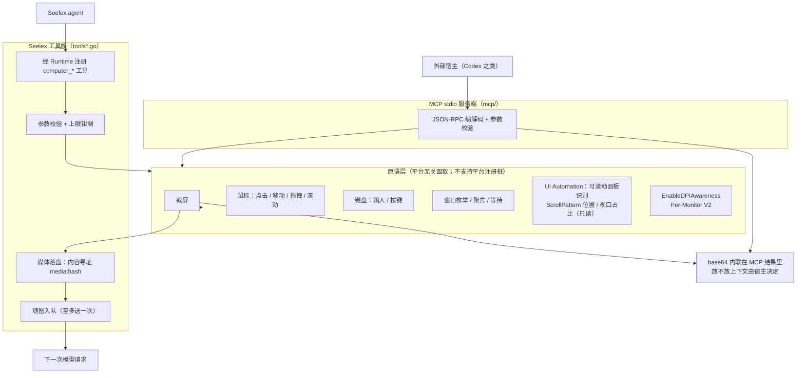
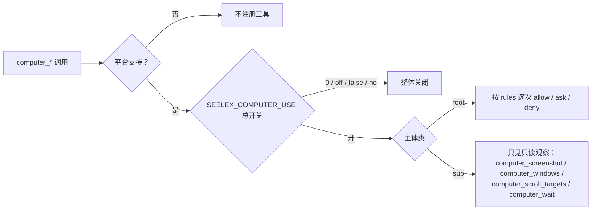

# Computer（桌面 computer use 原语）

## 生态位

`backend/tool/computer` 提供桌面 computer use 的**原语层**：截屏、鼠标、
键盘、窗口枚举与聚焦；同一个包再往上承载 **Seelex 侧工具族**（`tools*.go`）。
两个消费面共用同一套原语，差异只在"图像怎么送到模型"：

| 消费面 | 调用方 | 图像通道 |
|---|---|---|
| MCP stdio 服务端（`mcp/`） | Codex 之类的外部宿主 | base64 内联在 MCP 工具结果里，由宿主自己决定放不放上下文 |
| Seelex 工具族（`tools*.go`） | Seelex 自己的 agent（经 `seelebridge.Runtime` 注册） | 存进会话媒体分区（`media:<hash>`），再经 `imageattach` 队列随**下一次模型请求**送入（至多送一次） |

## 架构图



## 门控与权限



## 职责与非职责

职责：

- 把「看屏幕、动鼠标、敲键盘、找窗口」封装成可测试的 Go 函数；
- 用 **UI Automation / Accessibility / X11** 回答「页面里哪些面板可以滚轮操作、滚到哪一段、
  屏幕外还有多少内容」（`computer_scroll_targets`），让滚轮有落点、有回读——**有控件树的平台才有**，
  平台实现做不到时该工具不注册、原语显式返回 `ErrUnsupported`；
- 坐标语义统一为虚拟桌面（多显示器并集）物理像素；Windows 上进程启动即声明
  Per-Monitor V2 DPI 感知（`EnableDPIAwareness`），避免坐标被系统缩放虚拟化，
  X11 的坐标本来就是屏幕物理像素、无需声明；
- 在 MCP 层做 JSON-RPC 编解码与工具名/参数校验；
- 在工具层做参数校验、上限钳制、媒体落盘与随图入队（工具族清单见下）。

刻意不做什么：

- 不做业务判断、不做安全审批、不决定"该不该点"——边界由宿主与用户审批负责；
- 工具层不依赖 `seelebridge` 上层：注册面、媒体分区、随图队列全部由 `Deps`
  闭包注入（因此本包保持跨平台可编译、可单测）；
- 不回写会话正文、不读取模型上下文（只把画面交给随图队列）；
- 不替模型决定"该滚哪个面板"：UI Automation 查询只报事实（名字、控件类型、矩形、
  滚动位置与视口占比），选哪个面板、滚多少仍由模型决定；
- 不实现截图压缩策略之外的图像处理。

## 文件结构

| 文件 | 职责 |
|---|---|
| `computer.go` | 领域类型（`Point`/`Rect`/`Capture`/`ClickOptions`）与 `Sleep`；平台无关。 |
| `image.go` | 最近邻缩放（只影响给模型看的像素，不改坐标系）。 |
| `view.go` | 看图原语 `ViewImageFile`：读本地图片、必要时降采样重编码；只读、不拷贝，失败原因显式分类。 |
| `keys.go` | 虚拟键码与组合键解析（跨平台可测）。 |
| `click.go` | 点击序列语义：按下/释放成对、失败必补释放。平台无关、可单测。 |
| `scrolltarget.go` | 可滚动面板的领域类型（`ScrollTarget`/`ScrollAxis`）与纯函数：过滤、按面积排序、点命中取最内层、轴状态派生（到顶/到底）。平台无关、可单测。 |
| `desktop.go` | **平台抽象面**：`Desktop` 接口（13 个操作原语 + 2 个可滚动面板观测 + `Capabilities`/`Prepare`）与 `Capabilities` 声明。工具层、MCP 面与装配层只依赖它；平台差异在**编译期**由 build tag 选定 `current`，不做运行时探测。 |
| `facade.go` | 包级门面：`Current()` / `Supported()` / `ScrollTargetsSupported()` 与所有原语转发；外部调用方（`mcp/`、装配层、真机冒烟）不感知平台。 |
| `platform_windows.go` | Windows 的 `Desktop` 装配（user32/gdi32 + UI Automation；`ScrollTargets=true`）。 |
| `platform_linux.go` | Linux(X11) 的 `Desktop` 装配（纯 Go `jezek/xgb` + XTEST；`ScrollTargets=false`）。 |
| `platform_darwin.go` | macOS 的 `Desktop` 装配（纯 Go dlopen 的 CoreGraphics + CGEvent + Accessibility）。 |
| `platform_unsupported.go` | 其余 GOOS 的桩：每个原语显式 `ErrUnsupported`、`Capabilities` 全 false，装配层因此**不注册**整族工具。 |
| `screen_windows.go` / `input_windows.go` / `window_windows.go` | Windows 原语：GDI 截屏 + DPI 感知 / `SendInput` 鼠标键盘 / `EnumWindows` 等。 |
| `uia_windows.go` | UI Automation 客户端（Windows）：手写 COM vtable 调用，枚举窗口子树里的可滚动面板、读滚动位置、按点回读落点面板。 |
| `x11_linux.go` | Linux(X11) 的地基：连接生命周期、X11 原子/属性读写、输入注入的唯一出口（`fakeKey`/`fakeMotion`/`fakeButton`，全部 checked）。 |
| `screen_linux.go` / `input_linux.go` / `window_linux.go` | Linux 原语：X11 截屏与光标 / XTEST 鼠标键盘（键号 1/2/3=左/中/右，4/5=滚轮）/ EWMH 窗口枚举与激活。 |
| `scrolltarget_linux.go` | Linux 的可滚动面板观测：显式 `ErrUnsupported`（X11 没有控件树，见「平台实现」）。 |
| `darwin_core.go` / `screen_darwin.go` / `input_darwin.go` / `window_darwin.go` / `scrolltarget_darwin.go` | macOS 原语（CoreGraphics 截屏、CGEvent 注入、Accessibility 窗口与面板观测）。 |
| `mcp/main.go` | MCP stdio 服务端：`initialize` / `tools/list` / `tools/call`。 |
| `tools.go` | Seelex 侧工具族的装配面：`Deps`（注册面/媒体分区/随图队列）+ 十一个工具名常量 + 注册 + 共享 helper。 |
| `tools_view.go` | 观察类工具：`computer_screenshot`（截屏 → 媒体分区 → 随图）、`computer_windows`、`computer_focus`。 |
| `tools_input.go` | 输入类工具：`computer_click` / `computer_move` / `computer_drag` / `computer_scroll` / `computer_type` / `computer_keys` / `computer_wait`。 |
| `tools_scroll.go` | 滚轮工具面：`computer_scroll_targets`（可滚动面板清单）与滚轮动作的落点回读投影。 |
| `tools_schema.go` | 十一个工具的 JSON Schema（参数名、单位与坐标语义是模型可见契约）。 |
| `tools_test.go` | 工具层单测（原语注入假实现，任何平台都能跑）。 |
| `scrolltarget_test.go` | 可滚动面板纯函数单测（过滤/排序/点命中/滚轮分格），任何平台都能跑。 |
| `tools_scroll_test.go` | 滚轮工具契约单测：面板清单、窗口匹配、滚前/滚后回读、缺省落点。 |
| `tools_desktop_probe_test.go` | 真机桌面冒烟（默认跳过，`SEELEX_COMPUTER_DESKTOP_PROBE=1` 才跑）。 |
| `desktop_probe_linux_test.go` | Linux 真机桌面冒烟（同上开关）：在 X11 会话里跑截屏 → PNG → 窗口枚举。 |
| `scrolltargets_desktop_probe_test.go` | 真机 UI Automation 探针（默认跳过）：枚举真实窗口的可滚动面板并验证点命中回读。 |

### Seelex 侧工具族（`tools*.go`）

| 工具 | 形状 | 说明 |
|---|---|---|
| `computer_screenshot` | 截屏 → `media:<hash>` + 随图 | 画面进会话媒体分区，并挂进"下一次请求"；结果只回引用、区域/缩放、光标与前台窗口 |
| `computer_windows` | 只读 | 可见顶层窗口列表（缺省过滤不可见窗口）+ 虚拟桌面 + 前台窗口；`match` 过滤、`limit` 上限 60 |
| `computer_scroll_targets` | 只读 | 窗口里可用滚轮操作的面板清单：名称/控件类型/矩形/中心坐标 + 纵向横向的滚动位置与视口占比（`at_start`/`at_end` 直接标出有没有更多内容）；`window` 按标题匹配（不聚焦）、`limit` 上限 40 |
| `computer_focus` | 输入 | 按标题子串置前；空 match 只报告当前前台窗口 |
| `computer_click` | 输入 | `x/y` 或 `window`（聚焦后点窗口中心）；`button` left/right/middle，`clicks` 1-3 |
| `computer_move` | 输入 | 移动指针（hover / 拖拽预备） |
| `computer_drag` | 输入 | 按住左键从 `from` 拖到 `to` 再释放（中途失败也补释放） |
| `computer_scroll` | 输入 | 在 `x/y` 滚轮（给 `window` 时先聚焦并滚该窗口最大的纵向可滚动面板；两者都没有则用光标处）；`delta` 以 WHEEL_DELTA=120 为单位、按格下发，正数向上；结果回读落点面板的滚前/滚后位置 |
| `computer_type` | 输入 | 字面文本注入（UTF-16，支持中文与 emoji），单次上限 4000 字符 |
| `computer_keys` | 输入 | 组合键（`ctrl+shift+t`、`enter`…），重复 1-10 次 |
| `computer_wait` | 只读 | 等待 UI 稳定（上限 10s），随后应重新截图而不是假设动作生效 |

开关与门控：

- 平台：只有 `current` 声明了桌面能力才注册（`Supported()` = `Capabilities().Desktop`）；
  没有桌面实现的 GOOS 一个工具都不给（宁可不给也不挂一串必然失败的摆设），
  做不到的工具也单独摘掉——例如 Linux 上不注册 `computer_scroll_targets`；
- 环境：`SEELEX_COMPUTER_USE=0|off|false|no` 整体关闭（无头/CI 场景）；
- 权限：`config/seele.yaml` 的 `permission.rules` 逐次 allow/ask/deny（默认 `* → ask`，
  本仓库给 `computer_*` 写了显式规则：只读观察（截屏/窗口/可滚动面板）也 ask，
  `computer_wait` allow）；`computer_scroll_targets` 只读，因此归 `ro` 组而不是
  `rw_desktop` 组——它不注入任何输入；
- 可见性：输入注入类工具对子代理不可见（并行子代理共用一块桌面会互相打断），
  观察类工具对子代理保持可见，且截到的画面只进**执行会话自己**的随图队列。

## 平台实现

路由在**编译期**用 build tag 选定（`platform_<goos>.go` 各给一个 `current`），不做运行时探测——
Windows 实现直连 `user32`/`gdi32`，而 Go 标准库把 `syscall.NewLazyDLL` 这类 DLL 绑定只定义在
Windows 专属文件里，同一份代码编到别的平台连编译都过不去。代价是"一个二进制只服务一个平台"，
换来的是 `CGO_ENABLED=0` 的四平台交叉编译与"没有该平台就不注册工具"这个硬边界。

| 平台 | 观察 | 输入 | `ScrollTargets` | 备注 |
|---|---|---|---|---|
| Windows | GDI 截屏（Per-Monitor V2 DPI 感知） | `SendInput`（返回真实事件数，可判成败） | ✅ UI Automation `ScrollPattern` | 主平台，见「核心实现」 |
| Linux (X11) | `jezek/xgb` 直接读根窗口像素 | XTEST `FakeInputChecked` | ❌ 显式 `ErrUnsupported` | 需要可用的 X 会话与 XTEST；Wayland 只覆盖 XWayland 下的 X11 客户端 |
| macOS | CoreGraphics 截屏 | CGEvent 注入 | ✅ Accessibility | `Prepare()` 需检查屏幕录制与辅助功能授权（TCC 无法静默获得） |
| 其它 GOOS | — | — | — | `platform_unsupported.go`：全部 `ErrUnsupported`，不注册工具 |

### Linux(X11) 实测口径（2026-09-25，Ubuntu 22.04 / Xorg）

一次完整的实机验收（UT）。被测二进制由本包 HEAD 交叉编译，判据是 `xev`（X 服务器层）
+ 一个"把收到的字节写进文件"的终端（应用层）+ `xdotool`（独立读 `_NET_ACTIVE_WINDOW`
与 `XGetInputFocus`）。逐条结论与复现见 [`docs/2026-09-25-linux-vm-demo/computer-use.md`](../../../docs/2026-09-25-linux-vm-demo/computer-use.md)：

- **可用**：截屏、窗口枚举、前台窗口、光标读写、`FocusWindow`（EWMH `_NET_ACTIVE_WINDOW`
  + Raise + SetInputFocus）、鼠标移动/点击/拖拽/滚轮、组合键、**ASCII 文本注入**（`xev` 记录的
  键码、Shift 状态与 keysym 逐项精确；`Shift+字母`、`>|_` 等需 Shift 的字符也对）；
- **点击即聚焦**：不先 `FocusWindow`、只给 `x/y` 的点击能把焦点搬到被点窗口，随后注入的
  键盘落在那里（`xdotool` 独立确认）；
- **环境前提（会造成"完全没反应"的错觉）**：桌面输入法处于中文态时，注入的 ASCII
  会被输入法当成拼音吃掉（字母进预编辑缓冲不落盘、`>`→`》`、`-`→`—`）。这是所有 X11
  注入方案共有的前提，参考实现 `xdotool` 同样失败；切到 `xkb:us::eng` 后逐字节精确。
  **演示与无人值守场景应在会话开始前显式切引擎**；
- **已知缺陷（未修）**：`TypeText` 对**非 ASCII**（中文/emoji）走"把最高空闲键码临时重映射成
  Unicode 键码再按一下"这条路时不稳——多字连打会丢字/串字，字间留 1.5s 也只能减轻。
  同机同窗口的 `xdotool type --delay 200` 正确，说明技术可行、实现需补一次强制往返/沉降。
  在修好之前，**不要把"支持中文与 emoji"当成 Linux 上的既有能力**；
- `computer_scroll_targets` 在 Linux 上**不注册**：它要回答的"哪些面板能滚、滚到哪、视口占比"
  是控件树（UI Automation / Accessibility）才有的信息，X11 协议里只有窗口与像素。
  `computer_scroll` 仍然可用，只是回读部分显式给 `unavailable: ["scroll_panel"]`，不编造状态。


- **输入注入走 `SendInput`，不走 `mouse_event`**：`SendInput` 返回真正插入队列
  的事件数，调用方因此能判断成功/失败；`mouse_event` 返回 `void`，把它的
  返回值当失败判断会让每一次点击都"假失败"。`runClickSequence` 另外保证按下
  与释放成对：按下失败时也补发一次释放，避免鼠标停在按下状态（桌面进入拖拽）。
- **绝对坐标归一化**：`absolutePoint` 按虚拟桌面尺寸把物理像素映射到
  `0..65535`，配合 `MOUSEEVENTF_ABSOLUTE|MOUSEEVENTF_VIRTUALDESK`。
- **DPI 感知**：`EnableDPIAwareness` 用 `SetProcessDpiAwarenessContext`
  声明 Per-Monitor V2；不声明时 125% 缩放下注入坐标会落到目标的 80%。
- **键盘文本**：`TypeText` 按 UTF-16 单元逐个注入（支持中文与 emoji），
  组合键由 `PressKeys` 解析后按"修饰键按下 → 主键 → 修饰键逆序释放"下发。
- **看图只读、截图才拷贝**：`ViewImageFile` 既不写盘也不留副本，路径失效时
  只能显式报错（`ErrImageNotFound` / `ErrImageNotFile` / `ErrImageEmpty` /
  `ErrImageFormatUnsupported`，各自可 `errors.Is` 判定）；按 `MaxWidth`
  降采样时只重编码「给模型看的那份字节」，原文件字节不变。
- **滚轮作用于指针下方的控件**：因此 `computer_scroll_targets` 先回答"哪些面板
  能滚、滚到哪了"，`computer_scroll` 再按点（或按窗口里最大的纵向面板）注入，
  并在滚完读回同一块面板的位置——"滚了但已经到头"和"压根没滚到可滚动区域"
  在结果里是可区分的（`moved` / `at_start` / `at_end`）。读不到就显式
  `unavailable: ["scroll_panel"]`，不编造状态。
- **UI Automation 只读查询**：`uia_windows.go` 手写 COM vtable 调用
  （`IUIAutomation` / `IUIAutomationElement` / `IUIAutomationElementArray` /
  `IUIAutomationTreeWalker` / `IUIAutomationScrollPattern`），vtable 槽位按
  Windows SDK 10.0.22621 的 `UIAutomationClient.h` 硬编码并逐条注明方法名。
  只调用读入口（`FindAll` / `GetCurrentPropertyValue` 等）与 `get_Current*`，
  不注册事件、不写 UI 状态、不调用 `Scroll`/`SetScrollPercent`——滚轮始终走
  `SendInput`，与"真人滚一下"同一条路径。
- **Chromium 的懒构建可访问性树**：Chrome/Edge 的可访问性树是懒构建的，冷启动
  时 `FindAll(IsScrollPatternAvailable)` 只看得到工具栏那一小块（同一窗口实测
  1 个 vs 3 个可滚动面板）；VS Code 更极端——快路径只回 Monaco 列表行，拿不到
  编辑器主区，按"最大面板"选落点就会选错行。因此查询分两步：先按属性条件
  `FindAll`（数百毫秒），**当且仅当**候选里没有一个覆盖到窗口面积 20% 以上的
  "主面板"（或一个候选都没有）才退回**有界**的 raw view 深度优先遍历（节点
  ≤3000、深度 ≤32、≤3s），并把两批结果按矩形+控件类型去重合并。主面板在场时
  不遍历（Qoder 实测 134ms）。
- **只报面板，不报滚动项**：面积小于 `minScrollTargetArea`（≈64×64 像素）的元素
  不算滚轮目标——Chromium 的虚拟列表会把每一行都标成 `IsScrollPatternAvailable`
 （VS Code 的 Monaco 行 170×22=3740px²），那是滚动**项**。点命中回读不受此限：
  指针落在哪个面板上就报哪个面板。
- **每次查询一个 COM 单元**：COM 接口有线程亲和性，而 goroutine 会在 OS 线程间
  迁移，因此每次查询都在 `runtime.LockOSThread()` 的线程上
  `CoInitializeEx(MTA)` → `CoCreateInstance(CUIAutomation)` → 用完
  `CoUninitialize`，接口指针不跨调用复用（`withUIAutomation`）。所有查询都有
  超时（`DefaultScrollTargetTimeout` 5s = 快路径 + 遍历预算；滚动回读 2s），
  跨进程调用被目标进程拖住时返回显式错误而不是把一次工具调用挂死。
- **MCP 侧一次调用给全「页面状态」**：`view_screen` 把截屏与虚拟桌面、光标、
  前台窗口绑成一条工具，`view_image` 负责「入参路径、出参图像内容」；两者都
  支持 `inline_image=false` 只回路径与尺寸，避免把图像塞进不需要它的上下文。
  内联有 `maxInlineImageBytes`（8 MB）封顶：超限就退回文本并提示降 `max_width`，
  而不是把一行 JSON 撑到读不回来。

## 数据流

MCP 宿主 → `mcp/main.go` 解析 JSON-RPC → 校验参数 → 调用原语
（`CaptureShot`/`Click`/`Drag`/`Scroll`/`TypeText`/`ListWindows`/`ViewImageFile`）
→ 结果编码为 MCP `content` 文本、图像内容或 PNG 保存路径 → 返回宿主。

- `screenshot`：截屏 → 落 PNG（默认 `%LOCALAPPDATA%\codex-computer-use\shots`）
  → 文本（路径/区域/尺寸/缩放/光标）+ 图像内容（`inline_image` 默认 true）。
- `view_screen`：`screenshot` 的复合形式——同一份画面外加 `describeScreenState()`
  汇总的虚拟桌面、光标、前台窗口，一次调用即「画面 + 当前在哪」。
- `view_image`：只读取调用方给的路径（不拷贝）→ 必要时降采样 → 图像内容。
  截图与看图因此分工明确：截图产出资产，看图消费任意路径上的图片。

可滚动面板（UI Automation 只读）：

```text
computer_scroll_targets(window?)
  → 原语 ListScrollTargets（ElementFromHandle → FindAll(IsScrollPatternAvailable)
     → 没有"主面板"（覆盖 <20% 窗口面积）时才跑 raw view 有界树遍历，再合并去重）
  → 每块面板读 BoundingRectangle / Name / LocalizedControlType / AutomationId /
     ClassName / IsOffscreen，并从 ScrollPattern 读 percent 与 viewSize
  → NormalizeScrollTargets：丢掉两轴都不可滚/零面积的，按面积降序（外层在前）限流
  → 回给模型：name / control_type / rect / center（可直接当 computer_scroll 的 x/y）/
     vertical·horizontal{scrollable, percent, view_size, at_start, at_end}

computer_scroll(x/y | window | 光标处, delta)
  → 滚前 ScrollStateAtPoint（ElementFromPoint + 祖先链上找 ScrollPattern）
  → SendInput 按格下发 WHEEL_DELTA（scrollNotches：一格一格，避免超大 delta 被宿主截断）
  → 滚后再读一次 → 结果附 panel{vertical.before_percent, percent, moved, at_start, at_end}
```

回读的语义边界：`ElementFromPoint` 命中的是**该点最上层的窗口**，因此窗口被遮挡时
回读的是遮挡窗口的面板（这恰好等于滚轮真实会作用的对象），而 `window` 参数的枚举
不受遮挡影响。

Seelex 侧（`tools*.go`）：

```text
computer_screenshot
  → 原语 CaptureShot（DPI 感知 + 虚拟桌面坐标）
  → PNG 编码（BestSpeed）→ 字节上限校验（默认 8 MiB）
  → Deps.StoreMedia   落 (项目, 会话) 媒体分区 → media:<hash>
  → Deps.AttachImage  入 imageattach 队列（带字节的 image FilePart）
  → 下一次模型请求：Wrapper 把画面作为一条 user 消息附上（Take 即清空，至多一次）
  → 回给模型的结果：ref / 尺寸 / 缩放 / 区域 / 光标 / 前台窗口（不含 base64）
```

只带 `media:<hash>`（没有字节）的附件由 `Runtime.loadSessionMedia` 按同一会话/
项目口径读回，因此"引用"与"字节"两条路都能走通。

## 依赖方向

只依赖标准库与平台系统接口：Windows 走 `user32`/`gdi32`/`kernel32`（以及 UI Automation
所需的 `ole32`/`oleaut32` + `CUIAutomation`），Linux 走纯 Go 的 `jezek/xgb`（X11 + XTEST），
macOS 走纯 Go `dlopen` 的 CoreGraphics/CGEvent/Accessibility。**不引入运行期外部二进制**
（不是 shell 出去调 `scrot` / `xdotool`），因此 `CGO_ENABLED=0` 的交叉编译不受影响。
不允许反向依赖 `seelebridge` 根包、`application/`、`session/` 等上层；未接入的 GOOS 由
`platform_unsupported.go` 保持 `go build ./...` 可编译，且不会注册任何 computer 工具。

## 并发、安全与错误语义

- 原语是**有副作用的**：调用即真实操作桌面，不做并发隔离，调用方自行串行；
- 平台观测的只读性分平台：Windows 的 UI Automation 查询只枚举元素、读属性，不聚焦、
  不点击、不滚动、不改任何窗口状态；X11 侧的窗口枚举/属性读取同样是只读请求；
  没有对应栈的平台返回 `ErrUnsupported`（`computer_scroll_targets` 在 Linux 上即如此）。
  COM/跨进程调用的失败与超时都显式返回（`CoCreateInstance`/`FindAll`/超时各有
  独立错误文案），滚轮动作则把回读失败降级成 `unavailable`，不影响输入本身；
- X11 连接是**进程级共享**的（`x11Mu` 下的一次会话，连接级故障后丢弃重连），
  键盘映射若被临时重映射会在用完时尽力还原；注入失败一律返回错误，不 panic；
- 截屏写入路径由调用方给出，默认落在 `%LOCALAPPDATA%\codex-computer-use\shots`；
- 输入注入不校验目标窗口，权限由宿主的审批策略控制。
- Seelex 工具层：截屏没有落点（媒体分区不可用）或没有随图通道时**显式失败**，
  不做"截了但没人看得到"的无用功；参数越界（`clicks`、`times`、`delta`、
  文本长度、等待时长）一律报错或钳制，不静默改写用户意图；
- 归属由执行 ctx 决定，项目解析三级：执行会话绑定 → 节点作用域的工作区
  （子代理/Plan 节点没有独立会话绑定时用它）→ 默认项目 `""`；刻意不读 Router
  的活跃写作用域，也不用 `MainSessionID` 兜底——并行执行期间视图可能已切走，
  用它们解析会把截图写进另一个项目。随图队列按**执行会话**（子代理就是节点
  会话）投递，画面送给真正干活的 agent；`session_id` 为空直接报错。

## 扩展方式

- 新原语：先在 `desktop.go` 的 `Desktop` 接口上定义语义，再在每个 `platform_*.go`
  对应的平台实现里落地（Windows 在 `*_windows.go`、Linux 在 `*_linux.go`、
  macOS 在 `*_darwin.go`），在 `platform_unsupported.go` 保持返回 `ErrUnsupported`，
  最后在 `mcp/main.go` 的 `tools/list` 与 `tools/call` 登记；
- 平台无关的原语（如 `view.go` 的看图）只需新文件 + 单测，不必进任何平台实现；
- **新增一个平台**：写一个实现 `Desktop` 的 `platform_<goos>.go` + 对应的
  screen/input/window 实现，并把 `platform_unsupported.go` 的 build tag 再排除掉该
  GOOS。工具层、权限规则、媒体通路一行都不用改；
- 新 MCP 工具同步补 `mcp/main_test.go`：直接调 `callTool` 断言 content 块，
  测试不依赖真实桌面；
- 新 Seelex 工具：在 `tools.go` 的 `Register` 加一行 + `tools_schema.go` 补
  schema + `tools_test.go` 补用例（原语注入假实现，任何平台都能跑）；
- 新 UIA 能力：先在 `uia_windows.go` 按 SDK 头文件核对 vtable 槽位与 IID，再在
  `platform_unsupported.go` 保持桩；能被"筛/排/判"的部分（过滤、排序、点命中、轴状态）一律
  放进 `scrolltarget.go` 做成纯函数，平台实现只保留系统调用；
- 新增或扩大 UIA 遍历范围时必须同时给节点预算与截止时间：跨进程遍历是
  O(节点数) 次调用，没有上限就等于把一次工具调用挂死；
- 只改平台实现的函数必须保持签名与坐标系语义不变（虚拟桌面物理像素）。

## Review 指南

- 系统调用的返回值语义是否被正确解读（`BOOL` 判 0、`SendInput` 判计数、
  `void` 不得参与判断）；
- 任何"按下"路径是否存在没有释放的出口；
- 新增坐标路径是否仍然 DPI 感知、是否仍以虚拟桌面为坐标原点。
- 手写 COM 调用：vtable 槽位是否与 SDK 头文件逐条对应（错一位就是调错方法）、
  每个 `Create*`/`FindAll`/`GetElement` 拿到的接口是否都 `Release`、`BSTR` 是否
  `SysFreeString`；新增 UIA 遍历是否带节点/深度/时间上限；
- 滚轮回读的语义：没有面板时必须显式 `unavailable`（不得假装滚到了）；
  `at_start`/`at_end` 只在真的可滚动时才置位。

## 测试与验证

```text
go test ./backend/tool/computer/... -count=1
```

- `click_test.go`：点击序列（成对、失败补释放、clicks<1 归一）。
- `scrolltarget_test.go`：面板过滤/排序/限流、点命中取最内层、轴状态派生
  （不可滚动 ≠ 在顶部）、滚轮分格（含余数、上限截断）。
- `tools_scroll_test.go`：`computer_scroll_targets` 的窗口匹配（不聚焦）、面板
  过滤与 limit、空结果的键盘回退提示；`computer_scroll` 的滚前/滚后回读
  （`moved`/`before_percent`）、无面板时 `unavailable`、给了 `window` 时的
  缺省落点（最大纵向面板中心）。
- `view_test.go`：看图语义——原样返回文件原文、超宽降采样且**不改写原文件**、
  各类失败可 `errors.Is` 判定。
- `mcp/main_test.go`：MCP 工具面（不碰真实桌面）——`view_image` 的图像块可解码、
  `max_width` 生效、`inline_image=false` 只回文本、坏路径显式报错、
  `describeScrollTargets` 的清单渲染（名字缺失退回类名、边界标注、空结果回退），
  以及 `tools/list` 里 `view_screen`/`view_image`/`scroll_targets` 的描述非空。
- `desktop_probe_test.go`：默认跳过；设 `SEELEX_COMPUTER_DESKTOP_PROBE=1`
  才会在真实桌面上点一下并断言"不报错且左键已释放"（会夺走一次点击，
  只在本机手动验证时用）。
- `tools_test.go`：工具层契约——十一个工具全部注册且描述/schema 非空；截屏落盘
  （PNG 可解码、来源标记 screenshot、文件名带时间戳）并随图（ref/字节/尺寸
  与落盘一致）；`max_width` 钳制与 region 校验；窗口过滤/上限/单项降级；
  点击坐标解析（显式坐标 vs 窗口中心 vs 两者都缺）、按钮与次数校验；
  拖拽/滚轮/文本/组合键/等待的参数边界。
- `tools_desktop_probe_test.go`：默认跳过；`SEELEX_COMPUTER_DESKTOP_PROBE=1`
  时用**真实桌面**跑"截屏 → PNG → 落盘 → 随图"与窗口枚举（本机实测
  1536×864 虚拟桌面 → 1024×576 画面、82 KB PNG、10 个可见顶层窗口）。
- `desktop_probe_linux_test.go`：默认跳过；同一个开关，在**有 X 会话的 Linux** 上跑
  `Supported()` 判定 + 截屏落盘 + 窗口枚举。VM 实测命令见
  [`docs/2026-09-25-linux-vm-demo/computer-use.md`](../../../docs/2026-09-25-linux-vm-demo/computer-use.md) §8。
- `scrolltargets_desktop_probe_test.go`：默认跳过；`SEELEX_COMPUTER_DESKTOP_PROBE=1`
  时用真实桌面**只读**枚举可滚动面板（可选 `SEELEX_COMPUTER_PROBE_WINDOW=<标题子串>`
  指定窗口，不聚焦），并用最大面板的中心做点命中回读断言。本机实测：Seelex 窗口
  3 个面板（对话区 `conversation` percent=100 / view_size≈7.35% 且 `at_end`，
  另有两条页签栏），Edge 的 DeepSeek 文档页 1 个（页面主体 percent=100 /
  view_size≈78.7%），Qoder 1 个（`消息列表` percent=100.44 / view_size≈12.5%，
  快路径 134ms），VS Code 走兜底遍历（快路径只回 Monaco 行）。

滚轮真实生效同样在真机上验过（临时探针，非随仓库提交）：对 Qoder 的 `消息列表`
面板中心注入一格 `delta=+120`，回读 100.439% → 97.251%；再注入 `delta=-120`
精确回到 100.439%，面板 class/rect 全程一致——滚轮注入与滚前/滚后回读都对得上。

## 文件与函数索引

> 由源码 doc 注释自动提取（首行摘要）；描述源码行为，与实现保持同步。
> 刷新方式：`python scripts/gen_core_readme_index.py`。

### click.go

- `func runClickSequence(inject injectMouse, down, up uint32, x, y uintptr, clicks int, interval time.Duration, sleep func(time.Duration)) error` — runClickSequence 按 clicks 次「按下 + 释放」发送点击，并把释放与按下绑成
- `func scrollNotches(delta int) []int` — scrollNotches 把一次滚轮请求拆成「一格一格」的增量序列（含不足一格的余数）。

### click_test.go

- `func TestRunClickSequencePairsDownWithUp(t *testing.T)`
- `func TestRunClickSequenceReleasesAfterFailedDown(t *testing.T)`
- `func TestRunClickSequenceReportsFailedUp(t *testing.T)`
- `func TestRunClickSequenceTreatsZeroClicksAsOne(t *testing.T)`

### computer.go

- `func (r Rect) Contains(x, y int) bool` — Contains 判断虚拟桌面坐标点是否落在矩形内。
- `func (r Rect) Center() Point` — Center 返回矩形中心点。
- `func (r Rect) String() string` — String 便于日志与工具输出。
- `func clipRect(rect, bounds Rect) Rect` — clipRect 把 rect 与 bounds 求交（用于把越界的截图/窗口区域收进屏幕内）。
- `func Sleep(ms int)` — Sleep 等待指定毫秒数，供 GUI 稳定期使用。

### darwin_core.go

- `func darwinBind(handle uintptr, name string, target any) bool` — darwinBind 把一个符号绑到函数变量上；符号不存在返回 false（而不是 panic）——
- `func darwinLoad() error` — darwinLoad 打开框架并绑定符号（进程内一次，失败结果缓存）。
- `func darwinOpenFrameworks() error`
- `func darwinRequiredSymbol(name string) bool` — darwinRequiredSymbol 报告某个符号是"缺了就不能用"，还是"缺了降级即可"。
- `func darwinProbe() error` — darwinProbe 报告当前进程能否用 macOS 的 CoreGraphics 桌面能力。
- `func darwinCFString(value string) uintptr` — darwinCFString 造一个 UTF-8 的 CFString 作为字典键；调用方负责 CFRelease。
- `func darwinCFStringValue(ref uintptr) string` — darwinCFStringValue 把 CFString 读回 Go 字符串（失败返回空）。
- `func darwinCFNumber(ref uintptr) (int64, bool)` — darwinCFNumber 从 CFNumber 读一个整数值。
- `func darwinCFBool(ref uintptr) (bool, bool)` — darwinCFBool 从 CFBoolean 读一个布尔值。
- `func darwinDictionaryValue(dict uintptr, key string) uintptr` — darwinDictionaryValue 按已知字符串键取字典里的值（键由本文件临时造 CFString）。

### desktop_probe_linux_test.go

- `func TestLinuxClickReleasesMouseButton(t *testing.T)` — 桌面探针默认跳过：它会在真实桌面上移动一次指针并点一下（会夺走一次点击，
- `func leftButtonDown() (bool, error)` — leftButtonDown 报告左键当前是否按下（QueryPointer 的按键掩码）。

### desktop_probe_test.go

- `func TestClickReleasesMouseButton(t *testing.T)` — 桌面探针默认跳过：它会在真实桌面上点一下鼠标（会夺走一次点击，也可能
- `func leftButtonDown() (bool, error)` — leftButtonDown 报告左键当前是否物理按下。

### facade.go

- `func Current() Desktop` — Current 返回当前平台的 Desktop 实现。路由在编译期由 build tag 决定
- `func Prepare() error` — Prepare 见 Desktop.Prepare。
- `func Supported() bool` — Supported 报告当前平台是否有可用的桌面 computer use。装配层据此决定是否
- `func ScrollTargetsSupported() bool` — ScrollTargetsSupported 报告当前实现能否只读回答可滚动面板的状态。
- `func VirtualScreen() (Rect, error)` — VirtualScreen 返回虚拟桌面（多显示器并集）矩形。
- `func CaptureShot(opts ScreenshotOptions) (Capture, error)` — CaptureShot 抓屏并按选项缩放。
- `func SavePNG(path string, opts ScreenshotOptions) (Capture, error)` — SavePNG 抓屏并写入 PNG 文件。
- `func CursorPosition() (Point, error)` — CursorPosition 返回当前光标位置（虚拟桌面坐标）。
- `func MoveMouse(p Point) error` — MoveMouse 把光标移动到指定坐标。
- `func Click(p Point, opts ClickOptions) error` — Click 移动光标到指定坐标并点击。
- `func Drag(from, to Point, duration time.Duration) error` — Drag 按住左键从 from 拖到 to 再释放。
- `func Scroll(p Point, delta int) error` — Scroll 在指定坐标滚动滚轮，delta 为 WHEEL_DELTA(120) 的倍数，正数向上。
- `func TypeText(text string) error` — TypeText 以字面文本方式注入输入（支持 CJK 与 emoji）。
- `func PressKeys(combo string, times int) error` — PressKeys 按下组合键（形如 ctrl+shift+t）。
- `func ListWindows() ([]Window, error)` — ListWindows 枚举顶层窗口。
- `func ForegroundWindow() (Window, error)` — ForegroundWindow 返回当前前台窗口。
- `func FocusWindow(match string) (Window, error)` — FocusWindow 按标题子串查找窗口并置前。
- `func ListScrollTargets(opts ScrollTargetOptions) ([]ScrollTarget, error)` — ListScrollTargets 枚举窗口里可用滚轮操作的面板。
- `func ScrollStateAtPoint(p Point, timeout time.Duration) (ScrollTarget, bool, error)` — ScrollStateAtPoint 回读落点处的可滚动面板状态。

### image.go

- `func ScaleNearest(src *image.RGBA, maxWidth int) (*image.RGBA, float64)` — ScaleNearest 以最近邻方式把图像缩放到指定最大宽度；宽度不足时原样返回。

### input_darwin.go

- `func darwinMouseButtonFor(name string) (darwinMouseButton, error)` — darwinMouseButtonFor 把工具层的按键名映射成 CGEvent 的按键三元组。
- `func darwinPostMouse(eventType uint32, point Point, button uint32) error` — darwinPostMouse 注入一次鼠标事件（失败只能报告"构造失败"：CGEventPost 无返回，
- `func darwinWarpPointer(point Point) error` — darwinWarpPointer 把指针移动到指定坐标，并保持指针与鼠标设备关联
- `func (darwinDesktop) MoveMouse(point Point) error` — MoveMouse 把指针移动到指定坐标。
- `func (d darwinDesktop) Click(point Point, opts ClickOptions) error` — Click 把指针移动到指定坐标并点击（按下与释放成对，失败也先补释放）。
- `func (d darwinDesktop) Drag(from, to Point, duration time.Duration) error` — Drag 按住左键从 from 拖到 to 再释放（中途失败也必须释放）。
- `func (d darwinDesktop) Scroll(point Point, delta int) error` — Scroll 在指定坐标滚动滚轮：delta 为 WHEEL_DELTA(120) 的倍数，正数向上。
- `func darwinPostUnicode(units []uint16) error` — darwinPostUnicode 以「虚拟键 0 + Unicode 字符串」注入一个 UTF-16 单元序列。
- `func (darwinDesktop) TypeText(text string) error` — TypeText 逐字注入文本（支持中文与 emoji）。
- `func darwinModifierFlags(modifiers []uint16) (uint64, error)` — darwinModifierFlags 把 keys.go 解析出的修饰键虚拟码折成 CGEventFlags。
- `func darwinVirtualKeyToCode(vk uint16) (uint16, bool)` — darwinVirtualKeyToCode 把虚拟键码映射成 macOS 虚拟键码。
- `func darwinPostKey(code uint16, flags uint64, down bool) error` — darwinPostKey 注入一次带修饰标志的按键。
- `func (darwinDesktop) PressKeys(combo string, times int) error` — PressKeys 按下组合键，times 为重复次数（0 视为 1）。

### input_linux.go

- `func (x11Desktop) MoveMouse(point Point) error` — MoveMouse 把指针移动到指定坐标。
- `func (d x11Desktop) Click(point Point, opts ClickOptions) error` — Click 把指针移动到指定坐标并点击（按下与释放成对，失败也先补释放）。
- `func (d x11Desktop) Drag(from, to Point, duration time.Duration) error` — Drag 按住左键从 from 拖到 to 再释放（中途失败也必须释放）。
- `func (d x11Desktop) Scroll(point Point, delta int) error` — Scroll 在指定坐标滚动滚轮：delta 为 WHEEL_DELTA(120) 的倍数，正数向上。
- `func x11ButtonCode(button string) (byte, error)` — x11ButtonCode 把工具层的按键名映射成 X11 键号。
- `func virtualKeyToKeysym(vk uint16) (uint32, bool)` — virtualKeyToKeysym 把 keys.go 解析出的虚拟键码映射成 X 键码。
- `func (m *x11Keymap) lookup(keysym uint32) (x11Keyslot, bool)`
- `func (s *x11Session) keymap() (*x11Keymap, error)` — keymap 读取并缓存键盘映射。只索引前两档（未按 Shift / 按下 Shift）：
- `func (s *x11Session) tapKey(keycode xproto.Keycode, shift bool) error` — tapKey 按下并释放一个键码；需要 Shift 档时先按下左 Shift，再逆序释放。
- `func (x11Desktop) TypeText(text string) error` — TypeText 逐字注入文本（支持中文与 emoji）。
- `func (s *x11Session) remapKeycode(keycode xproto.Keycode, keysym uint32)` — remapKeycode 把一个键码映射成给定键码（keysym=0 表示还原为空闲）。
- `func keysymForRune(char rune) uint32` — keysymForRune 把 rune 映射成 X 键码：ASCII 与 Latin-1 用码点本身，
- `func (x11Desktop) PressKeys(combo string, times int) error` — PressKeys 按下组合键，times 为重复次数（0 视为 1）。

### input_windows.go

- `func wrapProc(name string, err error) error`
- `func (win32Desktop) CursorPosition() (Point, error)` — CursorPosition 返回当前光标位置（虚拟桌面坐标）。
- `func (win32Desktop) MoveMouse(p Point) error` — MoveMouse 把光标移动到指定坐标。
- `func setCursor(p Point) error`
- `func (d win32Desktop) absolutePoint(p Point) (uintptr, uintptr)` — absolutePoint 把虚拟桌面坐标归一化为 0..65535，供 MOUSEEVENTF_ABSOLUTE 使用。
- `func mouseButtonFlags(button string) (down, up uint32, err error)`
- `func mouseInputEvent(flags uint32, x, y uintptr, data uint32) input` — mouseInputEvent 构造一次绝对坐标的鼠标输入事件（虚拟桌面坐标系）。
- `func sendMouse(flags uint32, x, y uintptr, data uint32) error` — sendMouse 注入一次鼠标事件。走 SendInput 而不是 mouse_event：SendInput
- `func (d win32Desktop) Click(p Point, opts ClickOptions) error` — Click 把光标移动到指定坐标并点击（按下与释放成对，失败也先补释放）。
- `func (d win32Desktop) Drag(from, to Point, duration time.Duration) error` — Drag 按住左键从 from 拖到 to，用于框选、拖拽窗口等。中途失败也必须释放，
- `func (d win32Desktop) Scroll(p Point, delta int) error` — Scroll 在指定坐标滚动滚轮，delta 为 WHEEL_DELTA(120) 的倍数，正数向上。
- `func sendInputs(inputs []input) error`
- `func keyInput(vk uint16, up bool) input`
- `func unicodeInput(unit uint16, up bool) input`
- `func (win32Desktop) TypeText(text string) error` — TypeText 以 Unicode 方式输入文本（支持中文与 emoji）。
- `func (win32Desktop) PressKeys(combo string, times int) error` — PressKeys 按下组合键，times 为重复次数（0 视为 1）。

### keys.go

- `func init()`
- `func ParseKeyCombo(combo string) (KeyCombo, error)` — ParseKeyCombo 解析形如 "ctrl+shift+t"、"alt+f4"、"enter" 的按键组合。
- `func modifierKey(token string) (uint16, bool)`
- `func singleKey(token string) (uint16, bool)`

### platform_darwin.go

- `func (darwinDesktop) Capabilities() Capabilities` — Capabilities 报告 macOS 的桌面能力：CoreGraphics 提供了完整的截图 / 输入 /
- `func (darwinDesktop) Prepare() error` — Prepare 建立框架绑定并检查「屏幕录制」授权。

### platform_linux.go

- `func (x11Desktop) Capabilities() Capabilities` — Capabilities 报告 Linux 的桌面能力：能连上 X11（且具备 XTEST）就有一套
- `func (x11Desktop) Prepare() error` — Prepare 建立（并缓存）一次 X11 连接；失败原因原样返回，装配层据此不注册

### platform_unsupported.go

- `func (unsupportedDesktop) Capabilities() Capabilities` — Capabilities 报告本平台没有任何桌面能力。
- `func (unsupportedDesktop) Prepare() error` — Prepare 无需准备。
- `func (unsupportedDesktop) VirtualScreen() (Rect, error)` — VirtualScreen 返回 ErrUnsupported。
- `func (unsupportedDesktop) CaptureShot(ScreenshotOptions) (Capture, error)` — CaptureShot 返回 ErrUnsupported。
- `func (unsupportedDesktop) SavePNG(string, ScreenshotOptions) (Capture, error)` — SavePNG 返回 ErrUnsupported。
- `func (unsupportedDesktop) CursorPosition() (Point, error)` — CursorPosition 返回 ErrUnsupported。
- `func (unsupportedDesktop) MoveMouse(Point) error` — MoveMouse 返回 ErrUnsupported。
- `func (unsupportedDesktop) Click(Point, ClickOptions) error` — Click 返回 ErrUnsupported。
- `func (unsupportedDesktop) Drag(Point, Point, time.Duration) error` — Drag 返回 ErrUnsupported。
- `func (unsupportedDesktop) Scroll(Point, int) error` — Scroll 返回 ErrUnsupported。
- `func (unsupportedDesktop) TypeText(string) error` — TypeText 返回 ErrUnsupported。
- `func (unsupportedDesktop) PressKeys(string, int) error` — PressKeys 返回 ErrUnsupported。
- `func (unsupportedDesktop) ListWindows() ([]Window, error)` — ListWindows 返回 ErrUnsupported。
- `func (unsupportedDesktop) ForegroundWindow() (Window, error)` — ForegroundWindow 返回 ErrUnsupported。
- `func (unsupportedDesktop) FocusWindow(string) (Window, error)` — FocusWindow 返回 ErrUnsupported。
- `func (unsupportedDesktop) ListScrollTargets(ScrollTargetOptions) ([]ScrollTarget, error)` — ListScrollTargets 返回 ErrUnsupported（控件树是 Windows/macOS 才有的栈，
- `func (unsupportedDesktop) ScrollStateAtPoint(Point, time.Duration) (ScrollTarget, bool, error)` — ScrollStateAtPoint 返回 ErrUnsupported。

### platform_windows.go

- `func (win32Desktop) Capabilities() Capabilities` — Capabilities 报告 Windows 的桌面能力：原生截图/输入/窗口枚举，加上

### screen_darwin.go

- `func darwinActiveDisplays() ([]uint32, error)` — darwinActiveDisplays 枚举在线显示器（返回 displayID 列表）。
- `func (darwinDesktop) VirtualScreen() (Rect, error)` — VirtualScreen 返回全部在线显示器的并集矩形（CoreGraphics 全局坐标，单位：点）。
- `func darwinUnionBounds(displays []uint32) (Rect, bool)` — darwinUnionBounds 求显示器边界的并集。
- `func (darwinDesktop) CursorPosition() (Point, error)` — CursorPosition 返回当前指针位置（CoreGraphics 全局坐标，单位：点）。
- `func (d darwinDesktop) CaptureShot(opts ScreenshotOptions) (Capture, error)` — CaptureShot 抓取屏幕（或指定区域）并按选项缩放。
- `func (d darwinDesktop) SavePNG(path string, opts ScreenshotOptions) (Capture, error)` — SavePNG 抓屏并写入 PNG 文件，返回实际截取区域与缩放系数。
- `func darwinCaptureRegion(region Rect) (*image.RGBA, error)` — darwinCaptureRegion 抓取一块"点空间"区域：逐显示器取像素图，再按 backing
- `func darwinBlitDisplay(out *image.RGBA, region, display Rect, source *image.RGBA)` — darwinBlitDisplay 把一块显示器的像素图按 backing scale 采样进输出图。
- `func darwinImageToRGBA(imageRef uintptr) (*image.RGBA, error)` — darwinImageToRGBA 把一张 CGImage 解码成 RGBA。

### screen_linux.go

- `func (x11Desktop) VirtualScreen() (Rect, error)` — VirtualScreen 返回 X11 根窗口的矩形（左上是 0,0）。多显示器在 X 里通常合成
- `func (x11Desktop) CursorPosition() (Point, error)` — CursorPosition 返回当前指针位置（根窗口坐标）。
- `func (d x11Desktop) CaptureShot(opts ScreenshotOptions) (Capture, error)` — CaptureShot 抓取屏幕（或指定区域）并按选项缩放。
- `func (d x11Desktop) SavePNG(path string, opts ScreenshotOptions) (Capture, error)` — SavePNG 抓屏并写入 PNG 文件，返回实际截取区域与缩放系数。
- `func captureRegion(region Rect) (*image.RGBA, error)` — captureRegion 用 XGetImage 抓根窗口（或其中一块）的像素。
- `func decodeZPixmap(s *x11Session, data []byte, width, height int) (*image.RGBA, error)` — decodeZPixmap 把 XGetImage 的原始 ZPixmap 数据解码成 RGBA：先按 PixmapFormats
- `func rawPixel(order binary.ByteOrder, pixel []byte) uint32` — rawPixel 把 1/2/3/4 字节的像素按服务器字节序拼成 32 位值。
- `func channel(value, mask uint32) uint8` — channel 按掩码取出一个通道并扩展到 8 位。

### screen_windows.go

- `func (win32Desktop) Prepare() error` — Prepare 把当前进程设置为 Per-Monitor V2 DPI 感知。截图与鼠标坐标都以物理
- `func (win32Desktop) VirtualScreen() (Rect, error)` — VirtualScreen 返回多显示器并集组成的虚拟桌面矩形。
- `func captureRegion(region Rect) (*image.RGBA, error)` — captureRegion 用 GDI BitBlt 抓取指定区域的像素。
- `func (d win32Desktop) CaptureShot(opts ScreenshotOptions) (Capture, error)` — CaptureShot 抓取屏幕并按选项缩放。
- `func (d win32Desktop) SavePNG(path string, opts ScreenshotOptions) (Capture, error)` — SavePNG 抓屏并写入 PNG 文件，返回实际截取区域与缩放系数。

### scrolltarget.go

- `func (a ScrollAxis) Known() bool` — Known 报告该轴是否带回了可用的位置数值。
- `func (a ScrollAxis) AtStart() bool` — AtStart 报告该轴是否停在起始端（纵向 = 页面顶部 / 横向 = 最左）。
- `func (a ScrollAxis) AtEnd() bool` — AtEnd 报告该轴是否停在末端（纵向 = 页面底部 / 横向 = 最右）。
- `func (t ScrollTarget) Scrollable() bool` — Scrollable 报告该面板是否至少有一条轴可以滚动。
- `func (t ScrollTarget) Area() int` — Area 返回面板面积（像素），用于"外层面板在前"的排序与最内层命中判定。
- `func (t ScrollTarget) Center() Point` — Center 返回面板中心点：滚轮要落在面板内部，中心是最稳的落点。
- `func (t ScrollTarget) Contains(p Point) bool` — Contains 报告点是否落在面板矩形内。
- `func NormalizeScrollTargets(targets []ScrollTarget, limit int) []ScrollTarget` — NormalizeScrollTargets 过滤无效面板（零/负面积、两轴都不可滚动）、按面积降序
- `func PickScrollTargetAtPoint(targets []ScrollTarget, p Point) (ScrollTarget, bool)` — PickScrollTargetAtPoint 返回包含该点、面积最小的可滚动面板：滚轮作用于指针
- `func LargestVerticalScrollTarget(targets []ScrollTarget) (ScrollTarget, bool)` — LargestVerticalScrollTarget 返回面积最大的纵向可滚动面板：调用方只给了窗口、

### scrolltarget_darwin.go

- `func (darwinDesktop) ListScrollTargets(ScrollTargetOptions) ([]ScrollTarget, error)` — ListScrollTargets 返回 ErrUnsupported。
- `func (darwinDesktop) ScrollStateAtPoint(Point, time.Duration) (ScrollTarget, bool, error)` — ScrollStateAtPoint 返回 ErrUnsupported。

### scrolltarget_linux.go

- `func (x11Desktop) ListScrollTargets(ScrollTargetOptions) ([]ScrollTarget, error)` — ListScrollTargets 在 X11 上返回 ErrUnsupported。
- `func (x11Desktop) ScrollStateAtPoint(Point, time.Duration) (ScrollTarget, bool, error)` — ScrollStateAtPoint 在 X11 上返回 ErrUnsupported。

### scrolltarget_test.go

- `func TestScrollAxisStateDerivations(t *testing.T)`
- `func TestNormalizeScrollTargetsFiltersSortsAndLimits(t *testing.T)`
- `func TestPickScrollTargetAtPointPrefersInnermost(t *testing.T)`
- `func TestLargestVerticalScrollTarget(t *testing.T)`
- `func TestScrollNotchesSplitPerWheelDelta(t *testing.T)`
- `func namesOf(targets []ScrollTarget) []string`

### scrolltargets_desktop_probe_test.go

- `func TestDesktopProbeScrollTargets(t *testing.T)` — ── 真机桌面探针：可滚动面板识别 ─────────────────────────────
- `func probeWindow(t *testing.T) (Window, error)`

### tools.go

- `func defaultPrimitives(desktop Desktop) primitives` — defaultPrimitives 把平台抽象面（Desktop）的方法绑成工具层的注入面：上层只
- `func NewTools(deps Deps) *Tools` — NewTools 构造工具族；缺省上限与时间源在此补齐。
- `func (t *Tools) Register()` — Register 注册整个工具族（注册面缺失时静默返回：装配层负责显式装配）。
- `func decodeArgs(argsJSON string, target any) error` — decodeArgs 解析工具入参；空串视为「无参数」（全零值）。
- `func encodeResult(payload any) (string, error)` — encodeResult 把工具结果编码为紧凑 JSON（模型可读，字段名稳定）。
- `func clampInt(value, minimum, maximum int) int`
- `func newRectJSON(rect Rect) rectJSON`
- `func newPointJSON(point Point) pointJSON`
- `func newWindowJSON(win Window) windowJSON`
- `func (t *Tools) storeScreenshot(ctx context.Context, name string, data []byte, width, height int, scale float64) (StoredMedia, error)` — storeScreenshot 把 PNG 落进会话媒体分区：没有落点就显式失败，不做无引用的

### tools_desktop_probe_test.go

- `func TestScreenshotThroughRealDesktop(t *testing.T)` — TestScreenshotThroughRealDesktop 是默认跳过的真机冒烟：SEELEX_COMPUTER_DESKTOP_PROBE=1

### tools_input.go

- `func (t *Tools) click(_ context.Context, argsJSON string) (string, error)`
- `func (t *Tools) move(_ context.Context, argsJSON string) (string, error)`
- `func (t *Tools) drag(_ context.Context, argsJSON string) (string, error)`
- `func (t *Tools) scroll(_ context.Context, argsJSON string) (string, error)`
- `func (t *Tools) typeText(_ context.Context, argsJSON string) (string, error)`
- `func (t *Tools) keys(_ context.Context, argsJSON string) (string, error)`
- `func (t *Tools) wait(_ context.Context, argsJSON string) (string, error)`
- `func (t *Tools) resolveTarget(x, y *int, window string) (Point, *Window, error)` — resolveTarget 解析输入动作的目标坐标：显式 x/y 优先；只有 window 时先聚焦
- `func (t *Tools) resolveScrollPoint(x, y *int, window *Window) (Point, error)` — resolveScrollPoint 解析滚轮落点，优先级：显式 x/y > 目标窗口里最大的可滚动

### tools_schema.go

- `func objectSchema(properties map[string]any, required ...string) map[string]any`
- `func integerSchema(description string, minimum, maximum int) map[string]any`
- `func pointProperties() map[string]any`
- `func regionSchema() map[string]any`
- `func screenshotSchema() map[string]any`
- `func windowsSchema() map[string]any`
- `func focusSchema() map[string]any`
- `func scrollTargetsSchema() map[string]any`
- `func clickSchema() map[string]any`
- `func moveSchema() map[string]any`
- `func dragSchema() map[string]any`
- `func scrollSchema() map[string]any`
- `func typeSchema() map[string]any`
- `func keysSchema() map[string]any`
- `func waitSchema() map[string]any`

### tools_scroll.go

- `func newScrollAxisJSON(axis ScrollAxis) scrollAxisJSON`
- `func newScrollTargetJSON(index int, target ScrollTarget) scrollTargetJSON`
- `func (t *Tools) scrollTargets(_ context.Context, argsJSON string) (string, error)` — scrollTargets 是 computer_scroll_targets 的实现：只读枚举窗口里的可滚动面板。
- `func (t *Tools) resolveScrollWindow(match string) (*Window, error)` — resolveScrollWindow 找出查询/滚动目标窗口：给了 match 就按标题子串匹配
- `func (t *Tools) largestScrollTarget(handle uintptr) (ScrollTarget, bool)` — largestScrollTarget 选窗口里面积最大的纵向可滚动面板；查不到返回 false，
- `func (t *Tools) scrollPanelAt(point Point) (ScrollTarget, bool)` — scrollPanelAt 读"这一点上的滚轮会滚到哪个面板"。取不到（没有面板 / UIA 不可用）
- `func scrollPanelResult(after ScrollTarget, before ScrollTarget, hadBefore bool) scrollPanelJSON` — scrollPanelResult 组合滚前/滚后两块观测，生成动作结果里的 panel 字段。
- `func attachScrollDelta(axis *scrollAxisJSON, before, after ScrollAxis)`
- `func scrollNote(panel *scrollPanelJSON, unavailable []string) string` — scrollNote 用一句人话总结滚轮结果：模型据此决定"继续滚 / 到头了 / 换个面板"。
- `func formatPercent(value *float64) string`

### tools_scroll_test.go

- `func scrollTargetFixture(name string, x, y, width, height int, scrollable bool, percent float64) ScrollTarget`
- `func TestScrollTargetsListsPanelsOfMatchedWindow(t *testing.T)`
- `func TestScrollTargetsDefaultsToForegroundWindowAndExplainsEmptyResult(t *testing.T)`
- `func TestScrollTargetsUnknownWindowAndPrimitiveFailure(t *testing.T)`
- `func TestScrollReportsPanelBeforeAfter(t *testing.T)`
- `func TestScrollMarksUnavailableWhenPanelUnknown(t *testing.T)`
- `func TestScrollWithWindowTargetsLargestPanel(t *testing.T)`

### tools_test.go

- `func newHarness(t *testing.T) *harness`
- `func newHarnessWithCaps(t *testing.T, caps *Capabilities) *harness` — newHarnessWithCaps 用指定能力声明构造工具族：caps 为 nil 表示全能力
- `func (r *recorder) primitives() primitives`
- `func (h *harness) call(t *testing.T, name, argsJSON string) string`
- `func (h *harness) callErr(t *testing.T, name, argsJSON string) error`
- `func (h *harness) toolNames() []string`
- `func TestRegisterExposesWholeComputerToolFamily(t *testing.T)`
- `func TestRegisterSkipsToolsThePlatformCannotAnswer(t *testing.T)` — TestRegisterSkipsToolsThePlatformCannotAnswer 验证「工具按能力声明暴露」：
- `func TestScreenshotStoresMediaAndAttachesToNextRequest(t *testing.T)`
- `func TestScreenshotClampsWidthAndRejectsBadRegion(t *testing.T)`
- `func TestScreenshotFailsLoudWithoutMediaOrAttach(t *testing.T)`
- `func TestWindowsFiltersLimitsAndDegrades(t *testing.T)`
- `func TestFocusDelegatesMatch(t *testing.T)`
- `func TestClickResolvesCoordinatesAndValidates(t *testing.T)`
- `func TestInputToolsValidateAndDelegate(t *testing.T)`

### tools_view.go

- `func (r *regionArg) rect() *Rect`
- `func (t *Tools) screenshot(ctx context.Context, argsJSON string) (string, error)`
- `func (t *Tools) windows(_ context.Context, argsJSON string) (string, error)`
- `func (t *Tools) focus(_ context.Context, argsJSON string) (string, error)`

### uia_windows.go

- `func boolVariant(value bool) comVariant`
- `func hresultError(action string, hr uintptr) error`
- `func comCall(object unsafe.Pointer, index int, args ...uintptr) uintptr` — comCall 调用 COM 接口的第 index 个 vtable 槽位（IUnknown 占 0-2）。
- `func comRelease(object unsafe.Pointer)` — comRelease 释放一个 COM 接口指针（IUnknown::Release，槽位 2）。
- `func withUIAutomation(fn func(automation unsafe.Pointer) error) error` — withUIAutomation 在锁定的 OS 线程上建立一次 COM 会话并创建 IUIAutomation。
- `func withUIATimeout(timeout time.Duration, query func() error) error` — withUIATimeout 给一次 UIA 查询加超时：UIA 是跨进程调用，目标进程卡住时调用方
- `func (win32Desktop) ListScrollTargets(opts ScrollTargetOptions) ([]ScrollTarget, error)` — ListScrollTargets 枚举一个窗口里可以滚轮操作的面板，供模型判断"屏幕外的
- `func (win32Desktop) ScrollStateAtPoint(p Point, timeout time.Duration) (ScrollTarget, bool, error)` — ScrollStateAtPoint 报告"这一点上的滚轮会滚到哪个面板"，以及该面板当前的滚动
- `func listScrollTargetsOnce(opts ScrollTargetOptions) ([]ScrollTarget, error)`
- `func scrollStateAtPointOnce(p Point) (ScrollTarget, bool, error)`
- `func findScrollTargets(automation, root unsafe.Pointer, includeOffscreen bool) ([]ScrollTarget, error)` — findScrollTargets 找出窗口子树里的可滚动面板。
- `func fastScrollTargets(automation, root unsafe.Pointer, includeOffscreen bool) []ScrollTarget` — fastScrollTargets 走属性条件 FindAll：UIA 只返回带 ScrollPattern 的元素。
- `func hasMainPanel(targets []ScrollTarget, windowRect Rect) bool` — hasMainPanel 报告候选里是否已经有"够大"的面板：窗口矩形不可知（面积 0）时只
- `func mergeScrollTargets(primary, secondary []ScrollTarget) []ScrollTarget` — mergeScrollTargets 合并快路径与遍历两批结果，按矩形+控件类型去重（同一块面板
- `func walkScrollTargetsBounded(automation, root unsafe.Pointer, includeOffscreen bool) ([]ScrollTarget, error)` — walkScrollTargetsBounded 跑一次有界 raw view 遍历，返回收集到的面板。
- `func (w *scrollTargetWalk) exhausted() bool`
- `func walkScrollTargets(walker, element unsafe.Pointer, depth int, state *scrollTargetWalk, includeOffscreen bool)` — walkScrollTargets 深度优先遍历子树，收集带 ScrollPattern 的元素。
- `func readScrollTargetArray(array unsafe.Pointer, includeOffscreen bool, minArea int) []ScrollTarget` — readScrollTargetArray 逐元素读取面板信息；读到上限即停（网页里的滚动容器
- `func readScrollTargetElement(element unsafe.Pointer, includeOffscreen bool, minArea int) (ScrollTarget, bool)` — readScrollTargetElement 把一个 UIA 元素读成滚动面板：没有 ScrollPattern、
- `func uiaPatternAvailableCondition(automation unsafe.Pointer, propertyID uintptr) (unsafe.Pointer, error)`
- `func uiaTrueCondition(automation unsafe.Pointer) (unsafe.Pointer, error)`
- `func uiaRawViewWalker(automation unsafe.Pointer) (unsafe.Pointer, error)`
- `func uiaElementFromHandle(automation unsafe.Pointer, handle uintptr) (unsafe.Pointer, error)`
- `func uiaElementFromPoint(automation unsafe.Pointer, p Point) (unsafe.Pointer, error)`
- `func uiaFindAll(root unsafe.Pointer, scope uintptr, condition unsafe.Pointer) (unsafe.Pointer, error)`
- `func uiaParentElement(walker, element unsafe.Pointer) (unsafe.Pointer, error)`
- `func uiaWalkerStep(walker, element unsafe.Pointer, slot int) (unsafe.Pointer, error)` — uiaWalkerStep 调用 TreeWalker 的子/兄弟遍历（slot 取 slotWalkerFirstChild 等）。
- `func uiaArrayLength(array unsafe.Pointer) int`
- `func uiaArrayElement(array unsafe.Pointer, index int) (unsafe.Pointer, error)`
- `func readScrollAxis(pattern unsafe.Pointer, scrollableSlot, percentSlot, viewSizeSlot int) ScrollAxis` — readScrollAxis 读一条轴的状态：不可滚动的轴不给位置数值（百分点是"内容里的
- `func uiaScrollPattern(element unsafe.Pointer) (unsafe.Pointer, error)`
- `func uiaElementRect(element unsafe.Pointer) (Rect, bool)`
- `func uiaElementOffscreen(element unsafe.Pointer) bool`
- `func uiaElementString(element unsafe.Pointer, slot int) string` — uiaElementString 读一个 BSTR 属性，读完立刻 SysFreeString（UIA 把字符串所有权
- `func uiaBool(object unsafe.Pointer, slot int) bool`
- `func uiaDouble(object unsafe.Pointer, slot int) (float64, bool)`

### view.go

- `func ViewImageFile(opts ViewImageOptions) (ViewedImage, error)` — ViewImageFile 读取一张本地图片，必要时降采样，返回可直接下发的字节与元数据。
- `func decodeImage(data []byte) (string, image.Image, error)` — decodeImage 解码图片并归一化 MIME 类型；解码器由标准库注册表提供。
- `func toRGBA(src image.Image) *image.RGBA` — toRGBA 把任意解码结果转成 RGBA，供最近邻缩放使用。

### view_test.go

- `func writeTempPNG(t *testing.T, dir, name string, width, height int) (string, []byte)` — writeTempPNG 在临时目录写一张 w×h 的 PNG，返回路径与文件原文。
- `func TestViewImageFileKeepsOriginalBytes(t *testing.T)`
- `func TestViewImageFileDownsamplesWithoutRewritingSource(t *testing.T)`
- `func TestViewImageFileSkipsScaleWhenNarrowEnough(t *testing.T)`
- `func TestViewImageFileErrors(t *testing.T)`

### window_darwin.go

- `func darwinListWindowRecords() ([]darwinWindowRecord, error)` — darwinListWindowRecords 枚举屏幕上的普通顶层窗口（layer 0）。
- `func darwinReadWindowRecord(dict uintptr) darwinWindowRecord` — darwinReadWindowRecord 从一个窗口信息字典里读字段。
- `func (darwinDesktop) ListWindows() ([]Window, error)` — ListWindows 枚举有标题的顶层窗口。
- `func (darwinDesktop) ForegroundWindow() (Window, error)` — ForegroundWindow 返回当前前台窗口。
- `func (d darwinDesktop) FocusWindow(match string) (Window, error)` — FocusWindow 按标题子串（大小写不敏感）查找窗口并置于前台。
- `func darwinRaiseWindow(pid int32, title string) error` — darwinRaiseWindow 用 Accessibility API 把目标应用的匹配窗口置前。
- `func darwinAXCopy(element uintptr, attribute string) (uintptr, error)` — darwinAXCopy 按属性名取一个 AX 值（返回的是调用方拥有的 CFTypeRef）。

### window_linux.go

- `func (s *x11Session) describeWindow(window xproto.Window) Window` — describeWindow 读一个顶层窗口的标题、矩形与状态。
- `func (s *x11Session) windowTitle(window xproto.Window) string` — windowTitle 取窗口标题：优先 _NET_WM_NAME（UTF-8），退回 WM_NAME。
- `func (s *x11Session) windowRect(window xproto.Window) (Rect, bool)` — windowRect 用 GetGeometry + TranslateCoordinates 得到窗口在根窗口坐标系里的
- `func (s *x11Session) clientWindows() ([]xproto.Window, error)` — clientWindows 列出顶层客户端窗口：优先 EWMH 的 _NET_CLIENT_LIST；没有窗口
- `func (x11Desktop) ListWindows() ([]Window, error)` — ListWindows 枚举有标题的顶层窗口（与 Windows 侧同语义：标题为空的不列出，
- `func (x11Desktop) ForegroundWindow() (Window, error)` — ForegroundWindow 返回当前前台窗口（EWMH 的 _NET_ACTIVE_WINDOW）。
- `func (s *x11Session) activeWindow() (xproto.Window, error)`
- `func (d x11Desktop) FocusWindow(match string) (Window, error)` — FocusWindow 按标题子串（大小写不敏感）查找可见窗口并置于前台。
- `func (s *x11Session) activateWindow(window xproto.Window) error` — activateWindow 用 EWMH 的 _NET_ACTIVE_WINDOW 客户端消息请窗口管理器激活窗口

### window_windows.go

- `func windowTitle(handle uintptr) string`
- `func windowRect(handle uintptr) (Rect, bool)`
- `func describeWindow(handle uintptr) Window`
- `func (win32Desktop) ListWindows() ([]Window, error)` — ListWindows 枚举有标题的顶层窗口。
- `func (win32Desktop) ForegroundWindow() (Window, error)` — ForegroundWindow 返回当前前台窗口。
- `func (d win32Desktop) FocusWindow(match string) (Window, error)` — FocusWindow 按标题子串（大小写不敏感）查找窗口并置于前台。

### x11_linux.go

- `func x11Use(op func(*x11Session) error) error` — x11Use 在互斥下执行 op；连接惰性建立，连接级故障后丢弃会话以便下次重连。
- `func x11Probe() error` — x11Probe 尝试建立一次连接（成功后缓存在会话里），失败原因原样返回。
- `func x11ConnectionBroken(err error) bool` — x11ConnectionBroken 判断错误是否意味着连接已经不可用：协议错误（BadWindow
- `func x11Open() (*x11Session, error)`
- `func rootPixelFormat(setup *xproto.SetupInfo, screen xproto.ScreenInfo) (xproto.Format, xproto.VisualInfo)` — rootPixelFormat 找出根窗口深度的 ZPixmap 格式与对应 visual（通道掩码）。
- `func (s *x11Session) atom(name string) (xproto.Atom, error)` — atom 取（并缓存）一个 X11 原子。
- `func (s *x11Session) property(window xproto.Window, atom xproto.Atom, length uint32) (xproto.Atom, byte, []byte, error)` — property 读一个属性，返回类型原子、format 与原始值；属性不存在时返回
- `func (s *x11Session) propertyOf(window xproto.Window, name string, length uint32) ([]byte, error)` — propertyOf 按属性名读原始值；属性不存在时返回 nil。
- `func (s *x11Session) atomList(value []byte) []uint32` — atomList 把 format=32 的属性值解码成 id 列表（按服务器字节序）。
- `func (s *x11Session) atomListOf(window xproto.Window, name string, length uint32) ([]uint32, error)` — atomListOf 读窗口上某个属性的 32 位 id 列表（属性不存在返回 nil）。
- `func (s *x11Session) fakeKey(eventType byte, keycode byte) error` — fakeKey / fakeMotion / fakeButton 是输入注入的唯一出口，全部走 checked 请求：
- `func (s *x11Session) fakeMotion(point Point) error`
- `func (s *x11Session) fakeButton(eventType byte, button byte, point Point) error`
