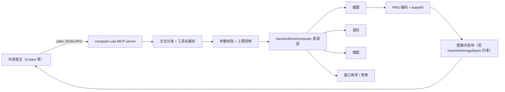
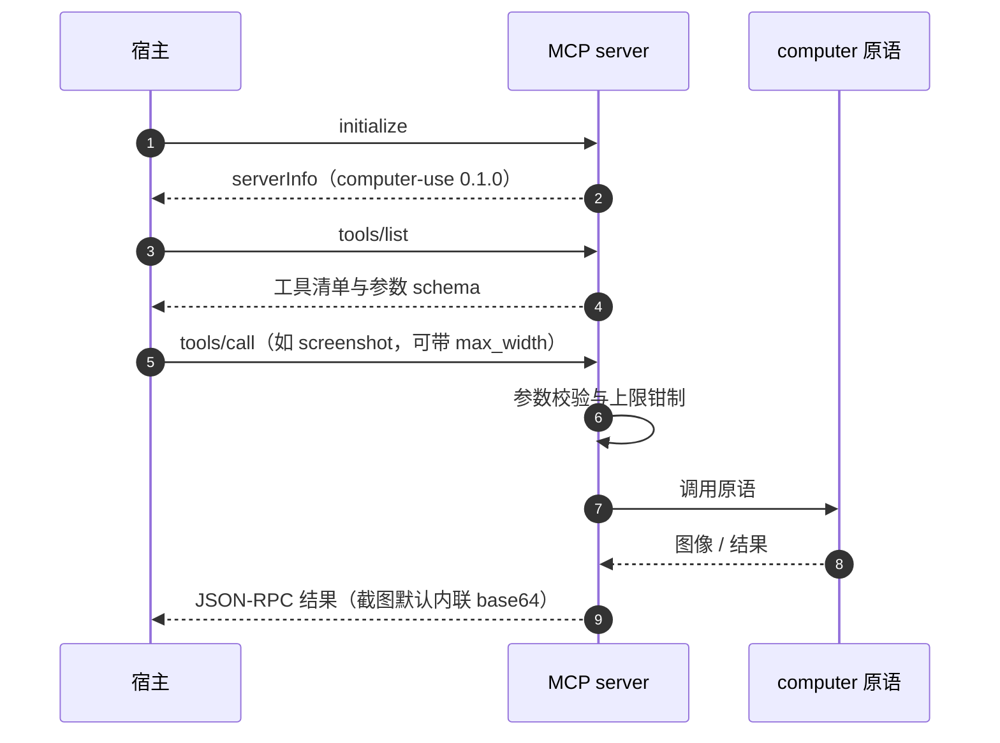

# backend/tool/computer/mcp

## 生态位

`backend/tool/computer/mcp` 是一个 **MCP stdio 服务端**：通过 JSON-RPC 把
桌面 computer use 原语（截图、鼠标、键盘、窗口枚举与聚焦）暴露给外部宿主
（例如 Codex）。

它是 `backend/tool/computer` 原语层的两个消费面之一（另一个是 Seelex 自己的
工具族），两者共用同一套原语，差异只在「图像怎么送到模型」：

| 消费面 | 调用方 | 图像通道 |
|---|---|---|
| MCP stdio 服务端（本包） | 外部宿主 | base64 内联在 MCP 工具结果里，由宿主决定是否进上下文 |
| Seelex 工具族 | Seelex agent | 落会话媒体分区，经 `imageattach` 随下一次请求送入（至多一次） |

典型用法：

```text
codex mcp add computer -- <path>/computer-use-mcp.exe
```

## 职责与非职责

- 做：stdio 上的 JSON-RPC 编解码、工具名与参数校验、调用原语、把截图编码为图像内容。
- 不做：不做任何**业务判断**。安全边界由调用方（模型与用户审批）负责；
  服务端只做输入注入与截屏。

## 架构图



## 时序图



## 约束与错误语义

- `maxInlineImageBytes = 8 MiB`：单张图内联上限，base64 会再涨约 33%；
  超过上限应让调用方降低 `max_width`，而不是把一行结果撑到读不回来。
- `maxLineBytes = 32 MiB`：单行 JSON-RPC 消息上限。
- `defaultWidth = 1600`：截图默认宽度，可被请求覆盖。
- 服务端不持有会话状态，也不落盘；每次调用无副作用之外的持久化写入。

## 扩展方式

新增暴露的工具：在原语层加函数，再在本包注册工具名与参数 schema，并同步
[`backend/tool/computer/README.md`](../README.md) 的工具清单。

## Review 指南

- 参数上限是否仍被钳制（宿主可能传任意大的尺寸或坐标）。
- 是否把「输入注入」当作可信操作（它不应自己做权限判断，但也不应假设宿主已授权）。
- 截图编码失败时是否显式报错，而不是返回空图像块。

## 测试与验证

```text
go test ./backend/tool/computer/... -count=1
go build ./...
```

## 文件与函数索引

> 由源码 doc 注释自动提取（首行摘要）；描述源码行为，与实现保持同步。
> 刷新方式：`python scripts/gen_core_readme_index.py`。

### main.go

- `func textResult(format string, args ...any) toolResult`
- `func errorResult(err error) toolResult`
- `func (r *regionArg) rect() *computer.Rect`
- `func describeScrollTargets(targets []computer.ScrollTarget, limit int) string` — describeScrollTargets 把可滚动面板渲染成给宿主模型看的文本清单。
- `func scrollTargetLabel(target computer.ScrollTarget) string` — scrollTargetLabel 给面板一个可读标签：UIA 名字缺失时退回类名，再缺就只说"未命名"。
- `func describeScrollAxis(_ string, axis computer.ScrollAxis) string`
- `func scrollStateSummary(after, before computer.ScrollTarget, hadBefore bool) string` — scrollStateSummary 在 scroll 结果后追加「滚到哪个面板、滚前滚后位置」。
- `func shotDir() string`
- `func captureAndEncode(region *computer.Rect, maxWidth int, savePath string, inline bool, cursor *computer.Point) ([]toolContent, error)` — captureAndEncode 截屏、落盘并生成 MCP 内容块。
- `func inlineImage(flag *bool) bool`
- `func main()`
- `func writeResponse(writer *bufio.Writer, resp rpcResponse)`
- `func handle(req rpcRequest) rpcResponse`
- `func callTool(params json.RawMessage) (toolResult, error)`
- `func describeScreenState() string` — describeScreenState 汇总「当前页面状态」里除画面之外的部分：虚拟桌面、光标、
- `func actionResult(summary string, withScreenshot bool, maxWidth int) (toolResult, error)`
- `func buttonName(button string) string`
- `func maxInt(a, b int) int`
- `func obj(properties map[string]any, required ...string) map[string]any`
- `func toolDefinitions() []toolDef`

### main_test.go

- `func newTempPNG(t *testing.T, dir, name string, width, height int) string` — newTempPNG 在临时目录写一张 PNG，返回路径。
- `func callViewImage(t *testing.T, arguments map[string]any) (toolResult, error)` — callViewImage 以 MCP 参数形状调用 view_image。
- `func TestViewImageToolReturnsInlineImage(t *testing.T)`
- `func TestViewImageToolHonoursMaxWidthAndInlineFlag(t *testing.T)`
- `func TestViewImageToolReportsInvalidPath(t *testing.T)`
- `func TestToolDefinitionsExposeViewTools(t *testing.T)`
- `func TestDescribeScrollTargetsRendersPanels(t *testing.T)` — TestDescribeScrollTargetsRendersPanels 覆盖面板清单的文本渲染：名字缺失时
- `func TestDescribeScreenStateIsSelfDescribing(t *testing.T)`
