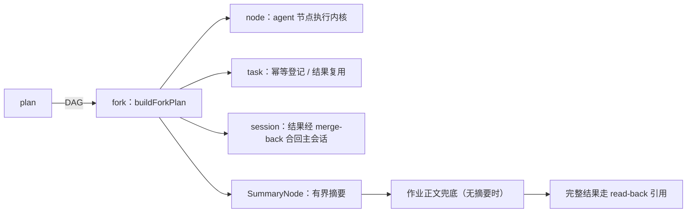
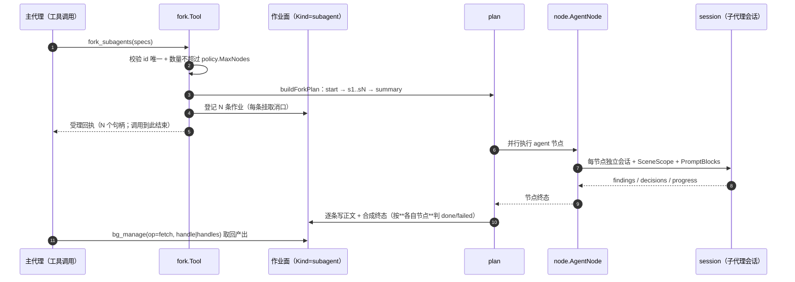

# Fork

## 生态位

`backend/tool/fork` 承载 `fork_subagents` 的纯类型与 DAG 构造：

- `types.go`：`Input`/`SubagentSpec` 输入契约、`SubagentsContractDescription`
  工具契约描述、`PlanCanonical` 规范 JSON（审计/展示）。
- `summary.go`：`SummaryNode` 汇总节点（把前驱输出压缩为每子代理一行的
  有界摘要，rune 计数截断）与 `ResultSummaryLines`/`SummaryLineLimit`/
  `SummaryMaxLines` 截断参数。

执行编排（账号/任务绑定/结果复用/worktree 生命周期）在本包 `tool.go`
（`Tool`/`NewTool`/`buildForkPlan`），根包 `runtime_subagent.go` 只保留
`forkSubagentsHandler` 门面转发；本包不反向依赖 `seelebridge` 根包，节点输入
形状直接复用 `backend/tool/node` 的 `SeelexNodeInput`（不再依赖 Plan 包）。

## 与其它域的关系



fork 把并发子代理编排成 plan DAG；节点类型是 node；结果经 session 合回
主会话；task 注册表负责幂等与并发配额。

## 时序图



`fork_subagents` **只派发、不等结果**（与 `bash_bg` / `read_batch` 同一个作业面）：
调用立刻返回句柄，产出经 `bg_manage(op=fetch)` 取回，过程用 `op=observe` 看、提前终止用
`op=kill`（一条 kill 取消整批，因为整批共用一次 plan run）、结清用 `op=done`。

## 批次失败策略（best-effort）

fork 批次的节点彼此独立（各自 worktree、各自账号、各自 goal），因此
`plan.newPlanRunner` 显式把 fork 批次的失败策略设为 `forkexec.PolicyBestEffort`
（框架默认是 fail-fast）：

- 任一节点失败**不再** cancel 整批上下文——同批兄弟节点跑完，产出按各自句柄取回；
- 失败仍必须可见：`planRunResultJSON` 按节点终态派生结果状态——有 failed 节点时
  `status:"failed"` + `error` 点名失败节点（REQ-006：任一分支失败不得报整体
  completed），`nodes[].status` 逐行可见；作业面按 `nodes[].status` 把它落成对应作业的
  `failed` 终态（成功兄弟仍是 `done`）；
- 只有**整批 agent 节点无一幸存**时才回到工具错误（错误会顶掉工具结果内容，
  有幸存产出时不能再走错误通道）——作业化之后这条体现为整批作业 `failed` + 正文带原因。

背景（2026-09-29 事故）：`fix-return-to-latest` 的流在 22:02:33 起满 300s 被
整请求超时掐断（failed），旧 fail-fast 立刻 cancel 整批，`fix-coldload-interference`
在 0.346s 后被连坐取消并报出没有来由的 `context canceled`，已完成产出一起被丢。
同一策略已在 `backend/tool/node/agent_node.go` 的 worktree 收尾降级（2026-09-11 事故）有过先例。

## 验证

```text
go test ./seelebridge -count=1
```

## 文件与函数索引

> 由源码 doc 注释自动提取（首行摘要）；描述源码行为，与实现保持同步。
> 刷新方式：`python scripts/gen_core_readme_index.py`。

### bind_subagent_task_test.go

- `func TestBindSubagentTaskIdempotent(t *testing.T)` — TestBindSubagentTaskIdempotent 验证 B6 装配件：相同 goal 的子代理绑定同一
- `func TestBindSubagentTaskRoutesByOwningSession(t *testing.T)` — TestBindSubagentTaskRoutesByOwningSession 钉住归属会话被**一路带到写入口**：

### per_subagent_params_test.go

- `func TestForkToolHandleRejectsSubagentLoopsAboveProcessCeiling(t *testing.T)` — TestForkToolHandleRejectsSubagentLoopsAboveProcessCeiling：同一条判据在工具入口
- `func TestSubagentsContractDescriptionMentionsPerSubagentLoops(t *testing.T)` — TestSubagentsContractDescriptionMentionsPerSubagentLoops：工具描述是**给模型看的

### summary.go

- `func NewSummaryNode(spec codec.NodeSpec[seenode.SeelexNodeInput]) *SummaryNode` — NewSummaryNode 构造 fork summary 节点。
- `func (n *SummaryNode) Run(_ context.Context, wc *workplanTypes.WorkflowContext) (string, error)`
- `func ResultSummaryLines(output string) (summary string, fullRunes int, truncated bool)` — ResultSummaryLines 提取子代理输出的有界摘要（rune 计数）；返回摘要、

### tool.go

- `func NewTool(deps Deps) *Tool` — NewTool 构造 fork 工具（deps 全部为闭包，域内不依赖根包）。
- `func (t *Tool) Handle(ctx context.Context, argsJSON string) (string, error)` — Handle 是 fork_subagents 的执行入口。
- `func (t *Tool) dispatchJobs(ctx context.Context, input Input, taskBindings map[string]string, timeout time.Duration) (string, error)` — dispatchJobs 把这一批子代理**作业化派发**：登记 N 条 Kind=subagent 作业 → 立刻返回
- `func (t *Tool) dispatchReusedJobs(ctx context.Context, input Input, taskBindings map[string]string, summaries map[string]string) (string, error)` — dispatchReusedJobs 把"结果复用"的批次也作业化：作业照样登记（回执形状与真跑一批
- `func acceptanceReceipt(receipts []map[string]string, hint string) (string, error)` — acceptanceReceipt 渲染作业化派发的受理回执：这是本次工具调用的**全部返回**
- `func (t *Tool) reusableForkSummaries(sessionID string, specs []SubagentSpec) (map[string]string, bool)` — reusableForkSummaries 检查每个 spec 是否可复用已保存输出：goal 命中的
- `func (t *Tool) bindSubagentTask(sessionID string, spec SubagentSpec) string` — bindSubagentTask 解析/创建子代理 task 并返回 task_id（幂等：相同 goal

### types_test.go

- `func TestInputTimeoutSecDecodes(t *testing.T)` — TestInputTimeoutSecDecodes 验证 fork 请求可按任务分配总超时
