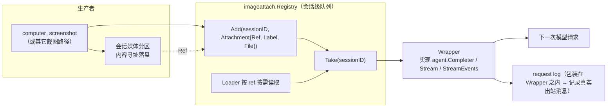
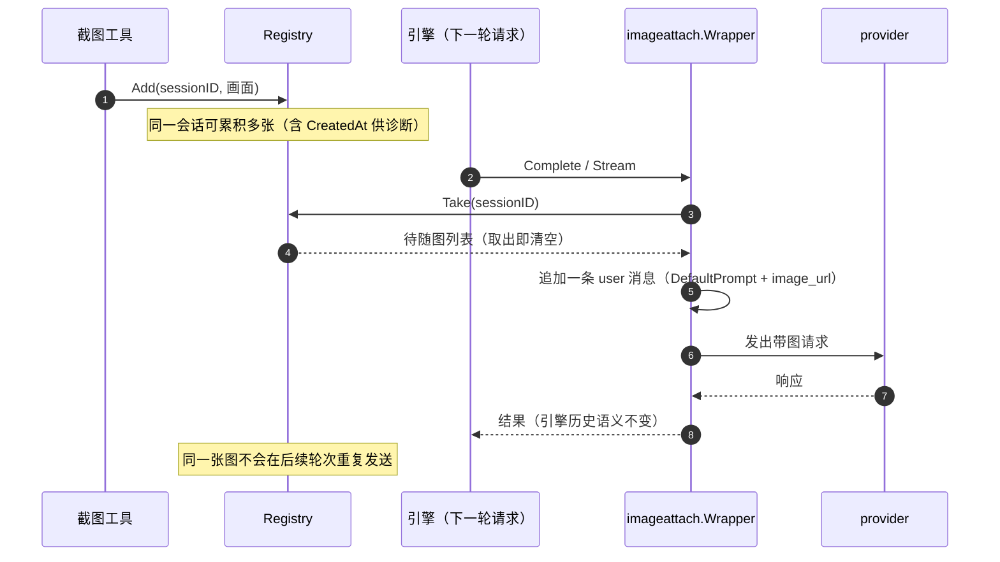

# backend/tool/io/imageattach

## 生态位

`backend/tool/io/imageattach` 把「会话里刚看到的画面」送到模型眼前，落在
**引擎与 provider 之间最窄的那条缝**上：`Completer` / `StreamCompleter`。

为什么在这层：引擎按自己的历史构造消息，它并不知道 Seelex 的会话媒体分区里
什么时候多了一张图；在这里补一条带图的 user 消息，模型就能看到画面，同时不改动
引擎的历史语义。

主要调用方：[`backend/tool/io/media`](../media/README.md)（截图落盘后 Add、请求装配时
`Wrap` 上队列与 ref 兜底 `Loader`）；装配器 `backend/engine/assemble` 的 Runtime 只决定
包装挂在 Completer 链的哪一层。

## 职责与非职责

- 做：会话级待随图队列（`Registry`）；发请求前把队列挂上（`Wrapper`）；`Take` 即清空。
- 不做：不截图、不落盘、不管媒体配额与回收（归 `store` 媒体分区与
  `CollectMedia`）。

## 语义：至多送一次

工具侧 `Add`，请求侧 `Take`：取出即清空，所以同一张图不会在后续每一轮重复占用
token 与配额。包装位置刻意在 request log **之内**，因此请求日志记录的就是真正
发出去的消息。

## 架构图



## 时序图



## 并发、存储与错误语义

- `Registry` 自持 `sync.Mutex`；`pending` 按会话 ID 分桶，不同会话互不干扰。
- `Attachment.Ref` 非空而 `File` 为空时按需 `Loader` 加载；ref 读不到且没有本体时
  触发 `OnDrop` 回调，不静默吞掉。
- `Stream` / `StreamEvents` 未装配时，流式调用退化为「一次同步 Complete + 单块回调」，
  与引擎在没有 `StreamCompleter` 时的回退语义一致。
- `DefaultPrompt` 明确说出「这是刚刚截取的屏幕画面」，否则模型容易把图片当成历史装饰。

## 扩展方式

新增随图来源：产出 `Attachment` 并 `Add`，无需改 `Wrapper`。新增图片载入位置：
替换 `Options.Loader`。需要改变提示语时用 `Options.Prompt`，不要改 `DefaultPrompt` 常量。

## Review 指南

- 是否出现「同一张图被重复发送」（`Take` 是否仍在请求侧调用）。
- 归属是否按**执行会话**解析（并行执行期间视图可能已切走，用视图会话会把画面写进另一个项目）。
- `OnDrop` 是否被忽略（会导致静默丢图，真机冒烟用「提示词里不存在的颜色词」断言图片确实送达）。

## 测试与验证

```text
go test ./backend/tool/io/imageattach -count=1
go test ./seelebridge/... -count=1
```

## 文件与函数索引

> 由源码 doc 注释自动提取（首行摘要）；描述源码行为，与实现保持同步。
> 刷新方式：`python scripts/gen_core_readme_index.py`。

### registry.go

- `func NewRegistry() *Registry` — NewRegistry 构造一个空队列。
- `func (r *Registry) Add(sessionID string, attachment Attachment)` — Add 把一张待随图挂到指定会话。
- `func (r *Registry) Take(sessionID string) []Attachment` — Take 取出并清空该会话的待随图；没有待随图时返回 nil。
- `func (r *Registry) Len(sessionID string) int` — Len 返回该会话待随图数量（诊断与断言用）。

### wrapper.go

- `func (w *Wrapper) Complete(ctx context.Context, messages []types.Message, tools []types.Tool) (types.Message, error)` — Complete 实现 agent.Completer。
- `func (w *Wrapper) CompleteStream( ctx context.Context, messages []types.Message, tools []types.Tool, onChunk func(string), ) (string, string, []types.ToolCall, error)` — CompleteStream 实现 agent.StreamCompleter。
- `func (w *Wrapper) CompleteStreamEvents( ctx context.Context, messages []types.Message, tools []types.Tool, onEvent func(types.StreamEvent), ) (string, string, []types.ToolCall, error)` — CompleteStreamEvents 实现 agent.StreamEventCompleter。
- `func (w *Wrapper) sessionID(ctx context.Context) string` — sessionID 解析会话 ID。
- `func (w *Wrapper) prepare(ctx context.Context, messages []types.Message) ([]types.Message, error)` — prepare 在原始消息之后补一条带图的 user 消息；没有待随图时原样返回。
- `func (w *Wrapper) resolve(ctx context.Context, attachment Attachment) (types.FilePart, error)` — resolve 取图片本体：优先内存里的字节，否则按 ref 加载。
- `func attachmentLabel(attachment Attachment) string` — attachmentLabel 给出人可读的来源标签。

### wrapper_test.go

- `func (c *recordingCompleter) Complete(_ context.Context, messages []types.Message, _ []types.Tool) (types.Message, error)`
- `func (c *recordingStreamCompleter) CompleteStream( _ context.Context, messages []types.Message, _ []types.Tool, onChunk func(string), ) (string, string, []types.ToolCall, error)`
- `func pngAttachment(label string) Attachment`
- `func TestRegistryTakeIsOnceAndSessionScoped(t *testing.T)`
- `func TestWrapperAttachesPendingImageExactlyOnce(t *testing.T)`
- `func TestWrapperLoadsImageByRef(t *testing.T)`
- `func TestWrapperDropsUnresolvableAttachmentWithoutBreakingRequest(t *testing.T)`
- `func TestWrapperStreamPaths(t *testing.T)`
