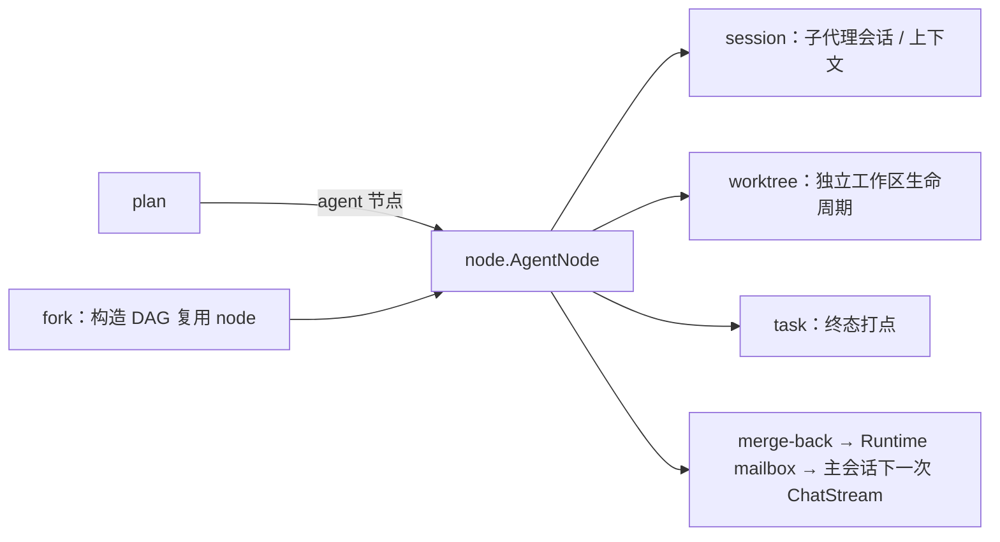
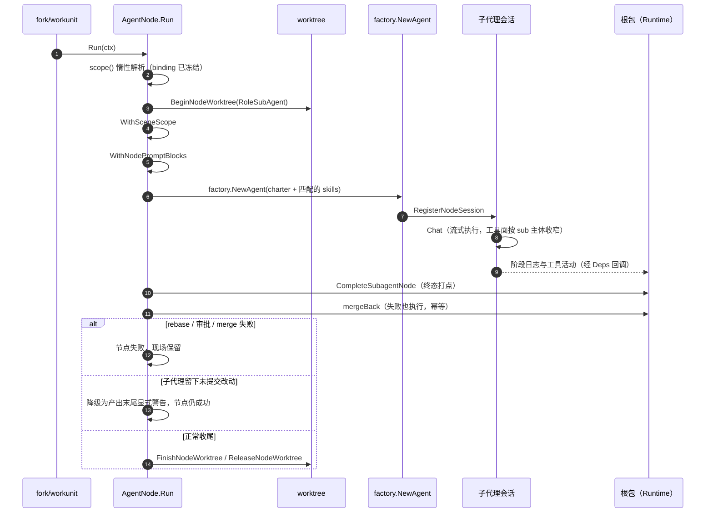

# backend/tool/node — 节点子代理执行域

## 生态位

承载子代理 AgentNode 的执行包装与节点级提示词装配。主要调用方：

- 根包 `runtime_subagent.go` 的 `runForkSubagent`——按一条 spec 直接构造 AgentNode；
- workunit 后台工作单元复用同一构造与 `nodeDeps()`；
- 根包 `runtime_subagent.go` 的 `nodeDeps()`（Deps 全为闭包，域内不依赖根包）。

## 与其它域的关系



subagent 是 node 域产生的子代理执行体；fork 编排其并行；plan 描述 DAG；
node 是执行内核（经 Coordinator.Deps 使用 session/worktree/task）。

## 时序图：一个节点的完整生命周期



## 职责与非职责

职责：

- `AgentNode.Run`：节点作用域注入 → worktree 开启 → 节点级 PromptBlocks 注入 → 节点 Session 执行 → 终态打点 → merge-back → worktree 收尾；
- 第一视角与语义结果（`Deps.RecordNodeStage`/`RecordNodeResult`）：spawn 阶段在
  `Run` 内记录（goal/会话 ID），turn/tool 阶段经 telemetry StageHook 记录，result
  阶段与预定义语义结果（`NodeSemanticResult`，对象结构由 seelex 制定、非 subagent
  自拟）在 `mergeBack` 内记录并投入语义结果队列；
- 节点级 PromptBlocks 的 ctx 注入/读取（`WithNodePromptBlocks` / `NodePromptBlocksFromContext`）；
- 执行预算（`NodeBudgetInfo`）、子代理章程渲染（`NodeSubagentCharter`）、skill 匹配（`MatchNodeSkills`）；
- 节点输入负载 `SeelexNodeInput` / `NodeBudgetInput`（`input.go`）：fork 单条子代理与历史 Plan 用例共用同一份形状。

非职责：

- 不持有会话/账号池/任务注册表/父证据（全部经 `Deps` 回调）；
- 不实现 worktree 生命周期（`backend/tool/worktree/` 域）；
- 不做 Plan 执行调度（内部 Plan 引擎已退役；历史 Plan 只读投影在应用层）。

## 目录或文件结构

| 文件 | 职责 |
|---|---|
| `agent_node.go` | `Deps`、`AgentNode`、`Run`/`mergeBack`、`withWorktreeUnmergedNotice`/`withWorktreeMergeBlockedNotice`、`SceneScopeFor`（经 `CurrentSceneScope` 窄回调解析）、`NodeSubagentCharter`、`MatchNodeSkills`、`WithNodePromptBlocks` |
| `input.go` | `SeelexNodeInput` / `NodeBudgetInput` 节点输入负载 |
| `coordinator.go` | `SessionPort`/`TreePort`/`TaskPort` 接口、`Coordinator`（含阶段日志与语义结果委托） |

## 核心实现

`Deps` 是全部运行时能力的函数字段集合（工厂、`CurrentSceneScope`、worktree 三件套、会话注册/终态、父证据、merge-back、预算、PromptBlocks、Tracer），由根包 `Runtime.nodeDeps()` 闭包注入。node 域不再 import Plan 包。

`AgentNode.Run` 生命周期：`scope()`（执行前解析 SceneScope）→ `BeginNodeWorktree`（RoleSubAgent）→ `WithSceneScope` → `WithNodePromptBlocks` → `factory.NewAgent` → `RegisterNodeSession` + `Chat` → `CompleteSubagentNode` → `mergeBack`（失败也执行，幂等）→ `FinishNodeWorktree`/`ReleaseNodeWorktree`。

收尾分类**只从契约取**（`workunit.ClassifyFinish`，job/subagent/teammate 三层唯一一份判据），节点只按分类做三件事：落定 → `ReleaseNodeWorktree`；「未提交改动」（`worktree_unmerged` 阶段 + `withWorktreeUnmergedNotice`）与「主工作区挡路」（`merge_blocked` 阶段 + `withWorktreeMergeBlockedNotice`）都**降级为产出末尾的显式警告**——节点按 Chat 结果判定成功、不 `Release`（现场保留供人工检查或补提交）；其余收尾失败才判死。这样单个子代理忘记执行收尾协议、或主工作区被在途改动挡住，都不会让 workplan fail-fast 取消同批兄弟节点、丢掉它们的产出。

## 数据流或生命周期

`fork_subagents` / workunit 构造 `AgentNode`（scope/blocks 闭包延迟解析）→ 执行 `Run` → 会话与工具活动经 deps 回根包 → merge-back 写 Runtime mailbox → 主会话下一次 ChatStream 前注入。

## 依赖方向

`node` → `internal/model`、`plan`、`worktree`、`workunit`（收尾分类与恢复说明的契约）、`skill`、`seelexctx`、`backend/engine/prompt/assets`。**禁止反向依赖 seelebridge 根包**（这是拆包打破循环依赖的硬约束）。

## 并发、存储、安全或错误语义

- `Run` 同步执行，取消经 ctx（fork 超时/用户停止由根包级联）；
- 收尾失败分流：只有 rebase/审批/merge 这类"改动/工作区不可用"的失败才让节点失败；"未提交改动"（`worktree.IsUncommittedChanges`）降级为产出中的 `[收尾警告]` 前缀段（含现场路径），节点仍成功——警告只加在返回给调用方的产出文本上，`mergeBack`/`NodeSemanticResult` 仍用原始结论，语义结果不被污染；
- merge-back 不因 `Chat` 失败而跳过（长时间静置场景已积累的 Findings/Decisions 不丢）；
- 不做持久化；子代理树/快照由根包 `session/` 域持有；
- 节点不触碰主会话锁——回传只经 `Deps.EnqueueSubagentContext`。

## 扩展方式

- 新增节点行为：改 `Run` 或新增 `Deps` 回调；
- 新增预算维度：扩展 `NodeBudgetInfo` 与根包 `Runtime.nodeBudget`；
- 新增提示词块：在 `NodeSubagentCharter`/`MatchNodeSkills` 侧扩展，保持"单一权威契约"。

## Review 指南

- `Deps` 是否保持"函数字段"，没有偷偷引回根包类型；
- scope/blocks 惰性解析是否保留（执行前冻结语义）；
- charter 是否仍为单一块（不再拆碎）；
- `TaskID` 是否只作绑定元数据、不进 prompt。

## 测试与验证

单元测试应留在本包（当前由根包 `agent_node_test.go`/`node_scope_test.go` 经兼容别名覆盖运行时方法；收尾降级的红灯用例见根包 `agent_node_uncommitted_test.go`，用真实 worktree 复现"子代理留下未提交改动"）。验证：

```text
go test ./seelebridge/... -count=1
go build ./...
```

## 文件与函数索引

> 由源码 doc 注释自动提取（首行摘要）；描述源码行为，与实现保持同步。
> 刷新方式：`python scripts/gen_core_readme_index.py`。

### agent_node.go

- `func NewAgentNode(spec codec.NodeSpec[SeelexNodeInput], deps Deps) *AgentNode` — NewAgentNode 构造子代理节点包装。scope/blocks 经闭包延迟解析，使执行前
- `func (n *AgentNode) Input() SeelexNodeInput` — Input 返回节点输入（测试/诊断读取面）。
- `func (n *AgentNode) Scope() func() dto.SceneScope` — Scope 返回节点作用域解析器（测试/诊断读取面）。
- `func (n *AgentNode) Blocks() func() []seelectx.PromptBlock` — Blocks 返回节点 PromptBlocks 解析器（测试/诊断读取面）。
- `func (n *AgentNode) traceSource() provider.TraceSource` — traceSource 返回遥测追踪源（子代理 Findings/Decisions 提取）。
- `func (n *AgentNode) Run(ctx context.Context, _ *workplanTypes.WorkflowContext) (string, error)` — Run 注入节点作用域与节点级 PromptBlocks 后委托节点 Session 执行。
- `func withWorktreeUnmergedNotice(result string, finishErr error) string` — withWorktreeUnmergedNotice 在节点产出末尾附加「未合并」警告。节点结论照常
- `func withWorktreeMergeBlockedNotice(result string, finishErr error) string` — withWorktreeMergeBlockedNotice 在节点产出末尾附加「合并被主工作区挡住」的警告。
- `func (n *AgentNode) mergeBack(ctx context.Context, agent frameworknode.Agent, goal, status, output string)` — mergeBack 把子代理会话的结构化上下文（Findings/Decisions/Constraints/
- `func truncateNodePreview(value string, max int) string`
- `func nodeStatusForErr(err error) string` — nodeStatusForErr 给出节点结论对应的**节点状态词**（引契约，不写字面量）。
- `func SceneScopeFor(deps Deps, nodeID string) dto.SceneScope` — SceneScopeFor 解析节点作用域：新执行模型下分支即节点（BranchID = NodeID），
- `func WithNodePromptBlocks(ctx context.Context, blocks []seelectx.PromptBlock) context.Context` — WithNodePromptBlocks 把节点级 PromptBlocks（目标 + 父证据 + 预算）注入 ctx。
- `func NodePromptBlocksFromContext(ctx context.Context) []seelectx.PromptBlock` — NodePromptBlocksFromContext 读取 ctx 中的节点级 PromptBlocks（拷贝）。
- `func NodeSubagentCharter(input SeelexNodeInput, budget NodeBudgetInfo, evidence *snapshot.ContextSnapshot) string` — NodeSubagentCharter 渲染子代理章程（Claude Code 风格结构化提示词：
- `func MatchNodeSkills(input string, skills []skill.Skill) []skill.Skill` — MatchNodeSkills 按节点目标匹配 skill：skill 名称（含分词：code-impl →

### coordinator.go

- `func NewCoordinator(deps CoordinatorDeps) *Coordinator` — NewCoordinator 构造节点协调器。
- `func (c *Coordinator) Close()` — Close 清理节点协调器状态（started 去重表），幂等；节点本身无 goroutine，
- `func (c *Coordinator) RegisterSession(mainSessionID, nodeID string, sess *frameworkSession.Session, goal string)` — RegisterSession 注册运行中的子代理会话（详情查询数据面）。
- `func (c *Coordinator) UnregisterSession(nodeID string)` — UnregisterSession 结束注册并保留最后快照（节点结束后详情仍可看）。
- `func (c *Coordinator) CompleteSubagentNode(nodeID, summary string, err error)` — CompleteSubagentNode 写入 fork 子代理树节点终态，并同步 task 注册表
- `func (c *Coordinator) Conversation(nodeID string) ([]types.Message, bool)` — Conversation 返回节点子代理的会话记录：运行中 → 子会话 History（实时）；
- `func (c *Coordinator) ContextSnapshot(nodeID string) (*snapshot.ContextSnapshot, bool)` — ContextSnapshot 返回节点子代理的结构化上下文快照（详情弹窗"上下文"标签）。
- `func (c *Coordinator) ToolResultArchiverFor(nodeID string) *seelexctx.InMemoryToolResultArchiver` — ToolResultArchiverFor 返回节点专属工具结果归档器（惰性创建；同一节点跨
- `func (c *Coordinator) ToolResult(nodeID, ref string) (string, bool)` — ToolResult 读回节点子代理的工具结果原始内容（ref 必须带 node:<nodeID>: 前缀）。
- `func (c *Coordinator) RecordStage(nodeID string, log model.NodeStageLog)` — RecordStage 记录 node 第一视角阶段日志（见 session.SubagentSessions.RecordStage）。
- `func (c *Coordinator) StageLogs(nodeID string) []model.NodeStageLog` — StageLogs 返回 node 第一视角阶段日志（同一 subagent 的多阶段认证面）。
- `func (c *Coordinator) StageEvents() <-chan model.NodeStageLog` — StageEvents 返回第一视角阶段日志实时推送通道（即时输出面）。
- `func (c *Coordinator) RecordResult(nodeID string, result *model.NodeSemanticResult)` — RecordResult 登记 node 预定义语义结果并投入语义结果队列。
- `func (c *Coordinator) SemanticResult(nodeID string) *model.NodeSemanticResult` — SemanticResult 返回 node 最近一次语义结果。
- `func (c *Coordinator) DrainSemanticResults() []*model.NodeSemanticResult` — DrainSemanticResults 取空语义结果队列（消息队列消费面）。
- `func (c *Coordinator) ParentEvidence() *snapshot.ContextSnapshot` — ParentEvidence 返回 Runtime 持有的父证据快照（子代理可读）。
- `func (c *Coordinator) SetSkills(registry *skill.Registry)` — SetSkills 装配子代理 skill 目录 actor（skill.Registry 自带锁；传 nil 关闭
- `func (c *Coordinator) Budget(input SeelexNodeInput) NodeBudgetInfo` — Budget 返回节点子代理的迭代轮数预算：优先节点输入参数（plan_load 节点
- `func (c *Coordinator) GoalSkillActive() bool` — GoalSkillActive 读取 Runtime 持有的不可变可见性投影。
- `func (c *Coordinator) PromptBlocks(input SeelexNodeInput) []seelectx.PromptBlock` — PromptBlocks 构建节点级 PromptBlock：子代理章程（Claude Code 风格结构化
- `func (c *Coordinator) resumeNote(nodeID string) string` — resumeNote 读取节点中断恢复说明（未接线/非恢复轮次 → 空串）。
- `func (c *Coordinator) Assembler() seelectx.RequestAssembler` — Assembler 返回节点子代理会话的 RequestAssembler：把 AgentNode 注入 ctx 的
- `func (c *Coordinator) skillBlocks(input SeelexNodeInput) []seelectx.PromptBlock` — skillBlocks 构建子代理 skill 块：
- `func (c *Coordinator) MarkStarted(nodeID string)` — MarkStarted 节点首次组装请求（真正开始执行，SSE 流开启）→ queued 转
- `func (c *Coordinator) NoteProgress(nodeID string, messageCount int)` — NoteProgress 上报节点本轮装配的工作历史条数（调用点在节点自己的请求
- `func (c *Coordinator) inheritedBlocks() []seelectx.PromptBlock` — inheritedBlocks 返回子代理会话继承的主代理稳定上下文块：
- `func (a ScopeAssembler) Assemble(ctx context.Context, request seelectx.AssemblyRequest) (seelectx.AssembledRequest, error)` — Assemble 实现 seelectx.RequestAssembler。
- `func splitSystemBlocks(blocks []seelectx.PromptBlock) (systemBlocks, rest []seelectx.PromptBlock)` — splitSystemBlocks 把 system 块拆到最前（provider/缓存前缀约定），其余
- `func stringPtr(value string) *string` — stringPtr 返回字符串指针（PromptBlock 内容载体）。

### coordinator_tool_protocol_test.go

- `func TestScopeAssemblerSanitizesWorkingHistoryToolProtocol(t *testing.T)` — TestScopeAssemblerSanitizesWorkingHistoryToolProtocol 孤儿 tool 结果（没有
- `func TestScopeAssemblerLeavesLegalHistoryUntouched(t *testing.T)` — TestScopeAssemblerLeavesLegalHistoryUntouched 合法协议的历史逐字不动

### session_id.go

- `func NodeSessionID(systemPrompt string) string` — NodeSessionID 派生节点会话 ID：以系统提示（节点目标）为种子做稳定哈希；

### tool_result.go

- `func (a ToolResultArchiver) Store(ctx context.Context, callID, tool, raw string) (string, error)` — Store 实现 seelexctx.ToolResultArchiver（幂等由底层归档器保证）。
