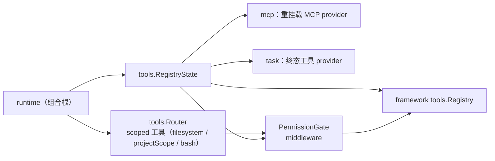
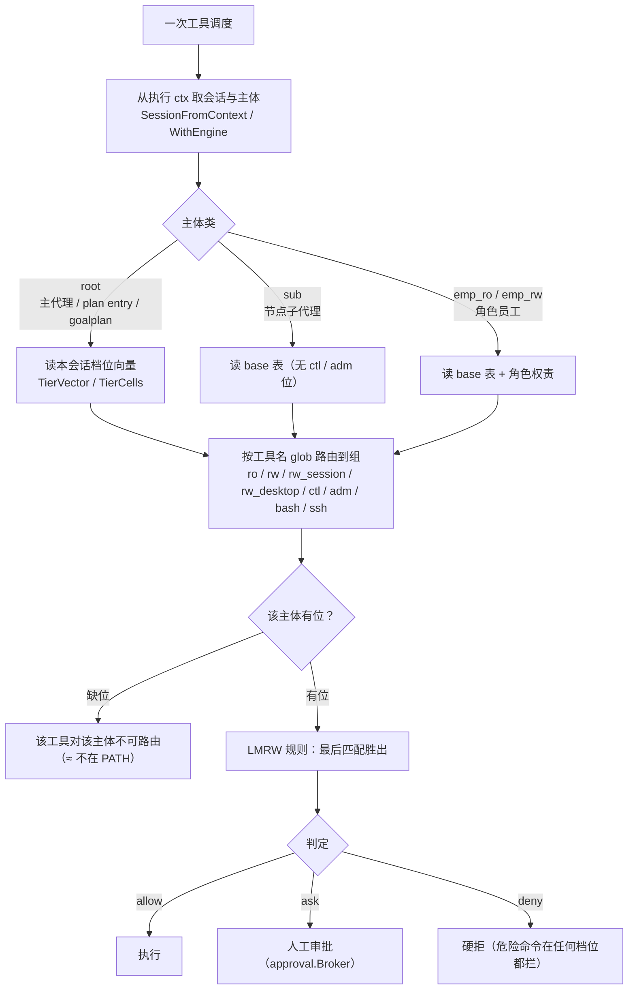

# tools 域

## 生态位

承载 scoped 工具路由与工具注册表状态：受项目根限制的
read/grep/glob/write/edit/bash 工具族（`Router`）、内联工具 provider
（`RegistryState.AddInline`）、权限门控（`PermissionGate`）。主要调用方：
`runtime.go`（RegisterBuiltins、seelexVisibilityPolicy）。

## 职责与非职责

- 职责：`Router` 注册并路由项目作用域工具；`RegistryState` 包装
  framework tools.Registry（超时/中间件/内联工具 + 工具簇属声明）；`PermissionGate`
  做工具调度前的权限检查（allow/deny/ask）；`async_*.go` / `job_*.go` 承载 **作业执行域**
  （子进程调用系契约，受 `limits.async_exec.enabled` 管辖；出厂配置 **true**，
  结构零值仍 false = 旧配置缺这段时能力不出现）。
- 非职责：MCP 工具生命周期（归 mcp 域）、plan 工具族（归 plan 域）。

## 与其它域的关系



## 权限判定链（主体 × 路由组 × 位）



**这一层的分工（2026-10-16 M2-C1/C4 后）**：图上"路由组表 / base 表 / 档位向量 /
工具簇属声明 / 壳类别"这些**判据**已归位 `backend/limit/policy`
（`DefaultPermissionGroupList` / `DefaultPermissionSubjects` / `TierVector` /
`DeclaredToolMeta` / `ShellKind`），本包只保留**执行门**（`PermissionGate` 的
类解析、可见性、工具面、员工主体解析与缓存）与注册表；审批落
`backend/limit/approval` 的 broker（本包只注入超时并消费）。判据改在 policy 改，
执行顺序改在本包改——两件事不要混。

## 传输选择（执行面 = local / ssh）

`transport.go` + `transport_decision.go` + `transport_selector.go` + `ssh_transport.go`：
把"这条命令在哪台机器上跑"从各个 handler 的入参里提出来，做成**一个接口 + 一个 ctx
读面 + 一个两段中间件**。

```mermaid
flowchart LR
    CALL["一次工具调度"] --> EVENT["event"]
    EVENT --> DEC["**TransportDecisionStage**<br/>只读决策：配置 + 探针缓存 → local / ssh"]
    DEC --> PG["pathGate（**按已定执行面取根**）"]
    PG --> PERM["permission"]
    PERM --> SEL["**TransportDialStage**<br/>建连：探针费 / 拨号 / 降级 / 报错"]
    SEL --> DIAG["diagnostic"]
    DIAG --> H["handler"]
    DEC -.写入 ctx.TransportDecision.-> PG
    SEL -.写入 ctx.TransportSelection.-> H
    H -.TransportFromContext.-> EXEC["ssh：*sshTransport（backend/tool/ssh）<br/>local：Transport=nil（既有本地路径）"]
```

- **选择拆成两段**（`transport_decision.go`，同一份中间件装在两处，靠 ctx 段标记区分）：
  - **决策段**：event 之后、`pathGate` **之前**。只读项目连接配置 + 探针缓存，
    **绝不建连、不发网络包**（未探 ≠ 通，照旧降级 local 并留痕）。这一段存在的唯一
    理由：路径门要"按面取根"，而旧链序里"走不走远端"要等权限门之后才知道；
  - **建连段**：permission **之后**、diagnostic 之前。真正的探测/拨号在这里——
    被拒的调用因此不白探、不白连，显式指名不可用的报错也不会顶掉权限拒绝。
- **选择规则**（`resolveTransportDecision` 判面 + `bindTransportSelection` 落地，顺序即
  优先级）：会话未固定命名环境 → local；固定环境无地址 → local；固定环境有地址 →
  ssh（探针或建连失败即报错，**不偷偷切回本地**）。环境与显式 `transport` 冲突时
  拒绝执行。环境名由宿主从会话绑定注入，模型入参不暴露也不能覆盖。判据只有一处：
  决策段给结论，建连段只落地。
- **错误码固定词表**：`SSH_UNREACHABLE` / `SSH_AUTH_FAILED` / `SSH_HOST_UNTRUSTED` /
  `SSH_TIMEOUT` / `SSH_ENV_DISABLED` / `SSH_ENV_UNKNOWN` / `SSH_ENV_CONFLICT`；映射表只有一张
  （`transportCodeForProbeClass`，输入是 `backend/tool/ssh` 的 `Class*`）。权限拒绝
  unwrap 到 `ErrPermissionDenied` 且不带任何码，见 `IsTransportErrorCode` 的用例。
- **留痕**：`TransportTrace{Degraded, Reason, ProbeClass, ...}`（不含命令、不含凭据）。
  降级必带 reason——否则"为什么这次在本机跑"无从追查。
- **消费者闸门**：`TransportSelectorDeps.Consumers` 空 ⇒ 中间件返回 nil（链上逐字
  等于旧行为）。把 ssh 写进 ctx 而 handler 不读，就是"说走远端其实跑了本地"，比不选
  更危险；因此消费者名单与真实消费点必须同一个提交里改。名单唯一一份：
  `RemoteFaceToolNames()`（read_file / write_file / edit_file / bash / bash_bg / bg_manage）。

### 远端工具面（`remote_face.go` + `ssh_transport.go`）

| 工具 | 远端实现 | 回执里的执行面两格 |
|---|---|---|
| `read_file` | `Transport.Read`（远端 base64 流回，行窗口在本端切） | 有（信封里的 `content` + `execution_surface` + `env`） |
| `write_file` | `Transport.Write`（内容走内容通道） | 有 |
| `edit_file` | `Transport.Edit`（读-替换-写，替换判据与本地面同源） | 有 |
| `bash` | `Transport.Exec`（命令正文与 `stdin` 数据都走内容通道） | 有（另带 `status` / `truncated` / `still_running` / `handle` / `log_path`） |
| `bash_bg` | `Transport.Start`（远端脱钩作业，返回 `ssh:` 句柄） | 有 |
| `bg_manage` | `Transport.Manage`（observe / fetch / kill / done） | 有 |

四条硬约束（判据都在用例里）：

1. **远端路径不过 shell 词法**：`backend/tool/ssh` 用 base64 承载路径，远端解码进
   shell 变量（`files_test.go` 断言命令正文里没有路径原文）；
2. **命令 + stdin 数据是两个字段**：`TransportRequest.Stdin` 与 `Command` 正交，
   数据不拼进命令正文（`TestRemoteBashSendsCommandAndStdinSeparatelyAndKeepsWorkdir`）；
3. **命令正文里的路径不做猜测式改写**：远端面上的 `path` / `workdir` 原样送给对端，
   本层不做 `ProjectScope` 解析（这是本地作用域的判据）；
4. **超时 / 截断 / 仍在跑分开**：`status`、`truncated`、`still_running` 三格互不顶替，
   仍在跑时必须有 `handle` + `log_path`（否则不说"稍后取回"）。

**远端作业句柄**是 `ssh:<base64url(dir)>` 族（`backend/tool/ssh/job.go`），与本机
作业表的 `bt-` / `bs-` / `bteam-` **语法上互不相认**：把本机句柄交给远端面只会得到
"该用哪张表"的显式错误，不会静默命中一条无关作业。

**边界（如实记录）**：

- **SSH 只有一枚能力**：路径门先按已定执行面取根（`path_gate_face.go`）——本地面按
  项目根判、越界直接拒；远端面不做本地根判定，但远端项目根之外的绝对路径必须落在
  当前 agent role 的 SSH 路径白名单里，否则以 `PERM_SSH_PATH_DENIED` 拒绝。白名单是
  `ssh` 能力的作用范围，不是第二枚权限。
- **远端项目根未知**：连接配置读面只有 host/port/user，没有"远端工作目录"，所以
  `SSHEndpoint.RemoteRoot` 恒为空；等它有了值，路径门判据一行不动（只多一个比对根）。
- **远端无并发写互斥**：本地 `fs.FileSystem` 的 per-path actor 是进程内锁，跨机器不
  成立；远端写只保证"原子替换"，不保证两个并发远端写之间的顺序。
- **远端 `edit_file` 是两趟往返**（读 + 写），读与写之间远端文件可能被别处改动。
- **`read_batch` / `grep_search` / `glob` 仍只有本地面**：不在消费者名单里，因此选择器
  对它们一个判断都不做。

## 核心实现

- `Router`：Deps 闭包注入 Runtime 能力（filesystem/projectScope/docker
  恢复/诊断），注册 read/write/bash 等工具。路径根解析顺序：worktree 节点作用域
  （`SceneScope.WorkspaceID`）→ 执行 ctx 的**会话键**（`Deps.SessionKey`，生产为
  telemetry 会话 ID）对应的项目根 → 进程默认根。后台/并行会话因此不会借用视图
  会话的项目根（工作区污染回归见 `router_session_root_test.go`）。
- **前台工具调用的终止（停止按钮）**：同步 `bash` 的 run 挂在回合 ctx 上，
  点停止 = 取消该 ctx。它与后台作业共用**同一份**进程树装配——`newProcessTreeCommand`
  （`router.go:570`）+ `startWithProcessTree`（`router.go:584`）= `security.ProcessTree` +
  `ConfigureProcessTree` + `cmd.Cancel = tree.Terminate()` + `WaitDelay`，两条链只传各自的
  `runCtx`（装配回归见 `process_tree_assembly_test.go`）。所以停止（以及 `timeout` 到点）
  终止的是**整棵树**：只杀直接 shell 时，它派生的孙进程会继续
  跑、继续握住输出管道，`cmd.Wait` 于是要等孙进程自己退出——"停止工具调用"就变成"点了
  停止还要再等几十秒"（回归用例 `stop_foreground_run_test.go`）。反过来，后台作业用
  `context.WithoutCancel` 摘掉了回合 ctx，**停止按钮不杀它们**：生死只由
  `bg_manage(op=kill)` 与 `asyncHardCap` 决定。
  **有意不并的只有 `runCtx`（超时 / 取消策略）**：两条链长得像但语义不同——后台是
  `context.WithTimeout(context.WithoutCancel(ctx), asyncHardCap)`（受理回执一返回本次调用的
  ctx 就失效，沿用它会把刚起的命令连带杀掉），同步是
  `context.WithTimeout(ctx, r.scopedToolTimeout(...))`（受本次调用预算约束、可被"停止"取消）。
  把这两条并成一条，要么后台命令被回执后的 ctx 杀掉，要么前台命令再也停不下来。
- `RegistryState`：framework registry 包装 + `InlineProvider` 累积
  RegisterTool 产品工具（重名覆盖、快照重建）。
- `PermissionGate`：middleware 闭包捕获，运行时原子更新。**权限档位按会话解析**（`SetPermissionTierFor` / `PermissionTierFor` / `effectiveTierLocked`，空会话 ID = 进程级默认面）：middleware 由执行 ctx 取会话（`SessionFromContext`）后按"主体类 + 会话档位向量"选 checker——root 读本会话 `TierVector` / `TierCells`，`sub`/`emp_*` 一律读 base 表；`full` 档的执行门短路**只对 root**（`Enforce` 条件 `class == root`），所以 A 会话切档不会放行 B 会话、员工越权也不会被 `full` 档连带放行（回归见 `permission_tiers_test.go`、`permission_session_isolation_test.go`、`permission_state_test.go`）。`SetFullAccess*` / `FullAccessFor` 保留为兼容壳（⇔ `full`/`manual` 档）。
- `computer/`（子包）：桌面 computer use 原语 + Seelex 侧工具族（`computer_*`）；
  工具面只依赖注入闭包（注册面/媒体分区/随图队列），原语平台无关桩保持跨平台
  可编译。输入注入类工具对子代理不可见（见 `policy.go` 的
  `isComputerInputTool`）。

### 作业执行域（子进程调用系契约，`async_*.go` / `job_*.go`）

**契约 = 一个 interface、Add + 四个管理动作**（`job_contract.go` 的 `JobTool`）：

```text
Add(ctx, JobSpec)            → []byte   派发并立刻返回受理回执（handle + log_path）
Status(ctx, JobHandle)       → []byte   只读看进度（不推进游标、不消费输出）
Fetch(ctx, JobHandle)        → []byte   取回增量（消费式：取过的不再给第二次）
Kill(ctx, JobHandle)         → []byte   终止执行体（进程树 / 取消级联），已产出内容不丢
Done(ctx, JobHandle)         → []byte   销项一个已终态的作业（终态只由执行体判定）
```

出参一律 `[]byte`（JSON 载荷）：载荷就是将来要交给模型/前端的结构化输出，先转成
string 只会让每个调用点多做一次编解码往返；框架的 `ToolHandler` 只吃 string，所以
转换点只留在**工具边界**那一处。

三类作业共用**同一张登记表、同一套状态机**（`asyncRun.kind`）：

| kind | 谁派发 | 执行体 | 谁触发终态 |
|---|---|---|---|
| `process` | `bash_bg` | 后台 shell 子进程（进程树可终止） | 运行体系（`awaitAsync` 被动） |
| `inline` | `read_batch` | 进程内读扇出（取消靠 ctx） | 运行体系（goroutine 收尾，被动） |
| `subagent` | `fork_subagents` | plan 节点编排（取消靠 ctx） | 运行体系（`CompleteJob`，被动）+ 模型侧 `done` 销项 |

三类作业的派发工具都**只派发、不等结果**：`fork_subagents` 也没有"阻塞到全部跑完"
的分支（阻塞期间模型没有下一次调用，`observe`/`kill` 就没有入口）。

### 句柄自带来源（作业身份层，2026-10-15）

本域的后台作业表与 Seele `jobs.Manager` 的团队作业表**在同一个进程里并存**，各表自己维护
派发序号。两边曾经共用同一套句柄形状（都从 `a1` 起），于是把一张表的句柄交给另一张表的管理
工具会**静默命中一条无关作业**（审计 `docs/2026-10-15-teamwork-defect-audit/README.md` D1，
真实会话里发生过 leader 想停 teammate 的 `a5`、却销掉一条无关后台作业并收到"成功"）。

现在的口径：

| 表 | 派发面 | 句柄 | 管理工具 |
|---|---|---|---|
| 后台工具作业 | `bash_bg`（process）/ `read_batch`（inline） | `bt-<seq>` | `bg_manage` |
| 后台子代理作业 | `fork_subagents`（subagent） | `bs-<seq>` | `bg_manage` |
| 团队作业 | `team_dispatch`（teammate，Seele `jobs.Manager`） | `bteam-<seq>` | `jobs_manage` |

- **文法与判据只有一处**：`contract/dto/job_namespace.go`（`JobHandle` 铸造 /
  `JobNamespaceOf` 识别 / `JobHandleSeq` 解析）。分隔符是文法的一部分——`bt` 是 `bteam` 的
  前缀，只有带上 `-` 匹配，`bteam-3` 才不会被判成 `bt-` 那一族。
- **本域铸造**在 `async_exec.go` 的 `beginJob`（按 kind 取 token）；团队表由 Seelex 注入的
  命名器给出（`backend/engine/assemble/teamwork_job_namer.go`）。
- **跨表调用显式报错**：`bg_manage` 的 `requireOwnedJobHandles` 只认本表的两个 token（正向
  白名单，第三张表出现时默认拒绝），拒绝文案点名 `jobs_manage`。
- 工作表格行 ID 仍是 `async:<handle>`（`async:` 是**行**命名空间，与句柄命名空间正交），
  前端与看板因此不需要认识 token。
- 名字从 `job_manage` 改成 `bg_manage`：旧名与 `jobs_manage` 只差一个字母（退役门禁见根目录
  `job_migration_residue_test.go`），新名与 token 同源。

### 实际壳的单一事实源（2026-10-15）

`bash` / `bash_bg` 到底在哪条壳里执行，是一条**装配期解析一次**的结论（`shell_fact.go` 的
`ResolveShellFact`：Git Bash → PATH 上的 bash（WSL 的 bash 被拒）→ PowerShell → cmd → sh），
进程内缓存。**执行层、模型面、权限表读同一份**：

- 执行层：`scopedBashCommand` 直接取事实里的 `Path` + 方言 argv（不再每次现算）；
- 模型面：两个工具的描述各带一句 `DialectHint`（本机壳是 POSIX 还是 PowerShell、该用哪些命令），
  系统提示词另有一段 Environment（由组合根经 `contract.Dependencies.EnvironmentSection` 注入，
  装配期定值 ⇒ 稳定前缀）；
- 权限表：`PermissionRulesForShell` 的**免打断读命令**那一层按方言分槽（PowerShell 宿主放行
  `Get-ChildItem*` / `Select-String *` 等，不放行 `ls *` / `head *` —— 那些命令在 PowerShell 下
  是"放行即失败"），其余层（写类 ask、危险 deny、越界 ask）只有一份。

为什么必须同源：白名单按**命令文本**匹配，同一个字符串在不同壳里是两回事。不同源的代价是
"**过闸即死**"——白名单放行、执行层跑另一个壳、命令失败，模型只拿到一条执行错误（审计 D4）。
判据在 `shell_fact_test.go`（事实稳定 + 执行同源 + 方言进模型面 + 权限分层）。

工具面与形状：`bash`（唯一的 shell 入口：串行、同步，**不再有 `background`**；
只读形态的免打断由权限模式表承担）/ `bash_bg`（`Add`，**必须带
`description`**——它是工作打点表的行标题）/ `read_batch`（一次派发 N 个读作业）/
`fork_subagents`（一次派发 N 个子代理作业）/ `bg_manage`（`op=observe|fetch|kill|done`；
`op=fetch`/`op=observe` 可给 `handles` 数组一次管一批——**整批共用一份等待预算**，
不是逐条各等一次）。派发只返回**受理回执**
（`{status:accepted, handle, log_path, state:running}`，不含作业输出），
`tool_call`/`tool_result` 的配对就在这一次调用里完成。每一问一答都是正常的相邻工具对，
所以历史只追加、不回写，也不需要
"结果到达时把空闲会话叫醒"那条链路（它必然回闯 `ChatStream` 全程持有的会话锁）。选型与
实测见
[`docs/2026-09-24-async-tool-deferred-ack/README.md`](../../../docs/2026-09-24-async-tool-deferred-ack/README.md)
§0（P4/P5 证明迟到 `role=tool` 在 wire 层非法，P7 证明轮询形态不破前缀缓存）与 §10。
契约与打点见 [`docs/2026-09-26-subprocess-contract/tool_concurrency_design.md`](../../../docs/2026-09-26-subprocess-contract/tool_concurrency_design.md)
§A/§B 与 [`docs/2026-09-26-subprocess-contract/tool_calling_step0_contracts.md`](../../../docs/2026-09-26-subprocess-contract/tool_calling_step0_contracts.md)。

串行与后台之间有一条**时长线**（`serialBashBudget` = 5 分钟）：显式 `timeout` 超过它的
`bash` 调用被拒绝，并被指向 `bash_bg`（`auditSerialTimeout`）。取拒绝而不是
按预算截断：截断是静默降级——模型以为给了 30 分钟，命令在第 5 分钟被杀，工作白做且没有
任何信号说明该换入口。作业面关闭时**不**审查：没有 `bash_bg` 可派发，拒绝一条长命令等于
既不执行也不给替代路径。没声明 `timeout` 的调用同样不审查（没有"声明的时长"），长命令该
去哪由描述与系统提示词负责说明。这条线的数字在三份工具描述与
[`assets/system/instructions.md`](../../../kernel/prompt/assets/assets/system/instructions.md)
的 `Long-Running Commands` 段里各出现一次，来源只有 `serialBashBudget`：
`serial_bash_budget_test.go` 同时钉住拒绝、边界、开关不误伤与"提示词里的数字就是代码执行
的数字"。

文件分工按"契约 / 表 / 执行体 / 工具面 / 探针"五份（`async_exec.go` 单文件曾长到 608 行
且职责混合，命中仓库根 `MEMORY.md` 的上帝文件判据）：

- `job_contract.go`：`JobTool` 契约 + `jobManager`（四个管理动作的唯一实现；批量入口
  `FetchMany`/`StatusMany` 也在这里，单条与批量共用 `fetchOne`/`polledPayload`）。
- `job_tools.go`：`bg_manage` / `bash_bg` / `read_batch` 三个工具面与 schema/描述。
- `scoped_names.go`：**项目作用域工具名单（唯一一份）**（P21-31 归位）——六个名字常量
  （`ReadFileToolName` / `GrepSearchToolName` / `GlobToolName` / `WriteFileToolName` /
  `EditFileToolName` / `BashToolName`）+ `ProjectScopedToolName(name) bool`。名单有两个消费面：
  `Router.Register` 登记它们、装配层的 `RegisterTool` 拒绝在作用域表就绪后再注册同名工具——
  两处各写一份就会漂移（新加的项目作用域工具被晚注册顶掉，或莫名其妙被拒）。
- `path_gate.go`：**路径门前移**（P1 / M2-C5）——把 ProjectScope 越界检查放在权限门
  **之前**（事件 → 执行面决策 → 路径门 → 权限门 → 建连 → 诊断 → handler），越界路径
  直接拒、不先弹审批。路径根解析与 handler 同源（`resolveScopedPath`，含 SceneScope
  worktree 根）；本文件只维护"哪个工具的哪个入参是路径"的表（`path` / `paths[]` /
  `workdir`）与按面分派。
- `path_gate_face.go`：路径门**按已定执行面取根**——本地面按项目根判（越界直接拒）；
  远端面不做本地根判定（远端路径属对端命名空间），只把"本地根容不下"的绝对路径记成
  `RemotePathHandoff`，并交给同一 `ssh` 能力下的路径白名单裁定；远端面上相对路径
  不按本地根判。
- `job_run.go` / `job_subagent.go`：等待预算、子代理作业的登记与被动收尾入口。
- `async_exec.go`：句柄表与状态机（`running/done/failed/killed`）、载荷渲染。
- `async_run.go`：派发、`awaitAsync` 收尾、进程树与输出目录回收。
- `async_probe.go`：只读探针（`AsyncRuns` / `AsyncRunEvents` / `AsyncOutputTail`）——回答界面上的
  "是什么、在跑什么、现在怎么样、最后几屏说了什么"，前两者不推进游标、不进上下文；
  `AsyncOutputTail` 同样**不消费输出**（取回语义只属于 `bg_manage(op=fetch)`），只给详情
  弹窗一个日志末尾的有界窗口（UTF-8 边界对齐、控制字符与 ANSI 转义清洗）。
- `scoped_names_test.go`：**跨实现一致性**——用 `Deps.RegisterTool` 桩捕获注册面实际登记的名字，
  与判据面的名单逐一对账（两处各写一份名单就会在这里红）；名单之外的名字（含大小写变体与
  `bash_bg` / `read_batch` 这类同族名字）一律不算。

- `asyncRegistry`：单锁句柄表。句柄 `<token>-<seq>`（本表是 `bt-` / `bs-`，token 表与文法见
  `contract/dto/job_namespace.go`；seq 单调，不能用 `len(runs)` 推——驱逐过
  已完成项后会同号，两条执行共用输出文件）；去重键 = 会话+命令（只在 `state=running`
  期间生效，一次失败不得永久封死这条命令）；在途上限 32、记录槽 256，驱逐最老的已完成
  记录时**连带删输出文件**（记录槽有上限、文件没有，否则长会话把临时目录无界撑大）。
  `begin`/`snapshot` 都按值返回副本：表内那条记录的 `state/exit` 由执行体收尾在锁内改写。
- 执行体：`context.WithoutCancel` + 自带 `asyncHardCap=30m`。同步路径的
  `scopedToolTimeout` 在这里不适用——受理回执一返回，本次工具调用的 ctx 就失效，沿用
  它会立刻杀掉刚起的命令。硬超时合成 `exit=124`、被杀合成 `exit=137`，两者都把注记写进
  输出文件（否则模型只看到"命令突然结束"）；正常退出、硬超时、被杀、执行体 panic 四条路
  都必须落到 `finish` 恰好一次。
- **进程树终止靠 `security.ProcessTree`（Windows = Job Object，POSIX = 进程组）**：
  `exec.CommandContext` 到点只杀直接子进程（bash），`taskkill /T` 也杀不到——MSYS2/Git Bash
  的 fork 子 shell 不一定挂在直接父进程下，实测 `bash -c "(sleep 0.5; echo GRANDCHILD) &
  sleep 25"` 在 150ms 被 `/T` 杀掉后 GRANDCHILD 仍落进日志。Job Object 不看父子关系，
  且 `KILL_ON_JOB_CLOSE` 让"执行体收尾时关句柄"成为唯一确定的回收点。Job 建不出来时
  退化成按 PID 杀，`Degraded()` 说得清——此时不得主张"整棵进程树已终止"。两条链读的是
  **同一个判据**（`backend/limit/gate/process_tree_windows.go` 的 `Degraded()`：Job 没建成 **或** 进程没挂进去），
  只是读数通道不同——后台链折进探针的 `Degraded` 栏与观察行（`async_probe.go:64`/`:127`），
  同步链发一条 `bash.process.degraded` 诊断（`router.go:714`，回归见
  `process_tree_degraded_reading_test.go`）：同一件事不许一条链说得出口、另一条链瞒下。
- `cappedLogWriter`：输出在 1MiB 处截断，超上限只丢字节、**仍向子进程报告已消费**
  （报短写会让命令自己异常退出，那是把基础设施限制伪装成命令失败）。
- 增量交付：`cursor` 是"已交付给模型的文件偏移"，每次取回最多带 4000 字符的**新增**
  部分——反复轮询同一句柄不会把整份日志重播进上下文（这是轮询型唯一真实的 token 风险）。
- 会话销毁即杀：`Router.CloseSessionAsync(sessionID)` 由 `Runtime.ReleaseSessionAsync`
  转给 core，在会话删除/归档时调用。句柄表按会话持有执行体，会话没了就没有任何取回/终止
  入口——不杀就是无人认领的孤儿进程，而工作打点表会一路显示 running。
- `AsyncPendingFor(sessionID)`：只读计数本会话在途执行。它是 core"无进展预算"的判据输入：
  异步载荷刻意不含时间戳（含了就每轮白烧前缀缓存），所以一条**安静**的长命令的两次取回
  必然逐字节相同，按载荷字节算进展会把还在跑的回合判死。
- 实时探针（`async_probe.go`）：`AsyncRuns()` 把登记表采样成"是什么（description）、
  在跑什么（command）、现在怎么样（state / exit / 已产出字节 / 末行 / 耗时 / 是否降级）"，
  `AsyncRunEvents()` 是它的变化信号口（容量 1、latest-wins）。三类来源发信号：派发与终态
  （`begin`/`finish`）、以及**有新字节**（`cappedLogWriter` → `noteOutput`，按
  `asyncProbeThrottle=1s` 去抖；安静没输出的命令不刷信号）。探针不推进 `cursor`，也不进
  上下文——命令行原文、绝对路径、时间戳只到 GUI；`asyncPayload` 那份仍受"确定性、不含
  路径"的缓存纪律约束。宿主投影编排见 `application/execution/table/runtime.go`。
- 开关（`Deps.AsyncExecEnabled` ⇐ `limits.async_exec.enabled`，**出厂 true**；结构零值仍
  false，旧配置文件缺这段 = 关）：关闭时作业工具（`bash_bg` / `read_batch` /
  `bg_manage`）都不注册、`bash` 收到旧入参 `background=true` 与
  `fork_subagents`（它只走作业面）都直接报错。**关就是关**，不得静默降级成同步执行
  （与 `backend/limit/gate/sandbox.go` 头注同源）。常驻开的已知代价：这几个入口的 schema
  每轮常驻（实测三个入口约 213 token/轮，A/B 报告 §4 r1）。
- 完成回填（打点 K-5）：终态迁移那一刻算一次**有界摘要**（≤512B：状态 + 退出码 +
  行数 + 字节数 + 有界末行），投影（`application/execution/table/runtime.go`）把它回填进
  请求尾部打点块——在途行带标题、完成行带摘要，取回/销项后行才消失。摘要按轮重播，
  所以它是**严格有界**的；全文只走 `fetch` 或 attachments 里的日志路径。
  `Notified` 位是回填幂等键：重复 `finish` / 重复 `done` 不产生第二次回填
  （`finish` 与 `CompleteJob` 都以"状态非 running 即返回"做同一次守卫）。

## Review 要点（本域最容易出错的地方）

- `state/exit/killRequested/cmd` 只能在 `g.mu` 内读写；终止动作（taskkill / TerminateJobObject）
  必须在锁外做——`finish` 也要这把锁。
- `killed` 意图只能在终止**确认成功**后落（`markKilled`），否则状态会跑在进程前面。
- 载荷新增字段前想清楚：它会永久留在可缓存前缀里，任何"每次都不一样"的字节都在白烧预算。
- 派发返回前若 `attach` 没落上（记录被驱逐/关停），执行体必须自己 `tree.Close()`，否则漏 Job。
- 探针读表（`infos`）只能在锁内取字段，文件 `stat`/读末窗一律在锁外做——一条狂写日志的
  命令不得挡住派发与收尾。信号是**非阻塞**发送（持 `g.mu` 时），消费者慢就让它丢，
  读侧自己汇聚。
- `asyncProbeThrottle` 只限制发信号的频率，不参与"进程还活着吗"的判断；终态一律由
  `cmd.Wait` 的返回说话。新增按墙钟猜状态的判据一律拒绝。
- 给后台执行加字段时先说清它属于哪一层：`asyncRun`（表）→ `AsyncRunInfo`（探针，可带
  路径/时间/命令原文）→ `asyncPayload`（进上下文，必须确定性、不含路径）。三层字段混用
  就是拿缓存预算换界面便利。

## 数据流

RegisterBuiltins → Router.Register → framework registry；每次工具调度 →
permission middleware → handler → 诊断/遥测钩子。

## 依赖方向

允许依赖：`fs`、`security`、`internal/model`、`framework tools`、
`framework types`。禁止依赖：seelebridge 根包及其它域。

## 并发、存储、安全

`Router`/`PermissionGate` 自带锁；路径经 `security.ProjectScope` 校验；
bash 诊断观察者 panic 隔离。作业域：`asyncRegistry` 单锁（执行体 goroutine 只写
自己那条，读侧在 handler 里，文件 I/O 一律在锁外）；句柄只对本会话有效，跨会话
取回/终止/销项直接拒绝；执行体脱离工具 ctx（`context.WithoutCancel`），存活上限由
`asyncHardCap` 自带；输出目录归本进程，`CloseAsync` 当场试删，删不动（还有句柄没关）
就由最后一条 `finish` 补删，关停后 `begin` 直接报错而不是新建一个没人回收的目录。
**`bash_read` 已删除（2026-10-15）**：它当年是"只读名牌 + 服务端语法判定"的分裂面
（`security.ClassifyCommand`/`ExplainCommand`，随它一起删除），实测 479 次调用有 165 次
（34.4%）折在判定上，而判定侧本身还与本机执行壳错位（白名单是 POSIX 词表、壳退化成
PowerShell，放行也执行失败）。命令面因此只剩 `bash` 与 `bash_bg`；读文件走
`read_file`/`grep_search`/`glob`。

**免打断的读命令**改由 `bash` 的**模式白名单**承担（`backend/limit/policy/policy.go` 的
`bash` Patterns：`git *` / `ls *` / `cat *` / `head *` / `tail *` / `pwd` / `go test *`
… ⇒ `ActionAllow`），其余形态落到 `ActionAsk`。模式匹配比服务端分类弱，所以这里刻意
只放保守形态（无管道、无重定向、无替换）。

## 扩展方式

新增 scoped 工具：扩展 `Router.Register`；新增内联产品工具：`AddInline`（簇属由
`backend/limit/policy.DeclaredToolMeta` 按路由组表自动填，新工具名必须先在**路由组表**里分封，否则
`RegistryState.UndeclaredTools()` 会把它列出来）。新增作业类型：实现 `JobTool`
（`Add` + `Status`/`Fetch`/`Kill`/`Done`，管理动作委派 `jobManager`）并把执行体接进
`asyncRun`——派发回执必须在自己的单元内完成配对，不得引入"迟到补记"写回历史中段的链路。

## Review 指南

- 路径是否可能逃逸项目根；路径门是否仍在权限门之前（越界不该弹审批）；权限中间件是否在
  注册表构造时正确闭包捕获。
- 后台执行体**不得**继承工具调用的 ctx 或 `scopedToolTimeout`（回执一返回该 ctx 就
  失效）；新增清理路径都要问"终态是否恰好合成一次"。
- 回执与取回的载荷必须确定性（不含时间戳/耗时）：这些字节会永久留在可缓存前缀里。
- 取回只能交付增量并推进 `cursor`；把整份日志重播进上下文会同时烧 token 和破前缀。
- `bg_manage` 的 `handles` 批量取回共用**一份**等待预算（deadline 只建一次）：新增
  批量路径时不得把预算按条数相乘——那是把"一次等一批"变回 N 次串行等待。`kill`/`done`
  一次只认一条句柄（kill 会终止整批共用编排，销项是逐条的确认）。
- 终态只由执行体判定：模型侧 `done` 只能销**已终态**的行，对在途作业必须报错并要求
  `kill`；`finish`/`CompleteJob` 必须以"状态非 running 即返回"守住"只迁移一次"。
- 摘要与投影都必须按**字节**封顶（末行按字符截断再拼进摘要，混着算会悄悄超限）。
- 开关新增一处生效就要同步三处（schema / 注册 / handler），且关闭态必须报错而非降级。

## 测试与验证

`go test ./backend/tool/registry/...`（router_test、permission_state_test、
async_exec_test：回执不含输出、增量拼接恰好一次、跨会话拒绝、未知句柄报错、去重只在
在途、在途上限、驱逐连带删日志、截断不报短写、wait_ms 归一、开关三处同步、权限组）。
真实 API 的形态与经济性冒烟（opt-in，不进 CI）：

```text
# wire 层：P1–P7（轮询形态合法且不破前缀缓存）
go test -tags asynclive . -run TestAsyncWire -count=1 -v
# §8.3 五指标 A/B（两臂只差 limits.async_exec.enabled）
go test -tags manualsmoke . -run TestManualSmokeAsyncAB -count=1 -v -timeout=60m
```

## 文件与函数索引

> 由源码 doc 注释自动提取（首行摘要）；描述源码行为，与实现保持同步。
> 刷新方式：`python scripts/gen_core_readme_index.py`。

### async_exec.go

- `func newAsyncRegistry() *asyncRegistry`
- `func (g *asyncRegistry) Events() <-chan struct` — Events 返回状态变化信号口（供装配层转成 Runtime 的投影事件）。
- `func asyncKey(sessionID, command string) string` — asyncKey 是去重键：同一会话同一条命令在途期间只有一个执行体。
- `func (g *asyncRegistry) ensureDirectory() (dir string, created bool, err error)` — ensureDirectory 返回（必要时创建）作业输出根目录。created=true 表示**本次调用
- `func (g *asyncRegistry) begin(sessionID, command, description, batchID string) (asyncRun, bool, error)` — begin 登记一次后台命令派发（Kind=process 的便捷入口，历史调用点与用例都走它）。
- `func (g *asyncRegistry) beginJob(spec JobSpec) (asyncRun, bool, error)` — beginJob 登记一次派发——**三类作业（process / inline / subagent）共用这一张表**，
- `func jobNamespaceForKind(kind string) dto.JobNamespace` — jobNamespaceForKind 把作业类别折成句柄命名空间（kind → 命名空间的**唯一**判据）：
- `func (g *asyncRegistry) countRunningLocked() int`
- `func (g *asyncRegistry) countRunningFor(sessionID string) int` — countRunningFor 报告某会话此刻还在跑的后台执行数。
- `func (g *asyncRegistry) countRunningKindFor(sessionID, kind string) int` — countRunningKindFor 在锁内数"某会话仍在跑的某一类作业"（不做任何文件 I/O）：
- `func (g *asyncRegistry) evictLocked() []string` — evictLocked 驱逐最老的已完成记录（连带去重键）把表封顶，返回**待删的输出文件
- `func (g *asyncRegistry) attach(handle string, tree processTree) bool` — attach 记下执行体所属的进程树（只有起得来的进程才可能被杀）。返回 false = 记录
- `func (g *asyncRegistry) killTarget(handle, sessionID string) (processTree, bool, error)` — killTarget 取"该不该杀、杀哪棵树"。锁内只做校验与取对象，终止动作一律在锁外做
- `func (g *asyncRegistry) killSession(sessionID string) int` — killSession 杀某会话全部在途执行（会话销毁即杀）。同 killTarget：锁内取目标，
- `func (g *asyncRegistry) markKilled(handle string)` — markKilled 在终止请求**确认成功之后**记下"是我们杀的"。终态仍由 awaitAsync 合成，
- `func (g *asyncRegistry) finish(handle string, exitCode int)` — finish 合成终态。**恰好一次**：正常退出、硬超时、被杀、执行体 panic，四条路都
- `func (g *asyncRegistry) retire(handle string) bool` — retire 销项：把一条**已终态**的记录从表里摘掉（连带去重键与输出文件）。
- `func (g *asyncRegistry) noteRetiredLocked(handle string, state dto.AsyncState)` — noteRetiredLocked 记一枚销项墓碑（FIFO 封顶）。调用方必须已持有 g.mu。
- `func (g *asyncRegistry) retiredState(handle string) (string, bool)` — retiredState 报告某句柄是否**已销项**及其终态字面量。
- `func (g *asyncRegistry) setCancel(handle string, cancel func())` — setCancel 记下非进程作业的取消口（inline / subagent）：它们没有进程树可杀，
- `func (g *asyncRegistry) killHandle(handle, sessionID string) (processTree, func(), bool, error)` — killHandle 取"该不该杀、怎么杀"。锁内只做校验与取对象，终止动作一律在锁外做
- `func (g *asyncRegistry) snapshot(handle string) (asyncRun, bool)` — snapshot 复制一份判定所需字段，避免把锁外的渲染代码接进锁内。
- `func (g *asyncRegistry) advanceTail(handle string, budget int) (next int64, delta string, truncated bool, ok bool)` — advanceTail 取 (cursor, 末尾增量, 是否触顶)：一次轮询只交付**新增**部分，
- `func (g *asyncRegistry) markCursor(handle string, next int64, truncated bool)` — markCursor 推进已交付偏移；truncated=true 时同时记下表，后续取回都要带上提示。
- `func (g *asyncRegistry) markCapHit(handle string)` — markCapHit 登记"该次执行的输出已触字节上限"。
- `func (g *asyncRegistry) appendNote(handle, text string) error` — appendNote 把**运行体系**产出的正文追加进作业的输出文件。
- `func summarizeLog(logPath string, exitCode int, state dto.AsyncState) (string, int)` — summarizeLog 生成终态摘要（打点 K-5 的 K-2 约束：**有界**）。它是"回填内容"
- `func truncateBytes(value string, limit int) string` — truncateBytes 按**字节**上限截断，且只在 UTF-8 字符边界切（切出半个字符会在
- `func countLogLines(logPath string) int` — countLogLines 数输出文件的行数（上限 asyncLineCountCap 字节，防超大文件把收尾
- `func truncateRunes(value string, limit int) string` — truncateRunes 按**字符**截断（不是字节）：摘要里会出现中文末行，按字节截会把
- `func formatBytesCompact(bytes int64) string` — formatBytesCompact 是摘要里的字节数口径（与投影的 formatAsyncBytes 同形，
- `func (g *asyncRegistry) noteOutput(handle string)` — noteOutput 记下"这条执行又写了字节"，按 asyncProbeThrottle 去抖后发一次投影信号。
- `func (g *asyncRegistry) notifyLocked()` — notifyLocked 发"表内容有可见变化"的信号。调用方必须已持有 g.mu，所以信号
- `func (g *asyncRegistry) close()` — close 记下关停意图并当场试删输出目录。
- `func (g *asyncRegistry) removeDir()` — removeDir 删输出根目录，成功才忘掉它（失败时留着，等下一个可删点重试）。
- `func encodeAsync(payload asyncPayload) ([]byte, error)` — encodeAsync 把载荷渲染成**字节**（JSON）。契约层的出参一律 []byte：那份字节
- `func renderAccepted(run asyncRun, repeated bool) ([]byte, error)` — renderAccepted 渲染派发回执（= 该 tool_call 的 tool 结果，配对在此完成）。
- `func renderPolled(run asyncRun, delta string, truncated bool) ([]byte, error)` — renderPolled 渲染一次取回：running 带增量，终态带 exit_code、有界摘要与末尾增量。
- `func polledPayload(run asyncRun, delta string, truncated bool) asyncPayload` — polledPayload 是"一次取回"的载荷（与 renderPolled 同一份内容）：单条取回与
- `func encodeAsyncBatch(jobs []asyncPayload) ([]byte, error)` — encodeAsyncBatch 渲染批量取回：任一条还在跑就报 progress（并说清还有几条），
- `func renderObserved(lines []string) ([]byte, error)` — renderObserved 渲染一次观察（只读旁路：**不推进游标**、不进上下文正文）。
- `func renderKilled(run asyncRun) ([]byte, error)` — renderKilled 渲染终止回执。杀完不带输出正文——正文一律走取回，
- `func renderAlreadyFinished(run asyncRun) ([]byte, error)` — renderAlreadyFinished 渲染"不用杀"：句柄已经终态不是错误，但也不能谎报杀了谁。
- `func renderRetired(run asyncRun) ([]byte, error)` — renderRetired 渲染一次销项（done）：行从工作打点表上消失，history 里那次取回的

### async_exec_raceproof_test.go

- `func (g *asyncRegistry) beginPointerShape(sessionID, command string) *asyncRun` — beginPointerShape 复刻修 bug 之前 begin 的返回口径：把表内指针交出去。
- `func (g *asyncRegistry) mutateLockedForRaceProof(handle string, state string, exit int)` — mutateLockedForRaceProof 复刻执行体收尾时对表内条目的写入（只改 state/exit，不关
- `func TestRaceProofOldPointerShape(t *testing.T)`

### async_exec_test.go

- `func asyncTestCtx(root, session string) context.Context`
- `func asyncSessionFromCtx(ctx context.Context) string`
- `func asyncTestRouter(t *testing.T, enabled bool) *Router`
- `func newAsyncRegistryForTest(t *testing.T) *asyncRegistry` — newAsyncRegistryForTest 与生产构造函数同形，只多做一件事：用例结束时收走它的
- `func dispatchForTest(t *testing.T, router *Router, ctx context.Context, command string) asyncPayload` — dispatchForTest 走 bash_bg 工具面派发一条后台命令（JobTool.Add 的进程作业面）。
- `func pollForTest(t *testing.T, router *Router, ctx context.Context, handle string, waitMS int) asyncPayload`
- `func manageForTest(t *testing.T, router *Router, ctx context.Context, op, handle string) (asyncPayload, error)` — manageForTest 走 bg_manage 的任意 op（只读那一档的用例用它做旁路观测）。
- `func decodeAsyncPayload(t *testing.T, output string) asyncPayload`
- `func waitAsyncTerminalForTest(t *testing.T, router *Router, handle string)` — waitAsyncTerminalForTest 派发了真实后台命令的用例在结束前要等执行体收尾：终态是
- `func TestAsyncDispatchAckCarriesNoCommandOutput(t *testing.T)` — TestAsyncDispatchAckCarriesNoCommandOutput 验证受理回执是受理而不是结果：
- `func TestAsyncPollDeliversOnlyNewBytes(t *testing.T)` — TestAsyncPollDeliversOnlyNewBytes 是切片的主验收：反复轮询同一句柄，把每次
- `func TestAsyncPollRejectsForeignSession(t *testing.T)` — TestAsyncPollRejectsForeignSession 验证句柄只在本会话内有效：跨会话取回会把
- `func TestAsyncPollUnknownHandleFailsLoudly(t *testing.T)` — TestAsyncPollUnknownHandleFailsLoudly 验证未知句柄是错误而不是空成功：
- `func TestAsyncRegistryDedupsOnlyWhileRunning(t *testing.T)`
- `func TestAsyncRegistryBeginHandsOutACopy(t *testing.T)` — TestAsyncRegistryBeginHandsOutACopy 钉住派发侧只持副本：执行体收尾在锁内改写表内
- `func TestAsyncRegistryCapsRunningDispatch(t *testing.T)`
- `func TestAsyncRegistryEvictionDropsRecordAndLog(t *testing.T)` — TestAsyncRegistryEvictionDropsRecordAndLog 验证驱逐连带删除输出文件：
- `func TestAsyncRegistryEvictionBreaksStartedAtTiesByDispatchOrder(t *testing.T)` — 驱逐的"最老"在 startedAt **并列**时必须按派发序（seq）裁决：Windows 的时钟粒度粗，
- `func TestAsyncRegistryCloseRemovesOutputDir(t *testing.T)` — TestAsyncRegistryCloseRemovesOutputDir 钉住收尾把后台输出目录带走：目录是进程级
- `func TestAsyncRegistryCloseSweepsLateFinish(t *testing.T)` — TestAsyncRegistryCloseSweepsLateFinish 钉住"当场删不掉 ⇒ 收尾补删"这条分支：
- `func TestAsyncRegistryTailDeliversOnlyNewBytes(t *testing.T)`
- `func TestAsyncCappedWriterTruncatesWithoutShortWrite(t *testing.T)` — TestAsyncCappedWriterTruncatesWithoutShortWrite 验证超上限只丢字节：
- `func TestClampAsyncWaitMS(t *testing.T)`
- `func captureRegisteredTools(t *testing.T, enabled bool) map[string]capturedTool`
- `func bashPropertyNames(t *testing.T, tool capturedTool) map[string]bool`
- `func TestJobCapabilityGatesSchemaAndRegistration(t *testing.T)` — TestJobCapabilityGatesSchemaAndRegistration 验证能力开关是"关就是关"：
- `func TestBashFamilyRoutingTable(t *testing.T)` — TestBashFamilyRoutingTable 是 K-3 的判据（TC-K3-1）：bash 名字按预期分组。

### async_kill_test.go

- `func killForTest(t *testing.T, router *Router, ctx context.Context, handle string) (asyncPayload, error)` — killForTest 调 bg_manage(op=kill) 并解出回执。
- `func TestAsyncKillTerminatesProcessTree(t *testing.T)`
- `func TestAsyncKillAlreadyFinishedIsNotAnError(t *testing.T)`
- `func TestAsyncKillRejectsUnknownAndForeignHandle(t *testing.T)`
- `func (f failingTree) Terminate() error`
- `func (f failingTree) Close()`
- `func (f failingTree) Degraded() bool` — Degraded 报 true：这棵替身表达的就是"进程树挂不上"，此时终止只能打到直接子进程。
- `func TestAsyncKillDoesNotLieWhenKillerFails(t *testing.T)` — TestAsyncKillDoesNotLieWhenKillerFails 钉住"杀不掉就说杀不掉"：终止实现报错时
- `func TestCloseSessionAsyncKillsOnlyOwnSession(t *testing.T)`
- `func TestJobKillEntryFollowsCapability(t *testing.T)`

### async_probe.go

- `func (g *asyncRegistry) observeLine(run asyncRun) string` — observeLine 是一条作业的**观察读数**（只读旁路：不推进游标、不消费输出）。
- `func (g *asyncRegistry) observeSession(sessionID string) []string` — observeSession 列某会话在册作业的观察读数（按派发序稳定排序）。
- `func (r *Router) AsyncRuns() []AsyncRunInfo` — AsyncRuns 返回全部后台执行的探针读数，按派发顺序稳定排序（句柄是 `<token>-<seq>`，
- `func (r *Router) AsyncRunEvents() <-chan struct` — AsyncRunEvents 返回后台执行表的变化信号口（派发/终态/驱逐/新字节）。
- `func (r *Router) AsyncOutputTail(handle string, maxBytes int) dto.AsyncOutputTail` — AsyncOutputTail 返回某句柄输出文件末尾的有界窗口（详情弹窗的实时输出读口）。
- `func (g *asyncRegistry) outputTail(handle string, maxBytes int) dto.AsyncOutputTail` — outputTail 是 AsyncOutputTail 在登记表上的实现：锁内只取日志路径，文件 I/O
- `func readLogTail(path string, maxBytes int) (string, bool)` — readLogTail 读输出文件末尾的有界窗口，并按"给人读"的口径清洗：
- `func sanitizeLogWindow(text string) string` — sanitizeLogWindow 清掉不适合直接进渲染的控制字符与 ANSI 转义序列。
- `func skipANSISequence(text string, esc int) int` — skipANSISequence 返回 ESC 之后应跳过的最后一个字节下标（调用方 index++ 续扫）。
- `func (g *asyncRegistry) infos() []AsyncRunInfo` — infos 采样整张表。锁内只取"表里有的那几条"的稳定字段，文件 I/O（stat + 读末窗）
- `func probeExit(run *asyncRun) int` — probeExit 把"还没终态"表达成 -1，而不是把零值 0 当成"退出码 0"。
- `func sampleLog(path string) (int64, time.Time, string)` — sampleLog 读输出文件的"一眼"：大小、最后修改时间、末行。文件还没建出来或读失败
- `func lastLine(chunk []byte) string` — lastLine 取末个非空行并压成一行：界面上"在动"的证据就是最新那行输出。
- `func clampProbeLine(line string) string`
- `func asyncHandleSeq(handle string) int` — asyncHandleSeq 取一条句柄的派发序号；不认得的形态回 0。

### async_probe_test.go

- `func writeLogForTest(t *testing.T, path, content string)` — writeLogForTest 往某次执行的输出文件写内容，模拟命令已经在产出。
- `func TestProbeReadsDescriptionCommandBytesAndTail(t *testing.T)`
- `func TestProbeTailIsOneLineSanitizedAndClamped(t *testing.T)` — 末行原样进 DOM 之前必须压成一行、去掉控制字符并限长：进度条类命令一行能到几 KB。
- `func TestProbeOrdersByDispatchSequenceNotHandleText(t *testing.T)` — 句柄是 `<token>-<seq>`：字符串序会把 bt-10 排到 bt-2 前，界面上就成了乱序的派发史。
- `func (s stubTreeForProbe) Terminate() error`
- `func (s stubTreeForProbe) Close()`
- `func (s stubTreeForProbe) Degraded() bool`
- `func TestProbeReportsDegradedProcessTree(t *testing.T)` — 树挂不上时"杀"只能打到直接子进程：探针必须把这条差别带到界面上，不能让用户以为
- `func TestOutputSignalsAreDebounced(t *testing.T)` — 去抖：短时间内的连续写入只发一次信号；过了节流窗口还在产出才再发。
- `func TestBackgroundDispatchCarriesDescriptionAndBatch(t *testing.T)` — 派发经过工具面时，描述与批次必须真的落到登记表；缺描述要当场拒绝，
- `func TestProbeIsEmptyWhenCapabilityOff(t *testing.T)` — 能力关闭时既没有行也没有句柄可看（不得留一个空壳工具面）。
- `func waitSignal(registry *asyncRegistry, within time.Duration) bool`
- `func drainSignal(registry *asyncRegistry)`

### async_output_tail_test.go

- `func writeTempLog(t *testing.T, content string) string` — writeTempLog 落一份作业输出文件（读口用例的输入）。
- `func (g *asyncRegistry) mustCursorForTest(t *testing.T, handle string) int64` — mustCursorForTest 取某句柄"已交付给模型"的偏移（读口不得推进它）。
- `func TestAsyncOutputTailReadsTailWithoutAdvancingCursor(t *testing.T)`
- `func TestAsyncOutputTailUnknownHandleDoesNotFabricate(t *testing.T)`
- `func TestReadLogTailAlignsUTF8AndDropsPartialFirstLine(t *testing.T)` — 窗口切在多字节字符中间时，起点必须对齐到字符边界；残行（前半截不在窗口里）
- `func TestReadLogTailStripsANSISequences(t *testing.T)` — ANSI 转义与控制字符不得进渲染：进度条类输出会把界面咬花。

### async_progress_test.go

- `func pollRaw(t *testing.T, router *Router, ctx context.Context, handle string, waitMS int) string` — pollRaw 直接取 handler 的原始返回字符串——"两次取回逐字节相同"必须按字节判，
- `func TestQuietPollResultsAreByteIdentical(t *testing.T)` — TestQuietPollResultsAreByteIdentical 钉住 D1 的前提事实：一条**安静**的长命令
- `func TestAsyncPendingDisabledReportsZero(t *testing.T)` — TestAsyncPendingDisabledReportsZero 能力关闭时计数恒 0：没有能力就没有"在途"可言，

### async_run.go

- `func (w *cappedLogWriter) Write(p []byte) (int, error)`
- `func (w *cappedLogWriter) markHitLocked()` — markHitLocked 把"触顶"记进登记表：取回侧据此在正文里声明输出已被截断。
- `func (r *Router) asyncEnabled() bool` — asyncEnabled 报告后台命令能力是否常驻（Deps.AsyncExecEnabled）。
- `func (r *Router) CloseAsync()` — CloseAsync 释放后台执行域的输出目录（装配层在进程收尾时登记）。
- `func (r *Router) CloseSessionAsync(sessionID string) int` — CloseSessionAsync 杀掉某个会话的全部在途后台执行（会话销毁即杀）。
- `func (r *Router) AsyncPendingFor(sessionID string) int` — AsyncPendingFor 报告某会话此刻还在跑的后台命令数（能力关闭时恒 0）。
- `func (r *Router) currentBatch(sessionID string) string` — currentBatch 返回派发该工具调用的 chat 请求 ID（工作表格的批次归属）。
- `func (r *Router) dispatchAsync(ctx context.Context, command, description, workdir string) (string, error)` — dispatchAsync 派发一条后台命令并立即返回受理回执（配对在同一次 tool_call /
- `func (r *Router) startInlineJob(ctx context.Context, run asyncRun, spec JobSpec) error` — startInlineJob 起一个进程内作业（Kind=inline：批量读）。
- `func (r *Router) startAsync(ctx context.Context, run asyncRun, command, workdir string) error` — startAsync 起执行体；返回错误 = 没能启动，调用方据此当场失败。
- `func (r *Router) awaitAsync(runCtx context.Context, cancel context.CancelFunc, cmd *exec.Cmd, writer *cappedLogWriter, file *os.File, handle string)` — awaitAsync 等执行体收尾并合成终态。终态恰好合成一次——正常退出、硬超时、被杀、

### bg_manage_batch_test.go

- `func manageBatchForTest(t *testing.T, router *Router, ctx context.Context, op string, handles []string, waitMS int) (asyncBatchPayload, error)` — manageBatchForTest 走 bg_manage 的 handles 入参，返回批量取回载荷。
- `func TestJobManageFetchManyReturnsWholeBatch(t *testing.T)` — TestJobManageFetchManyReturnsWholeBatch 一次等一批并各自取回增量：三条作业全部
- `func TestJobManageFetchManySharesWaitBudget(t *testing.T)` — TestJobManageFetchManySharesWaitBudget 整批**共用一份**等待预算：4 条件业在跑、
- `func TestJobManageFetchManyRejectsUnknownHandle(t *testing.T)` — TestJobManageFetchManyRejectsUnknownHandle 批量里有未知句柄 = 明确报错，
- `func TestJobManageObserveManyListsEachHandle(t *testing.T)` — TestJobManageObserveManyListsEachHandle 一次看一批：每条一行只读读数，不推进游标。
- `func TestJobManageRejectsMultiHandleKillAndDone(t *testing.T)` — TestJobManageRejectsMultiHandleKillAndDone kill / done 一次只认一条：kill 会终止

### bg_manage_identity_test.go

- `func TestJobHandlesCarryTheirTableToken(t *testing.T)` — TestJobHandlesCarryTheirTableToken：三类后台作业各自铸造的句柄必须带自己的 token。
- `func TestBgManageRefusesHandlesFromOtherTables(t *testing.T)` — TestBgManageRefusesHandlesFromOtherTables：跨表调用必须在工具边界**显式报错并点名对偶
- `func TestJobNamespaceGuardIsPositiveWhitelist(t *testing.T)` — TestJobNamespaceGuardIsPositiveWhitelist：守卫必须按**正向白名单**（只认本表的 token），
- `func assertNamespace(t *testing.T, handle string, want dto.JobNamespace)` — assertNamespace 断言句柄属于期望的命名空间（失败时直接说出句柄与期望，便于定位）。

### environment_schema_test.go

- `func TestEnvironmentIsInjectedByAdapterNotExposedAsToolArgument(t *testing.T)`

### glob_match_test.go

- `func TestMatchGlobPatternRecursive(t *testing.T)` — TestMatchGlobPatternRecursive 验证 glob 匹配器：** 递归、正斜杠语义、

### job_contract.go

- `func (m *jobManager) Status(ctx context.Context, handle JobHandle) ([]byte, error)` — Status 查看一个作业：只读读数，**不推进游标**、不消费输出（探针纪律，见
- `func (m *jobManager) StatusMany(ctx context.Context, handles []JobHandle) ([]byte, error)` — StatusMany 一次观察多条作业（`bg_manage` 的 `handles`）：只读读数，**不推进
- `func (m *jobManager) Fetch(ctx context.Context, handle JobHandle) ([]byte, error)` — Fetch 取回增量（**消费式**：取过的增量不会再给第二次）。
- `func (m *jobManager) FetchMany(ctx context.Context, handles []JobHandle) ([]byte, error)` — FetchMany 一次**等一批作业**并各自取回增量（`bg_manage` 的 `handles`）。
- `func (m *jobManager) fetchOne(ctx context.Context, sessionID string, handle JobHandle) (asyncPayload, error)` — fetchOne 是单条取回的唯一实现（单条与批量两条路径共用）：等预算 → 取增量 → 推进
- `func (m *jobManager) Kill(ctx context.Context, handle JobHandle) ([]byte, error)` — Kill 终止一棵执行体：进程作业终止进程树，非进程作业取消 ctx。两者都**保留已产出
- `func (m *jobManager) Done(ctx context.Context, handle JobHandle) ([]byte, error)` — Done 销项：终态迁移 + 回填（K-6 的"主动入口"）。
- `func (m *jobManager) sessionID(ctx context.Context) string` — sessionID 解析本次调用的会话归属（跨会话取回/终止一律拒绝）。
- `func (t *bashBgTool) Add(ctx context.Context, spec JobSpec) ([]byte, error)` — Add 派发一条后台命令：登记（去重）→ 起执行体 → 回受理回执。
- `func (t *bashBgTool) Status(ctx context.Context, handle JobHandle) ([]byte, error)` — Status / Fetch / Kill / Done 委派给 jobManager：四个动作对三类作业语义一致，
- `func (t *bashBgTool) Fetch(ctx context.Context, handle JobHandle) ([]byte, error)`
- `func (t *bashBgTool) Kill(ctx context.Context, handle JobHandle) ([]byte, error)`
- `func (t *bashBgTool) Done(ctx context.Context, handle JobHandle) ([]byte, error)`
- `func handleForRun(run asyncRun, repeated bool) JobHandle` — handleForRun 把登记表里的一条记录折成句柄面（回执渲染的输入）。
- `func renderJobAccepted(handle JobHandle) ([]byte, error)` — renderJobAccepted 渲染受理回执：这是 Add 的全部返回（派发即结束）。
- `func jobSummaryLine(run asyncRun, logBytes int64) string` — jobSummaryLine 是**投影**用的一行（观察读数与工作打点表共用同一口径）：

### job_contract_test.go

- `func TestJobToolContractImplementations(t *testing.T)` — TestJobToolContractImplementations 钉住"契约至少被两类作业实现"：
- `func TestJobSummaryIsBounded(t *testing.T)` — K-2：终态摘要有界。摘要在打点块里按轮数重播，无界即按轮数线性烧 token。
- `func TestJobTerminalTransitionHappensOnce(t *testing.T)` — K-6 / K-5-2：终态只迁移一次。
- `func TestJobKillPreservesProducedContent(t *testing.T)` — L-4：kill 不丢已产出内容。非进程作业没有进程树，取消口是 ctx；但**已经写进正文
- `func TestReadBatchDispatchesJobsAndReturnsImmediately(t *testing.T)` — L-3：批量读**派发即返回**，一批 N 个句柄，且这些句柄与进程作业同一张表
- `func TestJobManageEntryRejectsInvalidCalls(t *testing.T)` — K-6：管理动作的入口口径（表驱动）。每条都是一次可观测的判定：
- `func TestSubagentJobContract(t *testing.T)` — L-5：子代理作业纳入契约。四件事必须都能从**模型侧**做到：
- `func TestJobAcceptedReceiptMatchesLegacyShape(t *testing.T)` — L-1：bash_bg 的派发回执与旧 `bash(background=true)` **逐字段等价**。

### job_run.go

- `func awaitAsyncDeadline(ctx context.Context, done <-chan struct{}, waitMS int)` — awaitAsyncDeadline 等到执行体收尾、等待预算用尽或调用被取消——三者都返回，
- `func clampAsyncWaitMS(waitMS int) int` — clampAsyncWaitMS 归一 wait_ms：负数 = 不等待（立刻交付当前增量）；0/省略 =

### job_subagent.go

- `func (t *subagentTool) Add(ctx context.Context, spec JobSpec) ([]byte, error)` — Add 登记一条子代理作业并回受理回执。
- `func (t *subagentTool) Status(ctx context.Context, handle JobHandle) ([]byte, error)` — Status / Fetch / Kill / Done 委派给 jobManager（三类作业同一份实现）。
- `func (t *subagentTool) Fetch(ctx context.Context, handle JobHandle) ([]byte, error)`
- `func (t *subagentTool) Kill(ctx context.Context, handle JobHandle) ([]byte, error)`
- `func (t *subagentTool) Done(ctx context.Context, handle JobHandle) ([]byte, error)`
- `func (r *Router) AddSubagentJob(spec JobSpec, cancel func()) (string, error)` — AddSubagentJob 是**运行体系**的登记入口：登记一条子代理作业并挂上取消口，
- `func (r *Router) NoteJob(handle, text string) error` — NoteJob 追加子代理作业的正文（节点摘要 / 中途发现）。运行体系在执行过程中调用它，
- `func (r *Router) CompleteJob(handle string, state dto.AsyncState) bool` — CompleteJob 是运行体系的**被动 done** 入口：执行体收尾时合成终态。
- `func (r *Router) RunningSubagentJobsFor(sessionID string) int` — RunningSubagentJobsFor 报告某会话**仍在跑**的子代理作业数（只读，不采样文件）。
- `func (r *Router) SubagentJobHandles(sessionID string) []string` — SubagentJobHandles 返回本会话在册的**子代理作业**句柄（运行体系对账用：会话销毁、
- `func JobReceiptHandle(payload []byte) string` — JobReceiptHandle 从受理回执字节里取句柄（运行体系跨层传递时用；与

### job_tools.go

- `func (r *Router) scopedJobManage(ctx context.Context, argsJSON string) (string, error)` — scopedJobManage 是 Manage 的唯一工具入口。
- `func hasRemoteJobHandle(handles []string) bool` — hasRemoteJobHandle 报告句柄表里有没有远端作业句柄（`ssh:` 族）。
- `func jobManageRemote(ctx context.Context, transport Transport, op JobOp, handle string, waitMS int) (string, error)` — jobManageRemote 是 bg_manage 的远端面：四个 op 转给远端作业面，回执自报执行面。
- `func markedJobPayload(ctx context.Context, tool string, payload []byte) string` — markedJobPayload 给**本地**作业回执补上执行面两格（保持原键不动，加法式改动）。
- `func requireOwnedJobHandles(handles []string) error` — requireOwnedJobHandles 校验每个句柄都属于**本表**拥有的命名空间（后台工具作业 / 子代理作业）。
- `func requestedHandles(input jobManageInput) []string` — requestedHandles 把 handle / handles 两个入参合并成一份去重后的句柄表
- `func handleRequests(handles []string, waitMS int) []JobHandle` — handleRequests 把句柄名折成请求结构（同一个 wait_ms 摊给整批：一次调用只有一份预算）。
- `func jobManageSchema() map[string]interface` — jobManageSchema 是 bg_manage 的入参 schema。
- `func jobManageDescription() string` — jobManageDescription 说明四个 op 的语义，并明确四件容易踩的事：
- `func (r *Router) scopedBashBg(ctx context.Context, argsJSON string) (string, error)` — scopedBashBg 派发一条后台命令：解析 workdir → Add → 返回受理回执。
- `func bashBgSchema() map[string]interface` — bashBgSchema 是 bash_bg 的入参 schema（description 必填：它就是行标题）。
- `func bashBgDescription() string` — bashBgDescription 说明"派发即结束"：回执不含输出，取回与终止各走哪个 op。
- `func (t *inlineReadTool) Add(ctx context.Context, spec JobSpec) ([]byte, error)` — Add 派发一批读作业。
- `func (t *inlineReadTool) Status(ctx context.Context, handle JobHandle) ([]byte, error)` — Status / Fetch / Kill / Done 委派给 jobManager（与 bash_bg 同一份实现）。
- `func (t *inlineReadTool) Fetch(ctx context.Context, handle JobHandle) ([]byte, error)`
- `func (t *inlineReadTool) Kill(ctx context.Context, handle JobHandle) ([]byte, error)`
- `func (t *inlineReadTool) Done(ctx context.Context, handle JobHandle) ([]byte, error)`
- `func (r *Router) scopedReadBatch(ctx context.Context, argsJSON string) (string, error)` — scopedReadBatch 派发一批读作业，返回含 N 个 handle 的受理回执。
- `func readBatchSchema() map[string]interface` — readBatchSchema 是 read_batch 的入参 schema。
- `func readBatchDescription() string` — readBatchDescription 说明"派发即返回"与"结果走取回"，并把它与 read_file 的
- `func decodeJobReceipt(payload []byte) JobHandle` — decodeJobReceipt 从受理回执字节里取回句柄与落点。

### path_face_permission_test.go

- `func newFaceGate(t *testing.T) *PermissionGate`
- `func faceCtx(sessionID string) context.Context`
- `func faceDepsWithGate(gateway *PermissionGate, scope *security.ProjectScope, sessionID string) Deps`
- `func remoteDecisionContext(ctx context.Context, remoteRoot string) context.Context`
- `func runPathGate(t *testing.T, gated frameworktools.MetaMiddleware, ctx context.Context, tool, args string) (bool, error, RemotePathHandoff, bool)`
- `func grantedSSHContext(sessionID string, paths []string) context.Context`
- `func TestSSHCapabilityCoversRemoteRootAndAllowlist(t *testing.T)`
- `func TestSSHRevocationBlocksRemoteFace(t *testing.T)`
- `func TestLocalFaceIsStillBoundToProjectRoot(t *testing.T)`
- `func TestConcurrentSSHRolesDoNotPollute(t *testing.T)`
- `func TestFacePermissionDepsNilKeepsLegacyBehavior(t *testing.T)`
- `func errString(err error) string`

### path_face_root_test.go

- `func boundScope(t *testing.T, sessionID string) (*security.ProjectScope, string, string)` — boundScope 绑一个会话根，并返回（scope, 根目录, 本地根之外的绝对路径）。
- `func faceDeps(scope *security.ProjectScope, sessionID string) Deps`
- `func sshDecisionContext(ctx context.Context) context.Context` — sshDecisionContext 造一个"决策段已经选中 ssh"的 ctx（决策段的产出形状）。
- `func localDecisionContext(ctx context.Context) context.Context` — localDecisionContext 造一个"决策落在本地（降级）"的 ctx。
- `func TestPathGateJudgesByDecidedFace(t *testing.T)` — TestPathGateJudgesByDecidedFace：同一个远端绝对路径，按决策的面得到相反结论。
- `func TestPathGateRemoteFaceKeepsRelativePathsUnjudged(t *testing.T)` — TestPathGateRemoteFaceKeepsRelativePathsUnjudged：远端面上相对路径不按本地根判。
- `func TestFixedSSHEnvironmentNotRejectedByLocalRoot(t *testing.T)` — TestFixedSSHEnvironmentNotRejectedByLocalRoot 是端到端判据：会话固定 SSH 环境后，
- `func TestUnboundSessionStillJudgesLocalFace(t *testing.T)` — TestUnboundSessionStillJudgesLocalFace：未固定命名环境 → local，越界路径直接拒。
- `func TestExplicitSSHUnavailableStillErrorsWithoutDowngrade(t *testing.T)` — TestExplicitSSHUnavailableStillErrorsWithoutDowngrade：显式指名而不可用 → 报错，
- `func TestDecisionStageNeitherProbesNorDials(t *testing.T)` — TestDecisionStageNeitherProbesNorDials：决策段只读——显式指名 + 未探时也不当场探，
- `func TestExplicitSSHPaysProbeInDialStage(t *testing.T)` — TestExplicitSSHPaysProbeInDialStage：探针费在建连段付——通了才建连，挂了就报错。

### path_gate.go

- `func PathGate(deps Deps) frameworktools.MetaMiddleware` — PathGate 返回路径检查中间件。scope 为 nil 时返回 nil（未装配 = 不启用）。
- `func pathGateTargets(toolName, argsJSON string) []pathTarget` — pathGateTargets 是"工具名 → 路径入参"的唯一清单。没有路径语义的工具返回 nil，

### path_gate_face.go

- `func pathGateFace(ctx context.Context, argsJSON string) PathGateFace` — pathGateFace 取本次判定的执行面（顺序即优先级）。
- `func pathGateRemoteRoot(ctx context.Context) string` — pathGateRemoteRoot 返回本次判定要用的远端项目根（空 = 未知）。
- `func localPathRoot(deps Deps, ctx context.Context) string` — localPathRoot 返回本地面判定的项目根（纯读，不做任何文件系统访问）。
- `func WithRemoteUserSpaces(ctx context.Context, paths []string) context.Context`
- `func remoteUserSpacesFromContext(ctx context.Context) (remoteUserSpacesContext, bool)`
- `func RemoteUserSpacesFromContext(ctx context.Context) ([]string, bool)` — RemoteUserSpacesFromContext 读回本轮的 SSH 路径允许范围。
- `func WithRemotePathHandoff(ctx context.Context, handoff RemotePathHandoff) context.Context` — WithRemotePathHandoff 把交接事务写进 ctx（权限门/诊断可读）。
- `func RemotePathHandoffFromContext(ctx context.Context) (RemotePathHandoff, bool)` — RemotePathHandoffFromContext 读回这次调用的远端路径交接（没有则 ok=false）。
- `func remoteEscapeCandidates(deps Deps, ctx context.Context, remoteRoot string, targets []pathTarget) []string` — remoteEscapeCandidates 筛出"远端根/本地根都不包含"的绝对路径（纯字符串判定）。
- `func remotePathIsAbs(candidate string) bool` — remotePathIsAbs 报告路径是不是"远端面上看得懂的绝对路径"。
- `func remotePathInside(root, candidate string) bool` — remotePathInside 判"candidate 是否落在 root 内"（远端路径用远端语义）。
- `func (e *FacePermissionError) Error() string`
- `func FacePermissionErrorCode(err error) string` — FacePermissionErrorCode 返回按面判定的错误码（不是这类错误 → 空串）。
- `func IsFacePermissionError(err error, groups ...string) bool` — IsFacePermissionError 报告 err 是否是按面判定的拒绝（可传组名做进一步区分）。
- `func requireRemoteFacePermission(deps Deps, ctx context.Context, candidates []string) error` — requireRemoteFacePermission 是远端面的同一道 SSH 能力门 + 路径白名单。

### path_gate_test.go

- `func TestPathGateRejectsEscapeBeforePermissionAsk(t *testing.T)`
- `func TestPathGateUsesSceneScopeRoot(t *testing.T)`
- `func TestPathGateCoversBatchAndBashWorkdir(t *testing.T)` — TestPathGateCoversBatchAndBashWorkdir：路径入参表不漏（read_batch 的每个
- `func quoteJSON(value string) string` — quoteJSON 只用于用例拼路径字面量（Windows 反斜杠必须转义）。

### permission_employee_binding_test.go

- `func TestEmployeeClassInContextInterceptsWrite(t *testing.T)` — TestEmployeeClassInContextInterceptsWrite：ctx 里的员工主体类是拦截的唯一依据，
- `func TestEmployeeClassInContextMatchesIndexPath(t *testing.T)` — TestEmployeeClassInContextMatchesIndexPath：两条路（按构造注入 / 按会话号反查）

### permission_employee_grant_test.go

- `func employeeCtx(roleSessionID, roleName, policy string) context.Context` — employeeCtx 造一个"员工执行面"的工具调度 ctx：起手带着角色名与权责档
- `func TestEmployeeSubjectNameNormalizes(t *testing.T)` — TestEmployeeSubjectNameNormalizes：主体名会写进配置文件当键，必须可读、稳定，
- `func TestEmployeePermissionsAssignCapabilitiesBeyondTiers(t *testing.T)` — TestEmployeePermissionsAssignCapabilitiesBeyondTiers：显式分组位可以给出档位
- `func TestEmployeeAssignedGroupsOverrideTierOnEnforcement(t *testing.T)` — TestEmployeeAssignedGroupsOverrideTierOnEnforcement：分配的分组位在判定时生效
- `func TestEmployeeWithoutAssignmentFallsBackToTier(t *testing.T)` — TestEmployeeWithoutAssignmentFallsBackToTier：没被单独分配过的员工按档位默认
- `func TestSetEmployeePermissionsValidatesInput(t *testing.T)` — TestSetEmployeePermissionsValidatesInput：装配路径宁可显式失败，也不要静默写一条
- `func TestAssignedEmployeePermissionsSurviveConfigRefresh(t *testing.T)` — TestAssignedEmployeePermissionsSurviveConfigRefresh：装配是运行时行为，配置可能在
- `func TestInheritHostDefaultEmployeeKeepsRootJudgement(t *testing.T)` — TestInheritHostDefaultEmployeeKeepsRootJudgement：空口径（继承宿主默认）的员工不写

### permission_face_test.go

- `func employeeFaceTools() []string` — employeeFaceTools 是抽样工具清单：覆盖 ro / rw / rw_session / rw_desktop /
- `func TestEmployeeToolFaceFollowsToolsPolicy(t *testing.T)`
- `func TestEmployeeToolFaceLeavesRootAndSubagentAlone(t *testing.T)`
- `func TestEmployeeToolFaceFailsOpenWithoutPolicyModel(t *testing.T)`
- `func TestPolicyFilterAppliesEmployeeFace(t *testing.T)` — TestPolicyFilterAppliesEmployeeFace 是跨层验收：可见性策略（tools/policy.go）
- `func toolList(names ...string) []types.Tool` — toolList 造工具清单（与 policy_test.go 的 planTool 同形，只是批量）。

### permission_framework_gate_test.go

- `func sessionScopedGate(sessionID string, cfg toolspermission.PermissionConfig, approval toolspermission.ApprovalHandler) *PermissionGate` — sessionScopedGate 造一个按调用 ctx 解析会话归属的门，模拟 seelebridge 的装配。
- `func TestPermissionGateDeniesWithFrameworkError(t *testing.T)` — TestPermissionGateDeniesWithFrameworkError 钉住接入后的拒绝口径：策略拒绝走
- `func TestPermissionGateRoutesByToolDeclaredClusters(t *testing.T)` — TestPermissionGateRoutesByToolDeclaredClusters 钉住接入后真正拿到的新能力：
- `func TestPermissionGateApprovalRequestFilledByFramework(t *testing.T)` — TestPermissionGateApprovalRequestFilledByFramework 钉住接入后审批请求由框架

### permission_inherit_test.go

- `func inheritEmployeeCtx(roleSessionID, roleName string) context.Context` — inheritEmployeeCtx 造一个"继承宿主默认"的员工回合 ctx：与角色回合执行体
- `func TestInheritEmployeeInheritsFullToolFace(t *testing.T)` — TestInheritEmployeeInheritsFullToolFace：继承口径的员工工具面 = 全量
- `func TestInheritEmployeeCallsGoThroughMiddlewareReview(t *testing.T)` — TestInheritEmployeeCallsGoThroughMiddlewareReview：继承口径下"面上有"不等于
- `func TestEmployeeApprovalAttributedToOwnerSession(t *testing.T)` — TestEmployeeApprovalAttributedToOwnerSession：审批请求按宿主主会话归属
- `func TestEmployeeApprovalOwnershipDoesNotChangeJudgement(t *testing.T)` — TestEmployeeApprovalOwnershipDoesNotChangeJudgement：折算只改"审批弹在哪"，

### permission_policy.go

- `func withSubjectClass(ctx context.Context, class policy.SubjectClass) context.Context`
- `func subjectClassFromContext(ctx context.Context) (policy.SubjectClass, bool)`
- `func (state *PermissionGate) classFor(ctx context.Context) policy.SubjectClass` — classFor 解析本次调用的主体类：节点作用域（子代理）优先，其次是角色会话登记
- `func (state *PermissionGate) roleSessionClass(sessionID string) policy.SubjectClass` — roleSessionClass 查"这个会话是不是员工角色会话"，是则按 ToolsPolicy 给类。
- `func (state *PermissionGate) configSnapshot() toolspermission.PermissionConfig` — configSnapshot 取当前权限配置快照（Enforcer 用它做路由/分封判断）。
- `func (state *PermissionGate) policyReady(cfg toolspermission.PermissionConfig) bool` — policyReady 报告分组与主体表是否已装配。未装配（旧的仅 rules 配置、或只测
- `func (state *PermissionGate) sanitizeMeta(meta frameworktools.ToolMeta) frameworktools.ToolMeta` — sanitizeMeta 把"本次配置里不存在的簇"从工具自带的簇属里摘掉（打点 K-0 的
- `func (state *PermissionGate) callVector(ctx context.Context) (policy.PermissionVectorCells, string, bool)` — callVector 解析本次调用的权限向量并展开成"组 → 位"格位表。
- `func (state *PermissionGate) employeeVector(sessionID string, identity employeeIdentity) []string` — employeeVector 给出一个员工的**生效权限向量**（唯一一条方向：显式分配优先，
- `func (state *PermissionGate) decideFor(subject toolspermission.Subject, name string, meta frameworktools.ToolMeta, argsJSON string) (toolspermission.CheckResult, bool)` — decideFor / visibleFor 是框架 checker 的只读查询（checker 自身线程安全）。
- `func (state *PermissionGate) visibleFor(subject toolspermission.Subject, name string, meta frameworktools.ToolMeta) bool`
- `func (state *PermissionGate) ToolFaceFor(class policy.SubjectClass, toolName string) bool` — ToolFaceFor 回答"主体类的工具面上有没有这个工具"（可见性口径的静态版，供
- `func (state *PermissionGate) ToolFaceForSubject(subject toolspermission.Subject, toolName string) bool` — ToolFaceForSubject 是工具面的**主体版**判定：把主体（root / sub / emp_ro /
- `func (state *PermissionGate) ToolFaceForContext(ctx context.Context, toolName string) bool` — ToolFaceForContext 是工具面过滤的入口：按 ctx 解析主体类（节点作用域 → 角色
- `func (state *PermissionGate) FacePermission(ctx context.Context, group string) (bool, bool)` — FacePermission 回答"本次调用在 SSH 能力组上位齐吗"。
- `func EmployeeSubjectName(roleName string) string` — EmployeeSubjectName 把角色名规范化成员工主体名：小写，非 [a-z0-9_-] 归一为 '_'。
- `func employeeSubjectHash(roleName string) string` — employeeSubjectHash 是角色原文的稳定短哈希（8 位十六进制）：只在归一化丢信息时
- `func EmployeeSubject(roleName string) (toolspermission.Subject, bool)` — EmployeeSubject 返回员工的主体 id（不是员工 → ok=false）。
- `func EmployeeGroupsForPolicy(toolsPolicy string) map[string]uint8` — EmployeeGroupsForPolicy 把 ToolsPolicy 档位派生成逐组位（与 emp_ro / emp_rw
- `func EmployeeGrantFor(toolsPolicy string) toolspermission.SubjectGrant` — EmployeeGrantFor 把 ToolsPolicy 档位派生成框架授权条目（未识别口径 → root 位，
- `func (permission EmployeePermission) Grant() (toolspermission.SubjectGrant, error)` — Grant 把一次员工权限分配落成框架授权条目。
- `func grantFromEmployeeGroups(groups map[string]uint8) toolspermission.SubjectGrant` — grantFromEmployeeGroups 把逐组位落成授权条目，并按组补齐 resource 限定
- `func employeeResourcesFor(group string) []string`
- `func WithEmployeeSubjectClass(ctx context.Context, toolsPolicy string) context.Context` — WithEmployeeSubjectClass 把"已经确定的员工主体类"放进 ctx：角色回合执行体
- `func WithEmployeeSubject(ctx context.Context, roleName, toolsPolicy string) context.Context` — WithEmployeeSubject 把"员工是谁"放进 ctx：角色回合执行体（员工自己的工具回合）
- `func WithEmployeeGrant(ctx context.Context, roleName, toolsPolicy string, groups map[string]uint8) context.Context` — WithEmployeeGrant 是 WithEmployeeSubject 的**逐格装配版**：除了角色名与档位，还带上
- `func WithEmployeeAccountRole(ctx context.Context, accountRole string) context.Context` — WithEmployeeAccountRole 给员工执行 ctx 补上权限面板使用的 agent role。
- `func ClassForEmployeeGrant(toolsPolicy string, groups map[string]uint8) policy.SubjectClass` — ClassForEmployeeGrant 把（档位 + 显式格子）映射成员工主体类。
- `func cloneEmployeeGroups(groups map[string]uint8) map[string]uint8` — cloneEmployeeGroups 复制一份权限格子（ctx 里的身份不该与调用方的 map 共享可变状态）。
- `func employeeFromContext(ctx context.Context) (employeeIdentity, bool)` — employeeFromContext 取 ctx 里的员工身份（没有 → 不是员工执行面）。
- `func (state *PermissionGate) resolveEmployeeSubject(ctx context.Context, class policy.SubjectClass) toolspermission.Subject` — resolveEmployeeSubject 解析本次调用的**授权主体**：
- `func employeeIdentityBits(identity employeeIdentity) map[string]uint8` — employeeIdentityBits 把员工身份**纯读**地落成"组 → 位"：显式格子优先，否则按档位
- `func (state *PermissionGate) explicitEmployeePermission(roleName string) (EmployeePermission, bool)` — explicitEmployeePermission 取该角色在装配期的显式分配（大小写不敏感，与主体命名
- `func employeePermissionBits(permission EmployeePermission) (map[string]uint8, bool)` — employeePermissionBits 取显式分配的格位（未分配 → ok=false）。

### permission_session_isolation_test.go

- `func probeCtx(sessionID string) context.Context` — probeCtx 构造带会话归属的调度 ctx（"" = 无归属/legacy 路径）。
- `func newFullAccessProbe() (*PermissionGate, frameworktools.ToolHandler, *int)` — newFullAccessProbe 构造探针门：manual + 显式 deny 规则，SessionFromContext
- `func TestProbeFullAccessDoesNotLeakAcrossSessions(t *testing.T)` — TestProbeFullAccessDoesNotLeakAcrossSessions：全权是「会话内的用户决定」，
- `func TestProbeFullAccessSurvivesOtherSessionSync(t *testing.T)` — TestProbeFullAccessSurvivesOtherSessionSync：其它会话的 chat 起点同步
- `func TestProbeFullAccessPerSessionSurvivesSet(t *testing.T)` — TestProbeFullAccessPerSessionSurvivesSet：运行期重装权限配置（Set 重建
- `func TestProbeFullAccessDefaultStaysProcessScoped(t *testing.T)` — TestProbeFullAccessDefaultStaysProcessScoped：进程级默认（CLI

### permission_session_test.go

- `func TestPermissionMiddlewareAttachesSessionFromContext(t *testing.T)` — TestPermissionMiddlewareAttachesSessionFromContext 波 4 approval 会话级
- `func TestPermissionMiddlewareLeavesEmptySessionWithoutResolver(t *testing.T)` — TestPermissionMiddlewareLeavesEmptySessionWithoutResolver 未注入会话解析

### permission_state_test.go

- `func TestPermissionGateReportsFullAccessState(t *testing.T)`
- `func TestPermissionGateFullAccessShortCircuitsBeforeChecker(t *testing.T)` — TestPermissionGateFullAccessShortCircuitsBeforeChecker：全权开启后，权限
- `func TestPermissionGateFullAccessBeforeSetIsNotLost(t *testing.T)` — TestPermissionGateFullAccessBeforeSetIsNotLost：全权请求早于权限配置装配

### permission_subject_test.go

- `func subagentCtx() context.Context` — subagentCtx 造一个子代理工具调度 ctx（plan kind:agent 节点 / fork 派生同形）。
- `func employeeGate(sessionID, toolsPolicy string, approval toolspermission.ApprovalHandler) *PermissionGate` — employeeGate 造一个员工会话的权限门：sessionID 是角色会话，解析器给出 ToolsPolicy。
- `func callTool(t *testing.T, state *PermissionGate, ctx context.Context, name string) (error, int)` — callTool 走一次完整工具调用（无参），返回错误与被调用次数。
- `func callToolArgs(t *testing.T, state *PermissionGate, ctx context.Context, name, argsJSON string) (error, int)` — callToolArgs 走一次带参工具调用，返回错误与被调用次数。
- `func TestSubagentOutOfAuthorityIsDeniedWithoutPrompt(t *testing.T)` — TestSubagentOutOfAuthorityIsDeniedWithoutPrompt：子代理碰 ctl / adm / 共享外设
- `func TestSubagentAuthorizedCallsRunWithoutPrompt(t *testing.T)` — TestSubagentAuthorizedCallsRunWithoutPrompt：子代理位齐 → 放行，且"规则要求
- `func TestSubagentHardDenyStaysDenied(t *testing.T)` — TestSubagentHardDenyStaysDenied：显式 deny 规则对子代理同样硬（位齐也不放行）。
- `func TestBashPatternRulesAreLive(t *testing.T)` — TestBashPatternRulesAreLive：命令行工具的规则 patterns 按命令本体匹配（否则
- `func TestEmployeeMissingBitGoesToApprovalPage(t *testing.T)` — TestEmployeeMissingBitGoesToApprovalPage：员工位缺（违权）→ 走执行选择页面提权，
- `func TestEmployeePageDenialKeepsCallDenied(t *testing.T)` — TestEmployeePageDenialKeepsCallDenied：员工在页面上拒绝 → 调用被拒（提权不是自动放行）。
- `func TestEmployeeToolsPolicyMapsToSubjectClass(t *testing.T)` — TestEmployeeToolsPolicyMapsToSubjectClass：ToolsPolicy 口径 → 主体类。
- `func TestSubjectClassFromContext(t *testing.T)` — TestSubjectClassFromContext：同一份配置下，主体类由 ctx（节点作用域 / 角色会话）
- `func TestEmployeePolicyResolverCached(t *testing.T)` — TestEmployeePolicyResolverCached：角色会话解析结果按 TTL 缓存，且换解析器即作废。
- `func TestSubagentKeepsBitsUnderSessionFullAccess(t *testing.T)` — TestSubagentKeepsBitsUnderSessionFullAccess：子代理不因会话全权而获得 ctl/adm
- `func TestSubagentVisibleToolsAreAuthorized(t *testing.T)` — TestSubagentVisibleToolsAreAuthorized：可见性名单与位断言一致——子代理看得见的
- `func TestRoutePermissionGroupIsLastMatchWins(t *testing.T)` — TestRoutePermissionGroupIsLastMatchWins：路由 LMRW（最后匹配胜出）与分组不重叠。

### permission_teammate_test.go

- `func TestTeammateInGrantRunsDirectlyAndOutOfGrantGoesToTheEscalationPage(t *testing.T)`
- `func TestTeammateEscalationDeniedKeepsTheCallDenied(t *testing.T)` — TestTeammateEscalationDeniedKeepsTheCallDenied：越权提权页面上选拒绝 → 调用被拒
- `func TestTeammateCapabilityFaceStaysClosedUnderFullTier(t *testing.T)` — TestTeammateCapabilityFaceStaysClosedUnderFullTier：满档（full）也不连带放行员工的

### permission_tiers_test.go

- `func tierMatrixConfig() toolspermission.PermissionConfig` — tierMatrixConfig 是判定矩阵用的权责配置（默认分组 + 主体 + 规则；不叠加
- `func TestTierDecisionMatrix(t *testing.T)` — TestTierDecisionMatrix 逐档位钉住 root 的代表性判定（执行门级）。
- `func TestTierVectorPresetsMonotone(t *testing.T)` — TestTierVectorPresetsMonotone 钉住预设的两条不变量：
- `func TestTierCatalogMirrorsDTO(t *testing.T)` — TestTierCatalogMirrorsDTO 钉住档位目录（id 序 + 标签齐全），前端按它渲染列表。
- `func TestSetPermissionTierRejectsUnknown(t *testing.T)` — TestSetPermissionTierRejectsUnknown 钉住写入侧校验：非法档位报错且不改变当前档。
- `func tierProbe(approvals *int, ran *int) *PermissionGate` — tierProbe 构造带会话归属 + 员工角色识别的探针门（默认权责配置）。
- `func runTierTool(state *PermissionGate, ctx context.Context, name, args string, ran *int) error` — runTierTool 执行一次工具调用，返回错误并统计真正执行次数。
- `func TestTierRootAutoRunsWithoutApproval(t *testing.T)` — TestTierRootAutoRunsWithoutApproval 钉住 auto 档对 root 的效果：命令直跑、
- `func TestTierDoesNotBypassEmployeeBoundary(t *testing.T)` — TestTierDoesNotBypassEmployeeBoundary 钉住**主体边界**：
- `func TestTierDoesNotBypassSubagentBoundary(t *testing.T)` — TestTierDoesNotBypassSubagentBoundary 钉住子代理边界：档位不改变子代理的
- `func TestTierSessionIsolation(t *testing.T)` — TestTierSessionIsolation 钉住会话隔离：A 切 full 不替 B 放行；显式 deny 规则
- `func TestTierSurvivesConfigReinstall(t *testing.T)` — TestTierSurvivesConfigReinstall 钉住 Set 重建 checker 不丢会话档位

### permission_vector_test.go

- `func vectorGate(t *testing.T, resolver func(sessionID, role string) ([]string, bool, error)) *PermissionGate` — vectorGate 造一个装配了默认权责配置、并注入"读面"的探针门。
- `func TestPermissionVectorTakesOverJudgement(t *testing.T)` — TestPermissionVectorTakesOverJudgement：① 判定前解析 (会话, 角色) 的向量，
- `func TestEmployeePermissionVectorUsesAccountRoleNotMemberName(t *testing.T)`
- `func TestMainAgentRolePermissionAllowSkipsApproval(t *testing.T)`
- `func TestMainAgentBashPermissionAllowSkipsApproval(t *testing.T)` — TestMainAgentBashPermissionAllowSkipsApproval 钉住用户实际勾选 Bash 后的产品
- `func TestMainAgentWriteDoesNotGrantBashApproval(t *testing.T)` — TestMainAgentWriteDoesNotGrantBashApproval 钉住两枚权限已经真正分开：只有
- `func TestLegacyAdminPermissionMigratesToBash(t *testing.T)` — TestLegacyAdminPermissionMigratesToBash 钉住旧配置兼容：历史角色向量里的
- `func TestMainAgentFullAccessBypassesBashApprovalEvenWithNarrowRoleVector(t *testing.T)`
- `func TestPermissionVectorClaimsDoNotTouchSharedTable(t *testing.T)` — TestPermissionVectorClaimsDoNotTouchSharedTable：② 判定不再写共享主体表——
- `func TestPermissionVectorConcurrentRolesDoNotPollute(t *testing.T)` — TestPermissionVectorConcurrentRolesDoNotPollute：④ 两个不同角色并发调用，
- `func TestUnregisteredRoleFallbackMatchesExplicitAssignment(t *testing.T)` — TestUnregisteredRoleFallbackMatchesExplicitAssignment：④ 读面没定过（未登记、
- `func TestEmployeeReadwriteFallbackIncludesBash(t *testing.T)` — TestEmployeeReadwriteFallbackIncludesBash 钉住没有角色向量时的 readwrite
- `func TestTierPresetIsVectorNotRulePruning(t *testing.T)` — TestTierPresetIsVectorNotRulePruning：③ 档位是向量预设——执行面按 TierVector

### policy.go

- `func NewPolicy(deps PolicyDeps) *Policy` — NewPolicy 构造可见性策略。
- `func (p *Policy) Filter(ctx context.Context, tools []types.Tool) []types.Tool` — Filter 按节点作用域与插件配置过滤可见工具集。
- `func (p *Policy) goalSkillActive() bool`
- `func (p *Policy) goalActive() bool`
- `func isGoalTool(name string) bool` — isGoalTool 判断 goal 工具族（goal_begin 等只对主代理、goal 治理可见）。
- `func sceneScopeExcludedTool(name string) bool` — sceneScopeExcludedTool 判断子代理不可见的全局状态工具：这些工具操作
- `func isComputerInputTool(name string) bool` — isComputerInputTool 判断 computer use 的输入注入工具：并行子代理共享同一块

### policy_test.go

- `func planTool(name string) types.Tool`
- `func TestPolicyHidesComputerInputToolsFromSubagents(t *testing.T)` — TestPolicyHidesComputerInputToolsFromSubagents 验证 computer use 的输入注入
- `func TestPolicyHidesCompactContextFromSubagents(t *testing.T)` — TestPolicyHidesCompactContextFromSubagents 验证 compact_context 对子代理不可见：
- `func TestPolicyFiltersSubagentExcludedAndGoalTools(t *testing.T)`
- `func TestPolicyGoalToolsGatedByGoalActive(t *testing.T)` — TestPolicyGoalToolsGatedByGoalActive 验证 P1 goal 工具门控：goal_begin
- `func names(ts []types.Tool) []string`

### process_tree_assembly_test.go

- `func TestProcessTreeAssemblyIsSingleAcrossChains(t *testing.T)`

### process_tree_degraded_bench_test.go

- `func BenchmarkNoteProcessTreeDegradedHealthy(b *testing.B)` — BenchmarkNoteProcessTreeDegradedHealthy 量的是生产上**绝大多数时候**走的那条：树健康 →
- `func BenchmarkNoteProcessTreeDegradedReported(b *testing.B)` — BenchmarkNoteProcessTreeDegradedReported 量退化时那条：多一次诊断事件投递（观察者空实现）。

### process_tree_degraded_reading_test.go

- `func withDegradedProcessTree(t *testing.T)` — withDegradedProcessTree 在本用例期间把建树工厂换成"Job 没建成"的形态（用完立刻还原）。
- `func diagnosticStages(events []BashDiagnosticEvent) []string` — diagnosticStages 取本轮诊断事件的阶段名序列。
- `func TestSyncChainReportsDegradedProcessTree(t *testing.T)`
- `func TestSyncChainStaysSilentWhenTreeIsHealthy(t *testing.T)` — TestSyncChainStaysSilentWhenTreeIsHealthy 是阴性对照：不退化时一个字都不许说

### process_tree_primitive_single_caller_test.go

- `func scanPrimitiveCallers(t *testing.T) [][3]string` — scanPrimitiveCallers 扫 seelebridge/ 的非测试 .go 文件，回报每处进程树原语的
- `func enclosingFunc(lines []string, index int) string` — enclosingFunc 向上找第 index 行所属的函数签名行（找不到回空串）。
- `func TestProcessTreePrimitivesHaveOneProductionCaller(t *testing.T)`
- `func TestBothChainsCallTheSingleAssembly(t *testing.T)`
- `func readPackageFile(t *testing.T, name string) string`

### registry_state.go

- `func NewRegistryState(timeout time.Duration, permission *PermissionGate, approvalTimeout time.Duration, pathGate frameworktools.MetaMiddleware, transportMiddleware frameworktools.MetaMiddleware, eventMiddleware, diagnosticMiddleware frameworktools.Middleware) *RegistryState` — NewRegistryState 构造带超时/权限门/传输选择/事件与诊断中间件的工具注册表。
- `func asMetaMiddleware(mw frameworktools.Middleware) frameworktools.MetaMiddleware` — asMetaMiddleware 把不吃簇属的普通中间件提升为 MetaMiddleware（忽略 meta）。
- `func (s *RegistryState) AddInline( name, description string, inputSchema map[string]interface{}, handler func(context.Context, string) (string, error), )` — AddInline 注册一个普通产品工具（等价旧 holder.RegisterInline，重名覆盖）。
- `func (s *RegistryState) noteUndeclared(name string)` — noteUndeclared 记下"没有簇属声明"的工具名（幂等）。
- `func (s *RegistryState) UndeclaredTools() []string` — UndeclaredTools 返回没有簇属声明的工具名（稳定排序，供用例/诊断读取）。
- `func (s *RegistryState) InlineMetas() map[string]frameworktools.ToolMeta` — InlineMetas 返回已注册内联工具的簇属（名字 → 声明），供用例断言"全量填表"。
- `func (s *RegistryState) FindTool(name string) (types.Tool, bool)` — FindTool 按名称在注册表中查找工具（plan 工具面读取）。
- `func (p *InlineProvider) ProviderName() string` — ProviderName 返回内联 provider 名称。
- `func (p *InlineProvider) Tools() []frameworktools.ToolEntry` — Tools 返回全部内联工具（只读拷贝）。
- `func (p *InlineProvider) upsert(entry frameworktools.ToolEntry)`
- `func (state *PermissionGate) Set(cfg toolspermission.PermissionConfig, handler toolspermission.ApprovalHandler)` — Set 装配权限配置与审批处理器。checker 只承载 base 规则：档位不再复制规则表
- `func (state *PermissionGate) rebuildLocked()` — rebuildLocked 重建 base checker 与组名集合（调用方持锁）。
- `func (state *PermissionGate) SetEmployeePermissions(permissions []EmployeePermission) error` — SetEmployeePermissions 把**装配期分配的员工权限**并入权责表：每个员工得到自己的
- `func (state *PermissionGate) EmployeePermissions() []EmployeePermission` — EmployeePermissions 返回装配期分配过的员工权限（快照，供巡检/诊断读取）。
- `func (state *PermissionGate) SetRolePermissionVectorResolver(resolver func(sessionID, role string) ([]string, bool, error))` — SetRolePermissionVectorResolver 注入 (会话, 角色) → **生效权限向量**的读面
- `func (state *PermissionGate) SetRoleSessionPolicyResolver(resolver func(sessionID string) (string, bool))` — SetRoleSessionPolicyResolver 注入"角色会话 → 员工权限口径（ToolsPolicy）"解析器。
- `func (state *PermissionGate) SetRoleSessionOwnerResolver(resolver func(sessionID string) (string, bool))` — SetRoleSessionOwnerResolver 注入"角色会话（员工/评审者）→ 宿主主会话"的读面：
- `func (state *PermissionGate) approvalSessionFor(sessionID string) string` — approvalSessionFor 把调用会话折算成**审批呈现归属**：注入了读面且命中时用宿主
- `func (state *PermissionGate) SetPermissionTierFor(sessionID, tier string) error` — SetPermissionTierFor 设置指定会话的**权限档位**（空会话 ID = 进程级默认）。
- `func (state *PermissionGate) PermissionTierFor(sessionID string) string` — PermissionTierFor 返回指定会话生效的档位（会话级选择优先，未选择回退进程
- `func (state *PermissionGate) PermissionTier() string` — PermissionTier 返回进程级默认档位（装配期捕获面；未做会话级选择的回退值）。
- `func (state *PermissionGate) SetFullAccess(on bool)` — SetFullAccess 是**兼容壳**：true → full 档、false → manual 档（进程级默认）。
- `func (state *PermissionGate) SetFullAccessFor(sessionID string, on bool)` — SetFullAccessFor 是**兼容壳**：true → full 档、false → manual 档（指定会话）。
- `func (state *PermissionGate) FullAccess() bool` — FullAccess 返回进程级默认是否 full 档（兼容读面）。
- `func (state *PermissionGate) FullAccessFor(sessionID string) bool` — FullAccessFor 返回指定会话生效的档位是否等价旧 full_access（兼容读面；会话级
- `func (state *PermissionGate) effectiveTierLocked(sessionID string) string` — effectiveTierLocked 解析生效的档位（调用方持锁）：会话级选择优先，未选择回退
- `func (state *PermissionGate) checkerForLocked(_ string, _ policy.SubjectClass) *toolspermission.PermissionChecker` — checkerForLocked 选 checker（调用方持锁）：**一律 base 表**。
- `func (state *PermissionGate) Middleware(approvalTimeout time.Duration) frameworktools.MetaMiddleware` — Middleware 把一次工具调用接到框架 permission.Gate 上：**判定完全交给框架**
- `func policyArgsFor(name, argsJSON string) string` — policyArgsFor 给判定换一份"模式匹配用参数"。命令行类工具（bash）的规则写的是
- `func (state *PermissionGate) gate(approvalTimeout time.Duration, class policy.SubjectClass, sessionID string) *toolspermission.Gate` — gate 组装框架判定器：checker 与审批处理器在调用瞬间快照，因此 Set 重建
- `func (state *PermissionGate) Enforce(ctx context.Context, subject toolspermission.Subject, meta frameworktools.ToolMeta, name, argsJSON string) (toolspermission.Action, bool)` — Enforce 实现框架 permission.BitEnforcer：在**位/组/规则之前**用权限向量接管判定。
- `func (state *PermissionGate) sessionFromContext(ctx context.Context) string`

### remote_face.go

- `func RemoteFaceToolNames() []string` — RemoteFaceToolNames 是**真的有远端面**的工具名单（唯一一份）。
- `func executionFaceFields(ctx context.Context) map[string]any` — executionFaceFields 是回执里"这是哪台机器"的两格（判据只此一处）。
- `func receiptJSON(tool string, fields map[string]any) (string, error)` — receiptJSON 把回执渲染成字符串（本地与远端共用同一套渲染）。
- `func withExecutionFace(ctx context.Context, fields map[string]any) map[string]any` — withExecutionFace 给一份"已经有形状"的回执补上执行面两格（本地回执的加法式改动）。
- `func readFileRemote(ctx context.Context, transport Transport, input scopedReadFileInput) (string, error)` — readFileRemote 是 read_file 的远端回执。
- `func writeFileRemote(ctx context.Context, transport Transport, input scopedWriteFileInput) (string, error)`
- `func editFileRemote(ctx context.Context, transport Transport, input scopedEditFileInput) (string, error)`
- `func bashRemote(ctx context.Context, transport Transport, command, stdinData, workdir string, budget time.Duration) (string, error)` — bashRemote 是 bash 的远端回执。
- `func bashLocalReceipt(ctx context.Context, result scopedBashResult) (string, error)` — bashLocalReceipt 是 bash 的**本地**回执：历史三键（stdout / stderr / exit_code）不动，

### remote_face_test.go

- `func remoteFaceRouter(t *testing.T) *Router` — remoteFaceRouter 造一个只够远端面判据用的 Router（本地依赖给最小可用值）。
- `func jsonString(t *testing.T, value string) string` — jsonString 把任意字符串折成 JSON 字面量（引号、换行、非 ASCII 全部按 JSON 规则转义）。
- `func decodeReceipt(t *testing.T, payload string) map[string]any` — decodeReceipt 把工具回执解成字段表（远端回执是 JSON）。
- `func requireFace(t *testing.T, fields map[string]any, surface, env string)` — requireFace 断言回执里的执行面与环境名两格。
- `func TestRemoteReadFileUsesRemoteFaceAndKeepsPathVerbatim(t *testing.T)`
- `func TestLocalReadFileStillReturnsRawContent(t *testing.T)`
- `func TestRemoteWriteFileCarriesContentAsDataField(t *testing.T)`
- `func TestRemoteEditFileReportsReplacements(t *testing.T)`
- `func TestRemoteBashSendsCommandAndStdinSeparatelyAndKeepsWorkdir(t *testing.T)`
- `func TestRemoteBashSeparatesTimeoutTruncationAndStillRunning(t *testing.T)`
- `func TestLocalBashReceiptMarksSurface(t *testing.T)`
- `func TestRemoteBashBackgroundUsesRemoteStartAndKeepsReceiptShape(t *testing.T)`
- `func TestRemoteBgManageRoutesRemoteHandles(t *testing.T)`
- `func TestJobHandlesDoNotCrossSurfaces(t *testing.T)`
- `func TestPathGateLetsExplicitSSHPathsThrough(t *testing.T)`

### role_plugins.go

- `func WithRolePlugins(ctx context.Context, names []string) context.Context` — WithRolePlugins 把按会话装配的插件名清单放进 ctx：去首尾空白、丢弃空项、保序
- `func RolePluginsFromContext(ctx context.Context) []string` — RolePluginsFromContext 取本轮装配的插件集合；没装配（含空集、含 ctx 为 nil）

### role_plugins_test.go

- `func faceToolsOf(names ...string) []types.Tool`
- `func faceNamesOf(tools []types.Tool) []string`
- `func faceHasName(names []string, want string) bool`
- `func TestRolePluginsContextCarrier(t *testing.T)` — TestRolePluginsContextCarrier 钉住 ctx 载体的空集语义：**没装配**与"装配了零个"
- `func TestPolicyPluginFaceTakesPrecedenceOverHostFilter(t *testing.T)` — TestPolicyPluginFaceTakesPrecedenceOverHostFilter：按会话装配（PluginFace）优先
- `func TestPolicyPluginFaceCannotWidenPermissionFace(t *testing.T)` — TestPolicyPluginFaceCannotWidenPermissionFace 钉住"权限不随插件走"：插件面是**最后

### router.go

- `func NewRouter(deps Deps) *Router` — NewRouter constructs the scoped tool router with injected deps.
- `func (r *Router) resolveNodePath(ctx context.Context, path string, forWrite bool) (string, error)` — resolveNodePath 解析工具路径的根（口径见 resolveScopedPath）。
- `func resolveScopedPath(deps Deps, ctx context.Context, path string, forWrite bool) (string, error)` — resolveScopedPath 是工具路径解析的**唯一实现**（处理器与路径门前置检查共用）：
- `func (r *Router) sessionKey(ctx context.Context) string` — sessionKey 返回执行 ctx 的会话键；未注入解析面时返回空键（进程默认根）。
- `func (r *Router) Register()` — registerProjectScopedTools overrides the Seele builtin filesystem tools.
- `func (r *Router) scopedReadFile(ctx context.Context, argsJSON string) (string, error)`
- `func windowLines(content string, startLine, endLine int) (string, int, error)` — windowLines 是 read_file 的**行窗口判据**（本地面与远端面同一份）。
- `func (r *Router) scopedGrep(ctx context.Context, argsJSON string) (string, error)`
- `func (r *Router) scopedGlob(ctx context.Context, argsJSON string) (string, error)`
- `func (r *Router) walkTimeout() time.Duration` — walkTimeout 返回 glob/grep 目录遍历超时（limits.walk_timeout，默认 30s；
- `func walkContext(ctx context.Context, timeout time.Duration) (context.Context, context.CancelFunc)` — walkContext 构造遍历上下文：超时 >0 时包 WithTimeout；0 = 不限制
- `func matchGlobPattern(pattern, path string) bool` — matchGlobPattern 是 glob 模式匹配（正斜杠语义，路径统一 ToSlash 后
- `func globMatch(pattern, path string) bool` — globMatch 递归匹配按 "/" 切分的 glob 模式与路径：
- `func globSegmentMatch(pattern, segment string) bool` — globSegmentMatch 匹配单段（无分隔符；* 任意、? 单字符、字面）。
- `func beforeFirstSegment(value string) string`
- `func afterFirstSegment(value string) string`
- `func allStars(value string) bool`
- `func (r *Router) scopedWriteFile(ctx context.Context, argsJSON string) (string, error)`
- `func (r *Router) scopedEditFile(ctx context.Context, argsJSON string) (string, error)`
- `func (r *Router) scopedBash(ctx context.Context, argsJSON string) (output string, returnedErr error)`
- `func newProcessTreeCommand(runCtx context.Context, shell string, shellArgs []string, workdir string) (*exec.Cmd, *security.ProcessTree)` — newProcessTreeCommand 组装一条"整棵树可终止"的命令——**进程树装配只有这一份**：
- `func startWithProcessTree(cmd *exec.Cmd, tree *security.ProcessTree) error` — startWithProcessTree 起命令并把进程挂进树（两条链共用）。挂不上不放弃执行：派发
- `func (r *Router) executeScopedBash(ctx context.Context, command, stdinData string, timeoutSec int, workdir string) (string, error)` — executeScopedBash 是 bash 的同步执行路径：授权与路径解析已经在调用方完成，
- `func (r *Router) observeBash(event BashDiagnosticEvent)`
- `func (r *Router) noteProcessTreeDegraded(shell string, tree *security.ProcessTree)` — noteProcessTreeDegraded 是同步链**唯一的退化读数落点**：树挂不上时，"这条命令的终止只及
- `func scopedBashCommand(command string) (string, []string)` — scopedBashCommand 按**装配期解析出的那一份实际壳结论**起命令（见 shell_fact.go）。
- `func (r *Router) scopedToolTimeout(requestedSeconds int) time.Duration` — scopedToolTimeout 解析 bash 类工具的默认超时：优先显式 tool_call_timeout
- `func readFileSchema() map[string]interface`
- `func grepSchema() map[string]interface`
- `func globSchema() map[string]interface`
- `func writeFileSchema() map[string]interface`
- `func editFileSchema() map[string]interface`
- `func serialBashBudgetLabel() string` — serialBashBudgetLabel 把预算写成给模型读的文案（"5 minutes"）。描述、错误消息与
- `func (r *Router) auditSerialTimeout(toolName string, requestedSeconds int) error` — auditSerialTimeout 审查串行入口**声明的**时长：超预算就拒绝，不截断、也不静默跑下去。
- `func bashDescription() string` — bashDescription 说明 bash 的边界：**串行、同步**，写与读都走它（bash_read 已删除）。
- `func bashSchema() map[string]interface` — bashSchema 下发 bash 入参。

### router_session_root_test.go

- `func TestScopedToolsUseSessionRoot(t *testing.T)` — TestScopedToolsUseSessionRoot 是「工作区污染」的工具面回归：进程默认根指向

### router_test.go

- `func TestResolveNodePathUsesWorktreeRoot(t *testing.T)` — TestResolveNodePathUsesWorktreeRoot 验证 SceneScope.WorkspaceID（worktree 根）
- `func TestScopedBashPublishesDiagnosticStages(t *testing.T)` — TestScopedBashPublishesDiagnosticStages 验证 scoped bash 全程发布诊断阶段，
- `func TestBashDiagnosticObserverPanicDoesNotBreakTool(t *testing.T)` — TestBashDiagnosticObserverPanicDoesNotBreakTool 验证观察者 panic 不影响工具调用。

### scoped_names.go

- `func ProjectScopedToolName(name string) bool` — ProjectScopedToolName 报告该工具名是不是项目作用域工具（名单见上；大小写敏感——工具名是契约面）。

### scoped_names_test.go

- `func TestProjectScopedToolNameCoversExactlyTheRegisteredSet(t *testing.T)` — TestProjectScopedToolNameCoversExactlyTheRegisteredSet 是**跨实现一致性**用例：注册面
- `func TestProjectScopedToolNameRejectsOthers(t *testing.T)` — TestProjectScopedToolNameRejectsOthers：名单之外的（含大小写变体、前缀相似）一律不是——

### serial_bash_budget_test.go

- `func TestSerialBashBudgetRefusesOverBudgetTimeout(t *testing.T)` — TestSerialBashBudgetRefusesOverBudgetTimeout：超预算的显式 timeout 必须被拒，且
- `func TestSerialBashBudgetKeepsItsBoundary(t *testing.T)` — TestSerialBashBudgetKeepsItsBoundary：边界两边各一格，外加两种**不该**拒绝的情形
- `func TestSerialBashBudgetLeavesNormalCallsAlone(t *testing.T)` — TestSerialBashBudgetLeavesNormalCallsAlone：预算之内的命令真的照跑（审查不是
- `func TestSerialBashBudgetIsWrittenInEveryEntryDescription(t *testing.T)` — TestSerialBashBudgetIsWrittenInEveryEntryDescription：模型只有描述可读，所以每个
- `func TestSerialBashBudgetLabelMatchesBudget(t *testing.T)` — TestSerialBashBudgetLabelMatchesBudget：文案必须由预算派生，不得各写一份数字。
- `func TestSerialBashBudgetAgreesWithPrompt(t *testing.T)` — TestSerialBashBudgetAgreesWithPrompt：系统提示词那份 assets 里的 5 分钟与

### shell_fact.go

- `func ResolveShellFact() ShellFact` — ResolveShellFact 解析（并缓存）本进程 bash 工具实际会用的壳。
- `func resolveShellFact() ShellFact` — resolveShellFact 是探针本身：优先 Git Bash（模型写的绝大多数命令是 POSIX 语法），
- `func shellCommandArgs(kind policy.ShellKind, command string) []string` — shellCommandArgs 按壳的方言把一条命令折成 argv 尾巴（唯一一处方言表）。
- `func (f ShellFact) DialectHint() string` — DialectHint 是工具描述里那句"你写命令时该用什么语法"。
- `func (f ShellFact) PromptSection() string` — PromptSection 是系统提示词里的**环境段**（模型写命令前该知道的唯一一句事实）。

### shell_fact_test.go

- `func TestShellFactIsResolvedOnceAndDrivesExecution(t *testing.T)` — TestShellFactIsResolvedOnceAndDrivesExecution：解析一次、执行层与它同源。
- `func TestShellDialectIsCarriedToTheModel(t *testing.T)` — TestShellDialectIsCarriedToTheModel：模型面必须拿到**方言**（工具描述 + 系统提示环境段）——
- `func TestPermissionAllowListFollowsTheShellDialect(t *testing.T)` — TestPermissionAllowListFollowsTheShellDialect：免打断白名单按方言分派，其余层只有一份。
- `func containsString(values []string, want string) bool`
- `func bashAllowListForTest(kind policy.ShellKind) []string` — bashAllowListForTest 取某档壳下的 bash 免打断模式。

### ssh_env_decision_test.go

- `func environmentDecisionDeps(enabled bool) TransportSelectorDeps`
- `func TestNamedLocalEnvironmentStaysLocalWithoutProbe(t *testing.T)`
- `func TestNamedSSHEnvironmentSelectsRemoteBeforeProbe(t *testing.T)`
- `func TestEnvironmentAndTransportConflictIsRejected(t *testing.T)`
- `func TestUnknownEnvironmentDoesNotFallBack(t *testing.T)`
- `func TestUnboundSessionStaysLocalEvenWithProjectEndpoint(t *testing.T)`
- `func TestTransportBindingKeepsProjectForUnboundSession(t *testing.T)`
- `func TestTransportSelectionUsesEnvironmentKindEndToEnd(t *testing.T)`
- `func TestToolEnvironmentArgumentCannotOverrideSessionBinding(t *testing.T)`
- `func BenchmarkResolveTransportDecisionWithEnvironment(b *testing.B)`

### ssh_transport.go

- `func NewSSHTransport(backend *seelessh.Backend, endpoint string) Transport` — NewSSHTransport 把 ssh 包的执行面包成工具层的 Transport（backend 为 nil 时返回 nil）。
- `func (t *sshTransport) Kind() TransportKind` — Kind 返回 ssh。
- `func (t *sshTransport) Exec(ctx context.Context, req TransportRequest) (TransportOutput, error)` — Exec 执行一次命令（命令正文与 stdin 数据都走内容通道）。
- `func (t *sshTransport) Start(ctx context.Context, req TransportRequest) (TransportManageOutput, error)` — Start 派发一条远端后台作业并立即返回 `ssh:` 句柄。
- `func (t *sshTransport) Read(ctx context.Context, req TransportReadRequest) (TransportReadOutput, error)` — Read 读一个远端文件并按行窗口切好（窗口判据与本地面同一份：windowLines）。
- `func (t *sshTransport) Write(ctx context.Context, req TransportWriteRequest) (TransportWriteOutput, error)` — Write 覆盖写一个远端文件（内容走内容通道）。
- `func (t *sshTransport) Edit(ctx context.Context, req TransportEditRequest) (TransportEditOutput, error)` — Edit 在远端文件里做"全部出现处替换"。
- `func (t *sshTransport) Manage(ctx context.Context, req TransportManageRequest) (TransportManageOutput, error)` — Manage 管理远端作业（observe / fetch / kill / done）。
- `func fillRemoteState(out TransportManageOutput, state seelessh.JobState) TransportManageOutput` — fillRemoteState 把远端状态读数填进回执（状态词与"还在跑"的判定只此一处）。
- `func (t *sshTransport) faceError(err error) error` — faceError 把 ssh 底座错误归一成工具层错误。
- `func (t *sshTransport) connectError(err error) error` — connectError 把底座错误归一成固定码 + 探针分类。
- `func ssClassifyFailure(err error) string` — ssClassifyFailure 把 backend/tool/ssh 的三层错误（CodeError / DialError /

### stop_foreground_run_test.go

- `func buildCommandForTest(t *testing.T, root string) (command, marker string)` — buildCommandForTest 在临时目录里放好两个脚本，返回一条构建式长命令与它的标记文件。
- `func TestStopTerminatesForegroundToolRun(t *testing.T)` — TestStopTerminatesForegroundToolRun 钉住第 1 条：停止按钮要停掉整个前台工具调用的
- `func TestStopLeavesBackgroundSubprocessRunning(t *testing.T)` — TestStopLeavesBackgroundSubprocessRunning 钉住第 2 条：停止按钮不影响后台子进程。

### subprocess_contract_test.go

- `func TestObserveDoesNotAdvanceCursor(t *testing.T)` — TestObserveDoesNotAdvanceCursor 钉住"观察只读 / 取回消费"这对性质。
- `func TestJobContractToolFaceRoutingTable(t *testing.T)` — TestJobContractToolFaceRoutingTable 是"工具名 → 路由组"这张表的验收钩子。

### tool_meta_test.go

- `func TestDeclaredToolMetaFollowsRouteTable(t *testing.T)` — DeclaredToolMeta 是打点 K-0 的**声明路径**：工具名 → 簇属，事实源是路由组表。
- `func TestDeclaredToolMetaKeepsBitsZero(t *testing.T)` — TestDeclaredToolMetaKeepsBitsZero 钉住"所需位只有一个事实源"：声明的 Bits 必须
- `func TestSanitizeMetaDropsUnknownGroups(t *testing.T)` — TestSanitizeMetaDropsUnknownGroups 是 K-0 的**安全侧**守卫用例。

### transport.go

- `func (s TransportSelection) Local() bool` — Local 报告这次调用是否走本地执行面。
- `func (s TransportSelection) ExecutionSurface() string` — ExecutionSurface 返回回执里的执行面标识（"local" / "ssh"）。
- `func (s TransportSelection) EnvLabel() string` — EnvLabel 返回回执里的环境名；没有选择（未装配选择器）时按本地报。
- `func trimmedOrString(value, fallback string) string` — trimmedOrString 是"空则取 fallback"（本文件与选择器共用一处，别各写一份）。
- `func WithTransportSelection(ctx context.Context, selection TransportSelection) context.Context` — WithTransportSelection 把一次调用的执行面写进 ctx。
- `func TransportSelectionFromContext(ctx context.Context) (TransportSelection, bool)` — TransportSelectionFromContext 读回这次调用的执行面（含理由，供诊断/审计）。
- `func TransportFromContext(ctx context.Context) (Transport, bool)` — TransportFromContext 只读执行面这一格：ok=false 表示"没有远端传输可用，按本地
- `func ExecutionFace(ctx context.Context) (surface, env string)` — ExecutionFace 返回回执里**必须**自报的两格：执行面（local\|ssh）与环境名。
- `func RemoteTransport(ctx context.Context) (Transport, bool)` — RemoteTransport 返回"这次调用的远端执行面"（ok=false = 走本地既有路径）。
- `func (e *TransportError) Error() string`
- `func (e *TransportError) Unwrap() error`
- `func transportErr(code, format string, args ...any) error` — transportErr 造一个带固定码的传输错误。
- `func TransportErrorCode(err error) string` — TransportErrorCode 返回错误的传输码；不是传输错误时返回空串。
- `func IsTransportErrorCode(err error, codes ...string) bool` — IsTransportErrorCode 报告 err 是否携带给定码之一（空列表 = 只要是一个固定码即可）。
- `func NewTransportTraceLog(max int) *TransportTraceLog` — NewTransportTraceLog 造一个容量为 max 的留痕（max<=0 取默认 64）。
- `func (log *TransportTraceLog) RecordTransportTrace(entry TransportTrace)` — RecordTransportTrace 追加一条（满了丢最旧的一条：留痕是诊断辅助，不是账本）。
- `func (log *TransportTraceLog) Entries() []TransportTrace` — Entries 返回留痕快照（只读拷贝）。
- `func (log *TransportTraceLog) Degradations() []TransportTrace` — Degradations 只返回降级/失败那几条（"该走远端却走了本地"是最需要被看见的一类）。

### transport_decision.go

- `func (d TransportDecision) Remote() bool` — Remote 报告这次的路径命名空间在远端（= 走过 ssh 那一支，或调用方指名了 ssh）。
- `func WithTransportBinding(ctx context.Context, binding TransportBinding) context.Context` — WithTransportBinding 把一个固定环境绑定到执行 ctx。
- `func TransportBindingFromContext(ctx context.Context) (TransportBinding, bool)` — TransportBindingFromContext 读回固定环境绑定。
- `func WithTransportDecision(ctx context.Context, decision TransportDecision) context.Context` — WithTransportDecision 把一次调用的执行面决策写进 ctx。
- `func TransportDecisionFromContext(ctx context.Context) (TransportDecision, bool)` — TransportDecisionFromContext 读回这次调用的执行面决策（诊断/路径门/建连段共用）。
- `func withTransportStage(ctx context.Context, stage transportStage) context.Context`
- `func transportStageFromContext(ctx context.Context) transportStage`
- `func TransportDecisionStage(middleware frameworktools.MetaMiddleware) frameworktools.MetaMiddleware` — TransportDecisionStage 把传输中间件包装成**决策段**（装在路径门之前）。
- `func TransportDialStage(middleware frameworktools.MetaMiddleware) frameworktools.MetaMiddleware` — TransportDialStage 把传输中间件包装成**建连段**（权限门之后、诊断之前）。
- `func resolveTransportDecision( ctx context.Context, deps TransportSelectorDeps, toolName string, explicit bool, explicitKind TransportKind, env string, ) TransportDecision` — resolveTransportDecision 是"这次走哪个面"的**唯一判据**（顺序即优先级，勿重排）。

### transport_fake_test.go

- `func (f *fakeTransport) Kind() TransportKind`
- `func (f *fakeTransport) Calls() int` — Calls 返回六个能力面被调用的总次数（选择器用例用"零调用"钉住"权限拒绝不连远端"）。
- `func (f *fakeTransport) record()`
- `func (f *fakeTransport) Exec(_ context.Context, req TransportRequest) (TransportOutput, error)`
- `func (f *fakeTransport) Start(_ context.Context, req TransportRequest) (TransportManageOutput, error)`
- `func (f *fakeTransport) Read(_ context.Context, req TransportReadRequest) (TransportReadOutput, error)`
- `func (f *fakeTransport) Write(_ context.Context, req TransportWriteRequest) (TransportWriteOutput, error)`
- `func (f *fakeTransport) Edit(_ context.Context, req TransportEditRequest) (TransportEditOutput, error)`
- `func (f *fakeTransport) Manage(_ context.Context, req TransportManageRequest) (TransportManageOutput, error)`
- `func (f *fakeTransport) execCalls() []TransportRequest`
- `func (f *fakeTransport) startCalls() []TransportRequest`
- `func (f *fakeTransport) readCalls() []TransportReadRequest`
- `func (f *fakeTransport) writeCalls() []TransportWriteRequest`
- `func (f *fakeTransport) editCalls() []TransportEditRequest`
- `func (f *fakeTransport) manageCalls() []TransportManageRequest`
- `func sshContext(transport Transport, projectID, env string) context.Context` — sshContext 造一个"这次调用已选中 ssh"的执行 ctx（选择器的产出形状）。

### transport_selector.go

- `func (e SSHEndpoint) Addr() string` — Addr 返回 host:port 形态（端口缺省 22）。
- `func (e SSHEndpoint) Label() string` — Label 返回环境名：有名字用名字，否则 user@host:port（回执 env 一格的判据只此一处）。
- `func (e SSHEndpoint) Configured() bool` — Configured 报告这个端点是否真的被配置过（没配主机 = 未配）。
- `func TransportConsumers(names ...string) map[string]struct` — TransportConsumers 声明哪些工具会读执行面（空参数 = 直通）。
- `func TransportSelector(deps TransportSelectorDeps) frameworktools.MetaMiddleware` — TransportSelector 返回传输选择中间件（**两段共用一份**，见文件头与 transport_decision.go）。
- `func bindTransportSelection( ctx context.Context, deps TransportSelectorDeps, toolName string, decision TransportDecision, ) (TransportSelection, error)` — bindTransportSelection 是**建连段**：决策已定，这里只落地 + 留痕 + 报错。
- `func dialTransport(ctx context.Context, deps TransportSelectorDeps, projectID string, endpoint SSHEndpoint) (Transport, error)` — dialTransport 建连（deps 没给建连面时按"不可用"处理：宁可降级并留痕，也不假装）。
- `func transportCodeForProbeClass(class string) string` — transportCodeForProbeClass 把探针分类翻成**固定**错误码（唯一的映射表）。
- `func errProbeClass(err error) string` — errProbeClass 从错误里取探针分类（ssh 适配器用 ProbeClassError 带过来）。
- `func (e *ProbeClassError) Error() string`
- `func (e *ProbeClassError) Unwrap() error`
- `func probeDetailSuffix(detail string) string` — probeDetailSuffix 把探针的 Detail 收成一句可读后缀（空则不追加）。
- `func trimmedOr(value, fallback string) string` — trimmedOr 返回去空白后的值，空则用 fallback。
- `func WithExplicitTransport(ctx context.Context, kind TransportKind) context.Context` — WithExplicitTransport 让宿主/界面按会话显式指名传输（优先级高于工具入参）。
- `func explicitTransport(ctx context.Context, argsJSON string) (TransportKind, bool)` — explicitTransport 解析"调用方有没有显式指名"：ctx 优先，其次工具入参。
- `func explicitTransportFromArgs(argsJSON string) (TransportKind, bool)` — explicitTransportFromArgs 读工具入参里的 transport 字段（"auto" / 空 = 未指名）。
- `func normalizeTransportKind(raw string) (TransportKind, bool)` — normalizeTransportKind 归一化指名取值；未指名/无法识别一律视为"没指名"。

### transport_selector_test.go

- `func newSelectorHarness() *selectorHarness`
- `func (h *selectorHarness) deps() TransportSelectorDeps`
- `func bindHarnessEnvironment(h *selectorHarness, deps TransportSelectorDeps, env string, kind TransportKind) TransportSelectorDeps` — bindHarnessEnvironment 模拟宿主从会话绑定注入固定环境；模型入参不参与这项装配。
- `func (h *selectorHarness) run(t *testing.T, deps TransportSelectorDeps, argsJSON string) (TransportSelection, bool, error)` — run 走一遍中间件，并把 handler 看到的执行面原样带回来。
- `func TestTransportSelectorSixCellMatrix(t *testing.T)` — TestTransportSelectorSixCellMatrix 钉住六格矩阵：选了哪一支、理由是什么、有没有留痕。
- `func TestTransportSelectorExplicitLocalAlsoHonored(t *testing.T)` — TestTransportSelectorExplicitLocalAlsoHonored 显式指名 local 时尊重调用方（不探、不连、不算降级）。
- `func TestTransportSelectorExplicitFromContext(t *testing.T)` — TestTransportSelectorExplicitFromContext ctx 指名优先于工具入参（宿主/界面按会话指定）。
- `func TestTransportSelectorNonConsumerPassesThrough(t *testing.T)` — TestTransportSelectorNonConsumerPassesThrough 不是消费者的工具一个判断都不做。
- `func TestTransportSelectorWithoutConsumersIsNil(t *testing.T)` — TestTransportSelectorWithoutConsumersIsNil 无消费者时返回 nil（链上逐字等于旧行为）。
- `func TestTransportErrorsDistinguishableFromPermissionDenial(t *testing.T)` — TestTransportErrorsDistinguishableFromPermissionDenial 传输失败与权限拒绝在结构上可区分。
- `func TestTransportSelectorConcurrentSessionsIsolated(t *testing.T)` — TestTransportSelectorConcurrentSessionsIsolated 并发两个会话各选各的：选择不互相污染。
- `func TestRegistryStateTransportInsertionPoint(t *testing.T)` — TestRegistryStateTransportInsertionPoint 用真实 NewRegistryState 钉插入点：
- `func TestTransportTraceJSONShape(t *testing.T)` — TestTransportTraceJSONShape 留痕形状固定（诊断/轨迹读取面按字段名取）。
