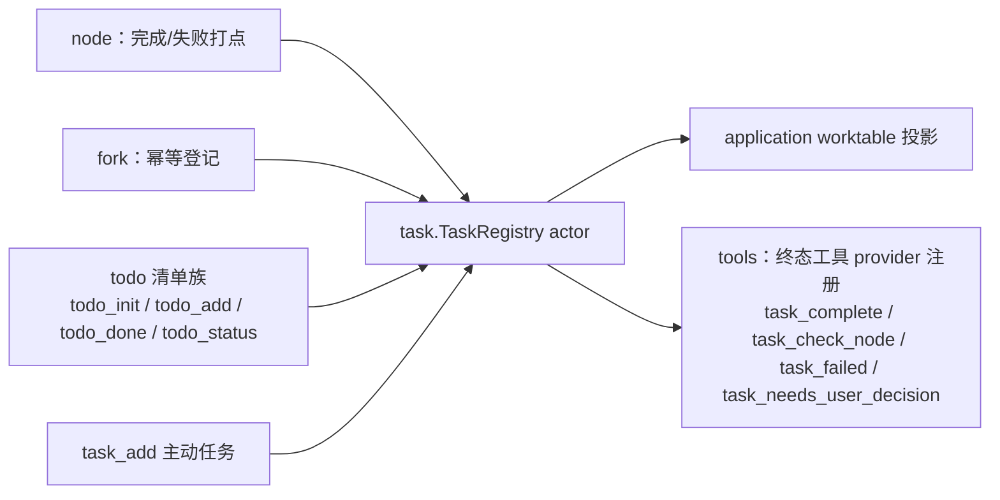
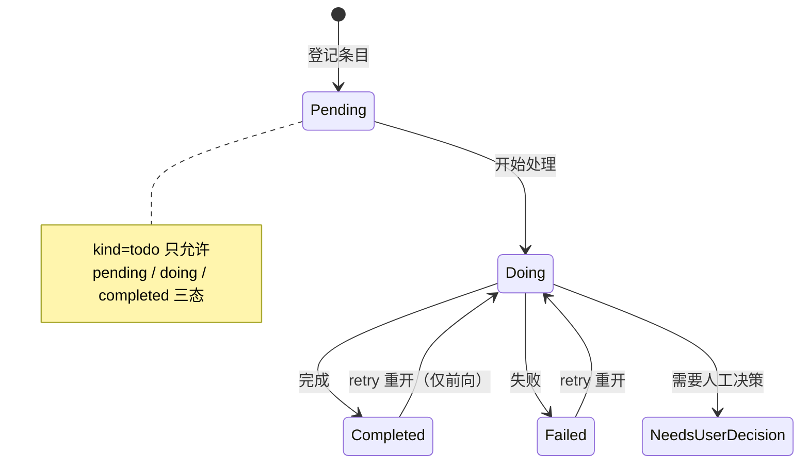

# Task

## 生态位

`backend/tool/task` 承载 worktable/task 注册表域：

- `task.go`：`TaskRegistry` actor（mailbox 单消费者串行，按 task 键隔离状态）、
  `TaskRecord`/`TaskSpec`/`TaskStatus`/`TaskTracePoint`/`TaskPhase*` 共享 DTO、
  `TodoItem` 兼容契约（`TaskToTodoItem`/`TodoToTaskStatus`）、
  `TaskKeyForGoal` 幂等键（归一化 goal 哈希）、`SetDefaultBatch` 默认批次
  （startChat 注入 requestID，新建条目自动盖章 `BatchID`）、进程级自动 ID
  分配（`NextAutoID`/`ObserveAutoID`，见下）。
- `terminal.go`：`TaskTerminalHandler` 与 `TaskTerminalProvider`
  （`task_complete`/`task_check_node`/`task_failed`/`task_needs_user_decision`
  工具定义，handler 由 application 侧注入）。
- `tools.go`：todo 清单族（`todo_init/todo_add/todo_done/todo_status` 规范名
  + `todolist_*` deprecated 兼容别名）与主动任务 `task_add`（旧 `taskadd`
  别名）的注册与 handler；todo 与 task 共用注册表，条目类型由 `Kind` 权威
  区分（todo 三态状态机，task/plan/subagent 通用迁移）。

依赖方向为根 facade → task；task 不反向依赖 `seelebridge` 根包。根包
`runtime.go` 持有 `*task.TaskRegistry`，`runtime_tools.go` 注册 todo/task 工具，
门面方法与别名重导出层已删除，门面方法委托本包实现。

## 与其它域的关系



## 状态机



task 是 worktable 状态面：node 完成/失败、fork 幂等登记均写 task；todolist
融合为 kind=todo 的 task；主动 `task_add` 直接登记 kind=task 条目；终态
工具 provider（`task_complete` 等，会话级协议）经 tools 注册表暴露给模型。
新建条目按 `defaultBatchID`（chat 请求批次）盖章，空批次（早期/恢复数据）
归入「早期任务」展示分组。

## 命名与状态机

- 工具命名体现条目类型粒度：`todo_*`（清单项）、`task_add`（主动任务）、
  `task_complete/failed/needs_user_decision`（会话级终态协议）。兼容期
  内 `todolist_*`/`taskadd` 保留为 deprecated 别名（描述标注），
  `main.go defaultManualRules` 新旧名同列。
- `validateTaskTransition(kind, current, next)`：todo 仅允许
  pending/doing/completed 三态；task/plan/subagent 维持终态→retry 重开、
  running/doing 不回退、retry 仅前向的通用迁移。

## 自动条目 ID 的分配（进程级）

无显式 ID 的条目（`task_add` 的 `task_id`、todo 清单项）由注册表出号。行 ID
是注册表的行键，也是跨会话台账的分组身份，所以它有两条硬约束：

- **进程内唯一**：自增源是包级的（`NextAutoID(prefix)`，跨注册表与跨会话
  scope 分区共享），因此两个会话各自产生无显式 ID 的条目不会同号——同号在
  注册表里是**覆盖**（`state.tasks[id]` 以 ID 为键），在台账里会被合并去重
  丢掉一行，前端 `data-work-row`/`task.changed` 也只认一行；
- **不重发已占用的号**：装载/恢复（会话切换 `ReplaceAll`、磁盘记录）会把外部
  的号带进来，`ObserveAutoID(id)` 抬高水位、`nextFreeIDLocked` 再跳过注册表里
  已占用的号。水位是**进程内**的，跨进程/跨项目的精确归档不在本层。

`TaskRegistryState` 不再持有私有计数器（历史行为是每个注册表/每个分区各自
从 1 数）。

## 验证

```text
go test ./backend/tool/task -count=1
```

`registry_test.go` 覆盖 actor 状态机与并发，`auto_id_test.go` 覆盖自动 ID 的
进程内唯一性（装载记录占用的号不得重发/覆盖）。

## 文件与函数索引

> 由源码 doc 注释自动提取（首行摘要）；描述源码行为，与实现保持同步。
> 刷新方式：`python scripts/gen_core_readme_index.py`。

### auto_id_test.go

- `func TestRegistryAutoIDsNeverReuseRestoredIDs(t *testing.T)` — ── 残留风险红灯：自动条目 ID 的进程内唯一性（注册表层）──────────────

### registry_test.go

- `func TestTaskRegistryTodoThreeStateLifecycle(t *testing.T)`
- `func TestTaskRegistryRejectsInvalidOperations(t *testing.T)`
- `func TestTaskRegistryAppendEnforcesLimitInsideActor(t *testing.T)`
- `func TestTaskRegistryTodoSnapshotIsDefensiveCopy(t *testing.T)`
- `func TestTaskRegistryConcurrentStatusAndSnapshot(t *testing.T)`
- `func TestTaskRegistryCloseFailsSends(t *testing.T)`
- `func TestTaskRegistryDefaultBatchStampsNewTasks(t *testing.T)` — TestTaskRegistryDefaultBatchStampsNewTasks 验证批次盖章：SetDefaultBatch
- `func TestTaskRegistryTodoKindRestrictsStateMachine(t *testing.T)` — TestTaskRegistryTodoKindRestrictsStateMachine 验证按 kind 的状态机：
- `func TestTaskRegistryIdempotentAddByKey(t *testing.T)`
- `func TestActorIdentity(t *testing.T)`
- `func TestTaskRegistryPassiveIdentityAndClaim(t *testing.T)` — TestTaskRegistryPassiveIdentityAndClaim 验证被动识别：创建默认继承
- `func TestTaskRegistryRetryIncrementsCount(t *testing.T)`
- `func TestTaskRegistryTerminalReopensToRetry(t *testing.T)` — TestTaskRegistryTerminalReopensToRetry 验证终态（completed/failed）可重开为
- `func TestTaskRegistryFailedReopensToRetry(t *testing.T)` — TestTaskRegistryFailedReopensToRetry 验证 failed → retry 允许、failed →
- `func TestTaskRegistryEmitChangeNeverBlocksActor(t *testing.T)` — TestTaskRegistryEmitChangeNeverBlocksActor 死锁回归：changes channel 被
- `func TestTaskRegistryChangesChannel(t *testing.T)`
- `func TestTaskRegistryReplaceAllSwitchesSession(t *testing.T)` — TestTaskRegistryReplaceAllSwitchesSession 会话级隔离：整体替换注册表

### task.go

- `func TaskToTodoItem(record TaskRecord) TodoItem` — TaskToTodoItem 把 kind=todo 的 task 还原为 TodoItem（兼容 TUI/旧契约）。
- `func TodoToTaskStatus(status TodoItemStatus) TaskStatus` — TodoToTaskStatus 把 TodoItemStatus 映射为 TaskStatus（todolist 状态更新入口）。
- `func ValidTodoStatus(status TodoItemStatus) bool` — ValidTodoStatus 校验清单项状态（todo 三态）。
- `func NewTaskRegistry() *TaskRegistry`
- `func (registry *TaskRegistry) send(command taskCommand) (taskReply, error)`
- `func (registry *TaskRegistry) apply(command taskCommand)`
- `func (registry *TaskRegistry) emitChange(record TaskRecord)` — emitChange 把变更后的 task 投递到输出 channel（CSP）：非阻塞；满则丢弃
- `func (registry *TaskRegistry) DroppedChanges() int64` — DroppedChanges 返回因 channel 满而丢弃的变更数（诊断/测试）。
- `func NextAutoID(prefix string) string` — NextAutoID 返回进程内唯一的自动条目 ID（`<prefix>:<n>`，prefix = task/todo）。
- `func ObserveAutoID(id string)` — ObserveAutoID 抬高自增水位：记录（可能来自磁盘/上一次进程）占用的号不再
- `func autoIDNumber(id string) (uint64, bool)` — autoIDNumber 解析自动 ID 的序号（`task:<n>` / `todo:<n>`）。
- `func nextFreeIDLocked(prefix string, state *TaskRegistryState) string` — nextFreeIDLocked 从进程级自增源取号，并跳过注册表里已占用的号（装载/恢复
- `func addTaskLocked(spec TaskSpec, state *TaskRegistryState) (TaskRecord, bool)`
- `func taskAddOperation(kind string) string`
- `func resolveTaskLocked(key string, state *TaskRegistryState) (TaskRecord, bool)`
- `func setTaskStatusLocked(id string, status TaskStatus, evidence string, state *TaskRegistryState) (TaskRecord, error)`
- `func attachParticipantLocked(id, participant string, state *TaskRegistryState) (TaskRecord, error)`
- `func containsParticipant(participants []string, want string) bool`
- `func appendTaskTraceLocked(id string, point TaskTracePoint, state *TaskRegistryState) (TaskRecord, error)`
- `func validateTaskTransition(kind string, current, next TaskStatus) error` — validateTaskTransition 按权威类型（Kind）限定状态机：
- `func snapshotTasksLocked(state *TaskRegistryState) []TaskRecord`
- `func removeTaskLocked(id string, state *TaskRegistryState)`
- `func replaceTodoLocked(items []TodoItem, state *TaskRegistryState)`
- `func appendTodoLocked(item TodoItem, state *TaskRegistryState)`
- `func todoByIndexLocked(index int, state *TaskRegistryState) (TaskRecord, error)`
- `func restoreTaskLocked(id string, record TaskRecord, state *TaskRegistryState) (TaskRecord, error)` — restoreTaskLocked 按原记录回填（幂等键冲突时保留既有，不覆盖）。
- `func replaceAllTasksLocked(records []TaskRecord, state *TaskRegistryState)` — replaceAllTasksLocked 整体替换注册表（会话级隔离：切换会话时清空并恢复
- `func todoSnapshotLocked(state *TaskRegistryState) []TaskRecord`
- `func (registry *TaskRegistry) Add(spec TaskSpec) (TaskRecord, bool, error)` — Add 创建 task（幂等：Key 命中返回既有记录）。
- `func (registry *TaskRegistry) SetDefaultIdentity(identity string) error` — SetDefaultIdentity 设置当前主执行身份（main:<mainSessionID>）。无显式
- `func (registry *TaskRegistry) SetDefaultBatch(batchID string) error` — SetDefaultBatch 设置当前默认批次（chat 请求 requestID）。此后创建的
- `func (registry *TaskRegistry) ResolveByKey(key string) (TaskRecord, bool, error)` — ResolveByKey 按幂等键查 task。
- `func (registry *TaskRegistry) SetStatus(id string, status TaskStatus, evidence string) (TaskRecord, error)` — SetStatus 更新 task 状态（retry 自增计数；running 保留计数）。
- `func (registry *TaskRegistry) AttachParticipant(id, participant string) (TaskRecord, error)` — AttachParticipant 把子代理挂为 task 参与者（幂等）。
- `func (registry *TaskRegistry) AppendTrace(id string, point TaskTracePoint) (TaskRecord, error)` — AppendTrace 追加打点。
- `func (registry *TaskRegistry) Snapshot() []TaskRecord` — Snapshot 返回只读拷贝。
- `func (registry *TaskRegistry) ReplaceTodo(items []TodoItem) error` — ReplaceTodo 整体替换 todolist（todolist_init；融合进 task 注册表）。
- `func (registry *TaskRegistry) TodoSnapshot() []TaskRecord` — TodoSnapshot 返回 todolist 有序只读快照（kind=todo 的 task 按列表序）。
- `func (registry *TaskRegistry) AppendTodo(item TodoItem, limit int) error` — AppendTodo 追加一项（actor 内上限校验，防并发 check-then-act）。
- `func (registry *TaskRegistry) SetTodoStatusByIndex(index int, status TaskStatus) (TaskRecord, error)` — SetTodoStatusByIndex 按 todolist 索引设置状态（GUI 工作表格状态更新入口）。
- `func (registry *TaskRegistry) Close()` — Close 优雅关闭 actor。
- `func (registry *TaskRegistry) TaskChanged() <-chan TaskRecord` — TaskChanged 返回 task.changed 输出 channel（CSP：变更即投递，application
- `func (registry *TaskRegistry) Restore(id string, record TaskRecord) error` — Restore 会话恢复：按原记录原样回填（不追加打点、不校验迁移、不发增量）。
- `func (registry *TaskRegistry) ReplaceAll(records []TaskRecord) error` — ReplaceAll 整体替换注册表（会话级隔离：切换会话时清空并恢复目标会话
- `func TaskKeyForGoal(goal string) string`
- `func ActorIdentity(role, sessionID string) string` — ActorIdentity 按 role+sessionID 合成执行身份（dto 自由函数别名）。

### terminal.go

- `func NewTaskTerminalProvider(handler TaskTerminalHandler) *TaskTerminalProvider`
- `func (p *TaskTerminalProvider) ProviderName() string`
- `func (p *TaskTerminalProvider) Tools() []tools.ToolEntry`

### tools.go

- `func (t *Tools) sessionID(ctx context.Context) string` — sessionID 解析本次工具调用的会话归属（空 = 旧调用面，落实时注册表）。
- `func NewTools(deps Deps) *Tools` — NewTools 构造工具族（deps 全部为闭包，域内不依赖根包）。
- `func (t *Tools) RegisterTodoTools()` — RegisterTodoTools 注册 todo 清单工具族：规范名 todo_init/add/done/status，
- `func (t *Tools) RegisterTaskTools()` — RegisterTaskTools 注册主动任务工具 task_add（worktable task 体系；主动
- `func (t *Tools) todoInitHandler(ctx context.Context, argsJSON string) (string, error)`
- `func (t *Tools) todoAddHandler(ctx context.Context, argsJSON string) (string, error)`
- `func (t *Tools) todoDoneHandler(ctx context.Context, argsJSON string) (string, error)`
- `func (t *Tools) todoStatusHandler(ctx context.Context, _ string) (string, error)`
- `func (t *Tools) taskAddHandler(ctx context.Context, argsJSON string) (string, error)` — taskAddHandler 主动登记 task（幂等：按归一化 goal 去重）。
- `func (t *Tools) todoStatusJSON(sessionID string) string` — todoStatusJSON 渲染清单 JSON（{items:[{text,done}], done:n, total:n}）。
