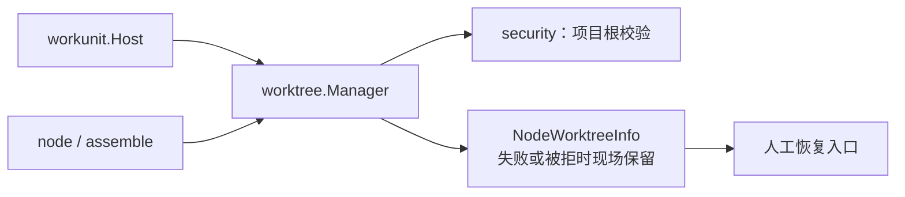
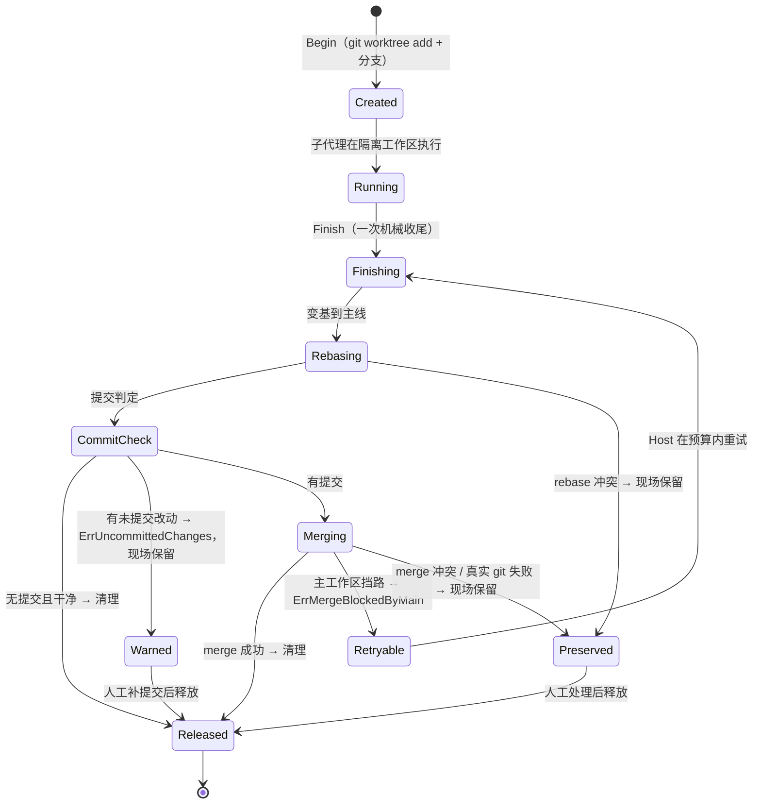

# backend/tool/worktree — worktree 现场的 git 机械适配器

## 生态位

承载子代理/工作项的独立 worktree **机械动作**：建现场（`Begin` / `BeginNamed` / `BeginNamedStrict`）→ 执行期间工作区隔离 → 单次收尾（`Finish`：变基 → 提交/脏判定 → 一次 merge → 清理）→ 释放（`Release`）。主要调用方：装配处 `backend/engine/assemble`（`hostPorts.MergeScene` / `BindWorkspace` / `ReleaseScene`）、`backend/tool/node/` 域 `AgentNode.Run` 的 `Deps`。

teammate / WorkItem 路径必须使用 `BeginNamedStrict`：非 git 根、非法 HEAD、路径冲突、
分支或创建失败都返回 `WorktreeCreateError`（稳定 Code + `ApprovalRequired=true`）。
`BeginNamed` 仅为旧调用方保留 nil 降级语义，不得用于新的团队派发路径。

**生命周期判据不在本包**：要不要重试、挡路算不算失败、未提交算不算落定、什么时候回收，
唯一实现在 [`backend/workunit/lifecycle.go`](../../workunit/README.md) 的 `Host`。本包只把
事实（有没有提交、工作区脏不脏、merge 是否被挡、冲突文件）交回，错误按
`workunit.ErrUncommittedChanges` / `workunit.ErrMergeBlockedByMain` / 真实 git 失败分类。

## 与其它域的关系



worktree 为 node 提供隔离工作区；建/拆的时机由生命周期与装配处决定；失败路径现场保留
供恢复（NodeWorktreeInfo）。

## 生命周期状态



## 职责与非职责

职责：

- git worktree 创建/清理与分支管理；
- 单次收尾的机械步骤：rebase 兜底、提交计数、脏判定、merge 目标对齐、一次 merge、cleanup；
- 收尾失败时保留"工作区现场"（注册表不释放，供前端展示与人工恢复）；
- 读取冲突文件、返回类型化事实错误；
- 可选机械阶段观察者（`WorktreeManagerDeps.Phase`，仅测试/诊断；生产装配不注入）。

非职责：

- 不决定节点何时开/关 worktree（调用方 `backend/tool/node/` 域决定）；
- 不决定重试预算、收尾分类与回收时机（唯一实现在 `workunit.Host`）；
- 不实现 git 命令本身之外的版本控制策略；没有审批门、没有 plan 专用字段；
- 不落盘会话数据。

## 目录或文件结构

| 文件 | 职责 |
|---|---|
| `worktree_manager.go` | `WorktreeManager`、`WorktreeManagerDeps`、`NodeWorktree`/`NodeWorktreeInfo`、`GitRunner`/`CleanupWorktree`/`ConflictFilesIn` |
| `worktree_manager_test.go` | fakeGit 驱动的机械动作单元测试（建 / 单次收尾 / 释放） |
| `worktree_prune_test.go` | 残留回收（`Prune`）与幽灵现场（`Restore`）判据 |
| `worktree_failure_smoke_test.go` | B1/B2/B4 收尾失败现场保留冒烟 |

## 核心实现

`WorktreeManager` 内部单锁保护 `nodeID → NodeWorktree` 注册表；git 执行经可注入的 `git` 字段（默认 `GitRunner`，测试替换为 fakeGit）。

`Finish` 流程（**一次**，不重试）：`branchBehindBase` → 落后则 rebase（冲突报错保留现场）→
`commitCountSince` 判定 → 无提交且干净则 `cleanup`；无提交但有改动 → `ErrUncommittedChanges`
（现场保留）→ 有提交则 **对齐合并目标分支**（`alignMergeTarget`：把主工作区切到现场记录的
`wt.MainBranch`）→ merge → `cleanup`。主工作区挡路 → `ErrMergeBlockedByMain`；其余 git 失败
原样交回。任一步失败现场保留。

**挡路要不要等是生命周期判据**：`workunit.Host` 的 `MergeRetry`（默认 2 分钟 / 5 秒）只在
`IsMergeBlockedByMain` 为真时重试，并在等待期间报 `awaiting_merge` 阶段；预算耗尽或取消 →
带 `ErrMergeBlockedByMain` 的分类错误。本包不再持有重试预算，也不决定"未提交算成功还是失败"。

**"收尾要合到哪条分支"只有一个事实 = `NodeWorktree.MainBranch`**（建现场时记下）：变基目标、落后判定与合并目标三处读的都是它。合并前若不先把主工作区切回这条分支，`git merge` 就会合进主工作区**此刻碰巧所在**的分支——主工作区的当前分支在工作途中漂走时，同批先收尾的落在旧分支、后收尾的落在新分支，先前那份"已经合回来"的产出被踢成另一个分支上的孤儿（`worktree_merge_kickback_test.go`）。切不动一律显式收口：主工作区有在途改动挡路 → 可重试的 `ErrMergeBlockedByMain`，其余 → 硬失败带 git 原文、现场保留。

这一格的判据只有一处：`classifySceneMergeTarget`（有名分支 / 游离 HEAD / **空栏**）。**空栏 = 登记缺栏，一律显式失败**（`errSceneFactsIncomplete`，`errors.Is` 可判）：`alignMergeTarget` 不再 `return nil`（过去空栏等于"合进当前 HEAD"，M2 在这条路上等于没装），`branchBehindBase`/`commitCountSince`/`diffStat` 也**绝不**把空栏拼进 ref 字符串——`HEAD..` / `..HEAD` 这种写法 git **不报错**（本机 git 2.51 实测 `git rev-list --count "HEAD.."` → `0`、exit 0），于是"缺栏"会被读成"没有落后 / 没有提交"，一路静默走到 `cleanup`：**现场与 `seelex/<nodeID>` 分支一起被删、产出一个字节都没合回来，而 `Finish` 报成功**（2026-10-06 红灯实测，`worktree_weak_registration_merge_test.go`）。空栏的成因只有一个：**弱登记先到**——teammate 记录只写 Path/Branch（`workunit_team_records.go` 的 `teamUnitWorktreeRecord`），恢复链里 `Restore` 先于 `Adopt`，`Adopt` 被"已在册"挡回，于是缺栏的那一份成为收尾读到的事实。补栏要改**记录侧**（本包无写点，见该用例头注）。

失败是**类型化的事实**：`commitCountSince` 判定为"工作区脏且无提交"（子代理未执行收尾协议
`git add -A && git commit`）时，返回包装了 `ErrUncommittedChanges` 的错误；主工作区挡路时返回
包装了 `ErrMergeBlockedByMain` 的错误；其余（rebase 冲突、merge 冲突、缺栏）是真实 git /
登记失败。现场一律保留（绝不静默删除子代理产出）。**这些错误怎么分类、要不要降级**由
`workunit.ClassifyFinish` 与调用方决定，本包不写第二张表。

**残留回收（`Prune`）**：成功收尾才 `git worktree remove`，失败/中断的现场按设计保留，因此必须有兜底清理器，否则每个残留 = 一份完整检出 + 一个 `seelex/<id>` 分支，磁盘随历史失败数无界增长。`Prune` 走本仓库自己的 `git worktree list`，只回收**同时满足**两条的现场：

- **不在册**：注册表里没有它（发/收现场锚点）。恢复得到的现场由 `Restore` 先登记，因此不会被当残留删掉；
- **干净**：没有未提交改动。有改动的现场一律保留（`PruneResult.Kept`），与 `ErrUncommittedChanges` 同一口径——框架不替人决定产出「丢还是留」。

命名不属于本管理器（`<repoBase>-seelex-<nodeID>`）的 worktree 一律不碰；顺手跑一次 `git worktree prune` 清掉手工删目录留下的 prunable 元数据。**调用顺序是判据的一部分**：先 `Restore`、后 `Prune`（根包 `RestoreSubagentAnchors` 即按此顺序）。

**三个生命周期修正**：

- `Restore` 不再登记**目录已不存在**的路径：否则 `Info` 会报一个不存在的路径、`team_close` 收口步 2 会对着它跑 `git status` 而失败（幽灵条目）。
- `Begin` 对同一 `nodeID` **幂等**（已有在册现场直接复用），且不再对**仍在册**的路径做 `worktree remove --force`。路径与分支都只按 nodeID 命名，跨会话/跨批次的第二次 `Begin` 会指向同一目录，旧行为会把一个正在使用的现场删掉。
- `Finish` 的合并目标取自**现场记录**的 `MainBranch`（`alignMergeTarget`），不取主工作区当前所在的分支——后者是漂移的 ambient 状态，把同一批的产出散到不同分支上（"先前已合回来的那件被踢成另一个分支"）。

## 数据流或生命周期

`Begin(scope, nodeID)`（仅 RoleSubAgent；非 git 仓库降级共享工作区）→ `NodeWorktree` 注入 `SceneScope.WorkspaceID` → 节点执行 → `Finish` 成功则 `Release` 移除注册；失败路径注册表保留（`Info` 可查，`NodeWorktreeInfoFor` 暴露恢复入口）。挡路重试由 `workunit.Host` 在多次 `MergeScene` 之间完成，每次仍只跑本包的一次 `Finish`。

## 依赖方向

`worktree` → `security`（`ConfigureHiddenCommand`）、`contract/dto` / `internal/model`（作用域与角色）、
`backend/workunit`（两个哨兵错误与分类词表）。**禁止反向依赖装配包或 seelebridge 根包**。

## 并发、存储、安全或错误语义

- 单锁 + git 子进程串行；60s git 超时防挂起；
- 失败保留现场是显式语义：`Release` 只由成功路径触发；
- 已知风险：脏判定用裸 `git status --porcelain`（`pathDirtyWith`，**唯一实现**；组件 `w.pathDirty` / `w.worktreeDirty` 与包级 `PathDirty` 都转调它），Windows/WSL 下 `.gitattributes` 未覆盖文件的 CRLF 转换可能造成"幻影脏"（待修复方向：CRLF 不敏感判定；语义变更要先有红灯用例，只在这一行改一处）。

## 扩展方式

- 注入替代 git 执行器（测试/远程环境）；
- 调整挡路等待预算 / 阶段观察者：`workunit.MergeRetry`（不在这里）；
- 调整机械收尾（rebase 前是否强推、冲突处理提示）：改 `finishOnce`；
- 调整生命周期分类 / 回收时机：改 `workunit.Host`，不在本包复制判据。

## Review 指南

- 失败路径是否必然保留现场（不能误清理）；
- `Finish` 是否只跑一次机械收尾（重试/分类没有偷偷回到本包）；
- 挡路/未提交是否仍以**类型化错误**交回，而不是在本包判成败；
- CRLF 幻影脏是否会被误判为"脏未提交"而中断节点；
- 脏未提交失败是否走 `ErrUncommittedChanges`，而不是与 rebase/merge 硬失败混为一谈；
- 残留回收是否只删「不在册 **且** 干净」的现场，且调用方确实是先 `Restore` 后 `Prune`。

## 测试与验证

本包内：`worktree_manager_test.go`、`worktree_failure_smoke_test.go`（fakeGit，无真实 git 依赖）；
`worktree_merge_serial_test.go` 既有脚本化 git，也有一条把真实 `WorktreeManager.Finish` 接成
`workunit.SceneFace` 的跨层用例（挡路两次 → Host 重试 → 合上）。真实 git 集成用例
（`backend/engine/assemble/worktree_test.go`）需本机 git，沙箱受限时按 skip 名单跳过。验证：

```text
go test ./backend/tool/worktree/ -count=1
go test ./backend/workunit/ ./backend/engine/assemble/ -count=1
```

**"合并分叉"这一段的覆盖范围**（真 git 仓 + 真 worktree，`reproGitRepo`）：

| 机制 | 覆盖它的用例 |
|---|---|
| M1 收尾单写者 `finishActor` | `worktree_merge_serial_test.go`（`maxInMerge` 恒为 1 + 摘掉 actor 的反证对照） |
| M2 合并前把主工作区切回 `wt.MainBranch` | `worktree_merge_kickback_test.go`（先合回来的不被踢成孤儿分支） |
| M3 挡路事实只交一次 | `worktree_merge_serial_test.go`（`mergeCalls == 1` + `ErrMergeBlockedByMain` + 现场保留） |
| M4 有界重试 / 分类只有一份 | `backend/workunit/merge_retry_test.go`（挡路→等干净→合上、超预算带处置办法、取消即收口、真冲突不重试） |
| **登记来源：两个来源指向同一现场、缺栏不降级** | `worktree_registration_sources_test.go`、`worktree_scene_claim_test.go` |
| **登记缺栏（弱登记先到）时 M2 不许静默失效** | `worktree_weak_registration_merge_test.go`（缺栏 → 显式失败 + 一个空 ref 都不发给 git + 现场/分支/产出原样；反证对照：只有 `Adopt` 先到时两栏由 git 现算、收尾照常合回 main） |
| 现场被对端收走 | `worktree_vanished_scene_repro_test.go`（不许被幂等口径抹掉） |

## 文件与函数索引

> 由源码 doc 注释自动提取（首行摘要）；描述源码行为，与实现保持同步。
> 刷新方式：`python scripts/gen_core_readme_index.py`。

### worktree_dirty_judgment_test.go

- `func TestDirtyJudgmentIsSingleAcrossEntries(t *testing.T)`

### worktree_failure_smoke_test.go

- `func TestWorktreeScenePreservedOnAllFinishFailures(t *testing.T)` — TestWorktreeScenePreservedOnAllFinishFailures 表驱动冒烟：所有 worktree
- `func TestWorktreeScenePreservedOnMergeConflict(t *testing.T)` — TestWorktreeScenePreservedOnMergeConflict B4: 主工作区 merge 冲突。
- `func TestWorktreeSceneReleasedOnSuccess(t *testing.T)` — TestWorktreeSceneReleasedOnSuccess 对照：成功路径 Finish 只清理 worktree
- `func TestWorktreeSceneSurvivesRelease(t *testing.T)` — TestWorktreeSceneSurvivesRelease 验证 Release 只由成功路径调用：

### worktree_judgment_bench_test.go

- `func BenchmarkJudgmentPathDirtyWith(b *testing.B)`
- `func BenchmarkJudgmentWorktreePathEqual(b *testing.B)`
- `func BenchmarkJudgmentParseWorktreeList(b *testing.B)`
- `func BenchmarkJudgmentCleanupWorktreeWith(b *testing.B)`

### worktree_manager.go

- `func (e *WorktreeCreateError) Error() string`
- `func (e *WorktreeCreateError) Unwrap() error`
- `func strictWorktreeError(nodeID string, code WorktreeErrorCode, err error) *WorktreeCreateError`
- `func IsUncommittedChanges(err error) bool` — IsUncommittedChanges 判定 err 是否属于「未提交改动」类收尾失败。
- `func IsMergeBlockedByMain(err error) bool` — IsMergeBlockedByMain 判定 err 是否属于「被主工作区挡住」类收尾失败（转调契约那份判据）。
- `func (e *missingSceneFactsError) Error() string`
- `func (e *missingSceneFactsError) Unwrap() error`
- `func classifySceneMergeTarget(mainBranch string) (sceneMergeTargetKind, string)` — classifySceneMergeTarget 判定一条现场记录的合并目标归属（全包唯一一处）。
- `func missingMergeTarget(nodeID string, wt *NodeWorktree) error` — missingMergeTarget / missingBaseline 造「缺栏」诊断：说清缺的是哪一栏、这一栏收尾拿它干什么
- `func missingBaseline(nodeID string, wt *NodeWorktree) error`
- `func (e *mergeBlockedError) Error() string`
- `func (e *mergeBlockedError) Unwrap() error`
- `func isMergeBlockedEvidence(stderr string, callErr error) bool` — isMergeBlockedEvidence 判定一次失败的 git 调用是否属于「主工作区挡路」。
- `func NewWorktreeManager(deps WorktreeManagerDeps) *WorktreeManager`
- `func (w *WorktreeManager) handleFinish(command finishCommand)` — handleFinish 是 finishActor 的唯一消费者：串行执行一次收尾并把结果回给投递方。
- `func (w *WorktreeManager) submitFinish(ctx context.Context, nodeID string, wt *NodeWorktree) error` — submitFinish 把一次收尾投给单写者并等结果。
- `func (w *WorktreeManager) Close()` — Close 幂等关闭：停收尾单写者（处理完当前命令即退出）并等它收工。
- `func (w *WorktreeManager) worktreeFor(nodeID string) *NodeWorktree` — worktreeFor 返回节点的 worktree（无 → nil）。
- `func (w *WorktreeManager) RegisteredCount() int` — RegisteredCount 返回当前注册的 worktree 数（测试/诊断读取面）。
- `func (w *WorktreeManager) Begin(scope dto.SceneScope, nodeID string) *NodeWorktree` — Begin 为节点创建 worktree（降级返回 nil）：
- `func (w *WorktreeManager) BeginNamed(nodeID string) *NodeWorktree` — BeginNamed 为非子代理的**编排节点**创建 worktree：teammate 的每一个 Work Item 都是
- `func (w *WorktreeManager) BeginNamedStrict(nodeID string) (*NodeWorktree, error)` — BeginNamedStrict 是 teammate / Work Item 的严格创建入口：任何失败都返回 typed
- `func (w *WorktreeManager) WorktreeForNode(nodeID string) *NodeWorktree` — WorktreeForNode 返回在册现场（无 → nil）。合并/释放按 id 取现场时用。
- `func (w *WorktreeManager) beginNamed(nodeID string) *NodeWorktree` — beginNamed 为 nodeID 开一个现场（幂等）。四种情况**分清楚**，任何一条路径都
- `func (w *WorktreeManager) beginNamedStrict(nodeID string) (*NodeWorktree, error)`
- `func (w *WorktreeManager) Adopt(nodeID string) *NodeWorktree` — Adopt 认领一个**既有的**现场（按 nodeID）：把磁盘上已经建好、且确实是本 repo 的
- `func sceneDirName(repoBase, nodeID string) string` — sceneDirName 拼一个 nodeID 的现场目录名。
- `func sceneDirPrefix(repoBase string) string` — sceneDirPrefix 是"由本管理器命名的现场"目录名前缀（isManagedPath 的判据）。
- `func (w *WorktreeManager) scenePath(root, nodeID string) string` — scenePath 返回 nodeID 的现场路径（与 beginNamed 同一条命名）。
- `func (w *WorktreeManager) register(nodeID string, wt *NodeWorktree) *NodeWorktree` — register 把一份现场登记进注册表并返回它。
- `func (w *WorktreeManager) worktreeEntryAt(root, path string) (worktreeEntry, bool)` — worktreeEntryAt 返回某路径在 `git worktree list` 里的登记（目录不在或不在册 → false）。
- `func (w *WorktreeManager) branchExists(root, branch string) bool` — branchExists 报告本地分支是否已存在。判据取"rev-parse 拿到了一个非空输出"：
- `func (w *WorktreeManager) baselineFor(branch, mainBranch string) string` — baselineFor 返回分支与主分支的分叉点，作为合并判定基线（BaseCommit）。
- `func (w *WorktreeManager) Finish(ctx context.Context, nodeID string, wt *NodeWorktree) error` — Finish 执行**一次**收尾：由单写者 actor 串行执行 变基兜底 → 提交判定 → merge →
- `func (w *WorktreeManager) finishOnce(ctx context.Context, nodeID string, wt *NodeWorktree) error` — finishOnce 是单次收尾的实际实现：只由 finishActor 串行调用（同一时刻只有一个
- `func (w *WorktreeManager) phase(ctx context.Context, nodeID, status string)` — phase 在注入机械阶段观察者时转发。生产装配不注入（生命周期阶段归 workunit.Host），
- `func (w *WorktreeManager) alignMergeTarget(root, nodeID string, wt *NodeWorktree) error` — alignMergeTarget 把主工作区切到**现场记录的那条收尾分支**（`wt.MainBranch`，建现场
- `func firstEvidenceLine(stderr string, callErr error) string` — firstEvidenceLine 从 git 证据里取一行摘要（原文可能多行；诊断取首行）。
- `func (w *WorktreeManager) Release(nodeID string)` — Release 在节点结束时从注册表移除（成功路径已清理；失败路径保留现场但解除注册，
- `func (w *WorktreeManager) Restore(records []store.NodeSessionRecord)` — Restore 从持久化记录重建 worktree 注册表（重启/恢复锚点）：
- `func (w *WorktreeManager) Info(nodeID string) (NodeWorktreeInfo, bool)` — Info 返回节点 worktree 现场信息（无现场 → false）。
- `func (w *WorktreeManager) sceneRegistered(path string) bool` — sceneRegistered 报告某个 worktree 路径是否是本管理器**在册**的现场
- `func (w *WorktreeManager) Prune() (PruneResult, error)` — Prune 回收**孤儿 worktree**：磁盘上仍是本仓库的 worktree（路径符合本管理器的
- `func (w *WorktreeManager) listWorktrees(root string) ([]worktreeEntry, error)` — listWorktrees 列出本仓库的全部 worktree（main + 各现场）。
- `func parseWorktreeList(out string) []worktreeEntry` — parseWorktreeList 解析 `git worktree list --porcelain` 的读数——**worktree 清单
- `func (w *WorktreeManager) isManagedPath(root, path string) bool` — isManagedPath 判定一个 worktree 路径是否由本管理器命名（`<repoBase>-seelex-<nodeID>`，
- `func (w *WorktreeManager) pathDirty(path string) (bool, error)` — pathDirty 报告某个 worktree 是否有未提交改动。判据只有一份，见 pathDirtyWith。
- `func PathDirty(path string) (bool, error)` — PathDirty 报告某个工作区是否有未提交改动（包级入口：编排面用它）。
- `func pathDirtyWith(git gitFn, path string) (bool, error)` — pathDirtyWith 是**脏判定的唯一实现**：`git status --porcelain` 非空即脏。
- `func (w *WorktreeManager) isGitRepository(root string) bool`
- `func (w *WorktreeManager) branchBehindBase(nodeID string, wt *NodeWorktree) (bool, error)`
- `func (w *WorktreeManager) commitCountSince(nodeID string, wt *NodeWorktree) (int, error)`
- `func (w *WorktreeManager) worktreeDirty(wt *NodeWorktree) (bool, error)` — worktreeDirty 报告某个现场是否有未提交改动：转调唯一实现（键 = wt.Path）。
- `func (w *WorktreeManager) conflictFilesIn(dir string) ([]string, error)`
- `func (w *WorktreeManager) cleanup(root string, wt *NodeWorktree) error` — cleanup 是收尾自动释放的入口（Finish 的两条成功路径）。释放判据只有一份，见
- `func GitRunner(root string, args ...string) (string, error)` — gitRunner 执行 git 命令（worktree 测试可用真实 git；命令经 ConfigureHiddenCommand
- `func CleanupWorktree(root string, wt *NodeWorktree) error` — CleanupWorktree 删除 worktree 及其分支（合并完成后或无可合并提交时）。
- `func cleanupWorktreeWith(git gitFn, root string, wt *NodeWorktree) error` — cleanupWorktreeWith 是**现场释放的唯一实现**：判据 = 「git 登记不在（或 remove 成功）
- `func worktreeRemoveError(path, stderr string, err error) error` — worktreeRemoveError 把 git 的原文留在报错里：注入的 runner 的第一个返回值就是这条
- `func deleteWorktreeBranchWith(git gitFn, root, branch string)` — deleteWorktreeBranchWith 删除本地分支，忽略"分支不存在"（释放幂等的另一半：分支可能
- `func gitWorktreeRegistered(root, path string) bool` — gitWorktreeRegistered 报告某个路径是否仍在 `git worktree list` 的清单里
- `func worktreeRegisteredWith(git gitFn, root, path string) bool` — worktreeRegisteredWith 用注入的 git 判定"这条路径还在不在册"：清单按 porcelain 解析
- `func worktreePathEqual(a, b string) bool` — worktreePathEqual 比较两个路径是否是同一个 worktree。
- `func sameFileIdentity(a, b string) bool` — sameFileIdentity 报告两个路径是否指向同一个文件系统对象（任一不存在 → false，
- `func ConflictFilesIn(dir string) ([]string, error)` — ConflictFilesIn 列出目录（worktree 或主工作区）中的冲突文件

### worktree_manager_test.go

- `func newFakeGit() *fakeGit`
- `func (f *fakeGit) run(root string, args ...string) (string, error)`
- `func (f *fakeGit) snapshot() []string`
- `func newTestWorktreeManager(root string) (*WorktreeManager, *fakeGit)`
- `func TestWorktreeManagerBeginDegradesOutsideGit(t *testing.T)`
- `func (*gitTestErr) Error() string`
- `func TestWorktreeManagerBeginRegistersAndInfo(t *testing.T)`
- `func TestWorktreeManagerFinishDirtyUncommittedPreservesScene(t *testing.T)`
- `func TestWorktreeManagerFinishCleanNoChangesCleansUp(t *testing.T)`
- `func TestWorktreeManagerFinishMergeApproved(t *testing.T)`
- `func TestWorktreeManagerReleaseRemovesRegistration(t *testing.T)`
- `func TestWorktreeManagerConcurrentRace(t *testing.T)`
- `func containsCall(calls []string, want string) bool`

### worktree_merge_kickback_test.go

- `func mergeKickbackManager(t *testing.T, root string) *WorktreeManager` — mergeKickbackManager 造一个绑定到 root 的收尾管理器（真实 git + 总是批准的审批门）。
- `func commitProduced(t *testing.T, dir, name, content, message string) string` — commitProduced 在 dir 里落一份产出并提交，返回这次提交的 sha。
- `func checkoutIn(t *testing.T, root, branch string)` — checkoutIn 在主工作区切分支（模拟"主工作区的当前分支漂走"）。
- `func refSha(root, ref string) string` — refSha 读一个 ref 的 sha（不存在 → 空串）。
- `func isAncestor(root, ancestor, descendant string) bool` — isAncestor 报告 ancestor 是否还在 descendant 的历史里（判"产出有没有被踢走"）。
- `func fileInRoot(root, name string) string` — fileInRoot 读主工作区里某个文件（不存在 → 空串）。
- `func TestFinishSecondUnitKeepsFirstMerge(t *testing.T)` — TestFinishSecondUnitKeepsFirstMerge 钉住"两个单元先后收尾"的三条判据：

### worktree_merge_serial_test.go

- `func newScriptedGit() *scriptedGit`
- `func (g *scriptedGit) run(_ string, args ...string) (string, error)`
- `func (g *scriptedGit) snapshot() []string`
- `func (l *phaseLog) record(_ context.Context, nodeID, status string)`
- `func (l *phaseLog) has(status string) bool`
- `func newScriptedManager(t *testing.T, git *scriptedGit) (*WorktreeManager, *phaseLog)` — newScriptedManager 组装一个注入脚本化 git 的管理器（预算压到几十毫秒，测试可
- `func TestFinishSerializesConcurrentMergesIntoMain(t *testing.T)` — TestFinishSerializesConcurrentMergesIntoMain（2026-10-05 核心红线）：fork 的一批
- `func TestFinishWithoutActorOverlapsMerges(t *testing.T)` — TestFinishWithoutActorOverlapsMerges 是上一条的**反证对照**：把单写者摘掉
- `func (scenePortForTest) BeginScene(context.Context, workunit.Ownership, string, string) (workunit.Scene, error)`
- `func (p scenePortForTest) MergeScene(ctx context.Context, _ workunit.Ownership, nodeID, _ string) error`
- `func (p scenePortForTest) ReleaseScene(nodeID string)`
- `func (scenePortForTest) AdoptScenes(context.Context, string) error`
- `func (p scenePortForTest) SceneRegistered(nodeID string) bool`
- `func (zeroUnits) Owned(context.Context, string, workunit.Ownership) bool`
- `func (zeroUnits) Settled(context.Context, string, string) (bool, error)`
- `func (zeroUnits) SettleUnit(context.Context, string, workunit.Ownership, error, error) (workunit.Outcome, error)`
- `func (zeroUnits) ReclaimUnit(context.Context, string, string) error`
- `func (zeroUnits) RecoverUnits(context.Context, string) (workunit.Resume, error)`
- `func (zeroRecords) Status(context.Context, workunit.Ownership, string, string) (string, bool, error)`
- `func (zeroRecords) Readout(context.Context, workunit.Ownership, string, string) (workunit.Resume, error)`
- `func (zeroRecords) SaveRecord(context.Context, workunit.Ownership, string, string, string, string, string)`
- `func (zeroRecords) SettleRecord(context.Context, workunit.Ownership, string, string, workunit.Outcome)`
- `func (zeroRecords) Clear(context.Context, workunit.Ownership, string, string) error`
- `func (sceneUnit) Kind() workunit.Kind`
- `func (u sceneUnit) ID() string`
- `func (sceneUnit) SessionPath() string`
- `func (sceneUnit) Policy() workunit.FinishPolicy`
- `func (sceneUnit) Owns() workunit.Ownership`
- `func TestHostRetriesWorktreeBlockedMergeWithinBudget(t *testing.T)` — TestHostRetriesWorktreeBlockedMergeWithinBudget："主工作区脏、正好压在本次合并
- `func TestFinishReportsBlockedByMainAsOneAttempt(t *testing.T)` — TestFinishReportsBlockedByMainAsOneAttempt：现场适配器只跑一次 merge，挡路以
- `func TestFinishMergeConflictIsDefinitive(t *testing.T)` — TestFinishMergeConflictIsDefinitive：真冲突（主工作区真的被改成了冲突态）**不是**
- `func TestFinishBlockedByMainReleasesActorForOtherNodes(t *testing.T)` — TestFinishBlockedByMainReleasesActorForOtherNodes：挡路事实交回后单写者立刻释放，
- `func TestBeginNamedReusedByTeammateAndSubagent(t *testing.T)` — TestBeginNamedReusedByTeammateAndSubagent 钉住两条链的**现场命名同源**：teammate 的

### worktree_prune_test.go

- `func TestPruneRemovesOrphanWorktreesAndKeepsDirtyOnes(t *testing.T)` — TestPruneRemovesOrphanWorktreesAndKeepsDirtyOnes 钉住「残留兜底清理器」的两条判据：
- `func TestPruneRunsGitWorktreePrune(t *testing.T)` — TestPruneRunsGitWorktreePrune 钉住「顺手清掉 prunable 元数据」：手工删目录会在
- `func TestRestoreSkipsWorktreesThatNoLongerExist(t *testing.T)` — TestRestoreSkipsWorktreesThatNoLongerExist 钉住「幽灵条目」修复：锚点还在、目录

### worktree_registration_bench_test.go

- `func sceneRecordsForBench(b *testing.B, dir string) []store.NodeSessionRecord` — sceneRecordsForBench 造 32 条"记录投影来源"的记录，每条都有真实存在的现场目录
- `func BenchmarkSceneRegistrationRestore(b *testing.B)`

### worktree_registration_sources_test.go

- `func sceneRecordFor(nodeID string, worktree store.NodeWorktreeRecord) store.NodeSessionRecord` — sceneRecordFor 造一条**记录投影来源**的会话记录（形态与 teammate 落盘一致）。
- `func TestSceneRegistrationSourcesAgreeInBothOrders(t *testing.T)` — TestSceneRegistrationSourcesAgreeInBothOrders —— ① 两个来源、两种顺序，只有一条登记。
- `func TestRestoreDoesNotDowngradeLiveRegistration(t *testing.T)` — TestRestoreDoesNotDowngradeLiveRegistration —— ② 记录里缺的栏位不许把活登记降级。
- `func TestRestoreStillRebuildsRegistrationAfterRestart(t *testing.T)` — TestRestoreStillRebuildsRegistrationAfterRestart —— ③ 首判复用不许弄丢"重启恢复"本身。

### worktree_release_judgment_test.go

- `func TestSceneReleaseJudgmentIsSingleAcrossEntries(t *testing.T)` — TestSceneReleaseJudgmentIsSingleAcrossEntries 对五种现场形状各跑两条入口：

### worktree_scene_claim_test.go

- `func sceneManager(root string) *WorktreeManager` — sceneManager 造一个绑定到 root 的 worktree 管理器（真实 git）。每次调用 = 一个新进程
- `func TestAdoptClaimsExistingSceneAndPruneKeepsIt(t *testing.T)` — TestAdoptClaimsExistingSceneAndPruneKeepsIt —— F4 ①：认领既有现场 + Prune 不删它。
- `func TestBeginNamedAfterRestartKeepsUncommittedScene(t *testing.T)` — TestBeginNamedAfterRestartKeepsUncommittedScene —— F5 ②：重派同一 nodeID 不丢未提交产出。
- `func TestBeginNamedRebuildsSceneFromExistingBranch(t *testing.T)` — TestBeginNamedRebuildsSceneFromExistingBranch —— F5 ③：分支已在、目录不在。

### worktree_scene_naming_test.go

- `func TestSceneNamingHasSingleSpelling(t *testing.T)`
- `func TestSceneRegistrationAgreesAcrossPathSpellings(t *testing.T)`

### worktree_strict_test.go

- `func TestBeginNamedStrictReturnsTypedNonGitError(t *testing.T)`
- `func TestBeginNamedLegacyWrapperKeepsFallbackSemantics(t *testing.T)`

### worktree_vanished_scene_repro_test.go

- `func TestWorktreeFinishReportsVanishedScene(t *testing.T)` — TestWorktreeFinishReportsVanishedScene 复现"现场被对端收走"的报错形状。
- `func isVanishedCwdError(err error) bool` — isVanishedCwdError 报告这条 git 报错是不是"子进程的工作目录不存在"那一类。
- `func reproGitRepo(t *testing.T) string` — reproGitRepo 建一个**真实** git 仓库。

### worktree_weak_registration_merge_test.go

- `func (l *gitCallLog) wrap(real gitFn) gitFn` — wrap 把真实 git 执行器包一层（记录后转调）。
- `func (l *gitCallLog) snapshot() []string`
- `func emptyRefArgs(lines []string) []string` — emptyRefArgs 找出「被拼空的 ref」（`HEAD..` / `..HEAD` 这一类：`..` 的左边或右边是空的）。
- `func weakSceneRecord(nodeID, path, branch string) store.NodeSessionRecord` — weakSceneRecord 造一条**teammate 落盘形态**的记录：现场栏只有 Path/Branch，
- `func weakSceneFixture(t *testing.T, nodeID string) (string, *WorktreeManager, *gitCallLog, *NodeWorktree, string, string)` — weakSceneFixture 搭出「旧进程建现场 + 现场里一条已提交产出 + 主工作区自己也在前进」的现场：
- `func TestWeakSceneRegistrationRefusesToMergeBack(t *testing.T)` — TestWeakSceneRegistrationRefusesToMergeBack —— ① 缺栏登记的收尾必须**显式**拒绝：
- `func TestAdoptFirstFillsSceneColumnsSoFinishMergesBack(t *testing.T)` — TestAdoptFirstFillsSceneColumnsSoFinishMergesBack —— ② 反证对照。
