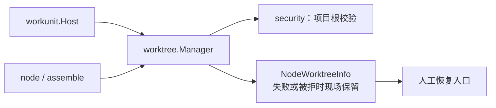
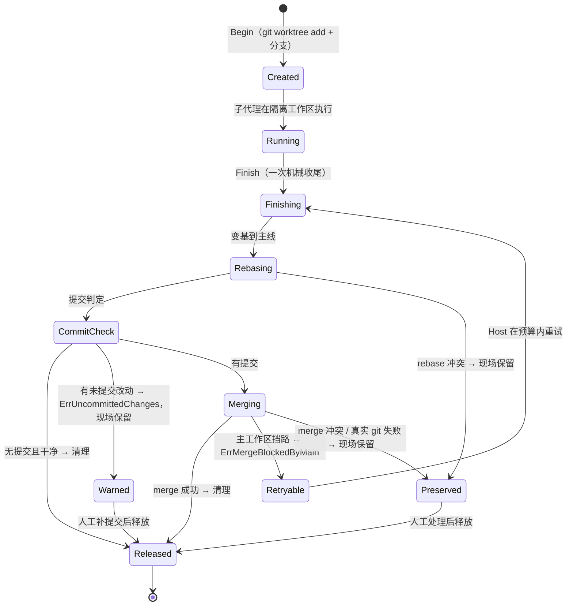

# backend/tool/worktree — worktree 现场的 git 机械适配器

## 生态位

承载子代理/工作项的独立 worktree **机械动作**：建现场（`Begin` / `BeginNamed`）→ 执行期间工作区隔离 → 单次收尾（`Finish`：变基 → 提交/脏判定 → 一次 merge → 清理）→ 释放（`Release`）。主要调用方：装配处 `backend/engine/assemble`（`hostPorts.MergeScene` / `BindWorkspace` / `ReleaseScene`）、`backend/tool/node/` 域 `AgentNode.Run` 的 `Deps`。

**生命周期判据不在本包**：要不要重试、挡路算不算失败、未提交算不算落定、什么时候回收，
唯一实现在 [`backend/workunit/lifecycle.go`](../../workunit/README.md) 的 `Host`。本包只把
事实（有没有提交、工作区脏不脏、merge 是否被挡、冲突文件）交回，错误按
`workunit.ErrUncommittedChanges` / `workunit.ErrMergeBlockedByMain` / 真实 git 失败分类。

## 与其它域的关系



worktree 为 node 提供隔离工作区；建/拆的时机由生命周期与装配处决定；失败路径现场保留
供恢复（NodeWorktreeInfo）。

## 生命周期状态



## 职责与非职责

职责：

- git worktree 创建/清理与分支管理；
- 单次收尾的机械步骤：rebase 兜底、提交计数、脏判定、merge 目标对齐、一次 merge、cleanup；
- 收尾失败时保留"工作区现场"（注册表不释放，供前端展示与人工恢复）；
- 读取冲突文件、返回类型化事实错误；
- 可选机械阶段观察者（`WorktreeManagerDeps.Phase`，仅测试/诊断；生产装配不注入）。

非职责：

- 不决定节点何时开/关 worktree（调用方 `backend/tool/node/` 域决定）；
- 不决定重试预算、收尾分类与回收时机（唯一实现在 `workunit.Host`）；
- 不实现 git 命令本身之外的版本控制策略；没有审批门、没有 plan 专用字段；
- 不落盘会话数据。

## 目录或文件结构

| 文件 | 职责 |
|---|---|
| `worktree_manager.go` | `WorktreeManager`、`WorktreeManagerDeps`、`NodeWorktree`/`NodeWorktreeInfo`、`GitRunner`/`CleanupWorktree`/`ConflictFilesIn` |
| `worktree_manager_test.go` | fakeGit 驱动的机械动作单元测试（建 / 单次收尾 / 释放） |
| `worktree_prune_test.go` | 残留回收（`Prune`）与幽灵现场（`Restore`）判据 |
| `worktree_failure_smoke_test.go` | B1/B2/B4 收尾失败现场保留冒烟 |

## 核心实现

`WorktreeManager` 内部单锁保护 `nodeID → NodeWorktree` 注册表；git 执行经可注入的 `git` 字段（默认 `GitRunner`，测试替换为 fakeGit）。

`Finish` 流程（**一次**，不重试）：`branchBehindBase` → 落后则 rebase（冲突报错保留现场）→
`commitCountSince` 判定 → 无提交且干净则 `cleanup`；无提交但有改动 → `ErrUncommittedChanges`
（现场保留）→ 有提交则 **对齐合并目标分支**（`alignMergeTarget`：把主工作区切到现场记录的
`wt.MainBranch`）→ merge → `cleanup`。主工作区挡路 → `ErrMergeBlockedByMain`；其余 git 失败
原样交回。任一步失败现场保留。

**挡路要不要等是生命周期判据**：`workunit.Host` 的 `MergeRetry`（默认 2 分钟 / 5 秒）只在
`IsMergeBlockedByMain` 为真时重试，并在等待期间报 `awaiting_merge` 阶段；预算耗尽或取消 →
带 `ErrMergeBlockedByMain` 的分类错误。本包不再持有重试预算，也不决定"未提交算成功还是失败"。

**"收尾要合到哪条分支"只有一个事实 = `NodeWorktree.MainBranch`**（建现场时记下）：变基目标、落后判定与合并目标三处读的都是它。合并前若不先把主工作区切回这条分支，`git merge` 就会合进主工作区**此刻碰巧所在**的分支——主工作区的当前分支在工作途中漂走时，同批先收尾的落在旧分支、后收尾的落在新分支，先前那份"已经合回来"的产出被踢成另一个分支上的孤儿（`worktree_merge_kickback_test.go`）。切不动一律显式收口：主工作区有在途改动挡路 → 可重试的 `ErrMergeBlockedByMain`，其余 → 硬失败带 git 原文、现场保留。

这一格的判据只有一处：`classifySceneMergeTarget`（有名分支 / 游离 HEAD / **空栏**）。**空栏 = 登记缺栏，一律显式失败**（`errSceneFactsIncomplete`，`errors.Is` 可判）：`alignMergeTarget` 不再 `return nil`（过去空栏等于"合进当前 HEAD"，M2 在这条路上等于没装），`branchBehindBase`/`commitCountSince`/`diffStat` 也**绝不**把空栏拼进 ref 字符串——`HEAD..` / `..HEAD` 这种写法 git **不报错**（本机 git 2.51 实测 `git rev-list --count "HEAD.."` → `0`、exit 0），于是"缺栏"会被读成"没有落后 / 没有提交"，一路静默走到 `cleanup`：**现场与 `seelex/<nodeID>` 分支一起被删、产出一个字节都没合回来，而 `Finish` 报成功**（2026-10-06 红灯实测，`worktree_weak_registration_merge_test.go`）。空栏的成因只有一个：**弱登记先到**——teammate 记录只写 Path/Branch（`workunit_team_records.go` 的 `teamUnitWorktreeRecord`），恢复链里 `Restore` 先于 `Adopt`，`Adopt` 被"已在册"挡回，于是缺栏的那一份成为收尾读到的事实。补栏要改**记录侧**（本包无写点，见该用例头注）。

失败是**类型化的事实**：`commitCountSince` 判定为"工作区脏且无提交"（子代理未执行收尾协议
`git add -A && git commit`）时，返回包装了 `ErrUncommittedChanges` 的错误；主工作区挡路时返回
包装了 `ErrMergeBlockedByMain` 的错误；其余（rebase 冲突、merge 冲突、缺栏）是真实 git /
登记失败。现场一律保留（绝不静默删除子代理产出）。**这些错误怎么分类、要不要降级**由
`workunit.ClassifyFinish` 与调用方决定，本包不写第二张表。

**残留回收（`Prune`）**：成功收尾才 `git worktree remove`，失败/中断的现场按设计保留，因此必须有兜底清理器，否则每个残留 = 一份完整检出 + 一个 `seelex/<id>` 分支，磁盘随历史失败数无界增长。`Prune` 走本仓库自己的 `git worktree list`，只回收**同时满足**两条的现场：

- **不在册**：注册表里没有它（发/收现场锚点）。恢复得到的现场由 `Restore` 先登记，因此不会被当残留删掉；
- **干净**：没有未提交改动。有改动的现场一律保留（`PruneResult.Kept`），与 `ErrUncommittedChanges` 同一口径——框架不替人决定产出「丢还是留」。

命名不属于本管理器（`<repoBase>-seelex-<nodeID>`）的 worktree 一律不碰；顺手跑一次 `git worktree prune` 清掉手工删目录留下的 prunable 元数据。**调用顺序是判据的一部分**：先 `Restore`、后 `Prune`（根包 `RestoreSubagentAnchors` 即按此顺序）。

**三个生命周期修正**：

- `Restore` 不再登记**目录已不存在**的路径：否则 `Info` 会报一个不存在的路径、`team_close` 收口步 2 会对着它跑 `git status` 而失败（幽灵条目）。
- `Begin` 对同一 `nodeID` **幂等**（已有在册现场直接复用），且不再对**仍在册**的路径做 `worktree remove --force`。路径与分支都只按 nodeID 命名，跨会话/跨批次的第二次 `Begin` 会指向同一目录，旧行为会把一个正在使用的现场删掉。
- `Finish` 的合并目标取自**现场记录**的 `MainBranch`（`alignMergeTarget`），不取主工作区当前所在的分支——后者是漂移的 ambient 状态，把同一批的产出散到不同分支上（"先前已合回来的那件被踢成另一个分支"）。

## 数据流或生命周期

`Begin(scope, nodeID)`（仅 RoleSubAgent；非 git 仓库降级共享工作区）→ `NodeWorktree` 注入 `SceneScope.WorkspaceID` → 节点执行 → `Finish` 成功则 `Release` 移除注册；失败路径注册表保留（`Info` 可查，`NodeWorktreeInfoFor` 暴露恢复入口）。挡路重试由 `workunit.Host` 在多次 `MergeScene` 之间完成，每次仍只跑本包的一次 `Finish`。

## 依赖方向

`worktree` → `security`（`ConfigureHiddenCommand`）、`contract/dto` / `internal/model`（作用域与角色）、
`backend/workunit`（两个哨兵错误与分类词表）。**禁止反向依赖装配包或 seelebridge 根包**。

## 并发、存储、安全或错误语义

- 单锁 + git 子进程串行；60s git 超时防挂起；
- 失败保留现场是显式语义：`Release` 只由成功路径触发；
- 已知风险：脏判定用裸 `git status --porcelain`（`pathDirtyWith`，**唯一实现**；组件 `w.pathDirty` / `w.worktreeDirty` 与包级 `PathDirty` 都转调它），Windows/WSL 下 `.gitattributes` 未覆盖文件的 CRLF 转换可能造成"幻影脏"（待修复方向：CRLF 不敏感判定；语义变更要先有红灯用例，只在这一行改一处）。

## 扩展方式

- 注入替代 git 执行器（测试/远程环境）；
- 调整挡路等待预算 / 阶段观察者：`workunit.MergeRetry`（不在这里）；
- 调整机械收尾（rebase 前是否强推、冲突处理提示）：改 `finishOnce`；
- 调整生命周期分类 / 回收时机：改 `workunit.Host`，不在本包复制判据。

## Review 指南

- 失败路径是否必然保留现场（不能误清理）；
- `Finish` 是否只跑一次机械收尾（重试/分类没有偷偷回到本包）；
- 挡路/未提交是否仍以**类型化错误**交回，而不是在本包判成败；
- CRLF 幻影脏是否会被误判为"脏未提交"而中断节点；
- 脏未提交失败是否走 `ErrUncommittedChanges`，而不是与 rebase/merge 硬失败混为一谈；
- 残留回收是否只删「不在册 **且** 干净」的现场，且调用方确实是先 `Restore` 后 `Prune`。

## 测试与验证

本包内：`worktree_manager_test.go`、`worktree_failure_smoke_test.go`（fakeGit，无真实 git 依赖）；
`worktree_merge_serial_test.go` 既有脚本化 git，也有一条把真实 `WorktreeManager.Finish` 接成
`workunit.SceneFace` 的跨层用例（挡路两次 → Host 重试 → 合上）。真实 git 集成用例
（`backend/engine/assemble/worktree_test.go`）需本机 git，沙箱受限时按 skip 名单跳过。验证：

```text
go test ./backend/tool/worktree/ -count=1
go test ./backend/workunit/ ./backend/engine/assemble/ -count=1
```

**"合并分叉"这一段的覆盖范围**（真 git 仓 + 真 worktree，`reproGitRepo`）：

| 机制 | 覆盖它的用例 |
|---|---|
| M1 收尾单写者 `finishActor` | `worktree_merge_serial_test.go`（`maxInMerge` 恒为 1 + 摘掉 actor 的反证对照） |
| M2 合并前把主工作区切回 `wt.MainBranch` | `worktree_merge_kickback_test.go`（先合回来的不被踢成孤儿分支） |
| M3 挡路事实只交一次 | `worktree_merge_serial_test.go`（`mergeCalls == 1` + `ErrMergeBlockedByMain` + 现场保留） |
| M4 有界重试 / 分类只有一份 | `backend/workunit/merge_retry_test.go`（挡路→等干净→合上、超预算带处置办法、取消即收口、真冲突不重试） |
| **登记来源：两个来源指向同一现场、缺栏不降级** | `worktree_registration_sources_test.go`、`worktree_scene_claim_test.go` |
| **登记缺栏（弱登记先到）时 M2 不许静默失效** | `worktree_weak_registration_merge_test.go`（缺栏 → 显式失败 + 一个空 ref 都不发给 git + 现场/分支/产出原样；反证对照：只有 `Adopt` 先到时两栏由 git 现算、收尾照常合回 main） |
| 现场被对端收走 | `worktree_vanished_scene_repro_test.go`（不许被幂等口径抹掉） |
