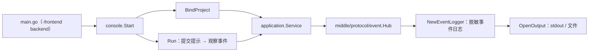
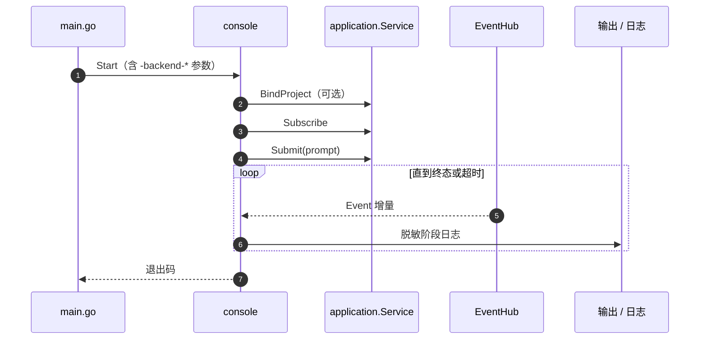

# Console

## 生态位

`console` 提供 headless 后端诊断控制台：绑定项目、提交提示、观察事件流并以脱敏格式输出阶段日志。
它是 `-frontend backend` 的入口，只通过 `application.Service` 的窄接口工作，不依赖具体 UI。

主要调用方：组合根 `main.go`（`-frontend backend` 分支）与诊断/冒烟脚本。

## 架构图



## 时序图



## 导出

- `Start`：启动诊断控制台主循环。
- `OpenOutput` / `NewEventLogger`：输出与脱敏事件日志器。
- `BindProject`：将后端会话绑定到项目工作区。
- `Run`：无 UI 的单轮提交-观察循环。

## 验证

```text
go test ./console -count=1
```

## 文件与函数索引

> 由源码 doc 注释自动提取（首行摘要）；描述源码行为，与实现保持同步。
> 刷新方式：`python scripts/gen_core_readme_index.py`。

### backend_console.go

- `func BindProject(app backendWorkspaceApplication, rootPath string) error`
- `func Start(app *application.Service, prompt string, timeout time.Duration, output io.Writer) error`
- `func OpenOutput(logPath string) (io.Writer, func() error, error)`
- `func Run(ctx context.Context, app backendApplication, prompt string, timeout time.Duration, input io.Reader, output io.Writer) error`
- `func submitBackendPrompt(ctx context.Context, app backendApplication, logger *EventLogger, prompt string, timeout time.Duration) error`
- `func observeBackendEvents(ctx context.Context, app backendApplication, logger *EventLogger) func()`
- `func NewEventLogger(output io.Writer, now func() time.Time) *EventLogger`
- `func LogStageIf(logger *EventLogger, stage string)`
- `func (logger *EventLogger) LogStage(stage string)`
- `func (logger *EventLogger) LogBashEvent(event dto.BashDiagnosticEvent)` — LogBashEvent records the process-boundary diagnostics emitted by scopedBash.
- `func (logger *EventLogger) LogToolHookEvent(event application.ToolHookDiagnosticEvent)` — LogToolHookEvent records the framework-to-application projection boundary.
- `func (logger *EventLogger) LogSubmit(text string)`
- `func (logger *EventLogger) LogSubmitError(err error)`
- `func (logger *EventLogger) LogIdle(err error)`
- `func (logger *EventLogger) LogEvent(event application.Event)`
- `func (logger *EventLogger) logToolEventLocked(event application.Event)`
- `func (logger *EventLogger) requestStartLocked(requestID string) time.Time`
- `func (logger *EventLogger) elapsedLocked(requestID string) time.Duration`

### backend_console_test.go

- `func (fake *backendWorkspaceFakeApplication) Snapshot() application.Snapshot`
- `func (fake *backendWorkspaceFakeApplication) CreateWorkspace(name, rootPath, _ string) error`
- `func (fake *backendWorkspaceFakeApplication) BindWorkspace(workspaceID string) error`
- `func newBackendConsoleFakeApplication() *backendConsoleFakeApplication`
- `func (fake *backendConsoleFakeApplication) Submit(_ context.Context, text string) error`
- `func (fake *backendConsoleFakeApplication) WaitForIdle(context.Context) error`
- `func (fake *backendConsoleFakeApplication) Subscribe(buffer int) application.Subscription`
- `func TestBackendEventLoggerLogsToolStagesWithoutPayloadContent(t *testing.T)`
- `func TestBackendEventLoggerLogsTeamChangedStage(t *testing.T)`
- `func TestBackendConsolePromptSubmitsAndWaitsForIdle(t *testing.T)`
- `func TestOpenBackendOutputUsesStdoutWithoutLogPath(t *testing.T)`
- `func TestBackendEventLoggerLogsBashStagesWithoutCommandContent(t *testing.T)`
- `func TestBackendEventLoggerLogsToolHookStagesWithoutPayloadContent(t *testing.T)`
- `func TestBindBackendProjectUsesExistingWorkspaceOrCreatesOne(t *testing.T)`

