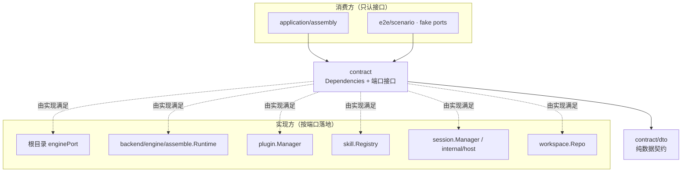
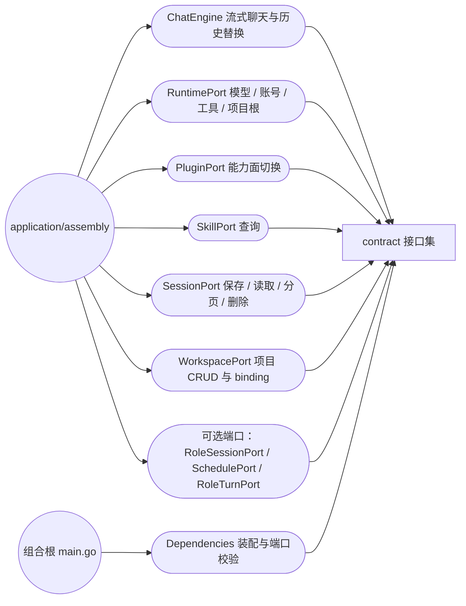

# Application Contracts

## 生态位

`contract` 定义 Application 所需的外部端口，是依赖倒置的边界。接口属于使用者，而不是 Seele、存储或前端实现方。

物理位置：2026-10-16 按
[`../docs/2026-10-15-architecture-reshape/plan.md`](../docs/2026-10-15-architecture-reshape/plan.md) §2.3 的
M1-A，本包从 `application/contract/` 归位到仓库顶层 `contract/`。包名、导出面与 JSON 形状均未变化，
调用方只改 import 路径。

主要调用方：`application/assembly`（只依赖端口）、`internal/host`、`backend/engine/assemble/`、
`backend/engine/plugin/`、`backend/engine/skill/`、`session/`、`workspace/`（各自实现对应端口），以及 `e2e/scenario` 的 fake ports。

子包边界：

- `contract/dto`：稳定枚举、跨层纯 DTO 与词表；
- `contract/protocol`：Snapshot/事件 payload/会话记录等版本化 wire 形状（BM-002 从
  `middle/protocol/model` 下沉，旧路径保留同身份 alias）。

`command.go` 定义 Application 命令入站面使用的 `Command` / `CommandResult`；
`backend/engine/input` 以 alias 复用，避免根门面反向依赖具体路由实现。

`compressed_turn.go` 定义压缩轮次归档的唯一 ToolResults ref 前缀；Application
writer、Store 和 fork 复制共用该常量，避免字符串命名空间漂移。

`engine_capabilities.go` 集中适配 routed/resident engine、session prompt、
working-history release、activate/unload/bundle release、session-backed 与
per-session execution 等可选能力；组合根不再各自复制 type assertion 和回退策略。

`contract/protocol/event_units.go` 是完整协议轮次与段落边界的唯一实现；
`contract/dto/queue_item.go` 是 durable queue 的只读恢复 DTO。Store 与 backend
session 均以同身份 alias 复用，不复制 wire 字段或段落判据。

## 架构图



## 用例图



## 主要端口

| 接口 | 责任 | 典型实现 |
|---|---|---|
| `ChatEngine` | 流式聊天、历史替换、session 生命周期、prompt/loop 配置 | 根目录 `enginePort` |
| `RuntimePort` | Provider、Account、Tool、Plugin、项目根和 Plan branch binding | `backend/engine/assemble` 的 `Runtime` 适配器 |
| `PluginPort` | Plugin 列表、激活、停用 | `plugin.Manager` 适配器 |
| `SkillPort` | Skill 查询 | `skill.Registry` 适配器 |
| `SessionPort` | 会话保存、读取、分页、删除和 active workspace | `session.Manager` 适配器 |
| `WorkspacePort` | 项目 CRUD、session binding、Git remote | `workspace.Repo` 适配器 |
| `ErrorPresentationPort` | Chat/Tool 错误的稳定呈现与结构化包装 | `internal/host` 转发 `middle/view/errors` |
| `CommandRegistryPort` / `InputDispatcher` | 命令注册与规范化输入分派 | `internal/host` 转发 `backend/engine/input` |
| `RoleSessionsPort` | 角色会话、draft、wire 与定时插话 | `internal/host` 转发 `backend/multiagent/team` |

`Dependencies` 是 `assembly.New` 的装配输入；Engine、Runtime、Plugin、Skill 与 Session 端口为必需依赖，构造器缺失时返回 error。`EngineMessage`/`EngineToolCall` 是防止 Seele types 穿透应用层的传输模型。

### 可选扩展端口（按类型断言发现）

| 接口 | 责任 | 典型实现 |
|---|---|---|
| `RoleSessionPort` | R2/R4 群聊角色会话：建角色会话、role draft 读写与 sequencer sync、顺序设置、角色 backup、snapshot/wire 观察面 | `internal/host.SessionPort`（同时实现 `SessionPort`） |
| `SchedulePort` | 定时任务式插话的 `schedule.registered` / `schedule.cancelled` / `schedule.fired` 事件登记 | 同上 |
| `RoleTurnPort` | 角色（员工）回合执行体：在角色自己的会话上跑一次带工具的有界回合，并保证主体类按 `ToolsPolicy` 落地 | `backend/engine/assemble` 的 `Runtime.RunRoleTurn`（经 `Dependencies.RoleTurn` 注入） |

这些端口是**可选能力**：`application/assembly` 用类型断言在 `Deps.Sessions` 上发现前两者，
`RoleTurnPort` 经 `Dependencies` 显式注入，
未装配时显式返回“不可用”，不静默退化、不新增旁路。签名只用
`contract/dto` 的纯 DTO（`dto.RoleRow` / `dto.RoleDraftRow` /
`dto.RoleSnapshot` / `dto.RoleWireSnapshot` / `dto.ScheduleEventPayload`），
存储实现类型 `store.*` 只允许出现在 `internal/host` 的映射函数里
（S27 收口；回归见 `e2e/dto_boundary_test.go`）。

## 扩展规则

- 只有 Application 用例确实需要的新能力才进入接口；不要为底层实现“顺手暴露”方法。
- 优先增加窄的可选能力接口，例如 core 内部的 scoped-session/storage port，而不是破坏所有实现。
- 新方法必须同步更新根适配器、fake ports、E2E harness 和编译期接口断言。

## Review 指南

- 接口参数是否使用 Application-owned model，而不是 GUI 或数据库类型。
- 方法是否表达用例语义，而非底层技术细节。
- project/session 作用域是否显式，是否会依赖可变的全局 active scope。
- mock 实现返回值是否掩盖真实错误路径。

## 测试

```text
go test ./application/... ./e2e/scenario . -count=1
```

## 架构门禁

`architecture_test.go` 是 Backend / Middle 领域化的结构门禁（BM-001）：

- 冻结 backend 内部直接包边、backend → middle、middle → backend、
  backend → application 四组生产依赖；
- 目标门禁要求 `middle → backend` 与 `backend → application` 最终归零；
- 超 500 行的存量生产文件按当前行数冻结，只允许缩短；新增文件上限为 500 行。

这里只解析生产 `.go` 文件的 import，不把测试辅助依赖计入跨层预算。新增边必须
同时给出业务理由并修改白名单；单纯换一条边不算债务下降。

```text
go test ./contract -run 'TestBM00' -count=1
```

## 文件与函数索引

> 由源码 doc 注释自动提取（首行摘要）；描述源码行为，与实现保持同步。
> 刷新方式：`python scripts/gen_core_readme_index.py`。

### architecture_test.go

- `func TestBM001DependencyBudgetIsFrozen(t *testing.T)`
- `func TestBM003AndBM004TargetEdgesAreZero(t *testing.T)`
- `func TestBM002BackendOnlyKeepsRuntimeIntegrationToMiddle(t *testing.T)`
- `func TestBM001FileSizeBudget(t *testing.T)`
- `func productionImportEdges(t *testing.T, root string) importEdges`
- `func assertEdgeBudget(t *testing.T, label string, got []string, budget map[string]string)`
- `func productionGoFiles(t *testing.T, root string) []string`
- `func lineCount(t *testing.T, path string) int`
- `func repositoryRoot(t *testing.T) string`
- `func sortedUnique(values []string) []string`
- `func formatEdges(edges []string) string`

### engine_capabilities.go

- `func RoutedSessionEngine(engine ChatEngine) (SessionChatEngine, bool)` — RoutedSessionEngine returns the explicit-session engine when supported.
- `func ResidentSessionEngineFor(engine ChatEngine) (ResidentSessionEngine, bool)` — ResidentSessionEngineFor returns the resident engine when supported.
- `func SetSystemPromptFor(engine ChatEngine, sessionID, prompt string) bool` — SetSystemPromptFor writes a session prompt when the engine supports it.
- `func SupportsSystemPromptFor(engine ChatEngine) bool` — SupportsSystemPromptFor reports whether session-routed prompt writes are
- `func ReleaseWorkingHistoryFor(engine ChatEngine, sessionID string) bool` — ReleaseWorkingHistoryFor releases one session's working history.
- `func ActivateSession(engine ChatEngine, sessionID string) (bool, error)` — ActivateSession creates the explicit engine bundle when supported.
- `func UnloadSession(engine ChatEngine, sessionID string) (bool, error)` — UnloadSession unloads one resident session bundle when supported.
- `func ReleaseSessionBundle(engine ChatEngine, sessionID string) bool` — ReleaseSessionBundle releases one resident engine bundle.
- `func SessionBacked(engine ChatEngine) bool` — SessionBacked reports whether the engine owns a reentrant session-backed
- `func PerSessionExecution(runtime RuntimePort) bool` — PerSessionExecution reports whether the host supports parallel session

### errors.go

- `func IsProviderContextExhaustion(err error) bool` — IsProviderContextExhaustion 判定 provider 是否以"上下文窗口超出"为由拒绝请求。
- `func ClassifyProviderFailure(err error) ProviderFailureKind` — ClassifyProviderFailure 按 provider 措辞把传输失败归到具体类别；无法归类返回

### retention.go

- `func RetainFloorTokens(percent, budgetTokens int) int` — RetainFloorTokens returns the percentage-derived lower bound of the context

### retention_test.go

- `func TestRetainFloorTokens(t *testing.T)`

### runtime_migration_test.go

- `func TestBM005RuntimeAssemblyProductionFilesAreClassified(t *testing.T)`
- `func TestBM005DomainPackagesDoNotImportRuntimeAssembly(t *testing.T)`
- `func TestBM005ReviewFilesRegistrationIsOwnedByBoot(t *testing.T)`
