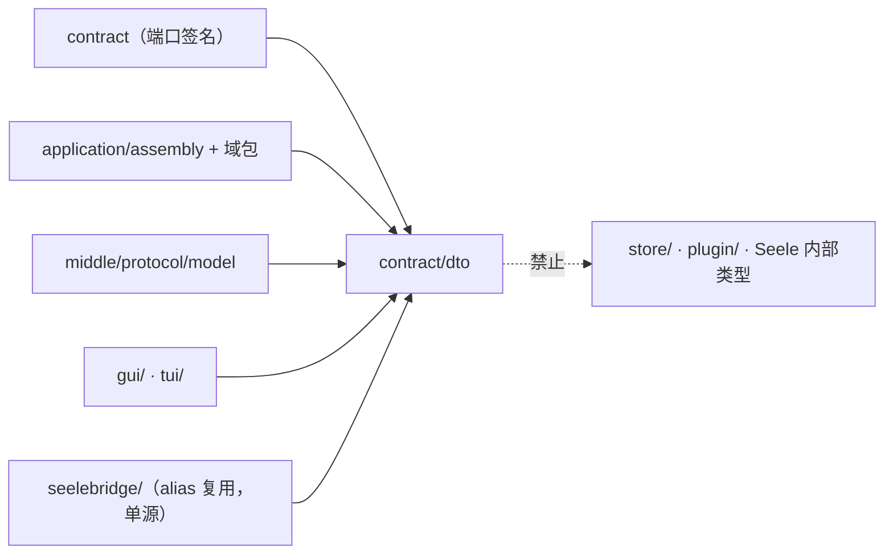
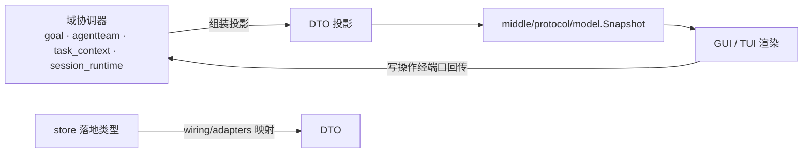

# contract/dto

## 生态位

`contract/dto` 是 Seelex 跨层共享的**纯数据契约**包：放数据形状（结构体、枚举字面量、常量）
与不绑定类型的自由函数判据，不把行为方法捆进 DTO，也不 import 存储、框架或 UI 包。

主要调用方：`contract`（端口签名）、`application/assembly` 及其域包、`middle/protocol/model`、
`gui/`、`tui/`，以及 `seelebridge/`（以类型 alias 复用同一定义，保证单源）。

## 职责与非职责

- 做：定义 Plan / Task / Goal 治理投影 / AgentTeam / 角色会话 / 子代理树与 live 事件 /
  调度任务 / 工作树 / worktree / 员工权限等跨层词汇；保证 JSON 字段名与前端 reducer 一致。
- 不做：不带方法、不发事件、不读写存储、不持有运行时状态、不做权限判定
  （判据在 `backend/limit/policy`、执行门在 `backend/tool/registry`，
  本包只提供**前后端共用的那份字面量**）。

## 文件结构

| 文件 | 承载 |
|---|---|
| `account.go` | 角色卡下的账户管理契约：`AccountDraft` / `AccountAddResult`（新增）、`AccountDetails` / `AccountUpdate`（读取与编辑，密钥只报告 `api_key_set`，编辑留空保留原密钥）、`AccountBalance` / `AccountBalanceInfo`（逐账号余额读数，金额保持供应商字符串原样），以及 `AccountRoleVocabulary()`（角色词表唯一来源）。 |
| `account_window.go` | 账号上下文窗口的界面挡位表；backend/accountwindow 以 alias 复用。 |
| `goal.go` | Goal 记录、预算、进度、Begin/Update/Finish 请求和 `GoalStatusView` 的纯数据形状；goal 域保留同身份 alias 与自由函数。 |
| `websearch_config.go` | `WebSearchConfig` / `StrategyConfig` 跨层配置形状；backend/tool/search 保留 alias。 |
| `plan.go` | `PlanEdge` 与 Plan 可序列化形状、`AccountRole`（agent / subagent / goalplan）。 |
| `task.go` | 包文档、`TaskStatus` 生命周期、`TaskPhase*` worktable 阶段常量。 |
| `projection.go` | `RuntimeVisibilityProjection`（application → runtime 的不可变可见性投影）、`GoalGovernanceView`（goal 治理只读投影）。 |
| `agentteam.go` | `RoleKind` / `OrderPolicy` / `TeamKind` 等 A2A 角色工厂枚举与 `TeamSpec` / `RoleSpec`。 |
| `rolesession.go` | R2/R4 群聊角色会话纯 DTO（`Event` / `RoleDraftRow` / `RoleSnapshot` 的应用层形状）。 |
| `permission.go` | 权限装配词汇：公开标签（`read/write/session/computeruse/control/bash/ssh`）、内部 `adm` 路由组与位值；旧 `admin/adm` 读取迁移为 `bash`。 |
| `prompt_layer.go` | `PromptLayer`：system prompt / 活动 Skill 分层的跨层只读形状。`application/prompt` 以同身份 alias 复用，backend 任务域不反向依赖 Application。 |
| `view_limits.go` | `ViewLimits`：中间层展示投影所需的 `HistoryWindow` / `PlanNodeEvents` / `EvidenceChars` 窄读数面。 |
| `role_settings.go` | 角色设置（`RoleSettings`：账号 / 权限向量 / 默认 plugin）与**五级权限向量解析的唯一实现**（`RoleSettingsLayers` + `ResolvePermissionVector` / `ResolveRoleSettings`；层序 `user_allow > agent_dispatch > session_default > role_default > global_default`，`!tag` 表示这一层明确不给）。`PermissionRoleInfo` 同时携带生效/默认向量、`inherit_main_agent`、角色默认与当前会话的 SSH 路径白名单；subagent / teammate 的继承同时覆盖权限与单一 `ssh` 能力下的路径白名单。上下文窗口不属于角色设置，而是账号模型字段。 |
| `scene_scope.go` | `SceneScope`：后台工作现场/子代理的执行作用域（SceneID / 角色 / 分支 / 工作区 / TaskID），ctx 携带；各读者只取自己需要的字段。原 Plan 节点 `NodeScope` 已退役。 |
| `scheduler.go` | `ScheduledTaskKind` / `PeriodUnit` 定时与周期任务契约。 |
| `subagent.go` | 子代理树只读投影（状态、节点、紧凑上下文）。 |
| `subagent_live.go` | `SubagentLiveEvent`：节点第一视角实时推送（stage / tool / assistant）；`SubagentLiveHistoryPage`：同一份回放窗口的**分页一页**（`scope_id/offset/limit/total/has_more/events`，窗口上限见 `seelebridge.RuntimeConfig.SubagentLiveWindow`）。 |
| `teammate_session_live.go` | `TeammateSessionLiveView`：**当前 teammate 会话**的实时只读投影（默认页 + `offset/limit/total/has_more` 分页；只投影 user/assistant 两类）。 |
| `subagent_recovery.go` | 子代理中断恢复的只读投影。 |
| `tree.go` | 工作树（Work Tree）只读元数据：只含路径/名称/类型/大小/计数，绝不携带文件内容。 |
| `gitcommit.go` | 提交详情（一个提交改了哪些文件）只读元数据：状态/路径/重命名原路径/±行数；文件**内容**走 `dto.FileContent`（与工作树预览同一形状）。 |
| `worktree.go` | `NodeWorktreeInfo`：节点 worktree 现场的只读摘要（人工恢复入口）。 |
| `review_request.go` | 「agent 请求 GUI 打开待审阅文件」这一格的契约：`ReviewRequest` / `ReviewFileRef` / `ReviewSkip` + 上限 `MaxReviewFilesPerRequest`（10）与跳过原因词表。**只带路径**，文件内容仍走只读预览通道（`dto.FileContent`）。 |
| `workspace.go` | 批量新建项目契约：`WorkspaceCreateRequest`、`WorkspaceCreateResult`、`WorkspaceCreateBatchResult`。批量创建只登记 workspace，不绑定当前会话；绑定仍走 `BindWorkspace`。 |
| `queue_item.go` | durable lifecycle queue 的只读恢复载荷：`QueueItem` 与 `QueueRecoveryReport`。字段与既有持久化 JSON 逐字一致，Store/backend session 以同身份 alias 复用。 |
| `teamwork_plan.go` | Teamwork 计划的完整持久化 DTO：`TeamworkPlan` / `TeamworkMember` / `TeamworkMilestone` / `TeamworkWorkItem` / `TeamworkState`、状态常量与自由函数判据。字段和 JSON tag 与既有 `plan.json` 逐字一致；Store、backend 与 middle 看板保留同身份 alias。 |

## 依赖方向



本包**不得**反向依赖 `application/assembly`、`store`、`gui`、`tui` 或 Seele 内部类型；
`seelebridge` 只以 alias 复用定义，不新增平行类型。

## 核心实现

- **枚举即契约**：`TaskStatus`、`TaskPhase*`、`RoleKind`、`OrderPolicy`、`TeamKind`、
  `ScheduledTaskKind` 的字符串值被前端筛选与后端判定共用，改名等于破坏协议。
- **投影而非镜像**：`RuntimeVisibilityProjection` / `GoalGovernanceView` / 子代理树与
  恢复投影都是给 UI 的**有界只读视图**，不是权威状态本身；权威状态在
  `middle/protocol/model` 与各域协调器。
- **逻辑角色 vs provider role**：`RoleKind` 只是 metadata，provider role 仍然只有
  system / user / assistant / tool；subagent 是 tool calling 能力，不属于任何 `RoleKind`。
- **持久化实体不归实现层独占**：`TeamworkPlan` 系列是 Store head payload、runtime
  编排输入与看板投影共用的同一份合同。Store 只保留 alias，避免 Application 为读一份计划
  反向 import 持久化实现。

## 数据流



存储层类型（`store.Event` / `RoleDraftRow` / `RoleSnapshot`）只在 `wiring/adapters`
里出现，由适配器做 DTO ↔ 存储映射；`application/assembly` 与前端只认本包类型。

## 并发、存储与错误语义

- 本包全部为值类型或只读形状，**无锁、无全局状态**；并发安全由持有它们的域协调器负责。
- 不定义错误类型：字段缺失或非法由消费方校验。
- 字段增删属于**协议变更**：必须同步前端 reducer、GUI 协议测试与 `docs/gui/schemas/`。

## 扩展方式

新增跨层词汇时，先确认它是否真的需要同时被 contract、core、前端与 seelebridge 看到；
只被单层使用的类型应留在该层，不要上提到这里。新增结构体时：

1. 在对应主题文件内定义，保持「一主题一文件」；
2. JSON tag 一旦发布即视为兼容面，破坏性改名须走协议版本；
3. 若是 `seelebridge` 也需要复用的形状，用 alias 而不是复制定义。

## Review 指南

- 是否引入了行为方法或对存储/框架的 import（违反「纯数据」定位）。
- 是否出现了第二份平行定义（`seelebridge` 侧应为 alias，而不是同名结构体）。
- 投影类 DTO 是否可能无界增长（子代理事件、工具事件必须有界）。
- 是否把 workspace 内文件内容塞进只读元数据 DTO（`tree.go` / `gitcommit.go` 明确禁止；
  文件字节只走 `FileContent`，且必须由后端 workspace 层做 containment 与敏感过滤）。

## 测试与验证

本包为高风险 wire 形状保留独立契约测试（例如 Goal、TeamworkPlan 与枚举编码）；
其余契约由消费方测试覆盖。最小验证命令：

```text
go test ./contract/dto -count=1
go build ./application/...
go test ./application/... -count=1
node --test gui/frontend/dist/*.test.mjs   # 协议字段与 reducer 一致性
```

## 文件与函数索引

> 由源码 doc 注释自动提取（首行摘要）；描述源码行为，与实现保持同步。
> 刷新方式：`python scripts/gen_core_readme_index.py`。

### account.go

- `func AccountRoleFromName(name string) AccountRole` — AccountRoleFromName 从账号 ID 推断角色，只用于兼容尚未携带显式 Role 的旧快照。
- `func AccountRoleVocabulary() []string` — AccountRoleVocabulary 返回可手动添加的账号角色名（顺序即界面下拉顺序）。

### account_window.go

- `func AccountWindowPresets() []int` — AccountWindowPresets returns the UI presets for per-account context windows.

### async_run.go

- `func (s AsyncState) String() string` — String 给出对外词。
- `func ParseAsyncState(text string) (AsyncState, bool)` — ParseAsyncState 把对外词读回枚举；第二个返回值报告它是不是我们认得的词。
- `func (s AsyncState) MarshalJSON() ([]byte, error)` — MarshalJSON 保住 wire 形状：JSON 里仍是 "running" 这样的词，不是枚举的整数值。
- `func (s *AsyncState) UnmarshalJSON(data []byte) error` — UnmarshalJSON 读回对外词。认不得的词**报错**，不静默折成零值——那会把"读不懂"变成

### context_snapshot.go

- `func (snap *ContextSnapshot) Format() string` — Format 将快照格式化为可注入 system prompt 的结构化文本。
- `func (snap *ContextSnapshot) SetGoal(goal string) *ContextSnapshot` — SetGoal 设置目标。
- `func (snap *ContextSnapshot) AddDecision(what, why string) *ContextSnapshot` — AddDecision 追加一条关键决策。
- `func (snap *ContextSnapshot) AddFinding(finding string) *ContextSnapshot` — AddFinding 追加一条重要发现。
- `func (snap *ContextSnapshot) SetProgress(progress string) *ContextSnapshot` — SetProgress 设置已完成进度。
- `func (snap *ContextSnapshot) AddConstraint(constraint string) *ContextSnapshot` — AddConstraint 追加一条约束。
- `func (snap *ContextSnapshot) AddPendingWork(work string) *ContextSnapshot` — AddPendingWork 追加一条待完成工作。
- `func (snap *ContextSnapshot) SetEscape(reason, message string, iterations int) *ContextSnapshot` — SetEscape 设置循环逃逸信息。
- `func (snap *ContextSnapshot) SetParentGoal(parentGoal string) *ContextSnapshot` — SetParentGoal 设置父目标（无 escape 时不做事）。
- `func (ve *ValidationError) Error() string`
- `func (snap *ContextSnapshot) Validate() error` — Validate 检查必填字段。
- `func Truncate(s string, maxLen int) string` — Truncate 截断字符串到指定长度。

### goal_status.go

- `func (s GoalStatus) String() string` — String 给出对外词（视图 JSON 与存档 wire 都用它）。
- `func ParseGoalStatus(text string) (GoalStatus, bool)` — ParseGoalStatus 把对外词读回枚举；第二个返回值报告认不认得。
- `func (s GoalStatus) Terminal() bool` — Terminal 报告状态是否终态（不再停留在 goal 栈上）。
- `func (s GoalStatus) MarshalJSON() ([]byte, error)` — MarshalJSON 保住 wire 形状：JSON 里仍是 "active" 这样的词。
- `func (s *GoalStatus) UnmarshalJSON(data []byte) error` — UnmarshalJSON 读回对外词；认不得的词报错，不动原值。

### goal_test.go

- `func TestGoalWireShapeStable(t *testing.T)`
- `func TestGoalRequestWireShapeStable(t *testing.T)`
- `func sortedKeys(fields map[string]json.RawMessage) []string`

### job_namespace.go

- `func jobNamespacePrefix(namespace JobNamespace) string` — jobNamespacePrefix 是某个命名空间的**前缀**（token + 分隔符）。识别与解析都走它，
- `func JobHandle(namespace JobNamespace, seq int) string` — JobHandle 铸造一个句柄。它是**唯一一处**把 token 与序号拼起来的地方：两张作业表的铸造点
- `func JobNamespaceOf(handle string) (JobNamespace, bool)` — JobNamespaceOf 识别一个句柄属于哪个命名空间；第二个返回值报告它是不是**我们认得的形态**
- `func JobHandleSeq(handle string) (int, bool)` — JobHandleSeq 从句柄里取回**派发序号**（第二个返回值 = 这个形态认不认得）。

### job_namespace_test.go

- `func TestJobNamespaceOfMatchesTokenPlusSeparator(t *testing.T)` — TestJobNamespaceOfMatchesTokenPlusSeparator 钉住句柄文法里最容易错的一处：
- `func TestJobHandleRoundTripsThroughItsNamespace(t *testing.T)` — TestJobHandleRoundTripsThroughItsNamespace 钉住"铸造与识别是同一份文法"：凡铸造出来的
- `func TestJobNamespacesAreDisjoint(t *testing.T)` — TestJobNamespacesAreDisjoint 钉住整套命名空间互不相交：任何两个 token 铸造出来的句柄

### node_status.go

- `func (s NodeStatus) String() string` — String 给出对外词。
- `func ParseNodeStatus(text string) (NodeStatus, bool)` — ParseNodeStatus 把对外词读回枚举；第二个返回值报告认不认得。**用它判"这个词是不是
- `func (s NodeStatus) MarshalJSON() ([]byte, error)` — MarshalJSON 保住 wire 形状：JSON 里仍是 "running" 这样的词。
- `func (s *NodeStatus) UnmarshalJSON(data []byte) error` — UnmarshalJSON 读回对外词；认不得的词报错，不动原值。
- `func NodeStatusFromFramework(word string) (NodeStatus, bool)` — NodeStatusFromFramework 把框架 workplan 的节点状态词折成这一格；第二个返回值报告

### permission.go

- `func PermissionGroupNames() []string` — PermissionGroupNames 返回规范组序（装配面板的"格子顺序"）。
- `func ValidPermissionGroup(group string) bool` — ValidPermissionGroup 报告 group 是否是已知路由组。
- `func NormalizePermissionGroups(groups map[string]uint8) (map[string]uint8, error)` — NormalizePermissionGroups 规整一份"逐格装配"的权限：校验组名与位值，返回**独立
- `func CanonicalPermissionGroup(group string) string` — CanonicalPermissionGroup 把旧版保存值迁移到当前能力词表。
- `func PermissionTiers() []PermissionTierInfo` — PermissionTiers 返回规范档位目录（升序 = 自动度递增；返回新切片，调用方
- `func PermissionTierIDs() []string` — PermissionTierIDs 返回规范档位 id 序列（装配/校验/测试用）。
- `func ValidPermissionTier(tier string) bool` — ValidPermissionTier 报告 tier 是否是已知档位 id。
- `func NormalizePermissionTier(tier string) (string, error)` — NormalizePermissionTier 规整档位 id：空（未选择）→ manual（进程默认）；未识别
- `func (e *PermissionTierError) Error() string`
- `func PermissionTierFromFullAccess(on bool) string` — PermissionTierFromFullAccess 把旧的二元 full_access 口径映射成档位（兼容壳：
- `func PermissionTierIsFullAccess(tier string) bool` — PermissionTierIsFullAccess 报告档位是否等价旧 full_access（诊断/兼容读面）。
- `func (e *PermissionGroupError) Error() string`

### plan_run.go

- `func (s PlanRunStatus) String() string` — String 给出对外词（plan_run 结果 JSON 里的 status）。
- `func ParsePlanRunStatus(text string) (PlanRunStatus, bool)` — ParsePlanRunStatus 把对外词读回枚举；第二个返回值报告它是不是这一格的词。
- `func (s PlanRunStatus) MarshalJSON() ([]byte, error)` — MarshalJSON 保住 wire 形状：JSON 里仍是 "completed" 这样的词。
- `func (s *PlanRunStatus) UnmarshalJSON(data []byte) error` — UnmarshalJSON 读回对外词；认不得的词报错（含框架的节点状态词——它不属于这一格）。

### plan_status.go

- `func (s PlanStatus) String() string` — String 给出对外词。注意 "running" 在这一格里是**计划的**在途态；节点状态的
- `func ParsePlanStatus(text string) (PlanStatus, bool)` — ParsePlanStatus 把对外词读回枚举；第二个返回值报告认不认得。
- `func (s PlanStatus) MarshalJSON() ([]byte, error)` — MarshalJSON 保住 wire 形状：JSON 里仍是 "running" 这样的词。
- `func (s *PlanStatus) UnmarshalJSON(data []byte) error` — UnmarshalJSON 读回对外词；认不得的词报错，不动原值。

### plugin_assembly.go

- `func NormalizePlugins(names []string, limit int) ([]string, error)` — NormalizePlugins 规整一份按会话装配的插件名清单：去首尾空白、丢弃空项（纯空白

### reasoning_effort.go

- `func ValidReasoningEffort(value string) bool` — ValidReasoningEffort 判断一个配置值是否为本系统认识的思考强度值。
- `func WireReasoningEffortVocabulary() []string` — WireReasoningEffortVocabulary 返回 **provider 词表** 的合法取值（不含 "session"）：
- `func NormalizeWireReasoningEffort(raw string) (string, error)` — NormalizeWireReasoningEffort 归一一个 provider 词表的思考强度，是"什么算一个合法
- `func ReasoningEffortVocabulary() []string` — ReasoningEffortVocabulary 返回全部合法取值（"session" 在前），供配置报错提示用。
- `func DefaultReasoningEffortForRole(role AccountRole) string` — DefaultReasoningEffortForRole 返回角色的默认思考强度（可能是 "session"）。

### review_request.go

- `func CloneReviewRequest(request *ReviewRequest) *ReviewRequest` — CloneReviewRequest 深拷贝一份待审阅请求（快照是并发读者的共享值，浅拷贝会

### role_settings.go

- `func PermissionLayerNames() []string` — PermissionLayerNames 返回五级来源的规范顺序（高→低）。
- `func PermissionTags() []string` — PermissionTags 返回规范标签序（权限面板的"格子顺序"，也是解析结果的展示序）。
- `func (settings RoleSettings) Empty() bool` — Empty 报告这份设置是否什么都没配（调用方据此跳过写入/覆盖）。
- `func (layers RoleSettingsLayers) Ordered() []RoleSettings` — Ordered 返回按优先级高→低排列的五层（新切片，顺序即 PermissionLayerNames）。
- `func (layers RoleSettingsLayers) PermissionVectors() [][]string` — PermissionVectors 返回五层的权限向量（顺序同上）。
- `func ResolvePermissionVector(layers ...[]string) []string` — ResolvePermissionVector 按五级优先级解析权限向量：**逐标签取首个出现者**，
- `func ResolvePermissionVectorDecision(layers ...[]string) PermissionVectorDecision` — ResolvePermissionVectorDecision 是五级优先级解析的**唯一实现**
- `func ResolveRoleSettings(layers ...RoleSettings) RoleSettings` — ResolveRoleSettings 按五级优先级解析整份角色设置（高→低参数序）：
- `func NormalizePermissionVector(vector []string) ([]string, error)` — NormalizePermissionVector 规整一份**写入侧**的权限向量：逐项取 `解析形态`
- `func (err *PermissionVectorError) Error() string`
- `func parsePermissionTag(raw string) (string, bool, bool)` — parsePermissionTag 把一项原文解析成 (标签, 是否允许)。第二个返回 false 表示这一项
- `func sortPermissionTags(tags []string)` — sortPermissionTags 就地把标签按"规范序在前、未知项按字典序在后"排好。

### role_settings_test.go

- `func TestResolvePermissionVectorTable(t *testing.T)`
- `func TestResolvePermissionVectorLayersOrder(t *testing.T)` — TestResolvePermissionVectorLayersOrder 钉住 RoleSettingsLayers.PermissionVectors
- `func TestRoleDefaultIsIndependentOfGlobalDefault(t *testing.T)` — TestRoleDefaultIsIndependentOfGlobalDefault 钉住角色默认的真实位置：它可以压住
- `func TestResolveRoleSettingsFirstNonEmptyWins(t *testing.T)`
- `func TestNormalizePermissionVector(t *testing.T)`

### routing_notice.go

- `func (n RoutingNotice) Message() string` — Message 把这条路由事实翻成一句给用户看的提示（B 类摘要 Detail 与文案同源）。
- `func (n RoutingNotice) failureKindText() string` — failureKindText 把账号资格失败类别翻成一句中文（与 backend/engine/account 的

### scene_scope.go

- `func WithSceneScope(ctx context.Context, scope SceneScope) context.Context` — WithSceneScope 把现场作用域注入 ctx（子代理/后台工作单元执行请求）。
- `func SceneScopeFromContext(ctx context.Context) (SceneScope, bool)` — SceneScopeFromContext 读取 ctx 中的现场作用域；无作用域时返回 (零值, false)。
- `func SceneScopeFromContextOrEmpty(ctx context.Context) SceneScope` — SceneScopeFromContextOrEmpty 读取现场作用域；无作用域时返回空 SceneScope

### schedule_run_status.go

- `func (s ScheduleRunStatus) String() string` — String 给出对外词（面板 JSON 里的 last_status）。
- `func ParseScheduleRunStatus(text string) (ScheduleRunStatus, bool)` — ParseScheduleRunStatus 把对外词读回枚举；第二个返回值报告认不认得。
- `func (s ScheduleRunStatus) MarshalJSON() ([]byte, error)` — MarshalJSON 保住 wire 形状：JSON 里仍是 "ok" 这样的词。
- `func (s *ScheduleRunStatus) UnmarshalJSON(data []byte) error` — UnmarshalJSON 读回对外词；认不得的词报错，不动原值。

### session_status.go

- `func (s SessionStatus) String() string` — String 给出对外词（快照 JSON / 目录行都用它）。
- `func ParseSessionStatus(text string) (SessionStatus, bool)` — ParseSessionStatus 把对外词读回枚举；第二个返回值报告认不认得。
- `func (s SessionStatus) MarshalJSON() ([]byte, error)` — MarshalJSON 保住 wire 形状：JSON 里仍是 "idle" 这样的词。
- `func (s *SessionStatus) UnmarshalJSON(data []byte) error` — UnmarshalJSON 读回对外词；认不得的词报错，不动原值。

### state_codec.go

- `func (c stateCodec) word(ordinal uint8) string` — word 给出对外词。越界（将来加了常量却忘了加词）折回"未知"，不 panic：
- `func (c stateCodec) ordinal(text string) (uint8, bool)` — ordinal 把对外词读回枚举序数；第二个返回值报告认不认得。
- `func (c stateCodec) marshal(ordinal uint8) ([]byte, error)` — marshal 让枚举的**整数值不出本进程**：JSON 里永远是词。
- `func (c stateCodec) unmarshal(data []byte, into *uint8) error` — unmarshal 读回对外词；认不得的词报错且**不动原值**。

### state_enum_test.go

- `func TestAsyncStateEnumKeepsWireShape(t *testing.T)`
- `func TestAsyncStateRejectsUnknownWord(t *testing.T)` — 认不得的词必须报错：静默折成零值会把"读不懂"变成"还在跑"——两者差一整个作业生命周期。
- `func TestAsyncRunRecordWireRoundTrip(t *testing.T)` — 记录整条走一遍 JSON：字段形状与字符串时代逐字节相同（`"state":"running"`）。
- `func TestPlanRunStatusEnumKeepsWireShape(t *testing.T)`

### state_machines_test.go

- `func assertStateWire(t *testing.T, c stateWireCase)`
- `func TestRecordStatusEnumWire(t *testing.T)` — 格 A：记录状态（子代理节点的生命周期；词也是**落盘**的那一份）。
- `func TestToolEventStatusEnumWire(t *testing.T)` — 格 B：工具事件状态（子代理工具调用的 running \| success \| error）。
- `func TestTaskStatusEnumWire(t *testing.T)` — 格 D：task 状态（工作表格条目的生命周期）。
- `func TestTurnStatusEnumWire(t *testing.T)` — 格 E：回合状态（用户这一次请求的生命周期；可见面 `Snapshot.Task.Status` 与
- `func TestSessionStatusEnumWire(t *testing.T)` — 格 F：会话可见状态（一个会话的可见状态机：运行期叠加 + 持久子集）。
- `func TestPlanStatusEnumWire(t *testing.T)` — 格 G：计划状态（整张 Plan 的生命周期；与 plan_run 的**批次结果**是两格）。
- `func TestNodeStatusEnumWire(t *testing.T)` — 格 H：节点状态（一个计划节点的状态；框架词 + 我们的 worktree 阶段词）。
- `func TestNodeStatusFromFrameworkFoldsStartedAndRejectsPhases(t *testing.T)` — 框架词折一次：框架的 "started" 与我们的 running 同态；**阶段词不是节点状态**
- `func TestScheduleRunStatusEnumWire(t *testing.T)` — 格 I：定时任务上次运行结果（`ScheduledTaskStatus.LastStatus`；GUI 面板数据源）。
- `func TestGoalStatusEnumWire(t *testing.T)` — 格 J：goal 状态（goal 栈每层一态；看板视图与 goal 存档同格）。
- `func TestUnitStatusEnumWire(t *testing.T)` — 格 L：恢复单元状态（恢复模板里的粗分三桶；由记录状态折一次）。
- `func TestRecordStatusReadsOldShapedRecords(t *testing.T)` — 落盘那一格：老形状（字符串）的记录必须能读回，认不得的词**不炸**、也不被当成终态。

### subagent.go

- `func (s SubAgentNodeStatus) String() string` — String 给出对外词（JSON / GUI / 落盘记录都用它）。
- `func ParseSubAgentNodeStatus(text string) (SubAgentNodeStatus, bool)` — ParseSubAgentNodeStatus 把对外词读回枚举；第二个返回值报告认不认得。
- `func (s SubAgentNodeStatus) MarshalJSON() ([]byte, error)` — MarshalJSON 保住 wire 形状：JSON 里仍是 "running" 这样的词。
- `func (s *SubAgentNodeStatus) UnmarshalJSON(data []byte) error` — UnmarshalJSON 读回对外词；认不得的词报错，不动原值。

### subagent_live.go

- `func (s ToolEventStatus) String() string` — String 给出对外词（事件 JSON 与 GUI 都用它）。
- `func ParseToolEventStatus(text string) (ToolEventStatus, bool)` — ParseToolEventStatus 把对外词读回枚举；第二个返回值报告认不认得。
- `func (s ToolEventStatus) MarshalJSON() ([]byte, error)` — MarshalJSON 保住 wire 形状：JSON 里仍是 "success" 这样的词。
- `func (s *ToolEventStatus) UnmarshalJSON(data []byte) error` — UnmarshalJSON 读回对外词；认不得的词报错，不动原值。

### task.go

- `func (s TaskStatus) String() string` — String 给出对外词。
- `func ParseTaskStatus(text string) (TaskStatus, bool)` — ParseTaskStatus 把对外词读回枚举；第二个返回值报告认不认得。
- `func (s TaskStatus) MarshalJSON() ([]byte, error)` — MarshalJSON 保住 wire 形状：JSON 里仍是 "completed" 这样的词。
- `func (s *TaskStatus) UnmarshalJSON(data []byte) error` — UnmarshalJSON 读回对外词；认不得的词报错，不动原值。
- `func PhaseForKind(kind string) string` — PhaseForKind 由权威类型 Kind 派生展示阶段（Phase 与 Kind 不允许双轨漂移）。
- `func ActorIdentity(role, sessionID string) string` — ActorIdentity 由执行角色与会话 ID 合成 Assignee/Participants 身份标识。
- `func (item TodoItem) WithDerivedDone() TodoItem` — WithDerivedDone 返回 Done 与 Status 一致的副本（Status == done → Done=true）。

### teamwork_board_test.go

- `func decodeKeys(t *testing.T, value any) []string`
- `func wantSorted(keys []string) []string`
- `func TestPluginAssemblyViewWireKeysAreFrozen(t *testing.T)` — TestPluginAssemblyViewWireKeysAreFrozen 逐键断言装配读数的 wire 形状。
- `func TestTeamworkMemberViewCarriesAssemblyGates(t *testing.T)` — TestTeamworkMemberViewCarriesAssemblyGates 钉成员行的装配两格：

### teamwork_plan.go

- `func TeamworkPlanIsEmpty(plan TeamworkPlan) bool` — TeamworkPlanIsEmpty 报告计划尚未声明团队（TeamID 为空）。
- `func TeamworkWorkItemStatusOrPending(item TeamworkWorkItem) string` — TeamworkWorkItemStatusOrPending 把空状态读成 pending。
- `func TeamworkWorkItemTerminal(item TeamworkWorkItem) bool` — TeamworkWorkItemTerminal 报告工作项是否已有 done/failed 结论。

### teamwork_plan_test.go

- `func TestTeamworkPlanContractWireShapeAndFreeFunctions(t *testing.T)`

### tool_record.go

- `func ToolReasonVocabulary() []string` — ToolReasonVocabulary 是词表全集（顺序稳定）：前端标签、看板配色与用例都按它走，

### turn_status.go

- `func (s TurnStatus) String() string` — String 给出对外词（Snapshot 的 JSON 与回合存档都用它）。
- `func ParseTurnStatus(text string) (TurnStatus, bool)` — ParseTurnStatus 把对外词读回枚举；第二个返回值报告认不认得。
- `func (s TurnStatus) MarshalJSON() ([]byte, error)` — MarshalJSON 保住 wire 形状：JSON 里仍是 "progressing" 这样的词。
- `func (s *TurnStatus) UnmarshalJSON(data []byte) error` — UnmarshalJSON 读回对外词；认不得的词报错，不动原值。

### unit_status.go

- `func (s UnitStatus) String() string` — String 给出对外词。
- `func ParseUnitStatus(text string) (UnitStatus, bool)` — ParseUnitStatus 把对外词读回枚举；第二个返回值报告认不认得。
- `func (s UnitStatus) Active() bool` — Active 报告这一单元是否要续跑（唯一判据：`Unit.Active()` 转调它）。
- `func (s UnitStatus) MarshalJSON() ([]byte, error)` — MarshalJSON 保住 wire 形状：JSON 里仍是 "active" 这样的词。
- `func (s *UnitStatus) UnmarshalJSON(data []byte) error` — UnmarshalJSON 读回对外词；认不得的词报错，不动原值。

