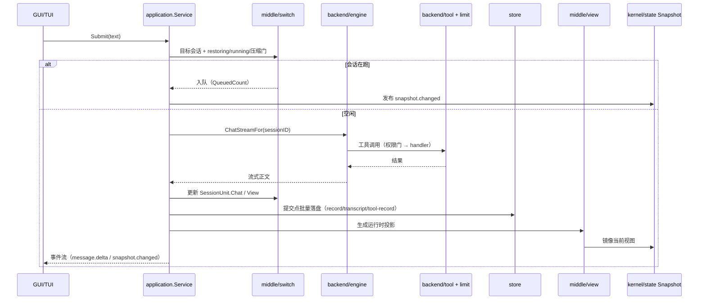
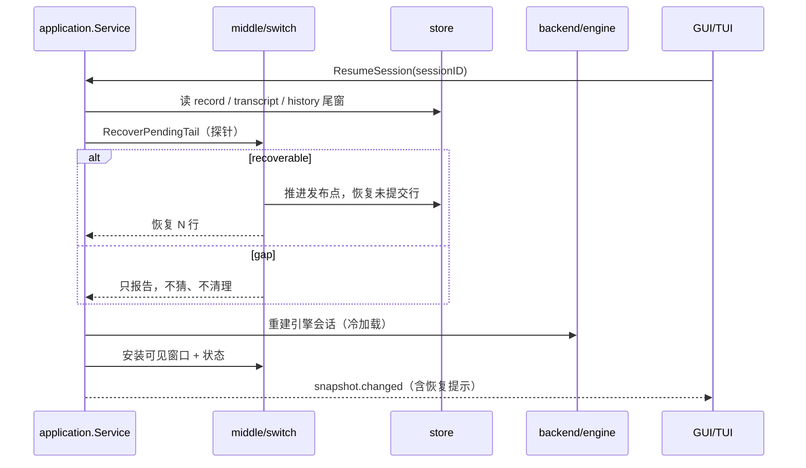

# 交接文档：架构重排（2026-10-17 收尾）

本文件是给下一个会话的交接：当前结论、状态 owner 的裁决依据、P3 三个关键概念的大白话
解释、整体架构与数据流、已完成/未完成清单，以及继续改动会涉及的文件。

分支：`refactor/architecture-reshape`（**未 push**，无 upstream）。工作树在本文提交后应为干净。

---

## 1. 一句话现状

plan.md 的 **M1–M5 结构目标已完成**：`seelebridge/` 已删、门面收窄、`application/core`
按域切片、`assemble.Runtime` 按域下沉、`store` 机制子包就位、前端 `console/` 与
`headless/` 已顶层化。迁移后的行为项（P1 路径门、P2 预算收尾、V10 工具记录）已落地。

**唯一没做完的已批准项是 P3（契约提纯）**。它剩下的技术面是：把 `contract/ports.go`
仍在引用的两个引擎形状（`seelectx/search.Result`、`seelectx/snapshot.ContextSnapshot`）
下沉契约层；工程面是顶层 `session/` 与 `workspace_usecase.go` 的物理搬迁，前置是
把 `session.Manager` 对 `store.Router` 的依赖反转成端口。

---

## 2. 状态 owner 是谁（按用户故事裁决）

**结论：状态机归会话域（`session.SessionUnit` + `middle/switch`），持久事实归
`store.Record`，`Snapshot` 只是当前视图的镜像。契约层只拥有形状与端口，不拥有状态机。**

### 2.1 两层 owner

| 状态面 | 权威 owner | 代码证据 | 说明 |
|---|---|---|---|
| 运行态（running / queued / 待批 / resident） | `session.SessionUnit`（内存、每会话一份） | `session/ports.go:208` 的 `SessionUnit{Chat, approvalIDs, resident, Cancel, Stream, Queue, ...}`；`sessionStatusLocked`（`application/core/service_snapshot.go:102`）全部从单元读 | 这是"这一刻在不在跑"的唯一事实 |
| 持久状态（status / checkpoint / binding / title） | `store.Record` | `store/session_granular.go:44` 的 `Record{Status, Checkpoint, Binding, ...}` | 重启后恢复的依据；写入发生在提交点 |
| 视图镜像 | `kernel/state.Core.Snapshot` | `Snapshot.Session` / `Snapshot.Chat` 由 active 单元镜像 | 只服务当前视图，**不是 owner** |
| 目录行状态 | `Snapshot.Sessions` + `enrichDirectoryRowsLocked` | `application/core/service_snapshot.go:70` 按每个会话单元补 running/queued/awaiting/resident | 切换会话时"后台在跑"就是从这里来的 |

### 2.2 四个用户故事逐条落地

1. **LRU 淘汰要判断状态**
   `sessionBusyState`（`application/core/resident_lru.go:134`）从 `SessionUnit` 读
   `PendingApprovals/Running/QueuedCount/PendingRequests`，交给
   `middle/switch.Busy` / `Protected`（`middle/switch/release.go`）。
   **淘汰判据的输入是单元状态，不是 Snapshot。**

2. **切换会话要及时看到后台运行状态**
   `SnapshotOf(sessionID)`（`application/core/session_scope.go:517`）与
   `ListSessions()` 都按会话单元/权威目录组装；`enrichDirectoryRowsLocked` 逐行叠加
   `sessionStatusLocked`。所以切到 B 时，A 的 running 仍能在目录行读到。

3. **会话要更新状态**
   运行态的写入口只有一条链：`runtime.UpdateChat` → `setSessionChatLockedFor` →
   单元 `Chat` + active 镜像。状态**不是**由前端或 Snapshot 回写的。

4. **恢复要看状态；运行中重启要做 draft 恢复**
   重启后内存态全空，"曾经在跑"不能靠 running 位（它已经没了）。持久证据是
   **发布点 + 未提交草稿尾**：`recoverPendingMessageTailAtLoad` →
   `middle/switch.RecoverPendingTail`（`middle/switch/pendingtail.go`）按
   `clean / recoverable / gap` 决策：可恢复就推进发布点并提示"恢复了 N 行"，断裂就
   只报告、不猜。运行中的进程内会话由 `Running` 判据拦住，不抢在飞写者的发布点。

### 2.3 对 P3 的直接含义

- 不要把状态机搬进 `contract` 或 `store`。契约层只放**形状/端口**。
- `session/` 要搬到 `middle/switch/sessionusecase/`，但先要把 `Manager` 持有的
  `*store.Router` 反转成端口（`SetWorkspace/Workspace/StorageConfig/SaveCommitWorkspace`），
  否则中间层会直接 import `store`，违反 §1.2。
- `Snapshot` 的字段可以继续按视图需要增删，但任何"决策"都必须回到单元/记录。

---

## 3. P3 的两个词，大白话

### 3.1 产品 A-B 模型是什么

Seelex 现在的执行模型不是"一群 agent 一起干活"，而是：

- **A（EXEC）= 主会话/主代理**：真正干活的人。它调工具、写文件、推进任务，
  是会话事实的**唯一写者**。
- **B（ADVISOR/TL）= 技术负责人/评审者**：在**隔离上下文**里看 A 交上来的证据，
  只输出结构化裁决（done / not_done / escalate）或指令。它不替 A 干活，也不写 A 的会话。
- 两者之间是一条**确定性治理循环**：A 跑一轮 → B 评一次（启用时）→ 裁决决定 A
  下一步或收口。A-B 的请求/记录/状态视图（Begin/Update/Finish/GoalRecord/StatusView）
  就是这条循环的"信封"。

**为什么 P3 卡在这里**：如果 A-B 是稳定产品模型，这些信封可以冻结进 `contract/dto`，
前端/插件/未来的远程调用都能依赖；如果 B 还在试验（比如要不要给 B 执行工具、要不要
多 B），过早冻结会把实验形状变成兼容债。

**我的建议**：冻结**治理信封**（begin/update/finish/proposal/verdict/status 的字段），
不冻结 **B 的执行能力**（B 今天只读，不要现在承诺"B 能跑命令"）。理由：治理循环已经
是默认行为且有确定性逃生路径；执行能力仍在演进。落地方式：goal 域保留实现与别名，
`contract/dto` 接管 `BeginRequest/UpdateRequest/FinishRequest/GoalRecord/StatusView`
的字段形状。

### 3.2 NodeScope 是什么

一句话：**NodeScope 是给一次工具调用挂的"工牌"**，上面写着"这次调用属于哪个 Plan 节点、
哪个角色、哪条分支、哪个工作区"。

为什么需要它：主代理可以同时跑多个 Plan 节点/子代理，每个节点可能有自己的 worktree。
工具调用（read/write/bash）如果不知道自己在哪个节点里，就会：

- 相对路径解析到主工作区，把别人的文件改了；
- 权限/审批记到主会话而不是这个角色；
- 账号选择、prompt 装配、结果归属串到别的节点。

`dto.NodeScope{NodeID, Role, BranchID, WorkspaceID, TaskID}`（`contract/dto/node_scope.go`）
就是这张工牌，随 ctx 传递。路径解析（`resolveScopedPath`）、权限主体、账号选择、
节点 prompt 都从它读。

**建议**：保持它在 `contract/dto`（它已经是跨层身份形状），把
`internal/model.NodeScope`、`backend/tool/node.NodeScope` 这些别名逐步收成
"只在一个方向转发"，不要再长出第二份字段。**不要给 NodeScope 加行为方法**——
它只是信封，行为属于路径门/权限/装配。

---

## 4. 架构图：application 与 middle 的生态位差别


**生态位差别（必须记住）**：

| | `application` | `middle` |
|---|---|---|
| 它回答的问题 | "用户这个动作要按什么顺序调用哪些域？" | "这个会话现在是什么状态？该留还是该切？" |
| 角色 | **用例编排/门面**：把 Submit/Resume/Fork 拆成多步，调用 middle/backend，最后投影成 Snapshot/事件 | **状态 owner**：会话视图、驻留、切换、历史、草稿、释放判据 |
| 依赖 | 可以依赖 middle/backend/contract | 只能依赖 contract + 窄端口；**不许 import application**，也不直接 import store |
| 有没有业务状态机 | 不拥有；只做装配与顺序 | 拥有（SessionUnit / residency / switch） |
| 改动判据 | 新的用户动作、跨域顺序 | 状态判定、切换/恢复/释放规则 |

一句话：**application 是"导演"，middle 是"舞台监督 + 演员状态"**。导演可以换戏，
但不能替舞台监督记"谁在台上"。

---

## 5. 数据流图

### 5.1 提交一轮消息



### 5.2 重启恢复（含运行中中断的 draft）



---

## 6. 已完成清单（本轮及之前）

| 项 | 证据 |
|---|---|
| M1–M5 结构迁移 | `seelebridge/` 空；`main.go` 41 行；`e2e` 布局/依赖门禁全绿；记录 §30/§52–§57 |
| P1 路径门前移 | `backend/tool/registry/path_gate.go`；越界 `approvals=0` 用例；`aabb311d` |
| P2 预算收尾 +1 次总结 | `contract.ReactBudgetFinalizationMarker`；`4613dc33` |
| P7 console/headless 顶层化 | `e55e929b` / `1e63efed`；`gui` 单向 import `headless` |
| P8/P18/P19/P20 | 僵尸面、草稿漂移、文案、挂死/竞态；`m5-record` §52–§53 |
| P21 域方法随类型走 | `runtime_teamwork`/`workunit`/`teamwork`/`plan`/`role_turn` 判据下沉；§34–§51 |
| effort 策略下沉 | `backend/limit/effort`；定时任务默认参数同源；`4d03de5d` |
| 引擎历史写面契约化 | `contract.EngineMessage` 统一读写；契约不再 import `Seele/types`；`3948729c` |
| 视图归位竞态 | `3d16a972`；stress `-count=50` 全绿 |

验收：`go build ./...`、`-tags "gui,desktop,production"`、`go vet ./...` 全 0；
`go test ./...` 仅 `application/core` 基线 3 例红；受影响包 `-race` 0 DATA RACE；
README 索引 89 个无漂移、引用检查 178 个 0 未解析。

---

## 7. 未完成项与继续改动的文件

### 7.1 P3 契约提纯（唯一未完成的已批准项）

现状：`contract` 的直接依赖只剩 `middle/protocol/{model,event}`（协议词汇，plan §1.3
允许）+ 两个引擎形状：

- `contract/ports.go: SearchHistory(...) (seelexctxsearch.Result, error)`
- `contract/ports.go: NodeContextSnapshot(...) (*snapshot.ContextSnapshot, bool)`

这两个形状把 `seelectx/{search,snapshot}` 及其 `store`/Seele 依赖带进契约闭包。

**涉及文件**：

```text
contract/ports.go
contract/dto/                      （新增 search_result.go / context_snapshot.go）
backend/engine/context/seelectx/search/search.go
backend/engine/context/seelectx/snapshot/snapshot.go
backend/engine/context/seelectx/{bridge.go,compressor.go}
backend/tool/node/agent_node.go
application/faces.go               （SearchResult / ContextSnapshot 的再导出）
middle/protocol/model/state.go     （如需别名）
e2e/facade_boundary_test.go        （契约闭包 ratchet 收缩）
```

注意：`ContextSnapshot` 有 10 个方法（Format/SetGoal/AddDecision/.../Validate），
把结构体搬到 `contract/dto` 后这些方法不能定义在别名上；要么改成函数
（`snapshot.Format(snap)`），要么在 snapshot 包保留一个嵌入 `dto` 的本地包装类型。
两种做法都要同步 `seelectx/{bridge,compressor}.go`、`backend/tool/node/agent_node.go`
与 snapshot 包测试。

### 7.2 R6 剩余物理搬迁

```text
session/                                  → middle/switch/sessionusecase/
application/core/workspace_usecase.go     → middle/switch/workspace/
```

**前置**：`session.Manager` 持有 `*store.Router`，`session/ports.go` 还别名了 6 个
store 类型。搬到中间层前必须先做端口反转：

```text
session/manager.go                 （Router → StoragePort）
session/ports.go                   （store 别名 → contract/dto 或消费侧）
wiring/adapters/session_workspace_ports.go（实现 StoragePort）
wiring/bootstrap/application.go    （装配注入）
application/core/session_*.go      （session.X 引用随搬迁改 import）
application/core/service_input.go
middle/switch/                      （新 workspace/sessionusecase 落点）
```

`workspace_usecase` 的方法体是宿主编排（`Deps.Workspace`/`Deps.Sessions`/引擎切换），
纯判据只有"换项目是否另起会话"一条；整体搬迁同样以状态 owner/端口反转为前置。

### 7.3 其他

- `application/core` 基线 3 例红（`TestContextBudgetSkipsCompactionWithoutMargin` /
  `TestRunningSessionAccumulatesAllRoundsInOrderControl` /
  `TestColdRestoreTailFirstRequestKeepsTranscriptOrder`）：契约登记为开工前既有，
  未修。若要修，先按 P20 的姿势做稳定复现。
- FNV 原语三处（`backend/tool/plan` / `account` / 权限策略）：建议保持现状，理由见
  `m5-record` §53。
- 分支未 push；`tmp/reshape/*` 脚本被 .gitignore 忽略，不影响构建。

---

## 8. 验证命令（交接后先跑）

```bash
git status --short                 # 应为空
go build ./...
go build -tags "gui,desktop,production" ./...
go vet ./...
go test ./... -count=1 -timeout 2400s
python scripts/gen_core_readme_index.py --check
python scripts/check_readme_refs.py --strict
```

基线：`application/core` 3 例红，其余应全绿。`-race` 用 Git Bash
（`G:\Tools\Git\Git\bin\bash.exe`，CGO_ENABLED=1 + gcc）。
