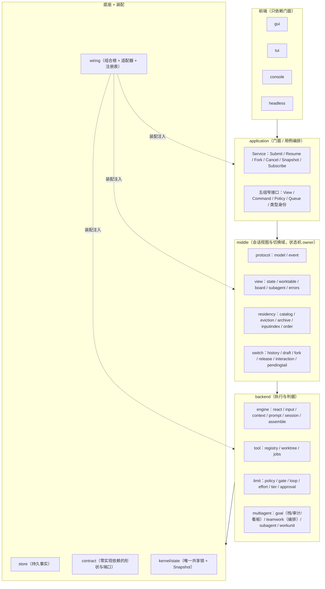
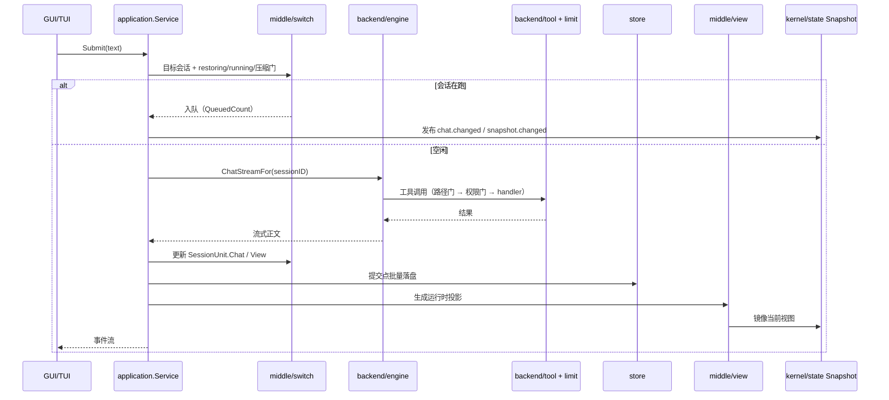
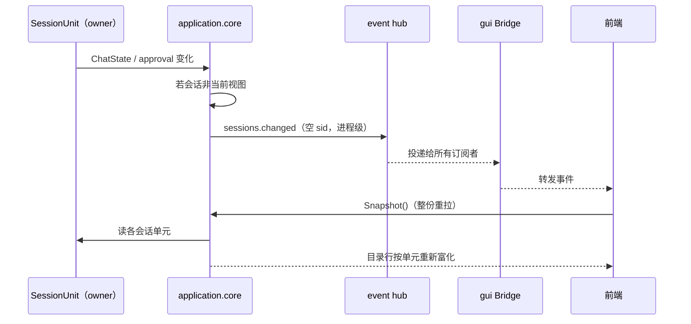
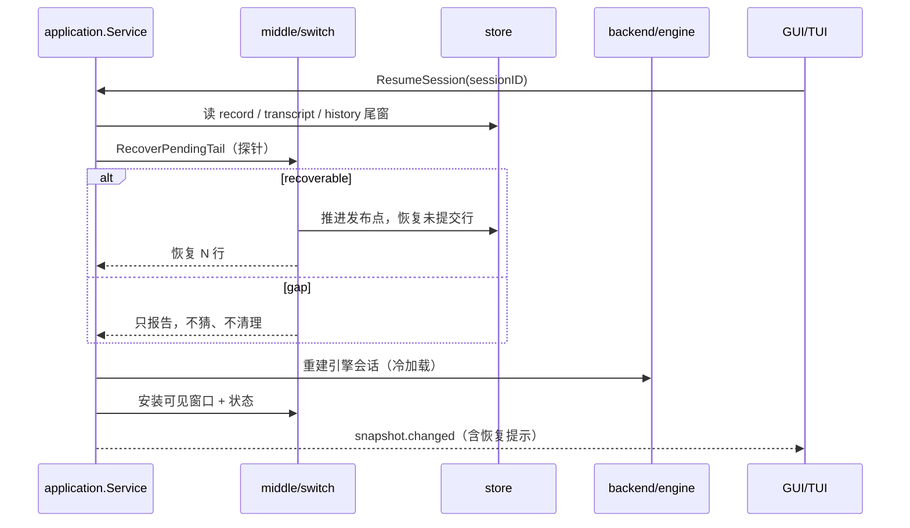

# 交接文档：架构重排（2026-10-17 收尾）

分支：`refactor/architecture-reshape`（**未 push**，无 upstream）。本文提交后工作树应为干净。

---

## 1. 一眼现状

- **M1–M5 结构目标已完成**：`seelebridge/` 已删、`main.go` 41 行、门面五组窄接口、
  `application/core` 按域切片、`assemble.Runtime` 按域下沉、`store` 机制子包就位、
  `console/` 与 `headless/` 顶层化。
- **P3 技术面已完成**：`contract` 的 Seelex 依赖闭包只剩 4 个纯形状包
  （`contract`、`contract/dto`、`middle/protocol/{model,event}`）；`Seele/types`、
  `store`、`seelectx/*` 与第三方包全部离开。ratchet 上限 29 → 4。
- **TL/ADVISOR（A-B 评审环）已按用户裁决删除**：goal 只留栈/审计/看板与
  `goal_begin/update/status/done`；团队编排由 **teamwork** 承担。
- **状态 owner → 显示面已集成**：后台会话状态变化发进程级 `sessions.changed`，
  GUI 重拉权威 Snapshot、TUI 重取 Snapshot；目录行按会话单元重新富化。

**唯一没做的结构项**：`session/` → `middle/switch/sessionusecase/` 与
`workspace_usecase.go` → `middle/switch/workspace/` 的物理搬迁（前置是 `session.Manager`
对 `store.Router` 的端口反转）。**NodeScope/Seele plan node 的删除**已确认性质，见 §4。

---

## 2. 状态 owner：谁说了算

**结论：运行态归 `session.SessionUnit`（内存、每会话一份）；持久状态归 `store.Record`；
`Snapshot` 只是当前视图镜像。契约层只拥有形状/端口，不拥有状态机。**

| 状态面 | 权威 owner | 证据 |
|---|---|---|
| running / queued / 待批 / resident | `session.SessionUnit` | `session/ports.go:208` 的 `SessionUnit{Chat, approvalIDs, resident, ...}`；`sessionStatusLocked` 全部从单元读 |
| status / checkpoint / binding | `store.Record` | `store/session_granular.go:44`；提交点落盘，重启恢复读它 |
| 当前视图 | `kernel/state.Snapshot` | 只镜像 active 单元，不是 owner |
| 目录行 | `Snapshot.Sessions` + `enrichDirectoryRowsLocked` | 逐行按会话单元补 running/queued/awaiting/resident |

### 四个用户故事

1. **LRU 淘汰要判断状态**：`sessionBusyState` 从单元读四个忙态，交给
   `middle/switch.Busy/Protected`；淘汰判据的输入不是 Snapshot。
2. **切换会话要看后台状态**：`SnapshotOf(sessionID)` / `ListSessions()` 都按单元与
   权威目录组装；后台状态通过 `sessions.changed` 通知显示面（见 §3）。
3. **会话要更新状态**：唯一写入口是 `runtime.UpdateChat → setSessionChatLockedFor`，
   写单元并镜像 active 视图；前端不能回写。
4. **重启恢复要看状态**：running 位在重启后已不存在，恢复靠**发布点 + 未提交草稿尾**。
   `RecoverPendingTail` 分 `clean / recoverable / gap`：可恢复就推进发布点并提示，
   断裂就只报告、不猜。运行中的进程内会话由 `Running` 判据拦住，不抢在飞写者的发布点。

### 显示面集成（observer，而非第二份 owner）

- 当前视图会话：沿用 `chat.changed` / `snapshot.changed`。
- 后台会话：`publishChatStateFor` 与审批开/闭在会话非当前视图时发**进程级**
  `sessions.changed`（空 sid、revision=0）。GUI 收到后整份重拉权威 Snapshot；
  TUI 的事件循环本来就在任意事件后重取 Snapshot。
- 事件白名单：`event.EventSessionsChanged` 是 process-class；`protocol.js` 的
  `PROCESS_KINDS` 同步；非增量事件 → refresh。
- 证据：`TestBackgroundSessionStateChangeNotifiesDisplaySurfaces`（后台发、视图会话不重复发）；
  `protocol.test.mjs` 的 `sessions.changed` refresh 用例。

---

## 3. 已删除的 A-B 模型（原 P3 的产品前提）

原来的 A-B 模型是：

- **A（EXEC，主会话/主代理）**：唯一干活与写会话的人。
- **B（ADVISOR/TL，技术负责人）**：隔离上下文里的只读评审者，输出 done/not_done/escalate。
- 中间是一条确定性治理循环（A 跑 → B 评 → 裁决驱动 A 或收口）。

**用户裁决（2026-10-17）：这个模型不要了，TL 删掉，teamwork 足够。** 已删除：

- 领域：`advisor.go` / `techleader.go` / `gate.go` / `a2a.go` / `directive.go` /
  `tl_steps.go` / `tl_stream.go` / `escape.go` / `advisor_evaluator.go` / goal 包
  `headless.go`（含对应测试）；
- 应用：Supervisor/TLEvaluator/终态 gate/TL 指令队列/`goal_propose_finish`/
  `GoalIterationCompleted`/`goalAdvanceAfterChat`/`goal_team_recorder`/工作摘要；
- 投影：`dto.PeerState`、`GoalStepView`、`GoalGovernanceView` 的 peer/in_flight/
  round_steps/last_directive；TUI 目标面板的 peer/TL 行。

保留：goal 栈 + 审计 + 看板（轻量目标台账）；团队编排归 `backend/multiagent/teamwork`
（`team_plan/team_work/team_dispatch/team_accept/team_close`）。

---

## 4. NodeScope：是什么、归谁、删不删

**已确认：`NodeScope` 是 Seele workplan 的 `plan node` 执行作用域**，由
`backend/tool/node/agent_node.go` 在 `SeelexAgentNode.Run` 注入 ctx；同时被
teamwork 的 workunit 现场端口**复用**来给 work item 建独立 worktree
（`workunit_assembly.go` 构造 `NodeScope{NodeID, Role}`）。

它解决的问题：多个 plan 节点并行时，工具调用要按节点解析 worktree 根、按角色判权限、
按分支选账号、把结果归属到正确节点。字段：`NodeID/Role/BranchID/WorkspaceID/TaskID`。

**用户口径**：如果它是 Seele plannode，就可以删——plannode 被 teamwork 淘汰（串行、
不可观测）。**我的确认与建议**：

- 它确实是 Seele plannode 的作用域；但 teamwork 的 workunit 现场创建还借用了它的
  两个字段（NodeID/Role）。删除时应先把 workunit 改成自己的 `SceneScope`（或把
  `beginNodeWorktree` 的入参改成 nodeID/role 两个显式参数），再删
  `contract/dto/node_scope.go` 与 `internal/model` / `backend/tool/node` 的别名。
- 还需要迁移 5 类读者：路径门（`WorkspaceID`）、权限主体（`Role`）、账号选择（`Role`）、
  `internal/stream` 的路由提示、`internal/telemetry` 摘要。它们都应改为读 teamwork/
  角色会话的显式 ctx（员工回合已有 `WithEmployeeGrant`；子代理有角色会话号）。
- **同时要决定 Seele plan 工具面**：`plan_load/plan_run/plan_status/plan_clear` 今天
  仍在 `wiring/registry` 注册（`planExecutor.Provider()`）。如果确认产品不再用
  workplan DAG，删除顺序应是：先停注册 → 删 `backend/tool/plan` 与 `backend/tool/node`
  → 清 `contract/dto/plan*` 与 `application/core/plan_tools.go` 的投影 → 再删
  NodeScope。**这一步会动产品 Plan 面板，建议单独一个 commit 并先跑 GUI/TUI 冒烟。**

在未确认"产品 Plan 面板也一起退场"之前，我没有直接删 `plan_*` 工具；这是当前
唯一需要你点头的删除面。

---

## 5. 架构图（application 与 middle 的生态位）



**生态位差别（必须记住）**：

| | `application` | `middle` |
|---|---|---|
| 回答的问题 | "用户这个动作要按什么顺序调用哪些域？" | "这个会话现在是什么状态？该留还是该切？" |
| 角色 | **用例编排/门面** | **状态 owner**（会话视图、驻留、切换、历史、草稿、释放判据） |
| 依赖 | 可依赖 middle/backend/contract | 只依赖 contract + 窄端口；**不许 import application**，不直接 import store |
| 状态机 | 不拥有；只做装配与顺序 | 拥有（SessionUnit / residency / switch） |
| 改动判据 | 新用户动作、跨域顺序 | 状态判定、切换/恢复/释放规则 |

一句话：**application 是导演，middle 是舞台监督 + 演员状态**。

---

## 6. 数据流图

### 6.1 提交一轮消息



### 6.2 后台会话状态 → 显示面（observer）



### 6.3 重启恢复（含运行中中断的 draft）



---

## 7. 已完成清单

| 项 | 证据 |
|---|---|
| M1–M5 结构迁移 | `seelebridge/` 空；`main.go` 41 行；`e2e` 布局/依赖门禁全绿 |
| P1 路径门前移 | `backend/tool/registry/path_gate.go`；越界 `approvals=0` |
| P2 预算 +1 总结 / 无限循环 | `contract.ReactBudgetFinalizationMarker`；`composer-knobs` 11/11 |
| P7 console/headless 顶层化 | `e55e929b` / `1e63efed` |
| P3 契约闭包 | 4 个纯形状包；`e2e` contract ratchet 上限 4 |
| TL/ADVISOR 删除 | goal 只剩 Controller/审计/看板；`goal_propose_finish` 全链删除 |
| 状态 owner → 显示面 | `sessions.changed` + 前端 refresh；跨层测试 |
| P8/P18/P19/P20/P21 | 僵尸面、草稿漂移、文案、竞态、域方法下沉 |
| effort 策略下沉 | `backend/limit/effort`；定时任务默认参数同源 |

验收：`go build` / `-tags "gui,desktop,production"` / `go vet` 全 0；
`go test ./...` 95 包 ok，仅 `application/core` 基线 3 例红；
受影响包 `-race` 0 DATA RACE。

---

## 8. 未完成项与继续改动的文件

### 8.1 删除 Seele plan node / NodeScope（等你点头）

```text
backend/tool/plan/**                 （plan_load/run/status/clear/validate/export）
backend/tool/node/**                 （SeelexAgentNode + NodeScope 注入）
backend/engine/assemble/runtime_plan.go（plan executor / node deps / node factory）
backend/engine/assemble/runtime.go    （planExecutor 构造与 Provider 注册）
contract/dto/node_scope.go
internal/model/node_scope.go
application/core/plan_tools.go       （PlanState 投影；若产品 Plan 面板一起退场）
contract/dto/plan.go / plan_run.go
```

删除前要把 teamwork 的 workunit 现场改成自己的 `SceneScope`：
`backend/engine/assemble/workunit_assembly.go` 的 `beginNodeWorktree`/`resolvedNodeScope`。
还要迁移 5 类读者（路径门 / 权限主体 / 账号选择 / stream 路由提示 / telemetry 摘要）。

### 8.2 `session/` 与 `workspace_usecase` 物理搬迁

```text
session/**                          → middle/switch/sessionusecase/
application/core/workspace_usecase.go → middle/switch/workspace/
```

前置：`session.Manager` 持 `*store.Router`、`session/ports.go` 别名 6 个 store 类型 →
先做端口反转（`wiring/adapters/session_workspace_ports.go` 实现 `StoragePort`，
`wiring/bootstrap/application.go` 注入），否则中间层直接 import store。

### 8.3 其他

- `application/core` 基线 3 例红（`TestContextBudgetSkipsCompactionWithoutMargin` /
  `TestRunningSessionAccumulatesAllRoundsInOrderControl` /
  `TestColdRestoreTailFirstRequestKeepsTranscriptOrder`）：既有，未修。
- FNV 原语三处：建议保持现状（见 `m5-record` §53）。

---

## 9. 验证命令

```bash
git status --short
go build ./...
go build -tags "gui,desktop,production" ./...
go vet ./...
go test ./... -count=1 -timeout 2400s
node --test gui/frontend/dist/*.test.mjs
python scripts/gen_core_readme_index.py --check
python scripts/check_readme_refs.py --strict
```

基线：`application/core` 3 例红，其余全绿。`-race` 用 Git Bash
（`G:\Tools\Git\Git\bin\bash.exe`，CGO_ENABLED=1 + gcc）。
