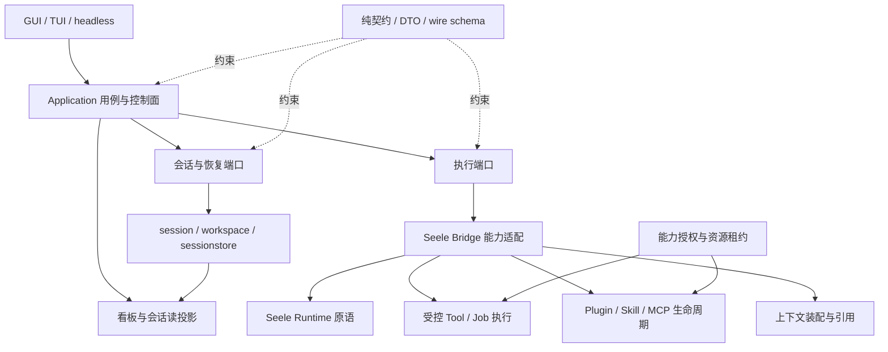
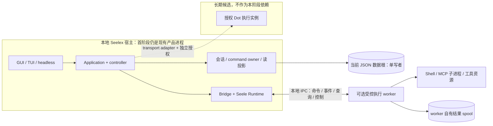

# Seelex 全局审查报告与架构重构前置设计

日期：2026-10-15  
状态：**有限证据审查／待裁决设计，不是实施计划授权，也不是全仓验收证明**  
交付范围：产品方向、旧能力分类、契约评估、性能与可观测性计划、目标架构、通信草案、渐进迁移门禁。

> 原全局审查报告已不可用。本报告不复述或假称复核该报告；仅以本轮已经读取的仓库材料建立结论。按用户最后要求停止进一步读取和检索，直接落本文。没有修改业务代码、测试、配置或正式事实文档，没有执行测试、构建、清理、迁移、发布、提交。本文不能替代后续完整调用链审查与运行验证。

## 执行摘要

1. **产品主线建议收敛为“一个人的本地个人 Agent”。** 根 README 与产品规划都明确强调 personal agent，看板、会话、行动面分别承担管理、执行和动手职责。多代理是个人完成复杂工作的执行方式，不等于多人协作产品。保留可恢复执行、项目隔离、上下文治理、权限审批和可审计结果，冻结新的团队产品叙事。
2. **SeelexDot 是未裁决的扩展方向，不是已实现产品。** 2026-10-13 记录的用户原词是“高管员工”，不是一个已定义的“高级员工”等级。记录要求 Dot 只能是高管员工，基层在 teamwork 下、只持 worktree；邮箱用途、Dot 与 Role 的数量关系、发布权限、星心身份都尚未裁决。`seelexboss` 不应直接等同于文档中的 `main Seelex`。
3. **最紧迫的问题是事实口径漂移，不是少一个 broker。** 根 README 仍将 TeamSpec 团队工厂列为已实现能力，但应用源码明确说明旧 Agent Team 用户面已于 2026-10-12 退场。产品规划仍将多后端持久化勾为已实现，而存储 README 指向仅 JSON v8、其它后端显式退役。性能裁定与同包实施记录也存在前后状态差异。
4. **已有契约基础值得保留，但尚未形成独立协议层。** `application/contract` 有使用者拥有的端口、纯 DTO、可选窄能力面和编译期断言惯例；同时 `ChatEngine`、`RuntimePort` 暴露回调、channel、函数注入、Seele 类型和大量异质职责。进程内 interface 不能直接搬到网络上。
5. **先模块化、再有条件拆进程，推荐混合架构。** Application、会话状态和当前 JSON 数据根继续单写者；优先选择一个可控 Tool/Job 执行路径验证远端驱动，不拆每个包，不把个人产品名变成基础服务名。完整 Agent Runtime 独立化和远程 Dot 放在后续门禁之后。
6. **不推荐当前阶段引入必需 broker，也不推荐自造通用消息平台。** 同步查询、异步命令、领域事件、大结果引用和控制信号分开。首轮采用可替换的本地 IPC，可靠命令需要另行定义持久意图、去重、租约和恢复；现有 EventHub 的有界重放不是耐久队列，JSON 模块 head 的原子发布也不是跨模块事务。
7. **性能先建立当前源码基线。** 历史报告中的 bundle 释放缺陷已被后续实施记录声称修复，不能照抄为当前缺陷。深拷贝、事件扫描、目录读取和写放大值得测量；本轮没有实测，不提供瓶颈排行或收益比例。
8. **本轮实际清理、合并、重构均为零。** 后文列候选与门禁。完整实现核实、跨实现一致性用例、故障注入和数据安全确认通过后，才可执行下一轮变更。

## 证据口径与覆盖边界

- **已核实〔代码〕**：本轮读取的源码或有明确范围的检索结果可以确认的静态事实；不等于运行正确。
- **已核实〔文档〕**：确认文档确实这样写；只证明设计意图或历史记录，不升级为实现事实。
- **已核实〔Git／配置〕**：本轮开始阶段读取的 Git 信息、`go.mod`、`go.work`；不是后续实时状态或远端发布证明。
- **推断**：从已读证据推出的架构判断，明确给出成立条件。
- **待验证**：尚未读完整调用链、依赖源码或没有运行数据；不以关键词命中／零命中作全仓结论。

覆盖的重点材料：`AGENTS.md`、根 `MEMORY.md`、根 `README.md`、`go.mod`、`go.work`、`application/contract/README.md` 与 `ports.go`、`application/event/hub.go`、`application/core/agentteam_runtime.go`、`sessionstore/README.md`、`seelebridge/README.md`、`docs/product/roadmap-2026.md`、Dot 头脑风暴 README、2026-10-14 性能裁定与实施记录。还检索了应用域和 Go 文件中的 Team／Plan／作用域相关符号。**未完成全仓生产调用链、全部测试、Seele v0.3.4 依赖源码及构建发布配置的逐项复核。**

所有路径均为仓库相对路径；拟新增模块与入口只作为名称草案，不表示文件已经存在。未读取真实账号配置、`*.local.yaml` 或会话数据。配置示例仅将 `config/accounts.example.yaml` 作为后续核实目标，不虚构其内容。

---

# 1. 当前事实与主要冲突

## 1.1 已有事实与资产

| 项目 | 本轮确认的事实 | 依据 | 限制 |
|---|---|---|---|
| 仓库位置 | 起始 HEAD 为 `c45d0b2899344cd4a33ff6a259562335c633eab2`；起始 `git status --short` 无输出 | 本轮起始 Git 读取 | 最后阶段没有重读，不作实时 clean 证明 |
| Git 版本 | 描述为 `v0.1.1-212-gc45d0b28` | 本轮起始 `git describe` | 不是发布版本或 Beta 验收证明 |
| 引擎依赖 | Seele 固定 `v0.3.4`，Go 声明 `1.25.8` | `go.mod:3,25` | 未验证依赖源码与编译结果 |
| 工作区覆盖 | `go.work` 仅 `use .` | `go.work:3-5` | 不依赖历史本地 replace 叙述 |
| 产品状态 | 文档明确 Developer Alpha、TUI 默认入口、GUI Alpha | `README.md:10,20` | 未核实远端 Release 与最近 CI |
| 产品定位 | personal agent；teamwork 是个人任务并行方式 | `README.md:3,16-18` | 不是多人共享工作台 |
| 层级约束 | frontend 经 Application，Bridge 适配 Seele，sessionstore 负责持久化，根装配 | `AGENTS.md:9-16` | 规范意图；全仓依赖符合度待机械检查 |
| 契约基础 | EngineBase、SessionChatEngine、RuntimePort；可选 teamwork 投影 | `application/contract/ports.go:36-42,90-109,118-260,271-294` | 进程内接口含函数、channel、框架类型 |
| 事件基础 | Event 有版本、全局 seq、订阅 delivery_seq、revision、请求与会话键 | `application/event/hub.go:105-120` | 未承诺落盘或跨重启重放 |
| 旧团队入口退场 | 源码保留空运行表及 goal 兼容形状，原建造入口退场 | `application/core/agentteam_runtime.go:1-17,31,123-127` | 需继续核实类型依赖和测试后才可删除 |
| 存储方向 | 模块文档指定 JSON v8、模块 head、显式 project/session、数据根单写者 | `sessionstore/README.md:35-39,75-91,98-146` | Repository 与恢复实现未完整复核 |
| 工作生命周期 | Bridge 文档描述一份 `lifecycleHost` + 三格端口，node/team 只注册装配 | `seelebridge/README.md:77-93` | 源码和跨链测试仍需复核，不另造生命周期实现 |

## 1.2 冲突登记

| ID | 冲突／张力 | 事实来源与判定 | 本轮建议 |
|---|---|---|---|
| F01 | README 将 TeamSpec 团队工厂列为已实现，源码注明 Agent Team 用户面退场 | `README.md:65,148-149` 对比 `application/core/agentteam_runtime.go:1-17`。**已核实：说明口径与源码退场状态不同** | 将旧 Agent Team、现行 teamwork、角色执行、subagent 分开登记；下一轮再改正式 README |
| F02 | 多后端持久化仍被勾为已实现 | `docs/product/roadmap-2026.md:75` 对比 `sessionstore/README.md:37-39,142-174` | 撤掉现状承诺；保留历史说明和退役错误；源码实现再确认 |
| F03 | personal agent 与未来团队平台叙事并存 | roadmap `:23` 排除多人共享，但 `:113,126` 仍保留团队／云服务方向，后者有重评注记 | 区分主干、实验扩展、未来候选；组织化工作不自动变为组织化产品 |
| F04 | 接口 README 声称 EngineMessage 阻止 Seele 类型穿透，接口仍引用 Seele | contract README `:88` 对比 `ports.go:7,60,63,98` | 明确当前是局部隔离，不是零引擎依赖；先提纯真实需要的消息契约 |
| F05 | ChatEngine 的锁警告仍按旧 Session 全程持锁解释，同文件后段说明已改闸门＋检查点 | `ports.go:53-59` 对比 `:111-116` | 此为**注释冲突**，不能据此判定现在仍死锁；依赖源码核实后更新约束与测试 |
| F06 | 性能裁定称 bundles 无删除面，实施记录声称已补完整释放 | `verdict.md:31-41,51-71` 对比 `implementation.md:74-84,106-118`（均在性能工作包） | 把裁定作为修复前线索；当前释放正确性必须查新代码，不重报旧缺陷 |
| F07 | “重启归零”被解释为必然无上限无回收 | 性能 `verdict.md:12-13` | 证据不足：缓存、GC、运行负载、native 内存等也可能有此形态；需曲线和对象归因 |
| F08 | 文档引用 vendor 源码，但本轮对应路径模式未发现文件 | Dot README `:72`、性能 verdict 的 vendor 引用；本轮只验证了指定 glob | 不能认定依赖缺失，也不能沿用旧行号；改用确切 v0.3.4 模块源码依据后再确认 |
| F09 | “多会话独立项目根”叙事与 Bridge 的部分默认根回退并存 | `README.md:16,28` 对比 `seelebridge/README.md:200-206`；应用源码检索存在 PerSessionExecution 守卫 | 高风险核实项；未读运行方法，不把 README 注记直接当当前漏洞 |
| F10 | Dot 协议文档把“任意 JSON transport”称为基线，不代表已有可靠远程协议 | Dot README `:71,143` | 需补 transport binding、授权、重试、取消与耐久语义；不能只序列化 Go 接口 |

**风险排序是验证优先级，不是缺陷严重度测量：**先产品承诺一致性和 scope／权限／恢复安全，再契约状态所有权，最后性能优化与部署拆分。未验证问题不标成已证实 P0。

---

# 2. 产品方向及依赖文件地图

## 2.1 Seelex、Dot、Boss 的定位

### Seelex：已有产品主干

- 目标用户：重视成本、数据主权、可审计执行的个人开发者；技术负责人和研究型用户是使用者身份，不意味着多人共享系统已经成立。证据：roadmap `:32-47`。
- 核心场景：个人提交工程任务、管理目标与证据、执行／审批／恢复会话、按需拆分并行工作。
- 责任：把上游引擎、工具、工作区、安全、上下文、持久化和前端装配为个人 Agent 产品。
- 非责任：自研模型、重新实现 Seele 引擎、默认为多人协作平台、用看板替代执行事实。
- “头／身／手”是产品叙事，不是必须三个进程。看板是读模型和控制面，会话是执行与历史归属，行动面有资源互斥与权限。

### SeelexDot：未裁决的高管执行节点方向

证据：`docs/2026-10-13-seelex-dot-a2a-star-topology/README.md:3,12-29`。

用户原话要求：Dot 的 A2A 走 MCP，支持跨进程乃至远程；星形拓扑；每个员工邮箱＋账号；高管能在自己的 branch 发布模块；Dot 只能是高管；基层在 teamwork 下、只能持 worktree；权限由分层改为能力装配。

必须区分：

1. **原话**是“高管员工”；“高级员工”不是本轮核实到的正式等级定义。
2. “独立 Seelex 实例”“邮箱是 inbox”“账号是制品账本”出自该记录 `:33-63` 的作者读法，记录本身要求确认，不可当既定需求。
3. 尚未决定一个 Dot 对应一个还是多个 Role、星心是否为 Dot、发布指 push／PR／tag／制品哪一种。
4. 基层不发布必须约束到凭据／远端授权和操作系统隔离；仅隐藏 publish 工具挡不住 Shell 使用已有凭据。证据：该记录 `:104-125`。

### SeelexBoss：名称与职责待裁决

已读取产品材料使用 `main Seelex`，本轮 docs Markdown 限定检索未返回 `seelexboss` 的定义；**这不是全仓不存在证明**。不能认定 Boss 是已实现产品、独立二进制，或其职责必然等于星心。

备选模型：

- **模型 A（建议优先讨论）**：Seelex 是个人产品；Boss 是其中 controller 的昵称；Dot 是可选执行实例。同一套产品底座，不新增三套状态机。
- **模型 B**：Seelex 是共享底座与个人端；Boss 是独立组织控制产品；Dot 是授权执行产品。必须另行定义组织身份、多租户、所有权、审计与凭据管理，明显扩大范围，建议暂缓。
- 两种模型均要求共享引擎与执行契约；不能先在根 Runtime 写 `if product == boss/dot` 再补设计。

## 2.2 产品能力 → 模块 → 依赖文件

| 能力 | 所有者／实现候选 | 本轮依据与后续核实入口 | 未实现或未核实依赖 |
|---|---|---|---|
| 个人任务提交与运行 | Application 用例＋Bridge＋Seele | `README.md:180-207`；`ports.go:36-109` | 主入口和实际 Submit 调用链未完整核实 |
| 看板／目标／工作证据 | Application 读投影；执行事实来自 Runtime／Store | `README.md:16,64-65`；`ports.go:163-188,271-294`；`seelebridge/README.md:74-75` | 项目看板持久化与独立读协议待查 |
| 会话作用域与恢复 | Application／session／workspace／sessionstore | `AGENTS.md:14`；`sessionstore/README.md:84-91`；`ports.go:90-109,240-250` | 显式 scope 的生产覆盖率、恢复幂等需验证 |
| 工具与审批 | Bridge tools/security；Seele 执行门 | `seelebridge/README.md:145-163,196-212` | fail-closed、全权切换与员工凭据边界待查测试 |
| 并行 subagent | Bridge plan/node/fork/session | `README.md:26,63`；`ports.go:61-84,251-256` | 节点生命周期／冷恢复／worktree 隔离需闭环验证 |
| teamwork 工作单元 | Bridge teamwork/workunit＋角色执行＋Store | `seelebridge/README.md:70,77-93`；`ports.go:277-294` | 不可等同旧 Agent Team 工厂；tool→records→恢复待完整核实 |
| 后台 Tool/Job | Bridge tools；Seele 作业原语 | `README.md:66`；`ports.go:172-188` | 已有两类读表，持久命令受理／重启恢复不应据此宣称支持 |
| 上下文可逆治理 | seelexctx＋Bridge context＋Store | `README.md:67-68`；`seelebridge/README.md:176-192` | 当前预算估算／压缩／恢复基线待测 |
| Plugin／Skill／MCP | plugin／skill＋Bridge managers | `AGENTS.md:13`；`seelebridge/README.md:117-118,150-151` | 服务端暴露、远程授权、插件切换事务边界待查 |
| 行动面与媒体 | Bridge computer/image＋Store media | `README.md:72-73`；`seelebridge/README.md:66-67` | 桌面租约、媒体引用授权／GC、跨进程取消待定义 |
| 模型路由 | Seele accountpool＋Bridge account | `go.mod:25`；`seelebridge/README.md:7-11,142-144` | 确切 API／租约与 failover 语义待读 v0.3.4 源码 |
| Dot 星形 A2A | 产品扩展＋传输 adapter，尚非实现事实 | Dot README `:12-29,82-125` | 身份、能力装配、发布范围、MCP server、持久受理、远端故障恢复 |
| Boss 指挥 Dot | 产品模型待裁决 | 已读取材料只有 main Seelex 星心读法 | 名称、组织边界、控制权、Dot 数量关系均未定 |
| Alpha→Beta | 产品验收＋跨平台发布工程 | `README.md:20`；roadmap `:93-109`；`AGENTS.md:85-98` | 当前 CI／Release、真实用户任务基线，本轮未验证 |

配置层面仅登记 `config/accounts.example.yaml` 为路由示例核实目标。Dot 记录提及 MCP 示例配置，**本轮未读其内容，不把 transport 字段当已确认配置契约**。

## 2.3 方向建议

| 阶段 | 保留 | 冻结／推迟 | 与 Alpha/Beta 的关系 |
|---|---|---|---|
| 近期 | 单人任务闭环、显式 scope、恢复、审批、上下文、证据与限额 | 新团队用户面、Boss 产品化、远程发布、必需 broker、恢复多后端承诺 | 先事实与安全收口；用已有核心场景验收，不为重构增加入口 |
| 下一阶段 | 契约提纯、单进程基准、一个执行 worker 纵向实验 | 整体 Runtime 服务化、组织账号系统、混合存储改写 | 拆分成功必须不降低现有任务／取消／恢复体验；不是 Beta 标签的前提 |
| 长期 | 经验证的 Dot 执行扩展、成熟传输替换、按需独立重启 | 多人共享、企业控制面、云执行等先单独裁决 | 不把长期愿景写进当前能力表；新增产品要有独立责任与验收 |

---

# 3. 旧口径／旧代码清理清单

## 3.1 分类原则与证据要求

入口退场不等于数据退场。每一项实际删除前须补齐：生产调用方、装配、工具注册、Prompt／Skill、存储字段与历史读取、恢复／收尾、测试和上级文档。负证据必须有范围，生成目录副本、注释和测试桩不能当生产入口。

## 3.2 候选清单

| ID／位置 | 分类与当前证据 | 调用／数据依赖 | 拟动作 | 风险、验证与前置条件 |
|---|---|---|---|---|
| L01 `README.md:65,148-149` | 过时能力叙述候选；旧工厂与当前 teamwork 混述 | 用户入口说明／产品承诺 | 拆开当前与退场状态，链接替代路径 | 先核实现行 team 工具面；本轮不改正式 README |
| L02 `application/core/agentteam_runtime.go` | 遗留不可达运行态；源码明确 put 来路退场 | goal 的具体 `*agentteam.Runtime` 签名，chat 前缀钩子，归档释放 | 先提取 goal 真正需要的窄端口，再消除空表／死分支 | 已检索应用域无 `teamRuntimes.put` 调用命中；仍需核实全部引用、装配与 goal 回归 |
| L03 `application/core/agentteam` runtime／scheduler | 类型耦合下的遗留能力；不能整包判废 | L02 与 goal 签名；spec／Role 类型可能仍有其它消费者 | 按符号区分调度与角色建模，只移除确认不可达部分 | 不能借删除包偷偷改变 goal 语义；先读模块 README／测试 |
| L04 `application/event/hub.go:35-48` | AgentTeamView／RoleSnapshot 注释疑似旧口径；事件仍有其它用途可能 | team.changed、teammate.tool.*、前端缓存与看板 | 先核实事件生产者和消费者，更新描述，不关键词删事件 | wire 兼容风险；保持 revision=0 的非快照事件语义直至协议裁决 |
| L05 `$plan`、旧 plan Skill | 退场线索：源码测试注释与实施记录明确提及移除 | `seelebridge/assembly_chain_real_partition_test.go` 检索；`manual_smoke_test.go` 仍出现 `$plan`；性能 implementation `:143-146` | 区分 Skill 名、模型工具、WorkPlan 底层；修旧示例／测试入口，不删有效 DAG 原语 | 尚未读 loader／注册链，不能确定每项可达；需目录事实一致性与任务场景回归 |
| L06 员工库／团队库用户入口 | 退场线索，不代表 RoleSpec／角色执行可删 | `main.go` 注释检索；`dto/agentteam.go`、`runtime_role_turn.go`、teamwork 装配 | 入口、静态模板、运行执行、恢复模型四类分别裁决 | ADVISOR、teammate 仍可能共用角色能力；发布边界未定 |
| L07 席位轮转／发言调度／order_roles | 主应用环不可达；持久语义不能同删 | 根 MEMORY `:94-101`；registry／sequencer 及旧恢复约定 | 为历史数据标状态；确认旧字段读路径后定保留期限 | 历史用户数据不可因产品退场丢弃；需脱敏 fixture 与恢复验证 |
| L08 `sessionstore/README.md:5-17,149-174` | 开头旧 sidecar 叙述与 v8 退役说明并存；旧布局段已标历史 | state／record、manifest、退役 backend enum | 整理状态与替代阅读顺序；保留显式退役错误和旧数据说明 | 源码核实后再改事实文档；不得清磁盘旧目录 |
| L09 `SetFullAccess*` 兼容壳 | 文档明确仍有效兼容层 | 权限档位 full/manual、CLI 与前端消费者 | 暂保留；未来按消费者与配置生命周期退场 | `seelebridge/README.md:156-163`；未验证 wire／配置迁移不能删 |
| L10 subagent／teamwork 工作生命周期 | 仍有效底层资产；文档称已统一 | `workunit_parent.go`、装配表、node/team 注册；一致性测试 | 保留现有生命周期、恢复说明和策略插口 | **不得再写 worker／Dot 专用第二份收尾状态机**；先源码核实 |
| L11 旧性能 verdict | 历史记录，不是当前问题清单 | 同工作包 implementation、现释放代码和回归 | 加“修复前取证”状态并链接当前实施，保留历史 | 本轮未改；不能无差别删除归因过程或宣称全部修完 |
| L12 规划中的 SQL／Redis、多人与云平台叙事 | 过时承诺或未来候选 | roadmap、存储退役枚举、产品定位 | 现状／实验／远期分区；待裁决再进入 roadmap | 不为履行旧文案重造后端与组织产品 |

## 3.3 一条已定位的退场闭环

旧链路的源码说明是：旧用户装配入口 → `teamRuntimeFor` → `teamRuntimes.put` → `teamRuntimeBySession` → goal 环记账／chat 前缀 → 会话释放。

当前已读 `agentteam_runtime.go` 表示：建造入口已删，表无生产注入；读取和释放保留，返回“没有环”。应用域检索还定位 `service_assembler.go` 注入 `TeamRuntimeFor`、`goal_coordinator.go` 读取该函数，以及 `goal_ring_escape_test.go` 退场说明。**这些调用方和测试本轮只定位未完整阅读，因此闭环只到“明确候选”，不是可直接删除的授权。**

持久化的另一条链不能混进上述删除：Role／teamwork 工作记录 → 恢复锚点 → system 恢复说明 → 同键续跑／收口。根 MEMORY `:94-101` 和 `ports.go:240-250` 要求保护这条语义；registry／sequencer 的兼容项须单独核实。

## 3.4 重复实现与唯一位置

**本轮确认可合并的重复实现：0。实际删除：0。**

已读 Bridge README 提供两个已有去重资产：

- node 与 teammate 生命周期／收尾／恢复读数 → 已有 `seelebridge/workunit_parent.go` 的 `lifecycleHost`，差异由 `workunit_assembly.go` 与 FinishPolicy 装配。
- teammate 实时分页／裁剪 → 已有 `teammateSessionLiveSlice`，不是再为跨进程查询造一份裁剪判据。

这不是本轮发现两份实现的证明，而是后续开发必须优先复用的唯一位置候选。新 worker 的投递去重属于通信语义，业务完成／恢复判据仍归现有 workunit，不能借网络 adapter 复制一份。

执行前还须独立用户确认；涉及会话、配置、dist 或目录变动时遵守根 MEMORY 和 AGENTS 的预警、进程检查、备份与恢复条件。本报告不执行任何清理。

---

# 4. 契约支持度与耦合点

## 4.1 分类评估

| 分类 | 实际文件／符号 | 可保留内容 | 需要补齐 |
|---|---|---|---|
| 可直接复用的结构资产 | `ports.go`：EngineMessage、EngineToolCall；`hub.go`：Event、ReplayResult | 标识、消息形状、版本／水位、覆盖不足语义 | 不等于完整行为契约；消息编码约束和跨版本 fixture 仍需补 |
| 需补充约束 | SessionChatEngine；RuntimePort 的 `*For` 方法 | 显式 session 路由、只读拷贝、幂等任务键 | project 绑定／未绑定错误、deadline、取消落点、并发配置冻结、作用域默认禁用 |
| 需传输适配 | EngineBase.ChatStream；SubscribeSubagentLive；TaskChangedChannel／PlanNodeEventChannel | 流式执行、通知、读回投影 | 回调与 channel 改为 Start／Observe／Fetch／Cancel／Subscribe 协议；分页、背压、断线续订 |
| 应重设计的接口组合 | RuntimePort；ChatEngine 的聊天＋历史＋节点＋树＋配置复合面 | 各能力语义保留 | 按执行／查询／配置／恢复分成窄端口，不扩张每个 backend 必需实现面 |
| 需隔离的框架类型 | `ports.go:60,63,98` 的 `types.Message`；`:67` 的 ContextSnapshot | 映射与需要的字段 | 传输层不暴露框架对象；映射在 adapter，领域层只认自有 DTO |
| 需明确状态提交契约 | SessionPort／Repository，module head | key 与发布水位规则，单写者 | 会话保存成功定义、崩溃窗口、跨模块一致性、幂等提交键和 durable ack |
| 需替换具体类型耦合 | goal 的 `TeamRuntimeFor func(...) *agentteam.Runtime` | “可选环／无环”的行为 | 真正最小只读／记账端口或明确删除该语义；不能只删类型绕过 goal |
| 适合可选能力模式 | TeamworkBoardProjection、TeamworkJobCompletion | 未装配显式 nil，窄能力发现 | adapter 必须转发可选能力；增加结构断言和探测契约，不依赖每层碰巧可断言 |

## 4.2 具体耦合

1. **框架类型泄漏**：contract imports Seele，README 的“防穿透”只局部成立。先拆实际消费字段，再评估独立契约包，不能靠别名伪装解耦。
2. **共享可变默认值**：`PermissionTier()` 是进程默认；空 sessionID 的设置修改默认，`BindProjectRoot` 与 `*For` 并存。网络入口必须要求显式 scope，不能复制当前视图回退。
3. **隐藏读副作用**：`TakeServedRoute` 读即清（`ports.go:213-216`），`DrainSubagentContexts` 也表达消费语义。应区分 peek／consume，远端重试不能把消费式读取伪装幂等查询。
4. **生命周期交织**：RuntimePort 同时处理执行、账号、插件、任务、调度、节点恢复、清理和检索。空接口填假方法会掩盖未装配状态。
5. **不可序列化对象**：回调、channel、cancel 函数、运行实例不能过 wire；`context.Context` 只在本进程承载取消与元数据，不能直接 JSON 化。
6. **全局可替换诊断函数**：`event.PublishDiagnostic` 是进程变量（`hub.go:74-79`），适合测试替换，但服务实例多租户或并行测试时须限定所有权与替换时机。
7. **错误语义不足**：`SelectAccount(string) bool` 等无法区分未知／忙／未授权；跨进程需要稳定错误码，不能把 error 字符串当协议。
8. **协议边界混合**：Event 支持 JSON，但 Subscription 持有函数和 channel。只传 Event，订阅身份、恢复游标、实例世代和关闭都由 binding 定义。

## 4.3 零实现依赖契约层与装配草案

“零实现依赖”指契约不 import Application core、Bridge、Store、GUI 或 Seele；可使用标准库和本层纯数据类型，不要求零外部编码工具。

逻辑契约层建议包含：Scope／ID／错误码／能力声明／命令结果／版本与 wire schema。实际物理位置优先评估现有 `application/contract/dto` 的纯化和窄端口提取；确实需要多个产品共享时才讨论独立 module，不预建万能 `common` 包。

```go
// 拟议伪代码，不是当前已实现接口。
type Scope struct { ProjectID, SessionID, WorkID string }
type ExecutionPort interface {
    Start(ctx context.Context, req StartCommand) (Acceptance, error)
    Observe(ctx context.Context, req ObserveQuery) (ExecutionView, error)
    Cancel(ctx context.Context, req CancelCommand) (CancelAcceptance, error)
}
type ResultReader interface {
    Read(ctx context.Context, req ResultQuery) (ResultPage, error)
}
type ExecutionEvents interface {
    Open(ctx context.Context, req SubscribeQuery) (EventReader, error)
}
// EventReader 的本地实现可持连接；对象本身不成为 JSON 字段。
// command owner 持久化与业务状态；本地／远端 adapter 只选择 transport。
var _ ExecutionPort = (*LocalExecutionAdapter)(nil)
var _ ExecutionPort = (*RemoteExecutionAdapter)(nil)
```

装配根只决定注入哪些端口：core 接收用例需要的端口，Bridge adapter 适配 Seele，transport adapter 翻译编码；按产品／层选择的策略只存在于装配和策略调用点。禁止契约反向依赖实现；不在业务 handler 中写“如果是 Dot 就另走状态机”。

## 4.4 测试设计

- **结构门禁**：契约 import 白名单；DTO 不出现 runtime／store 具体类型、callback／channel；每个 adapter 有编译期断言；可选端口逐一转发。复用现有 `e2e/dto_boundary_test.go`、`e2e/workunit_ports_test.go` 作为核实入口，尚未执行。
- **跨实现一致性**：同一份输入跑 local 和 remote，包括显式 scope、重复 command、超时、取消、重启、权限拒绝、大结果和已终态重读；比较可观察状态和结果，不比较 goroutine 交错或时间戳。
- **协议兼容**：版本协商、未知可选字段、未知必需命令拒绝、枚举扩展、旧 fixture 读取、大小限制、恶意路径／scope、缺失 trace、旧游标和实例换代。
- **红灯先行**：漂移缺陷先复现；不能删除旧失败断言或改预期来宣称统一。修行为与修真正过时测试必须分别解释。

---

# 5. 性能和可观测性改进计划

## 5.1 本轮能说什么、不能说什么

| 路径 | 已读证据 | 当前判断／验证方法 |
|---|---|---|
| 上下文装配／预算／压缩 | Bridge README 描述前缀、尾窗、ReplaceHistoryFor；hub 记录 compaction 分段耗时字段 | 成本随历史量变化为合理假设；分别测估算、装配、归档、写盘，不把压缩总时延归给模型 |
| Snapshot／事件投影 | event 结构和重放语义已读；性能 verdict 指 CloneSnapshot 全量深拷贝 | 克隆实现未重读：待核实；测 bytes/op、allocs/op、序列化、投递排队和 GUI 应用延迟 |
| bundle／LRU／释放 | verdict 是修复前；implementation 声称新增统一释放与受保护集 | 当前无界留存**未确认**；先核实 `ReleaseSessionBundle`、`releaseSessionMemory` 和 delete／archive／busy→idle 路径 |
| 遥测查询／token 统计 | 历史 verdict 指 MemoryTracer 无界与全量 Query，implementation 仍列遥测为后续项 | 当前依赖源码未读：高优先待测；测累计事件与 Query 延迟关系，不能先宣布泄漏 |
| JSON 写放大 | Store README `:120-122` 指整片重读／hash 与 head 重写为当时未完成项 | 当前代码待查；测 logical bytes／physical bytes、commit 次数、shard/hash/head/fsync 耗时 |
| Store 读锁 | README `:107-122` 记载读路径锁外解码和历史 66% 等待 | 历史百分比不用于当前瓶颈；验证 head 快照读可见性和写者阻塞，保留 Windows share-delete 场景 |
| MCP 历史／自动保存 | Bridge 有 MCP 生命周期域与历史 router 接线 | 本轮未读完整链：记录／结果／会话保存是否重复、保存频率、锁和关闭待核实 |
| Job／队列 | Runtime 有 latest-wins 容量 1 信号和消费式结果读 | 信号合并不是命令丢弃；分别测通知积压、执行并发、结果读和终态唤醒，不把它改成无限队列 |
| 媒体／子进程 | Bridge 文档说明至多一次图片附加、会话媒体和 scoped shell | 测引用存活、配额、结果清理、整树 kill、取消回执与真正退出之间的时间 |

没有本轮 CPU／heap／block／mutex profile，没有当前 p95，没有吞吐或优化比例。实施记录的历史全量测试耗时不是业务性能基线，也不是本轮测试结果。

## 5.2 可复现验证矩阵（下一轮经确认后执行）

基线记录：commit、Seele 版本、Go／OS／CPU／内存、存储介质、权限与限额、fixture hash、并发、warm/cold、采样方式。使用临时项目与合成数据，不读取真实会话或账号。

| 实验 | 输入规模与方法 | 指标 | 退出判断 |
|---|---|---|---|
| 无模型执行基线 | 确定性 fake completer，1／4／8 并发会话；固定工具响应 | Submit→accepted、首事件、完成 p50/p95/p99；吞吐／排队 | 重复样本可解释，scope 无串写；性能阈值先约定后实现 |
| 上下文装配 | 1k／10k／100k 合成事件，含大 tool result 与压缩帧 | ns/op、B/op、allocs/op、装配 token、冷恢复时长 | 相同 fixture 请求等价；结果引用／恢复不丢 |
| 事件压力 | 快慢订阅混合、断线／重连、事件超过窗口 | 发布耗时、queue depth、lag、重放覆盖、resync 次数 | 慢客户端不无限阻塞执行；漏事件能显式恢复 |
| Store 写入 | 不同 shard 大小、单／批提交、重复提交、发布前崩溃 | 写频、写放大、fsync／hash／head 时间、恢复时间 | 未发布尾不变为事实；重复提交无重复业务事件 |
| 长时资源 | 合成会话循环打开／释放、重复作业／媒体／订阅，2k／10k 单元；固定运行负载 | heap_live、RSS／native、goroutine、句柄、map/窗口数量 | 受保护集外资源能归属并回收；不以单次 GC 后降幅作为唯一证明 |
| 取消与故障 | 排队、执行、阻塞读写、MCP 卡住、父／worker 崩溃 | cancel→ack 与 cancel→实际退出分别测；孤儿数、恢复时长 | deadline 到达不再新接执行；未确认外部副作用呈 unknown/interrupted |
| IPC 对照 | 同一工具 local／IPC，空／小／大载荷；结果引用 | IPC 固定开销、序列化 B/op、完成 p95、启动 RSS | 无劣化安全／取消；拆分成本和独立重启收益都可报告 |

建议未来使用现有 benchmark／测试入口扩展，不本轮新增脚本。后续命令模板：`go test <目标包> -run '^$' -bench <基准名> -benchmem -count=5`；profiling 使用合成运行的 CPU、heap、allocs、block、mutex 与 goroutine dump。包与基准名在源码核实后填入，禁止用不存在的名字制造已可运行验收。

## 5.3 当前单进程 tracing

单进程完全可以 tracing。建议一个请求 root span：`application.submit` → `context.assemble` → `runtime.turn` → `provider.request`／`tool.invoke` → `store.commit`，异步 Job 用 span link 关联派发与完成，不把模型等待、审批等待和执行时间混成一个数字。

- 复用现有 Event 请求／会话标识、Bridge event／telemetry hook 与 compaction 分段计时；`go.mod:97-98` 只有 OTel 间接依赖，**不能据此认定已经接入 exporter**。
- trace 与工作证据各有职责：trace 是采样诊断数据，业务审计与恢复事实不能依赖 trace 全量保留。
- 默认不采 Prompt、工具正文、凭据、原始本机路径；只记录结果大小、状态码、耗时和安全引用。
- project/session/job ID 可作 trace 关联字段；metrics label 禁止无限高基数。日志、trace、结果存储分别设 quota／TTL／轮转。
- profiler 仅绑定本地回环并受开关／授权；本轮未查 `main_pprof*` 实现，不声称当前暴露安全或已开启。

## 5.4 跨进程传播及先做的优化

信封显式 `traceparent`／`tracestate`；服务端提取后新建 span，不能序列化 context。异步转发用因果 link；统一 UTC 时间，duration 本地计算，不用两台机器墙钟差推时延。取消、deadline 和 trace 分别处理，断开连接不能隐式取消已耐久受理作业。

先完成现架构的资源所有权、热路径重复读、投影／保存触发频率、有限保留与显式 scope 验证。拆进程增加拷贝、序列化、调度、重连、进程 RSS、部署和排障成本；不能自动修复无界数据结构或写放大。

---

# 6. 目标模块图与多二进制部署图

以下均为拟议设计，未新增入口、进程或协议实现。

## 6.1 逻辑模块图



契约属于消费方与共享协议边界，图中的虚线不是契约 import 实现。看板不是新的事实所有者；Store 和执行事实为源，读投影可重建。

## 6.2 推荐混合部署图



第一步不拆 UI／Application／Store，不让多个 worker 直接打开同一个 JSON 写根。结果 spool 是执行产物，不是第二套会话／业务作业事实；跨实例必须带 owner／scope／hash，不向客户端暴露任意本机文件路径。

## 6.3 模块责任与状态所有权

| 模块 | 职责 | 非职责 | 权威状态／依赖 |
|---|---|---|---|
| 产品 Application | 用例、用户决定、审批、作用域、目标与任务控制 | 模型循环、broker、具体 OS 执行 | 用户意图／用例状态；依赖窄端口 |
| Bridge／Runtime | 将 Seele 原语装配为执行能力 | frontend 状态机、组织产品语义、第二套持久化 | 运行会话／租约／在途执行；依赖 Seele、注入的存储／策略端口 |
| Tool/Job execution | 受控执行、进展、结果、真实退出 | 星心调度、团队成员产品、会话正文事实 | 本地执行句柄／临时 spool；业务生命周期归 owner／现有 workunit |
| session／workspace／Store | scope binding、会话事件与恢复、原子发布 | 工具编排、GUI 业务判定 | 当前 JSON 持久事实，单写者 |
| context | 预算、装配、压缩、引用 | transport 重投、账号权限 | 可重建缓存／引用；事实从会话与归档读取 |
| Plugin／Skill／MCP | 能力加载与生命周期 | 组织 IAM、业务任务真相 | 激活状态；切换事务／回滚仍在宿主控制面 |
| read projection | 展示快照／增量／分页 | 凭空推断 running／完成 | 派生状态；revision 和 resync 由权威投影定义 |
| capability／resource control | 限制真实能力、凭据、桌面占用 | 只凭路由字段授权 | 可信认证、最小凭据、租约；不可仅藏工具 |

## 6.4 候选二进制清单

| 候选入口（名称草案） | 输入与输出契约 | 存储／启动关闭／健康 | 故障恢复／独立调试 |
|---|---|---|---|
| 现有 Seelex 产品宿主 | 用户命令／查询；Snapshot／Event、审批和执行回执 | 保持会话与 command owner 单写者；启动先配置校验再端口装配，逆序关闭；ready 与 alive 分开 | 数据根锁与发布点恢复；fake ports 开发；现入口 build tags 待核实 |
| `seelex-worker`（首个实验候选） | StartExecution／Observe／ReadResult／Cancel，进度与终态事件；类型化 allowlist 工具，不接任意未授权 payload | 不持会话写根；自有 spool／实例世代；握手版本／能力／限额后 ready；关闭停止准入、取消或交还租约 | 父进程失联按租约处理；Windows 整树终止策略需核实；假 owner 和合成工具独立运行 |
| MCP 执行隔离 worker（后续可选） | 受控 MCP 调用／状态／取消，工具描述及结果引用 | provider 生命周期与 child process；Plugin 激活权仍由宿主拥有；MCP ready 不是宿主 ready | 卡死重启、工具重挂载、失效引用；保留事务回滚，先查 manager 可替换端口 |
| Runtime service（更后阶段） | Turn／History／Resume／Cancel／Event，显式 scope＋能力 | 运行状态与历史写者位置需重新裁决，不在拆出时复制 Store | 冷恢复与 ChatStream 等价门禁；完整请求／审批／恢复协议后才成立 |
| Dot 实例（长期产品执行单元） | 接受授权模块工作、查询进展、产物、审批升级；MCP 仅一种 binding 候选 | 独立节点数据根／凭据；注册／租约／健康／能力清单；不能默认共享主机桌面与账号 | 断网、离线、重复命令、远端副作用不确定；有节点 fixture，先裁决产品模型 |
| Boss（未定） | 若等于 controller 无需新增；若独立产品需组织契约 | 未裁决，不创建入口 | 不以命名决定进程边界 |

不拆出的模块：DTO／权限判据／mapper／workunit 分类等纯逻辑；轻量 context 小组件；每个 session／role 单独二进制；当前 Store 的每个模块 head。原因是没有独立故障域收益，反而增加一致性、编码与部署成本。角色与会话可以在同一执行进程内拥有独立状态，不等于共享同一 actor。

## 6.5 架构比较

| 方案 | 收益 | 代价 | 建议 |
|---|---|---|---|
| 模块化单体 | 最小部署／调试成本；复用现有接口和事务／锁边界 | native／子进程失控等可能影响宿主；独立重启有限 | 近期默认；先收敛契约与测量 |
| 多进程本地服务 | 可隔离外部工具，局部重启，独立开发 | IPC、版本、孤儿、调度、更多 RSS、Windows 生命周期 | 有故障隔离或资源收益证据才拆 |
| 混合架构 | 热路径仍本地；外部执行可选隔离；逐条替换 adapter | 要保持行为一致和单 owner | **推荐**；只为值得拆的生命周期增加 IPC |

## 6.6 Seele v0.3.4 可复用资产与限制

确切版本只由 `go.mod` 确认。下表的能力依据是已读 Bridge／根 README 与 ports 注释，**不是本轮已检查上游源码的 API 保证**。

| 原语候选 | 已有依据 | 复用方式 | 缺口／限制 |
|---|---|---|---|
| Agent／ReAct／Session | `seelebridge/README.md:7-11,142-144,167-174` | 继续由 Bridge 适配，不新写执行引擎 | 运行实例非 wire；闸门／checkpoint 实际 API 与取消待源码验证 |
| Tool Registry／权限门 | 同文档 `:9,145-163` | 复用注册执行和策略，产品能力在装配与凭据落地 | 工具可见性不替代 OS／远端授权 |
| WorkPlan／节点 | `README.md:24-26`、Bridge `:214-220` | 保留无产品语义 DAG 原语，与退场 `$plan` 分开 | 本轮未确认全部生产注册路径 |
| Account Pool | Bridge `:142-144` | 账号／流式租约继续上游，产品选择留 Bridge | 不为 Dot 复制池；远端凭据分发另裁决 |
| jobs.Manager／作业契约 | `ports.go:277-294`；性能历史记录 | 优先评估远端 driver 可结构满足既有作业端口 | 内存作业表不自动变 durable broker；输出／租约／重启仍需 binding |
| event／telemetry／MCP | Bridge `:10,62-63,117,127` | 复用 hooks/provider，再做 transport adapter | provider 支持什么 transport、server 能力、保留上限需确切版本源码 |
| 本仓 actor／workunit | Bridge `:77-93,122` | 复用有限邮箱与唯一生命周期 | actor mailbox 非持久队列；workunit 非远程协调平台 |

下一轮应在**已经存在的确切 v0.3.4 模块源码**核实符号、错误、锁、取消和测试，引用为“Seele v0.3.4／模块相对路径／符号”。不引用不存在的 vendor 行号，不自行下载或升版来补证，不在 Seelex 重造缺证但可能已经有的引擎能力。

---

# 7. 消息方案选型、契约草案与关键伪代码

## 7.1 先按语义分通信

| 类型 | 典型操作 | 建议方式／语义 |
|---|---|---|
| 同步查询 | 能力／健康／状态／分页结果 | 本地调用或 RPC；deadline；只读、显式 scope，消费式读另命名 |
| 异步命令 | Start／Resume／执行工作 | durable acceptance 与 completion 分开；有 command ID、去重、状态机 |
| 领域事件 | 工作受理／进展／终态／审批 | 事件日志或可重建投影；订阅恢复与消费 ack，非所有 UI delta 耐久化 |
| 大结果 | stdout、工具原文、图片、制品 | ResultRef＋授权读回；有大小／hash／生命周期／配额 |
| 控制信号 | cancel、lease renewal、shutdown | 独立优先处理；不能排在大结果后面；取消受理不等于执行退出 |

## 7.2 方案比较与推荐

以下是设计层比较，未运行产品 benchmark、安装 broker 或核实各第三方当前版本；Windows 的具体启动方式和恢复能力需选型 PoC。

| 方案 | Windows／跨平台与部署 | 耐久／重放／背压／顺序 | 成本与裁决 |
|---|---|---|---|
| 最小自建进程内队列 | Go 有界 channel 最简单，无服务部署 | 无重启耐久；局部顺序／显式限额；不能当 durable command store | 复用现有 actor/EventHub；**不自建通用 broker** |
| 本地 IPC＋单 owner 日志 | 回环 HTTP 便于跨平台调试；named pipe／Unix socket 可作后续 binding | IPC 本身不耐久；可靠性由 command journal／outbox／cursor；逐 scope 顺序 | **首轮推荐方向**，但 durable journal 是待实施设计，不谎称已有 |
| 嵌入式持久 KV／SQL 日志 | 无常驻 broker，新增驱动／锁／打包成本 | 可提供事务与索引，仍要设计消费协议 | 不是现有 sessionstore 已恢复 SQL；只在 JSON journal 无法满足一致性或量级时 PoC |
| 专用轻量 broker（如 NATS JetStream 候选） | 独立服务／配置／升级；Windows 确切支持与发行待官方复核 | 可评估持久流、ack、重放与背压；业务去重／授权／外部副作用仍自己负责 | 远程多节点有真实需求后再选；不加入 Alpha 必需依赖 |
| 通用队列 broker（如 RabbitMQ 候选） | 更重的运行时、运维与本地调试链 | 适合复杂路由／队列；顺序与重投要具体配置 | 当前个人本地产品没有证明值得承担成本 |
| Kafka 类日志平台 | 多组件与更大的运维负担，跨平台开发链需单独解决 | 分区日志与重放可用，但非本地低成本默认 | 现阶段不推荐；没有吞吐证据支持 |

本地 transport 建议先回环 HTTP＋版本化消息和流式事件，支持注入 fake adapter；生产绑定仅 `127.0.0.1`，仍做实例认证与 scope 授权。回环不等于可信：网页／本机其它进程／错误端口均需防护。named pipe ACL 和 Unix socket 权限可在相同业务契约下替换，不改业务 handler。

MCP 可作 Dot 的工具调用 binding，不能仅因 MCP 已存在就获得可靠离线命令、领域事件重放或组织授权。邮箱目前只是未裁决设想，不选作默认任务队列。

## 7.3 投递与一致性语义

- **不承诺 exactly-once。** 对日志命令以 at-least-once 重投为目标；去重确保已确认业务提交不重复，不保证外部 Shell／push／第三方请求只执行一次。
- ack 必须注明阶段：`accepted` 在意图耐久成功后；`committed` 在状态＋outbox 持久提交后；`completed` 是业务终态，不是 TCP 收到字节。
- 去重键为可信 scope＋command ID＋命令类型；保存 payload hash，同 ID 不同正文拒绝。不能把 correlation ID 当唯一去重键。
- 顺序仅承诺同聚合／会话／作业的 committed_seq，不承诺全系统全序。UI 的 DeliverySeq 是订阅内投递序，与 durable committed_seq 不混用。
- 重试必须有限、区分可重试错误和业务拒绝；预算在受理 owner，重投 deadline 不延长。毒消息进入受 scope 约束的死信记录，人工重驱是新审计事件，不自动静默丢弃。
- 订阅有 subscriber ID、durable cursor、实例世代、保留水位；游标已淘汰返回明确 resync／快照，不假装覆盖。
- 原子一致性：现有 JSON 模块 head 按模块发布，不证明状态与 outbox 跨模块原子。首个 PoC 可定义一个**命令 journal 单次提交记录**同时携带状态变更与待发事件，作为该执行聚合的唯一提交事实，投影可重建；但这会新增事实源，须先裁决与当前 Store／workunit 的关系。
- **未解决的硬门禁**：若同一命令必须同时修改现有会话多模块＋新 journal，没有事务／统一提交协议就不能写 `tx.Commit()` 假装解决。此时收窄 PoC 为独立执行聚合，或先设计当前 Store 的协调提交；不能长期双写两份权威状态。

若采用最小自建，其边界只有：单机可信 owner 的有限命令记录、去重、租约、outbox 和恢复，不做分布式共识、多区域复制、通用 topic 平台、任意路由脚本或全局顺序。

## 7.4 消息信封草案

```json
{
  "protocol_version": 1,
  "kind": "command",
  "type": "execution.start.v1",
  "message_id": "msg-example",
  "command_id": "cmd-example",
  "correlation_id": "request-example",
  "causation_id": "msg-parent-example",
  "traceparent": "<W3C trace context>",
  "tracestate": "",
  "source_instance": "controller-example",
  "target_instance": "worker-example",
  "instance_epoch": "epoch-example",
  "scope": {
    "project_id": "project-example",
    "session_id": "session-example",
    "job_id": "job-example"
  },
  "aggregate_id": "execution-example",
  "expected_revision": 3,
  "committed_seq": null,
  "deadline": "2026-10-15T03:00:00+08:00",
  "payload_schema": "execution.start/1",
  "payload": {
    "tool": "approved-tool-id",
    "input_ref": "artifact-example"
  },
  "result_ref": null,
  "error": null
}
```

示例为草案占位，不是可发送请求或真实 trace。payload 与 reference 用类型化判别和大小上限；事件才有 committed_seq，命令用 expected_revision；ResultRef 包含 owner、不可猜引用、hash、size、media type、有效期及 scope，不传任意本机 absolute path。

错误结构：`code`、`retryable`、`safe_message`、`details_schema`、有限安全 details；至少区分 unauthenticated、forbidden、scope_not_bound、unsupported_version、conflict、deadline_exceeded、cancel_requested、interrupted、unknown_outcome、resource_exhausted。

**路由不是授权。** scope、source_instance、target_instance、subject、capability 名均是声明；真实主体来自认证连接／受验证凭证。服务端校验授权 scope，授予最小凭据，不信任 payload 自称 root／emp_rw；Git 发布权必须由实际凭据和远端 rules enforcement 保证。

## 7.5 关键伪代码

下列均为**拟新增协议流程**。当前可复用资产只包括已定位的 scope／Event 结构、工作生命周期和 Store 发布原则；journal、outbox、远端 adapter、lease 和 durable cursor 尚未核实为已实现。

### A. 命令耐久受理

```text
receive(envelope, authenticated_peer):
  principal = authenticate(authenticated_peer)             # 拟议 transport 认证
  validate_version_schema_size_deadline(envelope)
  authorize(principal, envelope.scope, envelope.type)      # 不能信路由自声明
  key = (trusted_scope, command_type, command_id)
  hash = canonical_payload_hash(envelope)
  old = command_owner.lookup(key)
  if old exists:
      reject if old.payload_hash != hash
      return old.acceptance_or_terminal                    # 幂等重投
  intent = durable_append_unique(key, hash, envelope)      # 拟议，必须定义唯一性与 fsync
  return accepted(intent.id)                               # 未耐久不能回 accepted
```

### B. 执行、提交、发布

```text
run(intent):
  lease = claim_with_generation(intent)                    # 拟议，恢复时防旧执行者提交
  ctx = extract_trace_and_deadline(intent)
  outcome = execution_port.execute(ctx, intent.input)      # 优先复用 Seele/既有执行路径
  settlement = existing_workunit_policy(outcome)           # 不复制完成/回收判据
  append_commit_record_once(
      command_key, lease.generation,
      state_delta=settlement, outbox_events=events)         # 拟议单聚合日志原子发布点
  # 若操作现有会话多模块，这里不得假称同一事务；需另通过一致性门禁
  dispatcher.scan_unacked_outbox_and_send()                # commit 后崩溃可重发
  # publish 失败不撤销已提交事实；outbox 重试，不重新执行业务
```

### C. 消费去重与订阅恢复

```text
consume(event):
  verify_authenticated_owner_and_scope(event)
  reject stale producer generation where required
  if persisted_cursor covers event.committed_seq:
      ack(); return
  if sequence_gap:
      fetch_committed_range_or_resync_snapshot(); return
  atomically_record_projection_and_cursor(event)           # 拟议；先定义投影存储原子性
  ack_after_commit()
```

内存 UI 可先 apply 后用 delivery_seq 去重；耐久消费者必须 cursor 和副作用一致。窗口不覆盖就 resync，不能把 EventHub 有界窗口解释为无限历史。

### D. 取消、恢复与 trace

```text
cancel(command_key):
  durable_record_cancel_intent(command_key)                 # 拟议，可在断线后恢复
  signal_running_owner_on_priority_control_channel()
  return cancel_requested                                  # 不是已退出

worker_on_cancel:
  mark_cancel_requested; cancel_context
  terminate_child_tree_with_bounded_wait                    # 复用现有子进程语义，先核实
  retain_existing_output
  report(actual_exit_or_unknown_outcome)

recover():
  load_only_committed_records; ignore_or_truncate_unpublished_tail
  reclaim_expired_leases_with_new_generation
  resend_committed_outbox                                   # 不重跑已提交命令
  for accepted_without_terminal:
      if external_effect_uncertain:
          mark interrupted_or_unknown; require_verification
      else:
          existing_workunit_recovery_same_key()             # 复用七步/系统说明，不造结果

trace:
  extract W3C fields -> new server span
  async dispatch/completion -> span link using causal IDs
  error/cancel/commit -> structured span attributes
  never use missing trace as reason to lose business audit
```

进程退出并不撤销已发生的文件修改或远端 push。对不可逆外部动作，恢复优先验证真实效果；需要人工裁决的 unknown 不能被重试逻辑偷偷标为成功。

---

# 8. 渐进迁移路线与待裁决问题

## 8.1 里程碑（无时间承诺，以退出条件推进）

| 里程碑 | 目标／模块文件 | 前置依赖 | 交付物 | 可验证退出条件 | 风险／回退 |
|---|---|---|---|---|---|
| M0 事实收口 | 本工作包；README、roadmap、旧 Team、性能工作包、Git/CI/发布登记 | 用户确认允许继续只读核实／正式文档修正范围 | 当前能力清单、冲突裁决、源码／测试证据索引 | 每项能力区分实现／规划／退场；关键生产闭环可追踪；发布状态单独证明 | 误把历史当现状；回退到标待验证，不执行删除 |
| M1 契约提取 | `application/contract`、dto、event、adapter、goal 边界 | M0；状态 owner、产品 A/B 模型与 scope 决定 | 窄端口、错误／取消／并发契约、DTO/schema、装配图和结构测试 | 契约无实现／Seele依赖；现有 local 路径满足断言；可选端口逐层转发；无第二份判据 | 类型别名伪解耦／假桩；回退原 adapter，不变存储格式 |
| M2 现架构验证基线 | Application、Bridge、context、Store、MCP、Job、media、telemetry | M1 可测端口；合成 fixture 与权限隔离 | benchmark、profiles、资源所有权清单、取消／恢复 baseline | 场景可复现，修复前线索经当前源码验证；scope/恢复门禁通过；阈值已裁决 | 历史百分比误用／测试扰动；保留原路径与 fixture，不做优化承诺 |
| M3 首个纵向拆分 | 一个既有 Tool/Job 执行路径＋remote driver／worker 入口草案 | M2；确认 Seele 远端驱动可复用点、单 owner、执行副作用语义 | Start→execute→result→cancel→terminal 的完整实验；local/remote 一致性用例 | 无模型真实凭据也可独立运行；同输入同结果语义；取消整树可终止；parent/worker 崩溃不伪造成功 | 若当前 jobs 无可替换 driver，先适配上游或停止；一键装配回 local，不双开同一 command |
| M4 通信与 tracing | transport、journal/outbox、dedup、cursor、trace | M3；Store 一致性裁决和认证范围 | 协议 v1、兼容 fixture、fault injection、跨进程 span／诊断 | 所有 ack 定义明确；提交后断线只重发不重执；重投／游标过期／取消／deadline／scope伪造均覆盖；成本可测 | 日志与会话双真相／过大队列；回退 local adapter，完成／排空已受理远端命令后切换 |
| M5 后续隔离 | MCP worker 或 Runtime service，仅选择有证据收益的域 | M4；独立故障域价值与上线部署要求 | 每个候选 ADR、owner／shutdown／health／恢复测试 | 不共写同一 JSON 根；Plugin 回滚、审批、媒体、恢复不退化；独立重启与成本收益有证据 | 把小包服务化／部署膨胀；按域撤回进程边界，契约保持 |
| M6 旧实现退场 | L01-L12 逐项；旧 adapter／用户口径／兼容字段按清单 | 新路径验收、全部消费者覆盖、用户数据备份及明确确认 | 实际删除清单“原位置→唯一位置”、兼容策略、文档状态替代链接 | 每项旧实现有不再生产可达／格式读边界证据；跨实现一致性通过；无长期双轨与双写；历史数据不误删 | 删除恢复字段／强制升级数据；回退有期限的 adapter／恢复工具，不恢复重复状态机 |

M3 与 M4 可在同一个受控工作包迭代，但不能先投产“不耐久受理”再把可靠性留成永久技术债。若执行侧故障隔离收益不足，路线停在 M2 的模块化单体也是有效退出，不为完成图而拆进程。

## 8.2 防止长期双轨的规则

- 每个业务聚合在任一时刻只有一个 owner、一个权威提交来源、一个生命周期判据。
- local 与 remote 只是 adapter 选项，不分别实现完成／恢复／权限政策。
- 切换只在明确的无在途窗口，或有耐久 owner 与版本／租约交接协议时进行；不能对同一个 command 同时派两条路径。
- 兼容 adapter 有消费者名单与退出条件；迁移结束删除旧入口，而不是永久维护“旧＋新两套服务”。
- 历史记录保留状态和替代链接；持久字段／enum／旧恢复入口按数据契约裁决，不按 UI 退场一键删。

## 8.3 需要用户确认的决策

| ID | 需要裁决的问题 | 本报告建议 |
|---|---|---|
| D01 | 是否把 personal agent 定为近期唯一产品主线？ | 是；多人共享／组织控制产品暂不纳入 |
| D02 | `seelexboss` 是否就是 `main Seelex` controller 的产品昵称，还是独立产品？ | 先按模型 A 讨论，不建新产品和二进制 |
| D03 | 一个 Dot 对应一个 Role、多个 Role，还是整个 Seelex 实例？星心是否算 Dot？ | 需要原意确认；不自行补全 |
| D04 | “高管／高级员工”“自己的模块”“发布”分别精确指什么？ | 沿用已记录“高管”；模块／发布定义后才设计授权 |
| D05 | 邮箱是身份、人工通知还是耐久 A2A transport？ | 初阶段只讨论身份／通知，不默认任务队列 |
| D06 | Dot 远程协作仍是个人管理的执行扩展，还是多人组织系统？ | 前者作为候选；后者单独 PRD，不塞主干 |
| D07 | 能力未装配意味着拒绝还是可审批临时提权？桌面共享如何互斥？ | 默认拒绝；显式审批必须有期限／scope；桌面 lease 单独建模 |
| D08 | 是否接受“混合架构＋先一个执行 worker”，而非整体 Runtime 服务化？ | 是，但 M2 证据决定是否实际拆 |
| D09 | 对耐久命令是否接受单聚合 journal；如何与现有 Store/workunit 统一事实？ | 先收窄独立执行聚合 PoC；不能未经裁决增加会话双写 |
| D10 | 是否接受首轮不引必需 broker，未来通过 transport adapter 替换？ | 是；可靠性语义不可随 transport 改变 |
| D11 | 哪些旧入口／字段可退场、历史格式需保留到什么边界？ | 按 L 清单逐项确认，不批准整包或磁盘数据清理 |
| D12 | Alpha/Beta 验收优先哪些真实任务、安全和恢复指标？ | 个人任务闭环、可解释错误、取消／恢复、跨平台安装；标签／测试绿不替代体验验收 |

## 8.4 本轮交付与未完成事项

交付文件：`docs/2026-10-15-product-architecture-pre-design/global-review.md`。

本轮没有合并重复实现、清理旧代码、提取契约包、启动 worker 或变更持久化；这些均只是方案。没有本轮测试／构建／profiling 结果，未完成全仓源码与上游依赖的验证，因此 M0 的完整退出条件尚未通过。本文已经明确有限证据与缺口，可作为裁决会议和后续只读核实的输入，**不可作为“全仓无问题”或“可以直接开干重构”的证明**。

优先确认 D01／D02／D03（产品与执行节点模型）、D08（首个拆分边界）、D09／D10（持久一致性与通信范围）。确认后另行授权下一轮核实与实施；本轮到文档交付结束。
