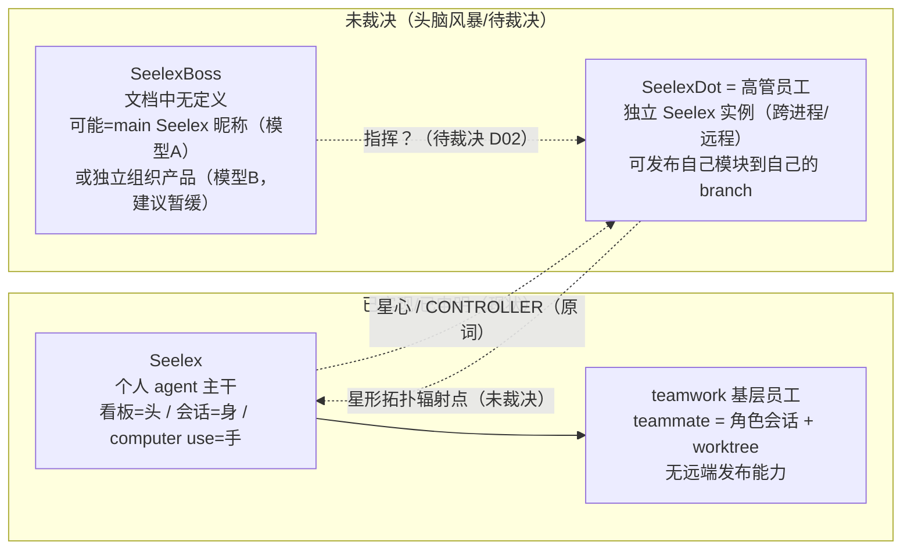

# Seelex 产品方向文档梳理（仅文档证据）

日期：2026-10-15
状态：**只读文档梳理。不改代码、不改模块 README、不改正式事实文档。** 第 5 节的删除清单在用户裁决前不执行。
证据口径：本报告**只以仓库内已落盘的文档为依据**，不做运行验证、不做代码调用链核实，不把"规划"读成"现状"、不把"头脑风暴"读成"需求"。凡涉及代码事实的结论，均转引已有审查文档并标注其状态。

上游与相邻材料（同日、不同分工）：

| 材料 | 位置 | 分工 |
|---|---|---|
| 全局审查报告与架构前置设计 | `docs/2026-10-15-product-architecture-pre-design/global-review.md` | 产品方向 + 契约 + 性能 + 迁移门禁；**待裁决** |
| 旧口径与疑似退场能力审查清单 | `docs/2026-10-15-product-architecture-pre-design/legacy-capability-audit.md` | **代码侧** A01–A11 清理清单；只读审查 |
| 性能/可观测性/多二进制草案 | `docs/2026-10-15-perf-observability-and-multi-binary/` | 性能基线与拆分架构；**拟议，未实施** |
| 本报告 | 本文件 | **文档侧**：定位梳理、追踪表、冲突登记、文档治理 |

> 注：上述三个目录在本次梳理开始时均为 git **未跟踪**（`git status` 显示 `??`），即尚未提交。本报告不对它们做任何改动。

---

## 1. Seelex / SeelexDot / SeelexBoss 的定位

### 1.1 Seelex —— 已有产品主干

| 维度 | 文档口径 | 出处 |
|---|---|---|
| 一句话定位 | "Seelex 是一个个人 agent（personal agent）：它长在你自己的电脑上，替你动手，由一块看板管理" | `README.md:3` |
| 形态 | "看板是头、会话是身、computer use 是手" | `README.md:16`；`docs/product/roadmap-2026.md:15-21` |
| 目标用户 | 重视成本、数据主权、可审计执行的**个人开发者**；"技术负责人和研究型用户是使用者身份，不意味着多人共享系统已经成立" | `global-review.md:78`；`roadmap-2026.md:32-47`（P1 成本敏感个人开发者 / P2 数据主权优先的团队技术负责人 / P3 研究型用户） |
| 核心场景 | 个人提交工程任务 → 管理目标与证据 → 执行/审批/恢复会话 → 按需拆分并行工作 | `global-review.md:79` |
| 责任 | 把上游 Seele 引擎、工具、工作区、安全、上下文、持久化和前端装配为**个人 Agent 产品** | `global-review.md:80` |
| 非责任 | 自研模型、重新实现 Seele 引擎、**默认为多人协作平台**、用看板替代执行事实 | `global-review.md:81` |
| 明确不做（v1.0） | IDE 插件、云托管/云端执行环境、自研模型、代码库语义索引（v1.x 再评估）、移动端 | `roadmap-2026.md:82-87` |
| 当前状态 | Developer Alpha；TUI 默认入口；GUI 为 Alpha | `README.md:20` |

**teamwork 的口径**（这是理解 Seelex 与"团队"关系的关键，三处表述高度一致）：

> "它是**一个人的 agent**，不是团队协作的工作台：teamwork（leader + 异步 worker、里程碑屏障、一个工作项 = 一条会话 + 一个 worktree）在这里是'一个人把一件事拆开并行做'的手段，而不是多人共享一块板的协同形态。" —— `README.md:18`

> "**不是团队协作的工作台**：多人共享一块板、跨人认领抢活、远程协同编辑都不是 Seelex 的定位。teamwork……属'身'内部的一种执行方式，**不是产品形态**。" —— `roadmap-2026.md:23`

> "产品定位 | personal agent；**teamwork 是个人任务并行方式** | …… | 不是多人共享工作台" —— `global-review.md:45`

### 1.2 SeelexDot —— 未裁决的"高管执行节点"方向

**这是本次梳理中最容易被误读的一块，逐条按原文钉死：**

| 问题 | 文档事实 | 出处 |
|---|---|---|
| 出处 | 2026-10-13 一次**头脑风暴记录**，状态自标"**头脑风暴，未裁决，未改代码**"；"任何一条在拍板前都不构成待办" | `docs/2026-10-13-seelex-dot-a2a-star-topology/README.md:3,8` |
| 用户原词 | `seelexdot` / `seelexrole` / `seelexmcp` / `main seelex` / **`高管员工`** / `基层员工` | 同上 `:14` |
| 原话要求（8 条） | ①Dot 的 A2A 走 MCP，跨进程乃至远程；②拓扑做成**星形**；③每个员工分发一个邮箱 + 一个 GitHub 账号；④`SeelexRole` 为**高管员工**时可在自己的 branch 发布自己模块的内容；⑤**`SeelexDot` 只能是高管员工**；⑥真正的基层员工在 `$teamwork` 下面；⑦基层员工只能持有 worktree，**不能持有远端 branch 发布能力**；⑧权限管理从"分层"改成"**装配**" | 同上 `:16-24` |
| 作者读法（**非用户原话，记录本身要求确认**） | "**高层 = SeelexDot = 高管员工**：一个独立的 Seelex 实例（跨进程/远程），**能对外产生产物**（发布自己模块到自己的 branch）；它是星形拓扑的一个**辐射点**，main Seelex 是**星心**" | 同上 `:33,51-52` |
| 写权分层 | `worktree（基层）` → `自己的 branch（高管）` → `main（main Seelex）` | 同上 `:59` |
| 代码实现 | **零命中**。全仓 `*.go` 中 `seelexdot` / `seelexboss` / `高管员工` 均无命中 | 检索结论；`global-review.md:12` 同判 |

**与现状的咬合点**（记录自己标注的，均属"已是现状"或"最干净落点"）：

- teammate = 角色会话 + git worktree（`seelebridge/worktree/**`），作业作用域 `{Session: 主会话, Subject: emp_<role>}` —— 记录标注"**已是现状**，这条是保持不动"（`:74`）。
- 员工执行面可替换：`roleEngine`（6 方法）+ `Runtime.SetRoleEngineFactory`，记录称其为"**远端高管节点最干净的落点**"（`:78`）。
- 权限现状：`emp_ro` / `emp_rw` 存在，`GroupRWDesktop` 字段整块不存在，`GroupCTL`/`GroupADM` 位为 0（`:75`）。
- **MCP 只有客户端**：记录明言"Seelex 自己的包**没有任何 server**"（`:72`）。
- 该记录**自降级**：不进 `docs/arch/`，"在拍板前它只是头脑风暴"（`:134-135`）；对应的 `docs/arch/seelex-dot-a2a-star-topology.md` **至今不存在**——即该概念从未升级为架构事实。

### 1.3 SeelexBoss —— 名称与职责均未被定义

**必须明确说清的三点：**

1. **`seelexboss` 这个词在仓库任何文档中都没有被定义过。** 已读取的产品材料用的是 **`main Seelex`**（星心 / CONTROLLER）。`global-review.md:99` 自己声明："本轮 docs Markdown 限定检索未返回 `seelexboss` 的定义；**这不是全仓不存在证明**。不能认定 Boss 是已实现产品、独立二进制，或其职责必然等于星心。"
2. **"seelexboss 指挥 seelexdot" 这句话不是用户原话。** 它只出现在 `global-review.md` 的表格行名（`:123`）与执行摘要（`:12`），是审查作者为组织问题而用的表述。用户原词列表里**只有 `main seelex`，没有 boss**。
3. 审查给出两个候选模型，并**建议按模型 A 讨论**：

> **模型 A（建议优先讨论）**：Seelex 是个人产品；Boss 是其中 controller 的昵称；Dot 是可选执行实例。同一套产品底座，不新增三套状态机。
> **模型 B**：Seelex 是共享底座与个人端；Boss 是独立组织控制产品；Dot 是授权执行产品。必须另行定义组织身份、多租户、所有权、审计与凭据管理，明显扩大范围，**建议暂缓**。
> —— `global-review.md:103-104`

### 1.4 三者关系（按文档口径复现，非补全）

### 1.5 三个易错点（务必以此为准）

| 常见误读 | 事实 |
|---|---|
| "seelexdot 高级员工" | 用户原词是"**高管**员工"。`global-review.md:92` 明确："'高级员工'不是本轮核实到的正式等级定义。"待裁决项 D04 仍在问"'高管／高级员工'精确指什么"。 |
| "seelexboss 指挥 seelexdot" | Boss 未被定义；用户原词只有 `main Seelex`。"Boss 指挥 Dot"是审查作者的表述。D02 待裁决。 |
| "Dot 是已实现能力" | 零代码实现、零架构文档；记录自标"头脑风暴，未裁决，未改代码"。`global-review.md:84` 标题即"**未裁决的高管执行节点方向**"。 |

---

## 2. 产品能力 → 实现模块 → 依赖文件（追踪表）

口径：**"已实现"以根 README 能力表与模块 README 为准；"未实现"以审查文档自标状态为准。** 依赖文件给出的是文档层面的入口与证据位置，不是完整调用链。

| 产品能力 | 实现模块（所有者） | 依赖文件 / 证据入口 | 状态 | 未实现或未核实的依赖 |
|---|---|---|---|---|
| 个人任务提交与运行 | Application 用例 + seelebridge + Seele | `README.md:180-207`（端到端时序）；`application/contract/ports.go:36-109` | 已实现 | 主入口与 Submit 完整调用链未核实（`global-review.md:111`） |
| 看板 / 目标 / 工作证据 | Application 读投影；执行事实来自 Runtime/Store | `README.md:16,64-65`；`ports.go:163-188,271-294`；`seelebridge/README.md:74-75`；`docs/arch/seelex-project-board.md` | 看板：M1–M7 已落地；目标治理：已实现 | 项目看板持久化与独立读协议待查 |
| 会话作用域与恢复 | application / session / workspace / sessionstore | `AGENTS.md:14`；`sessionstore/README.md:84-91`；`ports.go:90-109,240-250` | 已实现（JSON v8） | 显式 scope 的生产覆盖率、恢复幂等需验证 |
| 工具与审批 | seelebridge tools/security；Seele 执行门 | `seelebridge/README.md:145-163,196-212`；`docs/arch/agent-permission-subjects.md` | 已实现 | fail-closed、全权切换与员工凭据边界待查测试 |
| 并行 subagent | seelebridge plan/node/fork/session | `README.md:26,63`；`ports.go:61-84,251-256`；`docs/arch/subagent-visibility-design.md` | 已实现 | 节点生命周期/冷恢复/worktree 隔离需闭环验证 |
| teamwork 工作单元 | seelebridge teamwork/workunit + 角色执行 + Store | `seelebridge/README.md:70,77-93`；`ports.go:277-294`；`docs/arch/teamwork-leader-worker-architecture.md` | 已实现（**不等于旧 Agent Team 工厂**） | tool→records→恢复待完整核实；M4 清场"待做" |
| 后台 Tool/Job | seelebridge tools；Seele 作业原语 | `README.md:66`；`ports.go:172-188` | 已实现 | 持久命令受理/重启恢复不应据此宣称支持 |
| 上下文可逆治理 | seelexctx + Bridge context + Store | `README.md:67-68`；`seelebridge/README.md:176-192`；`docs/arch/context-prefix-chain.md` | 已实现 | 当前预算估算/压缩/恢复基线待测 |
| Plugin / Skill / MCP | plugin / skill + Bridge managers | `AGENTS.md:13`；`seelebridge/README.md:117-118,150-151`；`plugins/README.md` | 已实现 | **服务端暴露**（Seelex 自身无 MCP server）、远程授权待查 |
| 行动面与媒体（computer use） | Bridge computer/image + Store media | `README.md:72-73`；`seelebridge/README.md:66-67`；`seelebridge/tools/computer/README.md` | 已实现（平台门控） | 桌面租约、媒体引用授权/GC、跨进程取消待定义 |
| 模型路由 / 账号池 | Seele accountpool + Bridge account | `go.mod`（Seele v0.3.4）；`seelebridge/README.md:7-11,142-144` | 已实现 | 确切 API/租约与 failover 语义待读上游源码 |
| **Dot 星形 A2A** | 产品扩展 + 传输 adapter，**尚非实现事实** | `docs/2026-10-13-seelex-dot-a2a-star-topology/README.md:12-29,82-125` | **未裁决 / 未实现** | 身份、能力装配、发布范围、MCP server、持久受理、远端故障恢复 |
| **Boss 指挥 Dot** | 产品模型待裁决 | 已读材料只有 `main Seelex` 星心读法 | **未定义** | 名称、组织边界、控制权、Dot 数量关系均未定 |
| 远程 agent 节点（L0–L2） | 评估完成、未实施 | `docs/arch/remote-agent-node-feasibility.md`（状态"评估 + 提案。本文未改代码"） | **评估完成 / 未实现** | Seelex 包内无网络服务端（`net.Listen` 零命中） |
| Alpha → Beta 收口 | 产品验收 + 跨平台发布工程 | `README.md:20`；`roadmap-2026.md:93-109`；`AGENTS.md:85-98` | **进行中** | 当前 CI/Release、真实用户任务基线未验证 |

配置层面仅登记 `config/accounts.example.yaml` 为路由示例核实目标；Dot 记录提及的 MCP 示例配置**未读其内容，不把 transport 字段当已确认配置契约**。

---

## 3. 冲突、重复、过时与悬而未决

### 3.1 事实口径冲突（已被 `global-review.md:53-67` 登记，此处按文档视角复述）

| ID | 冲突 | 判定 | 处置建议 |
|---|---|---|---|
| F01 | 根 `README.md:65,148-149` 仍把 **TeamSpec 团队工厂**列为已实现，而 `application/core/agentteam_runtime.go:1-17` 注明旧 Agent Team 用户面 **2026-10-12 已退场** | 已核实口径不一致 | 把"旧 Agent Team / 现行 teamwork / 角色执行 / subagent"分开登记 |
| F02 | `roadmap-2026.md:75` 把**多后端持久化（SQLite/Postgres/Redis/JSON）勾为已实现**，而 `sessionstore/README.md:37-39,142-174` 指向仅 JSON v8、其余显式退役 | 已核实 | 撤掉现状承诺，保留退役错误说明 |
| F03 | `roadmap-2026.md:23` 排除多人共享，但 `:113,126` 仍保留"团队协作/企业版/云端服务"方向 | 已核实（`:126` 有 2026-10-11 重评注记） | 区分主干/实验扩展/未来候选 |
| F04 | contract README 声称"EngineMessage 阻止 Seele 类型穿透"，`ports.go:7,60,63,98` 仍引用 Seele | 已核实为**局部隔离** | 提纯真实需要的消息契约 |
| F05 | `ports.go:53-59` 的锁警告按旧 Session 全程持锁解释，同文件 `:111-116` 说明已改闸门+检查点 | **注释冲突** | 更新约束与测试 |
| F09 | "多会话独立项目根"叙事与 Bridge 部分默认根回退并存 | 高风险待核实 | 不把 README 注记直接当当前漏洞 |
| F10 | Dot 记录把"任意 JSON transport"称为基线 | 不代表已有可靠远程协议 | 需补 transport binding、授权、重试、取消与耐久语义 |

### 3.2 定位冲突（**需用户裁决，本次梳理的重点**）

| ID | 冲突 | 文档事实 | 我的提问 |
|---|---|---|---|
| P1 | **个人 agent 主干 vs 组织化工作叙事** | `README.md:3,16-18`、`roadmap-2026.md:11,13,23`、`global-review.md:11,45` 三处口径**完全一致**指向"个人"；但 `roadmap-2026.md:113` 阶段 3 仍写"团队协作（共享会话/计划/审计）；企业版（SSO/审计报告/私有化部署包）"，`global-review.md:104` 的模型 B 是"独立组织控制产品" | 见 §4.1 Q1 |
| P2 | **远程协作的归属** | `remote-agent-node-feasibility.md` 标题即"personal Agent 的员工节点"，`:15` 写"把一个远端机器当员工节点用"；而 Dot 记录的"邮箱 + GitHub 账号 + 独立实例"已是准组织形态 | 见 §4.1 Q2 |
| P3 | **`README.md` 用例图保留"团队负责人" actor** | `README.md:141,148,161-164` 有 `LEAD(("团队负责人"))` 与 UC5"登记员工与团队，召唤团队协作"，与同文 `:18`"不是团队协作的工作台"并存 | 措辞易误读，是否改写？ |
| P4 | **Dot 与 Role 的数量关系** | 用户原词把 `SeelexRole` 与 `SeelexDot` 分开列，作者读法把二者绑定；记录自陈"需要把关系钉死"（`:86-90`） | 见 §4.1 Q3 |

### 3.3 过时与重复（文档治理视角，本次新发现）

| ID | 对象 | 事实 | 分类 |
|---|---|---|---|
| G1 | `docs/research/2026-09-11-seelex-thesis-proposal.md`（v1）、`2026-09-13-seelex-thesis-proposal-v2.md`（v2） | v2 头部明写"本版为其修订与扩展"并指出**前版三处参数与代码不一致**；v3 头部明写"本版为其修订与扩展，结论以 v2 为基线"。v1/v2 均无保留价值声明 | 被取代 |
| G2 | `docs/2026-10-13-seelex-project-board/plan.md` | 头部写"状态：**设计方案（尚未实现）**"，但 `docs/arch/seelex-project-board.md`（2026-10-15）第 9 节记 M0–M7 **全部已落地**并附代码/测试证据 | 状态失真（与现状相反） |
| G3 | `docs/feature-instrumentation.md` | 标题"Seelex **当前**能力与质量基线"，核对日期 **2026-08-03**；正文仍把"JSON、SQLite、PostgreSQL、Redis 会话存储适配"列为核心能力——与 F02 冲突，且被 `global-review.md:58` 点名 | 过时（自称"当前"） |
| G4 | `docs/arch/architecture-and-flaws.md` | 头部"版本 v1.0 / 创建日期 2025-07-18 / **状态: 初稿**"；正文写"Seelex 是 Seele 引擎的 **TUI 客户端**"、"Go 1.22+"——与现行"个人 Agent 产品 + Wails GUI"不符；状态至今未刷新 | 过时（初稿） |
| G5 | `docs/plan/`（5 文件） | 均为 2026-08-02/03 的规划；`cli-memory.md`/`memory-architecture.md` 规划的 `read_memory` 等工具**代码零实现**；`subagent-detail-architecture.md` 与 `docs/arch/subagent-visibility-design.md` 主题重复 | 未落地 / 重复 |
| G6 | `docs/account-pool-roles.md` | "号池角色分组方案 v3 / 状态：讨论稿 / 日期：2026-07-26"，三个月无下文，`docs/arch/` 无接手 | 搁置讨论稿 |
| G7 | `docs/code-review-059cb14.md` | 审查对象为 `sqlRepository.ReadRange`、`redisRepository.ReadRange` 等，而这些后端**已退役** | 针对已退场代码 |
| G8 | `docs/self_judgement.md` | 无日期、无主题名的 Agent 一次性自省（含 CRLF 幻影脏检查根因等**真实教训**） | 位置不规范；**建议归档而非删除** |
| G9 | `fk1-docs-arch-summaries.md`（仓库根） | 子代理一次性产物，只总结了 2 个 arch 文档，且描述针对旧版 seele-v2；违反"禁止仓库根散落临时文档" | 无独立价值 |
| G10 | `docs/tool_concurrency_design.md` + `tool_calling_step0_contracts.md` + `subprocess_contract_testcases.md` | 同一设计族；`tool_concurrency_design.md` 状态写"**待评审**"，但同族文档记 P0/P1 **已于 2026-09-26 落地**；三份散落 docs/ 根 | 状态失真 + 位置不规范 |
| G11 | `docs/design/`、`docs/plan/`、`docs/blog/`、`docs/linux-vm-demo/` | 四个非规范目录。其中 `linux-vm-demo/`（含 Linux X11 实测结论与 `make build-linux-gui` 操作手册）**内容仍有效**；`design/qoder-skin/` 是现行皮肤设计语言；`design/teamwork-dag/` 已被 `teamwork-gantt/` 取代但 README 声明保留作前后对比 | 位置不规范（内容多为有效） |
| G12 | `docs/README.md` 索引 | "📊 **根目录**"栏目收录的 `feature-instrumentation.md` 实际在 **docs/ 根**（栏目名错误）；`roadmap-2026.md` **未被索引**；`docs/design/`、`docs/plan/`、`docs/blog/`、`docs/linux-vm-demo/` 四目录完全未出现 | 索引失配 |
| G13 | `docs/arch/README.md` / `docs/research/README.md` / `docs/product/README.md` | arch 索引漏收 10 篇现存文件（如 `effort-system-design.md`、`plan-executor.md`、`state-machine-inventory.md`）；research 索引漏收 16 篇；product 索引**完全不存在**（`pmstory.md`/`roadmap-2026.md` 均未登记） | 索引失配 |
| G14 | `docs/devlog/` | 180 个文件；`devlog/README.md` 自述"按时间沉淀……用于追溯'当时为什么这样改'"，与规范一致，**整体应保留**。仅 8 个早期文件无日期前缀（`code-changes.md`、`test-report.md`、`finish-review.md`、`CODE_EVALUATION_REPORT.md`、`README-dev.md`、`freecad-mcp-test-report.md` 等） | 保留；低优先级重命名 |

### 3.4 悬而未决的决策（转引 `global-review.md:598-613`，此处只列与产品方向相关的）

| ID | 问题 | 审查建议 |
|---|---|---|
| D01 | 是否把 personal agent 定为近期唯一产品主线？ | 是；多人共享/组织控制产品暂不纳入 |
| D02 | `seelexboss` 是 `main Seelex` controller 的昵称，还是独立产品？ | 先按模型 A 讨论，不建新产品和二进制 |
| D03 | 一个 Dot 对应一个 Role、多个 Role，还是整个 Seelex 实例？星心是否算 Dot？ | 需要原意确认；**不自行补全** |
| D04 | "高管／高级员工""自己的模块""发布"分别精确指什么？ | 沿用已记录"高管"；模块/发布定义后才设计授权 |
| D05 | 邮箱是身份、人工通知还是耐久 A2A transport？ | 初阶段只讨论身份/通知，不默认任务队列 |
| D06 | Dot 远程协作仍是个人管理的执行扩展，还是多人组织系统？ | 前者作为候选；后者单独 PRD，不塞主干 |
| D07 | 能力未装配意味着拒绝还是可审批临时提权？桌面共享如何互斥？ | 默认拒绝；显式审批须有期限/scope |
| D08 | 是否接受"混合架构 + 先一个执行 worker"，而非整体 Runtime 服务化？ | 是，但 M2 证据决定是否实际拆 |
| D11 | 哪些旧入口/字段可退场、历史格式保留到什么边界？ | 按 L 清单逐项确认 |
| D12 | Alpha/Beta 验收优先哪些真实任务、安全和恢复指标？ | 个人任务闭环、可解释错误、取消/恢复、跨平台安装 |

---

## 4. 方向建议

### 4.1 需要你裁决的问题（先答这几个，后面才好排）

**Q1（定位收口）**：是否确认 **"一个人的本地个人 Agent"是近期唯一产品主线**，并**冻结**"多人共享/组织控制/企业版"叙事？
- 现状：`roadmap-2026.md:113` 阶段 3 与 `:126` 付费点 3 仍保留"团队协作/企业版"；`:126` 已有 2026-10-11 的重评注记但未裁决。
- 我的建议：确认主线，把阶段 3 的团队/企业/云三条**降级为"待重新评估的远期候选"**，不写进当前能力表，也不作为 Beta 门禁。

**Q2（远程协作归属）**：Dot/远程节点是**个人管理的执行扩展**，还是**多人组织系统的雏形**？
- 若选前者（审查建议）：Dot 仅作为"个人 agent 的可选执行实例"，与 `remote-agent-node-feasibility.md` 的"员工节点"口径一致，主干不变。
- 若选后者：必须另起独立 PRD，定义组织身份/多租户/所有权/审计/凭据管理——这会显著扩大范围。

**Q3（Dot ↔ Role 关系）**：一个 Dot = 一个 Role、多个 Role，还是整个 Seelex 实例？星心本身算不算 Dot？
- 这条**只能由你确认原意**，文档里明确写着"不自行补全"（`global-review.md:604`）。

**Q4（Boss 是否独立产品）**：`seelexboss` 是否就是 `main Seelex`（controller）的产品昵称？
- 若是：无需新增产品与二进制，只需在文档里统一称谓（把 `main Seelex` 与 `seelexboss` 收敛成一个词）。
- 若否：需要新的组织契约，属模型 B，建议暂缓。

**Q5（`README.md` 用例图）**：`README.md:141` 的 "团队负责人" actor 与 UC5"登记员工与团队，召唤团队协作"是否改写为个人视角（如"用户与 AI 团队"）？当前措辞与 `:18` 的"不是团队协作的工作台"容易被读成矛盾。

### 4.2 保留 / 冻结 / 推迟

| 阶段 | 保留 | 冻结或推迟 | 与 Alpha/Beta 收口的关系 |
|---|---|---|---|
| **近期**（Alpha→Beta，2026 Q4） | 单人任务闭环、显式 scope、恢复、审批、上下文治理、证据与限额；看板（已落地的 M1–M7） | 新团队用户面、Boss 产品化、远程发布、必需 broker、多后端持久化承诺 | **先做事实与安全收口**：F01/F02 的 README 口径漂移必须先修，否则 Beta 对外承诺失真；用已有核心场景验收，不为重构增加入口 |
| **下一阶段**（Beta 后） | 契约提纯（M1）、单进程基准（M2）、一个执行 worker 纵向实验（M3） | 整体 Runtime 服务化、组织账号系统、混合存储改写 | 拆分成功**不降低**现有任务/取消/恢复体验；不是 Beta 标签的前提 |
| **长期**（待裁决） | 经验证的 Dot 执行扩展、成熟传输替换、按需独立重启 | 多人共享、企业控制面、云执行——**先单独裁决** | 不把长期愿景写进当前能力表；新增产品必须有独立责任与验收 |

**同时建议冻结的三类文档动作**：
1. **冻结新的团队产品叙事**（`global-review.md:11` 原话），直到 Q1/Q2 裁决。
2. **冻结"多后端持久化已实现"的口径**（F02）——只保留退役错误与历史说明。
3. **冻结把规划写进能力表**的做法：`roadmap-2026.md` 的阶段 2/3 内容应显式标注"规划，未实现"。

### 4.3 与当前 Alpha/Beta 收口工作的关系（一句话）

**本次梳理不改任何实现路径**：它给 Alpha/Beta 收口提供的是**"对外口径的准确性"**——把 F01/F02/F03 三处 README/roadmap 漂移修掉、把 Dot/Boss 从"看起来像产品"降回"未裁决方向"，Beta 的对外承诺才站得住；其余方向建议均在 Beta 之后。

---

## 5. 文档治理清单（**已裁决并执行，见第 6 节**）

### 5.1 A 档：建议删除（有明确取代关系或针对已退场能力）

| # | 路径 | 理由 | git 状态 |
|---|---|---|---|
| 1 | `docs/research/2026-09-11-seelex-thesis-proposal.md` | v1，被 v2/v3 明确取代，且参数已被更正 | 已跟踪（可恢复） |
| 2 | `docs/research/2026-09-13-seelex-thesis-proposal-v2.md` | v2，被 v3 明确取代，修订说明已被 v3 继承 | 已跟踪（可恢复） |
| 3 | `docs/code-review-059cb14.md` | 审查对象（sql/redis 后端）已退役 | 已跟踪（可恢复） |
| 4 | `docs/feature-instrumentation.md` | 自称"当前能力基线"但冻结于 2026-08-03，含已退役能力 | 已跟踪（可恢复）；**根 README:780 与 docs/README 有链接，需同步改** |
| 5 | `docs/account-pool-roles.md` | 2026-07-26 讨论稿，无下文、无接手 | 已跟踪（可恢复） |
| 6 | `fk1-docs-arch-summaries.md`（仓库根） | 子代理一次性产物，内容过时，违反根目录规范 | 已跟踪（可恢复） |
| 7 | `docs/plan/` 全 5 文件 | 2026-08 规划，未落地或与 `docs/arch/` 重复 | 已跟踪（可恢复） |
| 8 | `docs/arch/architecture-and-flaws.md` | "初稿"未刷新，产品定义（TUI 客户端）已过时 | 已跟踪（可恢复）；**docs/README 有链接，需同步改** |

### 5.2 B 档：建议归档/迁移（内容保留，修位置或状态）

| 对象 | 动作 |
|---|---|
| `docs/2026-10-13-seelex-project-board/` | 已被 `docs/arch/seelex-project-board.md` 取代；建议**在 `plan.md` 头部加"已实现，见 arch 版"指针**（不删，保留设计动机） |
| `docs/tool_concurrency_design.md` + `tool_calling_step0_contracts.md` + `subprocess_contract_testcases.md` | 迁入 `docs/arch/`（或建 `docs/2026-09-26-subprocess-contract/`），状态改为"P0/P1 已落地，P2 未开工" |
| `docs/self_judgement.md` | 迁入 `docs/devlog/2026-08-11-agent-self-review.md`（含真实教训，**不建议删**） |
| docs/ 根 6 个日期前缀散文件（2026-07-23×4、2026-07-24×1、2026-09-29×1） | 各建同名 `YYYY-MM-DD-topic/` 目录迁入 |
| `docs/blog/` → `docs/2026-08-07-technical-blog/`；`docs/linux-vm-demo/` → `docs/2026-09-25-linux-vm-demo/` | 目录改名以符合规范（内容有效） |
| `docs/design/` → `docs/gui/design/` | 归并到 GUI 设计目录（`teamwork-dag/` 可留作对比） |
| `docs/devlog/` 8 个无日期文件 | 补日期前缀（低优先级） |

### 5.3 C 档：建议保留（明确不动）

`docs/research/2026-09-14-seelex-thesis-proposal-v3.md`（开题现行版）· `docs/research/` 的 harness 对比 4 篇 · 缓存命中率证据链 3 篇 · `docs/2026-10-15-product-architecture-pre-design/`（2 篇，待裁决）· `docs/2026-10-15-perf-observability-and-multi-binary/` · `docs/devlog/` 全部 · `docs/arch/ARCHITECTURE_REVIEW.md`（自带"历史评审"声明）· 根 `DESIGN.md`（自带迁移声明）· `docs/design/qoder-skin/`、`teamwork-gantt/` · `docs/linux-vm-demo/`（内容）

### 5.4 D 档：索引修复（不删文件）

1. `docs/README.md`：修正"📊 根目录"栏目名；补 `product/roadmap-2026.md`；按 5.1/5.2 结果同步链接。
2. `docs/arch/README.md`：补 10 篇未收录文件。
3. `docs/research/README.md`：补 16 篇未收录文件。
4. `docs/product/README.md`：建立文档索引（当前完全没有）。
5. 根 `README.md:780`：若删除 `feature-instrumentation.md`，同步移除该链接。

---

## 6. 治理执行记录（2026-10-15，已执行）

用户裁决：**A 档 + B 档全量，`git rm` 直接删除**。以下为实际执行结果。

### 7.1 已删除（A 档，12 个文件，均在 git 历史中可恢复）

`docs/research/2026-09-11-seelex-thesis-proposal.md` · `docs/research/2026-09-13-seelex-thesis-proposal-v2.md` ·
`docs/code-review-059cb14.md` · `docs/feature-instrumentation.md` · `docs/account-pool-roles.md` ·
`fk1-docs-arch-summaries.md`（仓库根）· `docs/plan/`（5 文件，目录已空并移除）· `docs/arch/architecture-and-flaws.md`

### 7.2 已归档迁移（B 档）

| 原位置 | 新位置 |
|---|---|
| `docs/tool_concurrency_design.md`、`docs/tool_calling_step0_contracts.md`、`docs/subprocess_contract_testcases.md` | `docs/2026-09-26-subprocess-contract/`（+ 新增 `README.md` 索引；三份文档状态改为"P0/P1 已落地，P2 未开工"） |
| `docs/self_judgement.md` | `docs/devlog/2026-08-11-agent-self-review.md`（补标题与日期） |
| `docs/blog/seelex-technical-blog-2026.md` | `docs/2026-08-07-technical-blog/README.md`（`docs/blog/` 目录已移除） |
| `docs/linux-vm-demo/` | `docs/2026-09-25-linux-vm-demo/` |
| `docs/design/` | `docs/gui/design/`（qoder-skin / teamwork-dag / teamwork-gantt） |
| 6 个日期前缀散文件 | 各自建同名 `YYYY-MM-DD-topic/` 目录（其中 `2026-07-24-gui-documentation-architecture-review-front-review.md` 并入已存在的同名目录为 `front-review.md`） |
| `docs/2026-10-13-seelex-project-board/plan.md`、`plan-review.md` | 原地保留，**状态头已改为"已实现"并链接 `docs/arch/seelex-project-board.md`** |

### 7.3 同步修正的引用（删除/移动后不留失效链接）

- 索引：`README.md`（移除 feature-instrumentation 链接）、`docs/README.md`（移除 2 个已删条目、**合并重复的「🔬 调研报告」段**、补 `product/roadmap-2026.md` 与 9 个新条目、补 GUI 设计目录）、`docs/arch/README.md`（补 10 篇）、`docs/research/README.md`（补 14 篇）、`docs/product/README.md`（**新建索引**，此前为空）。
- 活文档引用：`docs/research/2026-09-14-seelex-thesis-proposal-v3.md`（6 处）、`docs/arch/seele-v2-runtime-architecture.md`、`docs/arch/effort-system-design.md`、`docs/product/pmstory.md`（4 处）、`docs/2026-08-07-technical-blog/README.md`、`docs/research/2026-09-11-deepseek-v4.1-flash-naming-and-deployment.md`、`docs/2026-08-01-seele-v2-underlying-refactor/plan.md`、`docs/2026-08-03-subagent-fork-architecture/plan.md`（2 处）、`docs/2026-08-06-agent-landscape-research/research-agent-landscape-2026-08.md`（4 处）、`seelebridge/tools/README.md`、`seelebridge/tools/computer/README.md`（2 处）、`docs/arch/remote-agent-node-feasibility.md`（5 处）、`gui/frontend/README.md`（2 处）、`gui/frontend/dist/themes/README.md`。
- 代码注释：`seelebridge/fs/filesystem_actor.go`、`seelebridge/tools/router.go`、`seelebridge/tools/subprocess_contract_test.go`、`seelebridge/worktree/worktree_manager.go`、`seelebridge/worktree/worktree_dirty_judgment_test.go`、`seelexctx/memory/memory.go`、`seelexctx/memory/README.md`。

### 7.4 验证

| 检查 | 结果 |
|---|---|
| 索引链接可达性（docs/README、arch/README、research/README、product/README） | 全部可达 |
| `go test ./e2e/ -count=1`（含 `TestGUIDocumentLinks`、`TestModuleReadmesMermaidBlocksAreStructurallyValid`、`TestRepositoryModuleReadmeLinks`） | ok |
| `go test . -run 'Catalog\|Layout\|BrandLogo\|LegacyBuild'` | ok |
| `go vet` 受影响 4 个包 | 通过 |
| `go build ./...` | 通过 |
| 改动过的 3 个 Go 文件 `gofmt -l` | 干净（gofmt 报出的其它文件为改动前既有状态） |

### 7.5 未执行 / 遗留

1. **devlog 6 个无日期文件改名**（`code-changes.md`、`finish-report`、`test-report.md`、`CODE_EVALUATION_REPORT.md`、`README-dev.md`、`freecad-mcp-test-report.md`）：纯命名规范、零内容风险但收益低，且 `docs/README.md` 有索引行，**暂缓**；如需执行请告知。
2. **`docs/2026-09-13-seele-multimodal-interaction/plan.md:12,466` 引用 `docs/plan/07-v05-roadmap-gap-analysis.md`**：该文件在本仓库**从未存在**（`docs/plan/` 只有那 5 个文件），属**改动前既有**的失效引用，非本次治理造成；因无法确定原目标，未擅自改写，留待该工作包维护者处理。
3. `CHANGELOG.md`、`docs/devlog/**`、`stage/**`、`dist/**` 中的历史路径引用**刻意未改**：它们记录"当时改了什么"，按 devlog 约定以代码与现行文档为准。
4. 本次治理**未 commit**（按 AGENTS.md §7，除非明确要求不自动提交）。

## 7. 证据索引

| 主题 | 文档 |
|---|---|
| 产品定位（个人 agent） | `README.md:3,16-20`；`README_EN.md:3`；`docs/product/roadmap-2026.md:11,13,15-23,32-47`；`docs/product/pmstory.md:14` |
| SeelexDot / 高管员工 | `docs/2026-10-13-seelex-dot-a2a-star-topology/README.md:3,8,12-29,33,51-59,74-78,86-90,134-135`；`design-permission-capability-assembly.md:3,29-32` |
| SeelexBoss / 模型 A·B | `docs/2026-10-15-product-architecture-pre-design/global-review.md:12,92-105,123,372-373,603-605` |
| 冲突登记 F01–F10 | `global-review.md:53-67` |
| 待裁决 D01–D12 | `global-review.md:598-613` |
| 能力→模块→文件 | `global-review.md:107-126`；`README.md:60-83` |
| 远程 agent 节点 | `docs/arch/remote-agent-node-feasibility.md:1,3,15-18,86,121-146,221-235` |
| 项目看板（已落地） | `docs/arch/seelex-project-board.md`（M0–M7）；`docs/2026-10-13-seelex-project-board/plan.md:3`（旧状态） |
| teamwork 架构 | `docs/arch/teamwork-leader-worker-architecture.md:13,461,482,532-546` |
| 旧能力代码侧审查 | `docs/2026-10-15-product-architecture-pre-design/legacy-capability-audit.md`（A01–A11） |
