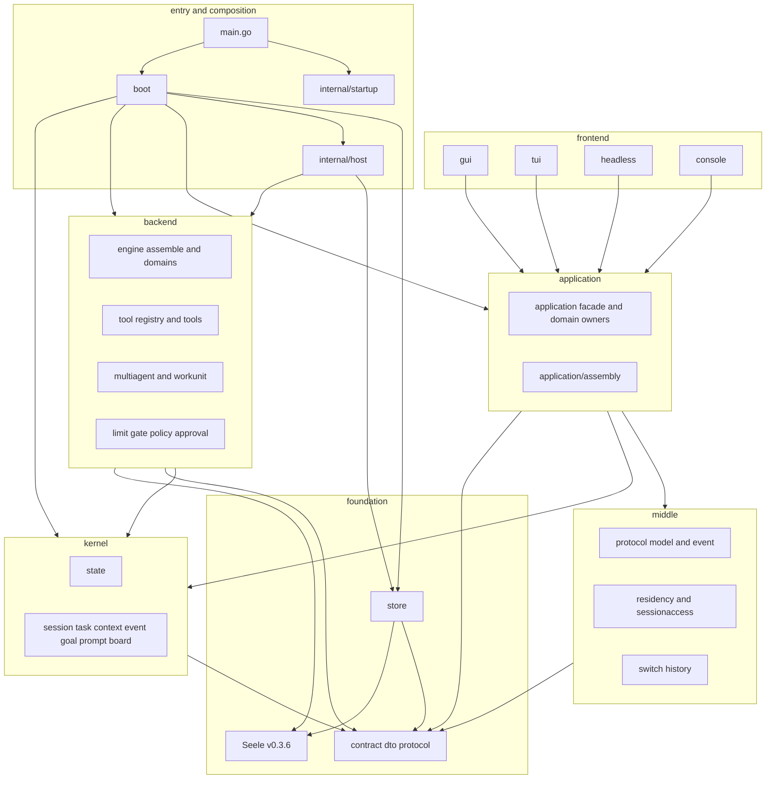
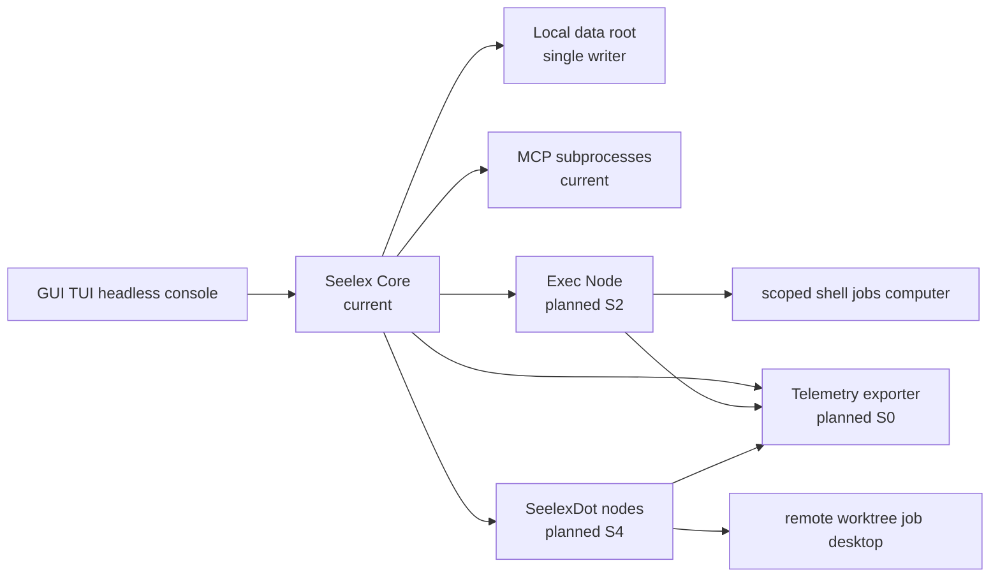

# 2026-10-28 当前架构与服务边界

> 状态：当前代码描述 + 目标边界提案。图中凡标 `planned` 的进程/端口尚未实现。

## 1. 当前分层



当前依赖方向的主体是
`frontend → application → kernel/middle/contract` 与
`composition root → application/backend/kernel/store`。
`application/**` 的直接 Backend/Middle/Store 依赖由结构预算压到零；
`internal/host` 负责把消费方端口接到具体实现。

## 2. 入口与组合根

当前启动链：

```text
main.go
  -> internal/startup.BindFlags
  -> flag.Parse
  -> pprof build hook / version
  -> boot.Run
     -> internal/startup mode and path chains
     -> backend/engine/assemble Runtime + store + workspace
     -> internal/host adapters
     -> application/assembly Components
     -> tool/plugin/MCP registration
     -> frontend dependencies
  -> App.Serve
  -> App.Shutdown
```

不变式：

- `main.go` 不拥有装配顺序。
- `boot` 不拥有业务状态机。
- `internal/startup` 不构造 Runtime。
- `internal/host` 不复制业务判据。
- 前端不直接触达 Store/Engine/Permission 实现。

## 3. 权威状态所有权

| 状态 | 唯一 owner | 消费者 | 跨进程策略 |
|---|---|---|---|
| UI Snapshot、revision、订阅 | Application view state / EventHub | GUI、TUI、headless、console | 保持在核心进程；wire 只传 DTO/事件 |
| SessionUnit、聊天/队列状态 | `application/session/state` | Application domains | 不拆 |
| Session/Task/Plan 持久事实 | `store` + `kernel/{session,task}` | Application、host | data root 单写者，不拆 |
| 上下文装配与压缩 | `kernel/context` + seelectx | Application/Engine | 先同进程，后续可评估 worker |
| Engine 会话与在飞回合 | `internal/host.EnginePort` + Seele Runtime | Application | 不整体远程化 |
| Tool Registry 与权限链 | `backend/tool/registry` + `backend/limit` | Engine | 可把执行子集封装为服务 |
| Plugin/Skill 可见性 | `backend/engine/{plugin,skill}` | Engine/Boot | 激活事务必须与工具/MCP 一体回滚 |
| Job/Async 生命周期 | `backend/tool/{registry,jobs}` + `backend/workunit` | Engine、Teamwork | 首个适合外移/远端的执行面 |
| Teamwork/WorkUnit | `backend/multiagent/*` + `backend/workunit` | Application/Engine | 状态留核心，执行可分派 |
| Dot 节点目录、租约、远程作业 | `contract` port；实现待建 | 主实例 | 新增，独立 data root |

## 4. 关键运行流

### 4.1 用户提交与流式回合

```text
frontend
  -> conversation application owner
  -> session state / task checkpoint
  -> kernel context assembly
  -> internal/host.EnginePort
  -> backend/engine/assemble.Runtime
  -> Seele ChatStream
  -> backend/limit permission middleware
  -> backend/tool execution / MCP / async job
  -> transcript + store commit
  -> Snapshot revision + EventHub
  -> frontend reducer
```

性能观测点必须分别落在这七段，不能用单个“回合耗时”掩盖差异。

### 4.2 冷恢复

```text
ResumeSession
  -> pending tail / record / transcript bounded reads
  -> history window assembly
  -> EnginePort pending-history handoff
  -> Task/Plan/Workspace restore
  -> Snapshot baseline + resync event
```

冷恢复的关键约束是 project scope、完整协议单元边界和 watermark；远端执行不得读取或重建
主实例的 session 文件。

### 4.3 Plugin/Skill/MCP 激活

Plugin 切换同时影响工具可见性、Skill 目录和 MCP 状态。事务必须在一个装配边界内成功或
整体回滚，因此近期不拆成独立能力服务。

### 4.4 子代理与团队作业

`fork_subagents` 与 teammate 作业采用“受理即返回句柄”，产出通过
observe/fetch/kill 读取。该形状天然适合进程边界，是后续 `exec-node`/Dot 的协议来源。

## 5. 已知性能敏感面

以下均为当前源码/测试可定位的观测面；除明确标注外，不宣称它们是已量化瓶颈。

| 边界 | 当前事实 | 需要新增的观测 |
|---|---|---|
| 上下文装配 | 每轮装配 system/project/memory/compact/history/plan/task，token 估算与收缩可能重复扫描 | build 次数、输入规模、各阶段耗时、压缩触发原因 |
| Snapshot | 每次读取深拷贝会话、计划、工具、工作表和子代理投影 | clone 字节数、字段规模、p50/p99 |
| 事件发布 | 每事件做载荷序列化，发布锁内遍历订阅者，慢消费者可能回压 | Marshal 耗时、订阅者入队延迟、resync 次数 |
| 流式批次 | 批次有界；满时生产侧自旋让出 | 批次率、PipelineFull 次数、CPU 自旋时长 |
| 工具/Job | 同步工具、异步作业、MCP 子进程共享 Runtime 生命周期 | 排队、执行、取消、退出、进程树回收耗时 |
| Store | message 读已改成 head 快照后锁外解码；提交仍有 head 整份重写与结构性 fsync | commit p99、head bytes、fsync/s、锁等待、rename 重试 |
| MCP trace | 熔断事件当前存在整份 JSON 重写形态 | 重写次数/字节、熔断振荡、trace 上限 |
| 多代理 | 作业扇出、子代理会话/worktree、看板投影并发增长 | 在途数、拒绝率、worktree 创建/合并耗时 |
| 子进程 | Windows Job Object/POSIX 进程组与 WaitDelay | spawn、terminate、残留率、超时 |

### 5.1 本轮实测信号

`go test ./store -run TestCommitNotBlockedByFullHistoryRead -count=3` 在隔离运行中 3/3
通过；首次全量并行运行时同一用例测得“读者造成额外等待 33.3217ms，预算 30ms”而失败。
这说明该门禁对并行负载与调度噪声敏感，也证明需要把 store 锁等待拆成可归因指标：
读锁、写锁、文件共享冲突、rename 重试和 fsync 必须分开观测。

## 6. 目标服务边界



| 候选服务 | 保留在核心的内容 | 外移内容 | 结论 |
|---|---|---|---|
| Core | Application、Session state、EventHub、Snapshot、Store | 无 | 不拆 |
| Exec Node | 会话、授权、汇总 | scoped shell、computer 子集、Job 执行、输出流 | 优先候选 |
| Dot Node | 节点注册、能力声明、租约、审计 | 独立 worktree/Job/Artifact 执行 | 有条件候选 |
| Model Gateway | 回合状态、工具循环 | 可选 Completer/配额/重试代理 | 待测后决定 |
| Store Service | 文件格式与单写者语义 | 目前无 | 不拆 |
| Plugin Service | 激活事务与工具可见性 | 目前无 | 不拆 |
| Observability Service | 采样与 exporter | 指标/span 汇聚 | 旁路服务，不承载控制流 |

## 7. 拆分收益与代价

拆进程只有在以下至少一项成为明确需求时才成立：

1. 工具/浏览器/桌面执行崩溃必须不拖垮会话核心。
2. 执行任务需要 OS 级 CPU、内存、进程或桌面资源限额。
3. 执行节点需要独立升级/重启而不中断会话。
4. 任务必须运行在远端机器或隔离 VM。
5. 单进程 pprof 已证明某执行边界占据了不可接受的 CPU/锁/GC。

每拆一个边界都要支付：wire 版本治理、序列化、租约、重试、幂等、跨进程 trace、部署、
故障对账与安全授权。未满足上述条件时不拆。
