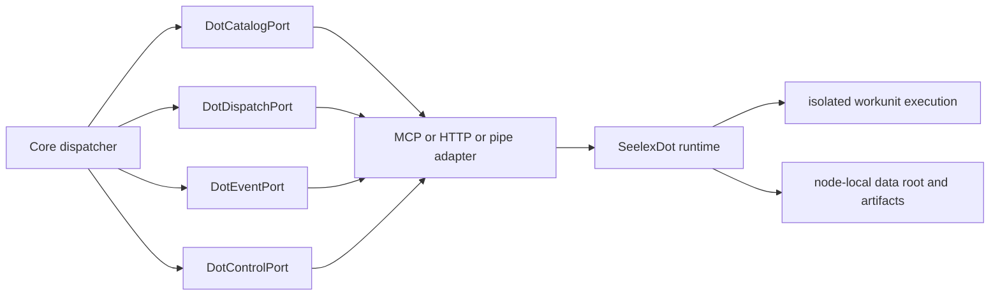

# SeelexDot 接口设计草案

> 状态：`〔提案〕`。仓库当前没有 `seelexdot` 二进制或生产实现；本文不是已实现能力声明。

## 1. 定位

SeelexDot 是主 Seelex 控制实例可以调度的工作节点。一个 Dot：

- 持有自己的进程、操作系统资源和 data root；
- 声明可执行能力，而不是暴露任意内部方法；
- 接收工作分派，以增量事件回传状态与输出；
- 只返回制品引用，不把主实例会话或 Store 当成共享可写目录；
- 能在断线、重启和租约过期后对账。

Seelex 主实例是控制面；Dot 是执行面。两者共享协议身份，不共享运行时对象。

## 2. 接口分层



端口由消费者定义；transport adapter 不拥有业务判定。MCP、HTTP/SSE 或本地 pipe 只映射同一组
DTO 和事件。

## 3. Go 窄端口

以下接口是协议形状草案，具体包落点应在 S1 设计门禁中确定；不建议继续扩大
`contract/ports.go` 成为万能接口。

```go
type DotCatalogPort interface {
	ListNodes(ctx context.Context) ([]DotDescriptor, error)
	GetNode(ctx context.Context, nodeID DotNodeID) (DotDescriptor, error)
}

type DotDispatchPort interface {
	Dispatch(ctx context.Context, request DispatchRequest) (DispatchReceipt, error)
	Cancel(ctx context.Context, request CancelRequest) (CancelReceipt, error)
}

type DotEventPort interface {
	ReadEvents(ctx context.Context, request EventReadRequest) (EventPage, error)
}

type DotLeasePort interface {
	Renew(ctx context.Context, request LeaseRenewRequest) (LeaseRenewReceipt, error)
}

type DotHealthPort interface {
	Health(ctx context.Context, nodeID DotNodeID) (DotHealth, error)
}
```

约束：

- 接口不含 channel、回调或 Seele 具体类型。
- 每个接口只服务一个真实消费者；不得把所有方法重新拼成 `DotPort`。
- 大批量输出不在 JSON 内联，使用 `ArtifactRef` 与有界窗口分页。
- 可选的 artifact fetch 能力独立定义，不塞进 dispatch。

## 4. 核心 DTO

| DTO | 必要字段 | 语义 |
|---|---|---|
| `DotNodeID` | opaque string | 节点稳定身份，不使用 hostname 作为唯一键 |
| `DotDescriptor` | protocol_version、node_version、instance_epoch、capabilities、labels | 节点注册与能力协商 |
| `CapabilityDescriptor` | kind、version、constraints | 例如 scoped_bash/v1、computer/windows/v1 |
| `TraceContext` | traceparent、tracestate | W3C 跨进程关联，不携带业务权限 |
| `Deadline` | RFC3339 time | 命令最终期限，节点侧必须强制执行 |
| `IdempotencyKey` | opaque string | dispatch/cancel/lease 命令去重 |
| `WorkspaceSpec` | workspace_ref、mode、allowed_roots | 不传主实例绝对个人路径 |
| `CredentialLease` | scope、expires_at、opaque_provider_ref | 最小权限，不把长期 secret 写入事件 |
| `ArtifactRef` | scheme、digest、size、media_type、producer | 内容寻址引用 |
| `ExecutionEvent` | protocol_version、message_id、correlation_id、seq、kind、terminal | append-only 状态流 |

## 5. Wire 信封

统一信封：

```json
{
  "protocol_version": "seelex.dot/v1",
  "message_id": "msg_opaque",
  "correlation_id": "job_opaque",
  "causation_id": "optional_opaque",
  "sender": {"kind": "core", "id": "main"},
  "recipient": {"kind": "dot", "id": "dot_opaque"},
  "sent_at": "2026-10-28T00:00:00Z",
  "trace": {
    "traceparent": "00-...-...-01",
    "tracestate": ""
  },
  "kind": "workunit.dispatch",
  "payload": {}
}
```

禁止在信封中放真实凭证、完整工具结果、会话正文或本机绝对路径。

## 6. 消息类型

| `kind` | 方向 | 幂等键 | 终态 |
|---|---|---|---|
| `node.register` | Dot → Core | node_id + instance_epoch | 否 |
| `node.heartbeat` | Dot → Core | instance_epoch + monotonically increasing seq | 否 |
| `workunit.dispatch` | Core → Dot | idempotency_key | 接受/拒绝 |
| `workunit.accepted` | Dot → Core | correlation_id | 否 |
| `workunit.progress` | Dot → Core | correlation_id + seq | 否 |
| `workunit.output` | Dot → Core | correlation_id + seq | 否 |
| `workunit.completed` | Dot → Core | correlation_id + seq | 是 |
| `workunit.failed` | Dot → Core | correlation_id + seq | 是 |
| `workunit.cancel` | Core → Dot | idempotency_key | 接受/拒绝 |
| `lease.renew` | Core → Dot | lease_id + generation | 接受/拒绝 |
| `artifact.describe` | Core → Dot | artifact digest | 否 |

同一 `correlation_id` 只能有一个终态；重复终态中首个合法 `seq` 生效，后续作为诊断事件记录。

## 7. 生命周期

```text
register
  -> capability negotiation
  -> ready
  -> dispatch accepted
  -> lease renew / progress / output
  -> completed | failed | cancelled | expired
  -> reconcile and artifact retention
```

节点注册返回协议版本和弦商能力。版本不兼容必须在 dispatch 前显式拒绝，不做静默降级。

## 8. 租约、取消与恢复

- `lease_id` 由控制方生成，带 generation；旧 generation 的续约被拒绝。
- 节点在租约过期后停止新工作；已完成的副作用通过事件和 artifact 保留供对账。
- 取消是独立命令，不依赖连接断开；节点必须终止其子进程树/桌面操作。
- 主实例重启后按 `correlation_id`、`instance_epoch`、最后 `seq` 对账。
- 无法确认完成的工作进入 `interrupted`，使用现有 T-RESUME 恢复语义；禁止伪装成 done。
- 重放窗口有上限；超出时返回 `event_window_expired`，调用方重新读取节点快照和 artifact。

## 9. 权限与安全

权限分三层，缺一不可：

1. **协议授权**：主实例是否有权向该 Dot/能力派发。
2. **凭据授权**：节点获得的 Git/SSH/云资源是否只覆盖本次工作。
3. **本地执行授权**：节点内部的 ProjectScope、工具权限和桌面互斥。

MCP 工具注册只表示“能力可发现”，不是最终授权。尤其不能让拥有通用 shell 的节点仅靠
“未注册 push 工具”来阻止发布；远端账号和分支规则必须限制写权限。

## 10. MCP binding

MCP 是第一种 transport binding，而不是 Dot 的领域模型：

| MCP 工具 | 映射 |
|---|---|
| `dot_nodes` | `DotCatalogPort.ListNodes/GetNode` |
| `dot_dispatch` | `DotDispatchPort.Dispatch` |
| `dot_events` | `DotEventPort.ReadEvents` |
| `dot_cancel` | `DotDispatchPort.Cancel` |
| `dot_lease` | `DotLeasePort.Renew` |
| `dot_health` | `DotHealthPort.Health` |

transport 层把同一 JSON payload 放进 MCP tool call/result；traceparent 放 MCP `_meta`，
business envelope 仍保留完整 trace 字段，便于后续替换成 HTTP/pipe。MCP server 不对
主实例暴露任意 Runtime 方法。

## 11. 性能与可观测性

每个 dispatch 建立一条跨进程 trace：

```text
core.dot.dispatch
  -> transport.send
  -> dot.accept
  -> dot.workunit
       -> dot.tool
       -> dot.artifact.write
  -> transport.event
  -> core.event.apply
```

每条边界记录：

- 命令排队/接受耗时；
- 首个进度事件和首个输出；
- 取消到进程树终止；
- 输出字节、事件数、artifact bytes；
- 最后 ack/lease 时间；
- 节点 heap/goroutine、执行槽位和在途 job。

主实例的 EventHub/Snapshot 不因远端慢而阻塞；远端事件经有界 inbox 应用，溢出返回显式
`slow_consumer` 或要求重新读取事件页。

## 12. 一致性验收

必须包含跨 transport 的同一套用例：

1. 同一 dispatch 重复投递只执行一次。
2. accepted 后节点崩溃，恢复为 interrupted，不产生 done。
3. 终态重复/乱序只应用一次。
4. cancel 与 complete 竞态有确定胜者。
5. 租约 generation 过期后旧节点不能继续领取工作。
6. 主进程重启后从游标续读并对账。
7. artifact 摘要不符时拒绝消费。
8. traceparent 在 core/node 两侧完整贯通且标签不含秘密。
