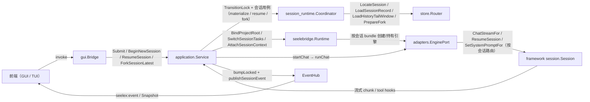

# Architecture Documents

本目录存放跨模块、长期有效的架构事实与设计原则，例如依赖方向、协议语义、并发模型、存储模型和已知结构性缺陷。

适合放置：

- 多个代码模块共同遵循的边界。
- 已接受且仍有效的架构决策和演进路线。
- 需要长期维护的调用链、状态机和安全模型。

不适合放置单一模块的当前实现细节（写入模块 README）、一次性实施计划（写入日期工作包）或外部方案调研（写入 `docs/research/`）。文档必须标明哪些是当前实现、哪些是目标设计。

## 文档索引

| 文档 | 说明 |
|------|------|
| [`seele-v2-runtime-architecture.md`](seele-v2-runtime-architecture.md) | Seelex 使用 Seele v0.1.1 远程模块边界的稳定架构（迁移完成） |
| [`application-middle-backend-boundaries.md`](application-middle-backend-boundaries.md) | Application / Middle / Backend / Store 的依赖矩阵、Session 聚合所有权与迁移期例外 |
| [`ARCHITECTURE_REVIEW.md`](ARCHITECTURE_REVIEW.md) | 上下文控制/数据流架构评审（历史，待与当前代码同步刷新） |
| [`plan.md`](plan.md) | 上下文、Skill、Plugin 与 Seele 薄封装实现方案 |
| [`design-decisions-mcp-storage.md`](design-decisions-mcp-storage.md) | MCP 中间件从 CAD 专属→通用→存储解耦的设计推演 |
| [`mcp-call-chain-flowchart.md`](mcp-call-chain-flowchart.md) | Agent 调用 MCP 全链路函数流 + 熔断事件通道 |
| [`agent-permission-subjects.md`](agent-permission-subjects.md) | 工具权责模型：主体（root/sub/emp_ro/emp_rw）× 路由组（ro/rw/rw_session/rw_desktop/ctl/adm）× 位（rwx）+ sudo；求值顺序、错误语义、当前实现与未落地部分 |
| [`context-improvement-plan.md`](context-improvement-plan.md) | Context 包拆分为 snapshot/provider/compactor/merger 方案 |
| [`skill-effort-architecture.md`](skill-effort-architecture.md) | Effort system prompt 与 Skill 用户上下文的当前实现设计 |
| [`agent-workbench-architecture.md`](agent-workbench-architecture.md) | DSL 对话卡片、Agent E2E、Workspace 沙盒与多会话并行总体架构 |
| [`subagent-visibility-design.md`](subagent-visibility-design.md) | 子代理详情查看系统设计方案 |
| [`session-snapshot-liveness.md`](session-snapshot-liveness.md) | Session、Snapshot、Runtime 投影与子代理回流的数据流及无死锁边界 |
| [`readme-spec.md`](readme-spec.md) | 模块 README 编写规范：生态位/文件与函数索引/分卷/链接与编码约定 |
| [`context-prefix-chain.md`](context-prefix-chain.md) | 上下文前缀链路：稳定前缀 + 累积 context + plan/task 后置（已实现）；含压缩四区模型与边界判据（共识 + 已落地） |
| [`a2a-agent-team-factory.md`](a2a-agent-team-factory.md) | A2A AgentTeam 与角色工厂：subagent 外包边界、goal TL 第一实例、RoleSpec/TeamSpec 泛化设计（目标态） |
| [`agent-team-seat-vs-claim.md`](agent-team-seat-vs-claim.md) | 席位制 team work（order_roles/环/座位/裁决 gate）与认领式 teamwork（任务池/Assignee/并行节点）的机制对照、优势与代价、扬长避短；面向作品集的叙事与证据映射。**席位制那一半已于 2026-10-03 整条退场**（见 `docs/devlog/2026-10-03-seat-rotation-retired.md`），本篇按历史口径阅读 |
| [`agent-team-phase2-and-goal-vs-vmodel.md`](agent-team-phase2-and-goal-vs-vmodel.md) | Agent Team 第二阶段反思：市面多代理做法对照、现状「玩具感」诊断（带代码锚点）、改动清单，以及 goal 与 V 模型的范畴澄清（goal 是流程无关宿主，V 模型是团队顺序拓扑；goal 域只需把 acceptance 升级为阶段配对）；含待商榷 fork。**讨论输入，未改代码** |
| [`teamwork-leader-worker-architecture.md`](teamwork-leader-worker-architecture.md) | Teamwork 目标架构与里程碑：由「席位同步轮转」重构为「leader + 异步 worker（子进程工具调用范式）」——非串行 / 信号驱动 / job_manage 作业化 / 权限受控；Seele 新增 `jobs` 契约+Manager+`jobs_manage`、Seelex 提供 Executor 与派发侧工具及 worktree(git)、`moduleTeamwork` 硬编排存储、teammate 人数上限与一角色一 teammate、长驻会话「释放 worktree+删内容、保在线」；含 M0–M4 详表、死代码清单与已决/待议清单（job 作用域已定 O3：`Scope{Session,Subject}` 两并列字段、不拼分隔符，归属沿用既有 `BatchID` 盖印章）。**目标设计，未改代码** |

| [`workunit-single-lifecycle-one-implementation.md`](workunit-single-lifecycle-one-implementation.md) | 一件活的生命周期只有一份实现：接口先行 + 两个注册点只做转发（含 §8 交集与析构函数、§10 红灯先行）|
| [`workunit-ports-and-assembly.md`](workunit-ports-and-assembly.md) | 父（端口）清单与装配矩阵：作业面/现场/会话/读面四类端口 + 两步计划（① 只定作业端口 / ② 两张作业表合一）|
| [`workunit-duplication-inventory.md`](workunit-duplication-inventory.md) | 只读盘点：同一件事在仓库里有几份实现（worktree / 会话 / 作业面），含归并建议与不确定项 |
| [`seelex-project-board.md`](seelex-project-board.md) | 项目看板：会话级任务/里程碑的派生投影（`<项目根>/.seelex/board/<会话 ID>/{worktable,teamwork}.jsonl` + 汇总人读件 `BOARD.md`）与按需读取面；含行信封、`FoldProjectBoardRows`、同步器、装配门与按会话分目录契约（M1–M9 已落地） |
| [`remote-agent-node-feasibility.md`](remote-agent-node-feasibility.md) | 远程 agent 节点（员工节点）可行性：依赖倒置的三处可用缝（`roleEngine` / workunit 作业端口 / 契约-装配分离）、暴露阶梯 L0–L3、跨进程缺口清单、三桌面后端能力对照（含 macOS `ScrollTargets=false` 与 Linux 非 ASCII 注入缺陷）、灰度/金丝雀的载体选择（VM 池 + 真机对照）。**评估，未改代码** |
| [`ssh-tool-transport.md`](ssh-tool-transport.md) | SSH 工具族双传输：五个内置工具（read/write/edit/bash/bg_manage）如何同时具备本地与远端执行面。策略接口 + 责任链中间件（复用框架既有 `MetaMiddleware`）+ 按项目状态自适应选择 + SSH 专用工具错误码 + 连通性测试三时机。附孤立 MVP 实测结论（9/9）与两个缺口：非 ASCII 路径须 base64 承载、基座缺"命令 + stdin 数据"的表达。**设计稿 + 已跑 MVP，产品未改** |
| [`permission-assembly.md`](permission-assembly.md) | 权限装配：把「主体 × 路由组 × 位 + 档位阶梯」改成**用户组 × 权限类型矩阵**，支持任意正交子集（`{ssh}`、`{rw, ssh}`）与默认拒绝；SSH 只有一枚 `ssh` 能力，项目根外路径由该能力下的 agent-role 白名单裁定。契约先行（`AssemblyPort`/`Gate`/`Requirement`）避免依赖倒置。角色权限向量已落地，早期矩阵 MVP 保留为历史验证。 |
| [`ssh-tool.md`](ssh-tool.md) | 内置 SSH 工具（`ssh_*`）设计：从真实执行教训反推的硬规矩（命令走文件、非 ASCII 内联拒收、三形态返回）、Go 侧库支持现状（`x/crypto/ssh` 已 vendor；`knownhosts`/`agent` 未 vendor；SFTP 需新依赖）、四段独立超时、`known_hosts` 严格校验与显式首次信任、凭据进 OS 凭据库、项目内 host 注册表（稳定 `id` + 可变 `name` 与引用检查）、权限路由组与装配门、进程内 sshd 的验收判据。**设计稿 + 连接基座已落地**（`backend/tool/ssh`） |
| [`agent-team-work-vs-market.md`](agent-team-work-vs-market.md) | Agent Team「team work」与市场常见多代理方案的机制差异、收益与数据依据（含实测/静态度量/外部未复核口径的分层标注与局限清单）。**席位制部分已于 2026-10-03 退场，按历史口径阅读** |
| [`effort-system-design.md`](effort-system-design.md) | Effort 系统完整设计方案。**历史设计稿**：Effort Provider 扩展未实现；当前 Effort profile 与预算以 `application/prompt/effort.go` 为准，Skill 传输见 [`skill-effort-architecture.md`](skill-effort-architecture.md) |
| [`permission-path-gating.md`](permission-path-gating.md) | Permission Gate 路径归属判定详细设计 |
| [`role-permission-registry.md`](role-permission-registry.md) | 角色权限登记（目标设计）：权限向量词表（含 UI 别名）、五级优先级 `user_allow > agent_dispatch > session_default > role_default > global_default` 的逐标签语义、登记键 `(sessionID, role)` 与并发纪律、会话加载恢复顺序与降级、账号维度三格（`context_window`/`permission_vector`/`default_plugin`）、与权限矩阵的子集关系、判据 A1–A10 与分期 R0–R5 |
| [`plan-executor.md`](plan-executor.md) | Plan Executor（plan 执行域组件）架构（已实现） |
| [`plan-visualization-design.md`](plan-visualization-design.md) | Plan 可视化系统设计（设计稿） |
| [`plugin-skill-restructure.md`](plugin-skill-restructure.md) | Plugin / Skill 文件架构重构方案（2026-07-19） |
| [`session-board-metadata-lifecycle.md`](session-board-metadata-lifecycle.md) | 会话粒度看板元数据与生命周期（goal 看板 / 团队看板）；已裁决（2026-10-02） |
| [`state-machine-inventory.md`](state-machine-inventory.md) | 状态机总表：状态枚举统一口径与现存零散字符串比较的地图 |
| [`team-board-gui-tui-contract.md`](team-board-gui-tui-contract.md) | 团队看板接 GUI + TUI 同源同步契约（draft） |
| [`context-prefix-stability-l1.md`](context-prefix-stability-l1.md) | 上下文前缀稳定性根治方案（**设计，未改代码**）：五条不变量（字节冻结 / 只追加 / 指针而非平移 / 前缀有键 / L1 派生）+ L1–draft–actor 三层（轮尾提交、ack 后清空）+ `prefix_key` 六格 + 双纪元表（`memory_update` / `tools_update` + `⟦toolset⟧` 哨兵）+ **字符级前缀探针（draft 每次追加即采样，cum/last/byTurn 三口径计数叠加，与 `prefix_key` 对撞分出预期/意外失效）**；含设计×代码逐条核对、M0–M5 实施计划与验收判据、2026-10-29 三条已拍决策。替换 `context-prefix-chain.md` 的"每轮重投影"部分 |
| [`workunit-progress-read-surface.md`](workunit-progress-read-surface.md) | workunit 进度读面（后端接口形状）只读勘定 |

## 会话数据流：架构层与方法

一次会话操作（提交 / 新建 / 恢复 / 分支 / 持久化）经过的层与方法：

关键方法（真实签名见各模块 README 的函数索引）：

- 提交：`Service.Submit` → `submitConversation` → `materializeDraftSession` → `startChat` → `runChat` → `EnginePort.ChatStreamFor`
- 新建：`Service.BeginNewSession`（草稿槽位）→ 首次提交物化
- 恢复：`Service.ResumeSession` → `resumeSession`（三读 + 会话级 `SetSystemPromptFor`）
- 分支：`Service.ForkSessionLatest` → `forkSessionLocked` → `Coordinator.PrepareFork` → `SaveCommitWorkspace`
  （**会话分叉 ForkSession**：独立子会话 + tool-results 物理复制 + 可达 ref 裁剪，口径见
  `kernel/session/fork.go` 头部；**子代理派发 ForkSubagent** 不走这条——
  它经 workplan DAG 落 `subagent_<hash>/` 子树并复用主会话 `big_tool_result`，无独立 refs 索引）
- 持久化：`Coordinator.PersistCurrentSession` → `SessionPort.SaveCommit` → `Router.SaveCommit`（原子写 sessions-json）
