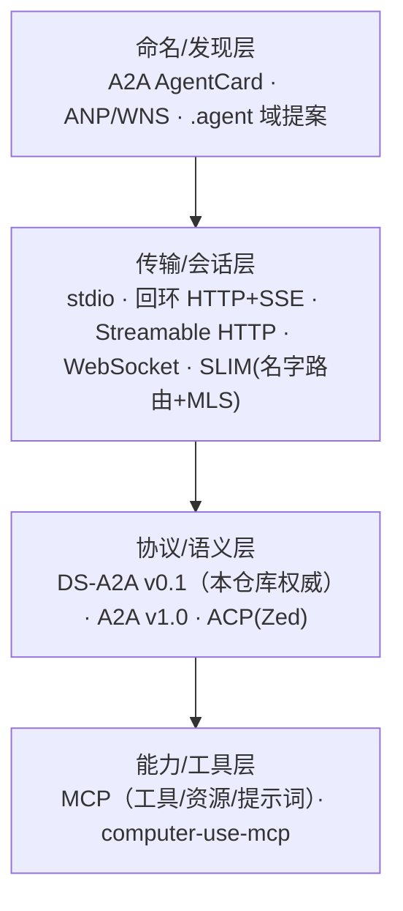

# Agent 远程协作的通信协议与传输绑定调研（2026-10-15）

状态：**调研（外部一手 + 仓库源码/文档取证）。本文未改任何代码，也不裁决 SeelexDot 方向。**

题目来源（用户原话）：*"关于 agent 远程协作尤其是 dot 的通信协议是什么，以及主要的通信方式是什么？当前如果要
在维持契约的前提下做出实际的操作替换（比如从本地 agent 替换到远程 agent，或者让本地 agent 和远程 agent
通信），协议是什么？"*

本文回答四件事，其余不碰：

| # | 问题 | 本文结论（证据见后文） |
|---|---|---|
| 1 | "dot" 指什么 | 仓库语境里 = **SeelexDot**（未裁决的产品概念，代码零命中）；外部另有三个同名的无关物（§1） |
| 2 | dot 的通信协议是什么 | **DS-A2A v0.1**：唯一权威协议（`ds-a2a-protocol.md`），协议本身**已声明 transport 无关**，今天只在进程内跑（§2） |
| 3 | 主要通信方式有哪些 | 进程内队列/事件流（现状）→ 回环 HTTP+SSE（仓库已有先例）→ 网络标准（MCP / A2A / ACP / ANP / SLIM）（§3） |
| 4 | 维持契约的前提下怎么替换成本地↔远程 | 按 **3 级替换点**逐个换（L0 工具面 / L1 角色回合引擎 / L2 作业面），**不要**动 `RuntimePort`；动手前有 7 项契约缺口要先补（§4、§5） |

方法边界：外部结论全部来自一手规范/仓库 README（附链接与抓取日期）；仓库结论全部附 `文件:行`。
**未跑构建与测试**，未做任何端到端连通性实测。未核实项集中在 §8，不作为结论使用。

---

## 1. "dot" 是什么：先把同名物分开

### 1.1 仓库语境：SeelexDot（未裁决、无代码实体）

来源是用户 2026-10-13 的口述记录，不是设计定稿：

- 用户原词：`seelexdot` / `seelexrole` / `seelexmcp` / `main seelex` / `高管员工` / `基层员工`；
  原话要求 8 条中最关键的两条是"**Seelex 的 dot 的 A2A，打算走 MCP 的路线，跨进程乃至远程**"与
  "**拓扑做成星形**"（`docs/2026-10-13-seelex-dot-a2a-star-topology/README.md:14-24`）。
- 记录者（agent）自己的读法（**非用户原话，记录本身要求确认**）："高层 = SeelexDot = 高管员工：一个独立的
  Seelex 实例（跨进程/远程），能对外产生产物；它是星形拓扑的一个辐射点，main Seelex 是星心"
  （同上 `:33,51-52`）。
- 该记录自陈是**头脑风暴，未裁决、未改代码**（同上 `:3`），并列出待拍板 Q1–Q6（Dot 与 Role 的关系、
  邮箱是 transport 还是只当身份、发布边界、能力必须落在凭据层、missing_bit 语义、rw 与 computer use 平权）。

后续两份同日文档做了事实核查：

- `docs/2026-10-15-product-direction-doc-review/README.md:43-54`：SeelexDot 是未裁决方向；
  `seelexdot`/`seelexboss`/`高管员工` 在**全仓 `*.go` 中零命中**。
- `docs/2026-10-15-perf-observability-and-multi-binary/multi-binary-architecture.md` §6：给出"模型 A
  （seelexdot = 同一底座编译出的可选执行实例，G2 占位）/ 模型 B（暂缓）"两种备选，并明确"**仓库内不存在
  对应代码实体，不能当已实现产品**"；§7 门禁里 G2 只在产品裁决后才立项。

### 1.2 外部同名物（都不是本仓库的 SeelexDot）

| 名字 | 是什么 | 是不是通信协议 |
|---|---|---|
| `dot-agents`（dot-agents.com） | 本地配置统一 CLI：把各编码 agent 的规则文件（`AGENTS.md`/`CLAUDE.md`/`.cursor/rules` 等）收敛到 `~/.agents/` | **不是**。它统一的是配置文件布局，不定义 wire 协议 |
| `.agent` special-use domain（`dot-agent-protocol` 项目） | 早期提案：为 agent 争取一个专用 DNS 命名空间（`assistant.agent` 这类身份），配 IETF/IANA 路线 | **是命名/发现层提案，处在很早期**；未成为既定标准，未定 transport |
| DoT（DNS over TLS） | 传输加密协议 | **与 agent 协作无关**，属同名误撞 |

结论：**"dot 的通信协议"在本仓库只有唯一一份答案，就是 §2 的 DS-A2A**；外部同名物不要混进设计讨论。

---

## 2. dot 的协议现状：DS-A2A v0.1（唯一权威契约）

### 2.1 契约本体（已定基线，改字段必须版本化）

`docs/2026-09-07-seele-a2a-framework-req/ds-a2a-protocol.md` 是权威协议（v0.1），
`ds-a2a-detailed-design.md` 是权威详设；同目录 `README.md:2,17-21` 声明"实现协议字段以此为准，
schema 变更 = 版本化（0.1→0.2…）"。要点：

- **角色**：EXEC(a) = 执行会话（唯一 writer，用户可见全量转录）；ADVISOR(b) = 后台评审会话
  （独立上下文、只读/无工具面）；CONTROLLER = b 的生命周期 owner（协议 §1）。
- **信封**（§3，单一 wire 格式）：`{v,id,ts,from,to,kind,seq,ref_seq,corr,session,payload}`。
- **a→b 帧类型**（§4）：`peer.bind/unbind`、`goal.start/update`、`transcript.inc`、`tool.checkpoint`、
  `context.compacted`、`approval.requested`、`terminal.proposed`；其中锚点、压缩、终态提议为"必进帧"。
- **b→a 载荷**（§5）：`gate.verdict`（done/not_done/rework/escalate，带 `ref_seq`+`corr`）、
  `advisory.send/ack`、`error`。**只进 a 的"受信注入区"，不进 a 转录主历史**。
- **一致性规则**（§7）：账本源单一（seq 只由 a 产生）、帧按 `ref_seq` 单调 append + 幂等丢弃、
  `corr` 幂等、有界（队列/帧体积/回合预算）、因果（b 的输出必须带它评估所基于的水位）。
- **缺席铁律**（§8）：**a 的任何路径（含终态 gate）不允许等待 b**；429/超时 → unbind → 按风险策略
  （低放行/高人工）继续执行。
- **生命周期状态机**（§9）与**错误码**（§10：429/timeout/bad_seq/dup_frame/unbound/schema_violation）。
- 缓存规则 C1–C5（§2）：b 的前缀恒定、只尾部追加、事务式评估，目标是 provider 前缀缓存命中。

### 2.2 协议自己就声明了"transport 无关"——这是替换的合法性基础

协议 §3 原文（投递语义）：

> 进程内 = 队列/事件流投递；跨进程 = 同一 JSON over 任意 transport。**不区分**——协议相同，
> 进程内是零拷贝特例。

这句话是本题的答案骨架：**要换的是 binding（transport）层，不是协议层**。

### 2.3 但今天只有进程内实现（这是实打实的缺口）

- 实现在产品域里：`application/core/goal/a2a.go`（信号/嵌入/指令三类契约，`a2a.go:5-8,25-32`）、
  `advisor.go:41-50`（FrameKind 与抽帧集）、`techleader.go`（治理编排与 b 生命周期）、`gate.go`（终态与缺席）。
- 详设 §4 建议把这些协议类型抽到 `application/core/peersession/`（协议类型放 `peersession/protocol`），
  **当前这一步还没做**——协议类型仍住在 goal 产品域里。
- 全仓没有 agent 侧网络服务端：`rg "net.Listen|ListenAndServe|NewMCPServer"` 的非测试命中只有
  `main_pprof.go:30`（pprof，opt-in）与 `gui/headless.go:76`（回环控制面，见 §3.2）。

---

## 3. 主要通信方式盘点：从进程内到网络标准

### 3.1 分层看（关键：不同候选解决的是不同层的问题）



把 DS-A2A 的信封装进 MCP（用户原话"走 MCP 的路线"）属于**用能力层承载协议层**：可行，
但要付语义妥协（§4.4）。

### 3.2 进程内 / 本机先例（仓库已有）

| 方式 | 仓库证据 | 能承载什么 |
|---|---|---|
| Go 队列/事件流（现状） | DS-A2A §3"进程内 = 队列/事件流"；指令队列 cap 32（`application/core/goal/a2a.go:25`）；事件水位读面 `seelebridge/events_unified.go:116-140`（`LoadRange`/`QueryRange`） | 全部 DS-A2A 语义，零拷贝零序列化 |
| **回环 HTTP + SSE 控制面** | `gui/headless.go:1-16`（定位：默认关闭，仅 `SEELEX_HEADLESS_PORT` 时启动，**只绑 127.0.0.1**）；`:91-98` 三条路由 `/healthz`、`/rpc`、`/events`；`:105-130` `POST /rpc {method,args}` → `{ok,result,error}`；`serveEvents` = `text/event-stream` + 15s 心跳 + `delivery_seq/kind/session_id/revision` | **这是"把 Seelex 当被驱动方"的现成形状**：命令走 POST、事件走 SSE；`dispatchRole` 已分发 `role.*`（建角色会话、草稿读写同步等）。注意：它是**前端驱动面**，不是 agent 协议，且无鉴权（靠回环+环境变量门控） |
| MCP 子进程（stdio） | `computer-mcp` 是 stdio MCP 服务端；装配开关 `seelebridge/runtime_computer.go`（`SEELEX_COMPUTER_USE`） | 把"能力"搬到另一进程/另一台机器 |
| 进程间管道 / 后端 MCP 客户端 | `vendor/github.com/RedHuang-0622/Seele/tools/mcp/provider.go:108-114`：`case "stdio": NewStdioMCPClient(...)` / `case "sse": NewSSEMCPClient(cfg.URL)`；配置面 `config/mcp.example.yaml`（`transport: stdio \| sse` + `url`） | Seelex **作为 MCP 客户端**已是远端可用 |

### 3.3 网络标准（外部一手）

#### MCP（Model Context Protocol）— 能力层事实标准

- 编码：JSON-RPC，UTF-8；**标准 transport 两种**：`stdio`、`Streamable HTTP`，另允许自定义 transport。
  客户端"应尽可能支持 stdio"（`docs/specification/2025-06-18/basic/transports.mdx`）。
- `Streamable HTTP` 于 2025-03-26 引入，**取代** 2024-11-05 的 `HTTP+SSE`；服务端提供**单一端点**
  同时支持 POST/GET，可选 SSE 流；明确的安全要求：**必须校验 `Origin`**（防 DNS rebinding）、
  本地部署**应只绑 127.0.0.1**、应做鉴权。
- **最新修订 2026-07-28 有语义级变化**（`.../2026-07-28/basic/transports/streamable-http.mdx` Info 块）：
  **移除 GET 流端点**、**移除协议级 session**；server→client 交互（sampling/elicitation/roots）改为
  **Multi Round-Trip Requests（SEP-2322）** 嵌在结果里；长生命变更通知走 `subscriptions/listen` 的响应流。
  → 对远程化的启示：**连 MCP 自己都在往"传输层不持有会话状态"收敛**，远端节点别把会话态押在 transport 上。

#### A2A（Agent2Agent）— 对等 agent 协作事实标准

一手规范：`github.com/a2aproject/A2A` `docs/specification.md`；该文首注明**当前发布版 v1.0.0**
（前序 0.3.0 / 0.2.6 / 0.1.0）；Google 2025-04 发布、2025-06 捐给 Linux Foundation
（仓库内既有调研 `docs/research/2026-09-30-goal-a2a-flow-and-techleader.md:128-136` 已记录）。要点：

- **三层结构**：数据模型（`spec/a2a.proto` 为唯一规范源，JSON 为生成物）/ 抽象操作 / **协议绑定**
  （JSON-RPC、gRPC、HTTP+JSON/REST、自定义绑定），且要求多绑定间**功能等价**（§1.3、§5.1）。
- **操作与绑定映射表**（§5.3）：`SendMessage` / `SendStreamingMessage` / `GetTask` / `ListTasks` /
  `CancelTask` / `SubscribeToTask` / pushNotificationConfig 增删查改 / `GetExtendedAgentCard`——
  JSON-RPC 方法与 REST 端点逐条对应（如 `POST /message:stream`、`POST /tasks/{id}:subscribe`）。
- **任务更新三通道**（§3.5）：轮询（GetTask）、流式（SSE）、**Push Notification（webhook，客户端注册 endpoint）**。
- **发现**（§8.2）：`https://{domain}/.well-known/agent-card.json`、registry/catalog、直接配置；
  AgentCard 的 `supportedInterfaces` **有序声明** transport + URL，客户端按序选（§8.3）；AgentCard 可
  JWS 签名（RFC 7515，先做 JCS 规范化 RFC 8785）。
- **错误映射**（§5.4）与**安全**（§7、§13）成体系；与 MCP 的分工见其附录 B：
  MCP 让单个 agent 变深（连工具/资源），A2A 让系统变宽（连另一个不透明的 agent）。

#### ACP（Zed 的 Agent Client Protocol）— 编辑器↔编码 agent

- 定位：标准化**编辑器（client）** 与**编码 agent（agent）** 的通信；JSON-RPC；
  协议定义了 `stdio` 与 **`Streamable HTTP`（仍标注为 draft proposal in progress）**，并允许自定义 transport；
  文档按 `protocol/v1`、`protocol/v2` 两套组织，仓库 README 声明**当前稳定协议版本为 1**，
  线兼容性由 `initialize` 交换的 `protocolVersion` 决定（`agent-client-protocol/README.md`、
  `docs/protocol/v2/transports.mdx`）。
- 对本题的价值：**它正是一个"本地跑 stdio、远端跑 Streamable HTTP，而契约不变"的现成范例**——
  编辑器侧换的只是 transport。

#### ACP（IBM / BeeAI 的 Agent Communication Protocol）— 已并入 A2A

- IBM Research 2025-03 发布，REST 原生、会话式、轻量，随 BeeAI 捐给 Linux Foundation；
  **2025-08-29 LF AI & Data 公告"ACP 与 A2A 合并"**（`lfaidata.foundation/communityblog/2025/08/29/...`；
  `github.com/orgs/i-am-bee/discussions/5` 给出迁移指引），BeeAI 平台已改用 A2A。
- 对本题的价值：**不要**为一个新的私有 agent 协议再造第三份"通用 agent 通信标准"——
  这个赛道刚收敛过一轮。

#### ANP（Agent Network Protocol）— 去中心身份与发现

- 规范集 ANP 1.2：ANP-02 用 W3C DID（`did:wba` / 原生 `did:web`）做方法无关的 HTTP/JSON 认证、
  ANP-03 定义 WBA 方法与身份连续性、ANP-04 定义 WNS 命名层（人可读 handle → DID 解析）；
  消息 Profile 定义 DID 寻址与**设备级 E2EE**（v2 引入 MLS），并明确禁止把 E2EE v1 状态当 v2 用或静默降级。
- 对本题的价值：**"每个员工一个邮箱/一个账号"这类身份与寻址需求，ANP 的 DID + WNS 是正统答案**；
  它解决"谁是谁、怎么找到、怎么端到端加密"，不解决"帧怎么排、谁裁决"。

#### SLIM / AGNTCY — 传输层基础设施

- SLIM（Secure Low-Latency Interactive Messaging）：三组件——**数据面**（按层级名字路由，不解析应用内容）、
  **会话层**（可靠投递 + 端到端 MLS 加密 + 组成员管理）、**控制面**（配置/监控/编排）；
  提供 A2A / MCP / OpenTelemetry 集成，支持 gRPC 与 WebSocket 传输以及 TLS / basic-auth / mTLS 模式。
- AGNTCY 由 Cisco Outshift 创建、现已为 Linux Foundation 项目，SLIM 是其组件之一。
- 对本题的价值：如果将来要"多节点、按名字寻址、支持离线、端到端加密"，**这是现成的 transport 层，
  不必自研消息总线**；但它不提供 DS-A2A 的帧/水位/裁决语义。

#### 命名层提案

`.agent` special-use domain 项目主张为 agent 建专用命名空间与身份（`assistant.agent`），
目前是 IETF/IANA 方向的**早期提案**（项目自陈处于标准化推进阶段）。仅作趋势参考，不作为选型依据。

---

## 4. 维持契约做替换：能不能换、换哪一层、代价是什么

### 4.1 先看契约允许什么

协议 §3 已允许换 binding；真正要守的是**不变量**（§2.1 列出）。因此"维持契约"的可验证定义是：

1. **同一份协议 JSON**，在进程内与跨进程两条 binding 上跑**同一套不变量用例**（同一输入跑两遍）；
2. B1–B6、C1–C5、§7 一致性、§8 缺席、§10 错误码**逐条仍成立**；
3. 远程实现是**替换**本地实现，而不是与本地实现并列存在（否则就是 AGENTS.md §8 的"第二份实现"）。

### 4.2 可以换的端口（按改动量从小到大）

| 级 | 替换点 | 证据与形状 | 换来什么 / 代价 |
|---|---|---|---|
| **L0** | 工具/能力面远端化（`computer_*`、scoped bash 等） | `computer-mcp` 已是 stdio MCP 服务端；MCP 客户端已支持 `sse`（`vendor/.../mcp/provider.go:108-114`）；装配开关在 `seelebridge/runtime_computer.go` | 今天就能跑（`docs/arch/remote-agent-node-feasibility.md` §3、§5 L0）。**代价**：MCP 工具在权责模型里落 `adm` 组、默认 `ask`，会把"每次桌面输入问人"退化成"装不装这个 MCP 问一次"——**这枚钉子必须先拍**（同文 §5 末） |
| **L1** | **角色回合引擎**（一个员工的"做工回合"搬到远端） | `seelebridge/runtime_role_turn.go:68-80`：`roleEngine` 只有 6 个方法（`SessionID/SetSystemPrompt/SetMaxLoops/ClearHistory/ChatStream/History`），**不含任何 channel**；注入点唯一：`:223` `SetRoleEngineFactory(func(sessionID string) (roleEngine, error))`，其注释自陈用途之一就是"未来要给角色回合换更严格的隔离面" | **最干净的远程 seam**：写一个 `remoteRoleEngine` 把 `ChatStream` 转发到远端 Seelex，角色回合作业面就从"本机进程内引擎"变成"远端节点"。**代价**：`ChatStream(ctx, input, onChunk func(string))` 的**函数回调**是唯一需要重新设计成流事件的形状（本地是回调，跨进程要变成事件/分块帧） |
| **L1.5** | DS-A2A 的 a↔b 通道远端化（ADVISOR 跑到另一台机器） | 协议 §3 允许任意 transport；帧账本/水位读面已有（`seelebridge/events_unified.go:116-140`）；`gui/headless.go` 已提供 `POST /rpc` + SSE `/events` 的形状可直接借 | 让"后台评审会话"跨机器。**代价**：Seelex 侧**没有服务端**（§2.3），要先写 server + 节点侧鉴权；且协议类型要从 goal 产品域抽成零依赖契约包 |
| **L2** | **workunit 作业面**（一件活的现场+会话+作业） | `seelebridge/workunit/contract.go`：`Lifecycle`（Begin/Finish/Reclaim/Recover/AlreadySettled/Notice）+ `Jobs` 四格窄端口 + 编译期断言 `var _ Jobs = (jobs.Manager)(nil)`；`docs/2026-10-15-.../multi-binary-architecture.md` §3.4 明确 seelexdot 的契约就是"workunit 端口的 remote 实现" | 架构上最"正"的 dot 落点（remote-agent 文档 §1 同判）。**代价**：每个节点必须**各自 data root**（`sessionstore/data_root_lock.go` 是单进程锁），聚合只能走网络；另加授权与审计 |
| **不做** | 远程化 `RuntimePort` / `ChatEngine` | `application/contract/ports.go:118` 的 `RuntimePort` 含 5 个 `<-chan` 型成员（`AsyncRunEvents` / `TaskChangedChannel` / `SubagentTreeEvents` / `PlanNodeEventChannel` / `SubscribeSubagentLive`），另有数十个 `X`/`XFor(sessionID)` 成对方法与会话级内存所有权 | 把大端口远程化会被它自己的**通道型成员**钉死（`docs/arch/remote-agent-node-feasibility.md` §4 #2）。这条是硬理由，不是偏好 |

### 4.3 推荐路径（与既有门禁文档对齐，不另立叙事）

```
G0  边界硬化（不改进程数）
    ① 把 DS-A2A 信封/帧/verdict 抽成零依赖 wire 契约包（详设 §4 建议的 peersession/protocol 位置）
    ② 先用"进程内 fake transport"跑同一套不变量用例，再换真 transport（先例：e2e/workunit_ports_test.go
       的契约包零依赖 + 编译期断言机械门禁）
    ③ 借 gui/headless.go 的现成形状做 server 骨架：POST 命令 + SSE 事件 + 心跳 + resync
G1a 角色回合远端化（L1）：最小可用远程面，改一个构造点
G1b 作业面远端化（L2）：多节点干活，各自 data root + 租约/对账
G2  SeelexDot 产品裁决（未裁决前不动）
```

这与 `docs/2026-10-15-perf-observability-and-multi-binary/multi-binary-architecture.md` §7 的
G0→G1→G2 门禁、以及 `docs/arch/remote-agent-node-feasibility.md` §5 的 L0→L3 阶梯是同一段路，
本文只补"binding 层怎么选"。

### 4.4 如果坚持"走 MCP 的路线"（用户原话）

可行的做法是**把 MCP 当 transport，而不是当语义层**：

- 信封仍是 DS-A2A JSON（`kind`/`seq`/`ref_seq`/`corr` 一字不改），MCP 只承担三件事：
  提交帧、取回 b 的产物、投递 verdict（`submit_frame` / `fetch_directives` / `verdict`）。
- transport 复用 MCP 的两种标准方式：**stdio**（远端经 ssh / 进程管道，今天就能做）或
  **Streamable HTTP**（真网络；注意 2026-07-28 起协议级 session 已被移除，别依赖它）。
- **代价与风险**：MCP 没有 peer/任务语义（没有"另一个 agent 是谁"的概念）、工具调用受 MCP 权责面治理
  （落 `adm`/`ask`，见 L0 的钉子）、错误码需自行映射到 DS-A2A §10（`429/timeout/bad_seq/dup_frame/...`）。
  因此它是**binding 层选项，不是协议层替代**——真正的"对等协作语义"要么留在 DS-A2A，
  要么将来映射到 A2A 的 Task/AgentCard（那时才谈得上和外部 agent 生态互通）。

### 4.5 DS-A2A ↔ 外部标准的语义对照（便于判断"能不能对外互通"）

| DS-A2A v0.1 | A2A v1.0 | MCP | 备注 |
|---|---|---|---|
| `terminal.proposed` / `gate.verdict` | Task 状态更新 + Artifact（§4.2） | 无对应 | DS-A2A 的"终态裁决"是 A2A Task 生命周期的私有化版本 |
| `advisory.send`（b→a，只进受信注入区） | Message（§4.1，双向） | 无对应（MCP 无 peer） | 语义最接近，但 DS-A2A 刻意不让 b 进 a 的转录主历史 |
| `frame.append` + `seq`/`ref_seq`（镜像/水位） | **无对应**（A2A 强调 opaque，不共享内部状态） | 无对应 | DS-A2A 特有：为前缀缓存命中而设计的增量镜像 |
| `peer.bind/unbind` + 生命周期状态机 | Task 生命周期 + `contextId` | session（2026-07-28 已移除） | 三层语义相近，字段不同 |
| `corr` 幂等 | messageId / 任务去重 | JSON-RPC id | 概念同构 |
| 缺席铁律 B4（永不等待 b） | Async-first + 超时/取消（§3.1 CancelTask） | 请求超时 | 都是"对端不在也要收敛" |

结论：**内部 use case 用 DS-A2A 私有契约成本最低**；只有当目标是"接入外部 agent 生态"时，
才值得做 AgentCard + Task 语义映射（本文不建议现在做）。

---

## 5. "维持契约"还差什么：7 项要先补的缺口

| # | 缺口 | 证据 | 影响 |
|---|---|---|---|
| 1 | **没有 agent 侧服务端** | 全仓 `net.Listen` 仅 `main_pprof.go:30` 与 `gui/headless.go:76`（回环、opt-in） | 任何远程 binding 都要先写 server 端 |
| 2 | **协议类型住在产品域** | 协议类型在 `application/core/goal/*`；详设 §4 建议抽到 `peersession/protocol` | 契约不零依赖 → 远端实现会 import 产品域，边界腐化 |
| 3 | **没有版本协商** | 信封有 `"v":1`，但无交换/降级流程；先例：A2A `supportedInterfaces`、ACP `initialize.protocolVersion`、本仓 `application/model/state.go:13 ProtocolVersion` | 多节点版本漂移时无判据 |
| 4 | **断线重放/对账缺失** | 帧账本在内存（`ref_seq` 幂等已有）；`multi-binary-architecture.md` §3.3 已给出租约+按 id 对账模式 | 远端重启后无法从 applied 水位续传 |
| 5 | **节点侧授权缺失** | 权限是**进程内**主体位表（`seelebridge/tools/permission_policy.go` 的 `DefaultPermissionSubjects`，`emp_*` 为本地条目）；remote-agent 文档 §6 红线 2 | 跨机后必须多一道"谁可以驱动这个节点"（token/凭据签发/只监听回环+隧道） |
| 6 | **数据根单写者** | `sessionstore/data_root_lock.go` + multiprocess 测试 | 每节点各自 data root，聚合只能走网络（不是缺陷，是隔离同向） |
| 7 | **传输安全要求** | MCP spec 明确要求 Origin 校验 / 回环绑定 / 鉴权 | 别把回环控制面直接暴露到网络 |

补缺口的判据（要当作验收条件写进测试，而不是写在文档里）：

- **跨实现一致性用例**：同一份帧序列喂进程内 binding 与远程 binding，断言 B1–B6/C1–C5/错误码一致
  （AGENTS.md §8.6 的"同一份输入跑两遍"）；
- **交接清单**：远程实现落地时必须列出"删掉了哪些重复实现（文件:行 → 新唯一位置）"，
  证据是"只剩一份实现/编译器钉住"，不是"用例全绿"；
- **机械门禁**：契约包零依赖 + 无按层/按产品分支（先例 `e2e/workunit_ports_test.go`）。

---

## 6. 需要拍板的 5 个问题（都属"选 binding 之前必须知道答案"）

1. **transport 选型**：MCP（stdio / Streamable HTTP）／自建 HTTP+SSE（借 `gui/headless.go` 形状）／
   消息基础设施（SLIM）／ssh+stdio 隧道？（前三者都只解决 binding，语义层不变）
2. **"邮箱"是什么**：是 A2A 的 store-and-forward transport（离线不丢、可审计、延迟换可靠性），
   还是只当身份/地址、消息仍走在线通道？（2026-10-13 记录 §4 Q2 已提出同一问题，至今未答）
3. **Dot 与 Role 的基数关系**：一个 Dot 承载几个高管角色？星心（main Seelex）算不算一个 Dot？
   （同记录 Q1）
4. **节点侧"谁可以驱动我"**：口令/token/双向 TLS/能力凭据签发，选一个并落到凭据层
   （同记录 Q4 的裁决：能力必须落在凭据层，不能只落在工具注册层）。
5. **互通目标**：只做内部 DS-A2A，还是要对外与 A2A 生态互通（后者需要 AgentCard + Task 语义映射，
   是另一份工作量）。

---

## 7. 证据与来源

### 7.1 仓库内（`文件:行`）

- 协议权威：`docs/2026-09-07-seele-a2a-framework-req/ds-a2a-protocol.md`（§1 角色、§2 C1–C5、§3 信封、
  §4/§5 帧与载荷、§7 一致性、§8 缺席、§9 生命周期、§10 错误码）；`ds-a2a-detailed-design.md` §4 组件与建议落点
- 现状与裁决状态：`docs/2026-10-13-seelex-dot-a2a-star-topology/README.md` §1–§4；
  `docs/2026-10-15-product-direction-doc-review/README.md:43-54`；
  `docs/2026-10-15-perf-observability-and-multi-binary/multi-binary-architecture.md` §3.3/§3.4/§4/§6/§7
- 可行性与阶梯：`docs/arch/remote-agent-node-feasibility.md` §1/§2/§4/§5/§6
- 既有外部对照：`docs/research/2026-09-30-goal-a2a-flow-and-techleader.md:126-156`
- 实现：`application/core/goal/a2a.go:5-8,25-50`、`advisor.go:41-50`、`techleader.go`、`gate.go`；
  `seelebridge/runtime_role_turn.go:68-80,223`；`seelebridge/workunit/contract.go`；
  `application/contract/ports.go:118`；`seelebridge/events_unified.go:116-140`；
  `gui/headless.go:1-16,68-140`、`serveEvents`；`main_pprof.go:30`；
  `vendor/github.com/RedHuang-0622/Seele/tools/mcp/provider.go:108-114`；`config/mcp.example.yaml`；
  `sessionstore/data_root_lock.go`；`application/model/state.go:13`；`e2e/workunit_ports_test.go:1-20`

### 7.2 外部一手（抓取日期 2026-10-15）

- MCP transports（2025-06-18）：`raw.githubusercontent.com/modelcontextprotocol/modelcontextprotocol/main/docs/specification/2025-06-18/basic/transports.mdx`
- MCP Streamable HTTP（2026-07-28 修订）：`.../docs/specification/2026-07-28/basic/transports/streamable-http.mdx`
  （含"移除 GET 流端点 / 移除协议级 session / MRTR SEP-2322 / subscriptions.listen"）
- A2A 规范（v1.0.0）：`raw.githubusercontent.com/a2aproject/A2A/main/docs/specification.md`
  （§1.3 三层、§3.5 三通道、§5.3 方法映射、§5.4 错误映射、§8.2/§8.3 发现与 supportedInterfaces、
  §8.4 AgentCard 签名、附录 B 与 MCP 的关系）；站点 `a2a-protocol.org`
- ACP（Zed）：`github.com/zed-industries/agent-client-protocol`（README：稳定协议版本 1、schema v1/v2；
  `docs/protocol/v2/transports.mdx`：stdio + Streamable HTTP(draft)）；站点 `agentclientprotocol.com`
- ACP（IBM/BeeAI）并入 A2A：`lfaidata.foundation/communityblog/2025/08/29/acp-joins-forces-with-a2a-under-the-linux-foundations-lf-ai-data/`；
  `github.com/orgs/i-am-bee/discussions/5`；`research.ibm.com/projects/agent-communication-protocol`
- ANP 1.2：`raw.githubusercontent.com/agent-network-protocol/AgentNetworkProtocol/main/README.md`
  （ANP-02 DID 认证、ANP-03 `did:wba`、ANP-04 WNS、P1–P6 消息 Profile 与 MLS E2EE v2）
- SLIM/AGNTCY：`raw.githubusercontent.com/agntcy/slim/main/README.md`（数据面/会话层/控制面、MLS、
  A2A/MCP/OTel 集成、gRPC/WebSocket 与 TLS/basic-auth/mTLS）；`outshift.cisco.com/the-internet-of-agents/agntcy`、
  `agntcy.org`（AGNTCY 由 Cisco Outshift 创建，现为 Linux Foundation 项目）
- `.agent` special-use domain 提案：`abhishekkumar35.github.io/dot-agent-protocol/`
- `dot-agents`（本地配置统一 CLI）：`www.dot-agents.com`

---

## 8. 未核实 / 局限（不据此推断）

- **未跑任何构建、测试或端到端连通性验证**；本文所有仓库结论均来自源码/文档静态阅读。
- A2A v1.0.0 的具体发布日期未核（只确认仓库文档把 1.0.0 标为"Latest Released"）。
- ACP（Zed）v2 是否已稳定：README 说当前稳定协议版本是 1，而 `docs/protocol/v2/` 已存在（含迁移指南）——
  两者口径未核，落地时必须按 `initialize` 的 `protocolVersion` 协商，不能按文档目录推断。
- SLIM 对 A2A/MCP 的集成成熟度、是否可直接承载 DS-A2A 信封，未实测。
- ANP 的在线实现与部署规模未核（只读规范与 README）。
- `.agent` 提案的标准化进度（IETF/IANA 状态）未核。
- `dot-agents` 是否支持跨机协作未见证据（其定位是本机配置统一）。
- MCP 2026-07-28 修订后的**客户端/服务端生态实际采用率**未核（本仓库 MCP 客户端走 Seele vendored 实现，
  其支持哪个协议修订版本未核）。
