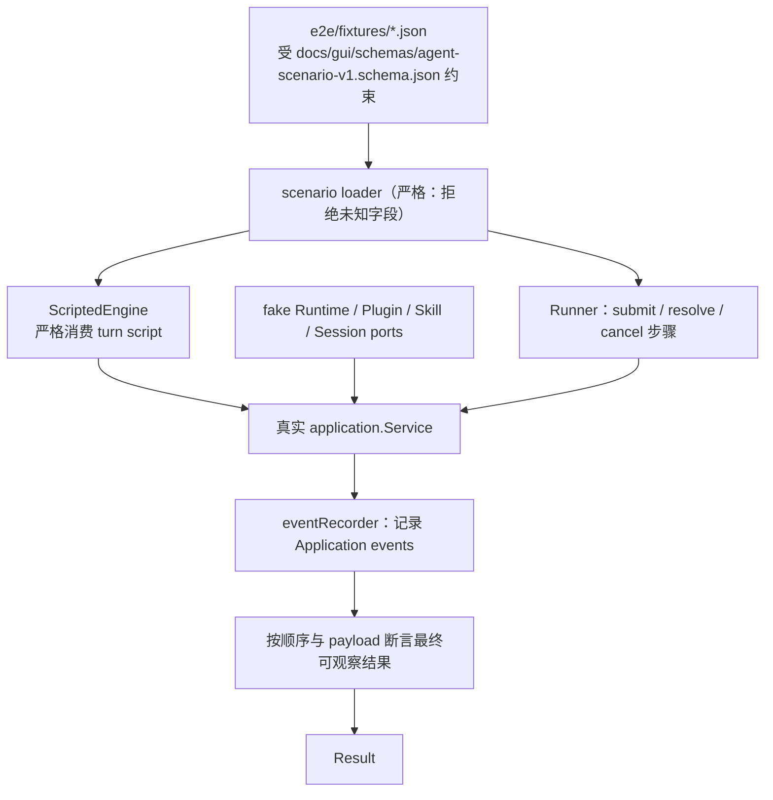
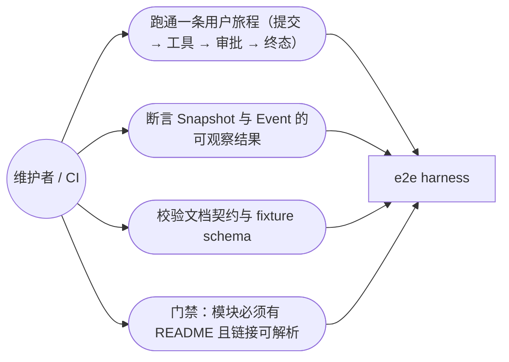

# End-to-End Testing

## 生态位

`e2e/` 承载跨 Application、Engine script、Tool lifecycle 和 Interaction 的确定性验收能力。它验证用户旅程，不依赖真实 LLM 或外部网络。

主要调用方：CI（`go test ./e2e/... -count=1`）与本地回归；它同时是 README 覆盖门禁
（`layout_test.go`）的所在地。

## 架构图



## 用例图



## 子模块

- [`scenario/`](scenario/README.md)：scenario v1 schema、loader、scripted engine、runner、event recorder 和 harness。
- fixture 由 `docs/gui/schemas/agent-scenario-v1.schema.json` 约束；新增 fixture 应放在 `e2e/fixtures/`。

本目录同时承载两组**架构门禁**（不是用户旅程，而是边界本身）：

- [`layout_test.go`](layout_test.go)：模块必须有 README、README 链接必须可解析、mermaid 块结构合法。
- [`facade_boundary_test.go`](facade_boundary_test.go)：plan §1.3 的门面不变量 I1–I4
  （门面依赖闭包只许收缩、契约层闭包 = stdlib、前端只 import 门面、门面无构造函数、
  门面类型必须保形别名）。清单是 ratchet：**只许收缩**。
- [`store_boundary_test.go`](store_boundary_test.go)：plan 的 **I6**（底座无向上依赖）——
  底座 `store/**` 的 Seelex 内依赖闭包只允许是它自己，测试文件的 import 同样受约束；
  `store` 那条待清理的 `backend/engine/context/seelectx/lifecycle`（原 `seelexctx/lifecycle`，M5-R7 归位）向上边登记在同一张 ratchet 里，
  M3-S4 删掉后清单归零。清单**只许收缩**。

## 边界

E2E harness 可以实现 Application ports，但不复制生产实现。真实浏览器/Wails smoke 属于 GUI 测试层，不应塞进纯 Go scenario runner。

## Review 指南

- scenario 必须确定性、无网络、无真实凭据。
- 断言应面向可观察结果和事件顺序，不依赖私有字段。
- 新协议字段需同步 schema、loader validation 和有效/无效 fixture。

## 测试

```text
go test ./e2e/... -count=1
go test . -run '^TestGUI' -count=1
```

## 文件与函数索引

> 由源码 doc 注释自动提取（首行摘要）；描述源码行为，与实现保持同步。
> 刷新方式：`python scripts/gen_core_readme_index.py`。

### bootstrap_test.go

- `func TestOfflineApplicationBootstrapComposition(t *testing.T)`

### docs_contract_test.go

- `func resolveExamplePath(example string) string` — resolveExamplePath 处理 cases 表中的相对/绝对混合路径：
- `func TestGUIDocumentContracts(t *testing.T)`
- `func TestGUIModuleRegistry(t *testing.T)`
- `func TestGUIDocumentLinks(t *testing.T)`
- `func loadGUISchemas(t *testing.T) *jsonschema.Compiler`
- `func readJSON(t *testing.T, path string) any`
- `func checkModuleGraph(t *testing.T, modules map[string][]string)`

### dto_boundary_test.go

- `func TestRoleSessionPortsDoNotLeakStorageTypes(t *testing.T)` — TestRoleSessionPortsDoNotLeakStorageTypes 钉住 S27 收口：R2/R4 的角色会话与
- `func fileImports(t *testing.T, path string) map[string]struct` — fileImports 返回一个 Go 文件的直接 import 路径集合。
- `func TestRoleSessionDTOFieldsMatchWireContract(t *testing.T)` — TestRoleSessionDTOFieldsMatchWireContract 钉住 DTO 的 JSON 形状：真实 API 冒烟
- `func readRepoFile(t *testing.T, parts ...string) string`

### facade_boundary_test.go

- `func TestFacadeDependencyClosureRatchet(t *testing.T)` — TestFacadeDependencyClosureRatchet 钉 I1：门面闭包里的 Seelex 包只许收缩。
- `func TestContractDependencyClosureIsStdlibOrAllowlisted(t *testing.T)` — TestContractDependencyClosureIsStdlibOrAllowlisted 钉 plan §4 M1 的退出条件之一：
- `func TestFrontendDirectImportsStayInsideFacade(t *testing.T)` — TestFrontendDirectImportsStayInsideFacade 钉 I2：三个前端入口直接 import 的 Seelex 包。
- `func TestGUIHasNoDirectBackendImports(t *testing.T)` — TestGUIHasNoDirectBackendImports 钉 plan §4 M1 的退出条件「前端 4 条越层边消失」。
- `func TestFacadeHasNoConstructors(t *testing.T)` — TestFacadeHasNoConstructors 钉 I3：门面包内不得出现 func New*。
- `func TestFacadeKeepsTypeIdentityByAlias(t *testing.T)` — TestFacadeKeepsTypeIdentityByAlias 钉 I4：门面导出的每个类型都必须是别名
- `func goListDependencies(t *testing.T, pattern string) []string` — goListDependencies 返回 `go list -deps <pattern>` 的包路径集合（stdout 逐行）。
- `func goListDirectImports(t *testing.T, pattern string) []string` — goListDirectImports 返回 `go list -f {{.Imports}} <pattern>` 的直接 import 集合。
- `func goListTestImports(t *testing.T, pattern string) []string` — goListTestImports 返回 `go list -f {{.TestImports}} {{.XTestImports}} <pattern>` 的集合。
- `func runGoList(t *testing.T, args ...string) []string` — runGoList 在仓库根目录执行 go list 并把 stdout 按行返回。
- `func packageGoFiles(t *testing.T, dir string) []string` — packageGoFiles 返回目录下的非测试 .go 文件（生产面）。
- `func isStdlib(importPath string) bool` — isStdlib 按 Go 的约定判定：import 路径第一段不含 "." 即为标准库
- `func stringSet(values []string) map[string]struct`

### facade_narrow_faces_test.go

- `func TestFacadeFacesMethodSetsAreFrozen(t *testing.T)` — 断言 1（编译期结构满足）写在 `application/faces.go` 的 `var _ ViewFace = (*Service)(nil)` 一族里；
- `func TestFacadeEveryExportedMethodBelongsToAFace(t *testing.T)` — 断言 2（本片追加，理由：防止新方法绕过四组）：`Service` 的公开方法 = 四组 ∪ 装配面清单。
- `func TestFacadeTypeAliasSetMatchesFaceTypeNames(t *testing.T)` — 断言 3：A 组别名集合逐字等于 `application.FaceTypeNames`。
- `func TestFacadeFrontendHasNoDiff(t *testing.T)` — 断言 4：前端零改动（I5）——`gui/` 与 `tui/` 在本批里不得出现 diff。没有 git 就跳过。
- `func methodNamesOf(value reflect.Type) []string` — methodNamesOf 返回类型（或接口）的公开方法名（排序）。

### governance_test.go

- `func repoRoot() string` — repoRoot 返回仓库根目录。实现只有一处（`internal/testutil.RepoRoot`，向上找 go.mod），
- `func TestGitHubConfigurationIsValidYAML(t *testing.T)`

### layout_test.go

- `func repositoryModuleDocumentationPath(module string) string`
- `func TestModuleReadmesMermaidBlocksAreStructurallyValid(t *testing.T)` — TestModuleReadmesMermaidBlocksAreStructurallyValid 是 Mermaid 图的结构门禁：
- `func mermaidProblems(text string) []string`
- `func checkMermaidBlock(start int, block []string) []string`
- `func TestApprovalAccepted(t *testing.T)`
- `func TestRepositoryAgentDocumentationRules(t *testing.T)`
- `func TestRepositoryModulesHaveReadmes(t *testing.T)`
- `func TestEveryGoPackageDirectoryHasReadme(t *testing.T)` — TestEveryGoPackageDirectoryHasReadme 是 AGENTS.md「模块 README 必备内容」的
- `func TestRepositoryModuleReadmeLinks(t *testing.T)`
- `func TestGitHubAutomationDocumentationDoesNotOverrideRepositoryReadme(t *testing.T)`
- `func TestRepositorySkillAndPluginLayouts(t *testing.T)`
- `func TestShippedCuratedCatalogPendingIsEvidenceTagged(t *testing.T)` — TestShippedCuratedCatalogPendingIsEvidenceTagged 是"归零不静默"在**发行树**上的那一半：
- `func TestPluginsReadmeIndexCarriesSource(t *testing.T)` — TestPluginsReadmeIndexCarriesSource 钉住最小可见化的落点：`plugins_list` 的回执在

### release_contract_test.go

- `func TestMakefileUsesGuardedCleanBuildSequences(t *testing.T)`
- `func TestGUIBuildKeepsLocalAndPublicConfigurationSeparate(t *testing.T)`
- `func TestReleaseTagSemVerContract(t *testing.T)`

### session_not_found_single_criterion_test.go

- `func TestSessionNotFoundCriterionIsDeclaredExactlyOnce(t *testing.T)` — TestSessionNotFoundCriterionIsDeclaredExactlyOnce 钉判据唯一：全仓只允许一个
- `func TestRetiredSQLNoRowsIsReferencedOnlyByListedTestData(t *testing.T)` — TestRetiredSQLNoRowsIsNotReferencedByCode 钉退役后端的错误码不再被代码引用：
- `func repoGoSourceFiles(t *testing.T) []string` — repoGoSourceFiles 返回仓库里全部 Go 源文件（含用例），跳过非源码目录：
- `func parseGoFile(t *testing.T, path string) *ast.File`
- `func repoRelPath(t *testing.T, path string) string`
- `func containsString(values []string, want string) bool`

### state_enum_cast_gate_test.go

- `func TestStateEnumNeverCastToString(t *testing.T)` — state_enum_cast_gate_test.go — 状态**枚举化之后的静默陷阱**门禁。
- `func mark() string`
- `func mark() bool`
- `func mark() string`
- `func same(status string) bool`
- `func stateEnumName(name string) bool` — stateEnumName 判断一个标识符（或 `pkg.Name` 选择式）是不是**已枚举化的状态值**。
- `func stateEnumStringCasts(relative string, source []byte) []string` — stateEnumStringCasts 用 AST 找源码里的 `string(<状态枚举值>)`，返回可读的命中清单。
- `func scanModuleForStateEnumCasts(root string) ([]string, error)` — scanModuleForStateEnumCasts 递归扫整个模块（跳过非源码目录），是这条门禁的**唯一扫描口径**：
- `func scanTreeForStateEnumCasts(root, dir string) ([]string, error)` — scanTreeForStateEnumCasts 递归扫一棵源码树（保留给按树的定点检查）。
- `func stateFieldStringCasts(relative string, source []byte) []string` — stateFieldStringCasts 找 `string(<x>.Status/State/Phase)`，**只在声明过状态面的文件里**判。
- `func statusVocabularyFileSet() map[string]bool` — statusVocabularyFileSet 收集门禁已经声明过的文件（那一批文件里确定存在状态枚举值）。
- `func TestStateEnumFieldCastInDeclaredFiles(t *testing.T)` — TestStateEnumFieldCastInDeclaredFiles：在声明过状态面的文件里，不许出现 string(x.Status)。
- `func selectorText(selector *ast.SelectorExpr) string` — selectorText 把 `x.Status` / `a.b.Status` 还原成源码文本；认不出的形态给空串（跳过）。

### store_boundary_test.go

- `func TestStoreDependencyClosureHasNoSeelexUpwardDependency(t *testing.T)` — TestStoreDependencyClosureHasNoSeelexUpwardDependency 钉 I6 的主判据。
- `func TestStoreTestFilesImportNothingUpward(t *testing.T)` — TestStoreTestFilesImportNothingUpward 钉 I6 的第二半：**测试文件也不许向上**。
- `func (scope storeBoundaryScope) patternPath() string` — patternPath 把 `./store/root` 这样的匹配式还原成可比较的包路径。
- `func seelexLayerOf(dependency string) string` — seelexLayerOf 返回依赖所属的顶层板块名，只用于报错文案。

### subagent_status_vocabulary_gate_test.go

- `func (v statusWordViolation) String() string`
- `func TestSubagentStatusVocabularyGate(t *testing.T)` — TestSubagentStatusVocabularyGate 是门禁本体：扫真源码，命中必须整体落在白名单里。
- `func TestSubagentStatusVocabularyGateCatchesViolations(t *testing.T)` — TestSubagentStatusVocabularyGateCatchesViolations 是门禁的**阴性对照**：故意违规的样例
- `func done(status string) bool`
- `func mark(err error) string`
- `func makeOutcome() outcome`
- `func bucket(r record) bool`
- `func done(status string) bool`
- `func TestSubagentStatusVocabularyGateCatchesMapStateKey(t *testing.T)` — TestSubagentStatusVocabularyGateCatchesMapStateKey 是**第六形态**（map 状态键）的阴性对照：
- `func receipt(handle string) map[string]string`
- `func receipt() map[string]string`
- `func scanStatusWordLiterals(relative string, source []byte, words map[string]bool) ([]statusWordViolation, error)` — scanStatusWordLiterals 在一份源码里找"状态词字面量"的六种形态（判据见文件头）。
- `func isStatusName(name string) bool` — isStatusName 报告一个标识符名是不是"状态位"（status / state 大小写不敏感的子串）。
- `func isStatusExpression(expression ast.Expr, source []byte) bool` — isStatusExpression 报告一个表达式是不是"状态位"（用它自己的源码文本判）。
- `func lineAt(source []byte, line int) string` — lineAt 取源码第 line 行（1 起算；越界返回空串）。

### teammate_session_live_wire_test.go

- `func TestTeammateSessionLiveWireShapeMatchesFrontend(t *testing.T)`
- `func sortedKeys(object map[string]any) []string` — sortedKeys 只用于把实际键面打进失败信息（顺序无关，读的人一眼能看出漂移）。

### view_lock_nesting_gate_test.go

- `func TestNoNestedViewLockInApplicationCore(t *testing.T)`
- `func holdsViewLockAtSnapshot(body string) bool` — holdsViewLockAtSnapshot 报告函数体里是否在**持锁期间**（没先 Unlock）调用了 `Snapshot()`。
- `func stripComments(body string) string` — stripComments 去掉行注释与块注释（门禁只看代码，不数注释里提到的锁调用）。
- `func splitFuncs(source string) map[string]string` — splitFuncs 把源码粗切成「func 头一行（含紧邻上方注释） + 函数体」，按函数名索引。

### workunit_ports_test.go

- `func (v portGateViolation) String() string`
- `func scanLifecycleImplementation(file, source string) []portGateViolation` — scanLifecycleImplementation 扫一个实现文件的**两个否定判据**：不许按层分支、不许出现具体类型。
- `func requireSnippet(file, source, snippet, reason string) []portGateViolation` — requireSnippet 是"编译期断言仍在原处"的**存在性**判据：断言是一行源码，源码里必须找得到它。
- `func requireSnippetCount(file, source, snippet string, want int, reason string) []portGateViolation` — requireSnippetCount 是"至少 N 处"的存在性判据（装配处三格端口的断言不怕排版变，只怕没了）。
- `func worktreeDependentsIn(dir string) ([]string, error)` — worktreeDependentsIn 返回 dir 下 import worktree 的 `.go` 文件名（不含 `_test.go`）。
- `func modulePath(t *testing.T) string` — modulePath 读仓库根 go.mod 的 module 行：门禁自己解析，不依赖外部命令（也不依赖本机路径）。
- `func packageDir(t *testing.T, importPath string) string` — packageDir 把**包身份**翻成仓库内目录：模块内的包 = 去掉 module 前缀的相对路径。
- `func moduleRelativeDir(module, importPath string) (string, error)` — moduleRelativeDir 是**纯函数**：import path → 仓库相对目录（模块内包才有值）。
- `func locateMarkerFiles(dir, marker string) ([]string, error)` — locateMarkerFiles 是**纯函数**：在一个目录里找出带标记的 `.go`（生产文件，不含 `_test.go`）。
- `func locatePackageFile(t *testing.T, importPath, marker, what string) (string, string)` — locatePackageFile 按**包身份 + 标记**定位一个生产文件：返回仓库相对斜杠路径与源码。
- `func TestWorkunitPortGate(t *testing.T)` — TestWorkunitPortGate 是门禁本体：扫真源码，任何一条不成立就红。
- `func TestWorkunitPortGateCatchesViolations(t *testing.T)` — TestWorkunitPortGateCatchesViolations 是门禁的**阴性对照**：故意违规的样例必须让它变红。
- `func (h *lifecycleHost) broken(u workunit.Unit)`
- `func (h *lifecycleHost) clean(u workunit.Unit)` — 注释里可以照常讨论 teamwork.WorkerRequest 与 kind == 这类东西（AST 扫描不看注释）。
- `func TestWorkunitGateLocatorCatchesMissingMarkers(t *testing.T)` — TestWorkunitGateLocatorCatchesMissingMarkers 是**定位器**的阴性对照：门禁改成"按包名 + 标记

